<!-- The line below is MyST syntax for creating a reference to changelog -->

(changelog)=

# JupyterLab Changelog

## v4.6

JupyterLab 4.6 includes a number of new features (described below), bug fixes, and enhancements.
This release is compatible with extensions supporting JupyterLab 4.0.
Extension authors are encouraged to consult the [Extension Migration Guide](https://jupyterlab.readthedocs.io/en/latest/extension/extension_migration.html#jupyterlab-4-5-to-4-6) which lists deprecations and changes to the public API.

### Layout and interface customization

The activity bar can now be positioned at the top or bottom of the interface, in addition to the default left and right placement. The setting is available under Settings → Interface → [Activity Bar Position](https://jupyterlab.readthedocs.io/en/latest/user/interface_customization.html#activity-bar-position).

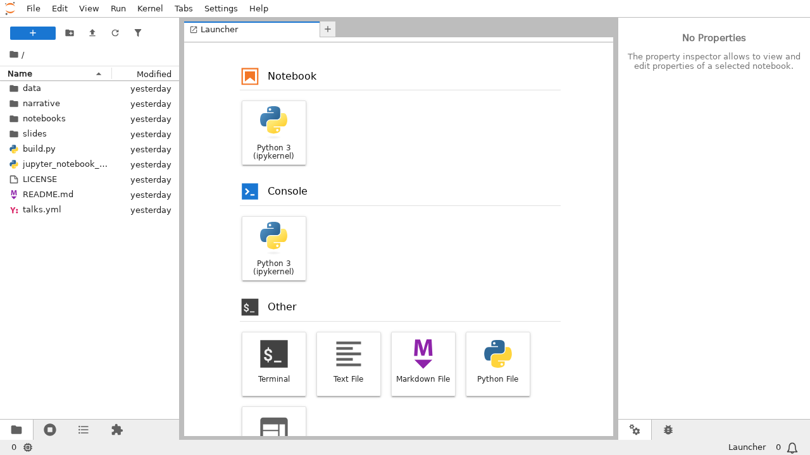

Sections of accordion sidebars can now be [moved between panels](https://jupyterlab.readthedocs.io/en/latest/user/interface_customization.html#move-accordion-sections-between-panels) via a context menu. Right-clicking a section header shows a "Move To" menu. The placement and collapsed state of moved sections are persisted across sessions.

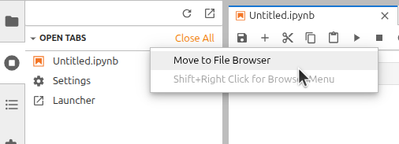

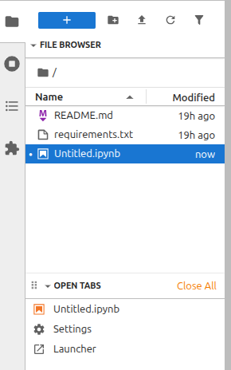

The sidebar panels themselves can be [moved between areas](https://jupyterlab.readthedocs.io/en/latest/user/interface_customization.html#move-open-widgets). Right-clicking a sidebar shows submenu with options to move it to the main area, a different sidebar, or the down area.

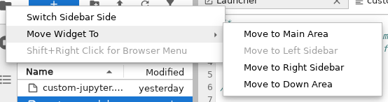

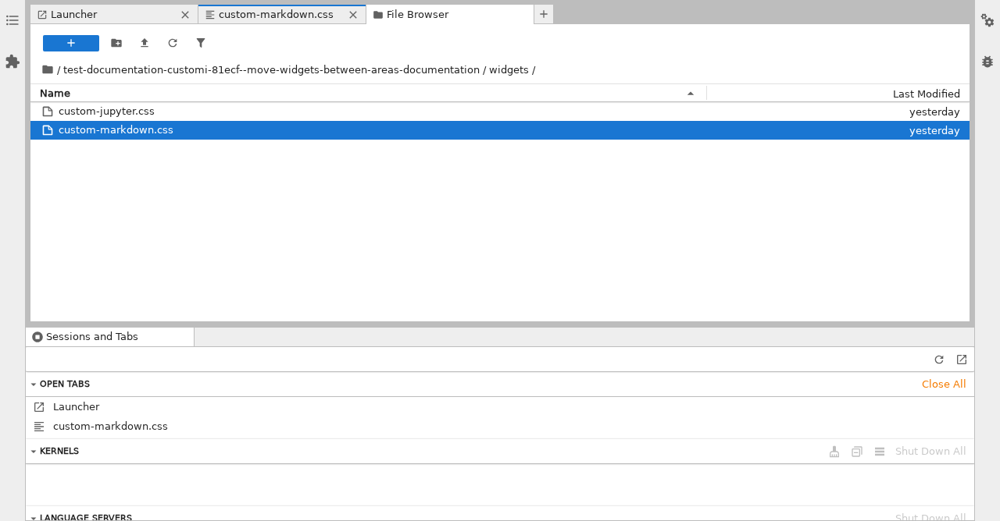

Tabs can now be split in four directions using the "Split Tab" context menu item (or the command palette), which adds split left, right, up, and down options.

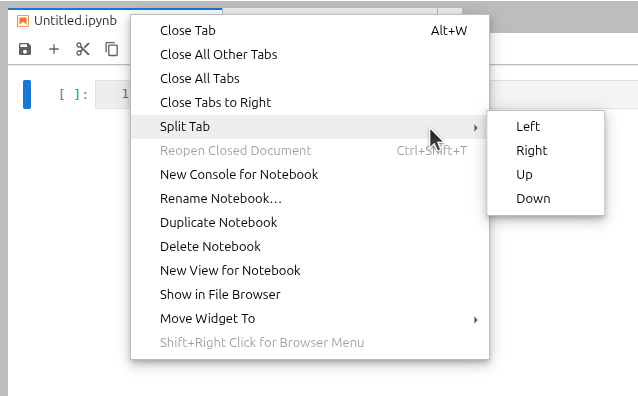

Individual panels can be zoomed in or out using <kbd>Ctrl</kbd> + mouse wheel (when "Enable Ctrl+ Scroll Zoom" is turned on in Settings → Interface) or via the command palette, without affecting other panels.

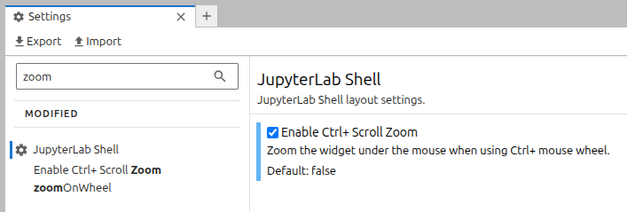

### Performance

Panel resizing is now more responsive; the width of individual widgets inside resized panels is frozen during the drag. This behaviour can be disabled by toggling "Optimize panel resize" in Settings → Application Shell.

### Notebook improvements

Two new navigation commands, "Select previous last modified cell" and "Select next last modified cell", allow jumping back and forward through recently edited cells. The commands are accessible from the Command Palette and as buttons in the [Table Of Contents](https://jupyterlab.readthedocs.io/en/latest/user/toc.html) toolbar when a notebook is active.

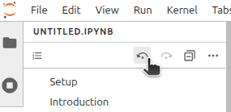

Copy, cut, and paste text commands have been added to the notebook context menu. This feature requires permission to access clipboard to work reliably and may not work in Firefox depending on version and additional restrictions.

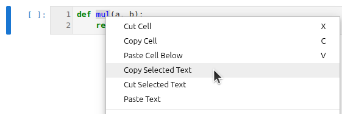

The cell toolbar delete button now shows a confirmation dialog to prevent accidental deletion. The "Do not ask me again" checkbox is available and the preference is persisted in [Cell Toolbar](https://jupyterlab.readthedocs.io/en/latest/user/notebook.html#cell-toolbar) settings. The standard keyboard shortcut (<kbd>D</kbd>, <kbd>D</kbd>) is unaffected.

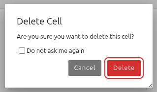

A new ["Paste code cells without output"](https://jupyterlab.readthedocs.io/en/latest/user/notebook.html#paste-code-cells-without-output) setting strips outputs and execution counts from code cells when pasting, producing clean cells without the output which may be stale or untrusted.

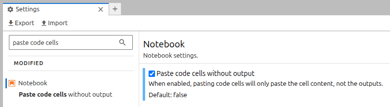

Pressing <kbd>Ctrl</kbd> + <kbd>B</kbd> (<kbd>Cmd</kbd> + <kbd>B</kbd> on macOS) in a markdown cell wraps the selected text in bold formatting.

When exporting a notebook as HTML via [File → Save and Export Notebook As → HTML](https://jupyterlab.readthedocs.io/en/latest/user/export.html), a dialog now asks whether to sanitize the HTML output before download.

### File browser enhancements

A new "Date Created" column has been added to the file browser, showing when files were created. The column can be toggled via Settings → File Browser → "Show date created column" or by right-clicking the column header. The latest `jupyter-server` (`v2.18`+) is required for accurate values across operating systems.

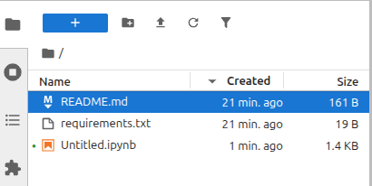

The breadcrumb bar now supports [direct path editing](https://jupyterlab.readthedocs.io/en/latest/user/files.html#editable-breadcrumbs) with tab-completion. Clicking the area behind breadcrumbs (highlighted on hover), or using the Command Palette, opens an editable text field where pressing Tab completes the longest common prefix of matching subdirectories.

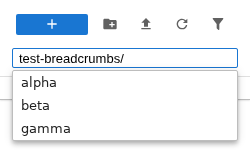

A new "Open in Terminal" option in the file browser context menu opens a terminal navigated to the selected directory. When multiple directories are selected, one terminal is opened per directory.

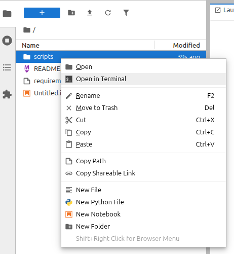

Additional file browser improvements include: a configurable [file name sort order](https://jupyterlab.readthedocs.io/en/latest/user/files.html#file-name-sort-order), persistence of the sort state across sessions, automatic clearing of the file filter when changing directories, and a loading animation during file browser refresh.

### Debugger improvements

The debugger Sources panel has been moved out of the debugger sidebar; the Sources now open as read-only editors in the main area, keeping the sidebar uncluttered while you [explore the code state](https://jupyterlab.readthedocs.io/en/latest/user/debugger.html#explore-the-code-state). The previous behavior can be restored by disabling the "Show Sources in Main Area" setting in the Debugger settings.

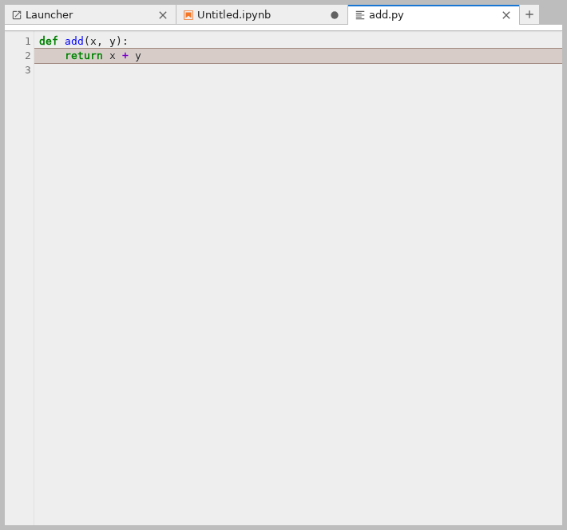

An overlay with continue/step in/stop buttons has been added easing the control of the debugger steps:

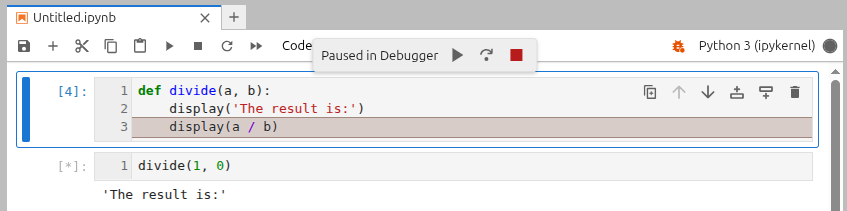

The Kernel Sources filter bar has been moved to the toolbar and now supports live filtering, making it easier to search through kernel source files while debugging.

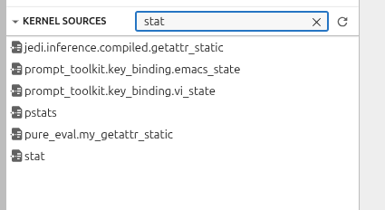

The refresh button for sources list was removed - the sources will now update automatically after each code execution.

### Keyboard navigation and accessibility

Keyboard navigation has been improved across several components:

- The terminal no longer traps keyboard focus, allowing users to move focus away with the keyboard.
- The console and file browser breadcrumbs both received keyboard navigation fixes.
- Focus is now correctly restored after closing the command palette, and input elements in dialogs opened from the command palette receive focus immediately.
- The find-and-replace button focus in the document search box has been corrected.

Screen reader behavior has been improved in the launcher and notebook. Toolbar buttons now correctly reflect their pressed state via the `aria-pressed` attribute.

The Keyboard Shortcuts settings panel has been updated to improve accessibility, including better keyboard interaction and screen reader announcements within the shortcuts editor dialog.

Focus indicators have been improved across the interface, including the status bar and other interactive components.

### Keyboard shortcuts

Shortcuts can now be added from the UI shortcut editor for any command (previously this required writing JSON in Advanced Settings Editor).

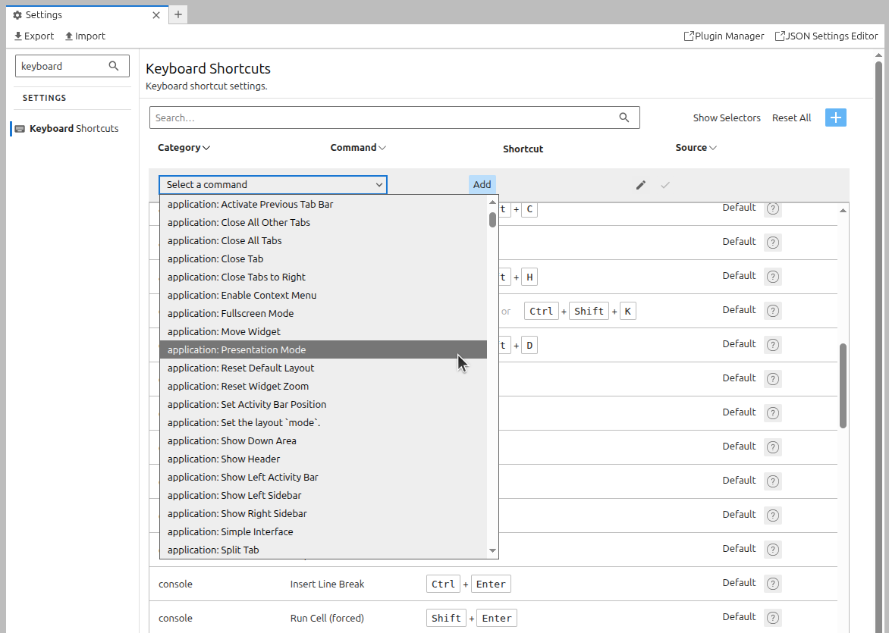

"Find and Replace" has been added to the Edit menu with the keyboard shortcut <kbd>Ctrl</kbd> + <kbd>H</kbd> (<kbd>Cmd</kbd> + <kbd>H</kbd> on macOS).

<kbd>Ctrl</kbd> + <kbd>Y</kbd> has been added as a redo shortcut on Windows and Linux.

Pressing <kbd>1</kbd>, <kbd>2</kbd>, <kbd>3</kbd>, <kbd>4</kbd>, <kbd>5</kbd> and <kbd>6</kbd> will no longer convert a focused code or raw cell to Markdown to avoid accidental conversions. These shortcuts continue working on markdown cells, switching the heading level, as they did before.

### Internationalization

Language packs can now be installed directly from within JupyterLab by selecting "Install more languages..." at the bottom of the Settings → Language menu. This opens the Extension Manager pre-filled with a search for available language pack extensions.

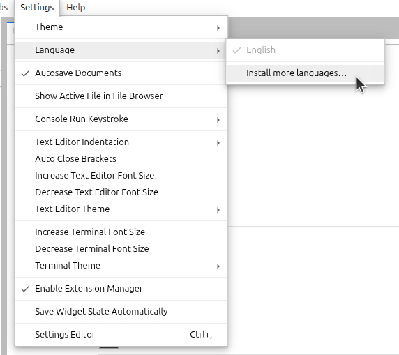

### Terminal enhancements

Pressing <kbd>Shift</kbd>+<kbd>Enter</kbd> in the terminal now inserts a newline without executing the current line. This matches the behavior expected by certain terminal applications.

### Inline completion enhancements

[Inline completion suggestions](https://jupyterlab.readthedocs.io/en/latest/user/completer.html#inline-completer) can now be rendered with syntax highlighting that matches the active editor language. This can be enabled in Settings → Inline Completer → "Ghost text syntax highlighting".


Ghost text is now also shown for all active cursors in a multi-cursor editing session.

### Miscellaneous

- Tab widths are kept frozen while the mouse pointer hovers over them, making it easier to close multiple tabs with the mouse
- Autocompletion heuristics were improved; the autocompletion (which remains opt-in) should no longer trigger in unexpected scenarios
- The output scroll overlay collapse icon is now visible regardless of the output size and scroll state
- The fonts used across components were standardized and fonts specified by themes or overrides are respected in every component of the application

## v4.5

JupyterLab 4.5 includes a number of new features (described below), bug fixes, and enhancements.
This release is compatible with extensions supporting JupyterLab 4.0.
Extension authors are encouraged to consult the [Extension Migration Guide](https://jupyterlab.readthedocs.io/en/latest/extension/extension_migration.html#jupyterlab-4-4-to-4-5) which lists deprecations and changes to the public API.

### Performance and windowing

The default windowing mode is now `contentVisibility` which improves cell rendering and
alleviates previously reported issues. The minimap can be enabled for all windowing modes
and all notebooks via the `Settings` menu, or by toggling the minimap per notebook with
the `View` -> `Show Minimap` option. Additional fixes improve layout containment and
scrollbar behavior when working with long cells.

### Notebook improvements

Saving large notebooks is now faster and more responsive thanks to streamed uploads
and users can now open notebooks without starting a kernel, via the `Open With`
context menu option.

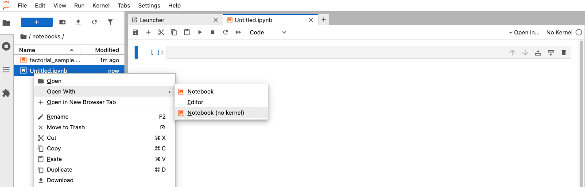

Markdown support has been expanded for using grid and flex based layouts and the
Table of Contents has been significantly improved to better handle markdown headings,
fixing issues with HTML tags, comments, and horizontal lines.

Copying and pasting cells across browser tabs is now supported and the "Line Wrap"
toggle in settings now correctly applies line wrapping to cells.

Other improvements include: restored scrolling to in-notebook links, manual
saving support in collaborative mode, and improved performance and memory usage
when streaming text outputs.

### Debugger and Console improvements

The debugger's evaluate dialog has been replaced with an interactive console with syntax
highlighting and code completion, and the variables panel now preserves its contents when
switching editors. Selected breakpoints are now visually highlighted and breakpoints
correctly handle empty lines and duplicate clicks. A visual indicator is displayed
when the debugger is paused.

Debugger panels as well as console debugging panels now reference the cell execution count
helping users relate breakpoints, call stacks and source code to the cells they originate
from.

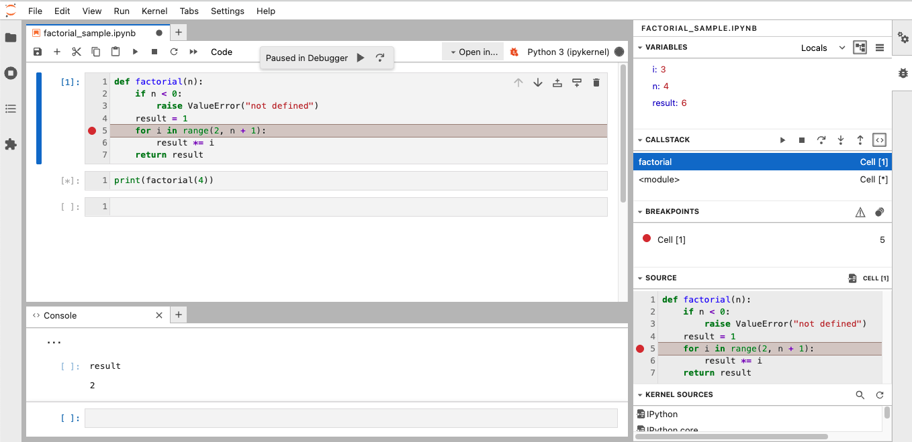

For the Log Console, users can now configure the default log level via settings,
as well as customise the toolbar.

### Terminal enhancements

The terminal now includes search functionality, with search highlights that adapt to
theme changes.

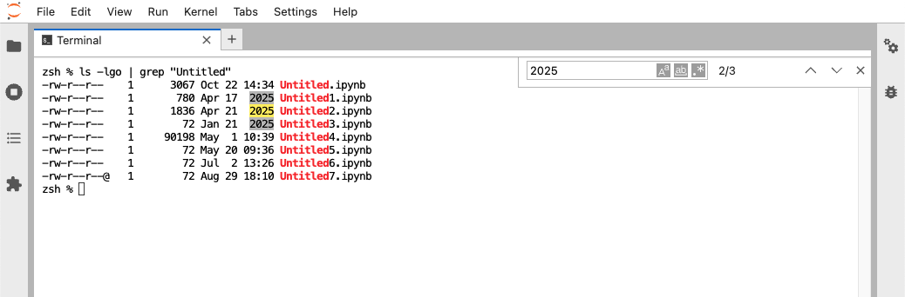

### Media and content support

JupyterLab now includes built-in audio and video viewers, allowing users to open
audio and video files directly from within JupyterLab.


### File browser enhancements

Uploaded files can auto-open, with controls for size limits and behavior, and
a new `allowFileUploads` setting provides control over upload permissions.

There is now a menu option for creating new Python, R, or Julia files,
and a “Select All” command has also been added, also accessible via the
`Ctrl + A` keyboard shortcut.

Users can now configure file browser breadcrumbs through the settings editor
options `breadcrumbsLeftItems` and `breadcrumbsRightItems`.

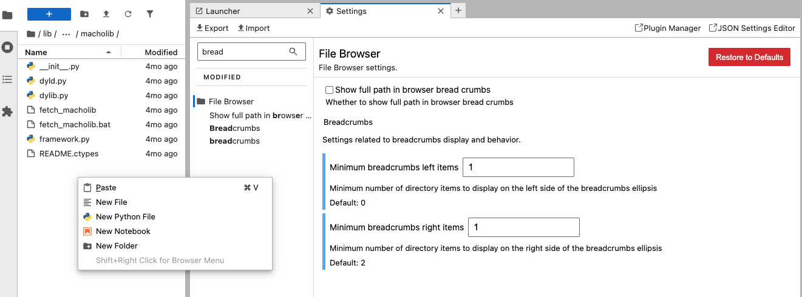

Updates to file dialogs and navigation have addressed column spacing,
preferred-directory handling and double-click behavior.

### Keyboard shortcuts and commands

Code fold and unfold commands have been added and shortcuts for these can be
set in the settings editor.

The “Show Workspace Indicator” command has been added to the command palette
and the “Send Code to Console” shortcut has been restored. The previous issue
involving editing shortcuts on Safari losing focus, has been resolved.

### Settings

The settings editor now supports a `toSkip` configuration to hide
specific plugins from view.

A new setting, `addExtraLineOnCellMerge`, allows to remove the extra line added
when merging cells, which is expected behavior based on the classic notebook.

### User interface and accessibility

JupyterLab can now automatically switch between light and dark themes when
“Synchronize with System Settings” is enabled.

Dialog components display buttons and checkboxes on separate lines for better
readability, and selections in the terminal under high-contrast themes have
better visibility.

Keyboard navigation and tab order in the status bar has also been improved.

## v4.4

JupyterLab 4.4 includes a number of new features (described below), bug fixes, and enhancements.
This release is compatible with extensions supporting JupyterLab 4.0.
Extension authors are encouraged to consult the [Extension Migration Guide](https://jupyterlab.readthedocs.io/en/latest/extension/extension_migration.html#jupyterlab-4-3-to-4-4) which lists deprecations and changes to the public API.

### Code console improvements

The code console prompt can now be positioned on the top, left, or right side of the console,
in addition to the default bottom placement. The placement is persisted in the Prompt Cell
Position setting.

The console toolbar now includes buttons to:
- Execute code
- Restart the kernel
- Clear the cells
- Switch the kernel

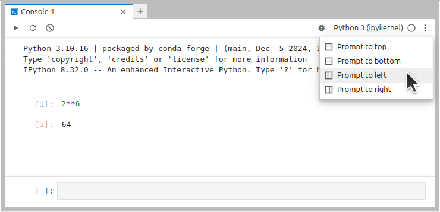

Additional settings for console behavior have been added:
- Clear Code Content on Execute (enabled by default) – When disabled, the code submitted for execution remains in the code editor, allowing for further edits.
- Hide Code Input – When enabled, only the execution output is shown in the console.
- Clear Cells on Execute – When enabled, only the last cell is displayed.

Toggling all the three new settings transforms the console into an interactive editor
resembling an ephemeral notebook with a single cell.

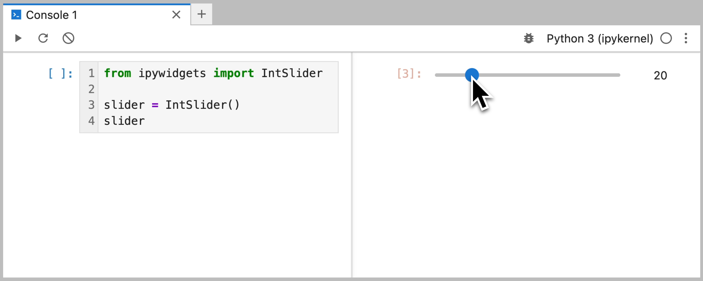

### Settings import and export

Settings can now be exported to `overrides.json` from the Settings Editor,
which can be used to pre-configure defaults in deployments or to restore settings.

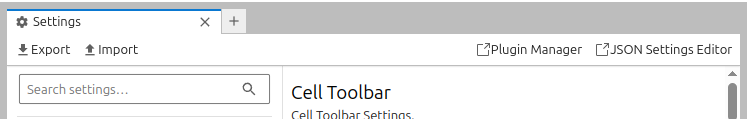

### Workspace indicator

An opt-in workspace indicator is displayed on the top bar (next to the menu bar). It can be enabled
in the Settings → View → Appearance → Show Workspace Indicator.

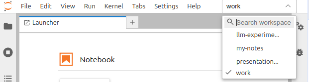

### Support for collaboration without `RTC:` drive

Real time collaboration in previous versions of JupyterLab
(which can be enabled by installing jupyter-collaboration package)
was implemented by swapping the default JupyterLab file system
drive to a collaborative drive with the `RTC:` prefix.
This approach was incompatible with multiple extensions.
JupyterLab 4.4 introduces the Content Providers API, which allows the next version of `jupyter-collaboration` to work without changing the drive prefix.
This improves compatibility with extensions that do not support arbitrary drives.

### Kernel subshells support

Kernel subshells, introduced in [JEP 91](https://jupyter.org/enhancement-proposals/kernel-subshells/),
enable concurrent code execution in kernels that support them.
When performing long-running computations (such as training a model), subshells enable users to:
- Use `ipywidgets` with updates displayed immediately
- Monitor kernel resource usage (e.g. memory usage)
- Invoke arbitrary commands (e.g., refine code for a subsequent cell) while maintaining live access to previously defined variables

Subshells are supported by `ipykernel` 7 (currently in alpha).

To create a subshell, open context menu (right-click)
over a notebook using a kernel supporting subshells
and select "New Subshell Console for Notebook".
A new console panel will open allowing access to variables from the main session.

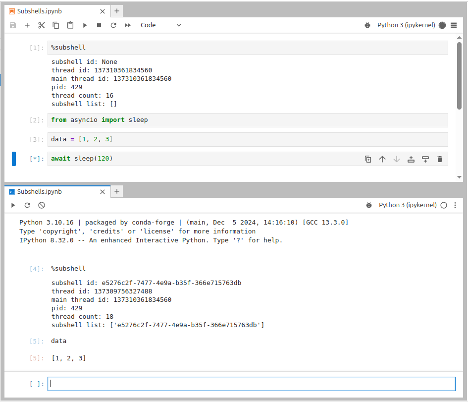

JupyterLab can automatically create subshells for comm messages if kernels support this feature.
This enables concurrent execution of `ipywidgets` callbacks without requiring a user action.
This behavior can be changed from the settings, with options to:
- disable that feature to not use subshells for comms
- (default) automatically create one subshell per comm-target (e.g. one subshell for all `ipywidgets`)
- automatically create one subshell per comm (this can lead to issues if creating many comms)

### Context menu opt-out

The context menu, available under right mouse click in browsers, can now be disabled globally
by toggling the `Enable Context Menu` option available in the Command Palette,
or via the JSON Settings Editor in the Application Context Menu.

### Slimmer status bar

The terminals counter no longer appears in the status bar if no terminals are open.
The kernels counter can be disabled by toggling the "Show the status bar item" setting
in "Running Terminals and Kernels" (code name `showStatusBarItem`).

## v4.3

JupyterLab 4.3 includes a number of new features (described below), bug fixes, and enhancements.
This release is compatible with extensions supporting JupyterLab 4.0.
Extension authors are recommended to consult the [Extension Migration Guide](https://jupyterlab.readthedocs.io/en/latest/extension/extension_migration.html#jupyterlab-4-2-to-4-3) which lists deprecations and changes to the public API.

### Minimap

The virtual scrollbar now acts as a minimap and exposes information on whether a cell:

- is running/scheduled (`[*]`), idle (`[ ]`) or was already run (e.g. `[1]`)
- was modified since it was last executed ("dirty") - orange background
- has an output that contains an error - red background
- is markdown/code (`[ ]`/`[*]`/`[1]` for code, nothing for markdown)
- how much text/code it contains

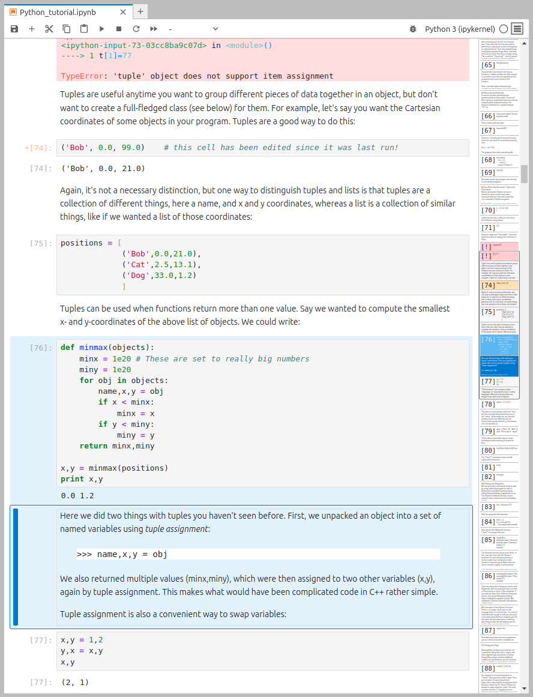

To enable the minimap, click on the hamburger icon (≡) which appears in the notebook's toolbar. If you do not see the hamburger icon, go to Settings → Notebook → Windowing mode and choose "full".

### Fullscreen mode

JupyterLab now offers two ways to toggle the full screen mode from within the application:
- using the `View` → `Appearance` → `Fullscreen Mode` menu entry
- using a customizable shortcut, by default <kbd>F11</kbd> (custom shortcuts are supported in Chrome, Safari and Edge)

### File browser enhancements

The file browser now:
- supports resizing the columns and remembers the column sizes after reloading JupyterLab
- supports uploading folders by drag-and-drop
- supports navigation with a single click (opt-in)
- has the file filter collapsed by default (funnel icon), increasing the space available

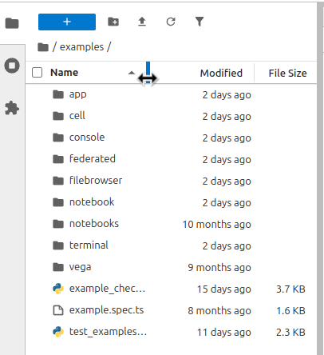

### Server-side execution and collaboration

JupyterLab 4.2 added the option for extensions to implement server-side execution, which preserves
outputs created when the browser window is closed or disconnected.
The server-side execution builds on the same shared models API as the real-time collaboration (RTC).

This release includes additional work, improving both
the server-side execution and real-time collaboration (RTC) use cases:
- the intermediary state of streaming outputs is now optimized away preventing a memory leak when using shared models with long-running computations,
- the cell execution indicator (`[*]`) is now synchronized in the model, allowing collaborators to see that a cell is executed, and allowing server-side execution extensions to populate the state accordingly,
- the issue of spurious "File Change" dialog on save was addressed by enabling the collaborative models extension to update the document hash.

You can try these features by installing extensions:
- [`jupyter-server-nbmodel`](https://github.com/datalayer/jupyter-server-nbmodel)\* provides server-side execution for `jupyter-server`,
- [`jupyter-collaboration`](https://github.com/jupyterlab/jupyter-collaboration) provides the real-time collaboration features,
- [`jupyverse`](https://github.com/jupyter-server/jupyverse) is an alternative server (a replacement for `jupyter-server`) which supports server-side execution.

\* while `jupyter-server-nbmodel` is developed by maintainers of JupyterLab, as of the JupyterLab 4.3.0 release date it is not an official Project Jupyter extension.

### Improved kernel and server interactions

The previous release enabled connecting to external kernels, such as those spawned by a third-party application like Blender.
In this release the kernel selector dialog was improved to also show the external kernels.

The previous release improved the awareness of the kernel/kernel specification distinction by providing both tree and list view in the kernels sidebar panel, but only the tree view featured the kernel identifiers.
In this release both the list and tree view show the kernel identifier stub.

A new toolbar button was added in the kernel allowing to shut down unused kernels (kernels with no widget attached).

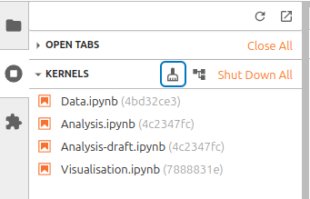

The following dialog windows can now be dismissed or silenced:
- the "Server Connection Error" dialog now has an option to dismiss it for the duration of the session,
- the "Restart Kernel?" dialog now has an option to not ask again. This preference is persisted in settings ( `skipKernelRestartDialog`),

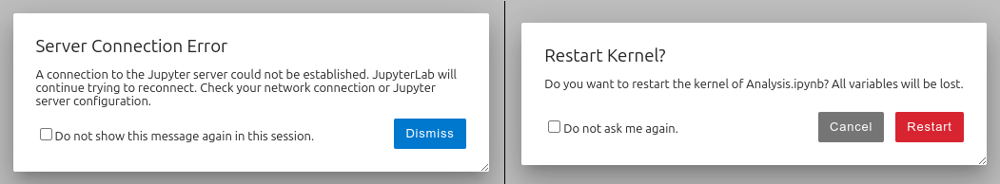

## v4.2

### Workspaces UI

It is now possible to switch and manage [workspaces](https://jupyterlab.readthedocs.io/en/latest/user/workspaces.html) from within JupyterLab.

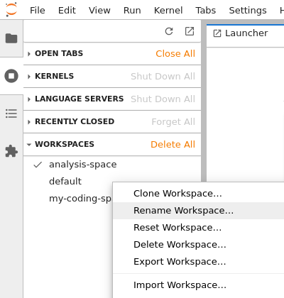

### Recently opened/closed files

The [jupyterlab-recents](https://github.com/jupyterlab-contrib/jupyterlab-recents) extension was integrated into JupyterLab.

Users are now able to:

- re-open recently used files from the main menu:

   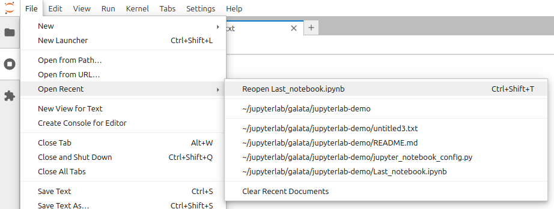

- re-open recently closed files from the sidebar:

   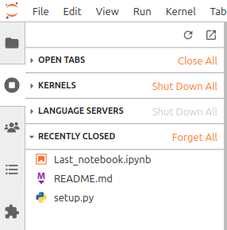

- quickly jump to open tabs/recently closed files by using a new searchable modal dialog (press <kbd>Ctrl</kbd>+<kbd>Alt</kbd>+<kbd>A</kbd> to open the dialog, or click on the \[↗\] icon in the sidebar):

   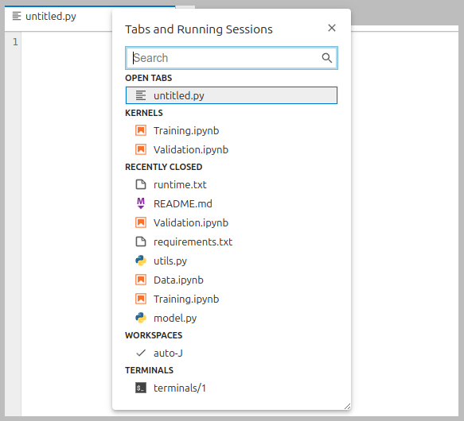

### Full notebook windowing mode by default

Notebooks in the `full` windowing mode only render the visible cells, significantly improving the performance of the application. One limitation of `full` mode is that the search function in your browser may produce false negatives; using the [JupyterLab search function](https://jupyterlab.readthedocs.io/en/latest/user/interface.html#searching) is recommended. To revert to the behaviour from JupyterLab 4.1, go to Settings → Settings Editor → Notebook, scroll to "Windowing mode", and choose `defer`.

### Improved Shortcuts Editor

Among the numerous improvements and bug fixes for the keyboard shortcuts editor:

- it is now possible to remove the default shortcuts,
- shortcuts are correctly sorted when using a language pack,
- shortcuts with different arguments are now correctly displayed as individual entries.

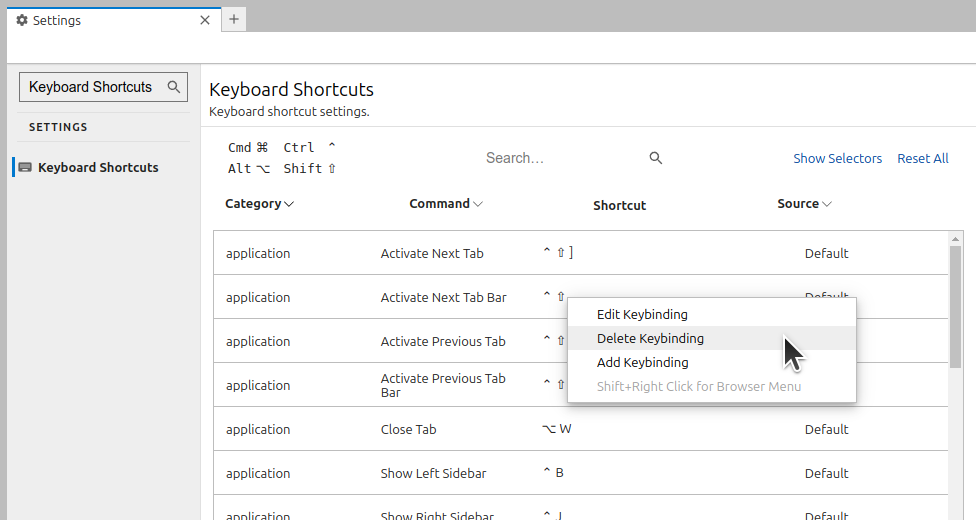

### Dark high contrast theme

A new theme, JupyterLab Dark High Contrast, which is intended to benefit users with the need for higher contrast, following the WCAG AAA accessibility standard for color contrast.
To select this theme, from the menu bar, choose Settings → Theme → JupyterLab Dark High Contrast. Please provide feedback and suggestions on further improvements to this theme.

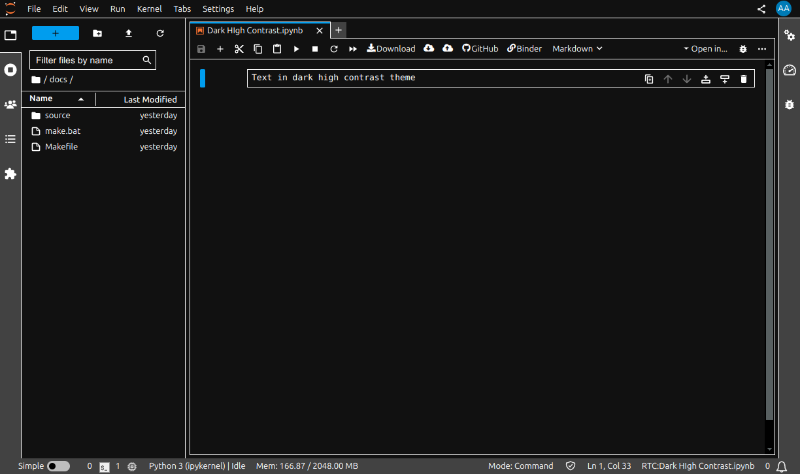

### Keyboard shortcuts improvements

Following feedback from users, implementation of certain shortcuts was moved from the CodeMirror editor to JupyterLab shortcut system, allowing for better integration:

- the shortcut for deleting a line was restored to <kbd>Ctrl</kbd>+<kbd>D</kbd> as in JupyterLab 3.x; the shortcut for extending (multi-cursor) selection was remapped to <kbd>Ctrl</kbd>+<kbd>Shift</kbd>+<kbd>D</kbd>. The <kbd>Ctrl</kbd>+<kbd>Shift</kbd>+<kbd>K</kbd> shortcut can also be used for deleting lines for compatibility with other editors.
- the shortcuts for toggling line comments (by default <kbd>Ctrl</kbd>+<kbd>/</kbd>) and block comments (by default <kbd>Alt</kbd>+<kbd>A</kbd>) can be customized in the Shortcuts Editor, enabling users of non-US keyboards to adjust the keybinding to one optimal on their keyboard layout. Please note that the block comment only works in languages which have a dedicated block comment syntax defined in the CodeMirror language data (e.g. C, JavaScript, but not Python). The line comment shortcut can be also used to comment out multiple lines.

## v4.1

JupyterLab 4.1 includes a number of new features (described below), bug fixes, and enhancements for extension developers. This release is compatible with extensions supporting JupyterLab 4.0. Extension authors are recommended to consult the [Extension Migration Guide](https://jupyterlab.readthedocs.io/en/latest/extension/extension_migration.html#jupyterlab-4-0-to-4-1) which lists deprecations and changes to the public API.

### Custom CSS

JupyterLab now supports automatic loading of custom CSS.
Themes are the recommended way for customizing the JupyterLab look and feel,
while custom CSS is intended for minor personal adjustments.

To opt in, start JupyterLab with the `--custom-css` flag.
The location of the `custom.css` file is documented in the section on [customizing the user interface](https://jupyterlab.readthedocs.io/en/latest/user/interface_customization.html#custom-css).

```{note}
`custom.css` is also available in Jupyter Notebook;
while similar selectors can be used for components shared between JupyterLab 4.1 and Jupyter Notebook 7.0,
there was a different set of selectors in Notebook 6 and older versions.
Users with the custom CSS file using the selectors from legacy Notebook versions
will need to update them and note that tutorials may refer to the selectors for the old Notebook versions.
```

### Diagrams in Markdown

Matching GitHub-Flavoured Markdown, JupyterLab 4.1 now supports [Mermaid](https://github.com/mermaid-js/mermaid) diagrams.
To create a mermaid diagram use the `mermaid` language specifier for a code block in a markdown cell or document, for example:

~~~
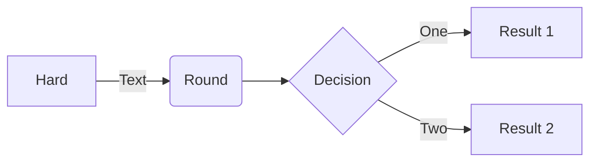
~~~

which renders as:

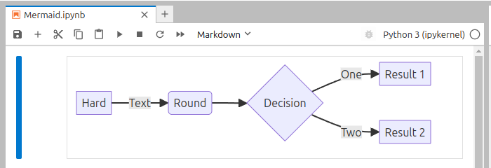

### Inline completer

JupyterLab now supports completion presented as ghost text in the cell and file editors,
allowing generative AI models to provide multi-line completions.
The suggestions are provided by plugins implementing the ``IInlineCompletionProvider`` API;
by default a single provider which uses kernel history is available.


The suggestions can be invoked as-you-type or manually using a configurable shortcut (by default <kbd>Alt</kbd> + <kbd>\\</kbd>).
The default keyboard shortcuts are displayed in the small widget shown when hovering over the ghost suggestion:
- <kbd>Alt</kbd> + <kbd>End</kbd> - accept suggestion
- <kbd>Alt</kbd> + <kbd>[</kbd> - previous suggestion
- <kbd>Alt</kbd> + <kbd>]</kbd> - next suggestion

To enable the inline suggestions based on the kernel history, go to Settings → Inline Completer → History provider → check the "enabled" checkbox.

In addition to the built-in history suggestions,
the [`jupyter-ai`](https://github.com/jupyterlab/jupyter-ai) extension can provide
suggestions from supported models.
The `jupyter-ai` integration with inline completer is available starting with the
[v2.10.0](https://github.com/jupyterlab/jupyter-ai/releases/tag/v2.10.0) release.

The Inline Completer API is still considered experimental and may be subject to changes, please share feedback!

### Keyboard navigation improvements

Numerous improvements to keyboard navigation with focus on accessibility and usability are included in this release:
- the notebook cells now retain focus
- the focus can now be moved beyond the active notebook
- the toolbars can now be navigated using arrow keys

For more details, see [this post on the Jupyter Blog](https://blog.jupyter.org/recent-keyboard-navigation-improvements-in-jupyter-4df32f97628d).

### Execution history in notebook

The code from previously executed cells can be used to populate empty cells,
allowing to iterate on code from previous cells or even previous sessions
(depending on how a specific kernel stores history).

To cycle between history items, press <kbd>Alt</kbd> + <kbd>Arrow Up</kbd> and  <kbd>Alt</kbd> + <kbd>Arrow Down</kbd>.

To enable execution history, go to Settings → Notebook → check the "Kernel history access" checkbox.

This feature was already available in the console in previous releases; it only works with kernels supporting execution history requests.
To clear the execution history, consult the documentation of the kernel you are using (e.g., IPython/ipykernel).

### Opening files from tracebacks

Paths to code files detected in tracebacks returned by kernels on execution error are now turned into links.
These links will open the corresponding file for editing, if it is in the Jupyter root directory,
or they will open a read-only preview if the file is outside of the root directory and the active kernel supports the debugger.

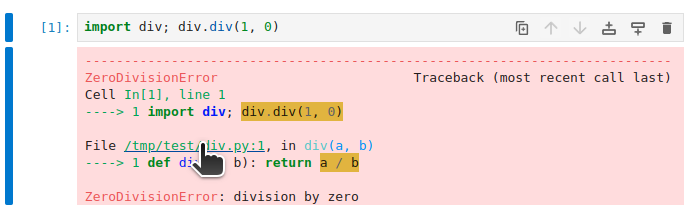

### Error indicator in the table of contents

When a cell fails during execution, an error indicator will be displayed by the corresponding heading,
increasing awareness of the notebook state and enabling users to quickly navigate to the cell which requires attention.

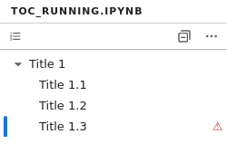

### Plugin Manager

Individual plugins can now be disabled or enabled from a new Plugin Manager user interface.
Each extension is composed of one or more plugins, and plugins form the basis of JupyterLab itself,
thus the plugin manager enables more extensive customization of the JupyterLab experience.


This feature is intended for advanced users and is documented in depth in the [documentation](https://jupyterlab.readthedocs.io/en/latest/user/extensions.html#managing-plugins-with-plugin-manager).

Administrators may want to [lock specific plugins](https://jupyterlab.readthedocs.io/en/latest/user/extensions.html#locking-and-unlocking-plugins) if they are required for any reason; this will prevent users from disabling the plugins via Plugin Manager and remote API calls. The Plugin Manager itself can be [disabled using the CLI](https://jupyterlab.readthedocs.io/en/latest/user/extensions.html#enabling-and-disabling-extensions).

### Virtual scrollbar for notebook in windowed mode

The windowed notebook received an optional scrollbar delineating the active cell and selected cells.
Users can jump to a specific cell.

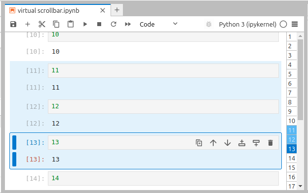

To enable the virtual scrollbar, go to Settings → Notebook → Windowing mode, choose "full", and click on the hamburger icon (≡) which appears in the notebook's toolbar.

Virtual scrollbar is considered experimental, please share feedback!

### Notifications

JupyterLab 3.6 added a notification center which so far was only used for announcements and version update notifications (both opt-in).
JupyterLab 4.1 adds two notifications to guide users in potentially confusing situations:
- when a user attempts to save a read-only document, a transient notification suggesting using "save as" is displayed
- when a user attempts to execute a cell before a slow-starting kernel has initialized, a notification is shown to indicate that the cell cannot be yet executed (this is opt-in and needs to be enabled in settings)

### Full notebook windowing mode improvements

Notebooks in the `full` windowing mode only render the visible cells, significantly improving the performance of the application.
Numerous improvements for the full windowing mode behaviour (such as scrolling, search, rendering, and navigation) are included in this release (see the list of issues in [#15258](https://github.com/jupyterlab/jupyterlab/issues/15258) for details).

```{note}
The windowing mode is still experimental and known issues remain to be solved
([#15415](https://github.com/jupyterlab/jupyterlab/issues/15415), [#15465](https://github.com/jupyterlab/jupyterlab/issues/15465),  [#15594](https://github.com/jupyterlab/jupyterlab/issues/15594)).
In addition, a sporadic regression in cell ordering ([#15610](https://github.com/jupyterlab/jupyterlab/issues/15610)) was observed in 4.1 beta,
and remains to be fixed, pending reports from users willing to test the windowing mode in JupyterLab 4.1 to help create reproducible steps that would enable fixing this issue.

Users who already enabled this mode in previous versions are advised to evaluate the benefits of fixes included in 4.1 against regressions linked above before deciding to upgrade.
```

### Search improvements
- The search box will now grow automatically to accommodate longer text
- Search in selection can now be toggled using <kbd>Alt</kbd> + <kbd>L</kbd> and automatic search in selection can be configured in settings
- Tooltips with shortcuts were added to the buttons in the search box to improve discoverability of the shortcuts

### Miscellaneous
- The current theme (dark/light) can now be synced with the browser/system preference (Settings menu → Theme → Synchronise with System Settings)
- A blue "read-only" status indicator is now  displayed in the toolbar of documents which cannot be saved because their model is read-only.
- Native support for viewing jsonl/ndjson files was added
- Collapsing of breadcrumbs in the File Browser can be disabled in File Browser settings
- Extension manager can now use a HTTP proxy for fetching extensions

### Moved plugins

Some internal JupyterLab plugins have been re-organized to allow for better flexibility for deployments and downstream applications like Notebook 7. This might affect users that disable specific plugins with the `jupyter labextension disable` command or the `disabledExtensions` config option.

- The `help:open` command is not defined in the `@jupyterlab/help-extension:resources` plugin anymore, but has been moved to a new `@jupyterlab/help-extension:open` plugin instead.

## v4.0

### 4.0.0 - Highlights

Below are the major highlights in JupyterLab 4.0.0.

#### New text editor

CodeMirror, the text editor used for cells and file editors, has been updated to [CodeMirror 6](https://codemirror.net/). This brings important
accessibility and performance improvements as well as better customization capabilities.
We have also improved the editor settings. Previously, users had to customize settings separately for each type of cell, the file editor, and the console editor. Now, you can change your settings in one place. It is now easier to use the default settings for all editors and to change some settings for specific cases. For example, you can now hide line numbers only for markdown cells.

Developers can now provide editor extensions, like themes and programming language parsers, through new application registries.

#### New extension manager

Starting with JupyterLab 3, extensions can be installed via Python packages
(or other providers of [prebuilt extensions](https://jupyterlab.readthedocs.io/en/latest/extension/extension_dev.html#prebuilt-extensions)).

In JupyterLab 4, building on this feature, the Extension Manager now includes extensions from [pypi.org](https://pypi.org/search/?c=Framework+%3A%3A+Jupyter+%3A%3A+JupyterLab).
This removes the build step from installation of extension when using Extension Manager.

Developers can provide an alternative package repository to display their own set of extensions.

#### Improved document search

The Search and Replace functionality has been improved with new features when searching in a notebook:

- Highlight matches in rendered markdown cells
- Search in selection
- Multi-line search
- Replace using regex capture-group references
- Replace while preserving case

#### UI improvements

Some new elements have been added or changed in the UI:

- Rework the running kernels section
- "Add a new cell" button at the bottom of a notebook
- Dialog to display keyboard shortcuts as in the Classic Notebook (use <kbd>Ctrl</kbd> + <kbd>Shift</kbd> + <kbd>H</kbd>)
- Display the first line of cell input and outputs when they are collapsed

#### Accessibility improvements

JupyterLab is not yet fully accessible. Currently, we are focused on making Notebook 7 accessible.
A big part of the code is shared, though, and the following accessibility improvements are in JupyterLab 4:

- Improved focus and keyboard navigation in the file browser
- More ARIA roles and labels were added to UI elements
- Main menu collapses to a hamburger menu if there is not enough space to display all items.

#### Performance enhancements

JupyterLab is now faster, thanks to the following improvements:

- CSS rules optimization: CSS selectors have been optimized to improve web browser performance when many elements are present on a page.
- Upgrade to CodeMirror 6: Especially for notebooks with many cells, the new CodeMirror version is far more efficient than the previous version. Large notebooks should load more quickly.
- Upgrade to MathJax 3: The mathematical equations renderer library has been been upgraded from v2 to v3 allowing faster rendering.
- Notebook windowing: By rendering only the parts of a notebook that fit in the web browser viewport, JupyterLab is much more efficient. See an important note below.

Notebook windowing _might_ add side effects for example if some cell outputs are displaying [iframes](https://developer.mozilla.org/en-US/docs/Web/HTML/Element/iframe). Therefore it is not yet the default value. But we recommend user to switch to it and report bugs to help us polish it. To test it, you
need to set the user setting _Notebook_ > _Windowing mode_ to `full`.  If you have issues with notebook rendering, try changing back to `defer` or `none`. (`none` should be used as a last resort, because it disables all optimizations.)

#### Real Time Collaboration

JupyterLab 3.6 already made significant improvements to the Real Time Collaboration (RTC) feature.
The feature is now in a separate repository: [jupyter_collaboration](https://github.com/jupyterlab/jupyter_collaboration).
The rationale is to limit the dependencies for users who don't need RTC. Separating RTC also helps organizations using JupyterLab that do not meet the specific requirements regarding file content management.

To enable RTC, install the `jupyter-collaboration` package with either `pip` or `conda`.

- with pip: `pip install "jupyter-collaboration>=1.0.0a0"`
- with conda: _not yet available_

RTC highlights in the standalone `jupyter-collboration` package, version 1.0.0, include:

- Support for displaying multiple cursors and selections
- Support for registration of new shared model types

#### For developers

Here are the main tool updates that will benefit extension authors and developers:

- TypeScript v5
- Yarn v3
- React v18
- Lumino v2

We recommend using Node.js v18 or newer, because older versions will reach end of life in 2023 or earlier (see [Node release schedule](https://github.com/nodejs/release#release-schedule)).

To ease code migration to JupyterLab 4, developers should review the [migration guide](https://jupyterlab.readthedocs.io/en/latest/extension/extension_migration.html). A few existing extensions have already been migrated and can be used as examples:
- the [JupyterLab Extensions by Examples](https://github.com/jupyterlab/extension-examples/pull/232)
- the [Jupyter MIME type renderers](https://github.com/jupyterlab/jupyter-renderers/pull/296)

<!-- <START NEW CHANGELOG ENTRY> -->

## 4.7.0b1

([Full Changelog](https://github.com/jupyterlab/jupyterlab/compare/v4.7.0b0...ca6210d371e287beb3735824a931824cc0048125))

### API and Breaking Changes

- Stop JupyterLab at startup when a config file has an error [#20000](https://github.com/jupyterlab/jupyterlab/pull/20000) ([@Rmaawn](https://github.com/Rmaawn), [@MUFFANUJ](https://github.com/MUFFANUJ), [@krassowski](https://github.com/krassowski))

### New features added

- Support recently used commands in the command palette [#19175](https://github.com/jupyterlab/jupyterlab/pull/19175) ([@jtpio](https://github.com/jtpio), [@MUFFANUJ](https://github.com/MUFFANUJ), [@krassowski](https://github.com/krassowski))

### Enhancements made

- Show an error dialog when opening a missing local file from rendered Markdown [#20396](https://github.com/jupyterlab/jupyterlab/pull/20396) ([@Yash990-bit](https://github.com/Yash990-bit), [@krassowski](https://github.com/krassowski))
- Add a default delimiter setting to the CSV viewer [#20352](https://github.com/jupyterlab/jupyterlab/pull/20352) ([@dgesteves](https://github.com/dgesteves), [@Artemis4777](https://github.com/Artemis4777), [@krassowski](https://github.com/krassowski))
- Open directory links from rendered Markdown in the file browser [#20317](https://github.com/jupyterlab/jupyterlab/pull/20317) ([@Ashraya77](https://github.com/Ashraya77), [@krassowski](https://github.com/krassowski))
- Consult the server authorizer in the lab API handlers [#20072](https://github.com/jupyterlab/jupyterlab/pull/20072) ([@Yagnik-Trivedi](https://github.com/Yagnik-Trivedi), [@MUFFANUJ](https://github.com/MUFFANUJ), [@claude](https://github.com/claude), [@krassowski](https://github.com/krassowski))
- Avoid rescanning notebook trust state on source edits [#19527](https://github.com/jupyterlab/jupyterlab/pull/19527) ([@MUFFANUJ](https://github.com/MUFFANUJ), [@krassowski](https://github.com/krassowski))
- Add R operator shortcuts [#19220](https://github.com/jupyterlab/jupyterlab/pull/19220) ([@Whning0513](https://github.com/Whning0513), [@MUFFANUJ](https://github.com/MUFFANUJ), [@krassowski](https://github.com/krassowski))
- Commit metadata editor changes when saving with Accel S [#19188](https://github.com/jupyterlab/jupyterlab/pull/19188) ([@JoeyAsh96](https://github.com/JoeyAsh96), [@MUFFANUJ](https://github.com/MUFFANUJ), [@krassowski](https://github.com/krassowski))
- Add an `open-with` query parameter to `/tree` URLs to choose the viewer [#19150](https://github.com/jupyterlab/jupyterlab/pull/19150) ([@MUFFANUJ](https://github.com/MUFFANUJ), [@jtpio](https://github.com/jtpio), [@krassowski](https://github.com/krassowski))
- Reuse terminal tab titles in the Running sidebar [#19138](https://github.com/jupyterlab/jupyterlab/pull/19138) ([@MUFFANUJ](https://github.com/MUFFANUJ), [@jtpio](https://github.com/jtpio), [@krassowski](https://github.com/krassowski))
- Change default setting of read-only Markdown cells to hide source code [#19052](https://github.com/jupyterlab/jupyterlab/pull/19052) ([@DenisaCG](https://github.com/DenisaCG), [@SylvainCorlay](https://github.com/SylvainCorlay), [@krassowski](https://github.com/krassowski))
- Improve undo behavior for deleted running cells [#18977](https://github.com/jupyterlab/jupyterlab/pull/18977) ([@MUFFANUJ](https://github.com/MUFFANUJ), [@Darshan808](https://github.com/Darshan808), [@krassowski](https://github.com/krassowski))
- Completions in Debugger Console: faster, support more than Python, more reliable [#18948](https://github.com/jupyterlab/jupyterlab/pull/18948) ([@krassowski](https://github.com/krassowski), [@MUFFANUJ](https://github.com/MUFFANUJ))
- Enable drag-to-reorder for all `SidePanel` accordion sections [#18933](https://github.com/jupyterlab/jupyterlab/pull/18933) ([@soniya-malviy](https://github.com/soniya-malviy), [@MUFFANUJ](https://github.com/MUFFANUJ), [@krassowski](https://github.com/krassowski))
- Show the top of a long cell after command-mode navigation [#18558](https://github.com/jupyterlab/jupyterlab/pull/18558) ([@imagickAI](https://github.com/imagickAI), [@Darshan808](https://github.com/Darshan808), [@krassowski](https://github.com/krassowski), [@michaeldoron59](https://github.com/michaeldoron59))
- Style the `stdin` input to match with `ipywidgets` appearance [#18327](https://github.com/jupyterlab/jupyterlab/pull/18327) ([@vansh2308](https://github.com/vansh2308), [@KH-Coder865](https://github.com/KH-Coder865), [@SylvainCorlay](https://github.com/SylvainCorlay), [@krassowski](https://github.com/krassowski))
- Add keyboard shortcuts to switch main area tabs by index [#18293](https://github.com/jupyterlab/jupyterlab/pull/18293) ([@MUFFANUJ](https://github.com/MUFFANUJ), [@Darshan808](https://github.com/Darshan808), [@itsmevichu](https://github.com/itsmevichu), [@jasongrout](https://github.com/jasongrout), [@krassowski](https://github.com/krassowski))
- Group Kernel Sources by package in a collapsible tree, with Open and Copy Path in the context menu [#18092](https://github.com/jupyterlab/jupyterlab/pull/18092) ([@arjxn-py](https://github.com/arjxn-py), [@Darshan808](https://github.com/Darshan808), [@MUFFANUJ](https://github.com/MUFFANUJ), [@krassowski](https://github.com/krassowski), [@martinRenou](https://github.com/martinRenou))

### Bugs fixed

- Fix missing active cell preview in Common Tools after a rebuild during the first load [#20416](https://github.com/jupyterlab/jupyterlab/pull/20416) ([@krassowski](https://github.com/krassowski), [@Darshan808](https://github.com/Darshan808))
- Fix scrolling to and numbering of ToC headings after their Markdown cell is edited [#20408](https://github.com/jupyterlab/jupyterlab/pull/20408) ([@dturaev](https://github.com/dturaev), [@KeuqS](https://github.com/KeuqS), [@claude](https://github.com/claude), [@krassowski](https://github.com/krassowski))
- Redraw Mermaid diagrams in the new theme when their Markdown is shown again after a theme switch [#20406](https://github.com/jupyterlab/jupyterlab/pull/20406) ([@KUMAR-AKASH-M](https://github.com/KUMAR-AKASH-M), [@Darshan808](https://github.com/Darshan808), [@krassowski](https://github.com/krassowski))
- Clarify that "Do not ask me again" in the kernel restart dialog lasts until the document is closed [#20399](https://github.com/jupyterlab/jupyterlab/pull/20399) ([@Darshan808](https://github.com/Darshan808), [@krassowski](https://github.com/krassowski))
- Fix cells running in the old kernel when restarting right after a page load [#20398](https://github.com/jupyterlab/jupyterlab/pull/20398) ([@Darshan808](https://github.com/Darshan808), [@krassowski](https://github.com/krassowski))
- Fix pasting cut files over files with the same name, and no longer offer to overwrite folders [#20397](https://github.com/jupyterlab/jupyterlab/pull/20397) ([@Yash990-bit](https://github.com/Yash990-bit), [@Darshan808](https://github.com/Darshan808), [@krassowski](https://github.com/krassowski))
- Do not scroll back to a newly inserted cell after the user scrolls away in full windowing mode [#20387](https://github.com/jupyterlab/jupyterlab/pull/20387) ([@KUMAR-AKASH-M](https://github.com/KUMAR-AKASH-M), [@krassowski](https://github.com/krassowski), [@maoyouaa](https://github.com/maoyouaa))
- Fix activation of extensions with an underscore in their plugin ID [#20381](https://github.com/jupyterlab/jupyterlab/pull/20381) ([@Eapp1e](https://github.com/Eapp1e), [@krassowski](https://github.com/krassowski))
- Let editors, links, and buttons in dialogs handle the Enter key [#20370](https://github.com/jupyterlab/jupyterlab/pull/20370) ([@aeodice21](https://github.com/aeodice21), [@claude](https://github.com/claude), [@krassowski](https://github.com/krassowski))
- Redraw Mermaid diagrams after a theme switch, and save diagram outputs in the default theme [#20356](https://github.com/jupyterlab/jupyterlab/pull/20356) ([@MayankSuthar9024](https://github.com/MayankSuthar9024), [@krassowski](https://github.com/krassowski))
- Open links to Markdown files in Markdown Preview instead of Editor [#20355](https://github.com/jupyterlab/jupyterlab/pull/20355) ([@DebankurPaul](https://github.com/DebankurPaul), [@krassowski](https://github.com/krassowski))
- Ignore a second click on the debugger button while the debugger starts or stops [#20349](https://github.com/jupyterlab/jupyterlab/pull/20349) ([@r0c0y](https://github.com/r0c0y), [@krassowski](https://github.com/krassowski))
- Fix missing collapse button on a heading typed while the Markdown parser loads [#20334](https://github.com/jupyterlab/jupyterlab/pull/20334) ([@krassowski](https://github.com/krassowski), [@Darshan808](https://github.com/Darshan808))
- Fix text selection in a rendered Markdown cell being cut one second after an edit [#20330](https://github.com/jupyterlab/jupyterlab/pull/20330) ([@krassowski](https://github.com/krassowski), [@Darshan808](https://github.com/Darshan808))
- Fix the right-side area collapsing on load when the activity bar is at the top or bottom [#20328](https://github.com/jupyterlab/jupyterlab/pull/20328) ([@krassowski](https://github.com/krassowski), [@Darshan808](https://github.com/Darshan808))
- Fix inline completion ghost text appearing after leaving edit mode [#20325](https://github.com/jupyterlab/jupyterlab/pull/20325) ([@krassowski](https://github.com/krassowski), [@Darshan808](https://github.com/Darshan808))
- Keep the cell in view when collapsing or scrolling a long output [#20319](https://github.com/jupyterlab/jupyterlab/pull/20319) ([@Darshan808](https://github.com/Darshan808), [@krassowski](https://github.com/krassowski))
- Fix editor rulers drawn at the wrong columns when the code font loads late [#20310](https://github.com/jupyterlab/jupyterlab/pull/20310) ([@krassowski](https://github.com/krassowski), [@Yann-P](https://github.com/Yann-P), [@jtpio](https://github.com/jtpio))
- Fix search issues when "Show editor for read-only Markdown cells" is off [#20309](https://github.com/jupyterlab/jupyterlab/pull/20309) ([@krassowski](https://github.com/krassowski), [@DenisaCG](https://github.com/DenisaCG))
- Fix "New Python File" appearing twice in the file browser context menu [#20305](https://github.com/jupyterlab/jupyterlab/pull/20305) ([@dturaev](https://github.com/dturaev), [@krassowski](https://github.com/krassowski))
- Restrict path suggestions to the file dialog root [#20298](https://github.com/jupyterlab/jupyterlab/pull/20298) ([@krassowski](https://github.com/krassowski), [@MUFFANUJ](https://github.com/MUFFANUJ))
- Fix keyboard navigation in menus opened from toolbar buttons [#20265](https://github.com/jupyterlab/jupyterlab/pull/20265) ([@Parth-ui-commits](https://github.com/Parth-ui-commits), [@Darshan808](https://github.com/Darshan808), [@krassowski](https://github.com/krassowski))
- Do not add default metadata to cells when opening the Property Inspector [#20160](https://github.com/jupyterlab/jupyterlab/pull/20160) ([@b84330808](https://github.com/b84330808), [@MUFFANUJ](https://github.com/MUFFANUJ), [@claude](https://github.com/claude), [@dturaev](https://github.com/dturaev), [@krassowski](https://github.com/krassowski))
- Fix the warning when closing a tab while several files are uploading [#20038](https://github.com/jupyterlab/jupyterlab/pull/20038) ([@chrikrah](https://github.com/chrikrah), [@krassowski](https://github.com/krassowski))
- Fix find in the JSON viewer [#20023](https://github.com/jupyterlab/jupyterlab/pull/20023) ([@jtpio](https://github.com/jtpio), [@krassowski](https://github.com/krassowski))
- Fix notebook and cell toolbar buttons incorrectly showing the state of another notebook [#20021](https://github.com/jupyterlab/jupyterlab/pull/20021) ([@brichet](https://github.com/brichet), [@krassowski](https://github.com/krassowski))
- Fix the warning when closing a tab after a failed upload [#20019](https://github.com/jupyterlab/jupyterlab/pull/20019) ([@lowgame](https://github.com/lowgame), [@Afnan-0206](https://github.com/Afnan-0206), [@chrikrah](https://github.com/chrikrah), [@krassowski](https://github.com/krassowski))
- Handle escaped and mid-paragraph `$$` math in the Markdown editor [#20004](https://github.com/jupyterlab/jupyterlab/pull/20004) ([@Yagnik-Trivedi](https://github.com/Yagnik-Trivedi), [@claude](https://github.com/claude), [@krassowski](https://github.com/krassowski))
- Do not write metadata from a form built for another cell [#20002](https://github.com/jupyterlab/jupyterlab/pull/20002) ([@Mrun25](https://github.com/Mrun25), [@claude](https://github.com/claude), [@dturaev](https://github.com/dturaev), [@krassowski](https://github.com/krassowski))
- Fix selected-cell search counter and match synchronization [#19977](https://github.com/jupyterlab/jupyterlab/pull/19977) ([@minwookshin](https://github.com/minwookshin), [@krassowski](https://github.com/krassowski))
- Highlight multiline `$$` math as LaTeX in Markdown cells and files [#19903](https://github.com/jupyterlab/jupyterlab/pull/19903) ([@Yagnik-Trivedi](https://github.com/Yagnik-Trivedi), [@chrikrah](https://github.com/chrikrah), [@claude](https://github.com/claude), [@krassowski](https://github.com/krassowski))
- Fix undo and redo of `set` and compound operations in `ObservableUndoableList` [#19819](https://github.com/jupyterlab/jupyterlab/pull/19819) ([@Yash990-bit](https://github.com/Yash990-bit), [@chrikrah](https://github.com/chrikrah), [@krassowski](https://github.com/krassowski))
- Ignore `=` and `-` lines inside `$$` math in the table of contents [#19818](https://github.com/jupyterlab/jupyterlab/pull/19818) ([@Yagnik-Trivedi](https://github.com/Yagnik-Trivedi), [@claude](https://github.com/claude), [@krassowski](https://github.com/krassowski))
- Keep an equals sign inside a query string value [#19621](https://github.com/jupyterlab/jupyterlab/pull/19621) ([@MahathirMohammadShuvo](https://github.com/MahathirMohammadShuvo), [@krassowski](https://github.com/krassowski))

### Maintenance and upkeep improvements

- Update `jupyter-releaser` workflows to `v1.12.0` [#20402](https://github.com/jupyterlab/jupyterlab/pull/20402) ([@krassowski](https://github.com/krassowski), [@Yann-P](https://github.com/Yann-P), [@jtpio](https://github.com/jtpio))
- Add push instructions for maintainers to apply updated snapshots [#20392](https://github.com/jupyterlab/jupyterlab/pull/20392) ([@krassowski](https://github.com/krassowski), [@Darshan808](https://github.com/Darshan808))
- Fix flaky kernel status, collapsible headings, notebook run and rename prompt UI tests [#20391](https://github.com/jupyterlab/jupyterlab/pull/20391) ([@krassowski](https://github.com/krassowski), [@MUFFANUJ](https://github.com/MUFFANUJ), [@Yann-P](https://github.com/Yann-P), [@jtpio](https://github.com/jtpio))
- Fix flaky console completer, rename, clipboard, settings, print and documentation UI tests [#20368](https://github.com/jupyterlab/jupyterlab/pull/20368) ([@krassowski](https://github.com/krassowski), [@Darshan808](https://github.com/Darshan808))
- Fix the Binder build [#20366](https://github.com/jupyterlab/jupyterlab/pull/20366) ([@jtpio](https://github.com/jtpio), [@krassowski](https://github.com/krassowski))
- Fix flaky UI test setup failing on `.yarn-state.yml` [#20332](https://github.com/jupyterlab/jupyterlab/pull/20332) ([@krassowski](https://github.com/krassowski), [@Darshan808](https://github.com/Darshan808))
- Fix flaky breadcrumbs completion menu UI test [#20327](https://github.com/jupyterlab/jupyterlab/pull/20327) ([@krassowski](https://github.com/krassowski), [@Darshan808](https://github.com/Darshan808))
- Fix flaky notebook scroll, workspace and collapsible headings UI tests [#20324](https://github.com/jupyterlab/jupyterlab/pull/20324) ([@krassowski](https://github.com/krassowski), [@Darshan808](https://github.com/Darshan808))
- Update `jupyter-releaser` workflow to v1.11.3 [#20320](https://github.com/jupyterlab/jupyterlab/pull/20320) ([@krassowski](https://github.com/krassowski), [@jtpio](https://github.com/jtpio))
- Fix `npm dist-tag` updates in the release workflow [#20318](https://github.com/jupyterlab/jupyterlab/pull/20318) ([@krassowski](https://github.com/krassowski), [@jtpio](https://github.com/jtpio))
- Fix `jlpm: not found` when resuming a failed release [#20315](https://github.com/jupyterlab/jupyterlab/pull/20315) ([@krassowski](https://github.com/krassowski), [@jtpio](https://github.com/jtpio))
- Drop lerna, replace it with `yarn workspaces foreach` [#20280](https://github.com/jupyterlab/jupyterlab/pull/20280) ([@krassowski](https://github.com/krassowski), [@bollwyvl](https://github.com/bollwyvl), [@jtpio](https://github.com/jtpio))
- Bump the actions group across 1 directory with 18 updates [#20178](https://github.com/jupyterlab/jupyterlab/pull/20178) ([@jtpio](https://github.com/jtpio))
- Turn on Typescript `useUnknownInCatchVariables` and fix errors [#18416](https://github.com/jupyterlab/jupyterlab/pull/18416) ([@jasongrout](https://github.com/jasongrout), [@Darshan808](https://github.com/Darshan808), [@krassowski](https://github.com/krassowski))

### Documentation improvements

- Deprecate `ObservableUndoableList` and `IModelDB.createList` [#20390](https://github.com/jupyterlab/jupyterlab/pull/20390) ([@Yash990-bit](https://github.com/Yash990-bit), [@krassowski](https://github.com/krassowski))
- Document how Jest tests are grouped [#20376](https://github.com/jupyterlab/jupyterlab/pull/20376) ([@krassowski](https://github.com/krassowski), [@jtpio](https://github.com/jtpio))
- Document how to associate a file extension with a CodeMirror language [#20358](https://github.com/jupyterlab/jupyterlab/pull/20358) ([@liorma6](https://github.com/liorma6), [@krassowski](https://github.com/krassowski))

### Other merged PRs

- Bump fast-uri from 3.1.8 to 3.1.9 [#20288](https://github.com/jupyterlab/jupyterlab/pull/20288) ([@jtpio](https://github.com/jtpio))
- Bump body-parser from 1.20.8 to 1.20.9 [#20278](https://github.com/jupyterlab/jupyterlab/pull/20278) ([@jtpio](https://github.com/jtpio))

### Contributors to this release

The following people contributed discussions, new ideas, code and documentation contributions, and review.
See [our definition of contributors](https://github-activity.readthedocs.io/en/latest/use/#how-does-this-tool-define-contributions-in-the-reports).

([GitHub contributors page for this release](https://github.com/jupyterlab/jupyterlab/graphs/contributors?from=2026-10-28&to=2026-11-06&type=c))

@aeodice21 ([activity](https://github.com/search?q=repo%3Ajupyterlab%2Fjupyterlab+involves%3Aaeodice21+updated%3A2026-10-28..2026-11-06&type=Issues)) | @Afnan-0206 ([activity](https://github.com/search?q=repo%3Ajupyterlab%2Fjupyterlab+involves%3AAfnan-0206+updated%3A2026-10-28..2026-11-06&type=Issues)) | @arjxn-py ([activity](https://github.com/search?q=repo%3Ajupyterlab%2Fjupyterlab+involves%3Aarjxn-py+updated%3A2026-10-28..2026-11-06&type=Issues)) | @Artemis4777 ([activity](https://github.com/search?q=repo%3Ajupyterlab%2Fjupyterlab+involves%3AArtemis4777+updated%3A2026-10-28..2026-11-06&type=Issues)) | @Ashraya77 ([activity](https://github.com/search?q=repo%3Ajupyterlab%2Fjupyterlab+involves%3AAshraya77+updated%3A2026-10-28..2026-11-06&type=Issues)) | @b84330808 ([activity](https://github.com/search?q=repo%3Ajupyterlab%2Fjupyterlab+involves%3Ab84330808+updated%3A2026-10-28..2026-11-06&type=Issues)) | @bollwyvl ([activity](https://github.com/search?q=repo%3Ajupyterlab%2Fjupyterlab+involves%3Abollwyvl+updated%3A2026-10-28..2026-11-06&type=Issues)) | @brichet ([activity](https://github.com/search?q=repo%3Ajupyterlab%2Fjupyterlab+involves%3Abrichet+updated%3A2026-10-28..2026-11-06&type=Issues)) | @chrikrah ([activity](https://github.com/search?q=repo%3Ajupyterlab%2Fjupyterlab+involves%3Achrikrah+updated%3A2026-10-28..2026-11-06&type=Issues)) | @claude ([activity](https://github.com/search?q=repo%3Ajupyterlab%2Fjupyterlab+involves%3Aclaude+updated%3A2026-10-28..2026-11-06&type=Issues)) | @Darshan808 ([activity](https://github.com/search?q=repo%3Ajupyterlab%2Fjupyterlab+involves%3ADarshan808+updated%3A2026-10-28..2026-11-06&type=Issues)) | @davidbrochart ([activity](https://github.com/search?q=repo%3Ajupyterlab%2Fjupyterlab+involves%3Adavidbrochart+updated%3A2026-10-28..2026-11-06&type=Issues)) | @DebankurPaul ([activity](https://github.com/search?q=repo%3Ajupyterlab%2Fjupyterlab+involves%3ADebankurPaul+updated%3A2026-10-28..2026-11-06&type=Issues)) | @DenisaCG ([activity](https://github.com/search?q=repo%3Ajupyterlab%2Fjupyterlab+involves%3ADenisaCG+updated%3A2026-10-28..2026-11-06&type=Issues)) | @dgesteves ([activity](https://github.com/search?q=repo%3Ajupyterlab%2Fjupyterlab+involves%3Adgesteves+updated%3A2026-10-28..2026-11-06&type=Issues)) | @dturaev ([activity](https://github.com/search?q=repo%3Ajupyterlab%2Fjupyterlab+involves%3Adturaev+updated%3A2026-10-28..2026-11-06&type=Issues)) | @Eapp1e ([activity](https://github.com/search?q=repo%3Ajupyterlab%2Fjupyterlab+involves%3AEapp1e+updated%3A2026-10-28..2026-11-06&type=Issues)) | @imagickAI ([activity](https://github.com/search?q=repo%3Ajupyterlab%2Fjupyterlab+involves%3AimagickAI+updated%3A2026-10-28..2026-11-06&type=Issues)) | @itsmevichu ([activity](https://github.com/search?q=repo%3Ajupyterlab%2Fjupyterlab+involves%3Aitsmevichu+updated%3A2026-10-28..2026-11-06&type=Issues)) | @jasongrout ([activity](https://github.com/search?q=repo%3Ajupyterlab%2Fjupyterlab+involves%3Ajasongrout+updated%3A2026-10-28..2026-11-06&type=Issues)) | @JoeyAsh96 ([activity](https://github.com/search?q=repo%3Ajupyterlab%2Fjupyterlab+involves%3AJoeyAsh96+updated%3A2026-10-28..2026-11-06&type=Issues)) | @jtpio ([activity](https://github.com/search?q=repo%3Ajupyterlab%2Fjupyterlab+involves%3Ajtpio+updated%3A2026-10-28..2026-11-06&type=Issues)) | @KeuqS ([activity](https://github.com/search?q=repo%3Ajupyterlab%2Fjupyterlab+involves%3AKeuqS+updated%3A2026-10-28..2026-11-06&type=Issues)) | @KH-Coder865 ([activity](https://github.com/search?q=repo%3Ajupyterlab%2Fjupyterlab+involves%3AKH-Coder865+updated%3A2026-10-28..2026-11-06&type=Issues)) | @krassowski ([activity](https://github.com/search?q=repo%3Ajupyterlab%2Fjupyterlab+involves%3Akrassowski+updated%3A2026-10-28..2026-11-06&type=Issues)) | @KUMAR-AKASH-M ([activity](https://github.com/search?q=repo%3Ajupyterlab%2Fjupyterlab+involves%3AKUMAR-AKASH-M+updated%3A2026-10-28..2026-11-06&type=Issues)) | @liorma6 ([activity](https://github.com/search?q=repo%3Ajupyterlab%2Fjupyterlab+involves%3Aliorma6+updated%3A2026-10-28..2026-11-06&type=Issues)) | @lowgame ([activity](https://github.com/search?q=repo%3Ajupyterlab%2Fjupyterlab+involves%3Alowgame+updated%3A2026-10-28..2026-11-06&type=Issues)) | @MahathirMohammadShuvo ([activity](https://github.com/search?q=repo%3Ajupyterlab%2Fjupyterlab+involves%3AMahathirMohammadShuvo+updated%3A2026-10-28..2026-11-06&type=Issues)) | @maoyouaa ([activity](https://github.com/search?q=repo%3Ajupyterlab%2Fjupyterlab+involves%3Amaoyouaa+updated%3A2026-10-28..2026-11-06&type=Issues)) | @martinRenou ([activity](https://github.com/search?q=repo%3Ajupyterlab%2Fjupyterlab+involves%3AmartinRenou+updated%3A2026-10-28..2026-11-06&type=Issues)) | @MayankSuthar9024 ([activity](https://github.com/search?q=repo%3Ajupyterlab%2Fjupyterlab+involves%3AMayankSuthar9024+updated%3A2026-10-28..2026-11-06&type=Issues)) | @michaeldoron59 ([activity](https://github.com/search?q=repo%3Ajupyterlab%2Fjupyterlab+involves%3Amichaeldoron59+updated%3A2026-10-28..2026-11-06&type=Issues)) | @minwookshin ([activity](https://github.com/search?q=repo%3Ajupyterlab%2Fjupyterlab+involves%3Aminwookshin+updated%3A2026-10-28..2026-11-06&type=Issues)) | @Mrun25 ([activity](https://github.com/search?q=repo%3Ajupyterlab%2Fjupyterlab+involves%3AMrun25+updated%3A2026-10-28..2026-11-06&type=Issues)) | @MUFFANUJ ([activity](https://github.com/search?q=repo%3Ajupyterlab%2Fjupyterlab+involves%3AMUFFANUJ+updated%3A2026-10-28..2026-11-06&type=Issues)) | @Parth-ui-commits ([activity](https://github.com/search?q=repo%3Ajupyterlab%2Fjupyterlab+involves%3AParth-ui-commits+updated%3A2026-10-28..2026-11-06&type=Issues)) | @r0c0y ([activity](https://github.com/search?q=repo%3Ajupyterlab%2Fjupyterlab+involves%3Ar0c0y+updated%3A2026-10-28..2026-11-06&type=Issues)) | @Rmaawn ([activity](https://github.com/search?q=repo%3Ajupyterlab%2Fjupyterlab+involves%3ARmaawn+updated%3A2026-10-28..2026-11-06&type=Issues)) | @soniya-malviy ([activity](https://github.com/search?q=repo%3Ajupyterlab%2Fjupyterlab+involves%3Asoniya-malviy+updated%3A2026-10-28..2026-11-06&type=Issues)) | @SylvainCorlay ([activity](https://github.com/search?q=repo%3Ajupyterlab%2Fjupyterlab+involves%3ASylvainCorlay+updated%3A2026-10-28..2026-11-06&type=Issues)) | @vansh2308 ([activity](https://github.com/search?q=repo%3Ajupyterlab%2Fjupyterlab+involves%3Avansh2308+updated%3A2026-10-28..2026-11-06&type=Issues)) | @Whning0513 ([activity](https://github.com/search?q=repo%3Ajupyterlab%2Fjupyterlab+involves%3AWhning0513+updated%3A2026-10-28..2026-11-06&type=Issues)) | @Yagnik-Trivedi ([activity](https://github.com/search?q=repo%3Ajupyterlab%2Fjupyterlab+involves%3AYagnik-Trivedi+updated%3A2026-10-28..2026-11-06&type=Issues)) | @Yann-P ([activity](https://github.com/search?q=repo%3Ajupyterlab%2Fjupyterlab+involves%3AYann-P+updated%3A2026-10-28..2026-11-06&type=Issues)) | @Yash990-bit ([activity](https://github.com/search?q=repo%3Ajupyterlab%2Fjupyterlab+involves%3AYash990-bit+updated%3A2026-10-28..2026-11-06&type=Issues))

<!-- <END NEW CHANGELOG ENTRY> -->

## 4.7.0b0

([Full Changelog](https://github.com/jupyterlab/jupyterlab/compare/v4.7.0a2...a877aee5ac6f490272a5ac18ac16b62b0deb1223))

### New features added

- Implement view only mode [#19707](https://github.com/jupyterlab/jupyterlab/pull/19707) ([@Meriem-BenIsmail](https://github.com/Meriem-BenIsmail), [@brichet](https://github.com/brichet), [@davidbrochart](https://github.com/davidbrochart), [@krassowski](https://github.com/krassowski))

### Enhancements made

- Show the match count and current match in the CSV viewer search [#20028](https://github.com/jupyterlab/jupyterlab/pull/20028) ([@MFA-G](https://github.com/MFA-G), [@krassowski](https://github.com/krassowski))
- Use rules from `@jupyter/eslint-plugin` `v1.3.0` [#19808](https://github.com/jupyterlab/jupyterlab/pull/19808) ([@MUFFANUJ](https://github.com/MUFFANUJ), [@krassowski](https://github.com/krassowski))
- Register the fullscreen mode command without a Lab shell [#19802](https://github.com/jupyterlab/jupyterlab/pull/19802) ([@jtpio](https://github.com/jtpio), [@krassowski](https://github.com/krassowski))
- Add a lock button in cell toolbar for read-only cells [#19789](https://github.com/jupyterlab/jupyterlab/pull/19789) ([@cmarmo](https://github.com/cmarmo), [@DenisaCG](https://github.com/DenisaCG), [@krassowski](https://github.com/krassowski))
- Enable lazy import ESLint rule and bump Eslint version [#19751](https://github.com/jupyterlab/jupyterlab/pull/19751) ([@MUFFANUJ](https://github.com/MUFFANUJ), [@brichet](https://github.com/brichet), [@krassowski](https://github.com/krassowski))
- Defer tab to the completer only when its actually bound [#19714](https://github.com/jupyterlab/jupyterlab/pull/19714) ([@nexus-hash](https://github.com/nexus-hash), [@MUFFANUJ](https://github.com/MUFFANUJ), [@krassowski](https://github.com/krassowski))
- Add CSV comment option to csvviewer [#18714](https://github.com/jupyterlab/jupyterlab/pull/18714) ([@terminalchai](https://github.com/terminalchai), [@MUFFANUJ](https://github.com/MUFFANUJ), [@krassowski](https://github.com/krassowski))

### Bugs fixed

- Upgrade `@codemirror/view` to 6.43.15, fixing text loss when typing with dead keys [#20302](https://github.com/jupyterlab/jupyterlab/pull/20302) ([@dturaev](https://github.com/dturaev), [@krassowski](https://github.com/krassowski))
- Fix React toolbar items flickering when they move into the "More commands" menu [#20285](https://github.com/jupyterlab/jupyterlab/pull/20285) ([@brichet](https://github.com/brichet), [@krassowski](https://github.com/krassowski))
- Fix toolbar items incorrectly wrapping rather than collapsing into Mode commands menu [#20191](https://github.com/jupyterlab/jupyterlab/pull/20191) ([@krassowski](https://github.com/krassowski), [@brichet](https://github.com/brichet))
- Fix images in Markdown with URL query/fragment [#20184](https://github.com/jupyterlab/jupyterlab/pull/20184) ([@krassowski](https://github.com/krassowski), [@jtpio](https://github.com/jtpio))
- Stop Enter and Space on a toolbar button from typing into the newly focused cell [#20176](https://github.com/jupyterlab/jupyterlab/pull/20176) ([@chanellebingham](https://github.com/chanellebingham), [@Darshan808](https://github.com/Darshan808), [@krassowski](https://github.com/krassowski))
- Show `disabled` on default keyboard shortcuts in the JSON Settings Editor [#20169](https://github.com/jupyterlab/jupyterlab/pull/20169) ([@paulmromer](https://github.com/paulmromer), [@krassowski](https://github.com/krassowski))
- Fix IPython history reset when opening a new view of a notebook [#20155](https://github.com/jupyterlab/jupyterlab/pull/20155) ([@faysou](https://github.com/faysou), [@krassowski](https://github.com/krassowski))
- Debugger: only re-send breakpoints when the cell source changes [#20154](https://github.com/jupyterlab/jupyterlab/pull/20154) ([@Darshan808](https://github.com/Darshan808), [@MUFFANUJ](https://github.com/MUFFANUJ), [@krassowski](https://github.com/krassowski))
- Fix dropped debugger requests when the session connection is reassigned [#20153](https://github.com/jupyterlab/jupyterlab/pull/20153) ([@Darshan808](https://github.com/Darshan808), [@MUFFANUJ](https://github.com/MUFFANUJ), [@krassowski](https://github.com/krassowski))
- Fix the yarn cache in CI, bump `maintainer-tools` actions to v1.1.2 [#20090](https://github.com/jupyterlab/jupyterlab/pull/20090) ([@Darshan808](https://github.com/Darshan808), [@claude](https://github.com/claude), [@krassowski](https://github.com/krassowski))
- Read the Help menu kernel info from the current widget's connection [#20029](https://github.com/jupyterlab/jupyterlab/pull/20029) ([@Yagnik-Trivedi](https://github.com/Yagnik-Trivedi), [@claude](https://github.com/claude), [@krassowski](https://github.com/krassowski))
- Do not block startup on translations/nbconvert endpoints [#20018](https://github.com/jupyterlab/jupyterlab/pull/20018) ([@krassowski](https://github.com/krassowski), [@Darshan808](https://github.com/Darshan808))
- Fix settings search for properties nested in object settings [#20008](https://github.com/jupyterlab/jupyterlab/pull/20008) ([@irontaek](https://github.com/irontaek), [@krassowski](https://github.com/krassowski))
- Do not open a second tab on reload for a file open in another view [#19996](https://github.com/jupyterlab/jupyterlab/pull/19996) ([@Yash990-bit](https://github.com/Yash990-bit), [@MUFFANUJ](https://github.com/MUFFANUJ), [@krassowski](https://github.com/krassowski))
- Fix console tab tooltip showing "Last Execution: undefined" [#19965](https://github.com/jupyterlab/jupyterlab/pull/19965) ([@SatyamKumarCS](https://github.com/SatyamKumarCS), [@krassowski](https://github.com/krassowski))
- Do not display kernel sources once the debugger has stopped [#19962](https://github.com/jupyterlab/jupyterlab/pull/19962) ([@pjdoland](https://github.com/pjdoland), [@krassowski](https://github.com/krassowski))
- Stabilize the metadata form UI tests [#19944](https://github.com/jupyterlab/jupyterlab/pull/19944) ([@pjdoland](https://github.com/pjdoland), [@krassowski](https://github.com/krassowski))
- Fix semantic command buttons visibility [#19943](https://github.com/jupyterlab/jupyterlab/pull/19943) ([@brichet](https://github.com/brichet), [@krassowski](https://github.com/krassowski))
- Do not request kernel sources when the debugger is not started [#19937](https://github.com/jupyterlab/jupyterlab/pull/19937) ([@pjdoland](https://github.com/pjdoland), [@krassowski](https://github.com/krassowski))
- Fix layout restoration on reload edge cases [#19934](https://github.com/jupyterlab/jupyterlab/pull/19934) ([@krassowski](https://github.com/krassowski), [@MUFFANUJ](https://github.com/MUFFANUJ))
- Fix toolbar button visibility not updating on many-changed signal [#19840](https://github.com/jupyterlab/jupyterlab/pull/19840) ([@Muthuraj-6805](https://github.com/Muthuraj-6805), [@brichet](https://github.com/brichet), [@krassowski](https://github.com/krassowski))
- Avoid rerendering Markdown preview on tab switch [#19801](https://github.com/jupyterlab/jupyterlab/pull/19801) ([@xuezhongyu01](https://github.com/xuezhongyu01), [@krassowski](https://github.com/krassowski))
- Fix literal metacharacters in inline history completion [#19776](https://github.com/jupyterlab/jupyterlab/pull/19776) ([@x0Lazarus](https://github.com/x0Lazarus), [@krassowski](https://github.com/krassowski))
- Fix confirmation dialogs hidden behind file picker dialogs [#19422](https://github.com/jupyterlab/jupyterlab/pull/19422) ([@yummyPancake2607](https://github.com/yummyPancake2607), [@MUFFANUJ](https://github.com/MUFFANUJ), [@krassowski](https://github.com/krassowski))
- Brighten mirror-editor attribute color in the dark themes [#19257](https://github.com/jupyterlab/jupyterlab/pull/19257) ([@nina-mir](https://github.com/nina-mir), [@IsabelParedes](https://github.com/IsabelParedes), [@krassowski](https://github.com/krassowski))
- Stabilize debugger Galata tests [#19169](https://github.com/jupyterlab/jupyterlab/pull/19169) ([@MUFFANUJ](https://github.com/MUFFANUJ), [@krassowski](https://github.com/krassowski))
- Disable replace button on cell outputs and on readonly cells [#18051](https://github.com/jupyterlab/jupyterlab/pull/18051) ([@itsmevichu](https://github.com/itsmevichu), [@Copilot](https://github.com/Copilot), [@Darshan808](https://github.com/Darshan808), [@MUFFANUJ](https://github.com/MUFFANUJ), [@krassowski](https://github.com/krassowski))

### Maintenance and upkeep improvements

- Bump `maintainer-tools` GitHub actions to v1.1.1 [#20273](https://github.com/jupyterlab/jupyterlab/pull/20273) ([@Darshan808](https://github.com/Darshan808), [@krassowski](https://github.com/krassowski))
- Switch the extension manager from `httpx` to `httpx2` [#20192](https://github.com/jupyterlab/jupyterlab/pull/20192) ([@jtpio](https://github.com/jtpio), [@krassowski](https://github.com/krassowski))
- Switch from `bump2version` to `bump-my-version` [#20186](https://github.com/jupyterlab/jupyterlab/pull/20186) ([@jtpio](https://github.com/jtpio), [@krassowski](https://github.com/krassowski))
- Drop Python 3.10, add Python 3.15 [#20185](https://github.com/jupyterlab/jupyterlab/pull/20185) ([@jtpio](https://github.com/jtpio), [@krassowski](https://github.com/krassowski))
- Fix and speedup `release-test`: do not use conda [#20179](https://github.com/jupyterlab/jupyterlab/pull/20179) ([@krassowski](https://github.com/krassowski), [@jarrodmillman](https://github.com/jarrodmillman), [@jtpio](https://github.com/jtpio))
- Bump `maintainer-tools` GitHub actions [#20171](https://github.com/jupyterlab/jupyterlab/pull/20171) ([@krassowski](https://github.com/krassowski), [@jtpio](https://github.com/jtpio))
- Drop unused Node.js packages [#20165](https://github.com/jupyterlab/jupyterlab/pull/20165) ([@krassowski](https://github.com/krassowski), [@Yann-P](https://github.com/Yann-P), [@jtpio](https://github.com/jtpio))
- Bump `verdaccio`, `uuid`, drop `npx` usage [#20164](https://github.com/jupyterlab/jupyterlab/pull/20164) ([@krassowski](https://github.com/krassowski), [@Yann-P](https://github.com/Yann-P))
- Bump postcss to 8.5.31, nanoid to 3.3.20 and source-map-js to 1.2.2 [#20162](https://github.com/jupyterlab/jupyterlab/pull/20162) ([@krassowski](https://github.com/krassowski), [@Yann-P](https://github.com/Yann-P))
- Bump jest-junit to v17 [#20107](https://github.com/jupyterlab/jupyterlab/pull/20107) ([@Yagnik-Trivedi](https://github.com/Yagnik-Trivedi), [@claude](https://github.com/claude), [@krassowski](https://github.com/krassowski))
- Speed up Windows CI by moving temporary files and package caches to the D drive [#20061](https://github.com/jupyterlab/jupyterlab/pull/20061) ([@krassowski](https://github.com/krassowski), [@Darshan808](https://github.com/Darshan808), [@dlqqq](https://github.com/dlqqq))
- Bump `@jupyter/eslint-plugin` to `v1.4.0` [#20042](https://github.com/jupyterlab/jupyterlab/pull/20042) ([@Darshan808](https://github.com/Darshan808), [@krassowski](https://github.com/krassowski))
- Improve examples testing: record page errors, use local services [#20041](https://github.com/jupyterlab/jupyterlab/pull/20041) ([@krassowski](https://github.com/krassowski), [@dlqqq](https://github.com/dlqqq))
- Update Lumino to v2026.10.8 [#20010](https://github.com/jupyterlab/jupyterlab/pull/20010) ([@jtpio](https://github.com/jtpio), [@krassowski](https://github.com/krassowski))
- Update to Playwright 1.64 [#20009](https://github.com/jupyterlab/jupyterlab/pull/20009) ([@jtpio](https://github.com/jtpio), [@krassowski](https://github.com/krassowski))
- Stabilize notebook execution and memory lifecycle tests [#19951](https://github.com/jupyterlab/jupyterlab/pull/19951) ([@MUFFANUJ](https://github.com/MUFFANUJ), [@krassowski](https://github.com/krassowski))
- Fix flaky toolbar and collapsible heading UI tests [#19950](https://github.com/jupyterlab/jupyterlab/pull/19950) ([@MUFFANUJ](https://github.com/MUFFANUJ), [@krassowski](https://github.com/krassowski))
- Further harden the new galata update workflow [#19946](https://github.com/jupyterlab/jupyterlab/pull/19946) ([@krassowski](https://github.com/krassowski), [@MUFFANUJ](https://github.com/MUFFANUJ))
- Pin fonts on vega snapshots [#19941](https://github.com/jupyterlab/jupyterlab/pull/19941) ([@krassowski](https://github.com/krassowski), [@MUFFANUJ](https://github.com/MUFFANUJ))
- Pin test fonts for metadata form and print UI tests [#19888](https://github.com/jupyterlab/jupyterlab/pull/19888) ([@krassowski](https://github.com/krassowski), [@MUFFANUJ](https://github.com/MUFFANUJ))
- Fix flaky build tests due to a concurrent run race [#19810](https://github.com/jupyterlab/jupyterlab/pull/19810) ([@krassowski](https://github.com/krassowski), [@jtpio](https://github.com/jtpio))
- Pin `@yarnpkg/core` to fix the deduplicate script [#19807](https://github.com/jupyterlab/jupyterlab/pull/19807) ([@jtpio](https://github.com/jtpio), [@krassowski](https://github.com/krassowski))
- Fix the heading level of the `ListModel.page` notes [#19805](https://github.com/jupyterlab/jupyterlab/pull/19805) ([@jtpio](https://github.com/jtpio), [@krassowski](https://github.com/krassowski))
- Update commands snapshot with the trust boundary ID argument [#19803](https://github.com/jupyterlab/jupyterlab/pull/19803) ([@jtpio](https://github.com/jtpio), [@krassowski](https://github.com/krassowski))
- Remove unused shortcut conflict callbacks [#19487](https://github.com/jupyterlab/jupyterlab/pull/19487) ([@yashrajrr](https://github.com/yashrajrr), [@IsabelParedes](https://github.com/IsabelParedes), [@krassowski](https://github.com/krassowski))

### Documentation improvements

- Improve instructions for PR authors and LLM agents [#20040](https://github.com/jupyterlab/jupyterlab/pull/20040) ([@krassowski](https://github.com/krassowski), [@jtpio](https://github.com/jtpio))
- Fix `ISectionEntry.id` documentation [#19967](https://github.com/jupyterlab/jupyterlab/pull/19967) ([@jtpio](https://github.com/jtpio), [@krassowski](https://github.com/krassowski))

### Other merged PRs

- Bump source-map-js from 1.2.1 to 1.2.2 in /jupyterlab/tests/mock_packages/test_no_hyphens [#19997](https://github.com/jupyterlab/jupyterlab/pull/19997) ([@krassowski](https://github.com/krassowski))
- Bump axios from 1.18.1 to 1.20.0 [#19987](https://github.com/jupyterlab/jupyterlab/pull/19987) ([@krassowski](https://github.com/krassowski))
- Bump dompurify from 3.4.13 to 3.4.16 [#19983](https://github.com/jupyterlab/jupyterlab/pull/19983) ([@krassowski](https://github.com/krassowski))
- Bump brace-expansion from 1.1.13 to 1.1.21 [#19980](https://github.com/jupyterlab/jupyterlab/pull/19980) ([@krassowski](https://github.com/krassowski))
- Bump markdown-it from 14.2.0 to 14.3.2 [#19978](https://github.com/jupyterlab/jupyterlab/pull/19978) ([@krassowski](https://github.com/krassowski))
- Bump brace-expansion from 1.1.11 to 1.1.21 in /jupyterlab/tests/mock_packages/test-hyphens-underscore [#19973](https://github.com/jupyterlab/jupyterlab/pull/19973) ([@krassowski](https://github.com/krassowski))
- Bump baseline-browser-mapping from 2.10.37 to 2.11.22 [#19740](https://github.com/jupyterlab/jupyterlab/pull/19740) ([@krassowski](https://github.com/krassowski))
- Bump svgo from 3.3.4 to 3.3.5 [#19720](https://github.com/jupyterlab/jupyterlab/pull/19720) ([@krassowski](https://github.com/krassowski))
- Bump colord from 2.9.3 to 2.10.0 [#19715](https://github.com/jupyterlab/jupyterlab/pull/19715) ([@krassowski](https://github.com/krassowski))
- Bump `@humanfs/node` from 0.16.7 to 0.16.8 [#19669](https://github.com/jupyterlab/jupyterlab/pull/19669) ([@krassowski](https://github.com/krassowski))
- Bump fast-uri from 3.1.5 to 3.1.8 [#19667](https://github.com/jupyterlab/jupyterlab/pull/19667) ([@krassowski](https://github.com/krassowski))

### Contributors to this release

The following people contributed discussions, new ideas, code and documentation contributions, and review.
See [our definition of contributors](https://github-activity.readthedocs.io/en/latest/use/#how-does-this-tool-define-contributions-in-the-reports).

([GitHub contributors page for this release](https://github.com/jupyterlab/jupyterlab/graphs/contributors?from=2026-09-21&to=2026-10-28&type=c))

@b84330808 ([activity](https://github.com/search?q=repo%3Ajupyterlab%2Fjupyterlab+involves%3Ab84330808+updated%3A2026-09-21..2026-10-28&type=Issues)) | @brichet ([activity](https://github.com/search?q=repo%3Ajupyterlab%2Fjupyterlab+involves%3Abrichet+updated%3A2026-09-21..2026-10-28&type=Issues)) | @chanellebingham ([activity](https://github.com/search?q=repo%3Ajupyterlab%2Fjupyterlab+involves%3Achanellebingham+updated%3A2026-09-21..2026-10-28&type=Issues)) | @claude ([activity](https://github.com/search?q=repo%3Ajupyterlab%2Fjupyterlab+involves%3Aclaude+updated%3A2026-09-21..2026-10-28&type=Issues)) | @cmarmo ([activity](https://github.com/search?q=repo%3Ajupyterlab%2Fjupyterlab+involves%3Acmarmo+updated%3A2026-09-21..2026-10-28&type=Issues)) | @Copilot ([activity](https://github.com/search?q=repo%3Ajupyterlab%2Fjupyterlab+involves%3ACopilot+updated%3A2026-09-21..2026-10-28&type=Issues)) | @Darshan808 ([activity](https://github.com/search?q=repo%3Ajupyterlab%2Fjupyterlab+involves%3ADarshan808+updated%3A2026-09-21..2026-10-28&type=Issues)) | @davidbrochart ([activity](https://github.com/search?q=repo%3Ajupyterlab%2Fjupyterlab+involves%3Adavidbrochart+updated%3A2026-09-21..2026-10-28&type=Issues)) | @DenisaCG ([activity](https://github.com/search?q=repo%3Ajupyterlab%2Fjupyterlab+involves%3ADenisaCG+updated%3A2026-09-21..2026-10-28&type=Issues)) | @dlqqq ([activity](https://github.com/search?q=repo%3Ajupyterlab%2Fjupyterlab+involves%3Adlqqq+updated%3A2026-09-21..2026-10-28&type=Issues)) | @dturaev ([activity](https://github.com/search?q=repo%3Ajupyterlab%2Fjupyterlab+involves%3Adturaev+updated%3A2026-09-21..2026-10-28&type=Issues)) | @faysou ([activity](https://github.com/search?q=repo%3Ajupyterlab%2Fjupyterlab+involves%3Afaysou+updated%3A2026-09-21..2026-10-28&type=Issues)) | @irontaek ([activity](https://github.com/search?q=repo%3Ajupyterlab%2Fjupyterlab+involves%3Airontaek+updated%3A2026-09-21..2026-10-28&type=Issues)) | @IsabelParedes ([activity](https://github.com/search?q=repo%3Ajupyterlab%2Fjupyterlab+involves%3AIsabelParedes+updated%3A2026-09-21..2026-10-28&type=Issues)) | @itsmevichu ([activity](https://github.com/search?q=repo%3Ajupyterlab%2Fjupyterlab+involves%3Aitsmevichu+updated%3A2026-09-21..2026-10-28&type=Issues)) | @jarrodmillman ([activity](https://github.com/search?q=repo%3Ajupyterlab%2Fjupyterlab+involves%3Ajarrodmillman+updated%3A2026-09-21..2026-10-28&type=Issues)) | @jtpio ([activity](https://github.com/search?q=repo%3Ajupyterlab%2Fjupyterlab+involves%3Ajtpio+updated%3A2026-09-21..2026-10-28&type=Issues)) | @krassowski ([activity](https://github.com/search?q=repo%3Ajupyterlab%2Fjupyterlab+involves%3Akrassowski+updated%3A2026-09-21..2026-10-28&type=Issues)) | @Meriem-BenIsmail ([activity](https://github.com/search?q=repo%3Ajupyterlab%2Fjupyterlab+involves%3AMeriem-BenIsmail+updated%3A2026-09-21..2026-10-28&type=Issues)) | @MFA-G ([activity](https://github.com/search?q=repo%3Ajupyterlab%2Fjupyterlab+involves%3AMFA-G+updated%3A2026-09-21..2026-10-28&type=Issues)) | @MUFFANUJ ([activity](https://github.com/search?q=repo%3Ajupyterlab%2Fjupyterlab+involves%3AMUFFANUJ+updated%3A2026-09-21..2026-10-28&type=Issues)) | @Muthuraj-6805 ([activity](https://github.com/search?q=repo%3Ajupyterlab%2Fjupyterlab+involves%3AMuthuraj-6805+updated%3A2026-09-21..2026-10-28&type=Issues)) | @nexus-hash ([activity](https://github.com/search?q=repo%3Ajupyterlab%2Fjupyterlab+involves%3Anexus-hash+updated%3A2026-09-21..2026-10-28&type=Issues)) | @nina-mir ([activity](https://github.com/search?q=repo%3Ajupyterlab%2Fjupyterlab+involves%3Anina-mir+updated%3A2026-09-21..2026-10-28&type=Issues)) | @paulmromer ([activity](https://github.com/search?q=repo%3Ajupyterlab%2Fjupyterlab+involves%3Apaulmromer+updated%3A2026-09-21..2026-10-28&type=Issues)) | @pjdoland ([activity](https://github.com/search?q=repo%3Ajupyterlab%2Fjupyterlab+involves%3Apjdoland+updated%3A2026-09-21..2026-10-28&type=Issues)) | @SatyamKumarCS ([activity](https://github.com/search?q=repo%3Ajupyterlab%2Fjupyterlab+involves%3ASatyamKumarCS+updated%3A2026-09-21..2026-10-28&type=Issues)) | @terminalchai ([activity](https://github.com/search?q=repo%3Ajupyterlab%2Fjupyterlab+involves%3Aterminalchai+updated%3A2026-09-21..2026-10-28&type=Issues)) | @x0Lazarus ([activity](https://github.com/search?q=repo%3Ajupyterlab%2Fjupyterlab+involves%3Ax0Lazarus+updated%3A2026-09-21..2026-10-28&type=Issues)) | @xuezhongyu01 ([activity](https://github.com/search?q=repo%3Ajupyterlab%2Fjupyterlab+involves%3Axuezhongyu01+updated%3A2026-09-21..2026-10-28&type=Issues)) | @Yagnik-Trivedi ([activity](https://github.com/search?q=repo%3Ajupyterlab%2Fjupyterlab+involves%3AYagnik-Trivedi+updated%3A2026-09-21..2026-10-28&type=Issues)) | @Yann-P ([activity](https://github.com/search?q=repo%3Ajupyterlab%2Fjupyterlab+involves%3AYann-P+updated%3A2026-09-21..2026-10-28&type=Issues)) | @Yash990-bit ([activity](https://github.com/search?q=repo%3Ajupyterlab%2Fjupyterlab+involves%3AYash990-bit+updated%3A2026-09-21..2026-10-28&type=Issues)) | @yashrajrr ([activity](https://github.com/search?q=repo%3Ajupyterlab%2Fjupyterlab+involves%3Ayashrajrr+updated%3A2026-09-21..2026-10-28&type=Issues)) | @yummyPancake2607 ([activity](https://github.com/search?q=repo%3Ajupyterlab%2Fjupyterlab+involves%3AyummyPancake2607+updated%3A2026-09-21..2026-10-28&type=Issues))

## 4.7.0a2

([Full Changelog](https://github.com/jupyterlab/jupyterlab/compare/v4.7.0a1...4f0b857421f7ac29e71e0758c20ce953cdcb7c02))

### New features added

- Add Copy Link Address to the terminal context menu [#19195](https://github.com/jupyterlab/jupyterlab/pull/19195) ([@jtpio](https://github.com/jtpio), [@krassowski](https://github.com/krassowski))

### Enhancements made

- Add CI memory leak regression tests [#19665](https://github.com/jupyterlab/jupyterlab/pull/19665) ([@MUFFANUJ](https://github.com/MUFFANUJ), [@krassowski](https://github.com/krassowski))
- Defer loading disabled federated extensions during startup [#19627](https://github.com/jupyterlab/jupyterlab/pull/19627) ([@MUFFANUJ](https://github.com/MUFFANUJ), [@jtpio](https://github.com/jtpio), [@krassowski](https://github.com/krassowski))
- Add Copy Image context menu action [#19516](https://github.com/jupyterlab/jupyterlab/pull/19516) ([@MUFFANUJ](https://github.com/MUFFANUJ), [@krassowski](https://github.com/krassowski))
- Add optional `ILatexTypesetter.withParseOptions()` [#19223](https://github.com/jupyterlab/jupyterlab/pull/19223) ([@krassowski](https://github.com/krassowski), [@MUFFANUJ](https://github.com/MUFFANUJ))
- Add a search provider for Markdown Viewer [#19222](https://github.com/jupyterlab/jupyterlab/pull/19222) ([@Whning0513](https://github.com/Whning0513), [@MUFFANUJ](https://github.com/MUFFANUJ), [@krassowski](https://github.com/krassowski))
- Add Copy to the Markdown Viewer context menu [#19221](https://github.com/jupyterlab/jupyterlab/pull/19221) ([@Whning0513](https://github.com/Whning0513), [@krassowski](https://github.com/krassowski))
- Add Show Markdown Preview to the command palette [#19217](https://github.com/jupyterlab/jupyterlab/pull/19217) ([@jtpio](https://github.com/jtpio), [@krassowski](https://github.com/krassowski))
- Add `mypy` enforcement [#19198](https://github.com/jupyterlab/jupyterlab/pull/19198) ([@MUFFANUJ](https://github.com/MUFFANUJ), [@krassowski](https://github.com/krassowski))
- Display cell IDs in Notebook's Property Inspector in Common Tools section [#19197](https://github.com/jupyterlab/jupyterlab/pull/19197) ([@MUFFANUJ](https://github.com/MUFFANUJ), [@brichet](https://github.com/brichet), [@dlqqq](https://github.com/dlqqq), [@krassowski](https://github.com/krassowski))
- Rename "Revert" button to "Reload from Disk" in file conflict dialog [#19191](https://github.com/jupyterlab/jupyterlab/pull/19191) ([@Sumitha007](https://github.com/Sumitha007), [@brichet](https://github.com/brichet), [@jtpio](https://github.com/jtpio), [@krassowski](https://github.com/krassowski))
- Allow opting out of single `$` inline math delimiter at the renderer level [#19177](https://github.com/jupyterlab/jupyterlab/pull/19177) ([@krassowski](https://github.com/krassowski), [@dlqqq](https://github.com/dlqqq))
- Add Python typing enforcement [#19164](https://github.com/jupyterlab/jupyterlab/pull/19164) ([@MUFFANUJ](https://github.com/MUFFANUJ), [@bollwyvl](https://github.com/bollwyvl), [@krassowski](https://github.com/krassowski))
- Enable nullable-number strict boolean linting [#19133](https://github.com/jupyterlab/jupyterlab/pull/19133) ([@MUFFANUJ](https://github.com/MUFFANUJ), [@jtpio](https://github.com/jtpio), [@krassowski](https://github.com/krassowski))
- Add typing to command helpers [#19125](https://github.com/jupyterlab/jupyterlab/pull/19125) ([@GagandeepSingh20](https://github.com/GagandeepSingh20), [@Copilot](https://github.com/Copilot), [@krassowski](https://github.com/krassowski))
- Allow providing a custom extension manager model [#19070](https://github.com/jupyterlab/jupyterlab/pull/19070) ([@jtpio](https://github.com/jtpio), [@DTiming24](https://github.com/DTiming24), [@krassowski](https://github.com/krassowski))
- Speed up large and streamed text outputs with incremental autolinking, preserve selection [#17197](https://github.com/jupyterlab/jupyterlab/pull/17197) ([@krassowski](https://github.com/krassowski), [@Copilot](https://github.com/Copilot), [@MUFFANUJ](https://github.com/MUFFANUJ))

### Bugs fixed

- Security patches [#19792](https://github.com/jupyterlab/jupyterlab/pull/19792) ([@krassowski](https://github.com/krassowski), [@MUFFANUJ](https://github.com/MUFFANUJ))
- Fix race when starting the search - keep correct filter [#19765](https://github.com/jupyterlab/jupyterlab/pull/19765) ([@krassowski](https://github.com/krassowski), [@brichet](https://github.com/brichet))
- Fix respecting `commsOverSubshells` option in `connectTo()` [#19734](https://github.com/jupyterlab/jupyterlab/pull/19734) ([@krassowski](https://github.com/krassowski), [@jtpio](https://github.com/jtpio))
- Cache and throttle path resolution to avoid requests storm [#19726](https://github.com/jupyterlab/jupyterlab/pull/19726) ([@krassowski](https://github.com/krassowski), [@MUFFANUJ](https://github.com/MUFFANUJ))
- Make inline history provider debounce (fix flaky tests), use ipykernel 7 for docs tests too [#19716](https://github.com/jupyterlab/jupyterlab/pull/19716) ([@krassowski](https://github.com/krassowski), [@MUFFANUJ](https://github.com/MUFFANUJ))
- Sanitize bottom-panel pager MIME output [#19677](https://github.com/jupyterlab/jupyterlab/pull/19677) ([@MUFFANUJ](https://github.com/MUFFANUJ), [@krassowski](https://github.com/krassowski))
- Fix resizing optimization for larger notebooks [#19620](https://github.com/jupyterlab/jupyterlab/pull/19620) ([@krassowski](https://github.com/krassowski), [@MUFFANUJ](https://github.com/MUFFANUJ))
- Show context actions for all images, not only SVGs [#19618](https://github.com/jupyterlab/jupyterlab/pull/19618) ([@fly1d](https://github.com/fly1d), [@krassowski](https://github.com/krassowski))
- Fix PyPI extension manager `package.json` inspection for `tar.gz` archives [#19613](https://github.com/jupyterlab/jupyterlab/pull/19613) ([@MUFFANUJ](https://github.com/MUFFANUJ), [@krassowski](https://github.com/krassowski))
- Save sidebar section expansion state from the hidden flag [#19415](https://github.com/jupyterlab/jupyterlab/pull/19415) ([@jtpio](https://github.com/jtpio), [@krassowski](https://github.com/krassowski))
- Fix memory leaks affecting common everyday use scenarios [#19370](https://github.com/jupyterlab/jupyterlab/pull/19370) ([@krassowski](https://github.com/krassowski), [@jtpio](https://github.com/jtpio))
- Fix memory leak when Property Inspector is open and other issues exposed by new linter rules [#19318](https://github.com/jupyterlab/jupyterlab/pull/19318) ([@krassowski](https://github.com/krassowski), [@jtpio](https://github.com/jtpio))
- Fix drive handling for consoles [#19259](https://github.com/jupyterlab/jupyterlab/pull/19259) ([@jtpio](https://github.com/jtpio), [@krassowski](https://github.com/krassowski))
- Preserve kernelspec metadata when spec is unavailable [#19247](https://github.com/jupyterlab/jupyterlab/pull/19247) ([@tomatotomata](https://github.com/tomatotomata), [@MUFFANUJ](https://github.com/MUFFANUJ), [@krassowski](https://github.com/krassowski))
- Fix Shift-click cell selection after editor text selection [#19243](https://github.com/jupyterlab/jupyterlab/pull/19243) ([@MUFFANUJ](https://github.com/MUFFANUJ), [@krassowski](https://github.com/krassowski))
- Fix variable inspection, document autocomplete and variable inspect/render [#19234](https://github.com/jupyterlab/jupyterlab/pull/19234) ([@krassowski](https://github.com/krassowski), [@jtpio](https://github.com/jtpio))
- Update the item positions when an item is removed from reactive toolbar [#19227](https://github.com/jupyterlab/jupyterlab/pull/19227) ([@brichet](https://github.com/brichet), [@krassowski](https://github.com/krassowski))
- Translate builder service error messages [#19174](https://github.com/jupyterlab/jupyterlab/pull/19174) ([@MUFFANUJ](https://github.com/MUFFANUJ), [@brichet](https://github.com/brichet), [@krassowski](https://github.com/krassowski))
- Fix active cell prompt and source blink in notebook tools & prevent a memory leak [#19168](https://github.com/jupyterlab/jupyterlab/pull/19168) ([@MUFFANUJ](https://github.com/MUFFANUJ), [@krassowski](https://github.com/krassowski))
- Show "starting" rather than "idle" status when changing kernel via `SessionContext.changeKernel()` [#19166](https://github.com/jupyterlab/jupyterlab/pull/19166) ([@Zsailer](https://github.com/Zsailer), [@krassowski](https://github.com/krassowski))
- Improve keyboard navigation in settings editor > keyboard shortcuts [#19159](https://github.com/jupyterlab/jupyterlab/pull/19159) ([@IsabelParedes](https://github.com/IsabelParedes), [@krassowski](https://github.com/krassowski), [@tonyfast](https://github.com/tonyfast))
- Preserve drive name for root-level sessions [#19157](https://github.com/jupyterlab/jupyterlab/pull/19157) ([@jtpio](https://github.com/jtpio), [@krassowski](https://github.com/krassowski))

### Maintenance and upkeep improvements

- Update links to `jupyter-ydoc` API after docs pages moved [#19790](https://github.com/jupyterlab/jupyterlab/pull/19790) ([@krassowski](https://github.com/krassowski), [@brichet](https://github.com/brichet), [@jtpio](https://github.com/jtpio))
- Use explicit Galata report window [#19757](https://github.com/jupyterlab/jupyterlab/pull/19757) ([@MUFFANUJ](https://github.com/MUFFANUJ), [@krassowski](https://github.com/krassowski))
- CI: align Yarn cache configuration [#19737](https://github.com/jupyterlab/jupyterlab/pull/19737) ([@zihjiang](https://github.com/zihjiang), [@MUFFANUJ](https://github.com/MUFFANUJ), [@krassowski](https://github.com/krassowski))
- Disable subshell usage in comm example [#19725](https://github.com/jupyterlab/jupyterlab/pull/19725) ([@krassowski](https://github.com/krassowski), [@MUFFANUJ](https://github.com/MUFFANUJ))
- Add code comment guidelines to AGENTS.md [#19724](https://github.com/jupyterlab/jupyterlab/pull/19724) ([@jtpio](https://github.com/jtpio), [@krassowski](https://github.com/krassowski))
- Remove pin to old ipykernel v7 pre-release in UI tests [#19672](https://github.com/jupyterlab/jupyterlab/pull/19672) ([@krassowski](https://github.com/krassowski), [@MUFFANUJ](https://github.com/MUFFANUJ))
- Use Galata filebrowser helpers in tests [#19645](https://github.com/jupyterlab/jupyterlab/pull/19645) ([@Darshan808](https://github.com/Darshan808), [@MUFFANUJ](https://github.com/MUFFANUJ), [@krassowski](https://github.com/krassowski))
- Restore running examples tests on CI [#19607](https://github.com/jupyterlab/jupyterlab/pull/19607) ([@krassowski](https://github.com/krassowski), [@MUFFANUJ](https://github.com/MUFFANUJ))
- Harden type checks by removing `any` [#19581](https://github.com/jupyterlab/jupyterlab/pull/19581) ([@MUFFANUJ](https://github.com/MUFFANUJ), [@krassowski](https://github.com/krassowski))
- Improve Python typing coverage for JupyterLab server modules [#19557](https://github.com/jupyterlab/jupyterlab/pull/19557) ([@MUFFANUJ](https://github.com/MUFFANUJ), [@krassowski](https://github.com/krassowski))
- Update Altair snapshot [#19488](https://github.com/jupyterlab/jupyterlab/pull/19488) ([@jtpio](https://github.com/jtpio), [@krassowski](https://github.com/krassowski))
- Update the copyright year to 2026 [#19308](https://github.com/jupyterlab/jupyterlab/pull/19308) ([@JussiRoos](https://github.com/JussiRoos), [@krassowski](https://github.com/krassowski))
- Update `@jupyter/eslint-plugin` to v1.1, adopt new rules [#19307](https://github.com/jupyterlab/jupyterlab/pull/19307) ([@krassowski](https://github.com/krassowski), [@jtpio](https://github.com/jtpio))
- Use `ui-test-report-comment` action from `maintainer-tools` [#19290](https://github.com/jupyterlab/jupyterlab/pull/19290) ([@krassowski](https://github.com/krassowski), [@MUFFANUJ](https://github.com/MUFFANUJ))
- Make singleton the default for core library packages [#19251](https://github.com/jupyterlab/jupyterlab/pull/19251) ([@Darshan808](https://github.com/Darshan808), [@jtpio](https://github.com/jtpio), [@krassowski](https://github.com/krassowski))
- Fix issues exposed by `mypy` in build & error handlers, extension upgrade & debug logger [#19231](https://github.com/jupyterlab/jupyterlab/pull/19231) ([@MUFFANUJ](https://github.com/MUFFANUJ), [@krassowski](https://github.com/krassowski))
- Update to Playwright 1.62 [#19215](https://github.com/jupyterlab/jupyterlab/pull/19215) ([@jtpio](https://github.com/jtpio), [@jasongrout](https://github.com/jasongrout))
- Update Altair snapshot [#19204](https://github.com/jupyterlab/jupyterlab/pull/19204) ([@krassowski](https://github.com/krassowski), [@MUFFANUJ](https://github.com/MUFFANUJ))
- Switch pre-commit to `language: system` [#19193](https://github.com/jupyterlab/jupyterlab/pull/19193) ([@krassowski](https://github.com/krassowski), [@jtpio](https://github.com/jtpio))
- Skip fork PR review triggers for snapshot updates [#19171](https://github.com/jupyterlab/jupyterlab/pull/19171) ([@MUFFANUJ](https://github.com/MUFFANUJ), [@brichet](https://github.com/brichet))
- Add flaky-test guardrails to Galata tests via `eslint-plugin-playwright` [#19106](https://github.com/jupyterlab/jupyterlab/pull/19106) ([@Darshan808](https://github.com/Darshan808), [@krassowski](https://github.com/krassowski))

### Documentation improvements

- Remove `CLAUDE.md` in favor of `AGENTS.md` [#19774](https://github.com/jupyterlab/jupyterlab/pull/19774) ([@jarrensj](https://github.com/jarrensj), [@krassowski](https://github.com/krassowski))
- Fix the IPython display link in the json-extension README [#19732](https://github.com/jupyterlab/jupyterlab/pull/19732) ([@jtpio](https://github.com/jtpio), [@krassowski](https://github.com/krassowski))
- Update JEP 91 link to the new MyST docs URL [#19212](https://github.com/jupyterlab/jupyterlab/pull/19212) ([@jtpio](https://github.com/jtpio), [@Yann-P](https://github.com/Yann-P), [@krassowski](https://github.com/krassowski))
- Update announcement banner to point to jupyter-wide announcement banner [#19189](https://github.com/jupyterlab/jupyterlab/pull/19189) ([@jasongrout](https://github.com/jasongrout), [@jtpio](https://github.com/jtpio), [@krassowski](https://github.com/krassowski))
- Add documentation about Metadata Editor - Advanced Tools interface [#18668](https://github.com/jupyterlab/jupyterlab/pull/18668) ([@amanparganiha](https://github.com/amanparganiha), [@cmarmo](https://github.com/cmarmo), [@krassowski](https://github.com/krassowski))

### Other merged PRs

- Bump nanoid from 3.3.11 to 3.3.18 in /jupyterlab/tests/mock_packages/test-hyphens-underscore [#19416](https://github.com/jupyterlab/jupyterlab/pull/19416) ([@krassowski](https://github.com/krassowski))
- Bump nanoid from 3.3.11 to 3.3.18 in /jupyterlab/tests/mock_packages/test_no_hyphens [#19314](https://github.com/jupyterlab/jupyterlab/pull/19314) ([@krassowski](https://github.com/krassowski))
- Bump dompurify from 3.4.12 to 3.4.13 [#19252](https://github.com/jupyterlab/jupyterlab/pull/19252) ([@krassowski](https://github.com/krassowski))
- Bump mermaid from 11.15.0 to 11.16.1 [#19248](https://github.com/jupyterlab/jupyterlab/pull/19248) ([@krassowski](https://github.com/krassowski))
- Bump socket.io-parser from 4.2.6 to 4.2.7 [#19241](https://github.com/jupyterlab/jupyterlab/pull/19241) ([@jtpio](https://github.com/jtpio))
- Bump fast-uri from 3.1.2 to 3.1.5 [#19240](https://github.com/jupyterlab/jupyterlab/pull/19240) ([@jtpio](https://github.com/jtpio))
- Bump dompurify from 3.4.11 to 3.4.12 [#19209](https://github.com/jupyterlab/jupyterlab/pull/19209) ([@krassowski](https://github.com/krassowski))
- Bump linkify-it from 5.0.1 to 5.0.2 [#19208](https://github.com/jupyterlab/jupyterlab/pull/19208) ([@krassowski](https://github.com/krassowski))
- Bump svgo from 3.3.2 to 3.3.4 [#19207](https://github.com/jupyterlab/jupyterlab/pull/19207) ([@krassowski](https://github.com/krassowski))

### Contributors to this release

The following people contributed discussions, new ideas, code and documentation contributions, and review.
See [our definition of contributors](https://github-activity.readthedocs.io/en/latest/use/#how-does-this-tool-define-contributions-in-the-reports).

([GitHub contributors page for this release](https://github.com/jupyterlab/jupyterlab/graphs/contributors?from=2026-07-21&to=2026-09-21&type=c))

@amanparganiha ([activity](https://github.com/search?q=repo%3Ajupyterlab%2Fjupyterlab+involves%3Aamanparganiha+updated%3A2026-07-21..2026-09-21&type=Issues)) | @bollwyvl ([activity](https://github.com/search?q=repo%3Ajupyterlab%2Fjupyterlab+involves%3Abollwyvl+updated%3A2026-07-21..2026-09-21&type=Issues)) | @brichet ([activity](https://github.com/search?q=repo%3Ajupyterlab%2Fjupyterlab+involves%3Abrichet+updated%3A2026-07-21..2026-09-21&type=Issues)) | @cmarmo ([activity](https://github.com/search?q=repo%3Ajupyterlab%2Fjupyterlab+involves%3Acmarmo+updated%3A2026-07-21..2026-09-21&type=Issues)) | @Copilot ([activity](https://github.com/search?q=repo%3Ajupyterlab%2Fjupyterlab+involves%3ACopilot+updated%3A2026-07-21..2026-09-21&type=Issues)) | @Darshan808 ([activity](https://github.com/search?q=repo%3Ajupyterlab%2Fjupyterlab+involves%3ADarshan808+updated%3A2026-07-21..2026-09-21&type=Issues)) | @davidbrochart ([activity](https://github.com/search?q=repo%3Ajupyterlab%2Fjupyterlab+involves%3Adavidbrochart+updated%3A2026-07-21..2026-09-21&type=Issues)) | @dlqqq ([activity](https://github.com/search?q=repo%3Ajupyterlab%2Fjupyterlab+involves%3Adlqqq+updated%3A2026-07-21..2026-09-21&type=Issues)) | @DTiming24 ([activity](https://github.com/search?q=repo%3Ajupyterlab%2Fjupyterlab+involves%3ADTiming24+updated%3A2026-07-21..2026-09-21&type=Issues)) | @fly1d ([activity](https://github.com/search?q=repo%3Ajupyterlab%2Fjupyterlab+involves%3Afly1d+updated%3A2026-07-21..2026-09-21&type=Issues)) | @GagandeepSingh20 ([activity](https://github.com/search?q=repo%3Ajupyterlab%2Fjupyterlab+involves%3AGagandeepSingh20+updated%3A2026-07-21..2026-09-21&type=Issues)) | @IsabelParedes ([activity](https://github.com/search?q=repo%3Ajupyterlab%2Fjupyterlab+involves%3AIsabelParedes+updated%3A2026-07-21..2026-09-21&type=Issues)) | @jarrensj ([activity](https://github.com/search?q=repo%3Ajupyterlab%2Fjupyterlab+involves%3Ajarrensj+updated%3A2026-07-21..2026-09-21&type=Issues)) | @jasongrout ([activity](https://github.com/search?q=repo%3Ajupyterlab%2Fjupyterlab+involves%3Ajasongrout+updated%3A2026-07-21..2026-09-21&type=Issues)) | @jtpio ([activity](https://github.com/search?q=repo%3Ajupyterlab%2Fjupyterlab+involves%3Ajtpio+updated%3A2026-07-21..2026-09-21&type=Issues)) | @JussiRoos ([activity](https://github.com/search?q=repo%3Ajupyterlab%2Fjupyterlab+involves%3AJussiRoos+updated%3A2026-07-21..2026-09-21&type=Issues)) | @krassowski ([activity](https://github.com/search?q=repo%3Ajupyterlab%2Fjupyterlab+involves%3Akrassowski+updated%3A2026-07-21..2026-09-21&type=Issues)) | @Meriem-BenIsmail ([activity](https://github.com/search?q=repo%3Ajupyterlab%2Fjupyterlab+involves%3AMeriem-BenIsmail+updated%3A2026-07-21..2026-09-21&type=Issues)) | @MUFFANUJ ([activity](https://github.com/search?q=repo%3Ajupyterlab%2Fjupyterlab+involves%3AMUFFANUJ+updated%3A2026-07-21..2026-09-21&type=Issues)) | @Sumitha007 ([activity](https://github.com/search?q=repo%3Ajupyterlab%2Fjupyterlab+involves%3ASumitha007+updated%3A2026-07-21..2026-09-21&type=Issues)) | @tomatotomata ([activity](https://github.com/search?q=repo%3Ajupyterlab%2Fjupyterlab+involves%3Atomatotomata+updated%3A2026-07-21..2026-09-21&type=Issues)) | @tonyfast ([activity](https://github.com/search?q=repo%3Ajupyterlab%2Fjupyterlab+involves%3Atonyfast+updated%3A2026-07-21..2026-09-21&type=Issues)) | @Whning0513 ([activity](https://github.com/search?q=repo%3Ajupyterlab%2Fjupyterlab+involves%3AWhning0513+updated%3A2026-07-21..2026-09-21&type=Issues)) | @Yann-P ([activity](https://github.com/search?q=repo%3Ajupyterlab%2Fjupyterlab+involves%3AYann-P+updated%3A2026-07-21..2026-09-21&type=Issues)) | @zihjiang ([activity](https://github.com/search?q=repo%3Ajupyterlab%2Fjupyterlab+involves%3Azihjiang+updated%3A2026-07-21..2026-09-21&type=Issues)) | @Zsailer ([activity](https://github.com/search?q=repo%3Ajupyterlab%2Fjupyterlab+involves%3AZsailer+updated%3A2026-07-21..2026-09-21&type=Issues))

## 4.7.0a1

([Full Changelog](https://github.com/jupyterlab/jupyterlab/compare/v4.7.0a0...9365f020baec5221deaf11535ed554c06637c999))

### Enhancements made

- Add support for renaming code consoles [#19156](https://github.com/jupyterlab/jupyterlab/pull/19156) ([@jtpio](https://github.com/jtpio), [@krassowski](https://github.com/krassowski))
- Use home icon for home preferred directory [#19137](https://github.com/jupyterlab/jupyterlab/pull/19137) ([@MUFFANUJ](https://github.com/MUFFANUJ), [@krassowski](https://github.com/krassowski))
- Update to xterm.js 6.0 [#19134](https://github.com/jupyterlab/jupyterlab/pull/19134) ([@jtpio](https://github.com/jtpio), [@krassowski](https://github.com/krassowski))
- Add manual Galata flakiness report workflow [#19130](https://github.com/jupyterlab/jupyterlab/pull/19130) ([@MUFFANUJ](https://github.com/MUFFANUJ), [@krassowski](https://github.com/krassowski))
- Use the widest row as the column count in the CSV viewer [#19058](https://github.com/jupyterlab/jupyterlab/pull/19058) ([@GagandeepSingh20](https://github.com/GagandeepSingh20), [@MUFFANUJ](https://github.com/MUFFANUJ), [@krassowski](https://github.com/krassowski))
- Use `@plutojl/lang-julia` for CodeMirror 6 Julia support [#19049](https://github.com/jupyterlab/jupyterlab/pull/19049) ([@fonsp](https://github.com/fonsp), [@krassowski](https://github.com/krassowski))
- Switch default hidden mode to content visibility [#18879](https://github.com/jupyterlab/jupyterlab/pull/18879) ([@krassowski](https://github.com/krassowski), [@Darshan808](https://github.com/Darshan808), [@jtpio](https://github.com/jtpio))
- Update shortcut to activate and focus file browser [#18672](https://github.com/jupyterlab/jupyterlab/pull/18672) ([@IsabelParedes](https://github.com/IsabelParedes), [@krassowski](https://github.com/krassowski))
- Improve notebook export menu guidance [#18656](https://github.com/jupyterlab/jupyterlab/pull/18656) ([@MUFFANUJ](https://github.com/MUFFANUJ), [@jtpio](https://github.com/jtpio), [@krassowski](https://github.com/krassowski))

### Bugs fixed

- Security patches [#19184](https://github.com/jupyterlab/jupyterlab/pull/19184) ([@krassowski](https://github.com/krassowski), [@MUFFANUJ](https://github.com/MUFFANUJ))
- Stabilize Open in Terminal Galata test on Firefox [#19152](https://github.com/jupyterlab/jupyterlab/pull/19152) ([@MUFFANUJ](https://github.com/MUFFANUJ), [@krassowski](https://github.com/krassowski))
- Fix notebook initialization stealing focus [#19149](https://github.com/jupyterlab/jupyterlab/pull/19149) ([@MUFFANUJ](https://github.com/MUFFANUJ), [@krassowski](https://github.com/krassowski))
- Fix stale document load after rename during initialization [#19144](https://github.com/jupyterlab/jupyterlab/pull/19144) ([@MUFFANUJ](https://github.com/MUFFANUJ), [@krassowski](https://github.com/krassowski))
- Clear stale Table of Contents error markers [#19143](https://github.com/jupyterlab/jupyterlab/pull/19143) ([@MUFFANUJ](https://github.com/MUFFANUJ), [@krassowski](https://github.com/krassowski))
- Fix bottom activity bar restoring as collapsed [#19136](https://github.com/jupyterlab/jupyterlab/pull/19136) ([@MUFFANUJ](https://github.com/MUFFANUJ), [@krassowski](https://github.com/krassowski))
- Fix spurious 3s kernel restart delay [#19126](https://github.com/jupyterlab/jupyterlab/pull/19126) ([@afshin](https://github.com/afshin), [@krassowski](https://github.com/krassowski))
- Handle invalid file browser drag target [#19122](https://github.com/jupyterlab/jupyterlab/pull/19122) ([@GagandeepSingh20](https://github.com/GagandeepSingh20), [@krassowski](https://github.com/krassowski))
- Update shortcuts settings UI on external preference saves [#19121](https://github.com/jupyterlab/jupyterlab/pull/19121) ([@MUFFANUJ](https://github.com/MUFFANUJ), [@krassowski](https://github.com/krassowski))
- Fix resolving platform-specific shortcuts in keyboard shortcuts [#19112](https://github.com/jupyterlab/jupyterlab/pull/19112) ([@krassowski](https://github.com/krassowski), [@MUFFANUJ](https://github.com/MUFFANUJ))
- Add CSP sandbox startup test, fix startup in environments without `window.localStorage` [#19030](https://github.com/jupyterlab/jupyterlab/pull/19030) ([@MUFFANUJ](https://github.com/MUFFANUJ), [@krassowski](https://github.com/krassowski))
- Stabilize flaky Firefox notebook Galata tests [#19008](https://github.com/jupyterlab/jupyterlab/pull/19008) ([@MUFFANUJ](https://github.com/MUFFANUJ), [@krassowski](https://github.com/krassowski))

### Maintenance and upkeep improvements

- Stabilize notebook scroll anchoring Galata test [#19151](https://github.com/jupyterlab/jupyterlab/pull/19151) ([@MUFFANUJ](https://github.com/MUFFANUJ), [@krassowski](https://github.com/krassowski))
- Update Jupyter Releaser GitHub Actions [#19145](https://github.com/jupyterlab/jupyterlab/pull/19145) ([@jtpio](https://github.com/jtpio), [@Darshan808](https://github.com/Darshan808), [@krassowski](https://github.com/krassowski))
- Harden type checks by removing `any` (remove `no-explicit-any` suppressions) [#19135](https://github.com/jupyterlab/jupyterlab/pull/19135) ([@MUFFANUJ](https://github.com/MUFFANUJ), [@krassowski](https://github.com/krassowski))
- Move `SettingConnector` to `@jupyterlab/settingregistry` and export it [#19132](https://github.com/jupyterlab/jupyterlab/pull/19132) ([@jtpio](https://github.com/jtpio), [@brichet](https://github.com/brichet), [@krassowski](https://github.com/krassowski))

### Documentation improvements

- Document how to assign a keyboard shortcut to a command without a default [#19154](https://github.com/jupyterlab/jupyterlab/pull/19154) ([@JoeyAsh96](https://github.com/JoeyAsh96), [@krassowski](https://github.com/krassowski))
- Fix a typo in release notes [#19116](https://github.com/jupyterlab/jupyterlab/pull/19116) ([@krassowski](https://github.com/krassowski))
- Update migration guide - 4.6 was released [#19108](https://github.com/jupyterlab/jupyterlab/pull/19108) ([@krassowski](https://github.com/krassowski))
- Add a standalone localization example [#19066](https://github.com/jupyterlab/jupyterlab/pull/19066) ([@NONAN23x](https://github.com/NONAN23x), [@krassowski](https://github.com/krassowski))

### Other merged PRs

- Bump brace-expansion from 1.1.11 to 1.1.16 in /jupyterlab/tests/mock_packages/test_no_hyphens [#19179](https://github.com/jupyterlab/jupyterlab/pull/19179) ([@krassowski](https://github.com/krassowski))
- Bump axios from 1.16.0 to 1.18.1 [#19178](https://github.com/jupyterlab/jupyterlab/pull/19178) ([@krassowski](https://github.com/krassowski))

### Contributors to this release

The following people contributed discussions, new ideas, code and documentation contributions, and review.
See [our definition of contributors](https://github-activity.readthedocs.io/en/latest/use/#how-does-this-tool-define-contributions-in-the-reports).

([GitHub contributors page for this release](https://github.com/jupyterlab/jupyterlab/graphs/contributors?from=2026-06-29&to=2026-07-21&type=c))

@afshin ([activity](https://github.com/search?q=repo%3Ajupyterlab%2Fjupyterlab+involves%3Aafshin+updated%3A2026-06-29..2026-07-21&type=Issues)) | @brichet ([activity](https://github.com/search?q=repo%3Ajupyterlab%2Fjupyterlab+involves%3Abrichet+updated%3A2026-06-29..2026-07-21&type=Issues)) | @Darshan808 ([activity](https://github.com/search?q=repo%3Ajupyterlab%2Fjupyterlab+involves%3ADarshan808+updated%3A2026-06-29..2026-07-21&type=Issues)) | @fonsp ([activity](https://github.com/search?q=repo%3Ajupyterlab%2Fjupyterlab+involves%3Afonsp+updated%3A2026-06-29..2026-07-21&type=Issues)) | @GagandeepSingh20 ([activity](https://github.com/search?q=repo%3Ajupyterlab%2Fjupyterlab+involves%3AGagandeepSingh20+updated%3A2026-06-29..2026-07-21&type=Issues)) | @IsabelParedes ([activity](https://github.com/search?q=repo%3Ajupyterlab%2Fjupyterlab+involves%3AIsabelParedes+updated%3A2026-06-29..2026-07-21&type=Issues)) | @JoeyAsh96 ([activity](https://github.com/search?q=repo%3Ajupyterlab%2Fjupyterlab+involves%3AJoeyAsh96+updated%3A2026-06-29..2026-07-21&type=Issues)) | @jtpio ([activity](https://github.com/search?q=repo%3Ajupyterlab%2Fjupyterlab+involves%3Ajtpio+updated%3A2026-06-29..2026-07-21&type=Issues)) | @krassowski ([activity](https://github.com/search?q=repo%3Ajupyterlab%2Fjupyterlab+involves%3Akrassowski+updated%3A2026-06-29..2026-07-21&type=Issues)) | @MUFFANUJ ([activity](https://github.com/search?q=repo%3Ajupyterlab%2Fjupyterlab+involves%3AMUFFANUJ+updated%3A2026-06-29..2026-07-21&type=Issues)) | @NONAN23x ([activity](https://github.com/search?q=repo%3Ajupyterlab%2Fjupyterlab+involves%3ANONAN23x+updated%3A2026-06-29..2026-07-21&type=Issues))

## 4.7.0a0

([Full Changelog](https://github.com/jupyterlab/jupyterlab/compare/v4.6.0...e0c663857f7bd9b7e41a457feff0510acff4c337))

### Enhancements made

- Add an optional widget ID to 'application:split-tab' command [#19077](https://github.com/jupyterlab/jupyterlab/pull/19077) ([@brichet](https://github.com/brichet), [@jtpio](https://github.com/jtpio), [@krassowski](https://github.com/krassowski))
- Expose generic LSP request API [#19067](https://github.com/jupyterlab/jupyterlab/pull/19067) ([@MUFFANUJ](https://github.com/MUFFANUJ), [@krassowski](https://github.com/krassowski))
- Add runtime LSP provider registration [#18985](https://github.com/jupyterlab/jupyterlab/pull/18985) ([@MUFFANUJ](https://github.com/MUFFANUJ), [@krassowski](https://github.com/krassowski))
- Add local zizmor pre-commit hook and pin CI/local versions [#18974](https://github.com/jupyterlab/jupyterlab/pull/18974) ([@MUFFANUJ](https://github.com/MUFFANUJ), [@Yann-P](https://github.com/Yann-P), [@krassowski](https://github.com/krassowski))
- Remove `no-explicit-any` suppressions [#18869](https://github.com/jupyterlab/jupyterlab/pull/18869) ([@MUFFANUJ](https://github.com/MUFFANUJ), [@krassowski](https://github.com/krassowski))
- Include videos for PR-modified tests in UI reports [#18865](https://github.com/jupyterlab/jupyterlab/pull/18865) ([@MUFFANUJ](https://github.com/MUFFANUJ), [@DTiming24](https://github.com/DTiming24), [@krassowski](https://github.com/krassowski))
- Improve placeholder in the rendered markdown cell [#18282](https://github.com/jupyterlab/jupyterlab/pull/18282) ([@MUFFANUJ](https://github.com/MUFFANUJ), [@Yann-P](https://github.com/Yann-P), [@jasongrout](https://github.com/jasongrout), [@krassowski](https://github.com/krassowski))
- Add option to display pager output in a bottom panel [#18179](https://github.com/jupyterlab/jupyterlab/pull/18179) ([@MUFFANUJ](https://github.com/MUFFANUJ), [@brichet](https://github.com/brichet), [@goelakash](https://github.com/goelakash), [@jtpio](https://github.com/jtpio), [@krassowski](https://github.com/krassowski))

### Bugs fixed

- Fix multiple dropdown settings not rendering in the Setting Editor [#19092](https://github.com/jupyterlab/jupyterlab/pull/19092) ([@krassowski](https://github.com/krassowski), [@Darshan808](https://github.com/Darshan808))
- Fix Font Awesome icon rendering on buttons [#19091](https://github.com/jupyterlab/jupyterlab/pull/19091) ([@krassowski](https://github.com/krassowski), [@MUFFANUJ](https://github.com/MUFFANUJ))
- Fix Ctrl + Shift + Z shortcut for redo [#19088](https://github.com/jupyterlab/jupyterlab/pull/19088) ([@krassowski](https://github.com/krassowski), [@MUFFANUJ](https://github.com/MUFFANUJ))
- Wait for launcher icons before screenshots [#19076](https://github.com/jupyterlab/jupyterlab/pull/19076) ([@MUFFANUJ](https://github.com/MUFFANUJ), [@krassowski](https://github.com/krassowski))
- Use anchor positioning for search box placement [#19055](https://github.com/jupyterlab/jupyterlab/pull/19055) ([@krassowski](https://github.com/krassowski), [@MUFFANUJ](https://github.com/MUFFANUJ), [@jtpio](https://github.com/jtpio))
- Fixes keyboard navigation of plugin list in Settings Editor [#19028](https://github.com/jupyterlab/jupyterlab/pull/19028) ([@IsabelParedes](https://github.com/IsabelParedes), [@krassowski](https://github.com/krassowski))
- Respect `maxNumberOutputs` when stdin is requested [#19009](https://github.com/jupyterlab/jupyterlab/pull/19009) ([@MUFFANUJ](https://github.com/MUFFANUJ), [@krassowski](https://github.com/krassowski))
- Fix `scrollToCell` for cells not yet rendered in `defer` / `contentVisibility` modes [#18987](https://github.com/jupyterlab/jupyterlab/pull/18987) ([@Darshan808](https://github.com/Darshan808), [@Copilot](https://github.com/Copilot), [@krassowski](https://github.com/krassowski))
- Fix moving cells: preserve output and execution state [#18874](https://github.com/jupyterlab/jupyterlab/pull/18874) ([@krassowski](https://github.com/krassowski), [@Darshan808](https://github.com/Darshan808))
- Queue settings saves to avoid toggle race [#18864](https://github.com/jupyterlab/jupyterlab/pull/18864) ([@MUFFANUJ](https://github.com/MUFFANUJ), [@krassowski](https://github.com/krassowski))
- Refactor selection logic for collapsed headings [#18084](https://github.com/jupyterlab/jupyterlab/pull/18084) ([@Meriem-BenIsmail](https://github.com/Meriem-BenIsmail), [@Darshan808](https://github.com/Darshan808), [@MUFFANUJ](https://github.com/MUFFANUJ), [@afshin](https://github.com/afshin), [@brichet](https://github.com/brichet), [@krassowski](https://github.com/krassowski), [@savchenko](https://github.com/savchenko), [@seankcn](https://github.com/seankcn), [@syedwasimwb](https://github.com/syedwasimwb))

### Maintenance and upkeep improvements

- Remove `no-explicit-any` suppressions [#19065](https://github.com/jupyterlab/jupyterlab/pull/19065) ([@MUFFANUJ](https://github.com/MUFFANUJ), [@krassowski](https://github.com/krassowski))
- Add return type annotations for some command utility functions [#19064](https://github.com/jupyterlab/jupyterlab/pull/19064) ([@GagandeepSingh20](https://github.com/GagandeepSingh20), [@krassowski](https://github.com/krassowski))
- Enable non-nullable type assertion style lint rule [#19063](https://github.com/jupyterlab/jupyterlab/pull/19063) ([@MUFFANUJ](https://github.com/MUFFANUJ), [@krassowski](https://github.com/krassowski))
- Split PR title spell check into `pull_request` workflow [#19059](https://github.com/jupyterlab/jupyterlab/pull/19059) ([@MUFFANUJ](https://github.com/MUFFANUJ), [@krassowski](https://github.com/krassowski))
- Move `jest-environment-jsdom` to dev dependencies section in `filebrowser` package [#19054](https://github.com/jupyterlab/jupyterlab/pull/19054) ([@martinRenou](https://github.com/martinRenou), [@krassowski](https://github.com/krassowski))
- Check PR titles for spelling [#19053](https://github.com/jupyterlab/jupyterlab/pull/19053) ([@MUFFANUJ](https://github.com/MUFFANUJ), [@Copilot](https://github.com/Copilot), [@krassowski](https://github.com/krassowski))
- Add bot support for updating example snapshots [#19007](https://github.com/jupyterlab/jupyterlab/pull/19007) ([@MUFFANUJ](https://github.com/MUFFANUJ), [@krassowski](https://github.com/krassowski))
- Do not disable immutable installs [#18940](https://github.com/jupyterlab/jupyterlab/pull/18940) ([@krassowski](https://github.com/krassowski), [@jtpio](https://github.com/jtpio))

### Documentation improvements

- Update banner and installation docs after 4.6.0 release [#19048](https://github.com/jupyterlab/jupyterlab/pull/19048) ([@krassowski](https://github.com/krassowski))
- Document Mermaid support in Markdown cells [#18325](https://github.com/jupyterlab/jupyterlab/pull/18325) ([@Krish-876](https://github.com/Krish-876), [@krassowski](https://github.com/krassowski))

### Other merged PRs

- Bump dompurify from 3.4.10 to 3.4.11 [#19056](https://github.com/jupyterlab/jupyterlab/pull/19056) ([@krassowski](https://github.com/krassowski))
- Bump ws from 8.18.1 to 8.21.0 in /jupyterlab/tests/mock_packages/test-hyphens-underscore [#19042](https://github.com/jupyterlab/jupyterlab/pull/19042) ([@krassowski](https://github.com/krassowski))

### Contributors to this release

The following people contributed discussions, new ideas, code and documentation contributions, and review.
See [our definition of contributors](https://github-activity.readthedocs.io/en/latest/use/#how-does-this-tool-define-contributions-in-the-reports).

([GitHub contributors page for this release](https://github.com/jupyterlab/jupyterlab/graphs/contributors?from=2026-06-18&to=2026-06-29&type=c))

@afshin ([activity](https://github.com/search?q=repo%3Ajupyterlab%2Fjupyterlab+involves%3Aafshin+updated%3A2026-06-18..2026-06-29&type=Issues)) | @brichet ([activity](https://github.com/search?q=repo%3Ajupyterlab%2Fjupyterlab+involves%3Abrichet+updated%3A2026-06-18..2026-06-29&type=Issues)) | @Copilot ([activity](https://github.com/search?q=repo%3Ajupyterlab%2Fjupyterlab+involves%3ACopilot+updated%3A2026-06-18..2026-06-29&type=Issues)) | @Darshan808 ([activity](https://github.com/search?q=repo%3Ajupyterlab%2Fjupyterlab+involves%3ADarshan808+updated%3A2026-06-18..2026-06-29&type=Issues)) | @DTiming24 ([activity](https://github.com/search?q=repo%3Ajupyterlab%2Fjupyterlab+involves%3ADTiming24+updated%3A2026-06-18..2026-06-29&type=Issues)) | @GagandeepSingh20 ([activity](https://github.com/search?q=repo%3Ajupyterlab%2Fjupyterlab+involves%3AGagandeepSingh20+updated%3A2026-06-18..2026-06-29&type=Issues)) | @goelakash ([activity](https://github.com/search?q=repo%3Ajupyterlab%2Fjupyterlab+involves%3Agoelakash+updated%3A2026-06-18..2026-06-29&type=Issues)) | @IsabelParedes ([activity](https://github.com/search?q=repo%3Ajupyterlab%2Fjupyterlab+involves%3AIsabelParedes+updated%3A2026-06-18..2026-06-29&type=Issues)) | @jasongrout ([activity](https://github.com/search?q=repo%3Ajupyterlab%2Fjupyterlab+involves%3Ajasongrout+updated%3A2026-06-18..2026-06-29&type=Issues)) | @jtpio ([activity](https://github.com/search?q=repo%3Ajupyterlab%2Fjupyterlab+involves%3Ajtpio+updated%3A2026-06-18..2026-06-29&type=Issues)) | @krassowski ([activity](https://github.com/search?q=repo%3Ajupyterlab%2Fjupyterlab+involves%3Akrassowski+updated%3A2026-06-18..2026-06-29&type=Issues)) | @Krish-876 ([activity](https://github.com/search?q=repo%3Ajupyterlab%2Fjupyterlab+involves%3AKrish-876+updated%3A2026-06-18..2026-06-29&type=Issues)) | @martinRenou ([activity](https://github.com/search?q=repo%3Ajupyterlab%2Fjupyterlab+involves%3AmartinRenou+updated%3A2026-06-18..2026-06-29&type=Issues)) | @Meriem-BenIsmail ([activity](https://github.com/search?q=repo%3Ajupyterlab%2Fjupyterlab+involves%3AMeriem-BenIsmail+updated%3A2026-06-18..2026-06-29&type=Issues)) | @MUFFANUJ ([activity](https://github.com/search?q=repo%3Ajupyterlab%2Fjupyterlab+involves%3AMUFFANUJ+updated%3A2026-06-18..2026-06-29&type=Issues)) | @savchenko ([activity](https://github.com/search?q=repo%3Ajupyterlab%2Fjupyterlab+involves%3Asavchenko+updated%3A2026-06-18..2026-06-29&type=Issues)) | @seankcn ([activity](https://github.com/search?q=repo%3Ajupyterlab%2Fjupyterlab+involves%3Aseankcn+updated%3A2026-06-18..2026-06-29&type=Issues)) | @syedwasimwb ([activity](https://github.com/search?q=repo%3Ajupyterlab%2Fjupyterlab+involves%3Asyedwasimwb+updated%3A2026-06-18..2026-06-29&type=Issues)) | @Yann-P ([activity](https://github.com/search?q=repo%3Ajupyterlab%2Fjupyterlab+involves%3AYann-P+updated%3A2026-06-18..2026-06-29&type=Issues))

## 4.6.0

([Full Changelog](https://github.com/jupyterlab/jupyterlab/compare/v4.5.0...abacfb97ae0c679b00674faec5643f38c91119f9))

### New features added

- Support horizontal activity bars [#18832](https://github.com/jupyterlab/jupyterlab/pull/18832) ([@jtpio](https://github.com/jtpio), [@krassowski](https://github.com/krassowski))
- Expose cell index and cell count in the statusbar [#18708](https://github.com/jupyterlab/jupyterlab/pull/18708) ([@krassowski](https://github.com/krassowski), [@jtpio](https://github.com/jtpio))
- Allow moving sections between panels [#18703](https://github.com/jupyterlab/jupyterlab/pull/18703) ([@Darshan808](https://github.com/Darshan808), [@Carreau](https://github.com/Carreau), [@brichet](https://github.com/brichet), [@jtpio](https://github.com/jtpio), [@krassowski](https://github.com/krassowski))
- Make the breadcrumbs in filebrowser editable + completion [#18571](https://github.com/jupyterlab/jupyterlab/pull/18571) ([@Carreau](https://github.com/Carreau), [@krassowski](https://github.com/krassowski))
- Add "Date Created" column to file browser [#18533](https://github.com/jupyterlab/jupyterlab/pull/18533) ([@ktaletsk](https://github.com/ktaletsk), [@RRosio](https://github.com/RRosio), [@cursoragent](https://github.com/cursoragent), [@krassowski](https://github.com/krassowski))
- Add command and buttons to select previous/next last modified cell [#18210](https://github.com/jupyterlab/jupyterlab/pull/18210) ([@Yahiewi](https://github.com/Yahiewi), [@brichet](https://github.com/brichet), [@krassowski](https://github.com/krassowski))
- feat(completer): Add syntax highlighting for ghost text [#18073](https://github.com/jupyterlab/jupyterlab/pull/18073) ([@MUFFANUJ](https://github.com/MUFFANUJ), [@Darshan808](https://github.com/Darshan808), [@jtpio](https://github.com/jtpio), [@krassowski](https://github.com/krassowski))

### Deprecated features

- Replace deprecated `keyCode` with `key` [#18674](https://github.com/jupyterlab/jupyterlab/pull/18674) ([@IsabelParedes](https://github.com/IsabelParedes), [@krassowski](https://github.com/krassowski))
- Drives: Deprecate the notion of defaultContentProvider [#18169](https://github.com/jupyterlab/jupyterlab/pull/18169) ([@martinRenou](https://github.com/martinRenou), [@brichet](https://github.com/brichet), [@jasongrout](https://github.com/jasongrout), [@jtpio](https://github.com/jtpio), [@krassowski](https://github.com/krassowski))

### Enhancements made

- Update lumino to `v2026.5.25` [#18942](https://github.com/jupyterlab/jupyterlab/pull/18942) ([@krassowski](https://github.com/krassowski), [@jtpio](https://github.com/jtpio))
- Improve scroll overlay icon placement [#18907](https://github.com/jupyterlab/jupyterlab/pull/18907) ([@krassowski](https://github.com/krassowski), [@jtpio](https://github.com/jtpio))
- Optimize resizing dock panels (with an opt-out) [#18877](https://github.com/jupyterlab/jupyterlab/pull/18877) ([@krassowski](https://github.com/krassowski), [@Darshan808](https://github.com/Darshan808))
- Use resolvePath API for traceback path resolution [#18876](https://github.com/jupyterlab/jupyterlab/pull/18876) ([@MUFFANUJ](https://github.com/MUFFANUJ), [@krassowski](https://github.com/krassowski))
- Add loading animation for file browser refresh action [#18855](https://github.com/jupyterlab/jupyterlab/pull/18855) ([@Siddhazntx](https://github.com/Siddhazntx), [@krassowski](https://github.com/krassowski))
- Upgrade Stylelint to v16 [#18848](https://github.com/jupyterlab/jupyterlab/pull/18848) ([@MUFFANUJ](https://github.com/MUFFANUJ), [@krassowski](https://github.com/krassowski))
- Add category-level ordering support for launcher sections via `categoryRank` [#18779](https://github.com/jupyterlab/jupyterlab/pull/18779) ([@tsharma-dev](https://github.com/tsharma-dev), [@MUFFANUJ](https://github.com/MUFFANUJ), [@krassowski](https://github.com/krassowski))
- File browser: replace Preferred icon to avoid confusion with Home [#18773](https://github.com/jupyterlab/jupyterlab/pull/18773) ([@tsharma-dev](https://github.com/tsharma-dev), [@Carreau](https://github.com/Carreau), [@IsabelParedes](https://github.com/IsabelParedes), [@krassowski](https://github.com/krassowski))
- Ask if the user wants to sanitize HTML export and send param to jupyter server [#18765](https://github.com/jupyterlab/jupyterlab/pull/18765) ([@Yann-P](https://github.com/Yann-P), [@krassowski](https://github.com/krassowski))
- Add a setting to disable the dock panel padding [#18760](https://github.com/jupyterlab/jupyterlab/pull/18760) ([@jtpio](https://github.com/jtpio), [@krassowski](https://github.com/krassowski))
- Remove Simple Mode switch from the status bar [#18757](https://github.com/jupyterlab/jupyterlab/pull/18757) ([@jtpio](https://github.com/jtpio), [@aarondr77](https://github.com/aarondr77), [@krassowski](https://github.com/krassowski))
- Add toggle command for output scrolling [#18754](https://github.com/jupyterlab/jupyterlab/pull/18754) ([@itsmejay80](https://github.com/itsmejay80), [@krassowski](https://github.com/krassowski))
- Refactor shared document dirty state [#18739](https://github.com/jupyterlab/jupyterlab/pull/18739) ([@davidbrochart](https://github.com/davidbrochart), [@SylvainCorlay](https://github.com/SylvainCorlay), [@brichet](https://github.com/brichet), [@jtpio](https://github.com/jtpio), [@krassowski](https://github.com/krassowski))
- Restrict 1-6 shortcuts for converting cell to headings to Markdown cells [#18734](https://github.com/jupyterlab/jupyterlab/pull/18734) ([@krassowski](https://github.com/krassowski), [@jtpio](https://github.com/jtpio))
- Add "toggle hidden file" to command palette [#18732](https://github.com/jupyterlab/jupyterlab/pull/18732) ([@Carreau](https://github.com/Carreau), [@krassowski](https://github.com/krassowski))
- Add command and Command Palette entry for crumbs path edition [#18729](https://github.com/jupyterlab/jupyterlab/pull/18729) ([@Carreau](https://github.com/Carreau), [@Copilot](https://github.com/Copilot), [@krassowski](https://github.com/krassowski))
- Integrate Plugin Playground into docs [#18726](https://github.com/jupyterlab/jupyterlab/pull/18726) ([@MUFFANUJ](https://github.com/MUFFANUJ), [@Carreau](https://github.com/Carreau), [@jtpio](https://github.com/jtpio), [@krassowski](https://github.com/krassowski))
- Allow reset query parameter with values (e.g. ?reset=1) [#18702](https://github.com/jupyterlab/jupyterlab/pull/18702) ([@tubaman](https://github.com/tubaman), [@claude](https://github.com/claude), [@itsmejay80](https://github.com/itsmejay80), [@krassowski](https://github.com/krassowski))
- Improve Keyboard Shortcuts in Settings Editor [#18655](https://github.com/jupyterlab/jupyterlab/pull/18655) ([@IsabelParedes](https://github.com/IsabelParedes), [@krassowski](https://github.com/krassowski))
- Fix accessibility of Keyboard Shortcuts dialog [#18650](https://github.com/jupyterlab/jupyterlab/pull/18650) ([@IsabelParedes](https://github.com/IsabelParedes), [@jayaprajapatii](https://github.com/jayaprajapatii), [@krassowski](https://github.com/krassowski))
- Update default font family to honor macOS system-wide ui-monospace [#18647](https://github.com/jupyterlab/jupyterlab/pull/18647) ([@flaviomartins](https://github.com/flaviomartins), [@krassowski](https://github.com/krassowski))
- Add `deletable` toggle to common tools notebook widget [#18645](https://github.com/jupyterlab/jupyterlab/pull/18645) ([@cmarmo](https://github.com/cmarmo), [@krassowski](https://github.com/krassowski))
- Improve focus indicators [#18619](https://github.com/jupyterlab/jupyterlab/pull/18619) ([@IsabelParedes](https://github.com/IsabelParedes), [@krassowski](https://github.com/krassowski))
- Expose `IDefaultFileBrowserRenderer` to customize the default file browser renderer [#18600](https://github.com/jupyterlab/jupyterlab/pull/18600) ([@jtpio](https://github.com/jtpio), [@krassowski](https://github.com/krassowski))
- Persist file browser sort state in state DB [#18596](https://github.com/jupyterlab/jupyterlab/pull/18596) ([@statxc](https://github.com/statxc), [@krassowski](https://github.com/krassowski))
- Add language pack installation support via Settings > Language menu [#18595](https://github.com/jupyterlab/jupyterlab/pull/18595) ([@bittoby](https://github.com/bittoby), [@krassowski](https://github.com/krassowski))
- Improve screen reader behavior in launcher/notebook and add tests [#18570](https://github.com/jupyterlab/jupyterlab/pull/18570) ([@autodots-AHassan](https://github.com/autodots-AHassan), [@krassowski](https://github.com/krassowski))
- Fall back to line comments when block comment syntax is unavailable [#18563](https://github.com/jupyterlab/jupyterlab/pull/18563) ([@altis0725](https://github.com/altis0725), [@claude](https://github.com/claude), [@krassowski](https://github.com/krassowski))
- Render inline completion for all cursors [#18555](https://github.com/jupyterlab/jupyterlab/pull/18555) ([@MUFFANUJ](https://github.com/MUFFANUJ), [@krassowski](https://github.com/krassowski))
- Clear file browser filter when changing directories [#18548](https://github.com/jupyterlab/jupyterlab/pull/18548) ([@RRosio](https://github.com/RRosio), [@Copilot](https://github.com/Copilot), [@krassowski](https://github.com/krassowski))
- Galata: fix fonts and font rendering for consistency [#18535](https://github.com/jupyterlab/jupyterlab/pull/18535) ([@krassowski](https://github.com/krassowski), [@brichet](https://github.com/brichet), [@jtpio](https://github.com/jtpio))
- ENH: terminal shift enter [#18523](https://github.com/jupyterlab/jupyterlab/pull/18523) ([@ianhi](https://github.com/ianhi), [@jtpio](https://github.com/jtpio), [@krassowski](https://github.com/krassowski))
- Expand the file browser breadcrumbs when there is space available adaptively [#18430](https://github.com/jupyterlab/jupyterlab/pull/18430) ([@MUFFANUJ](https://github.com/MUFFANUJ), [@krassowski](https://github.com/krassowski))
- Add automated spell check for documentation [#18398](https://github.com/jupyterlab/jupyterlab/pull/18398) ([@MUFFANUJ](https://github.com/MUFFANUJ), [@Copilot](https://github.com/Copilot), [@krassowski](https://github.com/krassowski))
- Add setting to paste code cells without their outputs [#18390](https://github.com/jupyterlab/jupyterlab/pull/18390) ([@MUFFANUJ](https://github.com/MUFFANUJ), [@aaron-seq](https://github.com/aaron-seq), [@krassowski](https://github.com/krassowski), [@superlevure](https://github.com/superlevure))
- Add setting to choose file name sort order in the file browser [#18388](https://github.com/jupyterlab/jupyterlab/pull/18388) ([@MUFFANUJ](https://github.com/MUFFANUJ), [@krassowski](https://github.com/krassowski))
- Add root option to limit FileDialog navigation to a subdirectory [#18372](https://github.com/jupyterlab/jupyterlab/pull/18372) ([@DeborahOlaboye](https://github.com/DeborahOlaboye), [@krassowski](https://github.com/krassowski))
- Enable moving the console prompt if the console is visible [#18332](https://github.com/jupyterlab/jupyterlab/pull/18332) ([@brichet](https://github.com/brichet), [@krassowski](https://github.com/krassowski))
- Allow preventing console title to update [#18331](https://github.com/jupyterlab/jupyterlab/pull/18331) ([@brichet](https://github.com/brichet), [@krassowski](https://github.com/krassowski))
- Add Ctrl+B shortcut to toggle bold formatting in markdown cells [#18328](https://github.com/jupyterlab/jupyterlab/pull/18328) ([@MUFFANUJ](https://github.com/MUFFANUJ), [@aaron-seq](https://github.com/aaron-seq), [@jasongrout](https://github.com/jasongrout), [@krassowski](https://github.com/krassowski))
- Added `interrupt_mode` to the Kernel Spec interface [#18307](https://github.com/jupyterlab/jupyterlab/pull/18307) ([@fleming79](https://github.com/fleming79), [@krassowski](https://github.com/krassowski))
- add better colour to improve visibility against the background [#18284](https://github.com/jupyterlab/jupyterlab/pull/18284) ([@MUFFANUJ](https://github.com/MUFFANUJ), [@Darshan808](https://github.com/Darshan808))
- Add `Ctrl + Y` key binding for redo command on Windows and Linux [#18275](https://github.com/jupyterlab/jupyterlab/pull/18275) ([@soniya-malviy](https://github.com/soniya-malviy), [@Darshan808](https://github.com/Darshan808), [@krassowski](https://github.com/krassowski))
- Add 'Open in Terminal' from file browser context menu [#18274](https://github.com/jupyterlab/jupyterlab/pull/18274) ([@MUFFANUJ](https://github.com/MUFFANUJ), [@krassowski](https://github.com/krassowski), [@raffaelemancuso](https://github.com/raffaelemancuso))
- Error background configurable from theme settings [#18219](https://github.com/jupyterlab/jupyterlab/pull/18219) ([@brichet](https://github.com/brichet), [@krassowski](https://github.com/krassowski))
- Add `Find and replace` command to the Edit menu [#18218](https://github.com/jupyterlab/jupyterlab/pull/18218) ([@Meriem-BenIsmail](https://github.com/Meriem-BenIsmail), [@brichet](https://github.com/brichet), [@krassowski](https://github.com/krassowski))
- Debugger: Move the responsibility to set the current source to the sources model [#18213](https://github.com/jupyterlab/jupyterlab/pull/18213) ([@HaudinFlorence](https://github.com/HaudinFlorence), [@brichet](https://github.com/brichet), [@jtpio](https://github.com/jtpio), [@krassowski](https://github.com/krassowski), [@martinRenou](https://github.com/martinRenou))
- Styling of settings array buttons [#18211](https://github.com/jupyterlab/jupyterlab/pull/18211) ([@brichet](https://github.com/brichet), [@krassowski](https://github.com/krassowski))
- Add commands to split main area widgets [#18192](https://github.com/jupyterlab/jupyterlab/pull/18192) ([@Meriem-BenIsmail](https://github.com/Meriem-BenIsmail), [@brichet](https://github.com/brichet), [@jtpio](https://github.com/jtpio), [@krassowski](https://github.com/krassowski))
- Add a "Stop Debugger" button to the paused overlay [#18184](https://github.com/jupyterlab/jupyterlab/pull/18184) ([@arjxn-py](https://github.com/arjxn-py), [@jtpio](https://github.com/jtpio), [@krassowski](https://github.com/krassowski), [@martinRenou](https://github.com/martinRenou))
- Add confirmation step for cell toolbar "delete" button [#18182](https://github.com/jupyterlab/jupyterlab/pull/18182) ([@MUFFANUJ](https://github.com/MUFFANUJ), [@Darshan808](https://github.com/Darshan808), [@krassowski](https://github.com/krassowski))
- Detect and log slow plugins [#18181](https://github.com/jupyterlab/jupyterlab/pull/18181) ([@Darshan808](https://github.com/Darshan808), [@jtpio](https://github.com/jtpio), [@krassowski](https://github.com/krassowski))
- Add the 'jupyterlab' entry point [#18158](https://github.com/jupyterlab/jupyterlab/pull/18158) ([@brichet](https://github.com/brichet), [@jasongrout](https://github.com/jasongrout), [@jtpio](https://github.com/jtpio))
- Make Kernel Info timeout editable [#18137](https://github.com/jupyterlab/jupyterlab/pull/18137) ([@linlol](https://github.com/linlol), [@Darshan808](https://github.com/Darshan808), [@jtpio](https://github.com/jtpio), [@krassowski](https://github.com/krassowski))
- Add a setting to show file filter bar by default [#18104](https://github.com/jupyterlab/jupyterlab/pull/18104) ([@MUFFANUJ](https://github.com/MUFFANUJ), [@Darshan808](https://github.com/Darshan808), [@krassowski](https://github.com/krassowski))
- Automatically refresh Kernel Sources after cell execution [#18081](https://github.com/jupyterlab/jupyterlab/pull/18081) ([@arjxn-py](https://github.com/arjxn-py), [@Darshan808](https://github.com/Darshan808), [@krassowski](https://github.com/krassowski), [@martinRenou](https://github.com/martinRenou))
- Move Kernel Sources filter bar to toolbar and enable live filtering [#18079](https://github.com/jupyterlab/jupyterlab/pull/18079) ([@arjxn-py](https://github.com/arjxn-py), [@jtpio](https://github.com/jtpio), [@krassowski](https://github.com/krassowski), [@martinRenou](https://github.com/martinRenou))
- Improve the error message provided when jupyterhub is missing [#18060](https://github.com/jupyterlab/jupyterlab/pull/18060) ([@frenzymadness](https://github.com/frenzymadness), [@Darshan808](https://github.com/Darshan808), [@hroncok](https://github.com/hroncok), [@krassowski](https://github.com/krassowski))
- Add copy/paste/cut for text in the notebook context menu [#18030](https://github.com/jupyterlab/jupyterlab/pull/18030) ([@Meriem-BenIsmail](https://github.com/Meriem-BenIsmail), [@krassowski](https://github.com/krassowski))
- Debugger: display sources in main area widgets [#17986](https://github.com/jupyterlab/jupyterlab/pull/17986) ([@HaudinFlorence](https://github.com/HaudinFlorence), [@RRosio](https://github.com/RRosio), [@SylvainCorlay](https://github.com/SylvainCorlay), [@brichet](https://github.com/brichet), [@jtpio](https://github.com/jtpio), [@krassowski](https://github.com/krassowski), [@martinRenou](https://github.com/martinRenou))
- Use no-op manager if terminals are unavailable [#17930](https://github.com/jupyterlab/jupyterlab/pull/17930) ([@krassowski](https://github.com/krassowski), [@jasongrout](https://github.com/jasongrout), [@jtpio](https://github.com/jtpio))

### Bugs fixed

- Fix flaky filebrowser filter navigation test [#19015](https://github.com/jupyterlab/jupyterlab/pull/19015) ([@MUFFANUJ](https://github.com/MUFFANUJ), [@krassowski](https://github.com/krassowski))
- Forbid relative URLs in extensionmanager [#19013](https://github.com/jupyterlab/jupyterlab/pull/19013) ([@Yann-P](https://github.com/Yann-P), [@krassowski](https://github.com/krassowski))
- Avoid debugger toolbar button flicker during kernel startup [#19006](https://github.com/jupyterlab/jupyterlab/pull/19006) ([@MUFFANUJ](https://github.com/MUFFANUJ), [@krassowski](https://github.com/krassowski))
- Fix XSS in extension manager's `homepage_url` [#19003](https://github.com/jupyterlab/jupyterlab/pull/19003) ([@Yann-P](https://github.com/Yann-P), [@krassowski](https://github.com/krassowski))
- Fix too eager autocompletion heuristics [#19000](https://github.com/jupyterlab/jupyterlab/pull/19000) ([@MUFFANUJ](https://github.com/MUFFANUJ), [@krassowski](https://github.com/krassowski))
- Fix toolbar popup row clipping in Safari [#18998](https://github.com/jupyterlab/jupyterlab/pull/18998) ([@arun-357](https://github.com/arun-357), [@krassowski](https://github.com/krassowski))
- Fix `HTMLSelect` dropdown icon misalignment in toolbar popup [#18996](https://github.com/jupyterlab/jupyterlab/pull/18996) ([@arun-357](https://github.com/arun-357), [@claude](https://github.com/claude), [@krassowski](https://github.com/krassowski))
- Fix hidden cells after moving collapsed headings [#18992](https://github.com/jupyterlab/jupyterlab/pull/18992) ([@MUFFANUJ](https://github.com/MUFFANUJ), [@krassowski](https://github.com/krassowski))
- Deduplicate concurrent LSP document connects by URI [#18980](https://github.com/jupyterlab/jupyterlab/pull/18980) ([@MUFFANUJ](https://github.com/MUFFANUJ), [@krassowski](https://github.com/krassowski))
- Fix scrolling to heading in ToC, workspace opening and flaky UI tests [#18961](https://github.com/jupyterlab/jupyterlab/pull/18961) ([@krassowski](https://github.com/krassowski), [@jtpio](https://github.com/jtpio))
- Fix read-only indicator [#18960](https://github.com/jupyterlab/jupyterlab/pull/18960) ([@davidbrochart](https://github.com/davidbrochart), [@jtpio](https://github.com/jtpio), [@krassowski](https://github.com/krassowski))
- Forward port CodeMirror DOM compatibility patch [#18947](https://github.com/jupyterlab/jupyterlab/pull/18947) ([@krassowski](https://github.com/krassowski), [@Darshan808](https://github.com/Darshan808))
- Prevent dialog from hanging when `getValue()` throws [#18938](https://github.com/jupyterlab/jupyterlab/pull/18938) ([@AliMahmoudDev](https://github.com/AliMahmoudDev), [@krassowski](https://github.com/krassowski))
- Add `packaging` min version pin [#18910](https://github.com/jupyterlab/jupyterlab/pull/18910) ([@krassowski](https://github.com/krassowski), [@Darshan808](https://github.com/Darshan808))
- Theme the CSV viewer scrollbar in dark themes [#18892](https://github.com/jupyterlab/jupyterlab/pull/18892) ([@dhgoal](https://github.com/dhgoal), [@Darshan808](https://github.com/Darshan808), [@krassowski](https://github.com/krassowski))
- Use `TabBarSvg.titleLabel` fallback in Open Tabs panel [#18883](https://github.com/jupyterlab/jupyterlab/pull/18883) ([@dhgoal](https://github.com/dhgoal), [@krassowski](https://github.com/krassowski))
- Fix execution state and outputs after undo [#18873](https://github.com/jupyterlab/jupyterlab/pull/18873) ([@krassowski](https://github.com/krassowski), [@Darshan808](https://github.com/Darshan808))
- Accept `aborted` status in `IReplyAbortContent` [#18871](https://github.com/jupyterlab/jupyterlab/pull/18871) ([@dhgoal](https://github.com/dhgoal), [@krassowski](https://github.com/krassowski))
- Treat TypeDoc validation warnings as errors and and TSDoc linting [#18859](https://github.com/jupyterlab/jupyterlab/pull/18859) ([@MUFFANUJ](https://github.com/MUFFANUJ), [@krassowski](https://github.com/krassowski))
- Fix opening notebook without a kernel if the kernel already exists by adding `shouldReuse` preference [#18856](https://github.com/jupyterlab/jupyterlab/pull/18856) ([@MUFFANUJ](https://github.com/MUFFANUJ), [@krassowski](https://github.com/krassowski))
- Use CSS `anchor` for prompt overlay [#18840](https://github.com/jupyterlab/jupyterlab/pull/18840) ([@CrafterKolyan](https://github.com/CrafterKolyan), [@krassowski](https://github.com/krassowski))
- Fix `PanelWithToolbar`: use optional toolbar in constructor options [#18824](https://github.com/jupyterlab/jupyterlab/pull/18824) ([@brichet](https://github.com/brichet), [@krassowski](https://github.com/krassowski))
- Fix Kernel Sources tab reuse and line highlighting behavior [#18809](https://github.com/jupyterlab/jupyterlab/pull/18809) ([@MUFFANUJ](https://github.com/MUFFANUJ), [@krassowski](https://github.com/krassowski))
- Fix notebook hang when dropping cells [#18808](https://github.com/jupyterlab/jupyterlab/pull/18808) ([@MUFFANUJ](https://github.com/MUFFANUJ), [@Meriem-BenIsmail](https://github.com/Meriem-BenIsmail), [@krassowski](https://github.com/krassowski))
- Fix `PageConfig.getUrl` to honor explicit workspace option [#18791](https://github.com/jupyterlab/jupyterlab/pull/18791) ([@boskodev790](https://github.com/boskodev790), [@krassowski](https://github.com/krassowski))
- Fix keyboard navigation for file browser bread crumbs [#18767](https://github.com/jupyterlab/jupyterlab/pull/18767) ([@IsabelParedes](https://github.com/IsabelParedes), [@krassowski](https://github.com/krassowski))
- Fix native context menu blocked even when context menu is suppressed [#18753](https://github.com/jupyterlab/jupyterlab/pull/18753) ([@utsav-develops](https://github.com/utsav-develops), [@krassowski](https://github.com/krassowski))
- Fix Contextual Help keyboard shortcut reliability and menu Help functionality [#18747](https://github.com/jupyterlab/jupyterlab/pull/18747) ([@itsmejay80](https://github.com/itsmejay80), [@Copilot](https://github.com/Copilot), [@claude](https://github.com/claude), [@krassowski](https://github.com/krassowski))
- Fix focusing input element when opening a dialog from Command Palette [#18735](https://github.com/jupyterlab/jupyterlab/pull/18735) ([@Carreau](https://github.com/Carreau), [@krassowski](https://github.com/krassowski))
- Fix inconsistent width measurement for breadcrumbs [#18728](https://github.com/jupyterlab/jupyterlab/pull/18728) ([@Carreau](https://github.com/Carreau), [@krassowski](https://github.com/krassowski))
- Fix keyboard navigation (tab trap) for terminal [#18706](https://github.com/jupyterlab/jupyterlab/pull/18706) ([@IsabelParedes](https://github.com/IsabelParedes), [@krassowski](https://github.com/krassowski))
- Contents Manager: Allow force renaming [#18681](https://github.com/jupyterlab/jupyterlab/pull/18681) ([@martinRenou](https://github.com/martinRenou), [@krassowski](https://github.com/krassowski))
- Fix ability to render cells as read-only via notebook factory override [#18680](https://github.com/jupyterlab/jupyterlab/pull/18680) ([@krassowski](https://github.com/krassowski), [@brichet](https://github.com/brichet))
- Fix inline completer space reservation settings having no effect [#18662](https://github.com/jupyterlab/jupyterlab/pull/18662) ([@moktamd](https://github.com/moktamd), [@krassowski](https://github.com/krassowski))
- Fix version of `core.package.json` in `@jupyterlab/core-meta` [#18657](https://github.com/jupyterlab/jupyterlab/pull/18657) ([@Darshan808](https://github.com/Darshan808), [@krassowski](https://github.com/krassowski))
- Video and Audio Content Providers: Fix JupyterLite support [#18652](https://github.com/jupyterlab/jupyterlab/pull/18652) ([@martinRenou](https://github.com/martinRenou), [@jtpio](https://github.com/jtpio), [@krassowski](https://github.com/krassowski))
- Fix heading undo issue [#18646](https://github.com/jupyterlab/jupyterlab/pull/18646) ([@tsharma-dev](https://github.com/tsharma-dev), [@MUFFANUJ](https://github.com/MUFFANUJ), [@krassowski](https://github.com/krassowski))
- Deactivate the delete cell command icon on non deletable cells [#18640](https://github.com/jupyterlab/jupyterlab/pull/18640) ([@cmarmo](https://github.com/cmarmo), [@krassowski](https://github.com/krassowski), [@nthiery](https://github.com/nthiery))
- Fix keyboard navigation for console [#18638](https://github.com/jupyterlab/jupyterlab/pull/18638) ([@IsabelParedes](https://github.com/IsabelParedes), [@krassowski](https://github.com/krassowski))
- Fix flaky toolbar item placement in popup [#18618](https://github.com/jupyterlab/jupyterlab/pull/18618) ([@filipeoliveira05](https://github.com/filipeoliveira05), [@brichet](https://github.com/brichet), [@krassowski](https://github.com/krassowski))
- Harmonize translation wrappers in Python files to use `gettext` methods [#18597](https://github.com/jupyterlab/jupyterlab/pull/18597) ([@tmetzl](https://github.com/tmetzl), [@krassowski](https://github.com/krassowski))
- Remove unimplemented `filebrowser:search` command [#18593](https://github.com/jupyterlab/jupyterlab/pull/18593) ([@krassowski](https://github.com/krassowski), [@jtpio](https://github.com/jtpio))
- Fix `filebrowser:create-new-file` context menu selector [#18588](https://github.com/jupyterlab/jupyterlab/pull/18588) ([@jtpio](https://github.com/jtpio), [@krassowski](https://github.com/krassowski))
- Fix status bar focus outlines [#18585](https://github.com/jupyterlab/jupyterlab/pull/18585) ([@IsabelParedes](https://github.com/IsabelParedes), [@krassowski](https://github.com/krassowski))
- Prevent split/merge on non-editable cells [#18579](https://github.com/jupyterlab/jupyterlab/pull/18579) ([@MUFFANUJ](https://github.com/MUFFANUJ), [@krassowski](https://github.com/krassowski))
- Fix single-character code blocks rendering as empty [#18572](https://github.com/jupyterlab/jupyterlab/pull/18572) ([@soniya-malviy](https://github.com/soniya-malviy), [@krassowski](https://github.com/krassowski))
- Hide `code` input in `CodeConsole` when configured [#18554](https://github.com/jupyterlab/jupyterlab/pull/18554) ([@agriyakhetarpal](https://github.com/agriyakhetarpal), [@krassowski](https://github.com/krassowski))
- Use a font size and family specified in CSS for `DataGrid`s [#18542](https://github.com/jupyterlab/jupyterlab/pull/18542) ([@krassowski](https://github.com/krassowski), [@Carreau](https://github.com/Carreau), [@brichet](https://github.com/brichet))
- Fix `font-family` application across UI components and remove a single hard-coded usage [#18541](https://github.com/jupyterlab/jupyterlab/pull/18541) ([@krassowski](https://github.com/krassowski), [@Carreau](https://github.com/Carreau), [@jtpio](https://github.com/jtpio))
- Fix comms subshell resource management on disposal and when changing settings [#18531](https://github.com/jupyterlab/jupyterlab/pull/18531) ([@krassowski](https://github.com/krassowski), [@Carreau](https://github.com/Carreau), [@Copilot](https://github.com/Copilot), [@ianthomas23](https://github.com/ianthomas23))
- Fix theme settings broken in non-English locales [#18530](https://github.com/jupyterlab/jupyterlab/pull/18530) ([@apoorvdarshan](https://github.com/apoorvdarshan), [@krassowski](https://github.com/krassowski))
- Replace scrollback implementation with scroll anchoring outside of `full` windowing mode [#18522](https://github.com/jupyterlab/jupyterlab/pull/18522) ([@krassowski](https://github.com/krassowski), [@jasongrout](https://github.com/jasongrout))
- Fix XSRF cookie selection to use last matching value for duplicate paths [#18518](https://github.com/jupyterlab/jupyterlab/pull/18518) ([@reteps](https://github.com/reteps), [@claude](https://github.com/claude), [@krassowski](https://github.com/krassowski))
- Only turn off overflow anchor when windowing is active [#18503](https://github.com/jupyterlab/jupyterlab/pull/18503) ([@jasongrout](https://github.com/jasongrout), [@krassowski](https://github.com/krassowski))
- Upgrade `@codemirror/view`, fixing slow selection when line wrapping is enabled [#18479](https://github.com/jupyterlab/jupyterlab/pull/18479) ([@krassowski](https://github.com/krassowski), [@jasongrout](https://github.com/jasongrout))
- Prevent file browser from stealing focus on refresh [#18478](https://github.com/jupyterlab/jupyterlab/pull/18478) ([@MUFFANUJ](https://github.com/MUFFANUJ), [@krassowski](https://github.com/krassowski))
- Avoid using system clipboard in Notebook widget [#18474](https://github.com/jupyterlab/jupyterlab/pull/18474) ([@brichet](https://github.com/brichet), [@krassowski](https://github.com/krassowski))
- Update CodeMirror versions, fixing a few selection issues [#18466](https://github.com/jupyterlab/jupyterlab/pull/18466) ([@krassowski](https://github.com/krassowski), [@jasongrout](https://github.com/jasongrout))
- Fix debugger variable panel to render value 0 properly [#18464](https://github.com/jupyterlab/jupyterlab/pull/18464) ([@itsmevichu](https://github.com/itsmevichu), [@krassowski](https://github.com/krassowski))
- Bump Lumino packages to the 2026.2.5 release, fixing iframe resizing [#18440](https://github.com/jupyterlab/jupyterlab/pull/18440) ([@jasongrout](https://github.com/jasongrout), [@krassowski](https://github.com/krassowski))
- Fix persistent text highlight in inactive cells [#18438](https://github.com/jupyterlab/jupyterlab/pull/18438) ([@MUFFANUJ](https://github.com/MUFFANUJ), [@krassowski](https://github.com/krassowski))
- Fix table of contents navigation for Markdown files [#18411](https://github.com/jupyterlab/jupyterlab/pull/18411) ([@itsmevichu](https://github.com/itsmevichu), [@krassowski](https://github.com/krassowski))
- Consider both the content type and pattern match in `DocumentRegistry.getFileTypeForModel()` [#18409](https://github.com/jupyterlab/jupyterlab/pull/18409) ([@krassowski](https://github.com/krassowski), [@jasongrout](https://github.com/jasongrout), [@martinRenou](https://github.com/martinRenou))
- Fix CVE-2025-13465 in `lodash` and `lodash-es` [#18400](https://github.com/jupyterlab/jupyterlab/pull/18400) ([@ktaletsk](https://github.com/ktaletsk), [@jtpio](https://github.com/jtpio), [@krassowski](https://github.com/krassowski))
- Check Python version compatibility in Extension Manager [#18393](https://github.com/jupyterlab/jupyterlab/pull/18393) ([@MUFFANUJ](https://github.com/MUFFANUJ), [@krassowski](https://github.com/krassowski))
- false in saveAs to avoid fetching file body [#18379](https://github.com/jupyterlab/jupyterlab/pull/18379) ([@DeborahOlaboye](https://github.com/DeborahOlaboye), [@jasongrout](https://github.com/jasongrout))
- Fix focus of replace buttons in the document search box [#18362](https://github.com/jupyterlab/jupyterlab/pull/18362) ([@IsabelParedes](https://github.com/IsabelParedes), [@krassowski](https://github.com/krassowski))
- Fix deferred cell loading in `defer` and `contentVisibility` windowing mode [#18359](https://github.com/jupyterlab/jupyterlab/pull/18359) ([@krassowski](https://github.com/krassowski), [@Darshan808](https://github.com/Darshan808))
- Fix error in console when the debugger switch from a module to another [#18352](https://github.com/jupyterlab/jupyterlab/pull/18352) ([@brichet](https://github.com/brichet), [@krassowski](https://github.com/krassowski))
- Fix "Open With > Editor" for `.py` files, update `@lumino` packages to `v2026.1.15` [#18349](https://github.com/jupyterlab/jupyterlab/pull/18349) ([@krassowski](https://github.com/krassowski), [@jasongrout](https://github.com/jasongrout))
- Update CodeMirror to latest versions [#18344](https://github.com/jupyterlab/jupyterlab/pull/18344) ([@krassowski](https://github.com/krassowski), [@Darshan808](https://github.com/Darshan808), [@jasongrout](https://github.com/jasongrout))
- Describe `kernelPreference` and `kernel` command args [#18337](https://github.com/jupyterlab/jupyterlab/pull/18337) ([@jtpio](https://github.com/jtpio), [@krassowski](https://github.com/krassowski))
- Fix empty math block throws codemirror's error [#18308](https://github.com/jupyterlab/jupyterlab/pull/18308) ([@i-aki-y](https://github.com/i-aki-y), [@Darshan808](https://github.com/Darshan808), [@krassowski](https://github.com/krassowski))
- Fix cell footer width for smaller screens [#18276](https://github.com/jupyterlab/jupyterlab/pull/18276) ([@MUFFANUJ](https://github.com/MUFFANUJ), [@Darshan808](https://github.com/Darshan808), [@krassowski](https://github.com/krassowski))
- Update to Rspack `1.7.0-beta.1` [#18267](https://github.com/jupyterlab/jupyterlab/pull/18267) ([@jtpio](https://github.com/jtpio), [@jasongrout](https://github.com/jasongrout), [@krassowski](https://github.com/krassowski))
- Make system clipboard opt-in when performing copy/cut/paste of cells [#18250](https://github.com/jupyterlab/jupyterlab/pull/18250) ([@Darshan808](https://github.com/Darshan808), [@krassowski](https://github.com/krassowski))
- Make file browser listings respect the UI font size when renaming files [#18249](https://github.com/jupyterlab/jupyterlab/pull/18249) ([@agriyakhetarpal](https://github.com/agriyakhetarpal), [@krassowski](https://github.com/krassowski))
- Fix WebSocket `_onWSClose` handler: do not ignore close codes [#18243](https://github.com/jupyterlab/jupyterlab/pull/18243) ([@Akshitguptaa](https://github.com/Akshitguptaa), [@jianyexi](https://github.com/jianyexi), [@krassowski](https://github.com/krassowski))
- Fix console commands enabled status if not in main area [#18238](https://github.com/jupyterlab/jupyterlab/pull/18238) ([@brichet](https://github.com/brichet), [@krassowski](https://github.com/krassowski))
- Fix merge breaking rendering cell order in `defer` mode [#18220](https://github.com/jupyterlab/jupyterlab/pull/18220) ([@krassowski](https://github.com/krassowski), [@brichet](https://github.com/brichet))
- Fix inverted Unicode surrogate checks [#18209](https://github.com/jupyterlab/jupyterlab/pull/18209) ([@JamesWrigley](https://github.com/JamesWrigley), [@krassowski](https://github.com/krassowski))
- Fix scrolling to anchor from ToC/links in Markdown and HTML with data attributes [#18208](https://github.com/jupyterlab/jupyterlab/pull/18208) ([@pranshugupta01](https://github.com/pranshugupta01), [@brichet](https://github.com/brichet), [@krassowski](https://github.com/krassowski))
- Fix search icon styling in command palette [#18202](https://github.com/jupyterlab/jupyterlab/pull/18202) ([@Meriem-BenIsmail](https://github.com/Meriem-BenIsmail), [@jtpio](https://github.com/jtpio), [@krassowski](https://github.com/krassowski))
- Fix `scrollPastEnd` for text editors [#18186](https://github.com/jupyterlab/jupyterlab/pull/18186) ([@Meriem-BenIsmail](https://github.com/Meriem-BenIsmail), [@krassowski](https://github.com/krassowski))
- Restore focus after closing the command palette [#18167](https://github.com/jupyterlab/jupyterlab/pull/18167) ([@Meriem-BenIsmail](https://github.com/Meriem-BenIsmail), [@jasongrout](https://github.com/jasongrout), [@krassowski](https://github.com/krassowski))
- Enable undo/redo in JSON settings editor [#18165](https://github.com/jupyterlab/jupyterlab/pull/18165) ([@Meriem-BenIsmail](https://github.com/Meriem-BenIsmail), [@krassowski](https://github.com/krassowski))
- Allow adding shortcuts to commands without a default shortcut via UI [#18163](https://github.com/jupyterlab/jupyterlab/pull/18163) ([@brichet](https://github.com/brichet), [@krassowski](https://github.com/krassowski))
- Fix: Safely handle missing args in fileeditor:change-font-size label provider [#18157](https://github.com/jupyterlab/jupyterlab/pull/18157) ([@prajyot-porje](https://github.com/prajyot-porje), [@Darshan808](https://github.com/Darshan808), [@krassowski](https://github.com/krassowski))
- Show rename dialog for new files moved before saving [#18145](https://github.com/jupyterlab/jupyterlab/pull/18145) ([@anafontan](https://github.com/anafontan), [@Darshan808](https://github.com/Darshan808), [@ZhYGuoL](https://github.com/ZhYGuoL), [@jtpio](https://github.com/jtpio))
- Fix Notebook Debugger: Missing Current-Line Highlight [#18140](https://github.com/jupyterlab/jupyterlab/pull/18140) ([@arjxn-py](https://github.com/arjxn-py), [@RRosio](https://github.com/RRosio), [@martinRenou](https://github.com/martinRenou))
- Debugger: Handle the case for editor being null [#18124](https://github.com/jupyterlab/jupyterlab/pull/18124) ([@martinRenou](https://github.com/martinRenou), [@krassowski](https://github.com/krassowski))
- `ToolbarButtonComponent` and `CommandToolbarButtonComponent`: add `AriaMenuButtonProps` to allow ARIA menu-button attributes [#18118](https://github.com/jupyterlab/jupyterlab/pull/18118) ([@agriyakhetarpal](https://github.com/agriyakhetarpal), [@krassowski](https://github.com/krassowski))
- Debugger: Fix restart and debug command. [#18115](https://github.com/jupyterlab/jupyterlab/pull/18115) ([@HaudinFlorence](https://github.com/HaudinFlorence), [@RRosio](https://github.com/RRosio), [@brichet](https://github.com/brichet), [@krassowski](https://github.com/krassowski), [@martinRenou](https://github.com/martinRenou))
- Respect the `activate` option when opening document widgets [#18114](https://github.com/jupyterlab/jupyterlab/pull/18114) ([@brichet](https://github.com/brichet), [@krassowski](https://github.com/krassowski))
- Restore auto-resizing of the code console input prompts [#17819](https://github.com/jupyterlab/jupyterlab/pull/17819) ([@jtpio](https://github.com/jtpio), [@Darshan808](https://github.com/Darshan808), [@agriyakhetarpal](https://github.com/agriyakhetarpal), [@krassowski](https://github.com/krassowski))
- Fix inconsistent state updates of toolbar buttons [#17230](https://github.com/jupyterlab/jupyterlab/pull/17230) ([@MUFFANUJ](https://github.com/MUFFANUJ), [@krassowski](https://github.com/krassowski))
- Update `aria-pressed` state for `ToolbarButton` when pressed [#17222](https://github.com/jupyterlab/jupyterlab/pull/17222) ([@MUFFANUJ](https://github.com/MUFFANUJ), [@krassowski](https://github.com/krassowski))

### Maintenance and upkeep improvements

- Fix flaky 'Switch back and forth to reference page' test [#19043](https://github.com/jupyterlab/jupyterlab/pull/19043) ([@krassowski](https://github.com/krassowski), [@MUFFANUJ](https://github.com/MUFFANUJ))
- Stabilize subpixel editor line shift on Welcome screenshot [#19039](https://github.com/jupyterlab/jupyterlab/pull/19039) ([@krassowski](https://github.com/krassowski), [@MUFFANUJ](https://github.com/MUFFANUJ))
- Update `@jupyter/ydoc` to final 4.0 [#19034](https://github.com/jupyterlab/jupyterlab/pull/19034) ([@krassowski](https://github.com/krassowski))
- Split external link checks and only run if diff includes a URL [#19029](https://github.com/jupyterlab/jupyterlab/pull/19029) ([@MUFFANUJ](https://github.com/MUFFANUJ), [@krassowski](https://github.com/krassowski))
- Baseline spelling cleanup for docs and README files [#19025](https://github.com/jupyterlab/jupyterlab/pull/19025) ([@MUFFANUJ](https://github.com/MUFFANUJ), [@krassowski](https://github.com/krassowski))
- Make docs dependencies a dependency group [#19024](https://github.com/jupyterlab/jupyterlab/pull/19024) ([@MUFFANUJ](https://github.com/MUFFANUJ), [@bollwyvl](https://github.com/bollwyvl), [@krassowski](https://github.com/krassowski))
- Update `@jupyter/ydoc` v4.0.0-b1 [#19023](https://github.com/jupyterlab/jupyterlab/pull/19023) ([@davidbrochart](https://github.com/davidbrochart), [@krassowski](https://github.com/krassowski))
- Drop `setuptools` dependency [#19020](https://github.com/jupyterlab/jupyterlab/pull/19020) ([@krassowski](https://github.com/krassowski), [@Darshan808](https://github.com/Darshan808), [@MUFFANUJ](https://github.com/MUFFANUJ), [@bollwyvl](https://github.com/bollwyvl))
- Workaround flaky test for scrolling on page down in windowed notebook [#19004](https://github.com/jupyterlab/jupyterlab/pull/19004) ([@krassowski](https://github.com/krassowski), [@MUFFANUJ](https://github.com/MUFFANUJ))
- Some linting improvements from the Scientific Python style guide [#18990](https://github.com/jupyterlab/jupyterlab/pull/18990) ([@Darshan808](https://github.com/Darshan808), [@krassowski](https://github.com/krassowski))
- Add tests for the readonly indicator [#18982](https://github.com/jupyterlab/jupyterlab/pull/18982) ([@jtpio](https://github.com/jtpio), [@krassowski](https://github.com/krassowski))
- Update minimum mermaid to 11.15.0 and marked 17.0.6 [#18958](https://github.com/jupyterlab/jupyterlab/pull/18958) ([@bollwyvl](https://github.com/bollwyvl), [@krassowski](https://github.com/krassowski))
- Ignore conda.io in addition to docs.conda.io [#18954](https://github.com/jupyterlab/jupyterlab/pull/18954) ([@krassowski](https://github.com/krassowski), [@Darshan808](https://github.com/Darshan808), [@MUFFANUJ](https://github.com/MUFFANUJ))
- Fix completer test failures on CI [#18946](https://github.com/jupyterlab/jupyterlab/pull/18946) ([@krassowski](https://github.com/krassowski), [@brichet](https://github.com/brichet))
- Update to Playwright 1.60 [#18939](https://github.com/jupyterlab/jupyterlab/pull/18939) ([@jtpio](https://github.com/jtpio), [@krassowski](https://github.com/krassowski))
- Fix path navigator font and breadcrumbs test [#18927](https://github.com/jupyterlab/jupyterlab/pull/18927) ([@krassowski](https://github.com/krassowski), [@jtpio](https://github.com/jtpio))
- Fix flaky example UI snapshot test by disabling cursor blinking [#18925](https://github.com/jupyterlab/jupyterlab/pull/18925) ([@tsharma-dev](https://github.com/tsharma-dev), [@krassowski](https://github.com/krassowski))
- Fix flaky test: wait for kernel startup before pressing Shift+Enter [#18924](https://github.com/jupyterlab/jupyterlab/pull/18924) ([@krassowski](https://github.com/krassowski), [@jtpio](https://github.com/jtpio))
- Wait for cell toolbar before snapshot in markdown tests [#18922](https://github.com/jupyterlab/jupyterlab/pull/18922) ([@krassowski](https://github.com/krassowski), [@jasongrout](https://github.com/jasongrout))
- Hash-pin all GitHub Actions [#18912](https://github.com/jupyterlab/jupyterlab/pull/18912) ([@krassowski](https://github.com/krassowski), [@jtpio](https://github.com/jtpio))
- Adopt `eslint-plugin-regexp` [#18908](https://github.com/jupyterlab/jupyterlab/pull/18908) ([@krassowski](https://github.com/krassowski), [@Darshan808](https://github.com/Darshan808), [@bollwyvl](https://github.com/bollwyvl))
- Harden GitHub actions [#18901](https://github.com/jupyterlab/jupyterlab/pull/18901) ([@krassowski](https://github.com/krassowski), [@Yann-P](https://github.com/Yann-P))
- Point to GitHub repo for shellcheck for now [#18899](https://github.com/jupyterlab/jupyterlab/pull/18899) ([@krassowski](https://github.com/krassowski), [@Darshan808](https://github.com/Darshan808))
- Add `zizmor` GitHub Actions security linter [#18898](https://github.com/jupyterlab/jupyterlab/pull/18898) ([@krassowski](https://github.com/krassowski), [@Yann-P](https://github.com/Yann-P))
- Harden galata update workflow [#18896](https://github.com/jupyterlab/jupyterlab/pull/18896) ([@krassowski](https://github.com/krassowski), [@Yann-P](https://github.com/Yann-P))
- Bump `jupyter-builder` to `v1.0.0b1` [#18895](https://github.com/jupyterlab/jupyterlab/pull/18895) ([@Darshan808](https://github.com/Darshan808), [@krassowski](https://github.com/krassowski))
- Ignore links to `docs.conda.io` since it returns 503 often [#18890](https://github.com/jupyterlab/jupyterlab/pull/18890) ([@krassowski](https://github.com/krassowski), [@afshin](https://github.com/afshin))
- Fix `build:prod:minimize:*` and `build:stats` scripts after rspack 2.0 upgrade [#18882](https://github.com/jupyterlab/jupyterlab/pull/18882) ([@krassowski](https://github.com/krassowski), [@Darshan808](https://github.com/Darshan808))
- Bump `@jupyter/eslint-plugin` to `v1` [#18863](https://github.com/jupyterlab/jupyterlab/pull/18863) ([@Darshan808](https://github.com/Darshan808), [@krassowski](https://github.com/krassowski))
- Add ShellCheck linting for scripts and docs [#18858](https://github.com/jupyterlab/jupyterlab/pull/18858) ([@MUFFANUJ](https://github.com/MUFFANUJ), [@krassowski](https://github.com/krassowski))
- Enable `no-explicit-any` with bootstrap suppressions [#18847](https://github.com/jupyterlab/jupyterlab/pull/18847) ([@MUFFANUJ](https://github.com/MUFFANUJ), [@krassowski](https://github.com/krassowski))
- Fix labeler spec to `v6.1.0` not `v6.1` [#18844](https://github.com/jupyterlab/jupyterlab/pull/18844) ([@krassowski](https://github.com/krassowski), [@jtpio](https://github.com/jtpio))
- Bump required labeler action to `v6.1` [#18842](https://github.com/jupyterlab/jupyterlab/pull/18842) ([@krassowski](https://github.com/krassowski), [@jtpio](https://github.com/jtpio))
- Remove `@jupyterlab/builder` package and all references to it [#18841](https://github.com/jupyterlab/jupyterlab/pull/18841) ([@Darshan808](https://github.com/Darshan808), [@jtpio](https://github.com/jtpio), [@krassowski](https://github.com/krassowski))
- Drop serial mode from galata test suite [#18838](https://github.com/jupyterlab/jupyterlab/pull/18838) ([@krassowski](https://github.com/krassowski), [@MUFFANUJ](https://github.com/MUFFANUJ))
- Remove vendored `yarn.js` [#18823](https://github.com/jupyterlab/jupyterlab/pull/18823) ([@bollwyvl](https://github.com/bollwyvl), [@Darshan808](https://github.com/Darshan808), [@krassowski](https://github.com/krassowski))
- Fix linting issue [#18819](https://github.com/jupyterlab/jupyterlab/pull/18819) ([@krassowski](https://github.com/krassowski), [@jtpio](https://github.com/jtpio))
- Only download the merged blobs on re-runs [#18801](https://github.com/jupyterlab/jupyterlab/pull/18801) ([@krassowski](https://github.com/krassowski), [@MUFFANUJ](https://github.com/MUFFANUJ))
- Allow to run a subset of UI test (once or more) from GitHub Actions UI [#18800](https://github.com/jupyterlab/jupyterlab/pull/18800) ([@krassowski](https://github.com/krassowski), [@Copilot](https://github.com/Copilot), [@MUFFANUJ](https://github.com/MUFFANUJ))
- Expose link to UI tests report in comment with Binder link [#18798](https://github.com/jupyterlab/jupyterlab/pull/18798) ([@krassowski](https://github.com/krassowski), [@MUFFANUJ](https://github.com/MUFFANUJ))
- Update to `jupyter-builder>=0.0.8` [#18792](https://github.com/jupyterlab/jupyterlab/pull/18792) ([@jtpio](https://github.com/jtpio), [@Darshan808](https://github.com/Darshan808), [@krassowski](https://github.com/krassowski))
- Remove unused CodeMirror v5 CSS rule [#18785](https://github.com/jupyterlab/jupyterlab/pull/18785) ([@Carreau](https://github.com/Carreau), [@krassowski](https://github.com/krassowski))
- Remove unused Extension Manager CSS rules, add regression test [#18784](https://github.com/jupyterlab/jupyterlab/pull/18784) ([@Carreau](https://github.com/Carreau), [@krassowski](https://github.com/krassowski))
- Bump `@jupyter/eslint-plugin` and fix lint [#18781](https://github.com/jupyterlab/jupyterlab/pull/18781) ([@Darshan808](https://github.com/Darshan808), [@krassowski](https://github.com/krassowski))
- Tell dependabot to ignore updates to `staging` directory as that is updated on release [#18776](https://github.com/jupyterlab/jupyterlab/pull/18776) ([@krassowski](https://github.com/krassowski), [@Copilot](https://github.com/Copilot), [@MUFFANUJ](https://github.com/MUFFANUJ))
- Remove unused CSS rule forgotten after CodeMirror migration [#18763](https://github.com/jupyterlab/jupyterlab/pull/18763) ([@Carreau](https://github.com/Carreau), [@krassowski](https://github.com/krassowski))
- Remove dead `.jp-VariableRenderer-TrustButton` CSS rule [#18762](https://github.com/jupyterlab/jupyterlab/pull/18762) ([@Carreau](https://github.com/Carreau), [@krassowski](https://github.com/krassowski))
- Remove used `.jp-Cell-Placeholder` CSS rules [#18761](https://github.com/jupyterlab/jupyterlab/pull/18761) ([@Carreau](https://github.com/Carreau), [@krassowski](https://github.com/krassowski))
- Remove unused progress bar CSS rule in execution indicator [#18759](https://github.com/jupyterlab/jupyterlab/pull/18759) ([@Carreau](https://github.com/Carreau), [@krassowski](https://github.com/krassowski))
- Workaround issue with merging shards on rerun of visual regression tests [#18742](https://github.com/jupyterlab/jupyterlab/pull/18742) ([@krassowski](https://github.com/krassowski), [@jtpio](https://github.com/jtpio))
- Use `@jupyter/builder` instead of `@jupyterlab/builder` [#18723](https://github.com/jupyterlab/jupyterlab/pull/18723) ([@Darshan808](https://github.com/Darshan808), [@jtpio](https://github.com/jtpio), [@krassowski](https://github.com/krassowski))
- Pin playwright in merge reports step of visual regression testing [#18711](https://github.com/jupyterlab/jupyterlab/pull/18711) ([@krassowski](https://github.com/krassowski), [@jtpio](https://github.com/jtpio))
- Update to Playwright 1.59 [#18710](https://github.com/jupyterlab/jupyterlab/pull/18710) ([@jtpio](https://github.com/jtpio), [@krassowski](https://github.com/krassowski))
- Debugger: Drop duplicate snapshots from debugger tests. [#18690](https://github.com/jupyterlab/jupyterlab/pull/18690) ([@HaudinFlorence](https://github.com/HaudinFlorence), [@krassowski](https://github.com/krassowski))
- Fix debugger documentation snapshots and update docs [#18688](https://github.com/jupyterlab/jupyterlab/pull/18688) ([@krassowski](https://github.com/krassowski), [@HaudinFlorence](https://github.com/HaudinFlorence), [@bittoby](https://github.com/bittoby))
- Implement updating JSON snapshots via new snapshots bot [#18658](https://github.com/jupyterlab/jupyterlab/pull/18658) ([@krassowski](https://github.com/krassowski), [@jtpio](https://github.com/jtpio))
- Add tests for single-click navigation in filebrowser [#18632](https://github.com/jupyterlab/jupyterlab/pull/18632) ([@RRosio](https://github.com/RRosio), [@krassowski](https://github.com/krassowski))
- Show `git status` on CI when integrity check fails [#18630](https://github.com/jupyterlab/jupyterlab/pull/18630) ([@krassowski](https://github.com/krassowski), [@jasongrout](https://github.com/jasongrout))
- Merge documentation job into the sharded galata job [#18629](https://github.com/jupyterlab/jupyterlab/pull/18629) ([@krassowski](https://github.com/krassowski), [@jasongrout](https://github.com/jasongrout))
- Upload standalone playwright report for instant preview [#18628](https://github.com/jupyterlab/jupyterlab/pull/18628) ([@krassowski](https://github.com/krassowski), [@jasongrout](https://github.com/jasongrout))
- Update to Rspack 1.7.8 [#18622](https://github.com/jupyterlab/jupyterlab/pull/18622) ([@jtpio](https://github.com/jtpio), [@krassowski](https://github.com/krassowski))
- Update CI install to use `uv pip` over `pip` [#18621](https://github.com/jupyterlab/jupyterlab/pull/18621) ([@krassowski](https://github.com/krassowski), [@jtpio](https://github.com/jtpio))
- Update to mermaid 11.13.0 and marked 17.0.4 [#18617](https://github.com/jupyterlab/jupyterlab/pull/18617) ([@bollwyvl](https://github.com/bollwyvl), [@krassowski](https://github.com/krassowski))
- Include `@jupyter/eslint-plugin` [#18615](https://github.com/jupyterlab/jupyterlab/pull/18615) ([@Darshan808](https://github.com/Darshan808), [@krassowski](https://github.com/krassowski))
- Enforce that certain CSS rules use variables [#18614](https://github.com/jupyterlab/jupyterlab/pull/18614) ([@lin9long](https://github.com/lin9long), [@krassowski](https://github.com/krassowski))
- Remove explicit timeouts in terminal playwright tests [#18610](https://github.com/jupyterlab/jupyterlab/pull/18610) ([@amanparganiha](https://github.com/amanparganiha), [@krassowski](https://github.com/krassowski))
- Fix Playwright browser cache in linuxtests workflow [#18603](https://github.com/jupyterlab/jupyterlab/pull/18603) ([@rodrigosf672](https://github.com/rodrigosf672), [@claude](https://github.com/claude), [@krassowski](https://github.com/krassowski))
- Bump svgo from 3.3.2 to 3.3.3 [#18601](https://github.com/jupyterlab/jupyterlab/pull/18601) ([@krassowski](https://github.com/krassowski))
- Update to Rspack 1.7.7 [#18591](https://github.com/jupyterlab/jupyterlab/pull/18591) ([@jtpio](https://github.com/jtpio), [@krassowski](https://github.com/krassowski))
- Bump minimatch from 3.1.2 to 3.1.5 in /jupyterlab/tests/mock_packages/test-hyphens-underscore [#18581](https://github.com/jupyterlab/jupyterlab/pull/18581) ([@krassowski](https://github.com/krassowski))
- Bump minimatch from 3.1.2 to 3.1.5 in /jupyterlab/tests/mock_packages/test_no_hyphens [#18580](https://github.com/jupyterlab/jupyterlab/pull/18580) ([@krassowski](https://github.com/krassowski))
- Bump actions/cache from 4 to 5 in the actions group [#18578](https://github.com/jupyterlab/jupyterlab/pull/18578) ([@krassowski](https://github.com/krassowski))
- Bump minimatch from 3.0.5 to 3.1.4 [#18573](https://github.com/jupyterlab/jupyterlab/pull/18573) ([@krassowski](https://github.com/krassowski))
- Install playwright browsers without dependencies [#18568](https://github.com/jupyterlab/jupyterlab/pull/18568) ([@krassowski](https://github.com/krassowski), [@jasongrout](https://github.com/jasongrout))
- Do not show banner in console when testing with galata (for now) [#18564](https://github.com/jupyterlab/jupyterlab/pull/18564) ([@krassowski](https://github.com/krassowski), [@jtpio](https://github.com/jtpio), [@peytondmurray](https://github.com/peytondmurray))
- Add workflow for updating visual regression snapshots from artifacts [#18559](https://github.com/jupyterlab/jupyterlab/pull/18559) ([@krassowski](https://github.com/krassowski), [@jtpio](https://github.com/jtpio))
- Make documentation snapshot update job use `update-snapshots-checkout` [#18550](https://github.com/jupyterlab/jupyterlab/pull/18550) ([@krassowski](https://github.com/krassowski), [@jasongrout](https://github.com/jasongrout))
- Update benchmark snapshots even if base snapshots require changes [#18549](https://github.com/jupyterlab/jupyterlab/pull/18549) ([@krassowski](https://github.com/krassowski), [@brichet](https://github.com/brichet))
- Upgrade verdaccio from `v5.33.0` to `v6.2.5` [#18545](https://github.com/jupyterlab/jupyterlab/pull/18545) ([@krassowski](https://github.com/krassowski), [@jasongrout](https://github.com/jasongrout))
- Drop `systeminformation` dependency in favor of Node.js native `os` module [#18544](https://github.com/jupyterlab/jupyterlab/pull/18544) ([@krassowski](https://github.com/krassowski), [@brichet](https://github.com/brichet))
- Add language packs for French and Chinese to binder env [#18534](https://github.com/jupyterlab/jupyterlab/pull/18534) ([@krassowski](https://github.com/krassowski), [@jasongrout](https://github.com/jasongrout))
- Add `@jupyterlab/core-meta` package for core metadata [#18528](https://github.com/jupyterlab/jupyterlab/pull/18528) ([@Darshan808](https://github.com/Darshan808), [@krassowski](https://github.com/krassowski))
- Update to marked 17.0.2 and mermaid 11.12.3 [#18526](https://github.com/jupyterlab/jupyterlab/pull/18526) ([@bollwyvl](https://github.com/bollwyvl), [@krassowski](https://github.com/krassowski))
- Debugger: delete the thread from the stopped before sending the 'continue' request [#18509](https://github.com/jupyterlab/jupyterlab/pull/18509) ([@brichet](https://github.com/brichet), [@HaudinFlorence](https://github.com/HaudinFlorence), [@krassowski](https://github.com/krassowski))
- Fix flaky completer tokens test [#18506](https://github.com/jupyterlab/jupyterlab/pull/18506) ([@krassowski](https://github.com/krassowski), [@jasongrout](https://github.com/jasongrout))
- Fix a few issues in config tests [#18496](https://github.com/jupyterlab/jupyterlab/pull/18496) ([@krassowski](https://github.com/krassowski), [@jasongrout](https://github.com/jasongrout))
- Fix more flaky tests [#18495](https://github.com/jupyterlab/jupyterlab/pull/18495) ([@krassowski](https://github.com/krassowski), [@jasongrout](https://github.com/jasongrout))
- Fix CodeQL `self` warnings [#18494](https://github.com/jupyterlab/jupyterlab/pull/18494) ([@krassowski](https://github.com/krassowski), [@jasongrout](https://github.com/jasongrout))
- Fix continued flakiness in 'Search in multiple selected cells' test [#18493](https://github.com/jupyterlab/jupyterlab/pull/18493) ([@jasongrout](https://github.com/jasongrout), [@krassowski](https://github.com/krassowski))
- Fix flaky subshell test [#18492](https://github.com/jupyterlab/jupyterlab/pull/18492) ([@krassowski](https://github.com/krassowski), [@jasongrout](https://github.com/jasongrout))
- Fix flaky search test by working around bug [#18488](https://github.com/jupyterlab/jupyterlab/pull/18488) ([@jasongrout](https://github.com/jasongrout), [@krassowski](https://github.com/krassowski))
- Fix useless conditionals noted by GitHub CodeQL [#18486](https://github.com/jupyterlab/jupyterlab/pull/18486) ([@jasongrout](https://github.com/jasongrout), [@krassowski](https://github.com/krassowski))
- Fix useless assignments to local variables noted by GitHub CodeQL [#18485](https://github.com/jupyterlab/jupyterlab/pull/18485) ([@jasongrout](https://github.com/jasongrout), [@krassowski](https://github.com/krassowski))
- Update locking workflow [#18477](https://github.com/jupyterlab/jupyterlab/pull/18477) ([@jasongrout](https://github.com/jasongrout), [@krassowski](https://github.com/krassowski))
- Bump webpack from 5.99.6 to 5.105.0 in /jupyterlab/tests/mock_packages/test_no_hyphens [#18472](https://github.com/jupyterlab/jupyterlab/pull/18472) ([@krassowski](https://github.com/krassowski))
- Update to Rspack 2.0 [#18467](https://github.com/jupyterlab/jupyterlab/pull/18467) ([@jtpio](https://github.com/jtpio), [@Darshan808](https://github.com/Darshan808), [@chenjiahan](https://github.com/chenjiahan), [@jasongrout](https://github.com/jasongrout), [@krassowski](https://github.com/krassowski))
- Make Python tests run faster on CI [#18454](https://github.com/jupyterlab/jupyterlab/pull/18454) ([@krassowski](https://github.com/krassowski), [@jasongrout](https://github.com/jasongrout))
- Fix flaky UI tests [#18453](https://github.com/jupyterlab/jupyterlab/pull/18453) ([@krassowski](https://github.com/krassowski), [@Copilot](https://github.com/Copilot), [@jasongrout](https://github.com/jasongrout))
- Fix `pre-commit` `prettier` entry after upgrade to a new version [#18452](https://github.com/jupyterlab/jupyterlab/pull/18452) ([@krassowski](https://github.com/krassowski), [@brichet](https://github.com/brichet))
- Bump webpack from 5.99.6 to 5.105.0 in /jupyterlab/tests/mock_packages/test-hyphens-underscore [#18449](https://github.com/jupyterlab/jupyterlab/pull/18449) ([@jasongrout](https://github.com/jasongrout), [@krassowski](https://github.com/krassowski))
- Turn on `verbatimModuleSyntax` [#18446](https://github.com/jupyterlab/jupyterlab/pull/18446) ([@jasongrout](https://github.com/jasongrout), [@krassowski](https://github.com/krassowski))
- Use past tense in README when referencing JupyterLab 3 security fixes [#18435](https://github.com/jupyterlab/jupyterlab/pull/18435) ([@krassowski](https://github.com/krassowski), [@jasongrout](https://github.com/jasongrout))
- Migrate ESLint to v9 [#18434](https://github.com/jupyterlab/jupyterlab/pull/18434) ([@Darshan808](https://github.com/Darshan808), [@bollwyvl](https://github.com/bollwyvl), [@jtpio](https://github.com/jtpio), [@krassowski](https://github.com/krassowski))
- Update to Rspack 1.7.5 [#18432](https://github.com/jupyterlab/jupyterlab/pull/18432) ([@jtpio](https://github.com/jtpio), [@jasongrout](https://github.com/jasongrout), [@krassowski](https://github.com/krassowski))
- Use sharding for faster visual regression/integration tests [#18427](https://github.com/jupyterlab/jupyterlab/pull/18427) ([@krassowski](https://github.com/krassowski), [@bollwyvl](https://github.com/bollwyvl), [@jasongrout](https://github.com/jasongrout))
- Bump the actions group with 8 updates [#18424](https://github.com/jupyterlab/jupyterlab/pull/18424) ([@krassowski](https://github.com/krassowski))
- Turn on Typescript `noImplicitThis` option and fix errors [#18423](https://github.com/jupyterlab/jupyterlab/pull/18423) ([@jasongrout](https://github.com/jasongrout), [@aaron-seq](https://github.com/aaron-seq), [@krassowski](https://github.com/krassowski))
- Turn on Typescript `strictBuiltinIteratorReturn` and fix errors [#18421](https://github.com/jupyterlab/jupyterlab/pull/18421) ([@jasongrout](https://github.com/jasongrout), [@krassowski](https://github.com/krassowski))
- Update prettier, use cache and parallel CLI options [#18420](https://github.com/jupyterlab/jupyterlab/pull/18420) ([@bollwyvl](https://github.com/bollwyvl), [@jasongrout](https://github.com/jasongrout))
- Turn on Typescript `strictBindCallApply` option [#18418](https://github.com/jupyterlab/jupyterlab/pull/18418) ([@jasongrout](https://github.com/jasongrout), [@krassowski](https://github.com/krassowski))
- Turn on the Typescript alwaysStrict option [#18414](https://github.com/jupyterlab/jupyterlab/pull/18414) ([@jasongrout](https://github.com/jasongrout), [@jtpio](https://github.com/jtpio))
- Bump lodash-es from 4.17.21 to 4.17.23 in /jupyterlab/tests/mock_packages/test-hyphens-underscore [#18408](https://github.com/jupyterlab/jupyterlab/pull/18408) ([@jtpio](https://github.com/jtpio))
- Upgrade to Typescript 5.9 [#18402](https://github.com/jupyterlab/jupyterlab/pull/18402) ([@jasongrout](https://github.com/jasongrout), [@jtpio](https://github.com/jtpio))
- Update to Playwright 1.58.0 [#18391](https://github.com/jupyterlab/jupyterlab/pull/18391) ([@jtpio](https://github.com/jtpio), [@krassowski](https://github.com/krassowski))
- Update release instructions [#18375](https://github.com/jupyterlab/jupyterlab/pull/18375) ([@jasongrout](https://github.com/jasongrout), [@krassowski](https://github.com/krassowski))
- Bump lodash-es from 4.17.21 to 4.17.23 in /jupyterlab/tests/mock_packages/test_no_hyphens [#18371](https://github.com/jupyterlab/jupyterlab/pull/18371) ([@krassowski](https://github.com/krassowski))
- Bump diff from 5.1.0 to 5.2.2 [#18364](https://github.com/jupyterlab/jupyterlab/pull/18364) ([@krassowski](https://github.com/krassowski))
- Update to Rspack 1.7.3 [#18360](https://github.com/jupyterlab/jupyterlab/pull/18360) ([@jtpio](https://github.com/jtpio), [@krassowski](https://github.com/krassowski))
- Remove generated docs files from the repo [#18340](https://github.com/jupyterlab/jupyterlab/pull/18340) ([@jtpio](https://github.com/jtpio), [@krassowski](https://github.com/krassowski))
- Bump `ruff` target to `py310` [#18339](https://github.com/jupyterlab/jupyterlab/pull/18339) ([@jtpio](https://github.com/jtpio), [@krassowski](https://github.com/krassowski))
- Fix UI tests: config useSystemClipboardForCells=true for notebook toolbar test [#18335](https://github.com/jupyterlab/jupyterlab/pull/18335) ([@brichet](https://github.com/brichet), [@krassowski](https://github.com/krassowski))
- Use reusable workflow action for checking permissions in the update-snapshots bot [#18334](https://github.com/jupyterlab/jupyterlab/pull/18334) ([@martinRenou](https://github.com/martinRenou), [@krassowski](https://github.com/krassowski))
- Bump to Rspack 1.7.2 [#18333](https://github.com/jupyterlab/jupyterlab/pull/18333) ([@jtpio](https://github.com/jtpio), [@krassowski](https://github.com/krassowski))
- Bump node-forge from 1.3.1 to 1.3.3 [#18329](https://github.com/jupyterlab/jupyterlab/pull/18329) ([@krassowski](https://github.com/krassowski))
- Bump vega-selections from 5.6.0 to 5.6.3 [#18315](https://github.com/jupyterlab/jupyterlab/pull/18315) ([@krassowski](https://github.com/krassowski))
- Update to Rspack 1.7.1 [#18312](https://github.com/jupyterlab/jupyterlab/pull/18312) ([@jtpio](https://github.com/jtpio), [@krassowski](https://github.com/krassowski))
- Update to Rspack `1.7.0` [#18300](https://github.com/jupyterlab/jupyterlab/pull/18300) ([@jtpio](https://github.com/jtpio), [@Darshan808](https://github.com/Darshan808), [@krassowski](https://github.com/krassowski))
- Fix the path of the uploaded artifiacts of galata report [#18288](https://github.com/jupyterlab/jupyterlab/pull/18288) ([@brichet](https://github.com/brichet), [@Darshan808](https://github.com/Darshan808), [@krassowski](https://github.com/krassowski))
- Fix command palette accessibility test [#18255](https://github.com/jupyterlab/jupyterlab/pull/18255) ([@krassowski](https://github.com/krassowski), [@brichet](https://github.com/brichet))
- Make the plugin registry slow activation test more robust [#18254](https://github.com/jupyterlab/jupyterlab/pull/18254) ([@krassowski](https://github.com/krassowski), [@Darshan808](https://github.com/Darshan808))
- Update ui test triggers [#18248](https://github.com/jupyterlab/jupyterlab/pull/18248) ([@jasongrout](https://github.com/jasongrout), [@Zsailer](https://github.com/Zsailer))
- Remove unused snapshot [#18224](https://github.com/jupyterlab/jupyterlab/pull/18224) ([@brichet](https://github.com/brichet), [@jtpio](https://github.com/jtpio), [@krassowski](https://github.com/krassowski))
- Bump systeminformation from 5.23.14 to 5.27.14 [#18223](https://github.com/jupyterlab/jupyterlab/pull/18223) ([@brichet](https://github.com/brichet), [@krassowski](https://github.com/krassowski))
- Prevent updating npm `next` tag for some versions of `@jupyterlab/rendermime-interfaces` [#18217](https://github.com/jupyterlab/jupyterlab/pull/18217) ([@jtpio](https://github.com/jtpio), [@krassowski](https://github.com/krassowski))
- Update to python 3.14, remove python 3.9 [#18216](https://github.com/jupyterlab/jupyterlab/pull/18216) ([@jasongrout](https://github.com/jasongrout), [@brichet](https://github.com/brichet), [@krassowski](https://github.com/krassowski))
- Check if the list of commands, tokens and plugins has changed [#18198](https://github.com/jupyterlab/jupyterlab/pull/18198) ([@jtpio](https://github.com/jtpio), [@krassowski](https://github.com/krassowski))
- Bump jws from 3.2.2 to 3.2.3 [#18171](https://github.com/jupyterlab/jupyterlab/pull/18171) ([@krassowski](https://github.com/krassowski))
- Revert "Add the 'jupyterlab' entry point" [#18166](https://github.com/jupyterlab/jupyterlab/pull/18166) ([@jtpio](https://github.com/jtpio), [@jasongrout](https://github.com/jasongrout))
- Update to Playwright 1.57.0 [#18151](https://github.com/jupyterlab/jupyterlab/pull/18151) ([@jtpio](https://github.com/jtpio), [@krassowski](https://github.com/krassowski))
- Prevent some supply-chain attack vectors [#18142](https://github.com/jupyterlab/jupyterlab/pull/18142) ([@jasongrout](https://github.com/jasongrout), [@krassowski](https://github.com/krassowski), [@mfisher87](https://github.com/mfisher87))
- Linter: enforce "import type" when applicable [#18129](https://github.com/jupyterlab/jupyterlab/pull/18129) ([@martinRenou](https://github.com/martinRenou), [@jasongrout](https://github.com/jasongrout), [@jtpio](https://github.com/jtpio), [@krassowski](https://github.com/krassowski))
- Update to `ruff==0.14.10` and other pre-commit updates [#17838](https://github.com/jupyterlab/jupyterlab/pull/17838) ([@jtpio](https://github.com/jtpio))
- Add tests for browser window's selection [#17718](https://github.com/jupyterlab/jupyterlab/pull/17718) ([@MUFFANUJ](https://github.com/MUFFANUJ), [@Darshan808](https://github.com/Darshan808), [@krassowski](https://github.com/krassowski))
- Switch from `webpack` to `rspack` for bundling [#16005](https://github.com/jupyterlab/jupyterlab/pull/16005) ([@jtpio](https://github.com/jtpio), [@FoSuCloud](https://github.com/FoSuCloud), [@chenjiahan](https://github.com/chenjiahan), [@erkin98](https://github.com/erkin98), [@jasongrout](https://github.com/jasongrout), [@krassowski](https://github.com/krassowski), [@xc2](https://github.com/xc2))

### Documentation improvements

- Update user-facing changelog for 4.6.0 RC [#19019](https://github.com/jupyterlab/jupyterlab/pull/19019) ([@krassowski](https://github.com/krassowski), [@Yann-P](https://github.com/Yann-P))
- Clarify TypeScript watch builds in documentation [#18979](https://github.com/jupyterlab/jupyterlab/pull/18979) ([@nightcityblade](https://github.com/nightcityblade), [@Darshan808](https://github.com/Darshan808), [@krassowski](https://github.com/krassowski))
- Fix typo in contributing docs [#18971](https://github.com/jupyterlab/jupyterlab/pull/18971) ([@TheChyeahhh](https://github.com/TheChyeahhh), [@krassowski](https://github.com/krassowski))
- Fix typo in LSP documentation [#18970](https://github.com/jupyterlab/jupyterlab/pull/18970) ([@TheChyeahhh](https://github.com/TheChyeahhh), [@MUFFANUJ](https://github.com/MUFFANUJ), [@krassowski](https://github.com/krassowski))
- Fix duplicated sentence in `showJumpToRecentExecutionButton` description [#18969](https://github.com/jupyterlab/jupyterlab/pull/18969) ([@TheChyeahhh](https://github.com/TheChyeahhh), [@krassowski](https://github.com/krassowski))
- Fix typo in a shell test description [#18968](https://github.com/jupyterlab/jupyterlab/pull/18968) ([@TheChyeahhh](https://github.com/TheChyeahhh), [@krassowski](https://github.com/krassowski))
- Mention JupyterLab 4.6.0 beta in installation guide and via a banner [#18941](https://github.com/jupyterlab/jupyterlab/pull/18941) ([@krassowski](https://github.com/krassowski), [@jtpio](https://github.com/jtpio))
- User-facing changelog for 4.6 release [#18932](https://github.com/jupyterlab/jupyterlab/pull/18932) ([@krassowski](https://github.com/krassowski), [@jtpio](https://github.com/jtpio))
- Migrate `Move Sections` documentation to `interface_customization.md` [#18918](https://github.com/jupyterlab/jupyterlab/pull/18918) ([@Darshan808](https://github.com/Darshan808), [@krassowski](https://github.com/krassowski))
- Add `jupyter-builder` section in Extension Migration guide [#18904](https://github.com/jupyterlab/jupyterlab/pull/18904) ([@Darshan808](https://github.com/Darshan808), [@krassowski](https://github.com/krassowski))
- Update documentation snapshot docs and document new CI trigger [#18886](https://github.com/jupyterlab/jupyterlab/pull/18886) ([@krassowski](https://github.com/krassowski), [@brichet](https://github.com/brichet))
- Add merge driver for png files [#18885](https://github.com/jupyterlab/jupyterlab/pull/18885) ([@krassowski](https://github.com/krassowski), [@brichet](https://github.com/brichet))
- Improve loading of interactive examples in documentation [#18828](https://github.com/jupyterlab/jupyterlab/pull/18828) ([@krassowski](https://github.com/krassowski), [@MUFFANUJ](https://github.com/MUFFANUJ))
- Fix name of option for extension manager implementation in docs [#18788](https://github.com/jupyterlab/jupyterlab/pull/18788) ([@krassowski](https://github.com/krassowski), [@jtpio](https://github.com/jtpio))
- Remove 4.5.0 announcement from docs [#18740](https://github.com/jupyterlab/jupyterlab/pull/18740) ([@krassowski](https://github.com/krassowski), [@Carreau](https://github.com/Carreau))
- Fix notebook factory plugin description [#18675](https://github.com/jupyterlab/jupyterlab/pull/18675) ([@krassowski](https://github.com/krassowski), [@brichet](https://github.com/brichet))
- Fix a typo in documentation [skip ci] [#18625](https://github.com/jupyterlab/jupyterlab/pull/18625) ([@davidbrochart](https://github.com/davidbrochart), [@krassowski](https://github.com/krassowski))
- Add default labels and behavior documentations for dialog buttons [#18604](https://github.com/jupyterlab/jupyterlab/pull/18604) ([@MUFFANUJ](https://github.com/MUFFANUJ), [@krassowski](https://github.com/krassowski))
- Remove `enableImmutableInstalls` from docs [#18586](https://github.com/jupyterlab/jupyterlab/pull/18586) ([@MUFFANUJ](https://github.com/MUFFANUJ), [@krassowski](https://github.com/krassowski))
- Add missing build step in services browser example README [#18569](https://github.com/jupyterlab/jupyterlab/pull/18569) ([@u-wlkjyy](https://github.com/u-wlkjyy), [@krassowski](https://github.com/krassowski))
- Revise team section in README with governance updates [#18483](https://github.com/jupyterlab/jupyterlab/pull/18483) ([@krassowski](https://github.com/krassowski), [@andrii-i](https://github.com/andrii-i), [@jasongrout](https://github.com/jasongrout))
- Fix inconsistent JupyterLab capitalization [#18450](https://github.com/jupyterlab/jupyterlab/pull/18450) ([@RamiNoodle733](https://github.com/RamiNoodle733), [@krassowski](https://github.com/krassowski))
- Disclose AI usage in PR template [#18413](https://github.com/jupyterlab/jupyterlab/pull/18413) ([@jasongrout](https://github.com/jasongrout), [@krassowski](https://github.com/krassowski), [@ktaletsk](https://github.com/ktaletsk))
- Fix Contents API fetch documentation of the `content` default [#18383](https://github.com/jupyterlab/jupyterlab/pull/18383) ([@ceasermikes002](https://github.com/ceasermikes002), [@brichet](https://github.com/brichet), [@jasongrout](https://github.com/jasongrout), [@krassowski](https://github.com/krassowski))
- Add installation instructions for JupyterLab with uv [#18363](https://github.com/jupyterlab/jupyterlab/pull/18363) ([@jimangel](https://github.com/jimangel), [@krassowski](https://github.com/krassowski))
- Add AI rules [#18322](https://github.com/jupyterlab/jupyterlab/pull/18322) ([@jtpio](https://github.com/jtpio), [@andrii-i](https://github.com/andrii-i), [@jasongrout](https://github.com/jasongrout), [@krassowski](https://github.com/krassowski))
- Clarify notebook and cell metadata API changes in JupyterLab 4 [#18304](https://github.com/jupyterlab/jupyterlab/pull/18304) ([@Krish-876](https://github.com/Krish-876), [@krassowski](https://github.com/krassowski))
- Add documentation of autosave option [#18283](https://github.com/jupyterlab/jupyterlab/pull/18283) ([@MUFFANUJ](https://github.com/MUFFANUJ), [@Darshan808](https://github.com/Darshan808), [@jtpio](https://github.com/jtpio), [@krassowski](https://github.com/krassowski))
- Document workspace selector and TopBar extension point [#18272](https://github.com/jupyterlab/jupyterlab/pull/18272) ([@Krish-876](https://github.com/Krish-876), [@krassowski](https://github.com/krassowski))
- Allow to zoom in/out individual widgets with ctrl + mouse wheel [#18263](https://github.com/jupyterlab/jupyterlab/pull/18263) ([@Meriem-BenIsmail](https://github.com/Meriem-BenIsmail), [@RRosio](https://github.com/RRosio), [@krassowski](https://github.com/krassowski))
- Document a change in the Code Editor source updates via `sharedModel` in JupyterLab 4 [#18260](https://github.com/jupyterlab/jupyterlab/pull/18260) ([@Krish-876](https://github.com/Krish-876), [@krassowski](https://github.com/krassowski))
- Document proxy environment variables for extension manager [#18259](https://github.com/jupyterlab/jupyterlab/pull/18259) ([@Krish-876](https://github.com/Krish-876), [@krassowski](https://github.com/krassowski))
- Fix broken see-also reference for `inspect_request` message [#18234](https://github.com/jupyterlab/jupyterlab/pull/18234) ([@Krish-876](https://github.com/Krish-876), [@krassowski](https://github.com/krassowski))
- Docs: clarify edit mode vs command mode in notebooks [#18222](https://github.com/jupyterlab/jupyterlab/pull/18222) ([@harshaagrawal20](https://github.com/harshaagrawal20), [@krassowski](https://github.com/krassowski))
- Update announcement and installation instructions post 4.5.0 final release [#18125](https://github.com/jupyterlab/jupyterlab/pull/18125) ([@krassowski](https://github.com/krassowski), [@jtpio](https://github.com/jtpio), [@ktaletsk](https://github.com/ktaletsk))
- Clean up old references to restructured text [#18123](https://github.com/jupyterlab/jupyterlab/pull/18123) ([@jtpio](https://github.com/jtpio), [@krassowski](https://github.com/krassowski))
- Add plotting and visualization documentation [#18094](https://github.com/jupyterlab/jupyterlab/pull/18094) ([@MMesch](https://github.com/MMesch), [@Darshan808](https://github.com/Darshan808), [@krassowski](https://github.com/krassowski))
- Allow moving widgets to different areas [#17880](https://github.com/jupyterlab/jupyterlab/pull/17880) ([@jtpio](https://github.com/jtpio), [@krassowski](https://github.com/krassowski))

### Other merged PRs

- Bump markdown-it from 14.1.0 to 14.2.0 [#19041](https://github.com/jupyterlab/jupyterlab/pull/19041) ([@krassowski](https://github.com/krassowski))
- Bump form-data from 4.0.5 to 4.0.6 [#19040](https://github.com/jupyterlab/jupyterlab/pull/19040) ([@krassowski](https://github.com/krassowski))
- Bump dompurify from 3.4.0 to 3.4.10 [#19037](https://github.com/jupyterlab/jupyterlab/pull/19037) ([@krassowski](https://github.com/krassowski))
- Bump `@babel/core` from 7.21.0 to 7.29.6 [#19036](https://github.com/jupyterlab/jupyterlab/pull/19036) ([@krassowski](https://github.com/krassowski))
- Bump `@tootallnate/once` from 2.0.0 to 2.0.1 [#18930](https://github.com/jupyterlab/jupyterlab/pull/18930) ([@krassowski](https://github.com/krassowski))
- Bump ws from 8.18.1 to 8.20.1 in /jupyterlab/tests/mock_packages/test_no_hyphens [#18913](https://github.com/jupyterlab/jupyterlab/pull/18913) ([@krassowski](https://github.com/krassowski))
- Bump brace-expansion from 5.0.3 to 5.0.6 [#18900](https://github.com/jupyterlab/jupyterlab/pull/18900) ([@brichet](https://github.com/brichet), [@krassowski](https://github.com/krassowski))
- Bump mermaid from 11.13.0 to 11.15.0 [#18872](https://github.com/jupyterlab/jupyterlab/pull/18872) ([@bollwyvl](https://github.com/bollwyvl), [@krassowski](https://github.com/krassowski))
- Bump `@babel/plugin-transform-modules-systemjs` from 7.20.11 to 7.29.4 [#18861](https://github.com/jupyterlab/jupyterlab/pull/18861) ([@brichet](https://github.com/brichet))
- Bump fast-uri from 3.0.6 to 3.1.2 [#18860](https://github.com/jupyterlab/jupyterlab/pull/18860) ([@brichet](https://github.com/brichet), [@krassowski](https://github.com/krassowski))
- Bump axios from 1.8.2 to 1.16.0 [#18843](https://github.com/jupyterlab/jupyterlab/pull/18843) ([@krassowski](https://github.com/krassowski))
- Bump postcss from 8.4.38 to 8.5.12 in /jupyterlab/tests/mock_packages/test_no_hyphens [#18821](https://github.com/jupyterlab/jupyterlab/pull/18821) ([@krassowski](https://github.com/krassowski))
- Bump postcss from 8.5.6 to 8.5.12 [#18805](https://github.com/jupyterlab/jupyterlab/pull/18805) ([@krassowski](https://github.com/krassowski))
- Bump postcss from 8.4.38 to 8.5.12 in /jupyterlab/tests/mock_packages/test-hyphens-underscore [#18793](https://github.com/jupyterlab/jupyterlab/pull/18793) ([@krassowski](https://github.com/krassowski))
- Bump follow-redirects from 1.15.11 to 1.16.0 [#18783](https://github.com/jupyterlab/jupyterlab/pull/18783) ([@krassowski](https://github.com/krassowski))
- Bump dompurify from 3.3.3 to 3.4.0 [#18775](https://github.com/jupyterlab/jupyterlab/pull/18775) ([@krassowski](https://github.com/krassowski))
- Bump lodash-es from 4.17.23 to 4.18.1 in /jupyterlab/tests/mock_packages/test_no_hyphens [#18720](https://github.com/jupyterlab/jupyterlab/pull/18720) ([@brichet](https://github.com/brichet))
- Bump lodash-es from 4.17.23 to 4.18.1 [#18719](https://github.com/jupyterlab/jupyterlab/pull/18719) ([@brichet](https://github.com/brichet), [@krassowski](https://github.com/krassowski))
- Bump lodash-es from 4.17.23 to 4.18.1 in /jupyterlab/tests/mock_packages/test-hyphens-underscore [#18718](https://github.com/jupyterlab/jupyterlab/pull/18718) ([@brichet](https://github.com/brichet))
- Bump lodash from 4.17.21 to 4.18.1 in /jupyterlab/tests/mock_packages/test-hyphens-underscore [#18717](https://github.com/jupyterlab/jupyterlab/pull/18717) ([@brichet](https://github.com/brichet))
- Bump lodash from 4.17.21 to 4.18.1 in /jupyterlab/tests/mock_packages/test_no_hyphens [#18716](https://github.com/jupyterlab/jupyterlab/pull/18716) ([@brichet](https://github.com/brichet))
- Bump path-to-regexp from 0.1.12 to 0.1.13 [#18697](https://github.com/jupyterlab/jupyterlab/pull/18697) ([@krassowski](https://github.com/krassowski))
- Bump brace-expansion from 1.1.12 to 1.1.13 [#18692](https://github.com/jupyterlab/jupyterlab/pull/18692) ([@krassowski](https://github.com/krassowski))
- Bump picomatch from 2.3.1 to 2.3.2 [#18678](https://github.com/jupyterlab/jupyterlab/pull/18678) ([@krassowski](https://github.com/krassowski))
- Bump flatted from 3.4.1 to 3.4.2 [#18669](https://github.com/jupyterlab/jupyterlab/pull/18669) ([@krassowski](https://github.com/krassowski))
- Bump socket.io-parser from 4.2.4 to 4.2.6 [#18651](https://github.com/jupyterlab/jupyterlab/pull/18651) ([@krassowski](https://github.com/krassowski))
- Bump flatted from 3.3.3 to 3.4.1 [#18641](https://github.com/jupyterlab/jupyterlab/pull/18641) ([@krassowski](https://github.com/krassowski))

### Contributors to this release

The following people contributed discussions, new ideas, code and documentation contributions, and review.
See [our definition of contributors](https://github-activity.readthedocs.io/en/latest/use/#how-does-this-tool-define-contributions-in-the-reports).

([GitHub contributors page for this release](https://github.com/jupyterlab/jupyterlab/graphs/contributors?from=2025-11-18&to=2026-06-18&type=c))

@aaron-seq ([activity](https://github.com/search?q=repo%3Ajupyterlab%2Fjupyterlab+involves%3Aaaron-seq+updated%3A2025-11-18..2026-06-18&type=Issues)) | @aarondr77 ([activity](https://github.com/search?q=repo%3Ajupyterlab%2Fjupyterlab+involves%3Aaarondr77+updated%3A2025-11-18..2026-06-18&type=Issues)) | @afshin ([activity](https://github.com/search?q=repo%3Ajupyterlab%2Fjupyterlab+involves%3Aafshin+updated%3A2025-11-18..2026-06-18&type=Issues)) | @agriyakhetarpal ([activity](https://github.com/search?q=repo%3Ajupyterlab%2Fjupyterlab+involves%3Aagriyakhetarpal+updated%3A2025-11-18..2026-06-18&type=Issues)) | @Akshitguptaa ([activity](https://github.com/search?q=repo%3Ajupyterlab%2Fjupyterlab+involves%3AAkshitguptaa+updated%3A2025-11-18..2026-06-18&type=Issues)) | @AliMahmoudDev ([activity](https://github.com/search?q=repo%3Ajupyterlab%2Fjupyterlab+involves%3AAliMahmoudDev+updated%3A2025-11-18..2026-06-18&type=Issues)) | @altis0725 ([activity](https://github.com/search?q=repo%3Ajupyterlab%2Fjupyterlab+involves%3Aaltis0725+updated%3A2025-11-18..2026-06-18&type=Issues)) | @amanparganiha ([activity](https://github.com/search?q=repo%3Ajupyterlab%2Fjupyterlab+involves%3Aamanparganiha+updated%3A2025-11-18..2026-06-18&type=Issues)) | @anafontan ([activity](https://github.com/search?q=repo%3Ajupyterlab%2Fjupyterlab+involves%3Aanafontan+updated%3A2025-11-18..2026-06-18&type=Issues)) | @andrii-i ([activity](https://github.com/search?q=repo%3Ajupyterlab%2Fjupyterlab+involves%3Aandrii-i+updated%3A2025-11-18..2026-06-18&type=Issues)) | @apoorvdarshan ([activity](https://github.com/search?q=repo%3Ajupyterlab%2Fjupyterlab+involves%3Aapoorvdarshan+updated%3A2025-11-18..2026-06-18&type=Issues)) | @arjxn-py ([activity](https://github.com/search?q=repo%3Ajupyterlab%2Fjupyterlab+involves%3Aarjxn-py+updated%3A2025-11-18..2026-06-18&type=Issues)) | @arun-357 ([activity](https://github.com/search?q=repo%3Ajupyterlab%2Fjupyterlab+involves%3Aarun-357+updated%3A2025-11-18..2026-06-18&type=Issues)) | @autodots-AHassan ([activity](https://github.com/search?q=repo%3Ajupyterlab%2Fjupyterlab+involves%3Aautodots-AHassan+updated%3A2025-11-18..2026-06-18&type=Issues)) | @aviu16 ([activity](https://github.com/search?q=repo%3Ajupyterlab%2Fjupyterlab+involves%3Aaviu16+updated%3A2025-11-18..2026-06-18&type=Issues)) | @bittoby ([activity](https://github.com/search?q=repo%3Ajupyterlab%2Fjupyterlab+involves%3Abittoby+updated%3A2025-11-18..2026-06-18&type=Issues)) | @bollwyvl ([activity](https://github.com/search?q=repo%3Ajupyterlab%2Fjupyterlab+involves%3Abollwyvl+updated%3A2025-11-18..2026-06-18&type=Issues)) | @boskodev790 ([activity](https://github.com/search?q=repo%3Ajupyterlab%2Fjupyterlab+involves%3Aboskodev790+updated%3A2025-11-18..2026-06-18&type=Issues)) | @brichet ([activity](https://github.com/search?q=repo%3Ajupyterlab%2Fjupyterlab+involves%3Abrichet+updated%3A2025-11-18..2026-06-18&type=Issues)) | @Carreau ([activity](https://github.com/search?q=repo%3Ajupyterlab%2Fjupyterlab+involves%3ACarreau+updated%3A2025-11-18..2026-06-18&type=Issues)) | @ceasermikes002 ([activity](https://github.com/search?q=repo%3Ajupyterlab%2Fjupyterlab+involves%3Aceasermikes002+updated%3A2025-11-18..2026-06-18&type=Issues)) | @chenjiahan ([activity](https://github.com/search?q=repo%3Ajupyterlab%2Fjupyterlab+involves%3Achenjiahan+updated%3A2025-11-18..2026-06-18&type=Issues)) | @claude ([activity](https://github.com/search?q=repo%3Ajupyterlab%2Fjupyterlab+involves%3Aclaude+updated%3A2025-11-18..2026-06-18&type=Issues)) | @cmarmo ([activity](https://github.com/search?q=repo%3Ajupyterlab%2Fjupyterlab+involves%3Acmarmo+updated%3A2025-11-18..2026-06-18&type=Issues)) | @Copilot ([activity](https://github.com/search?q=repo%3Ajupyterlab%2Fjupyterlab+involves%3ACopilot+updated%3A2025-11-18..2026-06-18&type=Issues)) | @CrafterKolyan ([activity](https://github.com/search?q=repo%3Ajupyterlab%2Fjupyterlab+involves%3ACrafterKolyan+updated%3A2025-11-18..2026-06-18&type=Issues)) | @cursoragent ([activity](https://github.com/search?q=repo%3Ajupyterlab%2Fjupyterlab+involves%3Acursoragent+updated%3A2025-11-18..2026-06-18&type=Issues)) | @Darshan808 ([activity](https://github.com/search?q=repo%3Ajupyterlab%2Fjupyterlab+involves%3ADarshan808+updated%3A2025-11-18..2026-06-18&type=Issues)) | @davidbrochart ([activity](https://github.com/search?q=repo%3Ajupyterlab%2Fjupyterlab+involves%3Adavidbrochart+updated%3A2025-11-18..2026-06-18&type=Issues)) | @DeborahOlaboye ([activity](https://github.com/search?q=repo%3Ajupyterlab%2Fjupyterlab+involves%3ADeborahOlaboye+updated%3A2025-11-18..2026-06-18&type=Issues)) | @dhgoal ([activity](https://github.com/search?q=repo%3Ajupyterlab%2Fjupyterlab+involves%3Adhgoal+updated%3A2025-11-18..2026-06-18&type=Issues)) | @doshi-kevin ([activity](https://github.com/search?q=repo%3Ajupyterlab%2Fjupyterlab+involves%3Adoshi-kevin+updated%3A2025-11-18..2026-06-18&type=Issues)) | @erkin98 ([activity](https://github.com/search?q=repo%3Ajupyterlab%2Fjupyterlab+involves%3Aerkin98+updated%3A2025-11-18..2026-06-18&type=Issues)) | @fcollonval ([activity](https://github.com/search?q=repo%3Ajupyterlab%2Fjupyterlab+involves%3Afcollonval+updated%3A2025-11-18..2026-06-18&type=Issues)) | @filipeoliveira05 ([activity](https://github.com/search?q=repo%3Ajupyterlab%2Fjupyterlab+involves%3Afilipeoliveira05+updated%3A2025-11-18..2026-06-18&type=Issues)) | @flaviomartins ([activity](https://github.com/search?q=repo%3Ajupyterlab%2Fjupyterlab+involves%3Aflaviomartins+updated%3A2025-11-18..2026-06-18&type=Issues)) | @fleming79 ([activity](https://github.com/search?q=repo%3Ajupyterlab%2Fjupyterlab+involves%3Afleming79+updated%3A2025-11-18..2026-06-18&type=Issues)) | @FoSuCloud ([activity](https://github.com/search?q=repo%3Ajupyterlab%2Fjupyterlab+involves%3AFoSuCloud+updated%3A2025-11-18..2026-06-18&type=Issues)) | @frenzymadness ([activity](https://github.com/search?q=repo%3Ajupyterlab%2Fjupyterlab+involves%3Afrenzymadness+updated%3A2025-11-18..2026-06-18&type=Issues)) | @github29tani ([activity](https://github.com/search?q=repo%3Ajupyterlab%2Fjupyterlab+involves%3Agithub29tani+updated%3A2025-11-18..2026-06-18&type=Issues)) | @GlassOfWhiskey ([activity](https://github.com/search?q=repo%3Ajupyterlab%2Fjupyterlab+involves%3AGlassOfWhiskey+updated%3A2025-11-18..2026-06-18&type=Issues)) | @harshaagrawal20 ([activity](https://github.com/search?q=repo%3Ajupyterlab%2Fjupyterlab+involves%3Aharshaagrawal20+updated%3A2025-11-18..2026-06-18&type=Issues)) | @HaudinFlorence ([activity](https://github.com/search?q=repo%3Ajupyterlab%2Fjupyterlab+involves%3AHaudinFlorence+updated%3A2025-11-18..2026-06-18&type=Issues)) | @hroncok ([activity](https://github.com/search?q=repo%3Ajupyterlab%2Fjupyterlab+involves%3Ahroncok+updated%3A2025-11-18..2026-06-18&type=Issues)) | @i-aki-y ([activity](https://github.com/search?q=repo%3Ajupyterlab%2Fjupyterlab+involves%3Ai-aki-y+updated%3A2025-11-18..2026-06-18&type=Issues)) | @ianhi ([activity](https://github.com/search?q=repo%3Ajupyterlab%2Fjupyterlab+involves%3Aianhi+updated%3A2025-11-18..2026-06-18&type=Issues)) | @ianthomas23 ([activity](https://github.com/search?q=repo%3Ajupyterlab%2Fjupyterlab+involves%3Aianthomas23+updated%3A2025-11-18..2026-06-18&type=Issues)) | @IsabelParedes ([activity](https://github.com/search?q=repo%3Ajupyterlab%2Fjupyterlab+involves%3AIsabelParedes+updated%3A2025-11-18..2026-06-18&type=Issues)) | @itsmejay80 ([activity](https://github.com/search?q=repo%3Ajupyterlab%2Fjupyterlab+involves%3Aitsmejay80+updated%3A2025-11-18..2026-06-18&type=Issues)) | @itsmevichu ([activity](https://github.com/search?q=repo%3Ajupyterlab%2Fjupyterlab+involves%3Aitsmevichu+updated%3A2025-11-18..2026-06-18&type=Issues)) | @JamesWrigley ([activity](https://github.com/search?q=repo%3Ajupyterlab%2Fjupyterlab+involves%3AJamesWrigley+updated%3A2025-11-18..2026-06-18&type=Issues)) | @jasongrout ([activity](https://github.com/search?q=repo%3Ajupyterlab%2Fjupyterlab+involves%3Ajasongrout+updated%3A2025-11-18..2026-06-18&type=Issues)) | @JasonWeill ([activity](https://github.com/search?q=repo%3Ajupyterlab%2Fjupyterlab+involves%3AJasonWeill+updated%3A2025-11-18..2026-06-18&type=Issues)) | @jayaprajapatii ([activity](https://github.com/search?q=repo%3Ajupyterlab%2Fjupyterlab+involves%3Ajayaprajapatii+updated%3A2025-11-18..2026-06-18&type=Issues)) | @JaYRaNa213 ([activity](https://github.com/search?q=repo%3Ajupyterlab%2Fjupyterlab+involves%3AJaYRaNa213+updated%3A2025-11-18..2026-06-18&type=Issues)) | @jianyexi ([activity](https://github.com/search?q=repo%3Ajupyterlab%2Fjupyterlab+involves%3Ajianyexi+updated%3A2025-11-18..2026-06-18&type=Issues)) | @jimangel ([activity](https://github.com/search?q=repo%3Ajupyterlab%2Fjupyterlab+involves%3Ajimangel+updated%3A2025-11-18..2026-06-18&type=Issues)) | @jtpio ([activity](https://github.com/search?q=repo%3Ajupyterlab%2Fjupyterlab+involves%3Ajtpio+updated%3A2025-11-18..2026-06-18&type=Issues)) | @krassowski ([activity](https://github.com/search?q=repo%3Ajupyterlab%2Fjupyterlab+involves%3Akrassowski+updated%3A2025-11-18..2026-06-18&type=Issues)) | @Krish-876 ([activity](https://github.com/search?q=repo%3Ajupyterlab%2Fjupyterlab+involves%3AKrish-876+updated%3A2025-11-18..2026-06-18&type=Issues)) | @ktaletsk ([activity](https://github.com/search?q=repo%3Ajupyterlab%2Fjupyterlab+involves%3Aktaletsk+updated%3A2025-11-18..2026-06-18&type=Issues)) | @lin9long ([activity](https://github.com/search?q=repo%3Ajupyterlab%2Fjupyterlab+involves%3Alin9long+updated%3A2025-11-18..2026-06-18&type=Issues)) | @linlol ([activity](https://github.com/search?q=repo%3Ajupyterlab%2Fjupyterlab+involves%3Alinlol+updated%3A2025-11-18..2026-06-18&type=Issues)) | @martinRenou ([activity](https://github.com/search?q=repo%3Ajupyterlab%2Fjupyterlab+involves%3AmartinRenou+updated%3A2025-11-18..2026-06-18&type=Issues)) | @Meriem-BenIsmail ([activity](https://github.com/search?q=repo%3Ajupyterlab%2Fjupyterlab+involves%3AMeriem-BenIsmail+updated%3A2025-11-18..2026-06-18&type=Issues)) | @mfisher87 ([activity](https://github.com/search?q=repo%3Ajupyterlab%2Fjupyterlab+involves%3Amfisher87+updated%3A2025-11-18..2026-06-18&type=Issues)) | @MMesch ([activity](https://github.com/search?q=repo%3Ajupyterlab%2Fjupyterlab+involves%3AMMesch+updated%3A2025-11-18..2026-06-18&type=Issues)) | @moktamd ([activity](https://github.com/search?q=repo%3Ajupyterlab%2Fjupyterlab+involves%3Amoktamd+updated%3A2025-11-18..2026-06-18&type=Issues)) | @MUFFANUJ ([activity](https://github.com/search?q=repo%3Ajupyterlab%2Fjupyterlab+involves%3AMUFFANUJ+updated%3A2025-11-18..2026-06-18&type=Issues)) | @nightcityblade ([activity](https://github.com/search?q=repo%3Ajupyterlab%2Fjupyterlab+involves%3Anightcityblade+updated%3A2025-11-18..2026-06-18&type=Issues)) | @nthiery ([activity](https://github.com/search?q=repo%3Ajupyterlab%2Fjupyterlab+involves%3Anthiery+updated%3A2025-11-18..2026-06-18&type=Issues)) | @peytondmurray ([activity](https://github.com/search?q=repo%3Ajupyterlab%2Fjupyterlab+involves%3Apeytondmurray+updated%3A2025-11-18..2026-06-18&type=Issues)) | @prajyot-porje ([activity](https://github.com/search?q=repo%3Ajupyterlab%2Fjupyterlab+involves%3Aprajyot-porje+updated%3A2025-11-18..2026-06-18&type=Issues)) | @pranshugupta01 ([activity](https://github.com/search?q=repo%3Ajupyterlab%2Fjupyterlab+involves%3Apranshugupta01+updated%3A2025-11-18..2026-06-18&type=Issues)) | @raffaelemancuso ([activity](https://github.com/search?q=repo%3Ajupyterlab%2Fjupyterlab+involves%3Araffaelemancuso+updated%3A2025-11-18..2026-06-18&type=Issues)) | @RamiNoodle733 ([activity](https://github.com/search?q=repo%3Ajupyterlab%2Fjupyterlab+involves%3ARamiNoodle733+updated%3A2025-11-18..2026-06-18&type=Issues)) | @reteps ([activity](https://github.com/search?q=repo%3Ajupyterlab%2Fjupyterlab+involves%3Areteps+updated%3A2025-11-18..2026-06-18&type=Issues)) | @rodrigosf672 ([activity](https://github.com/search?q=repo%3Ajupyterlab%2Fjupyterlab+involves%3Arodrigosf672+updated%3A2025-11-18..2026-06-18&type=Issues)) | @RRosio ([activity](https://github.com/search?q=repo%3Ajupyterlab%2Fjupyterlab+involves%3ARRosio+updated%3A2025-11-18..2026-06-18&type=Issues)) | @schmidi314 ([activity](https://github.com/search?q=repo%3Ajupyterlab%2Fjupyterlab+involves%3Aschmidi314+updated%3A2025-11-18..2026-06-18&type=Issues)) | @Siddhazntx ([activity](https://github.com/search?q=repo%3Ajupyterlab%2Fjupyterlab+involves%3ASiddhazntx+updated%3A2025-11-18..2026-06-18&type=Issues)) | @soniya-malviy ([activity](https://github.com/search?q=repo%3Ajupyterlab%2Fjupyterlab+involves%3Asoniya-malviy+updated%3A2025-11-18..2026-06-18&type=Issues)) | @statxc ([activity](https://github.com/search?q=repo%3Ajupyterlab%2Fjupyterlab+involves%3Astatxc+updated%3A2025-11-18..2026-06-18&type=Issues)) | @superlevure ([activity](https://github.com/search?q=repo%3Ajupyterlab%2Fjupyterlab+involves%3Asuperlevure+updated%3A2025-11-18..2026-06-18&type=Issues)) | @SylvainCorlay ([activity](https://github.com/search?q=repo%3Ajupyterlab%2Fjupyterlab+involves%3ASylvainCorlay+updated%3A2025-11-18..2026-06-18&type=Issues)) | @TheChyeahhh ([activity](https://github.com/search?q=repo%3Ajupyterlab%2Fjupyterlab+involves%3ATheChyeahhh+updated%3A2025-11-18..2026-06-18&type=Issues)) | @tmetzl ([activity](https://github.com/search?q=repo%3Ajupyterlab%2Fjupyterlab+involves%3Atmetzl+updated%3A2025-11-18..2026-06-18&type=Issues)) | @tsharma-dev ([activity](https://github.com/search?q=repo%3Ajupyterlab%2Fjupyterlab+involves%3Atsharma-dev+updated%3A2025-11-18..2026-06-18&type=Issues)) | @tubaman ([activity](https://github.com/search?q=repo%3Ajupyterlab%2Fjupyterlab+involves%3Atubaman+updated%3A2025-11-18..2026-06-18&type=Issues)) | @u-wlkjyy ([activity](https://github.com/search?q=repo%3Ajupyterlab%2Fjupyterlab+involves%3Au-wlkjyy+updated%3A2025-11-18..2026-06-18&type=Issues)) | @utsav-develops ([activity](https://github.com/search?q=repo%3Ajupyterlab%2Fjupyterlab+involves%3Autsav-develops+updated%3A2025-11-18..2026-06-18&type=Issues)) | @xc2 ([activity](https://github.com/search?q=repo%3Ajupyterlab%2Fjupyterlab+involves%3Axc2+updated%3A2025-11-18..2026-06-18&type=Issues)) | @Yahiewi ([activity](https://github.com/search?q=repo%3Ajupyterlab%2Fjupyterlab+involves%3AYahiewi+updated%3A2025-11-18..2026-06-18&type=Issues)) | @Yann-P ([activity](https://github.com/search?q=repo%3Ajupyterlab%2Fjupyterlab+involves%3AYann-P+updated%3A2025-11-18..2026-06-18&type=Issues)) | @ZhYGuoL ([activity](https://github.com/search?q=repo%3Ajupyterlab%2Fjupyterlab+involves%3AZhYGuoL+updated%3A2025-11-18..2026-06-18&type=Issues)) | @Zsailer ([activity](https://github.com/search?q=repo%3Ajupyterlab%2Fjupyterlab+involves%3AZsailer+updated%3A2025-11-18..2026-06-18&type=Issues))

## 4.6.0rc1

([Full Changelog](https://github.com/jupyterlab/jupyterlab/compare/v4.6.0rc0...ec0b487fa4f836a2ed68811243c27224807ffecd))

### Bugs fixed

- Fix flaky filebrowser filter navigation test [#19015](https://github.com/jupyterlab/jupyterlab/pull/19015) ([@MUFFANUJ](https://github.com/MUFFANUJ), [@krassowski](https://github.com/krassowski))
- Forbid relative URLs in extensionmanager [#19013](https://github.com/jupyterlab/jupyterlab/pull/19013) ([@Yann-P](https://github.com/Yann-P), [@krassowski](https://github.com/krassowski))
- Avoid debugger toolbar button flicker during kernel startup [#19006](https://github.com/jupyterlab/jupyterlab/pull/19006) ([@MUFFANUJ](https://github.com/MUFFANUJ), [@krassowski](https://github.com/krassowski))

### Maintenance and upkeep improvements

- Stabilize subpixel editor line shift on Welcome screenshot [#19039](https://github.com/jupyterlab/jupyterlab/pull/19039) ([@krassowski](https://github.com/krassowski), [@MUFFANUJ](https://github.com/MUFFANUJ))
- Update `@jupyter/ydoc` to final 4.0 [#19034](https://github.com/jupyterlab/jupyterlab/pull/19034) ([@krassowski](https://github.com/krassowski))
- Split external link checks and only run if diff includes a URL [#19029](https://github.com/jupyterlab/jupyterlab/pull/19029) ([@MUFFANUJ](https://github.com/MUFFANUJ), [@krassowski](https://github.com/krassowski))
- Baseline spelling cleanup for docs and README files [#19025](https://github.com/jupyterlab/jupyterlab/pull/19025) ([@MUFFANUJ](https://github.com/MUFFANUJ), [@krassowski](https://github.com/krassowski))
- Make docs dependencies a dependency group [#19024](https://github.com/jupyterlab/jupyterlab/pull/19024) ([@MUFFANUJ](https://github.com/MUFFANUJ), [@bollwyvl](https://github.com/bollwyvl), [@krassowski](https://github.com/krassowski))
- Update `@jupyter/ydoc` v4.0.0-b1 [#19023](https://github.com/jupyterlab/jupyterlab/pull/19023) ([@davidbrochart](https://github.com/davidbrochart), [@krassowski](https://github.com/krassowski))
- Drop `setuptools` dependency [#19020](https://github.com/jupyterlab/jupyterlab/pull/19020) ([@krassowski](https://github.com/krassowski), [@Darshan808](https://github.com/Darshan808), [@MUFFANUJ](https://github.com/MUFFANUJ), [@bollwyvl](https://github.com/bollwyvl))

### Documentation improvements

- Update user-facing changelog for 4.6.0 RC [#19019](https://github.com/jupyterlab/jupyterlab/pull/19019) ([@krassowski](https://github.com/krassowski), [@Yann-P](https://github.com/Yann-P))

### Other merged PRs

- Bump markdown-it from 14.1.0 to 14.2.0 [#19041](https://github.com/jupyterlab/jupyterlab/pull/19041) ([@krassowski](https://github.com/krassowski))
- Bump form-data from 4.0.5 to 4.0.6 [#19040](https://github.com/jupyterlab/jupyterlab/pull/19040) ([@krassowski](https://github.com/krassowski))
- Bump dompurify from 3.4.0 to 3.4.10 [#19037](https://github.com/jupyterlab/jupyterlab/pull/19037) ([@krassowski](https://github.com/krassowski))
- Bump `@babel/core` from 7.21.0 to 7.29.6 [#19036](https://github.com/jupyterlab/jupyterlab/pull/19036) ([@krassowski](https://github.com/krassowski))

### Contributors to this release

The following people contributed discussions, new ideas, code and documentation contributions, and review.
See [our definition of contributors](https://github-activity.readthedocs.io/en/latest/use/#how-does-this-tool-define-contributions-in-the-reports).

([GitHub contributors page for this release](https://github.com/jupyterlab/jupyterlab/graphs/contributors?from=2026-06-10&to=2026-06-17&type=c))

@bollwyvl ([activity](https://github.com/search?q=repo%3Ajupyterlab%2Fjupyterlab+involves%3Abollwyvl+updated%3A2026-06-10..2026-06-17&type=Issues)) | @Darshan808 ([activity](https://github.com/search?q=repo%3Ajupyterlab%2Fjupyterlab+involves%3ADarshan808+updated%3A2026-06-10..2026-06-17&type=Issues)) | @davidbrochart ([activity](https://github.com/search?q=repo%3Ajupyterlab%2Fjupyterlab+involves%3Adavidbrochart+updated%3A2026-06-10..2026-06-17&type=Issues)) | @krassowski ([activity](https://github.com/search?q=repo%3Ajupyterlab%2Fjupyterlab+involves%3Akrassowski+updated%3A2026-06-10..2026-06-17&type=Issues)) | @MUFFANUJ ([activity](https://github.com/search?q=repo%3Ajupyterlab%2Fjupyterlab+involves%3AMUFFANUJ+updated%3A2026-06-10..2026-06-17&type=Issues)) | @Yann-P ([activity](https://github.com/search?q=repo%3Ajupyterlab%2Fjupyterlab+involves%3AYann-P+updated%3A2026-06-10..2026-06-17&type=Issues))

## 4.6.0rc0

([Full Changelog](https://github.com/jupyterlab/jupyterlab/compare/v4.6.0b1...4fd02163056f39ab5600b76df294452d0b289afa))

### Enhancements made

- Use resolvePath API for traceback path resolution [#18876](https://github.com/jupyterlab/jupyterlab/pull/18876) ([@MUFFANUJ](https://github.com/MUFFANUJ), [@krassowski](https://github.com/krassowski))
- Add automated spell check for documentation [#18398](https://github.com/jupyterlab/jupyterlab/pull/18398) ([@MUFFANUJ](https://github.com/MUFFANUJ), [@Copilot](https://github.com/Copilot), [@krassowski](https://github.com/krassowski))

### Bugs fixed

- Fix XSS in extension manager's `homepage_url` [#19003](https://github.com/jupyterlab/jupyterlab/pull/19003) ([@Yann-P](https://github.com/Yann-P), [@krassowski](https://github.com/krassowski))
- Fix too eager autocompletion heuristics [#19000](https://github.com/jupyterlab/jupyterlab/pull/19000) ([@MUFFANUJ](https://github.com/MUFFANUJ), [@krassowski](https://github.com/krassowski))
- Fix toolbar popup row clipping in Safari [#18998](https://github.com/jupyterlab/jupyterlab/pull/18998) ([@arun-357](https://github.com/arun-357), [@krassowski](https://github.com/krassowski))
- Fix `HTMLSelect` dropdown icon misalignment in toolbar popup [#18996](https://github.com/jupyterlab/jupyterlab/pull/18996) ([@arun-357](https://github.com/arun-357), [@claude](https://github.com/claude), [@krassowski](https://github.com/krassowski))
- Fix hidden cells after moving collapsed headings [#18992](https://github.com/jupyterlab/jupyterlab/pull/18992) ([@MUFFANUJ](https://github.com/MUFFANUJ), [@krassowski](https://github.com/krassowski))
- Deduplicate concurrent LSP document connects by URI [#18980](https://github.com/jupyterlab/jupyterlab/pull/18980) ([@MUFFANUJ](https://github.com/MUFFANUJ), [@krassowski](https://github.com/krassowski))
- Fix scrolling to heading in ToC, workspace opening and flaky UI tests [#18961](https://github.com/jupyterlab/jupyterlab/pull/18961) ([@krassowski](https://github.com/krassowski), [@jtpio](https://github.com/jtpio))
- Fix read-only indicator [#18960](https://github.com/jupyterlab/jupyterlab/pull/18960) ([@davidbrochart](https://github.com/davidbrochart), [@jtpio](https://github.com/jtpio), [@krassowski](https://github.com/krassowski))

### Maintenance and upkeep improvements

- Workaround flaky test for scrolling on page down in windowed notebook [#19004](https://github.com/jupyterlab/jupyterlab/pull/19004) ([@krassowski](https://github.com/krassowski), [@MUFFANUJ](https://github.com/MUFFANUJ))
- Some linting improvements from the Scientific Python style guide [#18990](https://github.com/jupyterlab/jupyterlab/pull/18990) ([@Darshan808](https://github.com/Darshan808), [@krassowski](https://github.com/krassowski))
- Add tests for the readonly indicator [#18982](https://github.com/jupyterlab/jupyterlab/pull/18982) ([@jtpio](https://github.com/jtpio), [@krassowski](https://github.com/krassowski))

### Documentation improvements

- Clarify TypeScript watch builds in documentation [#18979](https://github.com/jupyterlab/jupyterlab/pull/18979) ([@nightcityblade](https://github.com/nightcityblade), [@Darshan808](https://github.com/Darshan808), [@krassowski](https://github.com/krassowski))
- Fix typo in contributing docs [#18971](https://github.com/jupyterlab/jupyterlab/pull/18971) ([@TheChyeahhh](https://github.com/TheChyeahhh), [@krassowski](https://github.com/krassowski))
- Fix typo in LSP documentation [#18970](https://github.com/jupyterlab/jupyterlab/pull/18970) ([@TheChyeahhh](https://github.com/TheChyeahhh), [@MUFFANUJ](https://github.com/MUFFANUJ), [@krassowski](https://github.com/krassowski))
- Fix duplicated sentence in `showJumpToRecentExecutionButton` description [#18969](https://github.com/jupyterlab/jupyterlab/pull/18969) ([@TheChyeahhh](https://github.com/TheChyeahhh), [@krassowski](https://github.com/krassowski))
- Fix typo in a shell test description [#18968](https://github.com/jupyterlab/jupyterlab/pull/18968) ([@TheChyeahhh](https://github.com/TheChyeahhh), [@krassowski](https://github.com/krassowski))

### Contributors to this release

The following people contributed discussions, new ideas, code and documentation contributions, and review.
See [our definition of contributors](https://github-activity.readthedocs.io/en/latest/use/#how-does-this-tool-define-contributions-in-the-reports).

([GitHub contributors page for this release](https://github.com/jupyterlab/jupyterlab/graphs/contributors?from=2026-05-28&to=2026-06-10&type=c))

@arun-357 ([activity](https://github.com/search?q=repo%3Ajupyterlab%2Fjupyterlab+involves%3Aarun-357+updated%3A2026-05-28..2026-06-10&type=Issues)) | @brichet ([activity](https://github.com/search?q=repo%3Ajupyterlab%2Fjupyterlab+involves%3Abrichet+updated%3A2026-05-28..2026-06-10&type=Issues)) | @claude ([activity](https://github.com/search?q=repo%3Ajupyterlab%2Fjupyterlab+involves%3Aclaude+updated%3A2026-05-28..2026-06-10&type=Issues)) | @Copilot ([activity](https://github.com/search?q=repo%3Ajupyterlab%2Fjupyterlab+involves%3ACopilot+updated%3A2026-05-28..2026-06-10&type=Issues)) | @Darshan808 ([activity](https://github.com/search?q=repo%3Ajupyterlab%2Fjupyterlab+involves%3ADarshan808+updated%3A2026-05-28..2026-06-10&type=Issues)) | @davidbrochart ([activity](https://github.com/search?q=repo%3Ajupyterlab%2Fjupyterlab+involves%3Adavidbrochart+updated%3A2026-05-28..2026-06-10&type=Issues)) | @jtpio ([activity](https://github.com/search?q=repo%3Ajupyterlab%2Fjupyterlab+involves%3Ajtpio+updated%3A2026-05-28..2026-06-10&type=Issues)) | @krassowski ([activity](https://github.com/search?q=repo%3Ajupyterlab%2Fjupyterlab+involves%3Akrassowski+updated%3A2026-05-28..2026-06-10&type=Issues)) | @MUFFANUJ ([activity](https://github.com/search?q=repo%3Ajupyterlab%2Fjupyterlab+involves%3AMUFFANUJ+updated%3A2026-05-28..2026-06-10&type=Issues)) | @nightcityblade ([activity](https://github.com/search?q=repo%3Ajupyterlab%2Fjupyterlab+involves%3Anightcityblade+updated%3A2026-05-28..2026-06-10&type=Issues)) | @TheChyeahhh ([activity](https://github.com/search?q=repo%3Ajupyterlab%2Fjupyterlab+involves%3ATheChyeahhh+updated%3A2026-05-28..2026-06-10&type=Issues)) | @Yann-P ([activity](https://github.com/search?q=repo%3Ajupyterlab%2Fjupyterlab+involves%3AYann-P+updated%3A2026-05-28..2026-06-10&type=Issues))

## 4.6.0b1

([Full Changelog](https://github.com/jupyterlab/jupyterlab/compare/v4.6.0b0...c3322018930fc7820a08aae9621389c252671936))

### Enhancements made

- Update lumino to `v2026.5.25` [#18942](https://github.com/jupyterlab/jupyterlab/pull/18942) ([@krassowski](https://github.com/krassowski), [@jtpio](https://github.com/jtpio))
- Improve scroll overlay icon placement [#18907](https://github.com/jupyterlab/jupyterlab/pull/18907) ([@krassowski](https://github.com/krassowski), [@jtpio](https://github.com/jtpio))
- Refactor shared document dirty state [#18739](https://github.com/jupyterlab/jupyterlab/pull/18739) ([@davidbrochart](https://github.com/davidbrochart), [@SylvainCorlay](https://github.com/SylvainCorlay), [@brichet](https://github.com/brichet), [@krassowski](https://github.com/krassowski))
- Automatically refresh Kernel Sources after cell execution [#18081](https://github.com/jupyterlab/jupyterlab/pull/18081) ([@arjxn-py](https://github.com/arjxn-py), [@Darshan808](https://github.com/Darshan808), [@krassowski](https://github.com/krassowski), [@martinRenou](https://github.com/martinRenou))
- Use no-op manager if terminals are unavailable [#17930](https://github.com/jupyterlab/jupyterlab/pull/17930) ([@krassowski](https://github.com/krassowski), [@jasongrout](https://github.com/jasongrout), [@jtpio](https://github.com/jtpio))

### Bugs fixed

- Forward port CodeMirror DOM compatibility patch [#18947](https://github.com/jupyterlab/jupyterlab/pull/18947) ([@krassowski](https://github.com/krassowski), [@Darshan808](https://github.com/Darshan808))
- Prevent dialog from hanging when `getValue()` throws [#18938](https://github.com/jupyterlab/jupyterlab/pull/18938) ([@AliMahmoudDev](https://github.com/AliMahmoudDev), [@krassowski](https://github.com/krassowski))
- Treat TypeDoc validation warnings as errors and and TSDoc linting [#18859](https://github.com/jupyterlab/jupyterlab/pull/18859) ([@MUFFANUJ](https://github.com/MUFFANUJ), [@krassowski](https://github.com/krassowski))
- Fix opening notebook without a kernel if the kernel already exists by adding `shouldReuse` preference [#18856](https://github.com/jupyterlab/jupyterlab/pull/18856) ([@MUFFANUJ](https://github.com/MUFFANUJ), [@krassowski](https://github.com/krassowski))

### Maintenance and upkeep improvements

- Update minimum mermaid to 11.15.0 and marked 17.0.6 [#18958](https://github.com/jupyterlab/jupyterlab/pull/18958) ([@bollwyvl](https://github.com/bollwyvl), [@krassowski](https://github.com/krassowski))
- Ignore conda.io in addition to docs.conda.io [#18954](https://github.com/jupyterlab/jupyterlab/pull/18954) ([@krassowski](https://github.com/krassowski), [@Darshan808](https://github.com/Darshan808), [@MUFFANUJ](https://github.com/MUFFANUJ))
- Fix completer test failures on CI [#18946](https://github.com/jupyterlab/jupyterlab/pull/18946) ([@krassowski](https://github.com/krassowski), [@brichet](https://github.com/brichet))
- Update to Playwright 1.60 [#18939](https://github.com/jupyterlab/jupyterlab/pull/18939) ([@jtpio](https://github.com/jtpio), [@krassowski](https://github.com/krassowski))
- Fix path navigator font and breadcrumbs test [#18927](https://github.com/jupyterlab/jupyterlab/pull/18927) ([@krassowski](https://github.com/krassowski), [@jtpio](https://github.com/jtpio))
- Fix flaky example UI snapshot test by disabling cursor blinking [#18925](https://github.com/jupyterlab/jupyterlab/pull/18925) ([@tsharma-dev](https://github.com/tsharma-dev), [@krassowski](https://github.com/krassowski))
- Fix flaky test: wait for kernel startup before pressing Shift+Enter [#18924](https://github.com/jupyterlab/jupyterlab/pull/18924) ([@krassowski](https://github.com/krassowski), [@jtpio](https://github.com/jtpio))
- Wait for cell toolbar before snapshot in markdown tests [#18922](https://github.com/jupyterlab/jupyterlab/pull/18922) ([@krassowski](https://github.com/krassowski), [@jasongrout](https://github.com/jasongrout))
- Hash-pin all GitHub Actions [#18912](https://github.com/jupyterlab/jupyterlab/pull/18912) ([@krassowski](https://github.com/krassowski), [@jtpio](https://github.com/jtpio))
- Remove vendored `yarn.js` [#18823](https://github.com/jupyterlab/jupyterlab/pull/18823) ([@bollwyvl](https://github.com/bollwyvl), [@Darshan808](https://github.com/Darshan808), [@krassowski](https://github.com/krassowski))
- Turn on `verbatimModuleSyntax` [#18446](https://github.com/jupyterlab/jupyterlab/pull/18446) ([@jasongrout](https://github.com/jasongrout), [@krassowski](https://github.com/krassowski))
- Turn on Typescript `strictBindCallApply` option [#18418](https://github.com/jupyterlab/jupyterlab/pull/18418) ([@jasongrout](https://github.com/jasongrout), [@krassowski](https://github.com/krassowski))

### Documentation improvements

- Mention JupyterLab 4.6.0 beta in installation guide and via a banner [#18941](https://github.com/jupyterlab/jupyterlab/pull/18941) ([@krassowski](https://github.com/krassowski), [@jtpio](https://github.com/jtpio))
- User-facing changelog for 4.6 release [#18932](https://github.com/jupyterlab/jupyterlab/pull/18932) ([@krassowski](https://github.com/krassowski), [@jtpio](https://github.com/jtpio))
- Add `jupyter-builder` section in Extension Migration guide [#18904](https://github.com/jupyterlab/jupyterlab/pull/18904) ([@Darshan808](https://github.com/Darshan808), [@krassowski](https://github.com/krassowski))

### Other merged PRs

- Bump `@tootallnate/once` from 2.0.0 to 2.0.1 [#18930](https://github.com/jupyterlab/jupyterlab/pull/18930) ([@krassowski](https://github.com/krassowski))

### Contributors to this release

The following people contributed discussions, new ideas, code and documentation contributions, and review.
See [our definition of contributors](https://github-activity.readthedocs.io/en/latest/use/#how-does-this-tool-define-contributions-in-the-reports).

([GitHub contributors page for this release](https://github.com/jupyterlab/jupyterlab/graphs/contributors?from=2026-05-20&to=2026-05-28&type=c))

@AliMahmoudDev ([activity](https://github.com/search?q=repo%3Ajupyterlab%2Fjupyterlab+involves%3AAliMahmoudDev+updated%3A2026-05-20..2026-05-28&type=Issues)) | @arjxn-py ([activity](https://github.com/search?q=repo%3Ajupyterlab%2Fjupyterlab+involves%3Aarjxn-py+updated%3A2026-05-20..2026-05-28&type=Issues)) | @bollwyvl ([activity](https://github.com/search?q=repo%3Ajupyterlab%2Fjupyterlab+involves%3Abollwyvl+updated%3A2026-05-20..2026-05-28&type=Issues)) | @brichet ([activity](https://github.com/search?q=repo%3Ajupyterlab%2Fjupyterlab+involves%3Abrichet+updated%3A2026-05-20..2026-05-28&type=Issues)) | @Darshan808 ([activity](https://github.com/search?q=repo%3Ajupyterlab%2Fjupyterlab+involves%3ADarshan808+updated%3A2026-05-20..2026-05-28&type=Issues)) | @davidbrochart ([activity](https://github.com/search?q=repo%3Ajupyterlab%2Fjupyterlab+involves%3Adavidbrochart+updated%3A2026-05-20..2026-05-28&type=Issues)) | @jasongrout ([activity](https://github.com/search?q=repo%3Ajupyterlab%2Fjupyterlab+involves%3Ajasongrout+updated%3A2026-05-20..2026-05-28&type=Issues)) | @jtpio ([activity](https://github.com/search?q=repo%3Ajupyterlab%2Fjupyterlab+involves%3Ajtpio+updated%3A2026-05-20..2026-05-28&type=Issues)) | @krassowski ([activity](https://github.com/search?q=repo%3Ajupyterlab%2Fjupyterlab+involves%3Akrassowski+updated%3A2026-05-20..2026-05-28&type=Issues)) | @martinRenou ([activity](https://github.com/search?q=repo%3Ajupyterlab%2Fjupyterlab+involves%3AmartinRenou+updated%3A2026-05-20..2026-05-28&type=Issues)) | @MUFFANUJ ([activity](https://github.com/search?q=repo%3Ajupyterlab%2Fjupyterlab+involves%3AMUFFANUJ+updated%3A2026-05-20..2026-05-28&type=Issues)) | @statxc ([activity](https://github.com/search?q=repo%3Ajupyterlab%2Fjupyterlab+involves%3Astatxc+updated%3A2026-05-20..2026-05-28&type=Issues)) | @SylvainCorlay ([activity](https://github.com/search?q=repo%3Ajupyterlab%2Fjupyterlab+involves%3ASylvainCorlay+updated%3A2026-05-20..2026-05-28&type=Issues)) | @tsharma-dev ([activity](https://github.com/search?q=repo%3Ajupyterlab%2Fjupyterlab+involves%3Atsharma-dev+updated%3A2026-05-20..2026-05-28&type=Issues))

## 4.6.0b0

([Full Changelog](https://github.com/jupyterlab/jupyterlab/compare/v4.6.0a5...0a16fa6f3f405411833414093fe16ed40bf1f3bf))

### New features added

- Support horizontal activity bars [#18832](https://github.com/jupyterlab/jupyterlab/pull/18832) ([@jtpio](https://github.com/jtpio), [@krassowski](https://github.com/krassowski))
- Allow moving sections between panels [#18703](https://github.com/jupyterlab/jupyterlab/pull/18703) ([@Darshan808](https://github.com/Darshan808), [@Carreau](https://github.com/Carreau), [@brichet](https://github.com/brichet), [@jtpio](https://github.com/jtpio), [@krassowski](https://github.com/krassowski))
- Add command and buttons to select previous/next last modified cell [#18210](https://github.com/jupyterlab/jupyterlab/pull/18210) ([@Yahiewi](https://github.com/Yahiewi), [@brichet](https://github.com/brichet), [@krassowski](https://github.com/krassowski))

### Enhancements made

- Optimize resizing dock panels (with an opt-out) [#18877](https://github.com/jupyterlab/jupyterlab/pull/18877) ([@krassowski](https://github.com/krassowski), [@Darshan808](https://github.com/Darshan808))
- Add loading animation for file browser refresh action [#18855](https://github.com/jupyterlab/jupyterlab/pull/18855) ([@Siddhazntx](https://github.com/Siddhazntx), [@krassowski](https://github.com/krassowski))
- Upgrade Stylelint to v16 [#18848](https://github.com/jupyterlab/jupyterlab/pull/18848) ([@MUFFANUJ](https://github.com/MUFFANUJ), [@krassowski](https://github.com/krassowski))
- File browser: replace Preferred icon to avoid confusion with Home [#18773](https://github.com/jupyterlab/jupyterlab/pull/18773) ([@tsharma-dev](https://github.com/tsharma-dev), [@Carreau](https://github.com/Carreau), [@IsabelParedes](https://github.com/IsabelParedes), [@krassowski](https://github.com/krassowski))
- Ask if the user wants to sanitize HTML export and send param to jupyter server [#18765](https://github.com/jupyterlab/jupyterlab/pull/18765) ([@Yann-P](https://github.com/Yann-P), [@krassowski](https://github.com/krassowski))
- Improve focus indicators [#18619](https://github.com/jupyterlab/jupyterlab/pull/18619) ([@IsabelParedes](https://github.com/IsabelParedes), [@krassowski](https://github.com/krassowski))
- Clear file browser filter when changing directories [#18548](https://github.com/jupyterlab/jupyterlab/pull/18548) ([@RRosio](https://github.com/RRosio), [@Copilot](https://github.com/Copilot), [@krassowski](https://github.com/krassowski))
- Galata: fix fonts and font rendering for consistency [#18535](https://github.com/jupyterlab/jupyterlab/pull/18535) ([@krassowski](https://github.com/krassowski), [@brichet](https://github.com/brichet), [@jtpio](https://github.com/jtpio))
- Add `Ctrl + Y` key binding for redo command on Windows and Linux [#18275](https://github.com/jupyterlab/jupyterlab/pull/18275) ([@soniya-malviy](https://github.com/soniya-malviy), [@Darshan808](https://github.com/Darshan808), [@krassowski](https://github.com/krassowski))
- Add copy/paste/cut for text in the notebook context menu [#18030](https://github.com/jupyterlab/jupyterlab/pull/18030) ([@Meriem-BenIsmail](https://github.com/Meriem-BenIsmail), [@krassowski](https://github.com/krassowski))

### Bugs fixed

- Add `packaging` min version pin [#18910](https://github.com/jupyterlab/jupyterlab/pull/18910) ([@krassowski](https://github.com/krassowski), [@Darshan808](https://github.com/Darshan808))
- Theme the CSV viewer scrollbar in dark themes [#18892](https://github.com/jupyterlab/jupyterlab/pull/18892) ([@dhgoal](https://github.com/dhgoal), [@Darshan808](https://github.com/Darshan808), [@krassowski](https://github.com/krassowski))
- Use `TabBarSvg.titleLabel` fallback in Open Tabs panel [#18883](https://github.com/jupyterlab/jupyterlab/pull/18883) ([@dhgoal](https://github.com/dhgoal), [@krassowski](https://github.com/krassowski))
- Fix execution state and outputs after undo [#18873](https://github.com/jupyterlab/jupyterlab/pull/18873) ([@krassowski](https://github.com/krassowski), [@Darshan808](https://github.com/Darshan808))
- Accept `aborted` status in `IReplyAbortContent` [#18871](https://github.com/jupyterlab/jupyterlab/pull/18871) ([@dhgoal](https://github.com/dhgoal), [@krassowski](https://github.com/krassowski))
- Use CSS `anchor` for prompt overlay [#18840](https://github.com/jupyterlab/jupyterlab/pull/18840) ([@CrafterKolyan](https://github.com/CrafterKolyan), [@krassowski](https://github.com/krassowski))
- Fix `PanelWithToolbar`: use optional toolbar in constructor options [#18824](https://github.com/jupyterlab/jupyterlab/pull/18824) ([@brichet](https://github.com/brichet), [@krassowski](https://github.com/krassowski))
- Fix `PageConfig.getUrl` to honor explicit workspace option [#18791](https://github.com/jupyterlab/jupyterlab/pull/18791) ([@boskodev790](https://github.com/boskodev790), [@krassowski](https://github.com/krassowski))

### Maintenance and upkeep improvements

- Adopt `eslint-plugin-regexp` [#18908](https://github.com/jupyterlab/jupyterlab/pull/18908) ([@krassowski](https://github.com/krassowski), [@Darshan808](https://github.com/Darshan808))
- Harden GitHub actions [#18901](https://github.com/jupyterlab/jupyterlab/pull/18901) ([@krassowski](https://github.com/krassowski), [@Yann-P](https://github.com/Yann-P))
- Point to GitHub repo for shellcheck for now [#18899](https://github.com/jupyterlab/jupyterlab/pull/18899) ([@krassowski](https://github.com/krassowski), [@Darshan808](https://github.com/Darshan808))
- Add `zizmor` GitHub Actions security linter [#18898](https://github.com/jupyterlab/jupyterlab/pull/18898) ([@krassowski](https://github.com/krassowski), [@Yann-P](https://github.com/Yann-P))
- Harden galata update workflow [#18896](https://github.com/jupyterlab/jupyterlab/pull/18896) ([@krassowski](https://github.com/krassowski), [@Yann-P](https://github.com/Yann-P))
- Bump `jupyter-builder` to `v1.0.0b1` [#18895](https://github.com/jupyterlab/jupyterlab/pull/18895) ([@Darshan808](https://github.com/Darshan808), [@krassowski](https://github.com/krassowski))
- Ignore links to `docs.conda.io` since it returns 503 often [#18890](https://github.com/jupyterlab/jupyterlab/pull/18890) ([@krassowski](https://github.com/krassowski), [@afshin](https://github.com/afshin))
- Fix `build:prod:minimize:*` and `build:stats` scripts after rspack 2.0 upgrade [#18882](https://github.com/jupyterlab/jupyterlab/pull/18882) ([@krassowski](https://github.com/krassowski), [@Darshan808](https://github.com/Darshan808))
- Bump `@jupyter/eslint-plugin` to `v1` [#18863](https://github.com/jupyterlab/jupyterlab/pull/18863) ([@Darshan808](https://github.com/Darshan808), [@krassowski](https://github.com/krassowski))
- Add ShellCheck linting for scripts and docs [#18858](https://github.com/jupyterlab/jupyterlab/pull/18858) ([@MUFFANUJ](https://github.com/MUFFANUJ), [@krassowski](https://github.com/krassowski))
- Enable `no-explicit-any` with bootstrap suppressions [#18847](https://github.com/jupyterlab/jupyterlab/pull/18847) ([@MUFFANUJ](https://github.com/MUFFANUJ), [@krassowski](https://github.com/krassowski))
- Fix labeler spec to `v6.1.0` not `v6.1` [#18844](https://github.com/jupyterlab/jupyterlab/pull/18844) ([@krassowski](https://github.com/krassowski), [@jtpio](https://github.com/jtpio))
- Bump required labeler action to `v6.1` [#18842](https://github.com/jupyterlab/jupyterlab/pull/18842) ([@krassowski](https://github.com/krassowski), [@jtpio](https://github.com/jtpio))
- Remove `@jupyterlab/builder` package and all references to it [#18841](https://github.com/jupyterlab/jupyterlab/pull/18841) ([@Darshan808](https://github.com/Darshan808), [@jtpio](https://github.com/jtpio), [@krassowski](https://github.com/krassowski))
- Drop serial mode from galata test suite [#18838](https://github.com/jupyterlab/jupyterlab/pull/18838) ([@krassowski](https://github.com/krassowski), [@MUFFANUJ](https://github.com/MUFFANUJ))
- Only download the merged blobs on re-runs [#18801](https://github.com/jupyterlab/jupyterlab/pull/18801) ([@krassowski](https://github.com/krassowski), [@MUFFANUJ](https://github.com/MUFFANUJ))
- Allow to run a subset of UI test (once or more) from GitHub Actions UI [#18800](https://github.com/jupyterlab/jupyterlab/pull/18800) ([@krassowski](https://github.com/krassowski), [@Copilot](https://github.com/Copilot), [@MUFFANUJ](https://github.com/MUFFANUJ))
- Expose link to UI tests report in comment with Binder link [#18798](https://github.com/jupyterlab/jupyterlab/pull/18798) ([@krassowski](https://github.com/krassowski), [@MUFFANUJ](https://github.com/MUFFANUJ))
- Update to Rspack 2.0 [#18467](https://github.com/jupyterlab/jupyterlab/pull/18467) ([@jtpio](https://github.com/jtpio), [@Darshan808](https://github.com/Darshan808), [@chenjiahan](https://github.com/chenjiahan), [@jasongrout](https://github.com/jasongrout), [@krassowski](https://github.com/krassowski))

### Documentation improvements

- Migrate `Move Sections` documentation to `interface_customization.md` [#18918](https://github.com/jupyterlab/jupyterlab/pull/18918) ([@Darshan808](https://github.com/Darshan808), [@krassowski](https://github.com/krassowski))
- Update documentation snapshot docs and document new CI trigger [#18886](https://github.com/jupyterlab/jupyterlab/pull/18886) ([@krassowski](https://github.com/krassowski), [@brichet](https://github.com/brichet))
- Add merge driver for png files [#18885](https://github.com/jupyterlab/jupyterlab/pull/18885) ([@krassowski](https://github.com/krassowski), [@brichet](https://github.com/brichet))
- Improve loading of interactive examples in documentation [#18828](https://github.com/jupyterlab/jupyterlab/pull/18828) ([@krassowski](https://github.com/krassowski), [@MUFFANUJ](https://github.com/MUFFANUJ))
- Allow moving widgets to different areas [#17880](https://github.com/jupyterlab/jupyterlab/pull/17880) ([@jtpio](https://github.com/jtpio), [@krassowski](https://github.com/krassowski))

### Other merged PRs

- Bump ws from 8.18.1 to 8.20.1 in /jupyterlab/tests/mock_packages/test_no_hyphens [#18913](https://github.com/jupyterlab/jupyterlab/pull/18913) ([@krassowski](https://github.com/krassowski))
- Bump brace-expansion from 5.0.3 to 5.0.6 [#18900](https://github.com/jupyterlab/jupyterlab/pull/18900) ([@brichet](https://github.com/brichet), [@krassowski](https://github.com/krassowski))
- Bump mermaid from 11.13.0 to 11.15.0 [#18872](https://github.com/jupyterlab/jupyterlab/pull/18872) ([@bollwyvl](https://github.com/bollwyvl), [@krassowski](https://github.com/krassowski))
- Bump `@babel/plugin-transform-modules-systemjs` from 7.20.11 to 7.29.4 [#18861](https://github.com/jupyterlab/jupyterlab/pull/18861) ([@brichet](https://github.com/brichet))
- Bump fast-uri from 3.0.6 to 3.1.2 [#18860](https://github.com/jupyterlab/jupyterlab/pull/18860) ([@brichet](https://github.com/brichet), [@krassowski](https://github.com/krassowski))
- Bump axios from 1.8.2 to 1.16.0 [#18843](https://github.com/jupyterlab/jupyterlab/pull/18843) ([@krassowski](https://github.com/krassowski))
- Bump postcss from 8.4.38 to 8.5.12 in /jupyterlab/tests/mock_packages/test_no_hyphens [#18821](https://github.com/jupyterlab/jupyterlab/pull/18821) ([@krassowski](https://github.com/krassowski))
- Bump brace-expansion from 1.1.12 to 1.1.13 [#18692](https://github.com/jupyterlab/jupyterlab/pull/18692) ([@krassowski](https://github.com/krassowski))

### Contributors to this release

The following people contributed discussions, new ideas, code and documentation contributions, and review.
See [our definition of contributors](https://github-activity.readthedocs.io/en/latest/use/#how-does-this-tool-define-contributions-in-the-reports).

([GitHub contributors page for this release](https://github.com/jupyterlab/jupyterlab/graphs/contributors?from=2026-04-29&to=2026-05-20&type=c))

@afshin ([activity](https://github.com/search?q=repo%3Ajupyterlab%2Fjupyterlab+involves%3Aafshin+updated%3A2026-04-29..2026-05-20&type=Issues)) | @bollwyvl ([activity](https://github.com/search?q=repo%3Ajupyterlab%2Fjupyterlab+involves%3Abollwyvl+updated%3A2026-04-29..2026-05-20&type=Issues)) | @boskodev790 ([activity](https://github.com/search?q=repo%3Ajupyterlab%2Fjupyterlab+involves%3Aboskodev790+updated%3A2026-04-29..2026-05-20&type=Issues)) | @brichet ([activity](https://github.com/search?q=repo%3Ajupyterlab%2Fjupyterlab+involves%3Abrichet+updated%3A2026-04-29..2026-05-20&type=Issues)) | @Carreau ([activity](https://github.com/search?q=repo%3Ajupyterlab%2Fjupyterlab+involves%3ACarreau+updated%3A2026-04-29..2026-05-20&type=Issues)) | @chenjiahan ([activity](https://github.com/search?q=repo%3Ajupyterlab%2Fjupyterlab+involves%3Achenjiahan+updated%3A2026-04-29..2026-05-20&type=Issues)) | @Copilot ([activity](https://github.com/search?q=repo%3Ajupyterlab%2Fjupyterlab+involves%3ACopilot+updated%3A2026-04-29..2026-05-20&type=Issues)) | @CrafterKolyan ([activity](https://github.com/search?q=repo%3Ajupyterlab%2Fjupyterlab+involves%3ACrafterKolyan+updated%3A2026-04-29..2026-05-20&type=Issues)) | @Darshan808 ([activity](https://github.com/search?q=repo%3Ajupyterlab%2Fjupyterlab+involves%3ADarshan808+updated%3A2026-04-29..2026-05-20&type=Issues)) | @dhgoal ([activity](https://github.com/search?q=repo%3Ajupyterlab%2Fjupyterlab+involves%3Adhgoal+updated%3A2026-04-29..2026-05-20&type=Issues)) | @fcollonval ([activity](https://github.com/search?q=repo%3Ajupyterlab%2Fjupyterlab+involves%3Afcollonval+updated%3A2026-04-29..2026-05-20&type=Issues)) | @github29tani ([activity](https://github.com/search?q=repo%3Ajupyterlab%2Fjupyterlab+involves%3Agithub29tani+updated%3A2026-04-29..2026-05-20&type=Issues)) | @HaudinFlorence ([activity](https://github.com/search?q=repo%3Ajupyterlab%2Fjupyterlab+involves%3AHaudinFlorence+updated%3A2026-04-29..2026-05-20&type=Issues)) | @IsabelParedes ([activity](https://github.com/search?q=repo%3Ajupyterlab%2Fjupyterlab+involves%3AIsabelParedes+updated%3A2026-04-29..2026-05-20&type=Issues)) | @jasongrout ([activity](https://github.com/search?q=repo%3Ajupyterlab%2Fjupyterlab+involves%3Ajasongrout+updated%3A2026-04-29..2026-05-20&type=Issues)) | @jtpio ([activity](https://github.com/search?q=repo%3Ajupyterlab%2Fjupyterlab+involves%3Ajtpio+updated%3A2026-04-29..2026-05-20&type=Issues)) | @krassowski ([activity](https://github.com/search?q=repo%3Ajupyterlab%2Fjupyterlab+involves%3Akrassowski+updated%3A2026-04-29..2026-05-20&type=Issues)) | @Meriem-BenIsmail ([activity](https://github.com/search?q=repo%3Ajupyterlab%2Fjupyterlab+involves%3AMeriem-BenIsmail+updated%3A2026-04-29..2026-05-20&type=Issues)) | @MUFFANUJ ([activity](https://github.com/search?q=repo%3Ajupyterlab%2Fjupyterlab+involves%3AMUFFANUJ+updated%3A2026-04-29..2026-05-20&type=Issues)) | @RRosio ([activity](https://github.com/search?q=repo%3Ajupyterlab%2Fjupyterlab+involves%3ARRosio+updated%3A2026-04-29..2026-05-20&type=Issues)) | @Siddhazntx ([activity](https://github.com/search?q=repo%3Ajupyterlab%2Fjupyterlab+involves%3ASiddhazntx+updated%3A2026-04-29..2026-05-20&type=Issues)) | @soniya-malviy ([activity](https://github.com/search?q=repo%3Ajupyterlab%2Fjupyterlab+involves%3Asoniya-malviy+updated%3A2026-04-29..2026-05-20&type=Issues)) | @tsharma-dev ([activity](https://github.com/search?q=repo%3Ajupyterlab%2Fjupyterlab+involves%3Atsharma-dev+updated%3A2026-04-29..2026-05-20&type=Issues)) | @Yahiewi ([activity](https://github.com/search?q=repo%3Ajupyterlab%2Fjupyterlab+involves%3AYahiewi+updated%3A2026-04-29..2026-05-20&type=Issues)) | @Yann-P ([activity](https://github.com/search?q=repo%3Ajupyterlab%2Fjupyterlab+involves%3AYann-P+updated%3A2026-04-29..2026-05-20&type=Issues))

## 4.6.0a5

([Full Changelog](https://github.com/jupyterlab/jupyterlab/compare/v4.6.0a4...7351e9aedc9099e0ed51618a4b4f1cb411b4b7c7))

### New features added

- Make the breadcrumbs in filebrowser editable + completion [#18571](https://github.com/jupyterlab/jupyterlab/pull/18571) ([@Carreau](https://github.com/Carreau), [@krassowski](https://github.com/krassowski))
- Add "Date Created" column to file browser [#18533](https://github.com/jupyterlab/jupyterlab/pull/18533) ([@ktaletsk](https://github.com/ktaletsk), [@RRosio](https://github.com/RRosio), [@cursoragent](https://github.com/cursoragent), [@krassowski](https://github.com/krassowski))

### Deprecated features

- Replace deprecated `keyCode` with `key` [#18674](https://github.com/jupyterlab/jupyterlab/pull/18674) ([@IsabelParedes](https://github.com/IsabelParedes), [@krassowski](https://github.com/krassowski))

### Enhancements made

- Add category-level ordering support for launcher sections via `categoryRank` [#18779](https://github.com/jupyterlab/jupyterlab/pull/18779) ([@tsharma-dev](https://github.com/tsharma-dev), [@MUFFANUJ](https://github.com/MUFFANUJ), [@krassowski](https://github.com/krassowski))
- Add a setting to disable the dock panel padding [#18760](https://github.com/jupyterlab/jupyterlab/pull/18760) ([@jtpio](https://github.com/jtpio), [@krassowski](https://github.com/krassowski))
- Remove Simple Mode switch from the status bar [#18757](https://github.com/jupyterlab/jupyterlab/pull/18757) ([@jtpio](https://github.com/jtpio), [@aarondr77](https://github.com/aarondr77), [@krassowski](https://github.com/krassowski))
- Add toggle command for output scrolling [#18754](https://github.com/jupyterlab/jupyterlab/pull/18754) ([@itsmejay80](https://github.com/itsmejay80), [@krassowski](https://github.com/krassowski))
- Restrict 1-6 shortcuts for converting cell to headings to Markdown cells [#18734](https://github.com/jupyterlab/jupyterlab/pull/18734) ([@krassowski](https://github.com/krassowski), [@jtpio](https://github.com/jtpio))
- Add "toggle hidden file" to command palette [#18732](https://github.com/jupyterlab/jupyterlab/pull/18732) ([@Carreau](https://github.com/Carreau), [@krassowski](https://github.com/krassowski))
- Add command and Command Palette entry for crumbs path edition [#18729](https://github.com/jupyterlab/jupyterlab/pull/18729) ([@Carreau](https://github.com/Carreau), [@Copilot](https://github.com/Copilot), [@krassowski](https://github.com/krassowski))
- Integrate Plugin Playground into docs [#18726](https://github.com/jupyterlab/jupyterlab/pull/18726) ([@MUFFANUJ](https://github.com/MUFFANUJ), [@Carreau](https://github.com/Carreau), [@jtpio](https://github.com/jtpio), [@krassowski](https://github.com/krassowski))
- Allow reset query parameter with values (e.g. ?reset=1) [#18702](https://github.com/jupyterlab/jupyterlab/pull/18702) ([@tubaman](https://github.com/tubaman), [@claude](https://github.com/claude), [@itsmejay80](https://github.com/itsmejay80), [@krassowski](https://github.com/krassowski))
- Improve Keyboard Shortcuts in Settings Editor [#18655](https://github.com/jupyterlab/jupyterlab/pull/18655) ([@IsabelParedes](https://github.com/IsabelParedes), [@krassowski](https://github.com/krassowski))
- Fix accessibility of Keyboard Shortcuts dialog [#18650](https://github.com/jupyterlab/jupyterlab/pull/18650) ([@IsabelParedes](https://github.com/IsabelParedes), [@jayaprajapatii](https://github.com/jayaprajapatii), [@krassowski](https://github.com/krassowski))
- Update default font family to honor macOS system-wide ui-monospace [#18647](https://github.com/jupyterlab/jupyterlab/pull/18647) ([@flaviomartins](https://github.com/flaviomartins), [@krassowski](https://github.com/krassowski))
- Add `deletable` toggle to common tools notebook widget [#18645](https://github.com/jupyterlab/jupyterlab/pull/18645) ([@cmarmo](https://github.com/cmarmo), [@krassowski](https://github.com/krassowski))
- Persist file browser sort state in state DB [#18596](https://github.com/jupyterlab/jupyterlab/pull/18596) ([@statxc](https://github.com/statxc), [@krassowski](https://github.com/krassowski))
- Add language pack installation support via Settings > Language menu [#18595](https://github.com/jupyterlab/jupyterlab/pull/18595) ([@bittoby](https://github.com/bittoby), [@krassowski](https://github.com/krassowski))
- Render inline completion for all cursors [#18555](https://github.com/jupyterlab/jupyterlab/pull/18555) ([@MUFFANUJ](https://github.com/MUFFANUJ), [@krassowski](https://github.com/krassowski))
- ENH: terminal shift enter [#18523](https://github.com/jupyterlab/jupyterlab/pull/18523) ([@ianhi](https://github.com/ianhi), [@jtpio](https://github.com/jtpio), [@krassowski](https://github.com/krassowski))
- Add root option to limit FileDialog navigation to a subdirectory [#18372](https://github.com/jupyterlab/jupyterlab/pull/18372) ([@DeborahOlaboye](https://github.com/DeborahOlaboye), [@krassowski](https://github.com/krassowski))
- Make Kernel Info timeout editable [#18137](https://github.com/jupyterlab/jupyterlab/pull/18137) ([@linlol](https://github.com/linlol), [@Darshan808](https://github.com/Darshan808), [@jtpio](https://github.com/jtpio), [@krassowski](https://github.com/krassowski))

### Bugs fixed

- Fix Kernel Sources tab reuse and line highlighting behavior [#18809](https://github.com/jupyterlab/jupyterlab/pull/18809) ([@MUFFANUJ](https://github.com/MUFFANUJ), [@krassowski](https://github.com/krassowski))
- Fix notebook hang when dropping cells [#18808](https://github.com/jupyterlab/jupyterlab/pull/18808) ([@MUFFANUJ](https://github.com/MUFFANUJ), [@Meriem-BenIsmail](https://github.com/Meriem-BenIsmail), [@krassowski](https://github.com/krassowski))
- Fix keyboard navigation for file browser bread crumbs [#18767](https://github.com/jupyterlab/jupyterlab/pull/18767) ([@IsabelParedes](https://github.com/IsabelParedes), [@krassowski](https://github.com/krassowski))
- Fix native context menu blocked even when context menu is suppressed [#18753](https://github.com/jupyterlab/jupyterlab/pull/18753) ([@utsav-develops](https://github.com/utsav-develops), [@krassowski](https://github.com/krassowski))
- Fix Contextual Help keyboard shortcut reliability and menu Help functionality [#18747](https://github.com/jupyterlab/jupyterlab/pull/18747) ([@itsmejay80](https://github.com/itsmejay80), [@Copilot](https://github.com/Copilot), [@claude](https://github.com/claude), [@krassowski](https://github.com/krassowski))
- Fix focusing input element when opening a dialog from Command Palette [#18735](https://github.com/jupyterlab/jupyterlab/pull/18735) ([@Carreau](https://github.com/Carreau), [@krassowski](https://github.com/krassowski))
- Fix inconsistent width measurement for breadcrumbs [#18728](https://github.com/jupyterlab/jupyterlab/pull/18728) ([@Carreau](https://github.com/Carreau), [@krassowski](https://github.com/krassowski))
- Fix keyboard navigation (tab trap) for terminal [#18706](https://github.com/jupyterlab/jupyterlab/pull/18706) ([@IsabelParedes](https://github.com/IsabelParedes), [@krassowski](https://github.com/krassowski))
- Contents Manager: Allow force renaming [#18681](https://github.com/jupyterlab/jupyterlab/pull/18681) ([@martinRenou](https://github.com/martinRenou), [@krassowski](https://github.com/krassowski))
- Fix ability to render cells as read-only via notebook factory override [#18680](https://github.com/jupyterlab/jupyterlab/pull/18680) ([@krassowski](https://github.com/krassowski), [@brichet](https://github.com/brichet))
- Video and Audio Content Providers: Fix JupyterLite support [#18652](https://github.com/jupyterlab/jupyterlab/pull/18652) ([@martinRenou](https://github.com/martinRenou), [@jtpio](https://github.com/jtpio), [@krassowski](https://github.com/krassowski))
- Fix heading undo issue [#18646](https://github.com/jupyterlab/jupyterlab/pull/18646) ([@tsharma-dev](https://github.com/tsharma-dev), [@MUFFANUJ](https://github.com/MUFFANUJ), [@krassowski](https://github.com/krassowski))
- Deactivate the delete cell command icon on non deletable cells [#18640](https://github.com/jupyterlab/jupyterlab/pull/18640) ([@cmarmo](https://github.com/cmarmo), [@krassowski](https://github.com/krassowski), [@nthiery](https://github.com/nthiery))
- Fix keyboard navigation for console [#18638](https://github.com/jupyterlab/jupyterlab/pull/18638) ([@IsabelParedes](https://github.com/IsabelParedes), [@krassowski](https://github.com/krassowski))
- Fix XSRF cookie selection to use last matching value for duplicate paths [#18518](https://github.com/jupyterlab/jupyterlab/pull/18518) ([@reteps](https://github.com/reteps), [@claude](https://github.com/claude), [@krassowski](https://github.com/krassowski))
- Fix WebSocket `_onWSClose` handler: do not ignore close codes [#18243](https://github.com/jupyterlab/jupyterlab/pull/18243) ([@Akshitguptaa](https://github.com/Akshitguptaa), [@jianyexi](https://github.com/jianyexi), [@krassowski](https://github.com/krassowski))

### Maintenance and upkeep improvements

- Fix linting issue [#18819](https://github.com/jupyterlab/jupyterlab/pull/18819) ([@krassowski](https://github.com/krassowski), [@jtpio](https://github.com/jtpio))
- Update to `jupyter-builder>=0.0.8` [#18792](https://github.com/jupyterlab/jupyterlab/pull/18792) ([@jtpio](https://github.com/jtpio), [@Darshan808](https://github.com/Darshan808), [@krassowski](https://github.com/krassowski))
- Remove unused CodeMirror v5 CSS rule [#18785](https://github.com/jupyterlab/jupyterlab/pull/18785) ([@Carreau](https://github.com/Carreau), [@krassowski](https://github.com/krassowski))
- Remove unused Extension Manager CSS rules, add regression test [#18784](https://github.com/jupyterlab/jupyterlab/pull/18784) ([@Carreau](https://github.com/Carreau), [@krassowski](https://github.com/krassowski))
- Bump `@jupyter/eslint-plugin` and fix lint [#18781](https://github.com/jupyterlab/jupyterlab/pull/18781) ([@Darshan808](https://github.com/Darshan808), [@krassowski](https://github.com/krassowski))
- Tell dependabot to ignore updates to `staging` directory as that is updated on release [#18776](https://github.com/jupyterlab/jupyterlab/pull/18776) ([@krassowski](https://github.com/krassowski), [@Copilot](https://github.com/Copilot), [@MUFFANUJ](https://github.com/MUFFANUJ))
- Remove unused CSS rule forgotten after CodeMirror migration [#18763](https://github.com/jupyterlab/jupyterlab/pull/18763) ([@Carreau](https://github.com/Carreau), [@krassowski](https://github.com/krassowski))
- Remove dead `.jp-VariableRenderer-TrustButton` CSS rule [#18762](https://github.com/jupyterlab/jupyterlab/pull/18762) ([@Carreau](https://github.com/Carreau), [@krassowski](https://github.com/krassowski))
- Remove used `.jp-Cell-Placeholder` CSS rules [#18761](https://github.com/jupyterlab/jupyterlab/pull/18761) ([@Carreau](https://github.com/Carreau), [@krassowski](https://github.com/krassowski))
- Remove unused progress bar CSS rule in execution indicator [#18759](https://github.com/jupyterlab/jupyterlab/pull/18759) ([@Carreau](https://github.com/Carreau), [@krassowski](https://github.com/krassowski))
- Workaround issue with merging shards on rerun of visual regression tests [#18742](https://github.com/jupyterlab/jupyterlab/pull/18742) ([@krassowski](https://github.com/krassowski), [@jtpio](https://github.com/jtpio))
- Use `@jupyter/builder` instead of `@jupyterlab/builder` [#18723](https://github.com/jupyterlab/jupyterlab/pull/18723) ([@Darshan808](https://github.com/Darshan808), [@jtpio](https://github.com/jtpio), [@krassowski](https://github.com/krassowski))
- Pin playwright in merge reports step of visual regression testing [#18711](https://github.com/jupyterlab/jupyterlab/pull/18711) ([@krassowski](https://github.com/krassowski), [@jtpio](https://github.com/jtpio))
- Update to Playwright 1.59 [#18710](https://github.com/jupyterlab/jupyterlab/pull/18710) ([@jtpio](https://github.com/jtpio), [@krassowski](https://github.com/krassowski))
- Debugger: Drop duplicate snapshots from debugger tests. [#18690](https://github.com/jupyterlab/jupyterlab/pull/18690) ([@HaudinFlorence](https://github.com/HaudinFlorence), [@krassowski](https://github.com/krassowski))
- Fix debugger documentation snapshots and update docs [#18688](https://github.com/jupyterlab/jupyterlab/pull/18688) ([@krassowski](https://github.com/krassowski), [@HaudinFlorence](https://github.com/HaudinFlorence), [@bittoby](https://github.com/bittoby))
- Add tests for single-click navigation in filebrowser [#18632](https://github.com/jupyterlab/jupyterlab/pull/18632) ([@RRosio](https://github.com/RRosio), [@krassowski](https://github.com/krassowski))
- Show `git status` on CI when integrity check fails [#18630](https://github.com/jupyterlab/jupyterlab/pull/18630) ([@krassowski](https://github.com/krassowski), [@jasongrout](https://github.com/jasongrout))
- Merge documentation job into the sharded galata job [#18629](https://github.com/jupyterlab/jupyterlab/pull/18629) ([@krassowski](https://github.com/krassowski), [@jasongrout](https://github.com/jasongrout))
- Upload standalone playwright report for instant preview [#18628](https://github.com/jupyterlab/jupyterlab/pull/18628) ([@krassowski](https://github.com/krassowski), [@jasongrout](https://github.com/jasongrout))
- Update to Rspack 1.7.8 [#18622](https://github.com/jupyterlab/jupyterlab/pull/18622) ([@jtpio](https://github.com/jtpio), [@krassowski](https://github.com/krassowski))
- Update CI install to use `uv pip` over `pip` [#18621](https://github.com/jupyterlab/jupyterlab/pull/18621) ([@krassowski](https://github.com/krassowski), [@jtpio](https://github.com/jtpio))
- Include `@jupyter/eslint-plugin` [#18615](https://github.com/jupyterlab/jupyterlab/pull/18615) ([@Darshan808](https://github.com/Darshan808), [@krassowski](https://github.com/krassowski))
- Enforce that certain CSS rules use variables [#18614](https://github.com/jupyterlab/jupyterlab/pull/18614) ([@lin9long](https://github.com/lin9long), [@krassowski](https://github.com/krassowski))
- Remove explicit timeouts in terminal playwright tests [#18610](https://github.com/jupyterlab/jupyterlab/pull/18610) ([@amanparganiha](https://github.com/amanparganiha), [@krassowski](https://github.com/krassowski))

### Documentation improvements

- Fix name of option for extension manager implementation in docs [#18788](https://github.com/jupyterlab/jupyterlab/pull/18788) ([@krassowski](https://github.com/krassowski), [@jtpio](https://github.com/jtpio))
- Remove 4.5.0 announcement from docs [#18740](https://github.com/jupyterlab/jupyterlab/pull/18740) ([@krassowski](https://github.com/krassowski), [@Carreau](https://github.com/Carreau))
- Fix notebook factory plugin description [#18675](https://github.com/jupyterlab/jupyterlab/pull/18675) ([@krassowski](https://github.com/krassowski), [@brichet](https://github.com/brichet))
- Fix a typo in documentation [skip ci] [#18625](https://github.com/jupyterlab/jupyterlab/pull/18625) ([@davidbrochart](https://github.com/davidbrochart), [@krassowski](https://github.com/krassowski))
- Allow to zoom in/out individual widgets with ctrl + mouse wheel [#18263](https://github.com/jupyterlab/jupyterlab/pull/18263) ([@Meriem-BenIsmail](https://github.com/Meriem-BenIsmail), [@RRosio](https://github.com/RRosio), [@krassowski](https://github.com/krassowski))

### Other merged PRs

- Bump postcss from 8.5.6 to 8.5.12 [#18805](https://github.com/jupyterlab/jupyterlab/pull/18805) ([@krassowski](https://github.com/krassowski))
- Bump postcss from 8.4.38 to 8.5.12 in /jupyterlab/tests/mock_packages/test-hyphens-underscore [#18793](https://github.com/jupyterlab/jupyterlab/pull/18793) ([@krassowski](https://github.com/krassowski))
- Bump follow-redirects from 1.15.11 to 1.16.0 [#18783](https://github.com/jupyterlab/jupyterlab/pull/18783) ([@krassowski](https://github.com/krassowski))
- Bump dompurify from 3.3.3 to 3.4.0 [#18775](https://github.com/jupyterlab/jupyterlab/pull/18775) ([@krassowski](https://github.com/krassowski))
- Bump lodash-es from 4.17.23 to 4.18.1 in /jupyterlab/tests/mock_packages/test_no_hyphens [#18720](https://github.com/jupyterlab/jupyterlab/pull/18720) ([@brichet](https://github.com/brichet))
- Bump lodash-es from 4.17.23 to 4.18.1 [#18719](https://github.com/jupyterlab/jupyterlab/pull/18719) ([@brichet](https://github.com/brichet), [@krassowski](https://github.com/krassowski))
- Bump lodash-es from 4.17.23 to 4.18.1 in /jupyterlab/tests/mock_packages/test-hyphens-underscore [#18718](https://github.com/jupyterlab/jupyterlab/pull/18718) ([@brichet](https://github.com/brichet))
- Bump lodash from 4.17.21 to 4.18.1 in /jupyterlab/tests/mock_packages/test-hyphens-underscore [#18717](https://github.com/jupyterlab/jupyterlab/pull/18717) ([@brichet](https://github.com/brichet))
- Bump lodash from 4.17.21 to 4.18.1 in /jupyterlab/tests/mock_packages/test_no_hyphens [#18716](https://github.com/jupyterlab/jupyterlab/pull/18716) ([@brichet](https://github.com/brichet))
- Bump path-to-regexp from 0.1.12 to 0.1.13 [#18697](https://github.com/jupyterlab/jupyterlab/pull/18697) ([@krassowski](https://github.com/krassowski))
- Bump picomatch from 2.3.1 to 2.3.2 [#18678](https://github.com/jupyterlab/jupyterlab/pull/18678) ([@krassowski](https://github.com/krassowski))
- Bump flatted from 3.4.1 to 3.4.2 [#18669](https://github.com/jupyterlab/jupyterlab/pull/18669) ([@krassowski](https://github.com/krassowski))
- Bump socket.io-parser from 4.2.4 to 4.2.6 [#18651](https://github.com/jupyterlab/jupyterlab/pull/18651) ([@krassowski](https://github.com/krassowski))
- Bump flatted from 3.3.3 to 3.4.1 [#18641](https://github.com/jupyterlab/jupyterlab/pull/18641) ([@krassowski](https://github.com/krassowski))

### Contributors to this release

The following people contributed discussions, new ideas, code and documentation contributions, and review.
See [our definition of contributors](https://github-activity.readthedocs.io/en/latest/use/#how-does-this-tool-define-contributions-in-the-reports).

([GitHub contributors page for this release](https://github.com/jupyterlab/jupyterlab/graphs/contributors?from=2026-03-11&to=2026-04-29&type=c))

@aarondr77 ([activity](https://github.com/search?q=repo%3Ajupyterlab%2Fjupyterlab+involves%3Aaarondr77+updated%3A2026-03-11..2026-04-29&type=Issues)) | @Akshitguptaa ([activity](https://github.com/search?q=repo%3Ajupyterlab%2Fjupyterlab+involves%3AAkshitguptaa+updated%3A2026-03-11..2026-04-29&type=Issues)) | @amanparganiha ([activity](https://github.com/search?q=repo%3Ajupyterlab%2Fjupyterlab+involves%3Aamanparganiha+updated%3A2026-03-11..2026-04-29&type=Issues)) | @bittoby ([activity](https://github.com/search?q=repo%3Ajupyterlab%2Fjupyterlab+involves%3Abittoby+updated%3A2026-03-11..2026-04-29&type=Issues)) | @brichet ([activity](https://github.com/search?q=repo%3Ajupyterlab%2Fjupyterlab+involves%3Abrichet+updated%3A2026-03-11..2026-04-29&type=Issues)) | @Carreau ([activity](https://github.com/search?q=repo%3Ajupyterlab%2Fjupyterlab+involves%3ACarreau+updated%3A2026-03-11..2026-04-29&type=Issues)) | @claude ([activity](https://github.com/search?q=repo%3Ajupyterlab%2Fjupyterlab+involves%3Aclaude+updated%3A2026-03-11..2026-04-29&type=Issues)) | @cmarmo ([activity](https://github.com/search?q=repo%3Ajupyterlab%2Fjupyterlab+involves%3Acmarmo+updated%3A2026-03-11..2026-04-29&type=Issues)) | @Copilot ([activity](https://github.com/search?q=repo%3Ajupyterlab%2Fjupyterlab+involves%3ACopilot+updated%3A2026-03-11..2026-04-29&type=Issues)) | @cursoragent ([activity](https://github.com/search?q=repo%3Ajupyterlab%2Fjupyterlab+involves%3Acursoragent+updated%3A2026-03-11..2026-04-29&type=Issues)) | @Darshan808 ([activity](https://github.com/search?q=repo%3Ajupyterlab%2Fjupyterlab+involves%3ADarshan808+updated%3A2026-03-11..2026-04-29&type=Issues)) | @davidbrochart ([activity](https://github.com/search?q=repo%3Ajupyterlab%2Fjupyterlab+involves%3Adavidbrochart+updated%3A2026-03-11..2026-04-29&type=Issues)) | @DeborahOlaboye ([activity](https://github.com/search?q=repo%3Ajupyterlab%2Fjupyterlab+involves%3ADeborahOlaboye+updated%3A2026-03-11..2026-04-29&type=Issues)) | @fcollonval ([activity](https://github.com/search?q=repo%3Ajupyterlab%2Fjupyterlab+involves%3Afcollonval+updated%3A2026-03-11..2026-04-29&type=Issues)) | @flaviomartins ([activity](https://github.com/search?q=repo%3Ajupyterlab%2Fjupyterlab+involves%3Aflaviomartins+updated%3A2026-03-11..2026-04-29&type=Issues)) | @HaudinFlorence ([activity](https://github.com/search?q=repo%3Ajupyterlab%2Fjupyterlab+involves%3AHaudinFlorence+updated%3A2026-03-11..2026-04-29&type=Issues)) | @ianhi ([activity](https://github.com/search?q=repo%3Ajupyterlab%2Fjupyterlab+involves%3Aianhi+updated%3A2026-03-11..2026-04-29&type=Issues)) | @IsabelParedes ([activity](https://github.com/search?q=repo%3Ajupyterlab%2Fjupyterlab+involves%3AIsabelParedes+updated%3A2026-03-11..2026-04-29&type=Issues)) | @itsmejay80 ([activity](https://github.com/search?q=repo%3Ajupyterlab%2Fjupyterlab+involves%3Aitsmejay80+updated%3A2026-03-11..2026-04-29&type=Issues)) | @jasongrout ([activity](https://github.com/search?q=repo%3Ajupyterlab%2Fjupyterlab+involves%3Ajasongrout+updated%3A2026-03-11..2026-04-29&type=Issues)) | @JasonWeill ([activity](https://github.com/search?q=repo%3Ajupyterlab%2Fjupyterlab+involves%3AJasonWeill+updated%3A2026-03-11..2026-04-29&type=Issues)) | @jayaprajapatii ([activity](https://github.com/search?q=repo%3Ajupyterlab%2Fjupyterlab+involves%3Ajayaprajapatii+updated%3A2026-03-11..2026-04-29&type=Issues)) | @jianyexi ([activity](https://github.com/search?q=repo%3Ajupyterlab%2Fjupyterlab+involves%3Ajianyexi+updated%3A2026-03-11..2026-04-29&type=Issues)) | @jtpio ([activity](https://github.com/search?q=repo%3Ajupyterlab%2Fjupyterlab+involves%3Ajtpio+updated%3A2026-03-11..2026-04-29&type=Issues)) | @krassowski ([activity](https://github.com/search?q=repo%3Ajupyterlab%2Fjupyterlab+involves%3Akrassowski+updated%3A2026-03-11..2026-04-29&type=Issues)) | @ktaletsk ([activity](https://github.com/search?q=repo%3Ajupyterlab%2Fjupyterlab+involves%3Aktaletsk+updated%3A2026-03-11..2026-04-29&type=Issues)) | @lin9long ([activity](https://github.com/search?q=repo%3Ajupyterlab%2Fjupyterlab+involves%3Alin9long+updated%3A2026-03-11..2026-04-29&type=Issues)) | @linlol ([activity](https://github.com/search?q=repo%3Ajupyterlab%2Fjupyterlab+involves%3Alinlol+updated%3A2026-03-11..2026-04-29&type=Issues)) | @martinRenou ([activity](https://github.com/search?q=repo%3Ajupyterlab%2Fjupyterlab+involves%3AmartinRenou+updated%3A2026-03-11..2026-04-29&type=Issues)) | @Meriem-BenIsmail ([activity](https://github.com/search?q=repo%3Ajupyterlab%2Fjupyterlab+involves%3AMeriem-BenIsmail+updated%3A2026-03-11..2026-04-29&type=Issues)) | @MUFFANUJ ([activity](https://github.com/search?q=repo%3Ajupyterlab%2Fjupyterlab+involves%3AMUFFANUJ+updated%3A2026-03-11..2026-04-29&type=Issues)) | @nthiery ([activity](https://github.com/search?q=repo%3Ajupyterlab%2Fjupyterlab+involves%3Anthiery+updated%3A2026-03-11..2026-04-29&type=Issues)) | @reteps ([activity](https://github.com/search?q=repo%3Ajupyterlab%2Fjupyterlab+involves%3Areteps+updated%3A2026-03-11..2026-04-29&type=Issues)) | @RRosio ([activity](https://github.com/search?q=repo%3Ajupyterlab%2Fjupyterlab+involves%3ARRosio+updated%3A2026-03-11..2026-04-29&type=Issues)) | @schmidi314 ([activity](https://github.com/search?q=repo%3Ajupyterlab%2Fjupyterlab+involves%3Aschmidi314+updated%3A2026-03-11..2026-04-29&type=Issues)) | @statxc ([activity](https://github.com/search?q=repo%3Ajupyterlab%2Fjupyterlab+involves%3Astatxc+updated%3A2026-03-11..2026-04-29&type=Issues)) | @tsharma-dev ([activity](https://github.com/search?q=repo%3Ajupyterlab%2Fjupyterlab+involves%3Atsharma-dev+updated%3A2026-03-11..2026-04-29&type=Issues)) | @tubaman ([activity](https://github.com/search?q=repo%3Ajupyterlab%2Fjupyterlab+involves%3Atubaman+updated%3A2026-03-11..2026-04-29&type=Issues)) | @utsav-develops ([activity](https://github.com/search?q=repo%3Ajupyterlab%2Fjupyterlab+involves%3Autsav-develops+updated%3A2026-03-11..2026-04-29&type=Issues))

## 4.6.0a4

([Full Changelog](https://github.com/jupyterlab/jupyterlab/compare/v4.6.0a3...f34f5c9c4bc572a5d0f4addb886a8739a84aa33a))

### Enhancements made

- Expose `IDefaultFileBrowserRenderer` to customize the default file browser renderer [#18600](https://github.com/jupyterlab/jupyterlab/pull/18600) ([@jtpio](https://github.com/jtpio), [@krassowski](https://github.com/krassowski))
- Improve screen reader behavior in launcher/notebook and add tests [#18570](https://github.com/jupyterlab/jupyterlab/pull/18570) ([@autodots-AHassan](https://github.com/autodots-AHassan), [@krassowski](https://github.com/krassowski))
- Fall back to line comments when block comment syntax is unavailable [#18563](https://github.com/jupyterlab/jupyterlab/pull/18563) ([@altis0725](https://github.com/altis0725), [@claude](https://github.com/claude), [@krassowski](https://github.com/krassowski))

### Bugs fixed

- Harmonize translation wrappers in Python files to use `gettext` methods [#18597](https://github.com/jupyterlab/jupyterlab/pull/18597) ([@tmetzl](https://github.com/tmetzl), [@krassowski](https://github.com/krassowski))
- Remove unimplemented `filebrowser:search` command [#18593](https://github.com/jupyterlab/jupyterlab/pull/18593) ([@krassowski](https://github.com/krassowski), [@jtpio](https://github.com/jtpio))
- Fix `filebrowser:create-new-file` context menu selector [#18588](https://github.com/jupyterlab/jupyterlab/pull/18588) ([@jtpio](https://github.com/jtpio), [@krassowski](https://github.com/krassowski))
- Fix status bar focus outlines [#18585](https://github.com/jupyterlab/jupyterlab/pull/18585) ([@IsabelParedes](https://github.com/IsabelParedes), [@krassowski](https://github.com/krassowski))
- Prevent split/merge on non-editable cells [#18579](https://github.com/jupyterlab/jupyterlab/pull/18579) ([@MUFFANUJ](https://github.com/MUFFANUJ), [@krassowski](https://github.com/krassowski))
- Fix single-character code blocks rendering as empty [#18572](https://github.com/jupyterlab/jupyterlab/pull/18572) ([@soniya-malviy](https://github.com/soniya-malviy), [@krassowski](https://github.com/krassowski))
- Hide `code` input in `CodeConsole` when configured [#18554](https://github.com/jupyterlab/jupyterlab/pull/18554) ([@agriyakhetarpal](https://github.com/agriyakhetarpal), [@krassowski](https://github.com/krassowski))
- Use a font size and family specified in CSS for `DataGrid`s [#18542](https://github.com/jupyterlab/jupyterlab/pull/18542) ([@krassowski](https://github.com/krassowski), [@Carreau](https://github.com/Carreau), [@brichet](https://github.com/brichet))
- Fix `font-family` application across UI components and remove a single hard-coded usage [#18541](https://github.com/jupyterlab/jupyterlab/pull/18541) ([@krassowski](https://github.com/krassowski), [@Carreau](https://github.com/Carreau), [@jtpio](https://github.com/jtpio))
- Replace scrollback implementation with scroll anchoring outside of `full` windowing mode [#18522](https://github.com/jupyterlab/jupyterlab/pull/18522) ([@krassowski](https://github.com/krassowski), [@jasongrout](https://github.com/jasongrout))
- Allow adding shortcuts to commands without a default shortcut via UI [#18163](https://github.com/jupyterlab/jupyterlab/pull/18163) ([@brichet](https://github.com/brichet), [@krassowski](https://github.com/krassowski))

### Maintenance and upkeep improvements

- Update to mermaid 11.13.0 and marked 17.0.4 [#18617](https://github.com/jupyterlab/jupyterlab/pull/18617) ([@bollwyvl](https://github.com/bollwyvl), [@krassowski](https://github.com/krassowski))
- Fix Playwright browser cache in linuxtests workflow [#18603](https://github.com/jupyterlab/jupyterlab/pull/18603) ([@rodrigosf672](https://github.com/rodrigosf672), [@claude](https://github.com/claude), [@krassowski](https://github.com/krassowski))
- Bump svgo from 3.3.2 to 3.3.3 [#18601](https://github.com/jupyterlab/jupyterlab/pull/18601) ([@krassowski](https://github.com/krassowski))
- Update to Rspack 1.7.7 [#18591](https://github.com/jupyterlab/jupyterlab/pull/18591) ([@jtpio](https://github.com/jtpio), [@krassowski](https://github.com/krassowski))
- Bump minimatch from 3.1.2 to 3.1.5 in /jupyterlab/tests/mock_packages/test-hyphens-underscore [#18581](https://github.com/jupyterlab/jupyterlab/pull/18581) ([@krassowski](https://github.com/krassowski))
- Bump minimatch from 3.1.2 to 3.1.5 in /jupyterlab/tests/mock_packages/test_no_hyphens [#18580](https://github.com/jupyterlab/jupyterlab/pull/18580) ([@krassowski](https://github.com/krassowski))
- Bump actions/cache from 4 to 5 in the actions group [#18578](https://github.com/jupyterlab/jupyterlab/pull/18578) ([@krassowski](https://github.com/krassowski))
- Bump minimatch from 3.0.5 to 3.1.4 [#18573](https://github.com/jupyterlab/jupyterlab/pull/18573) ([@krassowski](https://github.com/krassowski))
- Install playwright browsers without dependencies [#18568](https://github.com/jupyterlab/jupyterlab/pull/18568) ([@krassowski](https://github.com/krassowski), [@jasongrout](https://github.com/jasongrout))
- Do not show banner in console when testing with galata (for now) [#18564](https://github.com/jupyterlab/jupyterlab/pull/18564) ([@krassowski](https://github.com/krassowski), [@jtpio](https://github.com/jtpio), [@peytondmurray](https://github.com/peytondmurray))
- Add workflow for updating visual regression snapshots from artifacts [#18559](https://github.com/jupyterlab/jupyterlab/pull/18559) ([@krassowski](https://github.com/krassowski), [@jtpio](https://github.com/jtpio))
- Update benchmark snapshots even if base snapshots require changes [#18549](https://github.com/jupyterlab/jupyterlab/pull/18549) ([@krassowski](https://github.com/krassowski), [@brichet](https://github.com/brichet))
- Drop `systeminformation` dependency in favor of Node.js native `os` module [#18544](https://github.com/jupyterlab/jupyterlab/pull/18544) ([@krassowski](https://github.com/krassowski), [@brichet](https://github.com/brichet))
- Add `@jupyterlab/core-meta` package for core metadata [#18528](https://github.com/jupyterlab/jupyterlab/pull/18528) ([@Darshan808](https://github.com/Darshan808), [@krassowski](https://github.com/krassowski))
- Migrate ESLint to v9 [#18434](https://github.com/jupyterlab/jupyterlab/pull/18434) ([@Darshan808](https://github.com/Darshan808), [@bollwyvl](https://github.com/bollwyvl), [@jtpio](https://github.com/jtpio), [@krassowski](https://github.com/krassowski))

### Documentation improvements

- Add default labels and behavior documentations for dialog buttons [#18604](https://github.com/jupyterlab/jupyterlab/pull/18604) ([@MUFFANUJ](https://github.com/MUFFANUJ), [@krassowski](https://github.com/krassowski))
- Remove `enableImmutableInstalls` from docs [#18586](https://github.com/jupyterlab/jupyterlab/pull/18586) ([@MUFFANUJ](https://github.com/MUFFANUJ), [@krassowski](https://github.com/krassowski))
- Add missing build step in services browser example README [#18569](https://github.com/jupyterlab/jupyterlab/pull/18569) ([@u-wlkjyy](https://github.com/u-wlkjyy), [@krassowski](https://github.com/krassowski))

### Contributors to this release

The following people contributed discussions, new ideas, code and documentation contributions, and review.
See [our definition of contributors](https://github-activity.readthedocs.io/en/latest/use/#how-does-this-tool-define-contributions-in-the-reports).

([GitHub contributors page for this release](https://github.com/jupyterlab/jupyterlab/graphs/contributors?from=2026-02-23&to=2026-03-11&type=c))

@agriyakhetarpal ([activity](https://github.com/search?q=repo%3Ajupyterlab%2Fjupyterlab+involves%3Aagriyakhetarpal+updated%3A2026-02-23..2026-03-11&type=Issues)) | @altis0725 ([activity](https://github.com/search?q=repo%3Ajupyterlab%2Fjupyterlab+involves%3Aaltis0725+updated%3A2026-02-23..2026-03-11&type=Issues)) | @autodots-AHassan ([activity](https://github.com/search?q=repo%3Ajupyterlab%2Fjupyterlab+involves%3Aautodots-AHassan+updated%3A2026-02-23..2026-03-11&type=Issues)) | @bittoby ([activity](https://github.com/search?q=repo%3Ajupyterlab%2Fjupyterlab+involves%3Abittoby+updated%3A2026-02-23..2026-03-11&type=Issues)) | @bollwyvl ([activity](https://github.com/search?q=repo%3Ajupyterlab%2Fjupyterlab+involves%3Abollwyvl+updated%3A2026-02-23..2026-03-11&type=Issues)) | @brichet ([activity](https://github.com/search?q=repo%3Ajupyterlab%2Fjupyterlab+involves%3Abrichet+updated%3A2026-02-23..2026-03-11&type=Issues)) | @Carreau ([activity](https://github.com/search?q=repo%3Ajupyterlab%2Fjupyterlab+involves%3ACarreau+updated%3A2026-02-23..2026-03-11&type=Issues)) | @claude ([activity](https://github.com/search?q=repo%3Ajupyterlab%2Fjupyterlab+involves%3Aclaude+updated%3A2026-02-23..2026-03-11&type=Issues)) | @Darshan808 ([activity](https://github.com/search?q=repo%3Ajupyterlab%2Fjupyterlab+involves%3ADarshan808+updated%3A2026-02-23..2026-03-11&type=Issues)) | @IsabelParedes ([activity](https://github.com/search?q=repo%3Ajupyterlab%2Fjupyterlab+involves%3AIsabelParedes+updated%3A2026-02-23..2026-03-11&type=Issues)) | @jasongrout ([activity](https://github.com/search?q=repo%3Ajupyterlab%2Fjupyterlab+involves%3Ajasongrout+updated%3A2026-02-23..2026-03-11&type=Issues)) | @jtpio ([activity](https://github.com/search?q=repo%3Ajupyterlab%2Fjupyterlab+involves%3Ajtpio+updated%3A2026-02-23..2026-03-11&type=Issues)) | @krassowski ([activity](https://github.com/search?q=repo%3Ajupyterlab%2Fjupyterlab+involves%3Akrassowski+updated%3A2026-02-23..2026-03-11&type=Issues)) | @MUFFANUJ ([activity](https://github.com/search?q=repo%3Ajupyterlab%2Fjupyterlab+involves%3AMUFFANUJ+updated%3A2026-02-23..2026-03-11&type=Issues)) | @peytondmurray ([activity](https://github.com/search?q=repo%3Ajupyterlab%2Fjupyterlab+involves%3Apeytondmurray+updated%3A2026-02-23..2026-03-11&type=Issues)) | @rodrigosf672 ([activity](https://github.com/search?q=repo%3Ajupyterlab%2Fjupyterlab+involves%3Arodrigosf672+updated%3A2026-02-23..2026-03-11&type=Issues)) | @soniya-malviy ([activity](https://github.com/search?q=repo%3Ajupyterlab%2Fjupyterlab+involves%3Asoniya-malviy+updated%3A2026-02-23..2026-03-11&type=Issues)) | @statxc ([activity](https://github.com/search?q=repo%3Ajupyterlab%2Fjupyterlab+involves%3Astatxc+updated%3A2026-02-23..2026-03-11&type=Issues)) | @tmetzl ([activity](https://github.com/search?q=repo%3Ajupyterlab%2Fjupyterlab+involves%3Atmetzl+updated%3A2026-02-23..2026-03-11&type=Issues)) | @u-wlkjyy ([activity](https://github.com/search?q=repo%3Ajupyterlab%2Fjupyterlab+involves%3Au-wlkjyy+updated%3A2026-02-23..2026-03-11&type=Issues))

## 4.6.0a3

([Full Changelog](https://github.com/jupyterlab/jupyterlab/compare/v4.6.0a2...fcfab45e4bcf32eab257ce52a82b0e45cc8eee66))

### Enhancements made

- Expand the file browser breadcrumbs when there is space available adaptively [#18430](https://github.com/jupyterlab/jupyterlab/pull/18430) ([@MUFFANUJ](https://github.com/MUFFANUJ), [@krassowski](https://github.com/krassowski))
- Add setting to paste code cells without their outputs [#18390](https://github.com/jupyterlab/jupyterlab/pull/18390) ([@MUFFANUJ](https://github.com/MUFFANUJ), [@aaron-seq](https://github.com/aaron-seq), [@krassowski](https://github.com/krassowski), [@superlevure](https://github.com/superlevure))
- Add setting to choose file name sort order in the file browser [#18388](https://github.com/jupyterlab/jupyterlab/pull/18388) ([@MUFFANUJ](https://github.com/MUFFANUJ), [@krassowski](https://github.com/krassowski))
- Allow preventing console title to update [#18331](https://github.com/jupyterlab/jupyterlab/pull/18331) ([@brichet](https://github.com/brichet), [@krassowski](https://github.com/krassowski))
- Add 'Open in Terminal' from file browser context menu [#18274](https://github.com/jupyterlab/jupyterlab/pull/18274) ([@MUFFANUJ](https://github.com/MUFFANUJ), [@krassowski](https://github.com/krassowski))
- Add confirmation step for cell toolbar "delete" button [#18182](https://github.com/jupyterlab/jupyterlab/pull/18182) ([@MUFFANUJ](https://github.com/MUFFANUJ), [@Darshan808](https://github.com/Darshan808), [@krassowski](https://github.com/krassowski))

### Bugs fixed

- Fix comms subshell resource management on disposal and when changing settings [#18531](https://github.com/jupyterlab/jupyterlab/pull/18531) ([@krassowski](https://github.com/krassowski), [@Carreau](https://github.com/Carreau), [@Copilot](https://github.com/Copilot), [@ianthomas23](https://github.com/ianthomas23))
- Fix theme settings broken in non-English locales [#18530](https://github.com/jupyterlab/jupyterlab/pull/18530) ([@apoorvdarshan](https://github.com/apoorvdarshan), [@krassowski](https://github.com/krassowski))
- Only turn off overflow anchor when windowing is active [#18503](https://github.com/jupyterlab/jupyterlab/pull/18503) ([@jasongrout](https://github.com/jasongrout), [@krassowski](https://github.com/krassowski))
- Upgrade `@codemirror/view`, fixing slow selection when line wrapping is enabled [#18479](https://github.com/jupyterlab/jupyterlab/pull/18479) ([@krassowski](https://github.com/krassowski), [@jasongrout](https://github.com/jasongrout))
- Prevent file browser from stealing focus on refresh [#18478](https://github.com/jupyterlab/jupyterlab/pull/18478) ([@MUFFANUJ](https://github.com/MUFFANUJ), [@krassowski](https://github.com/krassowski))
- Avoid using system clipboard in Notebook widget [#18474](https://github.com/jupyterlab/jupyterlab/pull/18474) ([@brichet](https://github.com/brichet), [@krassowski](https://github.com/krassowski))
- Update CodeMirror versions, fixing a few selection issues [#18466](https://github.com/jupyterlab/jupyterlab/pull/18466) ([@krassowski](https://github.com/krassowski), [@jasongrout](https://github.com/jasongrout))
- Fix debugger variable panel to render value 0 properly [#18464](https://github.com/jupyterlab/jupyterlab/pull/18464) ([@itsmevichu](https://github.com/itsmevichu), [@krassowski](https://github.com/krassowski))
- Bump Lumino packages to the 2026.2.5 release, fixing iframe resizing [#18440](https://github.com/jupyterlab/jupyterlab/pull/18440) ([@jasongrout](https://github.com/jasongrout), [@krassowski](https://github.com/krassowski))
- Fix persistent text highlight in inactive cells [#18438](https://github.com/jupyterlab/jupyterlab/pull/18438) ([@MUFFANUJ](https://github.com/MUFFANUJ), [@krassowski](https://github.com/krassowski))
- Fix table of contents navigation for Markdown files [#18411](https://github.com/jupyterlab/jupyterlab/pull/18411) ([@itsmevichu](https://github.com/itsmevichu), [@krassowski](https://github.com/krassowski))
- Consider both the content type and pattern match in `DocumentRegistry.getFileTypeForModel()` [#18409](https://github.com/jupyterlab/jupyterlab/pull/18409) ([@krassowski](https://github.com/krassowski), [@jasongrout](https://github.com/jasongrout), [@martinRenou](https://github.com/martinRenou))
- Fix CVE-2025-13465 in `lodash` and `lodash-es` [#18400](https://github.com/jupyterlab/jupyterlab/pull/18400) ([@ktaletsk](https://github.com/ktaletsk), [@jtpio](https://github.com/jtpio), [@krassowski](https://github.com/krassowski))
- Check Python version compatibility in Extension Manager [#18393](https://github.com/jupyterlab/jupyterlab/pull/18393) ([@MUFFANUJ](https://github.com/MUFFANUJ), [@krassowski](https://github.com/krassowski))
- false in saveAs to avoid fetching file body [#18379](https://github.com/jupyterlab/jupyterlab/pull/18379) ([@DeborahOlaboye](https://github.com/DeborahOlaboye), [@jasongrout](https://github.com/jasongrout))

### Maintenance and upkeep improvements

- Make documentation snapshot update job use `update-snapshots-checkout` [#18550](https://github.com/jupyterlab/jupyterlab/pull/18550) ([@krassowski](https://github.com/krassowski), [@jasongrout](https://github.com/jasongrout))
- Upgrade verdaccio from `v5.33.0` to `v6.2.5` [#18545](https://github.com/jupyterlab/jupyterlab/pull/18545) ([@krassowski](https://github.com/krassowski), [@jasongrout](https://github.com/jasongrout))
- Add language packs for French and Chinese to binder env [#18534](https://github.com/jupyterlab/jupyterlab/pull/18534) ([@krassowski](https://github.com/krassowski), [@jasongrout](https://github.com/jasongrout))
- Update to marked 17.0.2 and mermaid 11.12.3 [#18526](https://github.com/jupyterlab/jupyterlab/pull/18526) ([@bollwyvl](https://github.com/bollwyvl), [@krassowski](https://github.com/krassowski))
- Debugger: delete the thread from the stopped before sending the 'continue' request [#18509](https://github.com/jupyterlab/jupyterlab/pull/18509) ([@brichet](https://github.com/brichet), [@HaudinFlorence](https://github.com/HaudinFlorence), [@krassowski](https://github.com/krassowski))
- Fix flaky completer tokens test [#18506](https://github.com/jupyterlab/jupyterlab/pull/18506) ([@krassowski](https://github.com/krassowski), [@jasongrout](https://github.com/jasongrout))
- Fix a few issues in config tests [#18496](https://github.com/jupyterlab/jupyterlab/pull/18496) ([@krassowski](https://github.com/krassowski), [@jasongrout](https://github.com/jasongrout))
- Fix more flaky tests [#18495](https://github.com/jupyterlab/jupyterlab/pull/18495) ([@krassowski](https://github.com/krassowski), [@jasongrout](https://github.com/jasongrout))
- Fix CodeQL `self` warnings [#18494](https://github.com/jupyterlab/jupyterlab/pull/18494) ([@krassowski](https://github.com/krassowski), [@jasongrout](https://github.com/jasongrout))
- Fix continued flakiness in 'Search in multiple selected cells' test [#18493](https://github.com/jupyterlab/jupyterlab/pull/18493) ([@jasongrout](https://github.com/jasongrout), [@krassowski](https://github.com/krassowski))
- Fix flaky subshell test [#18492](https://github.com/jupyterlab/jupyterlab/pull/18492) ([@krassowski](https://github.com/krassowski), [@jasongrout](https://github.com/jasongrout))
- Fix flaky search test by working around bug [#18488](https://github.com/jupyterlab/jupyterlab/pull/18488) ([@jasongrout](https://github.com/jasongrout), [@krassowski](https://github.com/krassowski))
- Fix useless conditionals noted by GitHub CodeQL [#18486](https://github.com/jupyterlab/jupyterlab/pull/18486) ([@jasongrout](https://github.com/jasongrout), [@krassowski](https://github.com/krassowski))
- Fix useless assignments to local variables noted by GitHub CodeQL [#18485](https://github.com/jupyterlab/jupyterlab/pull/18485) ([@jasongrout](https://github.com/jasongrout), [@krassowski](https://github.com/krassowski))
- Update locking workflow [#18477](https://github.com/jupyterlab/jupyterlab/pull/18477) ([@jasongrout](https://github.com/jasongrout), [@krassowski](https://github.com/krassowski))
- Bump webpack from 5.99.6 to 5.105.0 in /jupyterlab/tests/mock_packages/test_no_hyphens [#18472](https://github.com/jupyterlab/jupyterlab/pull/18472) ([@krassowski](https://github.com/krassowski))
- Make Python tests run faster on CI [#18454](https://github.com/jupyterlab/jupyterlab/pull/18454) ([@krassowski](https://github.com/krassowski), [@jasongrout](https://github.com/jasongrout))
- Fix flaky UI tests [#18453](https://github.com/jupyterlab/jupyterlab/pull/18453) ([@krassowski](https://github.com/krassowski), [@Copilot](https://github.com/Copilot), [@jasongrout](https://github.com/jasongrout))
- Fix `pre-commit` `prettier` entry after upgrade to a new version [#18452](https://github.com/jupyterlab/jupyterlab/pull/18452) ([@krassowski](https://github.com/krassowski), [@brichet](https://github.com/brichet))
- Bump webpack from 5.99.6 to 5.105.0 in /jupyterlab/tests/mock_packages/test-hyphens-underscore [#18449](https://github.com/jupyterlab/jupyterlab/pull/18449) ([@jasongrout](https://github.com/jasongrout), [@krassowski](https://github.com/krassowski))
- Use past tense in README when referencing JupyterLab 3 security fixes [#18435](https://github.com/jupyterlab/jupyterlab/pull/18435) ([@krassowski](https://github.com/krassowski), [@jasongrout](https://github.com/jasongrout))
- Update to Rspack 1.7.5 [#18432](https://github.com/jupyterlab/jupyterlab/pull/18432) ([@jtpio](https://github.com/jtpio), [@jasongrout](https://github.com/jasongrout), [@krassowski](https://github.com/krassowski))
- Use sharding for faster visual regression/integration tests [#18427](https://github.com/jupyterlab/jupyterlab/pull/18427) ([@krassowski](https://github.com/krassowski), [@bollwyvl](https://github.com/bollwyvl), [@jasongrout](https://github.com/jasongrout))
- Bump the actions group with 8 updates [#18424](https://github.com/jupyterlab/jupyterlab/pull/18424) ([@krassowski](https://github.com/krassowski))
- Turn on Typescript `noImplicitThis` option and fix errors [#18423](https://github.com/jupyterlab/jupyterlab/pull/18423) ([@jasongrout](https://github.com/jasongrout), [@aaron-seq](https://github.com/aaron-seq), [@krassowski](https://github.com/krassowski))
- Turn on Typescript `strictBuiltinIteratorReturn` and fix errors [#18421](https://github.com/jupyterlab/jupyterlab/pull/18421) ([@jasongrout](https://github.com/jasongrout), [@krassowski](https://github.com/krassowski))
- Update prettier, use cache and parallel CLI options [#18420](https://github.com/jupyterlab/jupyterlab/pull/18420) ([@bollwyvl](https://github.com/bollwyvl), [@jasongrout](https://github.com/jasongrout))
- Turn on the Typescript alwaysStrict option [#18414](https://github.com/jupyterlab/jupyterlab/pull/18414) ([@jasongrout](https://github.com/jasongrout), [@jtpio](https://github.com/jtpio))
- Bump lodash-es from 4.17.21 to 4.17.23 in /jupyterlab/tests/mock_packages/test-hyphens-underscore [#18408](https://github.com/jupyterlab/jupyterlab/pull/18408) ([@jtpio](https://github.com/jtpio))
- Upgrade to Typescript 5.9 [#18402](https://github.com/jupyterlab/jupyterlab/pull/18402) ([@jasongrout](https://github.com/jasongrout), [@jtpio](https://github.com/jtpio))
- Update to Playwright 1.58.0 [#18391](https://github.com/jupyterlab/jupyterlab/pull/18391) ([@jtpio](https://github.com/jtpio), [@krassowski](https://github.com/krassowski))
- Update release instructions [#18375](https://github.com/jupyterlab/jupyterlab/pull/18375) ([@jasongrout](https://github.com/jasongrout), [@krassowski](https://github.com/krassowski))
- Bump lodash-es from 4.17.21 to 4.17.23 in /jupyterlab/tests/mock_packages/test_no_hyphens [#18371](https://github.com/jupyterlab/jupyterlab/pull/18371) ([@krassowski](https://github.com/krassowski))
- Linter: enforce "import type" when applicable [#18129](https://github.com/jupyterlab/jupyterlab/pull/18129) ([@martinRenou](https://github.com/martinRenou), [@jasongrout](https://github.com/jasongrout), [@jtpio](https://github.com/jtpio), [@krassowski](https://github.com/krassowski))
- Add tests for browser window's selection [#17718](https://github.com/jupyterlab/jupyterlab/pull/17718) ([@MUFFANUJ](https://github.com/MUFFANUJ), [@Darshan808](https://github.com/Darshan808), [@krassowski](https://github.com/krassowski))

### Documentation improvements

- Revise team section in README with governance updates [#18483](https://github.com/jupyterlab/jupyterlab/pull/18483) ([@krassowski](https://github.com/krassowski), [@andrii-i](https://github.com/andrii-i), [@jasongrout](https://github.com/jasongrout))
- Fix inconsistent JupyterLab capitalization [#18450](https://github.com/jupyterlab/jupyterlab/pull/18450) ([@RamiNoodle733](https://github.com/RamiNoodle733), [@krassowski](https://github.com/krassowski))
- Disclose AI usage in PR template [#18413](https://github.com/jupyterlab/jupyterlab/pull/18413) ([@jasongrout](https://github.com/jasongrout), [@krassowski](https://github.com/krassowski), [@ktaletsk](https://github.com/ktaletsk))
- Fix Contents API fetch documentation of the `content` default [#18383](https://github.com/jupyterlab/jupyterlab/pull/18383) ([@ceasermikes002](https://github.com/ceasermikes002), [@jasongrout](https://github.com/jasongrout), [@krassowski](https://github.com/krassowski))
- Add AI rules [#18322](https://github.com/jupyterlab/jupyterlab/pull/18322) ([@jtpio](https://github.com/jtpio), [@andrii-i](https://github.com/andrii-i), [@jasongrout](https://github.com/jasongrout), [@krassowski](https://github.com/krassowski))
- Clarify notebook and cell metadata API changes in JupyterLab 4 [#18304](https://github.com/jupyterlab/jupyterlab/pull/18304) ([@Krish-876](https://github.com/Krish-876), [@krassowski](https://github.com/krassowski))
- Add documentation of autosave option [#18283](https://github.com/jupyterlab/jupyterlab/pull/18283) ([@MUFFANUJ](https://github.com/MUFFANUJ), [@Darshan808](https://github.com/Darshan808), [@jtpio](https://github.com/jtpio), [@krassowski](https://github.com/krassowski))
- Document a change in the Code Editor source updates via `sharedModel` in JupyterLab 4 [#18260](https://github.com/jupyterlab/jupyterlab/pull/18260) ([@Krish-876](https://github.com/Krish-876), [@krassowski](https://github.com/krassowski))

### Contributors to this release

The following people contributed discussions, new ideas, code and documentation contributions, and review.
See [our definition of contributors](https://github-activity.readthedocs.io/en/latest/use/#how-does-this-tool-define-contributions-in-the-reports).

([GitHub contributors page for this release](https://github.com/jupyterlab/jupyterlab/graphs/contributors?from=2026-01-22&to=2026-02-23&type=c))

@aaron-seq ([activity](https://github.com/search?q=repo%3Ajupyterlab%2Fjupyterlab+involves%3Aaaron-seq+updated%3A2026-01-22..2026-02-23&type=Issues)) | @andrii-i ([activity](https://github.com/search?q=repo%3Ajupyterlab%2Fjupyterlab+involves%3Aandrii-i+updated%3A2026-01-22..2026-02-23&type=Issues)) | @apoorvdarshan ([activity](https://github.com/search?q=repo%3Ajupyterlab%2Fjupyterlab+involves%3Aapoorvdarshan+updated%3A2026-01-22..2026-02-23&type=Issues)) | @aviu16 ([activity](https://github.com/search?q=repo%3Ajupyterlab%2Fjupyterlab+involves%3Aaviu16+updated%3A2026-01-22..2026-02-23&type=Issues)) | @bollwyvl ([activity](https://github.com/search?q=repo%3Ajupyterlab%2Fjupyterlab+involves%3Abollwyvl+updated%3A2026-01-22..2026-02-23&type=Issues)) | @brichet ([activity](https://github.com/search?q=repo%3Ajupyterlab%2Fjupyterlab+involves%3Abrichet+updated%3A2026-01-22..2026-02-23&type=Issues)) | @Carreau ([activity](https://github.com/search?q=repo%3Ajupyterlab%2Fjupyterlab+involves%3ACarreau+updated%3A2026-01-22..2026-02-23&type=Issues)) | @ceasermikes002 ([activity](https://github.com/search?q=repo%3Ajupyterlab%2Fjupyterlab+involves%3Aceasermikes002+updated%3A2026-01-22..2026-02-23&type=Issues)) | @Copilot ([activity](https://github.com/search?q=repo%3Ajupyterlab%2Fjupyterlab+involves%3ACopilot+updated%3A2026-01-22..2026-02-23&type=Issues)) | @Darshan808 ([activity](https://github.com/search?q=repo%3Ajupyterlab%2Fjupyterlab+involves%3ADarshan808+updated%3A2026-01-22..2026-02-23&type=Issues)) | @DeborahOlaboye ([activity](https://github.com/search?q=repo%3Ajupyterlab%2Fjupyterlab+involves%3ADeborahOlaboye+updated%3A2026-01-22..2026-02-23&type=Issues)) | @doshi-kevin ([activity](https://github.com/search?q=repo%3Ajupyterlab%2Fjupyterlab+involves%3Adoshi-kevin+updated%3A2026-01-22..2026-02-23&type=Issues)) | @github29tani ([activity](https://github.com/search?q=repo%3Ajupyterlab%2Fjupyterlab+involves%3Agithub29tani+updated%3A2026-01-22..2026-02-23&type=Issues)) | @HaudinFlorence ([activity](https://github.com/search?q=repo%3Ajupyterlab%2Fjupyterlab+involves%3AHaudinFlorence+updated%3A2026-01-22..2026-02-23&type=Issues)) | @ianthomas23 ([activity](https://github.com/search?q=repo%3Ajupyterlab%2Fjupyterlab+involves%3Aianthomas23+updated%3A2026-01-22..2026-02-23&type=Issues)) | @itsmevichu ([activity](https://github.com/search?q=repo%3Ajupyterlab%2Fjupyterlab+involves%3Aitsmevichu+updated%3A2026-01-22..2026-02-23&type=Issues)) | @jasongrout ([activity](https://github.com/search?q=repo%3Ajupyterlab%2Fjupyterlab+involves%3Ajasongrout+updated%3A2026-01-22..2026-02-23&type=Issues)) | @jtpio ([activity](https://github.com/search?q=repo%3Ajupyterlab%2Fjupyterlab+involves%3Ajtpio+updated%3A2026-01-22..2026-02-23&type=Issues)) | @krassowski ([activity](https://github.com/search?q=repo%3Ajupyterlab%2Fjupyterlab+involves%3Akrassowski+updated%3A2026-01-22..2026-02-23&type=Issues)) | @Krish-876 ([activity](https://github.com/search?q=repo%3Ajupyterlab%2Fjupyterlab+involves%3AKrish-876+updated%3A2026-01-22..2026-02-23&type=Issues)) | @ktaletsk ([activity](https://github.com/search?q=repo%3Ajupyterlab%2Fjupyterlab+involves%3Aktaletsk+updated%3A2026-01-22..2026-02-23&type=Issues)) | @martinRenou ([activity](https://github.com/search?q=repo%3Ajupyterlab%2Fjupyterlab+involves%3AmartinRenou+updated%3A2026-01-22..2026-02-23&type=Issues)) | @MUFFANUJ ([activity](https://github.com/search?q=repo%3Ajupyterlab%2Fjupyterlab+involves%3AMUFFANUJ+updated%3A2026-01-22..2026-02-23&type=Issues)) | @RamiNoodle733 ([activity](https://github.com/search?q=repo%3Ajupyterlab%2Fjupyterlab+involves%3ARamiNoodle733+updated%3A2026-01-22..2026-02-23&type=Issues)) | @superlevure ([activity](https://github.com/search?q=repo%3Ajupyterlab%2Fjupyterlab+involves%3Asuperlevure+updated%3A2026-01-22..2026-02-23&type=Issues))

## 4.6.0a2

([Full Changelog](https://github.com/jupyterlab/jupyterlab/compare/v4.6.0a1...7d2dba2a79d7b5a979fa08828d4761f708482d79))

### Enhancements made

- Enable moving the console prompt if the console is visible [#18332](https://github.com/jupyterlab/jupyterlab/pull/18332) ([@brichet](https://github.com/brichet), [@krassowski](https://github.com/krassowski))
- Add Ctrl+B shortcut to toggle bold formatting in markdown cells [#18328](https://github.com/jupyterlab/jupyterlab/pull/18328) ([@MUFFANUJ](https://github.com/MUFFANUJ), [@aaron-seq](https://github.com/aaron-seq), [@jasongrout](https://github.com/jasongrout), [@krassowski](https://github.com/krassowski))

### Bugs fixed

- Fix focus of replace buttons in the document search box [#18362](https://github.com/jupyterlab/jupyterlab/pull/18362) ([@IsabelParedes](https://github.com/IsabelParedes), [@krassowski](https://github.com/krassowski))
- Fix deferred cell loading in `defer` and `contentVisibility` windowing mode [#18359](https://github.com/jupyterlab/jupyterlab/pull/18359) ([@krassowski](https://github.com/krassowski), [@Darshan808](https://github.com/Darshan808))
- Fix error in console when the debugger switch from a module to another [#18352](https://github.com/jupyterlab/jupyterlab/pull/18352) ([@brichet](https://github.com/brichet), [@krassowski](https://github.com/krassowski))
- Fix "Open With > Editor" for `.py` files, update `@lumino` packages to `v2026.1.15` [#18349](https://github.com/jupyterlab/jupyterlab/pull/18349) ([@krassowski](https://github.com/krassowski), [@jasongrout](https://github.com/jasongrout))
- Update CodeMirror to latest versions [#18344](https://github.com/jupyterlab/jupyterlab/pull/18344) ([@krassowski](https://github.com/krassowski), [@Darshan808](https://github.com/Darshan808), [@jasongrout](https://github.com/jasongrout))
- Describe `kernelPreference` and `kernel` command args [#18337](https://github.com/jupyterlab/jupyterlab/pull/18337) ([@jtpio](https://github.com/jtpio), [@krassowski](https://github.com/krassowski))

### Maintenance and upkeep improvements

- Bump diff from 5.1.0 to 5.2.2 [#18364](https://github.com/jupyterlab/jupyterlab/pull/18364) ([@krassowski](https://github.com/krassowski))
- Update to Rspack 1.7.3 [#18360](https://github.com/jupyterlab/jupyterlab/pull/18360) ([@jtpio](https://github.com/jtpio), [@krassowski](https://github.com/krassowski))
- Remove generated docs files from the repo [#18340](https://github.com/jupyterlab/jupyterlab/pull/18340) ([@jtpio](https://github.com/jtpio), [@krassowski](https://github.com/krassowski))
- Bump `ruff` target to `py310` [#18339](https://github.com/jupyterlab/jupyterlab/pull/18339) ([@jtpio](https://github.com/jtpio), [@krassowski](https://github.com/krassowski))
- Fix UI tests: config useSystemClipboardForCells=true for notebook toolbar test [#18335](https://github.com/jupyterlab/jupyterlab/pull/18335) ([@brichet](https://github.com/brichet), [@krassowski](https://github.com/krassowski))
- Use reusable workflow action for checking permissions in the update-snapshots bot [#18334](https://github.com/jupyterlab/jupyterlab/pull/18334) ([@martinRenou](https://github.com/martinRenou), [@krassowski](https://github.com/krassowski))
- Bump to Rspack 1.7.2 [#18333](https://github.com/jupyterlab/jupyterlab/pull/18333) ([@jtpio](https://github.com/jtpio), [@krassowski](https://github.com/krassowski))
- Bump node-forge from 1.3.1 to 1.3.3 [#18329](https://github.com/jupyterlab/jupyterlab/pull/18329) ([@krassowski](https://github.com/krassowski))

### Documentation improvements

- Add installation instructions for JupyterLab with uv [#18363](https://github.com/jupyterlab/jupyterlab/pull/18363) ([@jimangel](https://github.com/jimangel), [@krassowski](https://github.com/krassowski))

### Contributors to this release

The following people contributed discussions, new ideas, code and documentation contributions, and review.
See [our definition of contributors](https://github-activity.readthedocs.io/en/latest/use/#how-does-this-tool-define-contributions-in-the-reports).

([GitHub contributors page for this release](https://github.com/jupyterlab/jupyterlab/graphs/contributors?from=2026-01-12&to=2026-01-22&type=c))

@aaron-seq ([activity](https://github.com/search?q=repo%3Ajupyterlab%2Fjupyterlab+involves%3Aaaron-seq+updated%3A2026-01-12..2026-01-22&type=Issues)) | @brichet ([activity](https://github.com/search?q=repo%3Ajupyterlab%2Fjupyterlab+involves%3Abrichet+updated%3A2026-01-12..2026-01-22&type=Issues)) | @Darshan808 ([activity](https://github.com/search?q=repo%3Ajupyterlab%2Fjupyterlab+involves%3ADarshan808+updated%3A2026-01-12..2026-01-22&type=Issues)) | @IsabelParedes ([activity](https://github.com/search?q=repo%3Ajupyterlab%2Fjupyterlab+involves%3AIsabelParedes+updated%3A2026-01-12..2026-01-22&type=Issues)) | @jasongrout ([activity](https://github.com/search?q=repo%3Ajupyterlab%2Fjupyterlab+involves%3Ajasongrout+updated%3A2026-01-12..2026-01-22&type=Issues)) | @jimangel ([activity](https://github.com/search?q=repo%3Ajupyterlab%2Fjupyterlab+involves%3Ajimangel+updated%3A2026-01-12..2026-01-22&type=Issues)) | @jtpio ([activity](https://github.com/search?q=repo%3Ajupyterlab%2Fjupyterlab+involves%3Ajtpio+updated%3A2026-01-12..2026-01-22&type=Issues)) | @krassowski ([activity](https://github.com/search?q=repo%3Ajupyterlab%2Fjupyterlab+involves%3Akrassowski+updated%3A2026-01-12..2026-01-22&type=Issues)) | @martinRenou ([activity](https://github.com/search?q=repo%3Ajupyterlab%2Fjupyterlab+involves%3AmartinRenou+updated%3A2026-01-12..2026-01-22&type=Issues)) | @MUFFANUJ ([activity](https://github.com/search?q=repo%3Ajupyterlab%2Fjupyterlab+involves%3AMUFFANUJ+updated%3A2026-01-12..2026-01-22&type=Issues))

## 4.6.0a1

([Full Changelog](https://github.com/jupyterlab/jupyterlab/compare/v4.6.0a0...6cc42e8f4ceb3f777ebf52b06333c340c28a6e42))

### Enhancements made

- Added `interrupt_mode` to the Kernel Spec interface [#18307](https://github.com/jupyterlab/jupyterlab/pull/18307) ([@fleming79](https://github.com/fleming79), [@krassowski](https://github.com/krassowski))
- add better colour to improve visibility against the background [#18284](https://github.com/jupyterlab/jupyterlab/pull/18284) ([@MUFFANUJ](https://github.com/MUFFANUJ), [@Darshan808](https://github.com/Darshan808))
- Error background configurable from theme settings [#18219](https://github.com/jupyterlab/jupyterlab/pull/18219) ([@brichet](https://github.com/brichet), [@krassowski](https://github.com/krassowski))
- Add `Find and replace` command to the Edit menu [#18218](https://github.com/jupyterlab/jupyterlab/pull/18218) ([@Meriem-BenIsmail](https://github.com/Meriem-BenIsmail), [@brichet](https://github.com/brichet), [@krassowski](https://github.com/krassowski))
- Debugger: Move the responsibility to set the current source to the sources model [#18213](https://github.com/jupyterlab/jupyterlab/pull/18213) ([@HaudinFlorence](https://github.com/HaudinFlorence), [@brichet](https://github.com/brichet), [@jtpio](https://github.com/jtpio), [@krassowski](https://github.com/krassowski), [@martinRenou](https://github.com/martinRenou))
- Styling of settings array buttons [#18211](https://github.com/jupyterlab/jupyterlab/pull/18211) ([@brichet](https://github.com/brichet), [@krassowski](https://github.com/krassowski))
- Add commands to split main area widgets [#18192](https://github.com/jupyterlab/jupyterlab/pull/18192) ([@Meriem-BenIsmail](https://github.com/Meriem-BenIsmail), [@brichet](https://github.com/brichet), [@jtpio](https://github.com/jtpio), [@krassowski](https://github.com/krassowski))

### Bugs fixed

- Fix empty math block throws codemirror's error [#18308](https://github.com/jupyterlab/jupyterlab/pull/18308) ([@i-aki-y](https://github.com/i-aki-y), [@Darshan808](https://github.com/Darshan808), [@krassowski](https://github.com/krassowski))
- Fix cell footer width for smaller screens [#18276](https://github.com/jupyterlab/jupyterlab/pull/18276) ([@MUFFANUJ](https://github.com/MUFFANUJ), [@Darshan808](https://github.com/Darshan808), [@krassowski](https://github.com/krassowski))
- Update to Rspack `1.7.0-beta.1` [#18267](https://github.com/jupyterlab/jupyterlab/pull/18267) ([@jtpio](https://github.com/jtpio), [@jasongrout](https://github.com/jasongrout), [@krassowski](https://github.com/krassowski))
- Make system clipboard opt-in when performing copy/cut/paste of cells [#18250](https://github.com/jupyterlab/jupyterlab/pull/18250) ([@Darshan808](https://github.com/Darshan808), [@krassowski](https://github.com/krassowski))
- Make file browser listings respect the UI font size when renaming files [#18249](https://github.com/jupyterlab/jupyterlab/pull/18249) ([@agriyakhetarpal](https://github.com/agriyakhetarpal), [@krassowski](https://github.com/krassowski))
- Fix console commands enabled status if not in main area [#18238](https://github.com/jupyterlab/jupyterlab/pull/18238) ([@brichet](https://github.com/brichet), [@krassowski](https://github.com/krassowski))
- Fix merge breaking rendering cell order in `defer` mode [#18220](https://github.com/jupyterlab/jupyterlab/pull/18220) ([@krassowski](https://github.com/krassowski), [@brichet](https://github.com/brichet))
- Fix inverted Unicode surrogate checks [#18209](https://github.com/jupyterlab/jupyterlab/pull/18209) ([@JamesWrigley](https://github.com/JamesWrigley), [@krassowski](https://github.com/krassowski))
- Fix scrolling to anchor from ToC/links in Markdown and HTML with data attributes [#18208](https://github.com/jupyterlab/jupyterlab/pull/18208) ([@pranshugupta01](https://github.com/pranshugupta01), [@brichet](https://github.com/brichet), [@krassowski](https://github.com/krassowski))
- Update `aria-pressed` state for `ToolbarButton` when pressed [#17222](https://github.com/jupyterlab/jupyterlab/pull/17222) ([@MUFFANUJ](https://github.com/MUFFANUJ), [@krassowski](https://github.com/krassowski))

### Maintenance and upkeep improvements

- Bump vega-selections from 5.6.0 to 5.6.3 [#18315](https://github.com/jupyterlab/jupyterlab/pull/18315) ([@krassowski](https://github.com/krassowski))
- Update to Rspack 1.7.1 [#18312](https://github.com/jupyterlab/jupyterlab/pull/18312) ([@jtpio](https://github.com/jtpio), [@krassowski](https://github.com/krassowski))
- Update to Rspack `1.7.0` [#18300](https://github.com/jupyterlab/jupyterlab/pull/18300) ([@jtpio](https://github.com/jtpio), [@Darshan808](https://github.com/Darshan808), [@krassowski](https://github.com/krassowski))
- Fix the path of the uploaded artifiacts of galata report [#18288](https://github.com/jupyterlab/jupyterlab/pull/18288) ([@brichet](https://github.com/brichet), [@Darshan808](https://github.com/Darshan808), [@krassowski](https://github.com/krassowski))
- Fix command palette accessibility test [#18255](https://github.com/jupyterlab/jupyterlab/pull/18255) ([@krassowski](https://github.com/krassowski), [@brichet](https://github.com/brichet))
- Make the plugin registry slow activation test more robust [#18254](https://github.com/jupyterlab/jupyterlab/pull/18254) ([@krassowski](https://github.com/krassowski), [@Darshan808](https://github.com/Darshan808))
- Update ui test triggers [#18248](https://github.com/jupyterlab/jupyterlab/pull/18248) ([@jasongrout](https://github.com/jasongrout), [@Zsailer](https://github.com/Zsailer))
- Remove unused snapshot [#18224](https://github.com/jupyterlab/jupyterlab/pull/18224) ([@brichet](https://github.com/brichet), [@jtpio](https://github.com/jtpio), [@krassowski](https://github.com/krassowski))
- Bump systeminformation from 5.23.14 to 5.27.14 [#18223](https://github.com/jupyterlab/jupyterlab/pull/18223) ([@brichet](https://github.com/brichet), [@krassowski](https://github.com/krassowski))
- Prevent updating npm `next` tag for some versions of `@jupyterlab/rendermime-interfaces` [#18217](https://github.com/jupyterlab/jupyterlab/pull/18217) ([@jtpio](https://github.com/jtpio), [@krassowski](https://github.com/krassowski))
- Update to python 3.14, remove python 3.9 [#18216](https://github.com/jupyterlab/jupyterlab/pull/18216) ([@jasongrout](https://github.com/jasongrout), [@brichet](https://github.com/brichet), [@krassowski](https://github.com/krassowski))
- Bump jws from 3.2.2 to 3.2.3 [#18171](https://github.com/jupyterlab/jupyterlab/pull/18171) ([@krassowski](https://github.com/krassowski))
- Update to `ruff==0.14.10` and other pre-commit updates [#17838](https://github.com/jupyterlab/jupyterlab/pull/17838) ([@jtpio](https://github.com/jtpio))

### Documentation improvements

- Document workspace selector and TopBar extension point [#18272](https://github.com/jupyterlab/jupyterlab/pull/18272) ([@Krish-876](https://github.com/Krish-876), [@krassowski](https://github.com/krassowski))
- Document proxy environment variables for extension manager [#18259](https://github.com/jupyterlab/jupyterlab/pull/18259) ([@Krish-876](https://github.com/Krish-876), [@krassowski](https://github.com/krassowski))
- Fix broken see-also reference for `inspect_request` message [#18234](https://github.com/jupyterlab/jupyterlab/pull/18234) ([@Krish-876](https://github.com/Krish-876), [@krassowski](https://github.com/krassowski))
- Docs: clarify edit mode vs command mode in notebooks [#18222](https://github.com/jupyterlab/jupyterlab/pull/18222) ([@harshaagrawal20](https://github.com/harshaagrawal20), [@krassowski](https://github.com/krassowski))

### Contributors to this release

The following people contributed discussions, new ideas, code and documentation contributions, and review.
See [our definition of contributors](https://github-activity.readthedocs.io/en/latest/#how-does-this-tool-define-contributions-in-the-reports).

([GitHub contributors page for this release](https://github.com/jupyterlab/jupyterlab/graphs/contributors?from=2025-12-15&to=2026-01-12&type=c))

@agriyakhetarpal ([activity](https://github.com/search?q=repo%3Ajupyterlab%2Fjupyterlab+involves%3Aagriyakhetarpal+updated%3A2025-12-15..2026-01-12&type=Issues)) | @andrii-i ([activity](https://github.com/search?q=repo%3Ajupyterlab%2Fjupyterlab+involves%3Aandrii-i+updated%3A2025-12-15..2026-01-12&type=Issues)) | @brichet ([activity](https://github.com/search?q=repo%3Ajupyterlab%2Fjupyterlab+involves%3Abrichet+updated%3A2025-12-15..2026-01-12&type=Issues)) | @Darshan808 ([activity](https://github.com/search?q=repo%3Ajupyterlab%2Fjupyterlab+involves%3ADarshan808+updated%3A2025-12-15..2026-01-12&type=Issues)) | @fleming79 ([activity](https://github.com/search?q=repo%3Ajupyterlab%2Fjupyterlab+involves%3Afleming79+updated%3A2025-12-15..2026-01-12&type=Issues)) | @harshaagrawal20 ([activity](https://github.com/search?q=repo%3Ajupyterlab%2Fjupyterlab+involves%3Aharshaagrawal20+updated%3A2025-12-15..2026-01-12&type=Issues)) | @HaudinFlorence ([activity](https://github.com/search?q=repo%3Ajupyterlab%2Fjupyterlab+involves%3AHaudinFlorence+updated%3A2025-12-15..2026-01-12&type=Issues)) | @i-aki-y ([activity](https://github.com/search?q=repo%3Ajupyterlab%2Fjupyterlab+involves%3Ai-aki-y+updated%3A2025-12-15..2026-01-12&type=Issues)) | @JamesWrigley ([activity](https://github.com/search?q=repo%3Ajupyterlab%2Fjupyterlab+involves%3AJamesWrigley+updated%3A2025-12-15..2026-01-12&type=Issues)) | @jasongrout ([activity](https://github.com/search?q=repo%3Ajupyterlab%2Fjupyterlab+involves%3Ajasongrout+updated%3A2025-12-15..2026-01-12&type=Issues)) | @jtpio ([activity](https://github.com/search?q=repo%3Ajupyterlab%2Fjupyterlab+involves%3Ajtpio+updated%3A2025-12-15..2026-01-12&type=Issues)) | @krassowski ([activity](https://github.com/search?q=repo%3Ajupyterlab%2Fjupyterlab+involves%3Akrassowski+updated%3A2025-12-15..2026-01-12&type=Issues)) | @Krish-876 ([activity](https://github.com/search?q=repo%3Ajupyterlab%2Fjupyterlab+involves%3AKrish-876+updated%3A2025-12-15..2026-01-12&type=Issues)) | @martinRenou ([activity](https://github.com/search?q=repo%3Ajupyterlab%2Fjupyterlab+involves%3AmartinRenou+updated%3A2025-12-15..2026-01-12&type=Issues)) | @Meriem-BenIsmail ([activity](https://github.com/search?q=repo%3Ajupyterlab%2Fjupyterlab+involves%3AMeriem-BenIsmail+updated%3A2025-12-15..2026-01-12&type=Issues)) | @MUFFANUJ ([activity](https://github.com/search?q=repo%3Ajupyterlab%2Fjupyterlab+involves%3AMUFFANUJ+updated%3A2025-12-15..2026-01-12&type=Issues)) | @pranshugupta01 ([activity](https://github.com/search?q=repo%3Ajupyterlab%2Fjupyterlab+involves%3Apranshugupta01+updated%3A2025-12-15..2026-01-12&type=Issues)) | @Zsailer ([activity](https://github.com/search?q=repo%3Ajupyterlab%2Fjupyterlab+involves%3AZsailer+updated%3A2025-12-15..2026-01-12&type=Issues))

## 4.6.0a0

([Full Changelog](https://github.com/jupyterlab/jupyterlab/compare/v4.5.0...cf5029786133fac829dc094d5f5de16fa1cda729))

### New features added

- feat(completer): Add syntax highlighting for ghost text [#18073](https://github.com/jupyterlab/jupyterlab/pull/18073) ([@MUFFANUJ](https://github.com/MUFFANUJ), [@Darshan808](https://github.com/Darshan808), [@jtpio](https://github.com/jtpio), [@krassowski](https://github.com/krassowski))

### Deprecated features

- Drives: Deprecate the notion of defaultContentProvider [#18169](https://github.com/jupyterlab/jupyterlab/pull/18169) ([@martinRenou](https://github.com/martinRenou), [@brichet](https://github.com/brichet), [@jasongrout](https://github.com/jasongrout), [@jtpio](https://github.com/jtpio), [@krassowski](https://github.com/krassowski))

### Enhancements made

- Add a "Stop Debugger" button to the paused overlay [#18184](https://github.com/jupyterlab/jupyterlab/pull/18184) ([@arjxn-py](https://github.com/arjxn-py), [@jtpio](https://github.com/jtpio), [@krassowski](https://github.com/krassowski), [@martinRenou](https://github.com/martinRenou))
- Detect and log slow plugins [#18181](https://github.com/jupyterlab/jupyterlab/pull/18181) ([@Darshan808](https://github.com/Darshan808), [@jtpio](https://github.com/jtpio), [@krassowski](https://github.com/krassowski))
- Add the 'jupyterlab' entry point [#18158](https://github.com/jupyterlab/jupyterlab/pull/18158) ([@brichet](https://github.com/brichet), [@jasongrout](https://github.com/jasongrout), [@jtpio](https://github.com/jtpio))
- Add a setting to show file filter bar by default [#18104](https://github.com/jupyterlab/jupyterlab/pull/18104) ([@MUFFANUJ](https://github.com/MUFFANUJ), [@Darshan808](https://github.com/Darshan808), [@krassowski](https://github.com/krassowski))
- Move Kernel Sources filter bar to toolbar and enable live filtering [#18079](https://github.com/jupyterlab/jupyterlab/pull/18079) ([@arjxn-py](https://github.com/arjxn-py), [@jtpio](https://github.com/jtpio), [@krassowski](https://github.com/krassowski), [@martinRenou](https://github.com/martinRenou))
- Improve the error message provided when jupyterhub is missing [#18060](https://github.com/jupyterlab/jupyterlab/pull/18060) ([@frenzymadness](https://github.com/frenzymadness), [@Darshan808](https://github.com/Darshan808), [@hroncok](https://github.com/hroncok), [@krassowski](https://github.com/krassowski))

### Bugs fixed

- Fix search icon styling in command palette [#18202](https://github.com/jupyterlab/jupyterlab/pull/18202) ([@Meriem-BenIsmail](https://github.com/Meriem-BenIsmail), [@jtpio](https://github.com/jtpio), [@krassowski](https://github.com/krassowski))
- Fix `scrollPastEnd` for text editors [#18186](https://github.com/jupyterlab/jupyterlab/pull/18186) ([@Meriem-BenIsmail](https://github.com/Meriem-BenIsmail), [@krassowski](https://github.com/krassowski))
- Restore focus after closing the command palette [#18167](https://github.com/jupyterlab/jupyterlab/pull/18167) ([@Meriem-BenIsmail](https://github.com/Meriem-BenIsmail), [@jasongrout](https://github.com/jasongrout), [@krassowski](https://github.com/krassowski))
- Enable undo/redo in JSON settings editor [#18165](https://github.com/jupyterlab/jupyterlab/pull/18165) ([@Meriem-BenIsmail](https://github.com/Meriem-BenIsmail), [@krassowski](https://github.com/krassowski))
- Fix: Safely handle missing args in fileeditor:change-font-size label provider [#18157](https://github.com/jupyterlab/jupyterlab/pull/18157) ([@prajyot-porje](https://github.com/prajyot-porje), [@Darshan808](https://github.com/Darshan808), [@krassowski](https://github.com/krassowski))
- Show rename dialog for new files moved before saving [#18145](https://github.com/jupyterlab/jupyterlab/pull/18145) ([@anafontan](https://github.com/anafontan), [@Darshan808](https://github.com/Darshan808), [@ZhYGuoL](https://github.com/ZhYGuoL), [@jtpio](https://github.com/jtpio))
- Fix Notebook Debugger: Missing Current-Line Highlight [#18140](https://github.com/jupyterlab/jupyterlab/pull/18140) ([@arjxn-py](https://github.com/arjxn-py), [@RRosio](https://github.com/RRosio), [@martinRenou](https://github.com/martinRenou))
- Debugger: Handle the case for editor being null [#18124](https://github.com/jupyterlab/jupyterlab/pull/18124) ([@martinRenou](https://github.com/martinRenou), [@krassowski](https://github.com/krassowski))
- `ToolbarButtonComponent` and `CommandToolbarButtonComponent`: add `AriaMenuButtonProps` to allow ARIA menu-button attributes [#18118](https://github.com/jupyterlab/jupyterlab/pull/18118) ([@agriyakhetarpal](https://github.com/agriyakhetarpal), [@krassowski](https://github.com/krassowski))
- Debugger: Fix restart and debug command. [#18115](https://github.com/jupyterlab/jupyterlab/pull/18115) ([@HaudinFlorence](https://github.com/HaudinFlorence), [@RRosio](https://github.com/RRosio), [@brichet](https://github.com/brichet), [@krassowski](https://github.com/krassowski), [@martinRenou](https://github.com/martinRenou))
- Respect the `activate` option when opening document widgets [#18114](https://github.com/jupyterlab/jupyterlab/pull/18114) ([@brichet](https://github.com/brichet), [@krassowski](https://github.com/krassowski))
- Restore auto-resizing of the code console input prompts [#17819](https://github.com/jupyterlab/jupyterlab/pull/17819) ([@jtpio](https://github.com/jtpio), [@Darshan808](https://github.com/Darshan808), [@agriyakhetarpal](https://github.com/agriyakhetarpal), [@krassowski](https://github.com/krassowski))
- Fix inconsistent state updates of toolbar buttons [#17230](https://github.com/jupyterlab/jupyterlab/pull/17230) ([@MUFFANUJ](https://github.com/MUFFANUJ), [@krassowski](https://github.com/krassowski))

### Maintenance and upkeep improvements

- Check if the list of commands, tokens and plugins has changed [#18198](https://github.com/jupyterlab/jupyterlab/pull/18198) ([@jtpio](https://github.com/jtpio), [@krassowski](https://github.com/krassowski))
- Revert "Add the 'jupyterlab' entry point" [#18166](https://github.com/jupyterlab/jupyterlab/pull/18166) ([@jtpio](https://github.com/jtpio), [@jasongrout](https://github.com/jasongrout))
- Update to Playwright 1.57.0 [#18151](https://github.com/jupyterlab/jupyterlab/pull/18151) ([@jtpio](https://github.com/jtpio), [@krassowski](https://github.com/krassowski))
- Prevent some supply-chain attack vectors [#18142](https://github.com/jupyterlab/jupyterlab/pull/18142) ([@jasongrout](https://github.com/jasongrout), [@krassowski](https://github.com/krassowski), [@mfisher87](https://github.com/mfisher87))
- Switch from `webpack` to `rspack` for bundling [#16005](https://github.com/jupyterlab/jupyterlab/pull/16005) ([@jtpio](https://github.com/jtpio), [@FoSuCloud](https://github.com/FoSuCloud), [@chenjiahan](https://github.com/chenjiahan), [@erkin98](https://github.com/erkin98), [@jasongrout](https://github.com/jasongrout), [@krassowski](https://github.com/krassowski), [@xc2](https://github.com/xc2))

### Documentation improvements

- Update announcement and installation instructions post 4.5.0 final release [#18125](https://github.com/jupyterlab/jupyterlab/pull/18125) ([@krassowski](https://github.com/krassowski), [@jtpio](https://github.com/jtpio), [@ktaletsk](https://github.com/ktaletsk))
- Clean up old references to restructured text [#18123](https://github.com/jupyterlab/jupyterlab/pull/18123) ([@jtpio](https://github.com/jtpio), [@krassowski](https://github.com/krassowski))
- Add plotting and visualization documentation [#18094](https://github.com/jupyterlab/jupyterlab/pull/18094) ([@MMesch](https://github.com/MMesch), [@Darshan808](https://github.com/Darshan808), [@krassowski](https://github.com/krassowski))

### Contributors to this release

The following people contributed discussions, new ideas, code and documentation contributions, and review.
See [our definition of contributors](https://github-activity.readthedocs.io/en/latest/#how-does-this-tool-define-contributions-in-the-reports).

([GitHub contributors page for this release](https://github.com/jupyterlab/jupyterlab/graphs/contributors?from=2025-11-18&to=2025-12-15&type=c))

@agriyakhetarpal ([activity](https://github.com/search?q=repo%3Ajupyterlab%2Fjupyterlab+involves%3Aagriyakhetarpal+updated%3A2025-11-18..2025-12-15&type=Issues)) | @anafontan ([activity](https://github.com/search?q=repo%3Ajupyterlab%2Fjupyterlab+involves%3Aanafontan+updated%3A2025-11-18..2025-12-15&type=Issues)) | @arjxn-py ([activity](https://github.com/search?q=repo%3Ajupyterlab%2Fjupyterlab+involves%3Aarjxn-py+updated%3A2025-11-18..2025-12-15&type=Issues)) | @brichet ([activity](https://github.com/search?q=repo%3Ajupyterlab%2Fjupyterlab+involves%3Abrichet+updated%3A2025-11-18..2025-12-15&type=Issues)) | @chenjiahan ([activity](https://github.com/search?q=repo%3Ajupyterlab%2Fjupyterlab+involves%3Achenjiahan+updated%3A2025-11-18..2025-12-15&type=Issues)) | @Darshan808 ([activity](https://github.com/search?q=repo%3Ajupyterlab%2Fjupyterlab+involves%3ADarshan808+updated%3A2025-11-18..2025-12-15&type=Issues)) | @erkin98 ([activity](https://github.com/search?q=repo%3Ajupyterlab%2Fjupyterlab+involves%3Aerkin98+updated%3A2025-11-18..2025-12-15&type=Issues)) | @FoSuCloud ([activity](https://github.com/search?q=repo%3Ajupyterlab%2Fjupyterlab+involves%3AFoSuCloud+updated%3A2025-11-18..2025-12-15&type=Issues)) | @frenzymadness ([activity](https://github.com/search?q=repo%3Ajupyterlab%2Fjupyterlab+involves%3Afrenzymadness+updated%3A2025-11-18..2025-12-15&type=Issues)) | @HaudinFlorence ([activity](https://github.com/search?q=repo%3Ajupyterlab%2Fjupyterlab+involves%3AHaudinFlorence+updated%3A2025-11-18..2025-12-15&type=Issues)) | @hroncok ([activity](https://github.com/search?q=repo%3Ajupyterlab%2Fjupyterlab+involves%3Ahroncok+updated%3A2025-11-18..2025-12-15&type=Issues)) | @ianthomas23 ([activity](https://github.com/search?q=repo%3Ajupyterlab%2Fjupyterlab+involves%3Aianthomas23+updated%3A2025-11-18..2025-12-15&type=Issues)) | @jasongrout ([activity](https://github.com/search?q=repo%3Ajupyterlab%2Fjupyterlab+involves%3Ajasongrout+updated%3A2025-11-18..2025-12-15&type=Issues)) | @jtpio ([activity](https://github.com/search?q=repo%3Ajupyterlab%2Fjupyterlab+involves%3Ajtpio+updated%3A2025-11-18..2025-12-15&type=Issues)) | @krassowski ([activity](https://github.com/search?q=repo%3Ajupyterlab%2Fjupyterlab+involves%3Akrassowski+updated%3A2025-11-18..2025-12-15&type=Issues)) | @ktaletsk ([activity](https://github.com/search?q=repo%3Ajupyterlab%2Fjupyterlab+involves%3Aktaletsk+updated%3A2025-11-18..2025-12-15&type=Issues)) | @martinRenou ([activity](https://github.com/search?q=repo%3Ajupyterlab%2Fjupyterlab+involves%3AmartinRenou+updated%3A2025-11-18..2025-12-15&type=Issues)) | @Meriem-BenIsmail ([activity](https://github.com/search?q=repo%3Ajupyterlab%2Fjupyterlab+involves%3AMeriem-BenIsmail+updated%3A2025-11-18..2025-12-15&type=Issues)) | @mfisher87 ([activity](https://github.com/search?q=repo%3Ajupyterlab%2Fjupyterlab+involves%3Amfisher87+updated%3A2025-11-18..2025-12-15&type=Issues)) | @MMesch ([activity](https://github.com/search?q=repo%3Ajupyterlab%2Fjupyterlab+involves%3AMMesch+updated%3A2025-11-18..2025-12-15&type=Issues)) | @MUFFANUJ ([activity](https://github.com/search?q=repo%3Ajupyterlab%2Fjupyterlab+involves%3AMUFFANUJ+updated%3A2025-11-18..2025-12-15&type=Issues)) | @prajyot-porje ([activity](https://github.com/search?q=repo%3Ajupyterlab%2Fjupyterlab+involves%3Aprajyot-porje+updated%3A2025-11-18..2025-12-15&type=Issues)) | @RRosio ([activity](https://github.com/search?q=repo%3Ajupyterlab%2Fjupyterlab+involves%3ARRosio+updated%3A2025-11-18..2025-12-15&type=Issues)) | @xc2 ([activity](https://github.com/search?q=repo%3Ajupyterlab%2Fjupyterlab+involves%3Axc2+updated%3A2025-11-18..2025-12-15&type=Issues)) | @ZhYGuoL ([activity](https://github.com/search?q=repo%3Ajupyterlab%2Fjupyterlab+involves%3AZhYGuoL+updated%3A2025-11-18..2025-12-15&type=Issues))

## 4.5.0

([Full Changelog](https://github.com/jupyterlab/jupyterlab/compare/v4.4.1...05df0d2487691b9bbf9d5e606238702152c3c634))

### New features added

- Add terminal search functionality [#17691](https://github.com/jupyterlab/jupyterlab/pull/17691) ([@ianthomas23](https://github.com/ianthomas23))

### Enhancements made

- Fix kernel status display in status bar [#18047](https://github.com/jupyterlab/jupyterlab/pull/18047) ([@Darshan808](https://github.com/Darshan808))
- Introduce `DebuggerDisplayRegistry` to provide context-aware display names for debugger panels [#18043](https://github.com/jupyterlab/jupyterlab/pull/18043) ([@arjxn-py](https://github.com/arjxn-py))
- Introduce new token for the default `IContentProvider` [#18027](https://github.com/jupyterlab/jupyterlab/pull/18027) ([@martinRenou](https://github.com/martinRenou))
- Update `Show more outputs` button design [#18021](https://github.com/jupyterlab/jupyterlab/pull/18021) ([@andrii-i](https://github.com/andrii-i))
- Optimize `content-visibility` application [#18013](https://github.com/jupyterlab/jupyterlab/pull/18013) ([@Meriem-BenIsmail](https://github.com/Meriem-BenIsmail))
- Show execution count in breakpoints, callstack, and sources panels while debugging in console [#18003](https://github.com/jupyterlab/jupyterlab/pull/18003) ([@arjxn-py](https://github.com/arjxn-py))
- Keep debugger state though kernel restarts [#17972](https://github.com/jupyterlab/jupyterlab/pull/17972) ([@gjmooney](https://github.com/gjmooney))
- Make `DocumentManager` dialogs customizable [#17961](https://github.com/jupyterlab/jupyterlab/pull/17961) ([@Darshan808](https://github.com/Darshan808))
- Systematise how base URL is obtained to allow swapping it more easily [#17952](https://github.com/jupyterlab/jupyterlab/pull/17952) ([@krassowski](https://github.com/krassowski))
- Export the `ContentProviderRegistry` [#17940](https://github.com/jupyterlab/jupyterlab/pull/17940) ([@martinRenou](https://github.com/martinRenou))
- Make filebrowser breadcrumbs configurable [#17932](https://github.com/jupyterlab/jupyterlab/pull/17932) ([@Darshan808](https://github.com/Darshan808))
- Switch the default windowing mode to `contentVisibility` [#17926](https://github.com/jupyterlab/jupyterlab/pull/17926) ([@Meriem-BenIsmail](https://github.com/Meriem-BenIsmail))
- Pass context down in attachments resolver [#17924](https://github.com/jupyterlab/jupyterlab/pull/17924) ([@krassowski](https://github.com/krassowski))
- Allow swapping the empty markdown cell placeholder (and translate it) [#17920](https://github.com/jupyterlab/jupyterlab/pull/17920) ([@krassowski](https://github.com/krassowski))
- Enable the minimap for all windowing modes [#17904](https://github.com/jupyterlab/jupyterlab/pull/17904) ([@Meriem-BenIsmail](https://github.com/Meriem-BenIsmail))
- Debugger: Differentiate selected breakpoints with specific style [#17893](https://github.com/jupyterlab/jupyterlab/pull/17893) ([@HaudinFlorence](https://github.com/HaudinFlorence))
- Use console for debugger evaluation [#17892](https://github.com/jupyterlab/jupyterlab/pull/17892) ([@gjmooney](https://github.com/gjmooney))
- Debugger: Visual indicator when debugger is paused [#17891](https://github.com/jupyterlab/jupyterlab/pull/17891) ([@arjxn-py](https://github.com/arjxn-py))
- Add `IUserAPIClient` to make swapping `UserManager` easier [#17884](https://github.com/jupyterlab/jupyterlab/pull/17884) ([@krassowski](https://github.com/krassowski))
- Provide context about the tag and attribute to the URL resolver [#17882](https://github.com/jupyterlab/jupyterlab/pull/17882) ([@krassowski](https://github.com/krassowski))
- Debugger: Show cell execution count in breakpoint/call stack/source panel [#17881](https://github.com/jupyterlab/jupyterlab/pull/17881) ([@arjxn-py](https://github.com/arjxn-py))
- Add file browser menu for creating new Python/R/Julia files [#17848](https://github.com/jupyterlab/jupyterlab/pull/17848) ([@martinRenou](https://github.com/martinRenou))
- Allow configuring `toSkip` for the `SettingsEditor` [#17834](https://github.com/jupyterlab/jupyterlab/pull/17834) ([@jtpio](https://github.com/jtpio))
- Use `content-visibility` to render notebook cells more efficiently [#17822](https://github.com/jupyterlab/jupyterlab/pull/17822) ([@Meriem-BenIsmail](https://github.com/Meriem-BenIsmail))
- Use toolbar registry for log console [#17814](https://github.com/jupyterlab/jupyterlab/pull/17814) ([@gjmooney](https://github.com/gjmooney))
- Add a new `addExtraLineOnCellMerge` setting [#17806](https://github.com/jupyterlab/jupyterlab/pull/17806) ([@jtpio](https://github.com/jtpio))
- Update to mermaid 11.10, marked 16.2 [#17800](https://github.com/jupyterlab/jupyterlab/pull/17800) ([@bollwyvl](https://github.com/bollwyvl))
- Allow opening notebooks without starting a kernel [#17798](https://github.com/jupyterlab/jupyterlab/pull/17798) ([@jtpio](https://github.com/jtpio))
- Allow to swap the URL resolver [#17784](https://github.com/jupyterlab/jupyterlab/pull/17784) ([@krassowski](https://github.com/krassowski))
- Add the "Show Workspace Indicator" command to the palette [#17780](https://github.com/jupyterlab/jupyterlab/pull/17780) ([@jtpio](https://github.com/jtpio))
- Auto-switch between light and dark mode when "Synchronize with System Settings" is enabled [#17733](https://github.com/jupyterlab/jupyterlab/pull/17733) ([@MUFFANUJ](https://github.com/MUFFANUJ))
- Keep cell `id` when the user changes cell type [#17731](https://github.com/jupyterlab/jupyterlab/pull/17731) ([@afshin](https://github.com/afshin))
- Discover the app directory relative to the installed module [#17721](https://github.com/jupyterlab/jupyterlab/pull/17721) ([@zanieb](https://github.com/zanieb))
- Show checkbox and buttons of Dialog component on separate lines [#17696](https://github.com/jupyterlab/jupyterlab/pull/17696) ([@MUFFANUJ](https://github.com/MUFFANUJ))
- Add types for interrupt messages, and move them from `shell` to `control` channel [#17684](https://github.com/jupyterlab/jupyterlab/pull/17684) ([@krassowski](https://github.com/krassowski))
- Add fold/unfold commands to menu and command palette [#17677](https://github.com/jupyterlab/jupyterlab/pull/17677) ([@Darshan808](https://github.com/Darshan808))
- Add a new `allowFileUploads` setting to the file browser [#17676](https://github.com/jupyterlab/jupyterlab/pull/17676) ([@jtpio](https://github.com/jtpio))
- Dockerfile: Install less, vim, and nano [#17670](https://github.com/jupyterlab/jupyterlab/pull/17670) ([@rschroll](https://github.com/rschroll))
- Describe `args` for all commands [#17649](https://github.com/jupyterlab/jupyterlab/pull/17649) ([@jtpio](https://github.com/jtpio))
- Add `audio-extension` and `video-extension` [#17636](https://github.com/jupyterlab/jupyterlab/pull/17636) ([@jtpio](https://github.com/jtpio))
- Add select all command for file browser listing [#17571](https://github.com/jupyterlab/jupyterlab/pull/17571) ([@RRosio](https://github.com/RRosio))
- Add a `selectionChanged` signal to the file browser [#17563](https://github.com/jupyterlab/jupyterlab/pull/17563) ([@jtpio](https://github.com/jtpio))
- Auto-open uploaded files with size and settings control [#17556](https://github.com/jupyterlab/jupyterlab/pull/17556) ([@Darshan808](https://github.com/Darshan808))
- Add a setting to configure the default log level for the Log Console [#17547](https://github.com/jupyterlab/jupyterlab/pull/17547) ([@jtpio](https://github.com/jtpio))
- Add a signal when cells are pasted in the Notebook [#17506](https://github.com/jupyterlab/jupyterlab/pull/17506) ([@brichet](https://github.com/brichet))
- Add new CSS rule for expanding linked output to 100% height [#17487](https://github.com/jupyterlab/jupyterlab/pull/17487) ([@SylvainCorlay](https://github.com/SylvainCorlay))
- Add an optional `exportAs` method to `NbConvert.IManager` [#17482](https://github.com/jupyterlab/jupyterlab/pull/17482) ([@jtpio](https://github.com/jtpio))
- Reorder `extra_labextensions_path` to favor defaults [#17476](https://github.com/jupyterlab/jupyterlab/pull/17476) ([@peytondmurray](https://github.com/peytondmurray))
- Use the system clipboard for copying and pasting cells [#17445](https://github.com/jupyterlab/jupyterlab/pull/17445) ([@yacchin1205](https://github.com/yacchin1205))
- Add jump to executing/executed cell button [#16880](https://github.com/jupyterlab/jupyterlab/pull/16880) ([@Darshan808](https://github.com/Darshan808))

### Bugs fixed

- Update lumino to `v2025.11.13` [#18108](https://github.com/jupyterlab/jupyterlab/pull/18108) ([@krassowski](https://github.com/krassowski))
- Use `IntersectionObserver` to disable containment for on-screen cells [#18091](https://github.com/jupyterlab/jupyterlab/pull/18091) ([@Meriem-BenIsmail](https://github.com/Meriem-BenIsmail))
- Fix layout trashing when navigating notebook cell-by-cell [#18080](https://github.com/jupyterlab/jupyterlab/pull/18080) ([@krassowski](https://github.com/krassowski))
- Hide “Paused in Debugger” overlay when session terminates [#18067](https://github.com/jupyterlab/jupyterlab/pull/18067) ([@arjxn-py](https://github.com/arjxn-py))
- Debugger: Fix breakpoints lost when closing modules [#18063](https://github.com/jupyterlab/jupyterlab/pull/18063) ([@HaudinFlorence](https://github.com/HaudinFlorence))
- Fix `allow-same-origin` exception handling in sandbox when changing trust status [#18049](https://github.com/jupyterlab/jupyterlab/pull/18049) ([@skapin](https://github.com/skapin))
- Don't open default editor if a different kind of editor is already open [#18034](https://github.com/jupyterlab/jupyterlab/pull/18034) ([@robertstrauss](https://github.com/robertstrauss))
- Fix debugger initialization for notebooks on reload [#18028](https://github.com/jupyterlab/jupyterlab/pull/18028) ([@arjxn-py](https://github.com/arjxn-py))
- Only show hidden part of the path in the tooltip of ellipsis [#18026](https://github.com/jupyterlab/jupyterlab/pull/18026) ([@krassowski](https://github.com/krassowski))
- Fix `ObservableList.removeValue` behaviour: if item isn't found, don't just remove the last item! [#18019](https://github.com/jupyterlab/jupyterlab/pull/18019) ([@robertstrauss](https://github.com/robertstrauss))
- Fix breadcrumb drag-and-drop issues [#18014](https://github.com/jupyterlab/jupyterlab/pull/18014) ([@Darshan808](https://github.com/Darshan808))
- Fix race condition renaming unnamed files on first save [#17982](https://github.com/jupyterlab/jupyterlab/pull/17982) ([@shreve](https://github.com/shreve))
- Fix spurious scrollbar in output area due to prompt overlay [#17981](https://github.com/jupyterlab/jupyterlab/pull/17981) ([@shreve](https://github.com/shreve))
- Fix file drag-and-drop to breadcrumbs [#17975](https://github.com/jupyterlab/jupyterlab/pull/17975) ([@Darshan808](https://github.com/Darshan808))
- Delay content-visibility application to handle early CodeMirror initialization (Firefox) [#17973](https://github.com/jupyterlab/jupyterlab/pull/17973) ([@Meriem-BenIsmail](https://github.com/Meriem-BenIsmail))
- Prevent widget closure when Save As is cancelled [#17956](https://github.com/jupyterlab/jupyterlab/pull/17956) ([@Darshan808](https://github.com/Darshan808))
- Fix empty whitespace after large cell rendering [#17949](https://github.com/jupyterlab/jupyterlab/pull/17949) ([@Meriem-BenIsmail](https://github.com/Meriem-BenIsmail))
- Fix scrolling to targets within notebook [#17928](https://github.com/jupyterlab/jupyterlab/pull/17928) ([@krassowski](https://github.com/krassowski))
- Debugger: fix adding a breakpoint on an empty line of code and reclicking after addition [#17923](https://github.com/jupyterlab/jupyterlab/pull/17923) ([@HaudinFlorence](https://github.com/HaudinFlorence))
- Make file browser optional in file editor extension [#17922](https://github.com/jupyterlab/jupyterlab/pull/17922) ([@Ankitaupadhaya](https://github.com/Ankitaupadhaya))
- Debugger: Only send the `configurationDone` message once as per the DAP [#17912](https://github.com/jupyterlab/jupyterlab/pull/17912) ([@martinRenou](https://github.com/martinRenou))
- Improve description of windowing mode in settings [#17897](https://github.com/jupyterlab/jupyterlab/pull/17897) ([@davidbrochart](https://github.com/davidbrochart))
- Fix kernel status display in status bar [#17894](https://github.com/jupyterlab/jupyterlab/pull/17894) ([@Darshan808](https://github.com/Darshan808))
- Correctly dispose `TerminalManager` even if terminals are not available [#17876](https://github.com/jupyterlab/jupyterlab/pull/17876) ([@krassowski](https://github.com/krassowski))
- Fix notebook toolbar item order [#17866](https://github.com/jupyterlab/jupyterlab/pull/17866) ([@Darshan808](https://github.com/Darshan808))
- Fix output prompt overlay height for large outputs [#17863](https://github.com/jupyterlab/jupyterlab/pull/17863) ([@Meriem-BenIsmail](https://github.com/Meriem-BenIsmail))
- Debugger: scroll to the highlighted line in source panel [#17860](https://github.com/jupyterlab/jupyterlab/pull/17860) ([@brichet](https://github.com/brichet))
- Prevent overlay of content from other columns when renaming a file in the file browser [#17857](https://github.com/jupyterlab/jupyterlab/pull/17857) ([@CrafterKolyan](https://github.com/CrafterKolyan))
- Select file and accept dialog on file double click in `FileDialog.getOpenFiles` [#17844](https://github.com/jupyterlab/jupyterlab/pull/17844) ([@martinRenou](https://github.com/martinRenou))
- Fix broken toolbar updates due to missing `'clear'` cases in switch statements for `ObservableList` [#17837](https://github.com/jupyterlab/jupyterlab/pull/17837) ([@Darshan808](https://github.com/Darshan808))
- Debugger: Preserve variables panel contents when switching editor focus [#17830](https://github.com/jupyterlab/jupyterlab/pull/17830) ([@arjxn-py](https://github.com/arjxn-py))
- Send code to console [#17824](https://github.com/jupyterlab/jupyterlab/pull/17824) ([@gjmooney](https://github.com/gjmooney))
- Change default line wrap in default editor config [#17818](https://github.com/jupyterlab/jupyterlab/pull/17818) ([@gjmooney](https://github.com/gjmooney))
- Clear incomplete execution metadata when splitting running cells [#17804](https://github.com/jupyterlab/jupyterlab/pull/17804) ([@Darshan808](https://github.com/Darshan808))
- Activate `Code Folding` submenu only where it is supported [#17803](https://github.com/jupyterlab/jupyterlab/pull/17803) ([@Darshan808](https://github.com/Darshan808))
- Fix highlighting search on output cells and previous match skips [#17797](https://github.com/jupyterlab/jupyterlab/pull/17797) ([@itsmevichu](https://github.com/itsmevichu))
- Don't create empty page_config in sys_prefix when disabled is empty [#17791](https://github.com/jupyterlab/jupyterlab/pull/17791) ([@gjmooney](https://github.com/gjmooney))
- Mark cell as dirty at execution start instead of after execution [#17774](https://github.com/jupyterlab/jupyterlab/pull/17774) ([@Darshan808](https://github.com/Darshan808))
- Preserve original cell during split to maintain kernel connections [#17755](https://github.com/jupyterlab/jupyterlab/pull/17755) ([@Darshan808](https://github.com/Darshan808))
- Exclude version 6.30.0 of ipykernel, which add a regression on the debugger [#17744](https://github.com/jupyterlab/jupyterlab/pull/17744) ([@brichet](https://github.com/brichet))
- Fix initial column sizes in `FileDialog.getOpenFiles` dialog [#17737](https://github.com/jupyterlab/jupyterlab/pull/17737) ([@martinRenou](https://github.com/martinRenou))
- Fix anchor navigation on sanitized HTML [#17727](https://github.com/jupyterlab/jupyterlab/pull/17727) ([@brichet](https://github.com/brichet))
- Fix file browser navigation with `preferredDir` [#17723](https://github.com/jupyterlab/jupyterlab/pull/17723) ([@Darshan808](https://github.com/Darshan808))
- Fix error when deleting a markdown cell with heading [#17720](https://github.com/jupyterlab/jupyterlab/pull/17720) ([@itsmevichu](https://github.com/itsmevichu))
- Reduce UI blocking time when saving large notebooks by using file stream [#17707](https://github.com/jupyterlab/jupyterlab/pull/17707) ([@krassowski](https://github.com/krassowski))
- Fix scrollbar behaviour when scrolling past long cell in full windowing mode [#17705](https://github.com/jupyterlab/jupyterlab/pull/17705) ([@krassowski](https://github.com/krassowski))
- Normalize `ToolbarButtonComponent` dataset attributes with the `data-` prefix [#17703](https://github.com/jupyterlab/jupyterlab/pull/17703) ([@RRosio](https://github.com/RRosio))
- Do not change silently when executing an empty cell [#17701](https://github.com/jupyterlab/jupyterlab/pull/17701) ([@brichet](https://github.com/brichet))
- Fix tab order for status bar items [#17700](https://github.com/jupyterlab/jupyterlab/pull/17700) ([@MUFFANUJ](https://github.com/MUFFANUJ))
- Update `@codemirror/view` to `v6.38.1`, fixing `lineWrap` in `defer` mode [#17698](https://github.com/jupyterlab/jupyterlab/pull/17698) ([@krassowski](https://github.com/krassowski))
- Fix auto completion on irrelevant cell types [#17693](https://github.com/jupyterlab/jupyterlab/pull/17693) ([@itsmevichu](https://github.com/itsmevichu))
- Check minimum docker version when starting docker build [#17675](https://github.com/jupyterlab/jupyterlab/pull/17675) ([@rschroll](https://github.com/rschroll))
- Fix uncoalesced cell stream outputs clearing [#17672](https://github.com/jupyterlab/jupyterlab/pull/17672) ([@Darshan808](https://github.com/Darshan808))
- Fix `threadId` being passed to the debugger [#17667](https://github.com/jupyterlab/jupyterlab/pull/17667) ([@kr-2003](https://github.com/kr-2003))
- Fix colors for CodeMirror panels [#17666](https://github.com/jupyterlab/jupyterlab/pull/17666) ([@krassowski](https://github.com/krassowski))
- Create a subshell per target and kernel when using `CommsOverSubshells.PerCommTarget` [#17634](https://github.com/jupyterlab/jupyterlab/pull/17634) ([@ianthomas23](https://github.com/ianthomas23))
- Prevent memory leak when rendering text stream [#17628](https://github.com/jupyterlab/jupyterlab/pull/17628) ([@krassowski](https://github.com/krassowski))
- Fix cell toolbar enabled status with multiple notebooks [#17625](https://github.com/jupyterlab/jupyterlab/pull/17625) ([@MUFFANUJ](https://github.com/MUFFANUJ))
- Add layout containment on viewport in windowed mode [#17620](https://github.com/jupyterlab/jupyterlab/pull/17620) ([@krassowski](https://github.com/krassowski))
- Fix selection visibility in terminal while using Dark High Contrast theme [#17618](https://github.com/jupyterlab/jupyterlab/pull/17618) ([@MUFFANUJ](https://github.com/MUFFANUJ))
- Fix setting allowed schemes on runtime using `Sanitizer.setAllowedSchemes` [#17602](https://github.com/jupyterlab/jupyterlab/pull/17602) ([@bsundaram1](https://github.com/bsundaram1))
- Emit `selectionChanged` on model refresh [#17596](https://github.com/jupyterlab/jupyterlab/pull/17596) ([@jtpio](https://github.com/jtpio))
- Fix error handing in extension manager (typo and undefined variable) [#17592](https://github.com/jupyterlab/jupyterlab/pull/17592) ([@Darshan808](https://github.com/Darshan808))
- Fixes for accessibility issues reported on missing ARIA roles [#17591](https://github.com/jupyterlab/jupyterlab/pull/17591) ([@nkn2022](https://github.com/nkn2022))
- Fix `stringmd5` in docker image if both `md5sum` and `md5` are present [#17590](https://github.com/jupyterlab/jupyterlab/pull/17590) ([@ritzdevp](https://github.com/ritzdevp))
- Improve the Table of Contents logic to handle more heading definitions [#17583](https://github.com/jupyterlab/jupyterlab/pull/17583) ([@itsmevichu](https://github.com/itsmevichu))
- Ensure strings with yellow background in tracebacks are visible [#17577](https://github.com/jupyterlab/jupyterlab/pull/17577) ([@EtiennePelletier](https://github.com/EtiennePelletier))
- Add `standby` callback to lumino polls [#17567](https://github.com/jupyterlab/jupyterlab/pull/17567) ([@mahendrapaipuri](https://github.com/mahendrapaipuri))
- Fix stdin input triggering cell re-execution on Shift+Enter [#17565](https://github.com/jupyterlab/jupyterlab/pull/17565) ([@Darshan808](https://github.com/Darshan808))
- `fileeditor-extension`: fix handling of launcher, commands and menu entries on `specsChanged` [#17550](https://github.com/jupyterlab/jupyterlab/pull/17550) ([@jtpio](https://github.com/jtpio))
- Fix Settings Editor incorrectly resetting values to default in filtered view [#17540](https://github.com/jupyterlab/jupyterlab/pull/17540) ([@yukiiii04](https://github.com/yukiiii04))
- Update widget flag on attaching cell to viewport [#17532](https://github.com/jupyterlab/jupyterlab/pull/17532) ([@trungleduc](https://github.com/trungleduc))
- Fix rendering of long cell editors in windowed notebook [#17528](https://github.com/jupyterlab/jupyterlab/pull/17528) ([@krassowski](https://github.com/krassowski))
- Fix incorrect ARIA labels in the `MainAreaWidget` [#17527](https://github.com/jupyterlab/jupyterlab/pull/17527) ([@dnlzrgz](https://github.com/dnlzrgz))
- Upgrade CodeMirror packages to latest [#17526](https://github.com/jupyterlab/jupyterlab/pull/17526) ([@krassowski](https://github.com/krassowski))
- Update lumino to `v2025.4.30` to pull menu aria fix [#17525](https://github.com/jupyterlab/jupyterlab/pull/17525) ([@krassowski](https://github.com/krassowski))
- Fix editing shortcuts on Safari (allow shortcut edit button to receive focus) [#17511](https://github.com/jupyterlab/jupyterlab/pull/17511) ([@minrk](https://github.com/minrk))
- Enable save in collaborative mode [#17508](https://github.com/jupyterlab/jupyterlab/pull/17508) ([@Darshan808](https://github.com/Darshan808))
- Add `aria-hidden` to icons (`<svg>` elements) which do not have a `title` [#17472](https://github.com/jupyterlab/jupyterlab/pull/17472) ([@nkn2022](https://github.com/nkn2022))
- Allow `grid` and `flexbox` style attributes during Markdown/HTML sanitization [#17408](https://github.com/jupyterlab/jupyterlab/pull/17408) ([@dotnetautor](https://github.com/dotnetautor))
- Fix opening active notebook from kernel - custom drive [#15958](https://github.com/jupyterlab/jupyterlab/pull/15958) ([@itsmevichu](https://github.com/itsmevichu))

### Maintenance and upkeep improvements

- Drop `altair` installation in release test; migrate from deprecated `vega_datasets` to `altair.datasets` [#18120](https://github.com/jupyterlab/jupyterlab/pull/18120) ([@krassowski](https://github.com/krassowski))
- Make usage2 server startup/teardown test more robust [#18087](https://github.com/jupyterlab/jupyterlab/pull/18087) ([@krassowski](https://github.com/krassowski))
- Separate verdaccio install and startup to fix flaky `release_test` CI job [#18082](https://github.com/jupyterlab/jupyterlab/pull/18082) ([@krassowski](https://github.com/krassowski))
- Update PyPI Downloads badge in `README.md` [#18052](https://github.com/jupyterlab/jupyterlab/pull/18052) ([@jtpio](https://github.com/jtpio))
- Update to mermaid 11.12.1 [#18046](https://github.com/jupyterlab/jupyterlab/pull/18046) ([@bollwyvl](https://github.com/bollwyvl))
- Revert "Fix kernel status display in status bar" [#18038](https://github.com/jupyterlab/jupyterlab/pull/18038) ([@krassowski](https://github.com/krassowski))
- Fix flaky test `Drag file from nested directory to parent via breadcrumb` [#18015](https://github.com/jupyterlab/jupyterlab/pull/18015) ([@Darshan808](https://github.com/Darshan808))
- Bandaid: pin ipykernel on CI to pre-7.0 [#17992](https://github.com/jupyterlab/jupyterlab/pull/17992) ([@krassowski](https://github.com/krassowski))
- Add UI testing on Firefox (ignore snapshot differences) [#17965](https://github.com/jupyterlab/jupyterlab/pull/17965) ([@krassowski](https://github.com/krassowski))
- Update to Playwright 1.56.0 [#17960](https://github.com/jupyterlab/jupyterlab/pull/17960) ([@jtpio](https://github.com/jtpio))
- Temporarily pin `ipykernel` to avoid CI breakage with 7.0 pre-release [#17957](https://github.com/jupyterlab/jupyterlab/pull/17957) ([@arjxn-py](https://github.com/arjxn-py))
- Fix case of 'Debugger console' to 'Debugger Console' [#17939](https://github.com/jupyterlab/jupyterlab/pull/17939) ([@jtpio](https://github.com/jtpio))
- Make debugger console tests more robust and faster [#17937](https://github.com/jupyterlab/jupyterlab/pull/17937) ([@krassowski](https://github.com/krassowski))
- Improve robustness of inline-completer UI tests [#17931](https://github.com/jupyterlab/jupyterlab/pull/17931) ([@ianthomas23](https://github.com/ianthomas23))
- Fix integrity checks on CI [#17927](https://github.com/jupyterlab/jupyterlab/pull/17927) ([@krassowski](https://github.com/krassowski))
- Ignore npmjs.com in check-links [#17915](https://github.com/jupyterlab/jupyterlab/pull/17915) ([@jtpio](https://github.com/jtpio))
- Update to Playwright 1.55.1 [#17914](https://github.com/jupyterlab/jupyterlab/pull/17914) ([@jtpio](https://github.com/jtpio))
- Fix failing mermaid snapshots test [#17845](https://github.com/jupyterlab/jupyterlab/pull/17845) ([@krassowski](https://github.com/krassowski))
- Avoid ipykernel 7.0.0a2 in CI [#17778](https://github.com/jupyterlab/jupyterlab/pull/17778) ([@ianthomas23](https://github.com/ianthomas23))
- Re-add workflow to reject changes to staging [#17776](https://github.com/jupyterlab/jupyterlab/pull/17776) ([@jtpio](https://github.com/jtpio))
- Stabilize Code Folding Tests [#17773](https://github.com/jupyterlab/jupyterlab/pull/17773) ([@Darshan808](https://github.com/Darshan808))
- Check `app.shell.currentWidget` for updating the tab title, if available [#17772](https://github.com/jupyterlab/jupyterlab/pull/17772) ([@jtpio](https://github.com/jtpio))
- Fix labeller config for audio/video extensions [#17768](https://github.com/jupyterlab/jupyterlab/pull/17768) ([@krassowski](https://github.com/krassowski))
- Update to Playwright 1.54.2 [#17760](https://github.com/jupyterlab/jupyterlab/pull/17760) ([@jtpio](https://github.com/jtpio))
- Add logs to the server startup in the `js-testing` tests [#17754](https://github.com/jupyterlab/jupyterlab/pull/17754) ([@jtpio](https://github.com/jtpio))
- Pin to `httpx<1` [#17746](https://github.com/jupyterlab/jupyterlab/pull/17746) ([@jtpio](https://github.com/jtpio))
- Bump form-data from 4.0.2 to 4.0.4 [#17717](https://github.com/jupyterlab/jupyterlab/pull/17717) ([@dependabot](https://github.com/dependabot))
- Bump brace-expansion from 1.1.11 to 1.1.12 [#17699](https://github.com/jupyterlab/jupyterlab/pull/17699) ([@dependabot](https://github.com/dependabot))
- Add more retries on the frequently failing test [#17689](https://github.com/jupyterlab/jupyterlab/pull/17689) ([@krassowski](https://github.com/krassowski))
- Bump actions/cache from 3 to 4 in the actions group [#17674](https://github.com/jupyterlab/jupyterlab/pull/17674) ([@dependabot](https://github.com/dependabot))
- Update library name, minor edit [#17671](https://github.com/jupyterlab/jupyterlab/pull/17671) ([@afshin](https://github.com/afshin))
- Fix terminal visual regression snapshots test failures [#17656](https://github.com/jupyterlab/jupyterlab/pull/17656) ([@krassowski](https://github.com/krassowski))
- Update UI Tests Documentation snapshots [#17654](https://github.com/jupyterlab/jupyterlab/pull/17654) ([@jtpio](https://github.com/jtpio))
- Update mermaid 11.7.0 [#17641](https://github.com/jupyterlab/jupyterlab/pull/17641) ([@bollwyvl](https://github.com/bollwyvl))
- Drop manual Firefox install, add playwright cache [#17631](https://github.com/jupyterlab/jupyterlab/pull/17631) ([@krassowski](https://github.com/krassowski))
- Update to Playwright 1.53 [#17622](https://github.com/jupyterlab/jupyterlab/pull/17622) ([@jtpio](https://github.com/jtpio))
- Remove the need for `ILabShell` for the inspector plugins [#17608](https://github.com/jupyterlab/jupyterlab/pull/17608) ([@jtpio](https://github.com/jtpio))
- Use hatch to get the version [#17559](https://github.com/jupyterlab/jupyterlab/pull/17559) ([@krassowski](https://github.com/krassowski))
- Temporarily ignore links to github.com [#17544](https://github.com/jupyterlab/jupyterlab/pull/17544) ([@krassowski](https://github.com/krassowski))
- Bump actions/create-github-app-token from 1 to 2 in the actions group [#17529](https://github.com/jupyterlab/jupyterlab/pull/17529) ([@dependabot](https://github.com/dependabot))
- Bump tough-cookie from 4.1.2 to 4.1.4 [#17502](https://github.com/jupyterlab/jupyterlab/pull/17502) ([@dependabot](https://github.com/dependabot))
- Bump ws from 8.16.0 to 8.18.1 in /jupyterlab/tests/mock_packages/test-hyphens-underscore [#17500](https://github.com/jupyterlab/jupyterlab/pull/17500) ([@dependabot](https://github.com/dependabot))
- Bump ws from 8.16.0 to 8.18.1 in /jupyterlab/tests/mock_packages/test_no_hyphens [#17499](https://github.com/jupyterlab/jupyterlab/pull/17499) ([@dependabot](https://github.com/dependabot))
- Update to Playwright 1.52.0 [#17483](https://github.com/jupyterlab/jupyterlab/pull/17483) ([@jtpio](https://github.com/jtpio))

### Documentation improvements

- Update JupyterLab pre-release version to 4.5.0rc1 [#18111](https://github.com/jupyterlab/jupyterlab/pull/18111) ([@krassowski](https://github.com/krassowski))
- Clean up references to Gitpod [#18107](https://github.com/jupyterlab/jupyterlab/pull/18107) ([@jtpio](https://github.com/jtpio))
- Update example for disabling `buildAvailable` [#18075](https://github.com/jupyterlab/jupyterlab/pull/18075) ([@Frank-Steiner](https://github.com/Frank-Steiner))
- Update announcement from JupyterCon to JupyterLab 4.5.0 RC [#18074](https://github.com/jupyterlab/jupyterlab/pull/18074) ([@krassowski](https://github.com/krassowski))
- Mention JupyterLab 4.5.0 RC in the installation instructions [#18061](https://github.com/jupyterlab/jupyterlab/pull/18061) ([@krassowski](https://github.com/krassowski))
- Add plausible and logos to API docs [#18059](https://github.com/jupyterlab/jupyterlab/pull/18059) ([@krassowski](https://github.com/krassowski))
- Update PyPI Downloads badge in `README.md` [#18052](https://github.com/jupyterlab/jupyterlab/pull/18052) ([@jtpio](https://github.com/jtpio))
- Convert documentation to Markdown [#18044](https://github.com/jupyterlab/jupyterlab/pull/18044) ([@jtpio](https://github.com/jtpio))
- Add plausible.io stats to the jupyterlab docs [#18041](https://github.com/jupyterlab/jupyterlab/pull/18041) ([@jasongrout](https://github.com/jasongrout))
- Document how to disable the file uploads via the settings [#18040](https://github.com/jupyterlab/jupyterlab/pull/18040) ([@jtpio](https://github.com/jtpio))
- Fix changelog URLs [#18031](https://github.com/jupyterlab/jupyterlab/pull/18031) ([@krassowski](https://github.com/krassowski))
- Update JupyterCon 2025 announcement links [#17983](https://github.com/jupyterlab/jupyterlab/pull/17983) ([@krassowski](https://github.com/krassowski))
- User-facing changelog for JupyterLab 4.5 [#17967](https://github.com/jupyterlab/jupyterlab/pull/17967) ([@RRosio](https://github.com/RRosio))
- Make `DocumentManager` dialogs customizable [#17961](https://github.com/jupyterlab/jupyterlab/pull/17961) ([@Darshan808](https://github.com/Darshan808))
- Fix parameter documentation issues in API reference [#17954](https://github.com/jupyterlab/jupyterlab/pull/17954) ([@krassowski](https://github.com/krassowski))
- Add cross-references to API reference, fix missing packages in API [#17953](https://github.com/jupyterlab/jupyterlab/pull/17953) ([@krassowski](https://github.com/krassowski))
- Systematise how base URL is obtained to allow swapping it more easily [#17952](https://github.com/jupyterlab/jupyterlab/pull/17952) ([@krassowski](https://github.com/krassowski))
- Add JupyterCon banner and Jupyter colors [#17906](https://github.com/jupyterlab/jupyterlab/pull/17906) ([@choldgraf](https://github.com/choldgraf))
- Allow configuring `toSkip` for the `SettingsEditor` [#17834](https://github.com/jupyterlab/jupyterlab/pull/17834) ([@jtpio](https://github.com/jtpio))
- Improve language/grammar in extensions documentation [#17833](https://github.com/jupyterlab/jupyterlab/pull/17833) ([@jrdnbradford](https://github.com/jrdnbradford))
- Reorganise and improve discoverability in documentation [#17821](https://github.com/jupyterlab/jupyterlab/pull/17821) ([@cmarmo](https://github.com/cmarmo))
- Remove Isabela Presedo-Floyd from current maintainers [#17810](https://github.com/jupyterlab/jupyterlab/pull/17810) ([@isabela-pf](https://github.com/isabela-pf))
- Replace deprecated `toolbarRegistry.registerFactory` with `toolbarRegistry.addFactory` in docs [#17799](https://github.com/jupyterlab/jupyterlab/pull/17799) ([@krassowski](https://github.com/krassowski))
- Update zoom link for weekly meetings in `CORPORATE.md` [#17789](https://github.com/jupyterlab/jupyterlab/pull/17789) ([@krassowski](https://github.com/krassowski))
- Mark cell as dirty at execution start instead of after execution [#17774](https://github.com/jupyterlab/jupyterlab/pull/17774) ([@Darshan808](https://github.com/Darshan808))
- Stabilize Code Folding Tests [#17773](https://github.com/jupyterlab/jupyterlab/pull/17773) ([@Darshan808](https://github.com/Darshan808))
- Check `app.shell.currentWidget` for updating the tab title, if available [#17772](https://github.com/jupyterlab/jupyterlab/pull/17772) ([@jtpio](https://github.com/jtpio))
- Fix anchor navigation on sanitized HTML [#17727](https://github.com/jupyterlab/jupyterlab/pull/17727) ([@brichet](https://github.com/brichet))
- Improve documentation for `jupyter.lab.transform` [#17726](https://github.com/jupyterlab/jupyterlab/pull/17726) ([@MUFFANUJ](https://github.com/MUFFANUJ))
- Describe `args` for all commands [#17649](https://github.com/jupyterlab/jupyterlab/pull/17649) ([@jtpio](https://github.com/jtpio))
- Fix link to zulip and icon in docs [#17639](https://github.com/jupyterlab/jupyterlab/pull/17639) ([@krassowski](https://github.com/krassowski))
- Add `audio-extension` and `video-extension` [#17636](https://github.com/jupyterlab/jupyterlab/pull/17636) ([@jtpio](https://github.com/jtpio))
- Documentation for Kernel Subshells [#17623](https://github.com/jupyterlab/jupyterlab/pull/17623) ([@MUFFANUJ](https://github.com/MUFFANUJ))
- Added --yes to conda environment creation command [#17605](https://github.com/jupyterlab/jupyterlab/pull/17605) ([@kathatherine](https://github.com/kathatherine))
- Add a `selectionChanged` signal to the file browser [#17563](https://github.com/jupyterlab/jupyterlab/pull/17563) ([@jtpio](https://github.com/jtpio))
- Add new entry to Postmortems in `RELEASE.md` [#17505](https://github.com/jupyterlab/jupyterlab/pull/17505) ([@jtpio](https://github.com/jtpio))
- Add an optional `exportAs` method to `NbConvert.IManager` [#17482](https://github.com/jupyterlab/jupyterlab/pull/17482) ([@jtpio](https://github.com/jtpio))
- Reorder `extra_labextensions_path` to favor defaults [#17476](https://github.com/jupyterlab/jupyterlab/pull/17476) ([@peytondmurray](https://github.com/peytondmurray))

### Contributors to this release

([GitHub contributors page for this release](https://github.com/jupyterlab/jupyterlab/graphs/contributors?from=2025-04-22&to=2025-11-18&type=c))

[@afshin](https://github.com/search?q=repo%3Ajupyterlab%2Fjupyterlab+involves%3Aafshin+updated%3A2025-04-22..2025-11-18&type=Issues) | [@andrii-i](https://github.com/search?q=repo%3Ajupyterlab%2Fjupyterlab+involves%3Aandrii-i+updated%3A2025-04-22..2025-11-18&type=Issues) | [@Ankitaupadhaya](https://github.com/search?q=repo%3Ajupyterlab%2Fjupyterlab+involves%3AAnkitaupadhaya+updated%3A2025-04-22..2025-11-18&type=Issues) | [@arjxn-py](https://github.com/search?q=repo%3Ajupyterlab%2Fjupyterlab+involves%3Aarjxn-py+updated%3A2025-04-22..2025-11-18&type=Issues) | [@bollwyvl](https://github.com/search?q=repo%3Ajupyterlab%2Fjupyterlab+involves%3Abollwyvl+updated%3A2025-04-22..2025-11-18&type=Issues) | [@brichet](https://github.com/search?q=repo%3Ajupyterlab%2Fjupyterlab+involves%3Abrichet+updated%3A2025-04-22..2025-11-18&type=Issues) | [@bsundaram1](https://github.com/search?q=repo%3Ajupyterlab%2Fjupyterlab+involves%3Absundaram1+updated%3A2025-04-22..2025-11-18&type=Issues) | [@choldgraf](https://github.com/search?q=repo%3Ajupyterlab%2Fjupyterlab+involves%3Acholdgraf+updated%3A2025-04-22..2025-11-18&type=Issues) | [@cmarmo](https://github.com/search?q=repo%3Ajupyterlab%2Fjupyterlab+involves%3Acmarmo+updated%3A2025-04-22..2025-11-18&type=Issues) | [@CrafterKolyan](https://github.com/search?q=repo%3Ajupyterlab%2Fjupyterlab+involves%3ACrafterKolyan+updated%3A2025-04-22..2025-11-18&type=Issues) | [@Darshan808](https://github.com/search?q=repo%3Ajupyterlab%2Fjupyterlab+involves%3ADarshan808+updated%3A2025-04-22..2025-11-18&type=Issues) | [@davidbrochart](https://github.com/search?q=repo%3Ajupyterlab%2Fjupyterlab+involves%3Adavidbrochart+updated%3A2025-04-22..2025-11-18&type=Issues) | [@dependabot](https://github.com/search?q=repo%3Ajupyterlab%2Fjupyterlab+involves%3Adependabot+updated%3A2025-04-22..2025-11-18&type=Issues) | [@dnlzrgz](https://github.com/search?q=repo%3Ajupyterlab%2Fjupyterlab+involves%3Adnlzrgz+updated%3A2025-04-22..2025-11-18&type=Issues) | [@domoritz](https://github.com/search?q=repo%3Ajupyterlab%2Fjupyterlab+involves%3Adomoritz+updated%3A2025-04-22..2025-11-18&type=Issues) | [@dotnetautor](https://github.com/search?q=repo%3Ajupyterlab%2Fjupyterlab+involves%3Adotnetautor+updated%3A2025-04-22..2025-11-18&type=Issues) | [@ellisonbg](https://github.com/search?q=repo%3Ajupyterlab%2Fjupyterlab+involves%3Aellisonbg+updated%3A2025-04-22..2025-11-18&type=Issues) | [@EtiennePelletier](https://github.com/search?q=repo%3Ajupyterlab%2Fjupyterlab+involves%3AEtiennePelletier+updated%3A2025-04-22..2025-11-18&type=Issues) | [@fcollonval](https://github.com/search?q=repo%3Ajupyterlab%2Fjupyterlab+involves%3Afcollonval+updated%3A2025-04-22..2025-11-18&type=Issues) | [@Frank-Steiner](https://github.com/search?q=repo%3Ajupyterlab%2Fjupyterlab+involves%3AFrank-Steiner+updated%3A2025-04-22..2025-11-18&type=Issues) | [@github-actions](https://github.com/search?q=repo%3Ajupyterlab%2Fjupyterlab+involves%3Agithub-actions+updated%3A2025-04-22..2025-11-18&type=Issues) | [@gjmooney](https://github.com/search?q=repo%3Ajupyterlab%2Fjupyterlab+involves%3Agjmooney+updated%3A2025-04-22..2025-11-18&type=Issues) | [@HaudinFlorence](https://github.com/search?q=repo%3Ajupyterlab%2Fjupyterlab+involves%3AHaudinFlorence+updated%3A2025-04-22..2025-11-18&type=Issues) | [@hxrshxz](https://github.com/search?q=repo%3Ajupyterlab%2Fjupyterlab+involves%3Ahxrshxz+updated%3A2025-04-22..2025-11-18&type=Issues) | [@ianthomas23](https://github.com/search?q=repo%3Ajupyterlab%2Fjupyterlab+involves%3Aianthomas23+updated%3A2025-04-22..2025-11-18&type=Issues) | [@isabela-pf](https://github.com/search?q=repo%3Ajupyterlab%2Fjupyterlab+involves%3Aisabela-pf+updated%3A2025-04-22..2025-11-18&type=Issues) | [@itsmevichu](https://github.com/search?q=repo%3Ajupyterlab%2Fjupyterlab+involves%3Aitsmevichu+updated%3A2025-04-22..2025-11-18&type=Issues) | [@jasongrout](https://github.com/search?q=repo%3Ajupyterlab%2Fjupyterlab+involves%3Ajasongrout+updated%3A2025-04-22..2025-11-18&type=Issues) | [@JasonWeill](https://github.com/search?q=repo%3Ajupyterlab%2Fjupyterlab+involves%3AJasonWeill+updated%3A2025-04-22..2025-11-18&type=Issues) | [@jrdnbradford](https://github.com/search?q=repo%3Ajupyterlab%2Fjupyterlab+involves%3Ajrdnbradford+updated%3A2025-04-22..2025-11-18&type=Issues) | [@jtpio](https://github.com/search?q=repo%3Ajupyterlab%2Fjupyterlab+involves%3Ajtpio+updated%3A2025-04-22..2025-11-18&type=Issues) | [@jupyterlab-probot](https://github.com/search?q=repo%3Ajupyterlab%2Fjupyterlab+involves%3Ajupyterlab-probot+updated%3A2025-04-22..2025-11-18&type=Issues) | [@kathatherine](https://github.com/search?q=repo%3Ajupyterlab%2Fjupyterlab+involves%3Akathatherine+updated%3A2025-04-22..2025-11-18&type=Issues) | [@kr-2003](https://github.com/search?q=repo%3Ajupyterlab%2Fjupyterlab+involves%3Akr-2003+updated%3A2025-04-22..2025-11-18&type=Issues) | [@krassowski](https://github.com/search?q=repo%3Ajupyterlab%2Fjupyterlab+involves%3Akrassowski+updated%3A2025-04-22..2025-11-18&type=Issues) | [@lumberbot-app](https://github.com/search?q=repo%3Ajupyterlab%2Fjupyterlab+involves%3Alumberbot-app+updated%3A2025-04-22..2025-11-18&type=Issues) | [@mahendrapaipuri](https://github.com/search?q=repo%3Ajupyterlab%2Fjupyterlab+involves%3Amahendrapaipuri+updated%3A2025-04-22..2025-11-18&type=Issues) | [@martinRenou](https://github.com/search?q=repo%3Ajupyterlab%2Fjupyterlab+involves%3AmartinRenou+updated%3A2025-04-22..2025-11-18&type=Issues) | [@Meriem-BenIsmail](https://github.com/search?q=repo%3Ajupyterlab%2Fjupyterlab+involves%3AMeriem-BenIsmail+updated%3A2025-04-22..2025-11-18&type=Issues) | [@minrk](https://github.com/search?q=repo%3Ajupyterlab%2Fjupyterlab+involves%3Aminrk+updated%3A2025-04-22..2025-11-18&type=Issues) | [@MUFFANUJ](https://github.com/search?q=repo%3Ajupyterlab%2Fjupyterlab+involves%3AMUFFANUJ+updated%3A2025-04-22..2025-11-18&type=Issues) | [@nkn2022](https://github.com/search?q=repo%3Ajupyterlab%2Fjupyterlab+involves%3Ankn2022+updated%3A2025-04-22..2025-11-18&type=Issues) | [@peytondmurray](https://github.com/search?q=repo%3Ajupyterlab%2Fjupyterlab+involves%3Apeytondmurray+updated%3A2025-04-22..2025-11-18&type=Issues) | [@pre-commit-ci](https://github.com/search?q=repo%3Ajupyterlab%2Fjupyterlab+involves%3Apre-commit-ci+updated%3A2025-04-22..2025-11-18&type=Issues) | [@ritzdevp](https://github.com/search?q=repo%3Ajupyterlab%2Fjupyterlab+involves%3Aritzdevp+updated%3A2025-04-22..2025-11-18&type=Issues) | [@robertstrauss](https://github.com/search?q=repo%3Ajupyterlab%2Fjupyterlab+involves%3Arobertstrauss+updated%3A2025-04-22..2025-11-18&type=Issues) | [@RRosio](https://github.com/search?q=repo%3Ajupyterlab%2Fjupyterlab+involves%3ARRosio+updated%3A2025-04-22..2025-11-18&type=Issues) | [@rschroll](https://github.com/search?q=repo%3Ajupyterlab%2Fjupyterlab+involves%3Arschroll+updated%3A2025-04-22..2025-11-18&type=Issues) | [@shreve](https://github.com/search?q=repo%3Ajupyterlab%2Fjupyterlab+involves%3Ashreve+updated%3A2025-04-22..2025-11-18&type=Issues) | [@skapin](https://github.com/search?q=repo%3Ajupyterlab%2Fjupyterlab+involves%3Askapin+updated%3A2025-04-22..2025-11-18&type=Issues) | [@superlevure](https://github.com/search?q=repo%3Ajupyterlab%2Fjupyterlab+involves%3Asuperlevure+updated%3A2025-04-22..2025-11-18&type=Issues) | [@SylvainCorlay](https://github.com/search?q=repo%3Ajupyterlab%2Fjupyterlab+involves%3ASylvainCorlay+updated%3A2025-04-22..2025-11-18&type=Issues) | [@tonyfast](https://github.com/search?q=repo%3Ajupyterlab%2Fjupyterlab+involves%3Atonyfast+updated%3A2025-04-22..2025-11-18&type=Issues) | [@trungleduc](https://github.com/search?q=repo%3Ajupyterlab%2Fjupyterlab+involves%3Atrungleduc+updated%3A2025-04-22..2025-11-18&type=Issues) | [@williamstein](https://github.com/search?q=repo%3Ajupyterlab%2Fjupyterlab+involves%3Awilliamstein+updated%3A2025-04-22..2025-11-18&type=Issues) | [@yacchin1205](https://github.com/search?q=repo%3Ajupyterlab%2Fjupyterlab+involves%3Ayacchin1205+updated%3A2025-04-22..2025-11-18&type=Issues) | [@yukiiii04](https://github.com/search?q=repo%3Ajupyterlab%2Fjupyterlab+involves%3Ayukiiii04+updated%3A2025-04-22..2025-11-18&type=Issues) | [@zanieb](https://github.com/search?q=repo%3Ajupyterlab%2Fjupyterlab+involves%3Azanieb+updated%3A2025-04-22..2025-11-18&type=Issues) | [@Zsailer](https://github.com/search?q=repo%3Ajupyterlab%2Fjupyterlab+involves%3AZsailer+updated%3A2025-04-22..2025-11-18&type=Issues)

## 4.5.0rc1

([Full Changelog](https://github.com/jupyterlab/jupyterlab/compare/v4.5.0rc0...f1675bd277961ea24d369a90237d3d218df932b6))

### Bugs fixed

- Update lumino to `v2025.11.13` [#18108](https://github.com/jupyterlab/jupyterlab/pull/18108) ([@krassowski](https://github.com/krassowski))
- Use `IntersectionObserver` to disable containment for on-screen cells [#18091](https://github.com/jupyterlab/jupyterlab/pull/18091) ([@Meriem-BenIsmail](https://github.com/Meriem-BenIsmail))
- Fix layout trashing when navigating notebook cell-by-cell [#18080](https://github.com/jupyterlab/jupyterlab/pull/18080) ([@krassowski](https://github.com/krassowski))
- Hide “Paused in Debugger” overlay when session terminates [#18067](https://github.com/jupyterlab/jupyterlab/pull/18067) ([@arjxn-py](https://github.com/arjxn-py))
- Debugger: Fix breakpoints lost when closing modules [#18063](https://github.com/jupyterlab/jupyterlab/pull/18063) ([@HaudinFlorence](https://github.com/HaudinFlorence))

### Maintenance and upkeep improvements

- Make usage2 server startup/teardown test more robust [#18087](https://github.com/jupyterlab/jupyterlab/pull/18087) ([@krassowski](https://github.com/krassowski))
- Separate verdaccio install and startup to fix flaky `release_test` CI job [#18082](https://github.com/jupyterlab/jupyterlab/pull/18082) ([@krassowski](https://github.com/krassowski))

### Documentation improvements

- Clean up references to Gitpod [#18107](https://github.com/jupyterlab/jupyterlab/pull/18107) ([@jtpio](https://github.com/jtpio))
- Update example for disabling `buildAvailable` [#18075](https://github.com/jupyterlab/jupyterlab/pull/18075) ([@Frank-Steiner](https://github.com/Frank-Steiner))
- Update announcement from JupyterCon to JupyterLab 4.5.0 RC [#18074](https://github.com/jupyterlab/jupyterlab/pull/18074) ([@krassowski](https://github.com/krassowski))
- Mention JupyterLab 4.5.0 RC in the installation instructions [#18061](https://github.com/jupyterlab/jupyterlab/pull/18061) ([@krassowski](https://github.com/krassowski))
- Add plausible and logos to API docs [#18059](https://github.com/jupyterlab/jupyterlab/pull/18059) ([@krassowski](https://github.com/krassowski))
- Convert documentation to Markdown [#18044](https://github.com/jupyterlab/jupyterlab/pull/18044) ([@jtpio](https://github.com/jtpio))

### Contributors to this release

([GitHub contributors page for this release](https://github.com/jupyterlab/jupyterlab/graphs/contributors?from=2025-10-30&to=2025-11-13&type=c))

[@arjxn-py](https://github.com/search?q=repo%3Ajupyterlab%2Fjupyterlab+involves%3Aarjxn-py+updated%3A2025-10-30..2025-11-13&type=Issues) | [@Frank-Steiner](https://github.com/search?q=repo%3Ajupyterlab%2Fjupyterlab+involves%3AFrank-Steiner+updated%3A2025-10-30..2025-11-13&type=Issues) | [@HaudinFlorence](https://github.com/search?q=repo%3Ajupyterlab%2Fjupyterlab+involves%3AHaudinFlorence+updated%3A2025-10-30..2025-11-13&type=Issues) | [@jasongrout](https://github.com/search?q=repo%3Ajupyterlab%2Fjupyterlab+involves%3Ajasongrout+updated%3A2025-10-30..2025-11-13&type=Issues) | [@jtpio](https://github.com/search?q=repo%3Ajupyterlab%2Fjupyterlab+involves%3Ajtpio+updated%3A2025-10-30..2025-11-13&type=Issues) | [@jupyterlab-probot](https://github.com/search?q=repo%3Ajupyterlab%2Fjupyterlab+involves%3Ajupyterlab-probot+updated%3A2025-10-30..2025-11-13&type=Issues) | [@krassowski](https://github.com/search?q=repo%3Ajupyterlab%2Fjupyterlab+involves%3Akrassowski+updated%3A2025-10-30..2025-11-13&type=Issues) | [@martinRenou](https://github.com/search?q=repo%3Ajupyterlab%2Fjupyterlab+involves%3AmartinRenou+updated%3A2025-10-30..2025-11-13&type=Issues) | [@Meriem-BenIsmail](https://github.com/search?q=repo%3Ajupyterlab%2Fjupyterlab+involves%3AMeriem-BenIsmail+updated%3A2025-10-30..2025-11-13&type=Issues)

## 4.5.0rc0

([Full Changelog](https://github.com/jupyterlab/jupyterlab/compare/v4.5.0b1...7f9ee36c7c27e96c1f7ffe9979dcac8ac7f374e6))

### Enhancements made

- Fix kernel status display in status bar [#18047](https://github.com/jupyterlab/jupyterlab/pull/18047) ([@Darshan808](https://github.com/Darshan808))
- Introduce `DebuggerDisplayRegistry` to provide context-aware display names for debugger panels [#18043](https://github.com/jupyterlab/jupyterlab/pull/18043) ([@arjxn-py](https://github.com/arjxn-py))
- Introduce new token for the default `IContentProvider` [#18027](https://github.com/jupyterlab/jupyterlab/pull/18027) ([@martinRenou](https://github.com/martinRenou))
- Update `Show more outputs` button design [#18021](https://github.com/jupyterlab/jupyterlab/pull/18021) ([@andrii-i](https://github.com/andrii-i))
- Optimize `content-visibility` application [#18013](https://github.com/jupyterlab/jupyterlab/pull/18013) ([@Meriem-BenIsmail](https://github.com/Meriem-BenIsmail))
- Keep debugger state though kernel restarts [#17972](https://github.com/jupyterlab/jupyterlab/pull/17972) ([@gjmooney](https://github.com/gjmooney))
- Add jump to executing/executed cell button [#16880](https://github.com/jupyterlab/jupyterlab/pull/16880) ([@Darshan808](https://github.com/Darshan808))

### Bugs fixed

- Fix `allow-same-origin` exception handling in sandbox when changing trust status [#18049](https://github.com/jupyterlab/jupyterlab/pull/18049) ([@skapin](https://github.com/skapin))
- Don't open default editor if a different kind of editor is already open [#18034](https://github.com/jupyterlab/jupyterlab/pull/18034) ([@robertstrauss](https://github.com/robertstrauss))
- Fix debugger initialization for notebooks on reload [#18028](https://github.com/jupyterlab/jupyterlab/pull/18028) ([@arjxn-py](https://github.com/arjxn-py))
- Only show hidden part of the path in the tooltip of ellipsis [#18026](https://github.com/jupyterlab/jupyterlab/pull/18026) ([@krassowski](https://github.com/krassowski))
- Fix `ObservableList.removeValue` behaviour: if item isn't found, don't just remove the last item! [#18019](https://github.com/jupyterlab/jupyterlab/pull/18019) ([@robertstrauss](https://github.com/robertstrauss))
- Fix breadcrumb drag-and-drop issues [#18014](https://github.com/jupyterlab/jupyterlab/pull/18014) ([@Darshan808](https://github.com/Darshan808))
- Make file browser optional in file editor extension [#17922](https://github.com/jupyterlab/jupyterlab/pull/17922) ([@Ankitaupadhaya](https://github.com/Ankitaupadhaya))
- Fix kernel status display in status bar [#17894](https://github.com/jupyterlab/jupyterlab/pull/17894) ([@Darshan808](https://github.com/Darshan808))

### Maintenance and upkeep improvements

- Update PyPI Downloads badge in `README.md` [#18052](https://github.com/jupyterlab/jupyterlab/pull/18052) ([@jtpio](https://github.com/jtpio))
- Update to mermaid 11.12.1 [#18046](https://github.com/jupyterlab/jupyterlab/pull/18046) ([@bollwyvl](https://github.com/bollwyvl))
- Revert "Fix kernel status display in status bar" [#18038](https://github.com/jupyterlab/jupyterlab/pull/18038) ([@krassowski](https://github.com/krassowski))
- Fix flaky test `Drag file from nested directory to parent via breadcrumb` [#18015](https://github.com/jupyterlab/jupyterlab/pull/18015) ([@Darshan808](https://github.com/Darshan808))

### Documentation improvements

- Update PyPI Downloads badge in `README.md` [#18052](https://github.com/jupyterlab/jupyterlab/pull/18052) ([@jtpio](https://github.com/jtpio))
- Add plausible.io stats to the jupyterlab docs [#18041](https://github.com/jupyterlab/jupyterlab/pull/18041) ([@jasongrout](https://github.com/jasongrout))
- Document how to disable the file uploads via the settings [#18040](https://github.com/jupyterlab/jupyterlab/pull/18040) ([@jtpio](https://github.com/jtpio))
- Fix changelog URLs [#18031](https://github.com/jupyterlab/jupyterlab/pull/18031) ([@krassowski](https://github.com/krassowski))
- User-facing changelog for JupyterLab 4.5 [#17967](https://github.com/jupyterlab/jupyterlab/pull/17967) ([@RRosio](https://github.com/RRosio))

### Contributors to this release

([GitHub contributors page for this release](https://github.com/jupyterlab/jupyterlab/graphs/contributors?from=2025-10-16&to=2025-10-30&type=c))

[@andrii-i](https://github.com/search?q=repo%3Ajupyterlab%2Fjupyterlab+involves%3Aandrii-i+updated%3A2025-10-16..2025-10-30&type=Issues) | [@Ankitaupadhaya](https://github.com/search?q=repo%3Ajupyterlab%2Fjupyterlab+involves%3AAnkitaupadhaya+updated%3A2025-10-16..2025-10-30&type=Issues) | [@arjxn-py](https://github.com/search?q=repo%3Ajupyterlab%2Fjupyterlab+involves%3Aarjxn-py+updated%3A2025-10-16..2025-10-30&type=Issues) | [@bollwyvl](https://github.com/search?q=repo%3Ajupyterlab%2Fjupyterlab+involves%3Abollwyvl+updated%3A2025-10-16..2025-10-30&type=Issues) | [@Darshan808](https://github.com/search?q=repo%3Ajupyterlab%2Fjupyterlab+involves%3ADarshan808+updated%3A2025-10-16..2025-10-30&type=Issues) | [@domoritz](https://github.com/search?q=repo%3Ajupyterlab%2Fjupyterlab+involves%3Adomoritz+updated%3A2025-10-16..2025-10-30&type=Issues) | [@ellisonbg](https://github.com/search?q=repo%3Ajupyterlab%2Fjupyterlab+involves%3Aellisonbg+updated%3A2025-10-16..2025-10-30&type=Issues) | [@gjmooney](https://github.com/search?q=repo%3Ajupyterlab%2Fjupyterlab+involves%3Agjmooney+updated%3A2025-10-16..2025-10-30&type=Issues) | [@jasongrout](https://github.com/search?q=repo%3Ajupyterlab%2Fjupyterlab+involves%3Ajasongrout+updated%3A2025-10-16..2025-10-30&type=Issues) | [@jtpio](https://github.com/search?q=repo%3Ajupyterlab%2Fjupyterlab+involves%3Ajtpio+updated%3A2025-10-16..2025-10-30&type=Issues) | [@jupyterlab-probot](https://github.com/search?q=repo%3Ajupyterlab%2Fjupyterlab+involves%3Ajupyterlab-probot+updated%3A2025-10-16..2025-10-30&type=Issues) | [@krassowski](https://github.com/search?q=repo%3Ajupyterlab%2Fjupyterlab+involves%3Akrassowski+updated%3A2025-10-16..2025-10-30&type=Issues) | [@martinRenou](https://github.com/search?q=repo%3Ajupyterlab%2Fjupyterlab+involves%3AmartinRenou+updated%3A2025-10-16..2025-10-30&type=Issues) | [@Meriem-BenIsmail](https://github.com/search?q=repo%3Ajupyterlab%2Fjupyterlab+involves%3AMeriem-BenIsmail+updated%3A2025-10-16..2025-10-30&type=Issues) | [@robertstrauss](https://github.com/search?q=repo%3Ajupyterlab%2Fjupyterlab+involves%3Arobertstrauss+updated%3A2025-10-16..2025-10-30&type=Issues) | [@RRosio](https://github.com/search?q=repo%3Ajupyterlab%2Fjupyterlab+involves%3ARRosio+updated%3A2025-10-16..2025-10-30&type=Issues) | [@skapin](https://github.com/search?q=repo%3Ajupyterlab%2Fjupyterlab+involves%3Askapin+updated%3A2025-10-16..2025-10-30&type=Issues)

## 4.5.0b1

([Full Changelog](https://github.com/jupyterlab/jupyterlab/compare/v4.5.0b0...d494a58d21ed42447e89ad318f1301593e22f121))

### Enhancements made

- Show execution count in breakpoints, callstack, and sources panels while debugging in console [#18003](https://github.com/jupyterlab/jupyterlab/pull/18003) ([@arjxn-py](https://github.com/arjxn-py))
- Make `DocumentManager` dialogs customizable [#17961](https://github.com/jupyterlab/jupyterlab/pull/17961) ([@Darshan808](https://github.com/Darshan808))
- Systematise how base URL is obtained to allow swapping it more easily [#17952](https://github.com/jupyterlab/jupyterlab/pull/17952) ([@krassowski](https://github.com/krassowski))
- Export the `ContentProviderRegistry` [#17940](https://github.com/jupyterlab/jupyterlab/pull/17940) ([@martinRenou](https://github.com/martinRenou))
- Make filebrowser breadcrumbs configurable [#17932](https://github.com/jupyterlab/jupyterlab/pull/17932) ([@Darshan808](https://github.com/Darshan808))
- Debugger: Visual indicator when debugger is paused [#17891](https://github.com/jupyterlab/jupyterlab/pull/17891) ([@arjxn-py](https://github.com/arjxn-py))
- Debugger: Show cell execution count in breakpoint/call stack/source panel [#17881](https://github.com/jupyterlab/jupyterlab/pull/17881) ([@arjxn-py](https://github.com/arjxn-py))

### Bugs fixed

- Fix race condition renaming unnamed files on first save [#17982](https://github.com/jupyterlab/jupyterlab/pull/17982) ([@shreve](https://github.com/shreve))
- Fix spurious scrollbar in output area due to prompt overlay [#17981](https://github.com/jupyterlab/jupyterlab/pull/17981) ([@shreve](https://github.com/shreve))
- Fix file drag-and-drop to breadcrumbs [#17975](https://github.com/jupyterlab/jupyterlab/pull/17975) ([@Darshan808](https://github.com/Darshan808))
- Delay content-visibility application to handle early CodeMirror initialization (Firefox) [#17973](https://github.com/jupyterlab/jupyterlab/pull/17973) ([@Meriem-BenIsmail](https://github.com/Meriem-BenIsmail))
- Prevent widget closure when Save As is cancelled [#17956](https://github.com/jupyterlab/jupyterlab/pull/17956) ([@Darshan808](https://github.com/Darshan808))
- Fix empty whitespace after large cell rendering [#17949](https://github.com/jupyterlab/jupyterlab/pull/17949) ([@Meriem-BenIsmail](https://github.com/Meriem-BenIsmail))
- Fix highlighting search on output cells and previous match skips [#17797](https://github.com/jupyterlab/jupyterlab/pull/17797) ([@itsmevichu](https://github.com/itsmevichu))

### Maintenance and upkeep improvements

- Bandaid: pin ipykernel on CI to pre-7.0 [#17992](https://github.com/jupyterlab/jupyterlab/pull/17992) ([@krassowski](https://github.com/krassowski))
- Add UI testing on Firefox (ignore snapshot differences) [#17965](https://github.com/jupyterlab/jupyterlab/pull/17965) ([@krassowski](https://github.com/krassowski))
- Update to Playwright 1.56.0 [#17960](https://github.com/jupyterlab/jupyterlab/pull/17960) ([@jtpio](https://github.com/jtpio))
- Temporarily pin `ipykernel` to avoid CI breakage with 7.0 pre-release [#17957](https://github.com/jupyterlab/jupyterlab/pull/17957) ([@arjxn-py](https://github.com/arjxn-py))
- Fix case of 'Debugger console' to 'Debugger Console' [#17939](https://github.com/jupyterlab/jupyterlab/pull/17939) ([@jtpio](https://github.com/jtpio))
- Improve robustness of inline-completer UI tests [#17931](https://github.com/jupyterlab/jupyterlab/pull/17931) ([@ianthomas23](https://github.com/ianthomas23))

### Documentation improvements

- Update JupyterCon 2025 announcement links [#17983](https://github.com/jupyterlab/jupyterlab/pull/17983) ([@krassowski](https://github.com/krassowski))
- Make `DocumentManager` dialogs customizable [#17961](https://github.com/jupyterlab/jupyterlab/pull/17961) ([@Darshan808](https://github.com/Darshan808))
- Fix parameter documentation issues in API reference [#17954](https://github.com/jupyterlab/jupyterlab/pull/17954) ([@krassowski](https://github.com/krassowski))
- Add cross-references to API reference, fix missing packages in API [#17953](https://github.com/jupyterlab/jupyterlab/pull/17953) ([@krassowski](https://github.com/krassowski))
- Systematise how base URL is obtained to allow swapping it more easily [#17952](https://github.com/jupyterlab/jupyterlab/pull/17952) ([@krassowski](https://github.com/krassowski))

### Contributors to this release

([GitHub contributors page for this release](https://github.com/jupyterlab/jupyterlab/graphs/contributors?from=2025-09-27&to=2025-10-16&type=c))

[@andrii-i](https://github.com/search?q=repo%3Ajupyterlab%2Fjupyterlab+involves%3Aandrii-i+updated%3A2025-09-27..2025-10-16&type=Issues) | [@arjxn-py](https://github.com/search?q=repo%3Ajupyterlab%2Fjupyterlab+involves%3Aarjxn-py+updated%3A2025-09-27..2025-10-16&type=Issues) | [@Darshan808](https://github.com/search?q=repo%3Ajupyterlab%2Fjupyterlab+involves%3ADarshan808+updated%3A2025-09-27..2025-10-16&type=Issues) | [@github-actions](https://github.com/search?q=repo%3Ajupyterlab%2Fjupyterlab+involves%3Agithub-actions+updated%3A2025-09-27..2025-10-16&type=Issues) | [@hxrshxz](https://github.com/search?q=repo%3Ajupyterlab%2Fjupyterlab+involves%3Ahxrshxz+updated%3A2025-09-27..2025-10-16&type=Issues) | [@ianthomas23](https://github.com/search?q=repo%3Ajupyterlab%2Fjupyterlab+involves%3Aianthomas23+updated%3A2025-09-27..2025-10-16&type=Issues) | [@itsmevichu](https://github.com/search?q=repo%3Ajupyterlab%2Fjupyterlab+involves%3Aitsmevichu+updated%3A2025-09-27..2025-10-16&type=Issues) | [@jtpio](https://github.com/search?q=repo%3Ajupyterlab%2Fjupyterlab+involves%3Ajtpio+updated%3A2025-09-27..2025-10-16&type=Issues) | [@jupyterlab-probot](https://github.com/search?q=repo%3Ajupyterlab%2Fjupyterlab+involves%3Ajupyterlab-probot+updated%3A2025-09-27..2025-10-16&type=Issues) | [@krassowski](https://github.com/search?q=repo%3Ajupyterlab%2Fjupyterlab+involves%3Akrassowski+updated%3A2025-09-27..2025-10-16&type=Issues) | [@lumberbot-app](https://github.com/search?q=repo%3Ajupyterlab%2Fjupyterlab+involves%3Alumberbot-app+updated%3A2025-09-27..2025-10-16&type=Issues) | [@martinRenou](https://github.com/search?q=repo%3Ajupyterlab%2Fjupyterlab+involves%3AmartinRenou+updated%3A2025-09-27..2025-10-16&type=Issues) | [@Meriem-BenIsmail](https://github.com/search?q=repo%3Ajupyterlab%2Fjupyterlab+involves%3AMeriem-BenIsmail+updated%3A2025-09-27..2025-10-16&type=Issues) | [@shreve](https://github.com/search?q=repo%3Ajupyterlab%2Fjupyterlab+involves%3Ashreve+updated%3A2025-09-27..2025-10-16&type=Issues)

## 4.5.0b0

([Full Changelog](https://github.com/jupyterlab/jupyterlab/compare/v4.5.0a4...04885e1c403b73f70dde7e66ba0a4908dc384389))

### Enhancements made

- Switch the default windowing mode to `contentVisibility` [#17926](https://github.com/jupyterlab/jupyterlab/pull/17926) ([@Meriem-BenIsmail](https://github.com/Meriem-BenIsmail))
- Pass context down in attachments resolver [#17924](https://github.com/jupyterlab/jupyterlab/pull/17924) ([@krassowski](https://github.com/krassowski))
- Allow swapping the empty markdown cell placeholder (and translate it) [#17920](https://github.com/jupyterlab/jupyterlab/pull/17920) ([@krassowski](https://github.com/krassowski))
- Enable the minimap for all windowing modes [#17904](https://github.com/jupyterlab/jupyterlab/pull/17904) ([@Meriem-BenIsmail](https://github.com/Meriem-BenIsmail))
- Debugger: Differentiate selected breakpoints with specific style [#17893](https://github.com/jupyterlab/jupyterlab/pull/17893) ([@HaudinFlorence](https://github.com/HaudinFlorence))
- Use console for debugger evaluation [#17892](https://github.com/jupyterlab/jupyterlab/pull/17892) ([@gjmooney](https://github.com/gjmooney))

### Bugs fixed

- Fix scrolling to targets within notebook [#17928](https://github.com/jupyterlab/jupyterlab/pull/17928) ([@krassowski](https://github.com/krassowski))
- Debugger: fix adding a breakpoint on an empty line of code and reclicking after addition [#17923](https://github.com/jupyterlab/jupyterlab/pull/17923) ([@HaudinFlorence](https://github.com/HaudinFlorence))
- Debugger: Only send the `configurationDone` message once as per the DAP [#17912](https://github.com/jupyterlab/jupyterlab/pull/17912) ([@martinRenou](https://github.com/martinRenou))
- Correctly dispose `TerminalManager` even if terminals are not available [#17876](https://github.com/jupyterlab/jupyterlab/pull/17876) ([@krassowski](https://github.com/krassowski))

### Maintenance and upkeep improvements

- Make debugger console tests more robust and faster [#17937](https://github.com/jupyterlab/jupyterlab/pull/17937) ([@krassowski](https://github.com/krassowski))
- Fix integrity checks on CI [#17927](https://github.com/jupyterlab/jupyterlab/pull/17927) ([@krassowski](https://github.com/krassowski))
- Ignore npmjs.com in check-links [#17915](https://github.com/jupyterlab/jupyterlab/pull/17915) ([@jtpio](https://github.com/jtpio))
- Update to Playwright 1.55.1 [#17914](https://github.com/jupyterlab/jupyterlab/pull/17914) ([@jtpio](https://github.com/jtpio))

### Contributors to this release

([GitHub contributors page for this release](https://github.com/jupyterlab/jupyterlab/graphs/contributors?from=2025-09-22&to=2025-09-27&type=c))

[@github-actions](https://github.com/search?q=repo%3Ajupyterlab%2Fjupyterlab+involves%3Agithub-actions+updated%3A2025-09-22..2025-09-27&type=Issues) | [@gjmooney](https://github.com/search?q=repo%3Ajupyterlab%2Fjupyterlab+involves%3Agjmooney+updated%3A2025-09-22..2025-09-27&type=Issues) | [@HaudinFlorence](https://github.com/search?q=repo%3Ajupyterlab%2Fjupyterlab+involves%3AHaudinFlorence+updated%3A2025-09-22..2025-09-27&type=Issues) | [@jtpio](https://github.com/search?q=repo%3Ajupyterlab%2Fjupyterlab+involves%3Ajtpio+updated%3A2025-09-22..2025-09-27&type=Issues) | [@jupyterlab-probot](https://github.com/search?q=repo%3Ajupyterlab%2Fjupyterlab+involves%3Ajupyterlab-probot+updated%3A2025-09-22..2025-09-27&type=Issues) | [@krassowski](https://github.com/search?q=repo%3Ajupyterlab%2Fjupyterlab+involves%3Akrassowski+updated%3A2025-09-22..2025-09-27&type=Issues) | [@martinRenou](https://github.com/search?q=repo%3Ajupyterlab%2Fjupyterlab+involves%3AmartinRenou+updated%3A2025-09-22..2025-09-27&type=Issues) | [@Meriem-BenIsmail](https://github.com/search?q=repo%3Ajupyterlab%2Fjupyterlab+involves%3AMeriem-BenIsmail+updated%3A2025-09-22..2025-09-27&type=Issues)

## 4.5.0a4

([Full Changelog](https://github.com/jupyterlab/jupyterlab/compare/v4.5.0a3...fef3a00d0e6bc87c2261da7a6256ec8cf7de0551))

### Enhancements made

- Add `IUserAPIClient` to make swapping `UserManager` easier [#17884](https://github.com/jupyterlab/jupyterlab/pull/17884) ([@krassowski](https://github.com/krassowski))
- Provide context about the tag and attribute to the URL resolver [#17882](https://github.com/jupyterlab/jupyterlab/pull/17882) ([@krassowski](https://github.com/krassowski))
- Add file browser menu for creating new Python/R/Julia files [#17848](https://github.com/jupyterlab/jupyterlab/pull/17848) ([@martinRenou](https://github.com/martinRenou))
- Allow configuring `toSkip` for the `SettingsEditor` [#17834](https://github.com/jupyterlab/jupyterlab/pull/17834) ([@jtpio](https://github.com/jtpio))
- Use `content-visibility` to render notebook cells more efficiently [#17822](https://github.com/jupyterlab/jupyterlab/pull/17822) ([@Meriem-BenIsmail](https://github.com/Meriem-BenIsmail))
- Use toolbar registry for log console [#17814](https://github.com/jupyterlab/jupyterlab/pull/17814) ([@gjmooney](https://github.com/gjmooney))
- Add a new `addExtraLineOnCellMerge` setting [#17806](https://github.com/jupyterlab/jupyterlab/pull/17806) ([@jtpio](https://github.com/jtpio))
- Update to mermaid 11.10, marked 16.2 [#17800](https://github.com/jupyterlab/jupyterlab/pull/17800) ([@bollwyvl](https://github.com/bollwyvl))
- Allow opening notebooks without starting a kernel [#17798](https://github.com/jupyterlab/jupyterlab/pull/17798) ([@jtpio](https://github.com/jtpio))

### Bugs fixed

- Improve description of windowing mode in settings [#17897](https://github.com/jupyterlab/jupyterlab/pull/17897) ([@davidbrochart](https://github.com/davidbrochart))
- Fix notebook toolbar item order [#17866](https://github.com/jupyterlab/jupyterlab/pull/17866) ([@Darshan808](https://github.com/Darshan808))
- Fix output prompt overlay height for large outputs [#17863](https://github.com/jupyterlab/jupyterlab/pull/17863) ([@Meriem-BenIsmail](https://github.com/Meriem-BenIsmail))
- Debugger: scroll to the highlighted line in source panel [#17860](https://github.com/jupyterlab/jupyterlab/pull/17860) ([@brichet](https://github.com/brichet))
- Prevent overlay of content from other columns when renaming a file in the file browser [#17857](https://github.com/jupyterlab/jupyterlab/pull/17857) ([@CrafterKolyan](https://github.com/CrafterKolyan))
- Select file and accept dialog on file double click in `FileDialog.getOpenFiles` [#17844](https://github.com/jupyterlab/jupyterlab/pull/17844) ([@martinRenou](https://github.com/martinRenou))
- Fix broken toolbar updates due to missing `'clear'` cases in switch statements for `ObservableList` [#17837](https://github.com/jupyterlab/jupyterlab/pull/17837) ([@Darshan808](https://github.com/Darshan808))
- Debugger: Preserve variables panel contents when switching editor focus [#17830](https://github.com/jupyterlab/jupyterlab/pull/17830) ([@arjxn-py](https://github.com/arjxn-py))
- Send code to console [#17824](https://github.com/jupyterlab/jupyterlab/pull/17824) ([@gjmooney](https://github.com/gjmooney))
- Change default line wrap in default editor config [#17818](https://github.com/jupyterlab/jupyterlab/pull/17818) ([@gjmooney](https://github.com/gjmooney))
- Clear incomplete execution metadata when splitting running cells [#17804](https://github.com/jupyterlab/jupyterlab/pull/17804) ([@Darshan808](https://github.com/Darshan808))
- Activate `Code Folding` submenu only where it is supported [#17803](https://github.com/jupyterlab/jupyterlab/pull/17803) ([@Darshan808](https://github.com/Darshan808))
- Don't create empty page_config in sys_prefix when disabled is empty [#17791](https://github.com/jupyterlab/jupyterlab/pull/17791) ([@gjmooney](https://github.com/gjmooney))

### Maintenance and upkeep improvements

- Fix failing mermaid snapshots test [#17845](https://github.com/jupyterlab/jupyterlab/pull/17845) ([@krassowski](https://github.com/krassowski))
- Re-add workflow to reject changes to staging [#17776](https://github.com/jupyterlab/jupyterlab/pull/17776) ([@jtpio](https://github.com/jtpio))

### Documentation improvements

- Add JupyterCon banner and Jupyter colors [#17906](https://github.com/jupyterlab/jupyterlab/pull/17906) ([@choldgraf](https://github.com/choldgraf))
- Allow configuring `toSkip` for the `SettingsEditor` [#17834](https://github.com/jupyterlab/jupyterlab/pull/17834) ([@jtpio](https://github.com/jtpio))
- Improve language/grammar in extensions documentation [#17833](https://github.com/jupyterlab/jupyterlab/pull/17833) ([@jrdnbradford](https://github.com/jrdnbradford))
- Reorganise and improve discoverability in documentation [#17821](https://github.com/jupyterlab/jupyterlab/pull/17821) ([@cmarmo](https://github.com/cmarmo))
- Remove Isabela Presedo-Floyd from current maintainers [#17810](https://github.com/jupyterlab/jupyterlab/pull/17810) ([@isabela-pf](https://github.com/isabela-pf))
- Replace deprecated `toolbarRegistry.registerFactory` with `toolbarRegistry.addFactory` in docs [#17799](https://github.com/jupyterlab/jupyterlab/pull/17799) ([@krassowski](https://github.com/krassowski))
- Update zoom link for weekly meetings in `CORPORATE.md` [#17789](https://github.com/jupyterlab/jupyterlab/pull/17789) ([@krassowski](https://github.com/krassowski))

### Contributors to this release

([GitHub contributors page for this release](https://github.com/jupyterlab/jupyterlab/graphs/contributors?from=2025-08-15&to=2025-09-22&type=c))

[@arjxn-py](https://github.com/search?q=repo%3Ajupyterlab%2Fjupyterlab+involves%3Aarjxn-py+updated%3A2025-08-15..2025-09-22&type=Issues) | [@bollwyvl](https://github.com/search?q=repo%3Ajupyterlab%2Fjupyterlab+involves%3Abollwyvl+updated%3A2025-08-15..2025-09-22&type=Issues) | [@brichet](https://github.com/search?q=repo%3Ajupyterlab%2Fjupyterlab+involves%3Abrichet+updated%3A2025-08-15..2025-09-22&type=Issues) | [@choldgraf](https://github.com/search?q=repo%3Ajupyterlab%2Fjupyterlab+involves%3Acholdgraf+updated%3A2025-08-15..2025-09-22&type=Issues) | [@cmarmo](https://github.com/search?q=repo%3Ajupyterlab%2Fjupyterlab+involves%3Acmarmo+updated%3A2025-08-15..2025-09-22&type=Issues) | [@CrafterKolyan](https://github.com/search?q=repo%3Ajupyterlab%2Fjupyterlab+involves%3ACrafterKolyan+updated%3A2025-08-15..2025-09-22&type=Issues) | [@Darshan808](https://github.com/search?q=repo%3Ajupyterlab%2Fjupyterlab+involves%3ADarshan808+updated%3A2025-08-15..2025-09-22&type=Issues) | [@davidbrochart](https://github.com/search?q=repo%3Ajupyterlab%2Fjupyterlab+involves%3Adavidbrochart+updated%3A2025-08-15..2025-09-22&type=Issues) | [@github-actions](https://github.com/search?q=repo%3Ajupyterlab%2Fjupyterlab+involves%3Agithub-actions+updated%3A2025-08-15..2025-09-22&type=Issues) | [@gjmooney](https://github.com/search?q=repo%3Ajupyterlab%2Fjupyterlab+involves%3Agjmooney+updated%3A2025-08-15..2025-09-22&type=Issues) | [@HaudinFlorence](https://github.com/search?q=repo%3Ajupyterlab%2Fjupyterlab+involves%3AHaudinFlorence+updated%3A2025-08-15..2025-09-22&type=Issues) | [@isabela-pf](https://github.com/search?q=repo%3Ajupyterlab%2Fjupyterlab+involves%3Aisabela-pf+updated%3A2025-08-15..2025-09-22&type=Issues) | [@jrdnbradford](https://github.com/search?q=repo%3Ajupyterlab%2Fjupyterlab+involves%3Ajrdnbradford+updated%3A2025-08-15..2025-09-22&type=Issues) | [@jtpio](https://github.com/search?q=repo%3Ajupyterlab%2Fjupyterlab+involves%3Ajtpio+updated%3A2025-08-15..2025-09-22&type=Issues) | [@jupyterlab-probot](https://github.com/search?q=repo%3Ajupyterlab%2Fjupyterlab+involves%3Ajupyterlab-probot+updated%3A2025-08-15..2025-09-22&type=Issues) | [@krassowski](https://github.com/search?q=repo%3Ajupyterlab%2Fjupyterlab+involves%3Akrassowski+updated%3A2025-08-15..2025-09-22&type=Issues) | [@lumberbot-app](https://github.com/search?q=repo%3Ajupyterlab%2Fjupyterlab+involves%3Alumberbot-app+updated%3A2025-08-15..2025-09-22&type=Issues) | [@martinRenou](https://github.com/search?q=repo%3Ajupyterlab%2Fjupyterlab+involves%3AmartinRenou+updated%3A2025-08-15..2025-09-22&type=Issues) | [@Meriem-BenIsmail](https://github.com/search?q=repo%3Ajupyterlab%2Fjupyterlab+involves%3AMeriem-BenIsmail+updated%3A2025-08-15..2025-09-22&type=Issues) | [@williamstein](https://github.com/search?q=repo%3Ajupyterlab%2Fjupyterlab+involves%3Awilliamstein+updated%3A2025-08-15..2025-09-22&type=Issues)

## 4.5.0a3

([Full Changelog](https://github.com/jupyterlab/jupyterlab/compare/v4.5.0a2...c8afc9469e8817780ed2e5c0dd43f2a9ac199365))

### New features added

- Add terminal search functionality [#17691](https://github.com/jupyterlab/jupyterlab/pull/17691) ([@ianthomas23](https://github.com/ianthomas23))

### Enhancements made

- Allow to swap the URL resolver [#17784](https://github.com/jupyterlab/jupyterlab/pull/17784) ([@krassowski](https://github.com/krassowski))
- Add the "Show Workspace Indicator" command to the palette [#17780](https://github.com/jupyterlab/jupyterlab/pull/17780) ([@jtpio](https://github.com/jtpio))

### Bugs fixed

- Mark cell as dirty at execution start instead of after execution [#17774](https://github.com/jupyterlab/jupyterlab/pull/17774) ([@Darshan808](https://github.com/Darshan808))
- Preserve original cell during split to maintain kernel connections [#17755](https://github.com/jupyterlab/jupyterlab/pull/17755) ([@Darshan808](https://github.com/Darshan808))
- Fix file browser navigation with `preferredDir` [#17723](https://github.com/jupyterlab/jupyterlab/pull/17723) ([@Darshan808](https://github.com/Darshan808))
- Fix opening active notebook from kernel - custom drive [#15958](https://github.com/jupyterlab/jupyterlab/pull/15958) ([@itsmevichu](https://github.com/itsmevichu))

### Maintenance and upkeep improvements

- Avoid ipykernel 7.0.0a2 in CI [#17778](https://github.com/jupyterlab/jupyterlab/pull/17778) ([@ianthomas23](https://github.com/ianthomas23))
- Stabilize Code Folding Tests [#17773](https://github.com/jupyterlab/jupyterlab/pull/17773) ([@Darshan808](https://github.com/Darshan808))
- Check `app.shell.currentWidget` for updating the tab title, if available [#17772](https://github.com/jupyterlab/jupyterlab/pull/17772) ([@jtpio](https://github.com/jtpio))
- Fix labeller config for audio/video extensions [#17768](https://github.com/jupyterlab/jupyterlab/pull/17768) ([@krassowski](https://github.com/krassowski))

### Documentation improvements

- Mark cell as dirty at execution start instead of after execution [#17774](https://github.com/jupyterlab/jupyterlab/pull/17774) ([@Darshan808](https://github.com/Darshan808))
- Stabilize Code Folding Tests [#17773](https://github.com/jupyterlab/jupyterlab/pull/17773) ([@Darshan808](https://github.com/Darshan808))
- Check `app.shell.currentWidget` for updating the tab title, if available [#17772](https://github.com/jupyterlab/jupyterlab/pull/17772) ([@jtpio](https://github.com/jtpio))

### Contributors to this release

([GitHub contributors page for this release](https://github.com/jupyterlab/jupyterlab/graphs/contributors?from=2025-08-08&to=2025-08-15&type=c))

[@Darshan808](https://github.com/search?q=repo%3Ajupyterlab%2Fjupyterlab+involves%3ADarshan808+updated%3A2025-08-08..2025-08-15&type=Issues) | [@fcollonval](https://github.com/search?q=repo%3Ajupyterlab%2Fjupyterlab+involves%3Afcollonval+updated%3A2025-08-08..2025-08-15&type=Issues) | [@github-actions](https://github.com/search?q=repo%3Ajupyterlab%2Fjupyterlab+involves%3Agithub-actions+updated%3A2025-08-08..2025-08-15&type=Issues) | [@ianthomas23](https://github.com/search?q=repo%3Ajupyterlab%2Fjupyterlab+involves%3Aianthomas23+updated%3A2025-08-08..2025-08-15&type=Issues) | [@itsmevichu](https://github.com/search?q=repo%3Ajupyterlab%2Fjupyterlab+involves%3Aitsmevichu+updated%3A2025-08-08..2025-08-15&type=Issues) | [@jtpio](https://github.com/search?q=repo%3Ajupyterlab%2Fjupyterlab+involves%3Ajtpio+updated%3A2025-08-08..2025-08-15&type=Issues) | [@jupyterlab-probot](https://github.com/search?q=repo%3Ajupyterlab%2Fjupyterlab+involves%3Ajupyterlab-probot+updated%3A2025-08-08..2025-08-15&type=Issues) | [@krassowski](https://github.com/search?q=repo%3Ajupyterlab%2Fjupyterlab+involves%3Akrassowski+updated%3A2025-08-08..2025-08-15&type=Issues) | [@Zsailer](https://github.com/search?q=repo%3Ajupyterlab%2Fjupyterlab+involves%3AZsailer+updated%3A2025-08-08..2025-08-15&type=Issues)

## 4.5.0a2

([Full Changelog](https://github.com/jupyterlab/jupyterlab/compare/v4.5.0a1...235dd10969c06fa9b68c52d4de7072b119a8f97c))

### Enhancements made

- Auto-switch between light and dark mode when "Synchronize with System Settings" is enabled [#17733](https://github.com/jupyterlab/jupyterlab/pull/17733) ([@MUFFANUJ](https://github.com/MUFFANUJ))
- Keep cell `id` when the user changes cell type [#17731](https://github.com/jupyterlab/jupyterlab/pull/17731) ([@afshin](https://github.com/afshin))
- Discover the app directory relative to the installed module [#17721](https://github.com/jupyterlab/jupyterlab/pull/17721) ([@zanieb](https://github.com/zanieb))
- Show checkbox and buttons of Dialog component on separate lines [#17696](https://github.com/jupyterlab/jupyterlab/pull/17696) ([@MUFFANUJ](https://github.com/MUFFANUJ))
- Add types for interrupt messages, and move them from `shell` to `control` channel [#17684](https://github.com/jupyterlab/jupyterlab/pull/17684) ([@krassowski](https://github.com/krassowski))
- Add fold/unfold commands to menu and command palette [#17677](https://github.com/jupyterlab/jupyterlab/pull/17677) ([@Darshan808](https://github.com/Darshan808))
- Add a new `allowFileUploads` setting to the file browser [#17676](https://github.com/jupyterlab/jupyterlab/pull/17676) ([@jtpio](https://github.com/jtpio))
- Dockerfile: Install less, vim, and nano [#17670](https://github.com/jupyterlab/jupyterlab/pull/17670) ([@rschroll](https://github.com/rschroll))
- Describe `args` for all commands [#17649](https://github.com/jupyterlab/jupyterlab/pull/17649) ([@jtpio](https://github.com/jtpio))
- Add `audio-extension` and `video-extension` [#17636](https://github.com/jupyterlab/jupyterlab/pull/17636) ([@jtpio](https://github.com/jtpio))
- Add select all command for file browser listing [#17571](https://github.com/jupyterlab/jupyterlab/pull/17571) ([@jupyterlab](https://github.com/jupyterlab))

### Bugs fixed

- Exclude version 6.30.0 of ipykernel, which add a regression on the debugger [#17744](https://github.com/jupyterlab/jupyterlab/pull/17744) ([@brichet](https://github.com/brichet))
- Fix initial column sizes in `FileDialog.getOpenFiles` dialog [#17737](https://github.com/jupyterlab/jupyterlab/pull/17737) ([@martinRenou](https://github.com/martinRenou))
- Fix anchor navigation on sanitized HTML [#17727](https://github.com/jupyterlab/jupyterlab/pull/17727) ([@brichet](https://github.com/brichet))
- Fix error when deleting a markdown cell with heading [#17720](https://github.com/jupyterlab/jupyterlab/pull/17720) ([@itsmevichu](https://github.com/itsmevichu))
- Reduce UI blocking time when saving large notebooks by using file stream [#17707](https://github.com/jupyterlab/jupyterlab/pull/17707) ([@krassowski](https://github.com/krassowski))
- Fix scrollbar behaviour when scrolling past long cell in full windowing mode [#17705](https://github.com/jupyterlab/jupyterlab/pull/17705) ([@krassowski](https://github.com/krassowski))
- Normalize `ToolbarButtonComponent` dataset attributes with the `data-` prefix [#17703](https://github.com/jupyterlab/jupyterlab/pull/17703) ([@jupyterlab](https://github.com/jupyterlab))
- Do not change silently when executing an empty cell [#17701](https://github.com/jupyterlab/jupyterlab/pull/17701) ([@brichet](https://github.com/brichet))
- Fix tab order for status bar items [#17700](https://github.com/jupyterlab/jupyterlab/pull/17700) ([@MUFFANUJ](https://github.com/MUFFANUJ))
- Update `@codemirror/view` to `v6.38.1`, fixing `lineWrap` in `defer` mode [#17698](https://github.com/jupyterlab/jupyterlab/pull/17698) ([@krassowski](https://github.com/krassowski))
- Fix auto completion on irrelevant cell types [#17693](https://github.com/jupyterlab/jupyterlab/pull/17693) ([@itsmevichu](https://github.com/itsmevichu))
- Check minimum docker version when starting docker build [#17675](https://github.com/jupyterlab/jupyterlab/pull/17675) ([@rschroll](https://github.com/rschroll))
- Fix uncoalesced cell stream outputs clearing [#17672](https://github.com/jupyterlab/jupyterlab/pull/17672) ([@Darshan808](https://github.com/Darshan808))
- Fix `threadId` being passed to the debugger [#17667](https://github.com/jupyterlab/jupyterlab/pull/17667) ([@kr-2003](https://github.com/kr-2003))
- Fix colors for CodeMirror panels [#17666](https://github.com/jupyterlab/jupyterlab/pull/17666) ([@krassowski](https://github.com/krassowski))
- Create a subshell per target and kernel when using `CommsOverSubshells.PerCommTarget` [#17634](https://github.com/jupyterlab/jupyterlab/pull/17634) ([@ianthomas23](https://github.com/ianthomas23))
- Prevent memory leak when rendering text stream [#17628](https://github.com/jupyterlab/jupyterlab/pull/17628) ([@krassowski](https://github.com/krassowski))
- Fix cell toolbar enabled status with multiple notebooks [#17625](https://github.com/jupyterlab/jupyterlab/pull/17625) ([@MUFFANUJ](https://github.com/MUFFANUJ))
- Add layout containment on viewport in windowed mode [#17620](https://github.com/jupyterlab/jupyterlab/pull/17620) ([@krassowski](https://github.com/krassowski))
- Fix selection visibility in terminal while using Dark High Contrast theme [#17618](https://github.com/jupyterlab/jupyterlab/pull/17618) ([@MUFFANUJ](https://github.com/MUFFANUJ))
- Fix setting allowed schemes on runtime using `Sanitizer.setAllowedSchemes` [#17602](https://github.com/jupyterlab/jupyterlab/pull/17602) ([@bsundaram1](https://github.com/bsundaram1))
- Emit `selectionChanged` on model refresh [#17596](https://github.com/jupyterlab/jupyterlab/pull/17596) ([@jtpio](https://github.com/jtpio))
- Fixes for accessibility issues reported on missing ARIA roles [#17591](https://github.com/jupyterlab/jupyterlab/pull/17591) ([@nkn2022](https://github.com/nkn2022))
- Improve the Table of Contents logic to handle more heading definitions [#17583](https://github.com/jupyterlab/jupyterlab/pull/17583) ([@itsmevichu](https://github.com/itsmevichu))

### Maintenance and upkeep improvements

- Update to Playwright 1.54.2 [#17760](https://github.com/jupyterlab/jupyterlab/pull/17760) ([@jtpio](https://github.com/jtpio))
- Add logs to the server startup in the `js-testing` tests [#17754](https://github.com/jupyterlab/jupyterlab/pull/17754) ([@jtpio](https://github.com/jtpio))
- Pin to `httpx<1` [#17746](https://github.com/jupyterlab/jupyterlab/pull/17746) ([@jtpio](https://github.com/jtpio))
- Bump form-data from 4.0.2 to 4.0.4 [#17717](https://github.com/jupyterlab/jupyterlab/pull/17717) ([@dependabot](https://github.com/dependabot))
- Bump brace-expansion from 1.1.11 to 1.1.12 [#17699](https://github.com/jupyterlab/jupyterlab/pull/17699) ([@dependabot](https://github.com/dependabot))
- Add more retries on the frequently failing test [#17689](https://github.com/jupyterlab/jupyterlab/pull/17689) ([@krassowski](https://github.com/krassowski))
- Bump actions/cache from 3 to 4 in the actions group [#17674](https://github.com/jupyterlab/jupyterlab/pull/17674) ([@dependabot](https://github.com/dependabot))
- Update library name, minor edit [#17671](https://github.com/jupyterlab/jupyterlab/pull/17671) ([@afshin](https://github.com/afshin))
- Fix terminal visual regression snapshots test failures [#17656](https://github.com/jupyterlab/jupyterlab/pull/17656) ([@krassowski](https://github.com/krassowski))
- Update UI Tests Documentation snapshots [#17654](https://github.com/jupyterlab/jupyterlab/pull/17654) ([@jtpio](https://github.com/jtpio))
- Update mermaid 11.7.0 [#17641](https://github.com/jupyterlab/jupyterlab/pull/17641) ([@bollwyvl](https://github.com/bollwyvl))
- Drop manual Firefox install, add playwright cache [#17631](https://github.com/jupyterlab/jupyterlab/pull/17631) ([@krassowski](https://github.com/krassowski))
- Update to Playwright 1.53 [#17622](https://github.com/jupyterlab/jupyterlab/pull/17622) ([@jtpio](https://github.com/jtpio))
- Remove the need for `ILabShell` for the inspector plugins [#17608](https://github.com/jupyterlab/jupyterlab/pull/17608) ([@jtpio](https://github.com/jtpio))

### Documentation improvements

- Fix anchor navigation on sanitized HTML [#17727](https://github.com/jupyterlab/jupyterlab/pull/17727) ([@brichet](https://github.com/brichet))
- Improve documentation for `jupyter.lab.transform` [#17726](https://github.com/jupyterlab/jupyterlab/pull/17726) ([@MUFFANUJ](https://github.com/MUFFANUJ))
- Describe `args` for all commands [#17649](https://github.com/jupyterlab/jupyterlab/pull/17649) ([@jtpio](https://github.com/jtpio))
- Fix link to zulip and icon in docs [#17639](https://github.com/jupyterlab/jupyterlab/pull/17639) ([@krassowski](https://github.com/krassowski))
- Add `audio-extension` and `video-extension` [#17636](https://github.com/jupyterlab/jupyterlab/pull/17636) ([@jtpio](https://github.com/jtpio))
- Documentation for Kernel Subshells [#17623](https://github.com/jupyterlab/jupyterlab/pull/17623) ([@MUFFANUJ](https://github.com/MUFFANUJ))
- Added --yes to conda environment creation command [#17605](https://github.com/jupyterlab/jupyterlab/pull/17605) ([@kathatherine](https://github.com/kathatherine))

### Contributors to this release

([GitHub contributors page for this release](https://github.com/jupyterlab/jupyterlab/graphs/contributors?from=2025-05-26&to=2025-08-08&type=c))

[@afshin](https://github.com/search?q=repo%3Ajupyterlab%2Fjupyterlab+involves%3Aafshin+updated%3A2025-05-26..2025-08-08&type=Issues) | [@bollwyvl](https://github.com/search?q=repo%3Ajupyterlab%2Fjupyterlab+involves%3Abollwyvl+updated%3A2025-05-26..2025-08-08&type=Issues) | [@brichet](https://github.com/search?q=repo%3Ajupyterlab%2Fjupyterlab+involves%3Abrichet+updated%3A2025-05-26..2025-08-08&type=Issues) | [@bsundaram1](https://github.com/search?q=repo%3Ajupyterlab%2Fjupyterlab+involves%3Absundaram1+updated%3A2025-05-26..2025-08-08&type=Issues) | [@Darshan808](https://github.com/search?q=repo%3Ajupyterlab%2Fjupyterlab+involves%3ADarshan808+updated%3A2025-05-26..2025-08-08&type=Issues) | [@dependabot](https://github.com/search?q=repo%3Ajupyterlab%2Fjupyterlab+involves%3Adependabot+updated%3A2025-05-26..2025-08-08&type=Issues) | [@github-actions](https://github.com/search?q=repo%3Ajupyterlab%2Fjupyterlab+involves%3Agithub-actions+updated%3A2025-05-26..2025-08-08&type=Issues) | [@ianthomas23](https://github.com/search?q=repo%3Ajupyterlab%2Fjupyterlab+involves%3Aianthomas23+updated%3A2025-05-26..2025-08-08&type=Issues) | [@itsmevichu](https://github.com/search?q=repo%3Ajupyterlab%2Fjupyterlab+involves%3Aitsmevichu+updated%3A2025-05-26..2025-08-08&type=Issues) | [@jtpio](https://github.com/search?q=repo%3Ajupyterlab%2Fjupyterlab+involves%3Ajtpio+updated%3A2025-05-26..2025-08-08&type=Issues) | [@jupyterlab-probot](https://github.com/search?q=repo%3Ajupyterlab%2Fjupyterlab+involves%3Ajupyterlab-probot+updated%3A2025-05-26..2025-08-08&type=Issues) | [@kathatherine](https://github.com/search?q=repo%3Ajupyterlab%2Fjupyterlab+involves%3Akathatherine+updated%3A2025-05-26..2025-08-08&type=Issues) | [@kr-2003](https://github.com/search?q=repo%3Ajupyterlab%2Fjupyterlab+involves%3Akr-2003+updated%3A2025-05-26..2025-08-08&type=Issues) | [@krassowski](https://github.com/search?q=repo%3Ajupyterlab%2Fjupyterlab+involves%3Akrassowski+updated%3A2025-05-26..2025-08-08&type=Issues) | [@lumberbot-app](https://github.com/search?q=repo%3Ajupyterlab%2Fjupyterlab+involves%3Alumberbot-app+updated%3A2025-05-26..2025-08-08&type=Issues) | [@martinRenou](https://github.com/search?q=repo%3Ajupyterlab%2Fjupyterlab+involves%3AmartinRenou+updated%3A2025-05-26..2025-08-08&type=Issues) | [@MUFFANUJ](https://github.com/search?q=repo%3Ajupyterlab%2Fjupyterlab+involves%3AMUFFANUJ+updated%3A2025-05-26..2025-08-08&type=Issues) | [@nkn2022](https://github.com/search?q=repo%3Ajupyterlab%2Fjupyterlab+involves%3Ankn2022+updated%3A2025-05-26..2025-08-08&type=Issues) | [@pre-commit-ci](https://github.com/search?q=repo%3Ajupyterlab%2Fjupyterlab+involves%3Apre-commit-ci+updated%3A2025-05-26..2025-08-08&type=Issues) | [@jupyterlab](https://github.com/search?q=repo%3Ajupyterlab%2Fjupyterlab+involves%3Ajupyterlab+updated%3A2025-05-26..2025-08-08&type=Issues) | [@rschroll](https://github.com/search?q=repo%3Ajupyterlab%2Fjupyterlab+involves%3Arschroll+updated%3A2025-05-26..2025-08-08&type=Issues) | [@zanieb](https://github.com/search?q=repo%3Ajupyterlab%2Fjupyterlab+involves%3Azanieb+updated%3A2025-05-26..2025-08-08&type=Issues)

## 4.5.0a1

([Full Changelog](https://github.com/jupyterlab/jupyterlab/compare/v4.5.0a0...9241bcb7a2283e1749ac6bc8934e4eef670ef603))

### Enhancements made

- Add a `selectionChanged` signal to the file browser [#17563](https://github.com/jupyterlab/jupyterlab/pull/17563) ([@jtpio](https://github.com/jtpio))
- Auto-open uploaded files with size and settings control [#17556](https://github.com/jupyterlab/jupyterlab/pull/17556) ([@Darshan808](https://github.com/Darshan808))
- Add a setting to configure the default log level for the Log Console [#17547](https://github.com/jupyterlab/jupyterlab/pull/17547) ([@jtpio](https://github.com/jtpio))
- Add a signal when cells are pasted in the Notebook [#17506](https://github.com/jupyterlab/jupyterlab/pull/17506) ([@brichet](https://github.com/brichet))
- Add new CSS rule for expanding linked output to 100% height [#17487](https://github.com/jupyterlab/jupyterlab/pull/17487) ([@SylvainCorlay](https://github.com/SylvainCorlay))
- Use the system clipboard for copying and pasting cells [#17445](https://github.com/jupyterlab/jupyterlab/pull/17445) ([@yacchin1205](https://github.com/yacchin1205))

### Bugs fixed

- Fix error handing in extension manager (typo and undefined variable) [#17592](https://github.com/jupyterlab/jupyterlab/pull/17592) ([@Darshan808](https://github.com/Darshan808))
- Fix `stringmd5` in docker image if both `md5sum` and `md5` are present [#17590](https://github.com/jupyterlab/jupyterlab/pull/17590) ([@ritzdevp](https://github.com/ritzdevp))
- Ensure strings with yellow background in tracebacks are visible [#17577](https://github.com/jupyterlab/jupyterlab/pull/17577) ([@EtiennePelletier](https://github.com/EtiennePelletier))
- Add `standby` callback to lumino polls [#17567](https://github.com/jupyterlab/jupyterlab/pull/17567) ([@mahendrapaipuri](https://github.com/mahendrapaipuri))
- Fix stdin input triggering cell re-execution on Shift+Enter [#17565](https://github.com/jupyterlab/jupyterlab/pull/17565) ([@Darshan808](https://github.com/Darshan808))
- `fileeditor-extension`: fix handling of launcher, commands and menu entries on `specsChanged` [#17550](https://github.com/jupyterlab/jupyterlab/pull/17550) ([@jtpio](https://github.com/jtpio))
- Fix incorrect ARIA labels in the `MainAreaWidget` [#17527](https://github.com/jupyterlab/jupyterlab/pull/17527) ([@dnlzrgz](https://github.com/dnlzrgz))
- Enable save in collaborative mode [#17508](https://github.com/jupyterlab/jupyterlab/pull/17508) ([@Darshan808](https://github.com/Darshan808))
- Allow `grid` and `flexbox` style attributes during Markdown/HTML sanitization [#17408](https://github.com/jupyterlab/jupyterlab/pull/17408) ([@dotnetautor](https://github.com/dotnetautor))

### Maintenance and upkeep improvements

- Use hatch to get the version [#17559](https://github.com/jupyterlab/jupyterlab/pull/17559) ([@krassowski](https://github.com/krassowski))
- Temporarily ignore links to github.com [#17544](https://github.com/jupyterlab/jupyterlab/pull/17544) ([@krassowski](https://github.com/krassowski))

### Documentation improvements

- Add a `selectionChanged` signal to the file browser [#17563](https://github.com/jupyterlab/jupyterlab/pull/17563) ([@jtpio](https://github.com/jtpio))

### Contributors to this release

([GitHub contributors page for this release](https://github.com/jupyterlab/jupyterlab/graphs/contributors?from=2025-05-07&to=2025-05-26&type=c))

[@brichet](https://github.com/search?q=repo%3Ajupyterlab%2Fjupyterlab+involves%3Abrichet+updated%3A2025-05-07..2025-05-26&type=Issues) | [@Darshan808](https://github.com/search?q=repo%3Ajupyterlab%2Fjupyterlab+involves%3ADarshan808+updated%3A2025-05-07..2025-05-26&type=Issues) | [@dnlzrgz](https://github.com/search?q=repo%3Ajupyterlab%2Fjupyterlab+involves%3Adnlzrgz+updated%3A2025-05-07..2025-05-26&type=Issues) | [@dotnetautor](https://github.com/search?q=repo%3Ajupyterlab%2Fjupyterlab+involves%3Adotnetautor+updated%3A2025-05-07..2025-05-26&type=Issues) | [@EtiennePelletier](https://github.com/search?q=repo%3Ajupyterlab%2Fjupyterlab+involves%3AEtiennePelletier+updated%3A2025-05-07..2025-05-26&type=Issues) | [@github-actions](https://github.com/search?q=repo%3Ajupyterlab%2Fjupyterlab+involves%3Agithub-actions+updated%3A2025-05-07..2025-05-26&type=Issues) | [@jtpio](https://github.com/search?q=repo%3Ajupyterlab%2Fjupyterlab+involves%3Ajtpio+updated%3A2025-05-07..2025-05-26&type=Issues) | [@jupyterlab-probot](https://github.com/search?q=repo%3Ajupyterlab%2Fjupyterlab+involves%3Ajupyterlab-probot+updated%3A2025-05-07..2025-05-26&type=Issues) | [@krassowski](https://github.com/search?q=repo%3Ajupyterlab%2Fjupyterlab+involves%3Akrassowski+updated%3A2025-05-07..2025-05-26&type=Issues) | [@mahendrapaipuri](https://github.com/search?q=repo%3Ajupyterlab%2Fjupyterlab+involves%3Amahendrapaipuri+updated%3A2025-05-07..2025-05-26&type=Issues) | [@ritzdevp](https://github.com/search?q=repo%3Ajupyterlab%2Fjupyterlab+involves%3Aritzdevp+updated%3A2025-05-07..2025-05-26&type=Issues) | [@SylvainCorlay](https://github.com/search?q=repo%3Ajupyterlab%2Fjupyterlab+involves%3ASylvainCorlay+updated%3A2025-05-07..2025-05-26&type=Issues) | [@yacchin1205](https://github.com/search?q=repo%3Ajupyterlab%2Fjupyterlab+involves%3Ayacchin1205+updated%3A2025-05-07..2025-05-26&type=Issues)

## 4.5.0a0

([Full Changelog](https://github.com/jupyterlab/jupyterlab/compare/v4.4.1...7160c308c0e66b2043818a4a5659e982b661b01f))

### Enhancements made

- Add an optional `exportAs` method to `NbConvert.IManager` [#17482](https://github.com/jupyterlab/jupyterlab/pull/17482) ([@jtpio](https://github.com/jtpio))
- Reorder `extra_labextensions_path` to favor defaults [#17476](https://github.com/jupyterlab/jupyterlab/pull/17476) ([@peytondmurray](https://github.com/peytondmurray))

### Bugs fixed

- Fix Settings Editor incorrectly resetting values to default in filtered view [#17540](https://github.com/jupyterlab/jupyterlab/pull/17540) ([@yukiiii04](https://github.com/yukiiii04))
- Update widget flag on attaching cell to viewport [#17532](https://github.com/jupyterlab/jupyterlab/pull/17532) ([@trungleduc](https://github.com/trungleduc))
- Fix rendering of long cell editors in windowed notebook [#17528](https://github.com/jupyterlab/jupyterlab/pull/17528) ([@krassowski](https://github.com/krassowski))
- Upgrade CodeMirror packages to latest [#17526](https://github.com/jupyterlab/jupyterlab/pull/17526) ([@krassowski](https://github.com/krassowski))
- Update lumino to `v2025.4.30` to pull menu aria fix [#17525](https://github.com/jupyterlab/jupyterlab/pull/17525) ([@krassowski](https://github.com/krassowski))
- Fix editing shortcuts on Safari (allow shortcut edit button to receive focus) [#17511](https://github.com/jupyterlab/jupyterlab/pull/17511) ([@minrk](https://github.com/minrk))
- Add `aria-hidden` to icons (`<svg>` elements) which do not have a `title` [#17472](https://github.com/jupyterlab/jupyterlab/pull/17472) ([@nkn2022](https://github.com/nkn2022))

### Maintenance and upkeep improvements

- Bump actions/create-github-app-token from 1 to 2 in the actions group [#17529](https://github.com/jupyterlab/jupyterlab/pull/17529) ([@dependabot](https://github.com/dependabot))
- Bump tough-cookie from 4.1.2 to 4.1.4 [#17502](https://github.com/jupyterlab/jupyterlab/pull/17502) ([@dependabot](https://github.com/dependabot))
- Bump ws from 8.16.0 to 8.18.1 in /jupyterlab/tests/mock_packages/test-hyphens-underscore [#17500](https://github.com/jupyterlab/jupyterlab/pull/17500) ([@dependabot](https://github.com/dependabot))
- Bump ws from 8.16.0 to 8.18.1 in /jupyterlab/tests/mock_packages/test_no_hyphens [#17499](https://github.com/jupyterlab/jupyterlab/pull/17499) ([@dependabot](https://github.com/dependabot))
- Update to Playwright 1.52.0 [#17483](https://github.com/jupyterlab/jupyterlab/pull/17483) ([@jtpio](https://github.com/jtpio))

### Documentation improvements

- Add new entry to Postmortems in `RELEASE.md` [#17505](https://github.com/jupyterlab/jupyterlab/pull/17505) ([@jtpio](https://github.com/jtpio))
- Add an optional `exportAs` method to `NbConvert.IManager` [#17482](https://github.com/jupyterlab/jupyterlab/pull/17482) ([@jtpio](https://github.com/jtpio))
- Reorder `extra_labextensions_path` to favor defaults [#17476](https://github.com/jupyterlab/jupyterlab/pull/17476) ([@peytondmurray](https://github.com/peytondmurray))

### Contributors to this release

([GitHub contributors page for this release](https://github.com/jupyterlab/jupyterlab/graphs/contributors?from=2025-04-22&to=2025-05-07&type=c))

[@dependabot](https://github.com/search?q=repo%3Ajupyterlab%2Fjupyterlab+involves%3Adependabot+updated%3A2025-04-22..2025-05-07&type=Issues) | [@jtpio](https://github.com/search?q=repo%3Ajupyterlab%2Fjupyterlab+involves%3Ajtpio+updated%3A2025-04-22..2025-05-07&type=Issues) | [@jupyterlab-probot](https://github.com/search?q=repo%3Ajupyterlab%2Fjupyterlab+involves%3Ajupyterlab-probot+updated%3A2025-04-22..2025-05-07&type=Issues) | [@krassowski](https://github.com/search?q=repo%3Ajupyterlab%2Fjupyterlab+involves%3Akrassowski+updated%3A2025-04-22..2025-05-07&type=Issues) | [@minrk](https://github.com/search?q=repo%3Ajupyterlab%2Fjupyterlab+involves%3Aminrk+updated%3A2025-04-22..2025-05-07&type=Issues) | [@nkn2022](https://github.com/search?q=repo%3Ajupyterlab%2Fjupyterlab+involves%3Ankn2022+updated%3A2025-04-22..2025-05-07&type=Issues) | [@peytondmurray](https://github.com/search?q=repo%3Ajupyterlab%2Fjupyterlab+involves%3Apeytondmurray+updated%3A2025-04-22..2025-05-07&type=Issues) | [@pre-commit-ci](https://github.com/search?q=repo%3Ajupyterlab%2Fjupyterlab+involves%3Apre-commit-ci+updated%3A2025-04-22..2025-05-07&type=Issues) | [@trungleduc](https://github.com/search?q=repo%3Ajupyterlab%2Fjupyterlab+involves%3Atrungleduc+updated%3A2025-04-22..2025-05-07&type=Issues) | [@yukiiii04](https://github.com/search?q=repo%3Ajupyterlab%2Fjupyterlab+involves%3Ayukiiii04+updated%3A2025-04-22..2025-05-07&type=Issues)

## 4.4.1

([Full Changelog](https://github.com/jupyterlab/jupyterlab/compare/v4.4.0...431caf5477f1c329bb68449a785ca7edda9df963))

### Bugs fixed

- Fix undo/redo in cells created in `none` windowing mode [#17486](https://github.com/jupyterlab/jupyterlab/pull/17486) ([@krassowski](https://github.com/krassowski))
- Fix token extraction for incomplete paths [#17477](https://github.com/jupyterlab/jupyterlab/pull/17477) ([@DenisaCG](https://github.com/DenisaCG))
- Fix handling of the single click navigation [#17475](https://github.com/jupyterlab/jupyterlab/pull/17475) ([@jtpio](https://github.com/jtpio))
- Follow changes to stream outputs [#17469](https://github.com/jupyterlab/jupyterlab/pull/17469) ([@davidbrochart](https://github.com/davidbrochart))
- Fix incorrect modifications in collaborative save events [#17466](https://github.com/jupyterlab/jupyterlab/pull/17466) ([@Darshan808](https://github.com/Darshan808))
- Fix document search matching text within unsupported SVG tags [#17429](https://github.com/jupyterlab/jupyterlab/pull/17429) ([@achhina](https://github.com/achhina))
- Fix handling of the CSV viewer theme [#17405](https://github.com/jupyterlab/jupyterlab/pull/17405) ([@jtpio](https://github.com/jtpio))
- Fix browser tab name updates when started in single-document mode [#17210](https://github.com/jupyterlab/jupyterlab/pull/17210) ([@Darshan808](https://github.com/Darshan808))

### Maintenance and upkeep improvements

- Bump webpack from 5.91.0 to 5.99.6 in /jupyterlab/tests/mock_packages/test-hyphens-underscore [#17495](https://github.com/jupyterlab/jupyterlab/pull/17495) ([@dependabot](https://github.com/dependabot))
- Bump webpack from 5.91.0 to 5.99.6 in /jupyterlab/tests/mock_packages/test_no_hyphens [#17494](https://github.com/jupyterlab/jupyterlab/pull/17494) ([@dependabot](https://github.com/dependabot))
- Bump `@babel/runtime` from 7.21.0 to 7.27.0 [#17491](https://github.com/jupyterlab/jupyterlab/pull/17491) ([@dependabot](https://github.com/dependabot))
- Fix `@jupyterlab/services` import [#17457](https://github.com/jupyterlab/jupyterlab/pull/17457) ([@jtpio](https://github.com/jtpio))
- Remove dependencies for Python < 3.9 [#17453](https://github.com/jupyterlab/jupyterlab/pull/17453) ([@bnavigator](https://github.com/bnavigator))
- Bump nanoid from 3.3.7 to 3.3.11 in /jupyterlab/tests/mock_packages/test-hyphens-underscore [#17448](https://github.com/jupyterlab/jupyterlab/pull/17448) ([@dependabot](https://github.com/dependabot))

### Contributors to this release

([GitHub contributors page for this release](https://github.com/jupyterlab/jupyterlab/graphs/contributors?from=2025-04-03&to=2025-04-22&type=c))

[@achhina](https://github.com/search?q=repo%3Ajupyterlab%2Fjupyterlab+involves%3Aachhina+updated%3A2025-04-03..2025-04-22&type=Issues) | [@afshin](https://github.com/search?q=repo%3Ajupyterlab%2Fjupyterlab+involves%3Aafshin+updated%3A2025-04-03..2025-04-22&type=Issues) | [@bnavigator](https://github.com/search?q=repo%3Ajupyterlab%2Fjupyterlab+involves%3Abnavigator+updated%3A2025-04-03..2025-04-22&type=Issues) | [@brichet](https://github.com/search?q=repo%3Ajupyterlab%2Fjupyterlab+involves%3Abrichet+updated%3A2025-04-03..2025-04-22&type=Issues) | [@Darshan808](https://github.com/search?q=repo%3Ajupyterlab%2Fjupyterlab+involves%3ADarshan808+updated%3A2025-04-03..2025-04-22&type=Issues) | [@davidbrochart](https://github.com/search?q=repo%3Ajupyterlab%2Fjupyterlab+involves%3Adavidbrochart+updated%3A2025-04-03..2025-04-22&type=Issues) | [@DenisaCG](https://github.com/search?q=repo%3Ajupyterlab%2Fjupyterlab+involves%3ADenisaCG+updated%3A2025-04-03..2025-04-22&type=Issues) | [@dependabot](https://github.com/search?q=repo%3Ajupyterlab%2Fjupyterlab+involves%3Adependabot+updated%3A2025-04-03..2025-04-22&type=Issues) | [@jtpio](https://github.com/search?q=repo%3Ajupyterlab%2Fjupyterlab+involves%3Ajtpio+updated%3A2025-04-03..2025-04-22&type=Issues) | [@jupyterlab-probot](https://github.com/search?q=repo%3Ajupyterlab%2Fjupyterlab+involves%3Ajupyterlab-probot+updated%3A2025-04-03..2025-04-22&type=Issues) | [@krassowski](https://github.com/search?q=repo%3Ajupyterlab%2Fjupyterlab+involves%3Akrassowski+updated%3A2025-04-03..2025-04-22&type=Issues) | [@pre-commit-ci](https://github.com/search?q=repo%3Ajupyterlab%2Fjupyterlab+involves%3Apre-commit-ci+updated%3A2025-04-03..2025-04-22&type=Issues)

## 4.4.0

([Full Changelog](https://github.com/jupyterlab/jupyterlab/compare/v4.3.0...7723a3d266b14aae183f9ec9ee04d60559169f46))

### New features added

- Add Settings Import Feature from a JSON File [#16994](https://github.com/jupyterlab/jupyterlab/pull/16994) ([@Darshan808](https://github.com/Darshan808))
- Support kernel subshells [#16963](https://github.com/jupyterlab/jupyterlab/pull/16963) ([@ianthomas23](https://github.com/ianthomas23))

### Enhancements made

- Create "Kernels" section, split statusbar settings [#17415](https://github.com/jupyterlab/jupyterlab/pull/17415) ([@krassowski](https://github.com/krassowski))
- Add `IKernelSpecAPICLient` and `ITerminalAPIClient`, fix definitions of interfaces [#17395](https://github.com/jupyterlab/jupyterlab/pull/17395) ([@jtpio](https://github.com/jtpio))
- If subshells are supported by the kernel, send comm messages to subshells [#17363](https://github.com/jupyterlab/jupyterlab/pull/17363) ([@martinRenou](https://github.com/martinRenou))
- Add a setting to disable the context menu [#17352](https://github.com/jupyterlab/jupyterlab/pull/17352) ([@afshin](https://github.com/afshin))
- Add `IKernelAPIClient` and `ISessionAPIClient` as options for `Kernel.IManager` and `Session.IManager` [#17348](https://github.com/jupyterlab/jupyterlab/pull/17348) ([@jtpio](https://github.com/jtpio))
- Fix checkbox alignment in dialog using `display: flex` [#17343](https://github.com/jupyterlab/jupyterlab/pull/17343) ([@SatyajitRedekar](https://github.com/SatyajitRedekar))
- Speed up output rendering: add a limit on max length of protocol to linkify [#17264](https://github.com/jupyterlab/jupyterlab/pull/17264) ([@krassowski](https://github.com/krassowski))
- Remove spurious regex to slightly improve performance of streaming large outputs [#17262](https://github.com/jupyterlab/jupyterlab/pull/17262) ([@krassowski](https://github.com/krassowski))
- Add (opt-in) workspace selector, show workspace name in the title [#17256](https://github.com/jupyterlab/jupyterlab/pull/17256) ([@Darshan808](https://github.com/Darshan808))
- Add commands to change the console prompt position to the palette [#17253](https://github.com/jupyterlab/jupyterlab/pull/17253) ([@jtpio](https://github.com/jtpio))
- Improve UX for "Rename on First Save" Dialog [#17217](https://github.com/jupyterlab/jupyterlab/pull/17217) ([@MUFFANUJ](https://github.com/MUFFANUJ))
- Replace R logo with official logo [#17216](https://github.com/jupyterlab/jupyterlab/pull/17216) ([@ajbozarth](https://github.com/ajbozarth))
- Bump `@codemirror/lang-python` to provide match-case indentation [#17189](https://github.com/jupyterlab/jupyterlab/pull/17189) ([@deephbz](https://github.com/deephbz))
- Remove `--subshell-console` flag [#17180](https://github.com/jupyterlab/jupyterlab/pull/17180) ([@ianthomas23](https://github.com/ianthomas23))
- Add Content Provider API [#17092](https://github.com/jupyterlab/jupyterlab/pull/17092) ([@krassowski](https://github.com/krassowski))
- Copy edits in `CONTRIBUTING.md` [#17078](https://github.com/jupyterlab/jupyterlab/pull/17078) ([@JasonWeill](https://github.com/JasonWeill))
- Add option to render markdown cells upon exit [#17076](https://github.com/jupyterlab/jupyterlab/pull/17076) ([@peytondmurray](https://github.com/peytondmurray))
- Add option for automatic Fill-in-the-Middle inline completion [#17067](https://github.com/jupyterlab/jupyterlab/pull/17067) ([@Darshan808](https://github.com/Darshan808))
- Update the form schema if it changed [#16907](https://github.com/jupyterlab/jupyterlab/pull/16907) ([@brichet](https://github.com/brichet))
- Export user preference settings to a json file [#16896](https://github.com/jupyterlab/jupyterlab/pull/16896) ([@Darshan808](https://github.com/Darshan808))
- Add more descriptive labels for fetching Jupyter news options [#16848](https://github.com/jupyterlab/jupyterlab/pull/16848) ([@Adam-D-Lewis](https://github.com/Adam-D-Lewis))
- Hide the terminals part of the running sessions status bar item by default [#16846](https://github.com/jupyterlab/jupyterlab/pull/16846) ([@jtpio](https://github.com/jtpio))
- Allow customizing the `ServiceManager` with plugins [#16794](https://github.com/jupyterlab/jupyterlab/pull/16794) ([@jtpio](https://github.com/jtpio))
- Move `@jupyterlab/debugger` icons to `@jupyterlab/ui-components` [#16745](https://github.com/jupyterlab/jupyterlab/pull/16745) ([@joaopalmeiro](https://github.com/joaopalmeiro))
- Add option to disable input placeholder text [#16713](https://github.com/jupyterlab/jupyterlab/pull/16713) ([@maitreya2954](https://github.com/maitreya2954))
- Allow changing the position of the code console prompt cell, add settings and toolbar items [#13837](https://github.com/jupyterlab/jupyterlab/pull/13837) ([@jtpio](https://github.com/jtpio))

### Bugs fixed

- Fix CommandPalette gets re-rendered even if hidden [#17442](https://github.com/jupyterlab/jupyterlab/pull/17442) ([@fcollonval](https://github.com/fcollonval))
- Add distinct accessible aria label for each toolbar [#17441](https://github.com/jupyterlab/jupyterlab/pull/17441) ([@nkn2022](https://github.com/nkn2022))
- Fix read-only indicator not showing in RTC docprovider [#17440](https://github.com/jupyterlab/jupyterlab/pull/17440) ([@Darshan808](https://github.com/Darshan808))
- Fix visual indication for drag and drop in editor [#17438](https://github.com/jupyterlab/jupyterlab/pull/17438) ([@MUFFANUJ](https://github.com/MUFFANUJ))
- Fix usage of `ITerminalAPIClient` in `TerminalConnection` [#17437](https://github.com/jupyterlab/jupyterlab/pull/17437) ([@jtpio](https://github.com/jtpio))
- Fix for filebrowser tooltip rendering the kernel info repeatedly [#17421](https://github.com/jupyterlab/jupyterlab/pull/17421) ([@itsmevichu](https://github.com/itsmevichu))
- More specific selector for "Copy Output to Clipboard" [#17413](https://github.com/jupyterlab/jupyterlab/pull/17413) ([@jtpio](https://github.com/jtpio))
- Fix rendering URLs as linked in errors [#17371](https://github.com/jupyterlab/jupyterlab/pull/17371) ([@afshin](https://github.com/afshin))
- Fix cell output stream if previous chunk did not end in new line [#17369](https://github.com/jupyterlab/jupyterlab/pull/17369) ([@davidbrochart](https://github.com/davidbrochart))
- Use "Move to Trash" over "Delete" when contents manager's `delete_to_trash` is `True` [#17359](https://github.com/jupyterlab/jupyterlab/pull/17359) ([@jesuino](https://github.com/jesuino))
- Add widget ID arg to semantic command invocations [#17350](https://github.com/jupyterlab/jupyterlab/pull/17350) ([@afshin](https://github.com/afshin))
- Improve scrolling edge cases [#17339](https://github.com/jupyterlab/jupyterlab/pull/17339) ([@krassowski](https://github.com/krassowski))
- Fix HTML lang attribute [#17337](https://github.com/jupyterlab/jupyterlab/pull/17337) ([@fcollonval](https://github.com/fcollonval))
- Fix typo in LSP console message on kernel change [#17323](https://github.com/jupyterlab/jupyterlab/pull/17323) ([@iisakkirotko](https://github.com/iisakkirotko))
- Fix handling of a `null` banner in the code console [#17322](https://github.com/jupyterlab/jupyterlab/pull/17322) ([@jtpio](https://github.com/jtpio))
- Updated enabling logic for run-all-below button on Notebook Panel [#17298](https://github.com/jupyterlab/jupyterlab/pull/17298) ([@rsaditya01](https://github.com/rsaditya01))
- Disable new `ctrl` + `m` toggle focus binding, enable configuring it via Keyboard Shortcuts [#17291](https://github.com/jupyterlab/jupyterlab/pull/17291) ([@krassowski](https://github.com/krassowski))
- Fix order of extensions in PyPI Extension Manager [#17266](https://github.com/jupyterlab/jupyterlab/pull/17266) ([@Princekumarofficial](https://github.com/Princekumarofficial))
- Allow `<GroupItem>` to filter out `null` children and accept any `ReactNode` [#17244](https://github.com/jupyterlab/jupyterlab/pull/17244) ([@MUFFANUJ](https://github.com/MUFFANUJ))
- Cache item state to improve filebrowser's performance [#17239](https://github.com/jupyterlab/jupyterlab/pull/17239) ([@Rishab87](https://github.com/Rishab87))
- Fix windowing crash due to out-of-bounds access [#17238](https://github.com/jupyterlab/jupyterlab/pull/17238) ([@krassowski](https://github.com/krassowski))
- Fix vertical scrollbar issue caused by `\tag{}` directive in LaTeX [#17223](https://github.com/jupyterlab/jupyterlab/pull/17223) ([@MUFFANUJ](https://github.com/MUFFANUJ))
- Fix display of tooltip/title for terminal and kernel sessions statusbar item [#17220](https://github.com/jupyterlab/jupyterlab/pull/17220) ([@MUFFANUJ](https://github.com/MUFFANUJ))
- Fix disabling Fuzzy Filtering in the File Browser [#17214](https://github.com/jupyterlab/jupyterlab/pull/17214) ([@Darshan808](https://github.com/Darshan808))
- Fix for inconsistent tab closure in "Close All Tabs" operation [#17203](https://github.com/jupyterlab/jupyterlab/pull/17203) ([@itsmevichu](https://github.com/itsmevichu))
- Fix "running" prompt state with server-side execution [#17195](https://github.com/jupyterlab/jupyterlab/pull/17195) ([@krassowski](https://github.com/krassowski))
- Fix for issue preventing cell metadata removal [#17194](https://github.com/jupyterlab/jupyterlab/pull/17194) ([@itsmevichu](https://github.com/itsmevichu))
- Add missing aria labels in application shell [#17192](https://github.com/jupyterlab/jupyterlab/pull/17192) ([@Rishab87](https://github.com/Rishab87))
- Fix misaligned SVG icon in "Add Tag" button [#17187](https://github.com/jupyterlab/jupyterlab/pull/17187) ([@MUFFANUJ](https://github.com/MUFFANUJ))
- Increase color contrast of operators in code editor [#17173](https://github.com/jupyterlab/jupyterlab/pull/17173) ([@hxrshxz](https://github.com/hxrshxz))
- Fix read-only cells becoming editable on settings change [#17167](https://github.com/jupyterlab/jupyterlab/pull/17167) ([@Darshan808](https://github.com/Darshan808))
- Ensure search highlight is applied to Python builtin keywords [#17160](https://github.com/jupyterlab/jupyterlab/pull/17160) ([@hxrshxz](https://github.com/hxrshxz))
- Fix scrolling and selection restoration on undo/redo [#17158](https://github.com/jupyterlab/jupyterlab/pull/17158) ([@krassowski](https://github.com/krassowski))
- Fix emission of `lastCell` from notebook run actions [#17156](https://github.com/jupyterlab/jupyterlab/pull/17156) ([@pawel99k](https://github.com/pawel99k))
- Improve contrast for 'Add' button in Keyboard Shortcuts UI in both dark and light theme [#17153](https://github.com/jupyterlab/jupyterlab/pull/17153) ([@hxrshxz](https://github.com/hxrshxz))
- Fixed Missing Comma in devcontainer.json to enable functional configuration [#17150](https://github.com/jupyterlab/jupyterlab/pull/17150) ([@hxrshxz](https://github.com/hxrshxz))
- Fixing dialog closing unexpectedly when typing in the textarea [#17142](https://github.com/jupyterlab/jupyterlab/pull/17142) ([@Rishab87](https://github.com/Rishab87))
- Fix setter for `contentProviderId` [#17141](https://github.com/jupyterlab/jupyterlab/pull/17141) ([@jtpio](https://github.com/jtpio))
- Fix title for overscan count option [#17130](https://github.com/jupyterlab/jupyterlab/pull/17130) ([@krassowski](https://github.com/krassowski))
- Ensure context menu closes when clicking outside it in the minimap [#17128](https://github.com/jupyterlab/jupyterlab/pull/17128) ([@peytondmurray](https://github.com/peytondmurray))
- Respect query argument in `settingeditor:open` when settings editor is already open [#17121](https://github.com/jupyterlab/jupyterlab/pull/17121) ([@andrewfulton9](https://github.com/andrewfulton9))
- Fix sanitizer call in ToC if html data is array of strings [#17114](https://github.com/jupyterlab/jupyterlab/pull/17114) ([@martenrichter](https://github.com/martenrichter))
- Use bare string `proxies` parameter for `httpx`\<0.28 [#17113](https://github.com/jupyterlab/jupyterlab/pull/17113) ([@AmberArr](https://github.com/AmberArr))
- Add missing `bind(this)` to `NotebookAdapter`'s `isReady` function [#17109](https://github.com/jupyterlab/jupyterlab/pull/17109) ([@martenrichter](https://github.com/martenrichter))
- Fix background of the popup toolbar [#17098](https://github.com/jupyterlab/jupyterlab/pull/17098) ([@krassowski](https://github.com/krassowski))
- Focus terminal after copy and paste operations [#17097](https://github.com/jupyterlab/jupyterlab/pull/17097) ([@krassowski](https://github.com/krassowski))
- Sync Settings Editor with Updated Settings [#17091](https://github.com/jupyterlab/jupyterlab/pull/17091) ([@Darshan808](https://github.com/Darshan808))
- Fix consecutive invocations of inline completion [#17082](https://github.com/jupyterlab/jupyterlab/pull/17082) ([@fcollonval](https://github.com/fcollonval))
- Fix contrast for unselected search matches in Dark High Contrast theme [#17065](https://github.com/jupyterlab/jupyterlab/pull/17065) ([@krassowski](https://github.com/krassowski))
- Bump `@codemirror` packages [#17064](https://github.com/jupyterlab/jupyterlab/pull/17064) ([@jtpio](https://github.com/jtpio))
- Use `AsyncHTTPTransport` over `HTTPTransport` for `httpx` [#17058](https://github.com/jupyterlab/jupyterlab/pull/17058) ([@krassowski](https://github.com/krassowski))
- Reset resizeData after column adjustment to allow file dragging [#17047](https://github.com/jupyterlab/jupyterlab/pull/17047) ([@Darshan808](https://github.com/Darshan808))
- Fix newline handling in stream outputs [#17043](https://github.com/jupyterlab/jupyterlab/pull/17043) ([@davidbrochart](https://github.com/davidbrochart))
- Fix filebrowser name order [#17038](https://github.com/jupyterlab/jupyterlab/pull/17038) ([@Nriver](https://github.com/Nriver))
- Improve performance of rendering stdout/stderr [#17022](https://github.com/jupyterlab/jupyterlab/pull/17022) ([@krassowski](https://github.com/krassowski))
- Fixing missed first keystroke on Ctrl+F [#17005](https://github.com/jupyterlab/jupyterlab/pull/17005) ([@itsmevichu](https://github.com/itsmevichu))
- Fix disappearing cells (heal offsets after updating estimated sizes) [#17000](https://github.com/jupyterlab/jupyterlab/pull/17000) ([@krassowski](https://github.com/krassowski))
- Fix handling of carriage return in output streams [#16999](https://github.com/jupyterlab/jupyterlab/pull/16999) ([@davidbrochart](https://github.com/davidbrochart))
- Fix emission of `FileBrowserModel.onFileChanged` for drives (including `RTC:`) [#16988](https://github.com/jupyterlab/jupyterlab/pull/16988) ([@davidbrochart](https://github.com/davidbrochart))
- Restore viewport `min-height` when not windowing [#16979](https://github.com/jupyterlab/jupyterlab/pull/16979) ([@brichet](https://github.com/brichet))
- Fix regression in standard error rendering performance [#16975](https://github.com/jupyterlab/jupyterlab/pull/16975) ([@krassowski](https://github.com/krassowski))
- Drag image prompt styling [#16972](https://github.com/jupyterlab/jupyterlab/pull/16972) ([@JasonWeill](https://github.com/JasonWeill))
- Remove unused CSS [#16968](https://github.com/jupyterlab/jupyterlab/pull/16968) ([@mgeier](https://github.com/mgeier))
- Fix moving files when `Last Modified` column is hidden [#16962](https://github.com/jupyterlab/jupyterlab/pull/16962) ([@krassowski](https://github.com/krassowski))
- Fix prefix removal when reconciling completions from multiple sources [#16953](https://github.com/jupyterlab/jupyterlab/pull/16953) ([@krassowski](https://github.com/krassowski))
- Fix total size estimation in full windowing mode to reduce scrollbar jitter [#16950](https://github.com/jupyterlab/jupyterlab/pull/16950) ([@krassowski](https://github.com/krassowski))
- Enable Scroll for Overflowing Menus on Small Screens [#16945](https://github.com/jupyterlab/jupyterlab/pull/16945) ([@Darshan808](https://github.com/Darshan808))
- Disable paste for read-only markdown cells & fix replace all for markdown cells [#16943](https://github.com/jupyterlab/jupyterlab/pull/16943) ([@itsmevichu](https://github.com/itsmevichu))
- Fix Regex Functionality for Find and Replace / Replace All [#16940](https://github.com/jupyterlab/jupyterlab/pull/16940) ([@itsmevichu](https://github.com/itsmevichu))
- Improve drag image styling [#16936](https://github.com/jupyterlab/jupyterlab/pull/16936) ([@JasonWeill](https://github.com/JasonWeill))
- Add clarification about FileFormat in `Services.Contents` [#16927](https://github.com/jupyterlab/jupyterlab/pull/16927) ([@cmarmo](https://github.com/cmarmo))
- Reuse serverSettings when reopen an existing terminal [#16921](https://github.com/jupyterlab/jupyterlab/pull/16921) ([@ianthomas23](https://github.com/ianthomas23))
- Maintain autosave timers while disconnected [#16903](https://github.com/jupyterlab/jupyterlab/pull/16903) ([@holzman](https://github.com/holzman))
- Abort saving if a file cannot be saved [#16900](https://github.com/jupyterlab/jupyterlab/pull/16900) ([@JasonWeill](https://github.com/JasonWeill))
- Fix triggering completer on the beginning of the lines [#16863](https://github.com/jupyterlab/jupyterlab/pull/16863) ([@andrewfulton9](https://github.com/andrewfulton9))
- Fix for unable to lock any extension [#16213](https://github.com/jupyterlab/jupyterlab/pull/16213) ([@itsmevichu](https://github.com/itsmevichu))

### Maintenance and upkeep improvements

- Do not try to prettier `.mypy_cache` [#17444](https://github.com/jupyterlab/jupyterlab/pull/17444) ([@krassowski](https://github.com/krassowski))
- Bump vega from 5.31.0 to 5.32.0 [#17436](https://github.com/jupyterlab/jupyterlab/pull/17436) ([@dependabot](https://github.com/dependabot))
- Make `ILabShell` optional in the logconsole extension [#17430](https://github.com/jupyterlab/jupyterlab/pull/17430) ([@jtpio](https://github.com/jtpio))
- Fix types in translation package, remove usages of `any` [#17414](https://github.com/jupyterlab/jupyterlab/pull/17414) ([@krassowski](https://github.com/krassowski))
- Remove workflow using `tj-actions/changed-files` [#17398](https://github.com/jupyterlab/jupyterlab/pull/17398) ([@jtpio](https://github.com/jtpio))
- Fix definition of the `ILicensesClient` interface [#17397](https://github.com/jupyterlab/jupyterlab/pull/17397) ([@jtpio](https://github.com/jtpio))
- Update to mermaid 11.6.0, marked 15.0.7 [#17396](https://github.com/jupyterlab/jupyterlab/pull/17396) ([@bollwyvl](https://github.com/bollwyvl))
- Bump nanoid from 3.3.7 to 3.3.9 in /jupyterlab/tests/mock_packages/test_no_hyphens [#17387](https://github.com/jupyterlab/jupyterlab/pull/17387) ([@dependabot](https://github.com/dependabot))
- Bump `@babel/helpers` from 7.21.0 to 7.26.10 [#17385](https://github.com/jupyterlab/jupyterlab/pull/17385) ([@dependabot](https://github.com/dependabot))
- Bump axios from 1.7.4 to 1.8.2 [#17380](https://github.com/jupyterlab/jupyterlab/pull/17380) ([@dependabot](https://github.com/dependabot))
- Update the copyright year to 2025 [#17379](https://github.com/jupyterlab/jupyterlab/pull/17379) ([@jtpio](https://github.com/jtpio))
- Update to Playwright 1.51.0 [#17372](https://github.com/jupyterlab/jupyterlab/pull/17372) ([@jtpio](https://github.com/jtpio))
- Require `JupyterLab.IInfo` for the plugin manager plugin [#17367](https://github.com/jupyterlab/jupyterlab/pull/17367) ([@jtpio](https://github.com/jtpio))
- Move the licenses plugin to `apputils-extension` [#17361](https://github.com/jupyterlab/jupyterlab/pull/17361) ([@jtpio](https://github.com/jtpio))
- Bump the actions group with 2 updates [#17353](https://github.com/jupyterlab/jupyterlab/pull/17353) ([@dependabot](https://github.com/dependabot))
- Expose `ConfigSectionManager` via a plugin [#17345](https://github.com/jupyterlab/jupyterlab/pull/17345) ([@jtpio](https://github.com/jtpio))
- Enforce plugin name convention and rename noncompliant plugins [#17338](https://github.com/jupyterlab/jupyterlab/pull/17338) ([@jtpio](https://github.com/jtpio))
- Use `ITranslationConnector` to fetch the translations [#17329](https://github.com/jupyterlab/jupyterlab/pull/17329) ([@jtpio](https://github.com/jtpio))
- Normalize translator plugin ids [#17328](https://github.com/jupyterlab/jupyterlab/pull/17328) ([@jtpio](https://github.com/jtpio))
- Provide `ISettingsConnector` via a separate plugin [#17327](https://github.com/jupyterlab/jupyterlab/pull/17327) ([@jtpio](https://github.com/jtpio))
- Provide `ITranslatorConnector` via a separate plugin [#17325](https://github.com/jupyterlab/jupyterlab/pull/17325) ([@jtpio](https://github.com/jtpio))
- Bump `semver` and `tough-cookie` to non-vulnerable versions [#17319](https://github.com/jupyterlab/jupyterlab/pull/17319) ([@dlqqq](https://github.com/dlqqq))
- Bump dompurify from 3.2.3 to 3.2.4 [#17305](https://github.com/jupyterlab/jupyterlab/pull/17305) ([@dependabot](https://github.com/dependabot))
- Bump vega from 5.24.0 to 5.26.0 [#17295](https://github.com/jupyterlab/jupyterlab/pull/17295) ([@dependabot](https://github.com/dependabot))
- Clean up references to `jupyter-packaging` [#17294](https://github.com/jupyterlab/jupyterlab/pull/17294) ([@jtpio](https://github.com/jtpio))
- Fix missing checks for author comment association for docs [#17289](https://github.com/jupyterlab/jupyterlab/pull/17289) ([@krassowski](https://github.com/krassowski))
- Fix CI failures caused by changes in `jupyterlab-demo` [#17283](https://github.com/jupyterlab/jupyterlab/pull/17283) ([@krassowski](https://github.com/krassowski))
- Update to Lumino `2025.2.1`, fix the console prompt menu alignment [#17274](https://github.com/jupyterlab/jupyterlab/pull/17274) ([@jtpio](https://github.com/jtpio))
- Update to TypeScript 5.5 [#17271](https://github.com/jupyterlab/jupyterlab/pull/17271) ([@jtpio](https://github.com/jtpio))
- Use the same `isPalette` arg as for other commands [#17258](https://github.com/jupyterlab/jupyterlab/pull/17258) ([@jtpio](https://github.com/jtpio))
- Update to TypeScript 5.4 [#17255](https://github.com/jupyterlab/jupyterlab/pull/17255) ([@jtpio](https://github.com/jtpio))
- Update to Playwright 1.50 [#17254](https://github.com/jupyterlab/jupyterlab/pull/17254) ([@jtpio](https://github.com/jtpio))
- Bump tj-actions/changed-files from 45.0.5 to 45.0.6 in the actions group [#17249](https://github.com/jupyterlab/jupyterlab/pull/17249) ([@dependabot](https://github.com/dependabot))
- Bump the pip group with 2 updates [#17248](https://github.com/jupyterlab/jupyterlab/pull/17248) ([@dependabot](https://github.com/dependabot))
- Improving reliability of the the galata tests [#17221](https://github.com/jupyterlab/jupyterlab/pull/17221) ([@Darshan808](https://github.com/Darshan808))
- Updated mock packages to use hatch-jupyter-builder [#17219](https://github.com/jupyterlab/jupyterlab/pull/17219) ([@Rishab87](https://github.com/Rishab87))
- Update to TypeScript 5.2 [#17207](https://github.com/jupyterlab/jupyterlab/pull/17207) ([@jtpio](https://github.com/jtpio))
- Bump katex from 0.16.11 to 0.16.21 [#17185](https://github.com/jupyterlab/jupyterlab/pull/17185) ([@dependabot](https://github.com/dependabot))
- Remove `skipLibCheck` from the test `tsconfig` [#17143](https://github.com/jupyterlab/jupyterlab/pull/17143) ([@jtpio](https://github.com/jtpio))
- Bump tj-actions/changed-files from 45.0.4 to 45.0.5 in the actions group [#17134](https://github.com/jupyterlab/jupyterlab/pull/17134) ([@dependabot](https://github.com/dependabot))
- Bump the pip group with 3 updates [#17133](https://github.com/jupyterlab/jupyterlab/pull/17133) ([@dependabot](https://github.com/dependabot))
- Fix exposing `ISignal` instead of `Signal` [#17122](https://github.com/jupyterlab/jupyterlab/pull/17122) ([@jtpio](https://github.com/jtpio))
- Add pixi files to various ignore files [#17120](https://github.com/jupyterlab/jupyterlab/pull/17120) ([@jtpio](https://github.com/jtpio))
- Bump systeminformation from 5.21.8 to 5.23.8 [#17116](https://github.com/jupyterlab/jupyterlab/pull/17116) ([@dependabot](https://github.com/dependabot))
- Workaround the Chromium bug with `navigator.language` [#17094](https://github.com/jupyterlab/jupyterlab/pull/17094) ([@krassowski](https://github.com/krassowski))
- Update to Playwright 1.49 [#17085](https://github.com/jupyterlab/jupyterlab/pull/17085) ([@jtpio](https://github.com/jtpio))
- Bump the pip group across 1 directory with 4 updates [#17081](https://github.com/jupyterlab/jupyterlab/pull/17081) ([@dependabot](https://github.com/dependabot))
- Update to `typedoc` 0.27.4 [#17070](https://github.com/jupyterlab/jupyterlab/pull/17070) ([@bollwyvl](https://github.com/bollwyvl))
- Bump `nanoid` from 3.3.6 to to 3.3.8 [#17057](https://github.com/jupyterlab/jupyterlab/pull/17057) ([@krassowski](https://github.com/krassowski))
- Restore bottom `httpx` version window [#17041](https://github.com/jupyterlab/jupyterlab/pull/17041) ([@bollwyvl](https://github.com/bollwyvl))
- Bump cross-spawn from 7.0.3 to 7.0.6 in /jupyterlab/tests/mock_packages/test-hyphens-underscore [#17040](https://github.com/jupyterlab/jupyterlab/pull/17040) ([@dependabot](https://github.com/dependabot))
- Drop Python 3.8 [#17036](https://github.com/jupyterlab/jupyterlab/pull/17036) ([@jtpio](https://github.com/jtpio))
- Fixes debugger UI-test with python>=3.12 [#17024](https://github.com/jupyterlab/jupyterlab/pull/17024) ([@brichet](https://github.com/brichet))
- Bump tj-actions/changed-files from 45.0.3 to 45.0.4 in the actions group [#17019](https://github.com/jupyterlab/jupyterlab/pull/17019) ([@dependabot](https://github.com/dependabot))
- Fix extension manager failure with new `httpx` versions, bump `httpx` to `v0.28.0` [#17013](https://github.com/jupyterlab/jupyterlab/pull/17013) ([@davidbrochart](https://github.com/davidbrochart))
- Pin Python version for visual regression testing to 3.11 [#16989](https://github.com/jupyterlab/jupyterlab/pull/16989) ([@krassowski](https://github.com/krassowski))
- Fix a test in `terminal.spec.ts` [#16942](https://github.com/jupyterlab/jupyterlab/pull/16942) ([@holzman](https://github.com/holzman))
- Fix `docmanager/savehandler` "continue to save" test [#16933](https://github.com/jupyterlab/jupyterlab/pull/16933) ([@holzman](https://github.com/holzman))
- Update sphinx requirement from \<8.1.0,>=1.8 to >=1.8,\<8.2.0 in the pip group across 1 directory [#16922](https://github.com/jupyterlab/jupyterlab/pull/16922) ([@dependabot](https://github.com/dependabot))
- Bump tj-actions/changed-files from 45.0.2 to 45.0.3 in the actions group [#16911](https://github.com/jupyterlab/jupyterlab/pull/16911) ([@dependabot](https://github.com/dependabot))
- Bump mermaid from 10.7.0 to 10.9.3 [#16885](https://github.com/jupyterlab/jupyterlab/pull/16885) ([@dependabot](https://github.com/dependabot))
- Run CI on Python 3.9 and 3.13 (drop 3.8 from testing matrix) [#16852](https://github.com/jupyterlab/jupyterlab/pull/16852) ([@krassowski](https://github.com/krassowski))
- Upgrade to `mermaid` 11.x, `marked` 15.x [#15733](https://github.com/jupyterlab/jupyterlab/pull/15733) ([@bollwyvl](https://github.com/bollwyvl))

### Documentation improvements

- Update changelog links, add new code console screenshot [#17392](https://github.com/jupyterlab/jupyterlab/pull/17392) ([@jtpio](https://github.com/jtpio))
- User-facing changelog for 4.4 [#17368](https://github.com/jupyterlab/jupyterlab/pull/17368) ([@krassowski](https://github.com/krassowski))
- Sort the list of plugins and tokens in the documentation [#17364](https://github.com/jupyterlab/jupyterlab/pull/17364) ([@jtpio](https://github.com/jtpio))
- If subshells are supported by the kernel, send comm messages to subshells [#17363](https://github.com/jupyterlab/jupyterlab/pull/17363) ([@martinRenou](https://github.com/martinRenou))
- Move the licenses plugin to `apputils-extension` [#17361](https://github.com/jupyterlab/jupyterlab/pull/17361) ([@jtpio](https://github.com/jtpio))
- Expose `ConfigSectionManager` via a plugin [#17345](https://github.com/jupyterlab/jupyterlab/pull/17345) ([@jtpio](https://github.com/jtpio))
- Enforce plugin name convention and rename noncompliant plugins [#17338](https://github.com/jupyterlab/jupyterlab/pull/17338) ([@jtpio](https://github.com/jtpio))
- Clarify documentation on bot privileges for updating snapshots [#17336](https://github.com/jupyterlab/jupyterlab/pull/17336) ([@Princekumarofficial](https://github.com/Princekumarofficial))
- Fix heading levels in extension migration guide [#17332](https://github.com/jupyterlab/jupyterlab/pull/17332) ([@krassowski](https://github.com/krassowski))
- Normalize translator plugin ids [#17328](https://github.com/jupyterlab/jupyterlab/pull/17328) ([@jtpio](https://github.com/jtpio))
- Add FAQ item about repeated key press events on OS X [#17279](https://github.com/jupyterlab/jupyterlab/pull/17279) ([@jtpio](https://github.com/jtpio))
- Add item about nightly releases to the FAQ [#17278](https://github.com/jupyterlab/jupyterlab/pull/17278) ([@jtpio](https://github.com/jtpio))
- Update to TypeScript 5.5 [#17271](https://github.com/jupyterlab/jupyterlab/pull/17271) ([@jtpio](https://github.com/jtpio))
- Update to TypeScript 5.4 [#17255](https://github.com/jupyterlab/jupyterlab/pull/17255) ([@jtpio](https://github.com/jtpio))
- Allow `<GroupItem>` to filter out `null` children and accept any `ReactNode` [#17244](https://github.com/jupyterlab/jupyterlab/pull/17244) ([@MUFFANUJ](https://github.com/MUFFANUJ))
- Update link to the Zoom channel [#17209](https://github.com/jupyterlab/jupyterlab/pull/17209) ([@jtpio](https://github.com/jtpio))
- Update to TypeScript 5.2 [#17207](https://github.com/jupyterlab/jupyterlab/pull/17207) ([@jtpio](https://github.com/jtpio))
- Document named attributes sanitization [#17178](https://github.com/jupyterlab/jupyterlab/pull/17178) ([@hxrshxz](https://github.com/hxrshxz))
- Use more formal wording in docs: `repo` → `repository` [#17152](https://github.com/jupyterlab/jupyterlab/pull/17152) ([@pdarshane](https://github.com/pdarshane))
- Fix jupyverse installation instructions [#17137](https://github.com/jupyterlab/jupyterlab/pull/17137) ([@SamuelMarks](https://github.com/SamuelMarks))
- Update docs to include export and import functionality for overrides.json [#17104](https://github.com/jupyterlab/jupyterlab/pull/17104) ([@Darshan808](https://github.com/Darshan808))
- Add Content Provider API [#17092](https://github.com/jupyterlab/jupyterlab/pull/17092) ([@krassowski](https://github.com/krassowski))
- Copy edits in `CONTRIBUTING.md` [#17078](https://github.com/jupyterlab/jupyterlab/pull/17078) ([@JasonWeill](https://github.com/JasonWeill))
- Update to `typedoc` 0.27.4 [#17070](https://github.com/jupyterlab/jupyterlab/pull/17070) ([@bollwyvl](https://github.com/bollwyvl))
- Drop Python 3.8 [#17036](https://github.com/jupyterlab/jupyterlab/pull/17036) ([@jtpio](https://github.com/jtpio))
- Use Zulip for instant messaging [#17031](https://github.com/jupyterlab/jupyterlab/pull/17031) ([@jtpio](https://github.com/jtpio))
- Update to `typedoc` 0.26, fix missing module pages [#17006](https://github.com/jupyterlab/jupyterlab/pull/17006) ([@bollwyvl](https://github.com/bollwyvl))
- Add forgotten bracket in code sample [#16998](https://github.com/jupyterlab/jupyterlab/pull/16998) ([@cmarmo](https://github.com/cmarmo))
- Document `IInlineCompletionItem.token` [#16959](https://github.com/jupyterlab/jupyterlab/pull/16959) ([@fcollonval](https://github.com/fcollonval))
- Add clarification about FileFormat in `Services.Contents` [#16927](https://github.com/jupyterlab/jupyterlab/pull/16927) ([@cmarmo](https://github.com/cmarmo))
- Fix inconsistency in `Contents.IChangedArgs` documentation [#16918](https://github.com/jupyterlab/jupyterlab/pull/16918) ([@cmarmo](https://github.com/cmarmo))
- Fix triggering completer on the beginning of the lines [#16863](https://github.com/jupyterlab/jupyterlab/pull/16863) ([@andrewfulton9](https://github.com/andrewfulton9))
- Allow customizing the `ServiceManager` with plugins [#16794](https://github.com/jupyterlab/jupyterlab/pull/16794) ([@jtpio](https://github.com/jtpio))
- Move `@jupyterlab/debugger` icons to `@jupyterlab/ui-components` [#16745](https://github.com/jupyterlab/jupyterlab/pull/16745) ([@joaopalmeiro](https://github.com/joaopalmeiro))

### Contributors to this release

([GitHub contributors page for this release](https://github.com/jupyterlab/jupyterlab/graphs/contributors?from=2024-10-30&to=2025-04-03&type=c))

[@Adam-D-Lewis](https://github.com/search?q=repo%3Ajupyterlab%2Fjupyterlab+involves%3AAdam-D-Lewis+updated%3A2024-10-30..2025-04-03&type=Issues) | [@afshin](https://github.com/search?q=repo%3Ajupyterlab%2Fjupyterlab+involves%3Aafshin+updated%3A2024-10-30..2025-04-03&type=Issues) | [@ajbozarth](https://github.com/search?q=repo%3Ajupyterlab%2Fjupyterlab+involves%3Aajbozarth+updated%3A2024-10-30..2025-04-03&type=Issues) | [@AmberArr](https://github.com/search?q=repo%3Ajupyterlab%2Fjupyterlab+involves%3AAmberArr+updated%3A2024-10-30..2025-04-03&type=Issues) | [@andrewfulton9](https://github.com/search?q=repo%3Ajupyterlab%2Fjupyterlab+involves%3Aandrewfulton9+updated%3A2024-10-30..2025-04-03&type=Issues) | [@andreytaboola](https://github.com/search?q=repo%3Ajupyterlab%2Fjupyterlab+involves%3Aandreytaboola+updated%3A2024-10-30..2025-04-03&type=Issues) | [@andrii-i](https://github.com/search?q=repo%3Ajupyterlab%2Fjupyterlab+involves%3Aandrii-i+updated%3A2024-10-30..2025-04-03&type=Issues) | [@bollwyvl](https://github.com/search?q=repo%3Ajupyterlab%2Fjupyterlab+involves%3Abollwyvl+updated%3A2024-10-30..2025-04-03&type=Issues) | [@brichet](https://github.com/search?q=repo%3Ajupyterlab%2Fjupyterlab+involves%3Abrichet+updated%3A2024-10-30..2025-04-03&type=Issues) | [@Carreau](https://github.com/search?q=repo%3Ajupyterlab%2Fjupyterlab+involves%3ACarreau+updated%3A2024-10-30..2025-04-03&type=Issues) | [@claytonparnell](https://github.com/search?q=repo%3Ajupyterlab%2Fjupyterlab+involves%3Aclaytonparnell+updated%3A2024-10-30..2025-04-03&type=Issues) | [@cmarmo](https://github.com/search?q=repo%3Ajupyterlab%2Fjupyterlab+involves%3Acmarmo+updated%3A2024-10-30..2025-04-03&type=Issues) | [@Darshan808](https://github.com/search?q=repo%3Ajupyterlab%2Fjupyterlab+involves%3ADarshan808+updated%3A2024-10-30..2025-04-03&type=Issues) | [@davidbrochart](https://github.com/search?q=repo%3Ajupyterlab%2Fjupyterlab+involves%3Adavidbrochart+updated%3A2024-10-30..2025-04-03&type=Issues) | [@deephbz](https://github.com/search?q=repo%3Ajupyterlab%2Fjupyterlab+involves%3Adeephbz+updated%3A2024-10-30..2025-04-03&type=Issues) | [@dependabot](https://github.com/search?q=repo%3Ajupyterlab%2Fjupyterlab+involves%3Adependabot+updated%3A2024-10-30..2025-04-03&type=Issues) | [@dlqqq](https://github.com/search?q=repo%3Ajupyterlab%2Fjupyterlab+involves%3Adlqqq+updated%3A2024-10-30..2025-04-03&type=Issues) | [@echarles](https://github.com/search?q=repo%3Ajupyterlab%2Fjupyterlab+involves%3Aecharles+updated%3A2024-10-30..2025-04-03&type=Issues) | [@fcollonval](https://github.com/search?q=repo%3Ajupyterlab%2Fjupyterlab+involves%3Afcollonval+updated%3A2024-10-30..2025-04-03&type=Issues) | [@fleming79](https://github.com/search?q=repo%3Ajupyterlab%2Fjupyterlab+involves%3Afleming79+updated%3A2024-10-30..2025-04-03&type=Issues) | [@github-actions](https://github.com/search?q=repo%3Ajupyterlab%2Fjupyterlab+involves%3Agithub-actions+updated%3A2024-10-30..2025-04-03&type=Issues) | [@holzman](https://github.com/search?q=repo%3Ajupyterlab%2Fjupyterlab+involves%3Aholzman+updated%3A2024-10-30..2025-04-03&type=Issues) | [@hxrshxz](https://github.com/search?q=repo%3Ajupyterlab%2Fjupyterlab+involves%3Ahxrshxz+updated%3A2024-10-30..2025-04-03&type=Issues) | [@ianthomas23](https://github.com/search?q=repo%3Ajupyterlab%2Fjupyterlab+involves%3Aianthomas23+updated%3A2024-10-30..2025-04-03&type=Issues) | [@iisakkirotko](https://github.com/search?q=repo%3Ajupyterlab%2Fjupyterlab+involves%3Aiisakkirotko+updated%3A2024-10-30..2025-04-03&type=Issues) | [@itsmevichu](https://github.com/search?q=repo%3Ajupyterlab%2Fjupyterlab+involves%3Aitsmevichu+updated%3A2024-10-30..2025-04-03&type=Issues) | [@JasonWeill](https://github.com/search?q=repo%3Ajupyterlab%2Fjupyterlab+involves%3AJasonWeill+updated%3A2024-10-30..2025-04-03&type=Issues) | [@jesuino](https://github.com/search?q=repo%3Ajupyterlab%2Fjupyterlab+involves%3Ajesuino+updated%3A2024-10-30..2025-04-03&type=Issues) | [@joaopalmeiro](https://github.com/search?q=repo%3Ajupyterlab%2Fjupyterlab+involves%3Ajoaopalmeiro+updated%3A2024-10-30..2025-04-03&type=Issues) | [@jtpio](https://github.com/search?q=repo%3Ajupyterlab%2Fjupyterlab+involves%3Ajtpio+updated%3A2024-10-30..2025-04-03&type=Issues) | [@jupyterlab-probot](https://github.com/search?q=repo%3Ajupyterlab%2Fjupyterlab+involves%3Ajupyterlab-probot+updated%3A2024-10-30..2025-04-03&type=Issues) | [@kellyrowland](https://github.com/search?q=repo%3Ajupyterlab%2Fjupyterlab+involves%3Akellyrowland+updated%3A2024-10-30..2025-04-03&type=Issues) | [@krassowski](https://github.com/search?q=repo%3Ajupyterlab%2Fjupyterlab+involves%3Akrassowski+updated%3A2024-10-30..2025-04-03&type=Issues) | [@kuraga](https://github.com/search?q=repo%3Ajupyterlab%2Fjupyterlab+involves%3Akuraga+updated%3A2024-10-30..2025-04-03&type=Issues) | [@lumberbot-app](https://github.com/search?q=repo%3Ajupyterlab%2Fjupyterlab+involves%3Alumberbot-app+updated%3A2024-10-30..2025-04-03&type=Issues) | [@maitreya2954](https://github.com/search?q=repo%3Ajupyterlab%2Fjupyterlab+involves%3Amaitreya2954+updated%3A2024-10-30..2025-04-03&type=Issues) | [@martenrichter](https://github.com/search?q=repo%3Ajupyterlab%2Fjupyterlab+involves%3Amartenrichter+updated%3A2024-10-30..2025-04-03&type=Issues) | [@martinRenou](https://github.com/search?q=repo%3Ajupyterlab%2Fjupyterlab+involves%3AmartinRenou+updated%3A2024-10-30..2025-04-03&type=Issues) | [@mgeier](https://github.com/search?q=repo%3Ajupyterlab%2Fjupyterlab+involves%3Amgeier+updated%3A2024-10-30..2025-04-03&type=Issues) | [@MUFFANUJ](https://github.com/search?q=repo%3Ajupyterlab%2Fjupyterlab+involves%3AMUFFANUJ+updated%3A2024-10-30..2025-04-03&type=Issues) | [@nkn2022](https://github.com/search?q=repo%3Ajupyterlab%2Fjupyterlab+involves%3Ankn2022+updated%3A2024-10-30..2025-04-03&type=Issues) | [@Nriver](https://github.com/search?q=repo%3Ajupyterlab%2Fjupyterlab+involves%3ANriver+updated%3A2024-10-30..2025-04-03&type=Issues) | [@pawel99k](https://github.com/search?q=repo%3Ajupyterlab%2Fjupyterlab+involves%3Apawel99k+updated%3A2024-10-30..2025-04-03&type=Issues) | [@pdarshane](https://github.com/search?q=repo%3Ajupyterlab%2Fjupyterlab+involves%3Apdarshane+updated%3A2024-10-30..2025-04-03&type=Issues) | [@peytondmurray](https://github.com/search?q=repo%3Ajupyterlab%2Fjupyterlab+involves%3Apeytondmurray+updated%3A2024-10-30..2025-04-03&type=Issues) | [@pre-commit-ci](https://github.com/search?q=repo%3Ajupyterlab%2Fjupyterlab+involves%3Apre-commit-ci+updated%3A2024-10-30..2025-04-03&type=Issues) | [@Princekumarofficial](https://github.com/search?q=repo%3Ajupyterlab%2Fjupyterlab+involves%3APrincekumarofficial+updated%3A2024-10-30..2025-04-03&type=Issues) | [@Rishab87](https://github.com/search?q=repo%3Ajupyterlab%2Fjupyterlab+involves%3ARishab87+updated%3A2024-10-30..2025-04-03&type=Issues) | [@rpwagner](https://github.com/search?q=repo%3Ajupyterlab%2Fjupyterlab+involves%3Arpwagner+updated%3A2024-10-30..2025-04-03&type=Issues) | [@jupyterlab](https://github.com/search?q=repo%3Ajupyterlab%2Fjupyterlab+involves%3Ajupyterlab+updated%3A2024-10-30..2025-04-03&type=Issues) | [@rsaditya01](https://github.com/search?q=repo%3Ajupyterlab%2Fjupyterlab+involves%3Arsaditya01+updated%3A2024-10-30..2025-04-03&type=Issues) | [@SamuelMarks](https://github.com/search?q=repo%3Ajupyterlab%2Fjupyterlab+involves%3ASamuelMarks+updated%3A2024-10-30..2025-04-03&type=Issues) | [@SatyajitRedekar](https://github.com/search?q=repo%3Ajupyterlab%2Fjupyterlab+involves%3ASatyajitRedekar+updated%3A2024-10-30..2025-04-03&type=Issues) | [@SylvainCorlay](https://github.com/search?q=repo%3Ajupyterlab%2Fjupyterlab+involves%3ASylvainCorlay+updated%3A2024-10-30..2025-04-03&type=Issues) | [@trungleduc](https://github.com/search?q=repo%3Ajupyterlab%2Fjupyterlab+involves%3Atrungleduc+updated%3A2024-10-30..2025-04-03&type=Issues) | [@Zsailer](https://github.com/search?q=repo%3Ajupyterlab%2Fjupyterlab+involves%3AZsailer+updated%3A2024-10-30..2025-04-03&type=Issues)

## 4.4.0rc1

([Full Changelog](https://github.com/jupyterlab/jupyterlab/compare/v4.4.0rc0...7723a3d266b14aae183f9ec9ee04d60559169f46))

### Bugs fixed

- Fix CommandPalette gets re-rendered even if hidden [#17442](https://github.com/jupyterlab/jupyterlab/pull/17442) ([@fcollonval](https://github.com/fcollonval))
- Add distinct accessible aria label for each toolbar [#17441](https://github.com/jupyterlab/jupyterlab/pull/17441) ([@nkn2022](https://github.com/nkn2022))
- Fix read-only indicator not showing in RTC docprovider [#17440](https://github.com/jupyterlab/jupyterlab/pull/17440) ([@Darshan808](https://github.com/Darshan808))
- Fix visual indication for drag and drop in editor [#17438](https://github.com/jupyterlab/jupyterlab/pull/17438) ([@MUFFANUJ](https://github.com/MUFFANUJ))
- Fix usage of `ITerminalAPIClient` in `TerminalConnection` [#17437](https://github.com/jupyterlab/jupyterlab/pull/17437) ([@jtpio](https://github.com/jtpio))
- Improve scrolling edge cases [#17339](https://github.com/jupyterlab/jupyterlab/pull/17339) ([@krassowski](https://github.com/krassowski))

### Maintenance and upkeep improvements

- Do not try to prettier `.mypy_cache` [#17444](https://github.com/jupyterlab/jupyterlab/pull/17444) ([@krassowski](https://github.com/krassowski))
- Bump vega from 5.31.0 to 5.32.0 [#17436](https://github.com/jupyterlab/jupyterlab/pull/17436) ([@dependabot](https://github.com/dependabot))
- Make `ILabShell` optional in the logconsole extension [#17430](https://github.com/jupyterlab/jupyterlab/pull/17430) ([@jtpio](https://github.com/jtpio))

### Contributors to this release

([GitHub contributors page for this release](https://github.com/jupyterlab/jupyterlab/graphs/contributors?from=2025-03-25&to=2025-04-02&type=c))

[@Darshan808](https://github.com/search?q=repo%3Ajupyterlab%2Fjupyterlab+involves%3ADarshan808+updated%3A2025-03-25..2025-04-02&type=Issues) | [@dependabot](https://github.com/search?q=repo%3Ajupyterlab%2Fjupyterlab+involves%3Adependabot+updated%3A2025-03-25..2025-04-02&type=Issues) | [@fcollonval](https://github.com/search?q=repo%3Ajupyterlab%2Fjupyterlab+involves%3Afcollonval+updated%3A2025-03-25..2025-04-02&type=Issues) | [@github-actions](https://github.com/search?q=repo%3Ajupyterlab%2Fjupyterlab+involves%3Agithub-actions+updated%3A2025-03-25..2025-04-02&type=Issues) | [@jtpio](https://github.com/search?q=repo%3Ajupyterlab%2Fjupyterlab+involves%3Ajtpio+updated%3A2025-03-25..2025-04-02&type=Issues) | [@jupyterlab-probot](https://github.com/search?q=repo%3Ajupyterlab%2Fjupyterlab+involves%3Ajupyterlab-probot+updated%3A2025-03-25..2025-04-02&type=Issues) | [@krassowski](https://github.com/search?q=repo%3Ajupyterlab%2Fjupyterlab+involves%3Akrassowski+updated%3A2025-03-25..2025-04-02&type=Issues) | [@MUFFANUJ](https://github.com/search?q=repo%3Ajupyterlab%2Fjupyterlab+involves%3AMUFFANUJ+updated%3A2025-03-25..2025-04-02&type=Issues) | [@nkn2022](https://github.com/search?q=repo%3Ajupyterlab%2Fjupyterlab+involves%3Ankn2022+updated%3A2025-03-25..2025-04-02&type=Issues)

## 4.4.0rc0

([Full Changelog](https://github.com/jupyterlab/jupyterlab/compare/v4.4.0b2...4c6159f834ad1507384653a4aeba2ab67a11f255))

### Enhancements made

- Create "Kernels" section, split statusbar settings [#17415](https://github.com/jupyterlab/jupyterlab/pull/17415) ([@krassowski](https://github.com/krassowski))
- Improve UX for "Rename on First Save" Dialog [#17217](https://github.com/jupyterlab/jupyterlab/pull/17217) ([@MUFFANUJ](https://github.com/MUFFANUJ))

### Bugs fixed

- Fix for filebrowser tooltip rendering the kernel info repeatedly [#17421](https://github.com/jupyterlab/jupyterlab/pull/17421) ([@itsmevichu](https://github.com/itsmevichu))

### Maintenance and upkeep improvements

- Update to mermaid 11.6.0, marked 15.0.7 [#17396](https://github.com/jupyterlab/jupyterlab/pull/17396) ([@bollwyvl](https://github.com/bollwyvl))

### Contributors to this release

([GitHub contributors page for this release](https://github.com/jupyterlab/jupyterlab/graphs/contributors?from=2025-03-19&to=2025-03-25&type=c))

[@bollwyvl](https://github.com/search?q=repo%3Ajupyterlab%2Fjupyterlab+involves%3Abollwyvl+updated%3A2025-03-19..2025-03-25&type=Issues) | [@brichet](https://github.com/search?q=repo%3Ajupyterlab%2Fjupyterlab+involves%3Abrichet+updated%3A2025-03-19..2025-03-25&type=Issues) | [@itsmevichu](https://github.com/search?q=repo%3Ajupyterlab%2Fjupyterlab+involves%3Aitsmevichu+updated%3A2025-03-19..2025-03-25&type=Issues) | [@jupyterlab-probot](https://github.com/search?q=repo%3Ajupyterlab%2Fjupyterlab+involves%3Ajupyterlab-probot+updated%3A2025-03-19..2025-03-25&type=Issues) | [@krassowski](https://github.com/search?q=repo%3Ajupyterlab%2Fjupyterlab+involves%3Akrassowski+updated%3A2025-03-19..2025-03-25&type=Issues) | [@MUFFANUJ](https://github.com/search?q=repo%3Ajupyterlab%2Fjupyterlab+involves%3AMUFFANUJ+updated%3A2025-03-19..2025-03-25&type=Issues)

## 4.4.0b2

([Full Changelog](https://github.com/jupyterlab/jupyterlab/compare/v4.4.0b1...5408b22af13e3b695cfd3ae75733de0b6d0c9ac6))

### Enhancements made

- Add `IKernelSpecAPICLient` and `ITerminalAPIClient`, fix definitions of interfaces [#17395](https://github.com/jupyterlab/jupyterlab/pull/17395) ([@jtpio](https://github.com/jtpio))
- If subshells are supported by the kernel, send comm messages to subshells [#17363](https://github.com/jupyterlab/jupyterlab/pull/17363) ([@martinRenou](https://github.com/martinRenou))

### Bugs fixed

- More specific selector for "Copy Output to Clipboard" [#17413](https://github.com/jupyterlab/jupyterlab/pull/17413) ([@jtpio](https://github.com/jtpio))
- Fix rendering URLs as linked in errors [#17371](https://github.com/jupyterlab/jupyterlab/pull/17371) ([@afshin](https://github.com/afshin))

### Maintenance and upkeep improvements

- Fix types in translation package, remove usages of `any` [#17414](https://github.com/jupyterlab/jupyterlab/pull/17414) ([@krassowski](https://github.com/krassowski))
- Remove workflow using `tj-actions/changed-files` [#17398](https://github.com/jupyterlab/jupyterlab/pull/17398) ([@jtpio](https://github.com/jtpio))
- Fix definition of the `ILicensesClient` interface [#17397](https://github.com/jupyterlab/jupyterlab/pull/17397) ([@jtpio](https://github.com/jtpio))

### Documentation improvements

- If subshells are supported by the kernel, send comm messages to subshells [#17363](https://github.com/jupyterlab/jupyterlab/pull/17363) ([@martinRenou](https://github.com/martinRenou))

### Contributors to this release

([GitHub contributors page for this release](https://github.com/jupyterlab/jupyterlab/graphs/contributors?from=2025-03-13&to=2025-03-19&type=c))

[@afshin](https://github.com/search?q=repo%3Ajupyterlab%2Fjupyterlab+involves%3Aafshin+updated%3A2025-03-13..2025-03-19&type=Issues) | [@fleming79](https://github.com/search?q=repo%3Ajupyterlab%2Fjupyterlab+involves%3Afleming79+updated%3A2025-03-13..2025-03-19&type=Issues) | [@ianthomas23](https://github.com/search?q=repo%3Ajupyterlab%2Fjupyterlab+involves%3Aianthomas23+updated%3A2025-03-13..2025-03-19&type=Issues) | [@jtpio](https://github.com/search?q=repo%3Ajupyterlab%2Fjupyterlab+involves%3Ajtpio+updated%3A2025-03-13..2025-03-19&type=Issues) | [@jupyterlab-probot](https://github.com/search?q=repo%3Ajupyterlab%2Fjupyterlab+involves%3Ajupyterlab-probot+updated%3A2025-03-13..2025-03-19&type=Issues) | [@krassowski](https://github.com/search?q=repo%3Ajupyterlab%2Fjupyterlab+involves%3Akrassowski+updated%3A2025-03-13..2025-03-19&type=Issues) | [@lumberbot-app](https://github.com/search?q=repo%3Ajupyterlab%2Fjupyterlab+involves%3Alumberbot-app+updated%3A2025-03-13..2025-03-19&type=Issues) | [@martinRenou](https://github.com/search?q=repo%3Ajupyterlab%2Fjupyterlab+involves%3AmartinRenou+updated%3A2025-03-13..2025-03-19&type=Issues) | [@trungleduc](https://github.com/search?q=repo%3Ajupyterlab%2Fjupyterlab+involves%3Atrungleduc+updated%3A2025-03-13..2025-03-19&type=Issues)

## 4.4.0b1

([Full Changelog](https://github.com/jupyterlab/jupyterlab/compare/v4.4.0b0...b64a95bc3533a503f26096e0e30bd6592ba8d4c1))

### Enhancements made

- Add a setting to disable the context menu [#17352](https://github.com/jupyterlab/jupyterlab/pull/17352) ([@afshin](https://github.com/afshin))
- Add `IKernelAPIClient` and `ISessionAPIClient` as options for `Kernel.IManager` and `Session.IManager` [#17348](https://github.com/jupyterlab/jupyterlab/pull/17348) ([@jtpio](https://github.com/jtpio))
- Fix checkbox alignment in dialog using `display: flex` [#17343](https://github.com/jupyterlab/jupyterlab/pull/17343) ([@SatyajitRedekar](https://github.com/SatyajitRedekar))

### Bugs fixed

- Fix cell output stream if previous chunk did not end in new line [#17369](https://github.com/jupyterlab/jupyterlab/pull/17369) ([@davidbrochart](https://github.com/davidbrochart))
- Use "Move to Trash" over "Delete" when contents manager's `delete_to_trash` is `True` [#17359](https://github.com/jupyterlab/jupyterlab/pull/17359) ([@jesuino](https://github.com/jesuino))
- Add widget ID arg to semantic command invocations [#17350](https://github.com/jupyterlab/jupyterlab/pull/17350) ([@afshin](https://github.com/afshin))
- Fix HTML lang attribute [#17337](https://github.com/jupyterlab/jupyterlab/pull/17337) ([@fcollonval](https://github.com/fcollonval))
- Fix typo in LSP console message on kernel change [#17323](https://github.com/jupyterlab/jupyterlab/pull/17323) ([@iisakkirotko](https://github.com/iisakkirotko))
- Fix handling of a `null` banner in the code console [#17322](https://github.com/jupyterlab/jupyterlab/pull/17322) ([@jtpio](https://github.com/jtpio))
- Updated enabling logic for run-all-below button on Notebook Panel [#17298](https://github.com/jupyterlab/jupyterlab/pull/17298) ([@rsaditya01](https://github.com/rsaditya01))
- Fix order of extensions in PyPI Extension Manager [#17266](https://github.com/jupyterlab/jupyterlab/pull/17266) ([@Princekumarofficial](https://github.com/Princekumarofficial))
- Fix for issue preventing cell metadata removal [#17194](https://github.com/jupyterlab/jupyterlab/pull/17194) ([@itsmevichu](https://github.com/itsmevichu))
- Fix for unable to lock any extension [#16213](https://github.com/jupyterlab/jupyterlab/pull/16213) ([@itsmevichu](https://github.com/itsmevichu))

### Maintenance and upkeep improvements

- Bump nanoid from 3.3.7 to 3.3.9 in /jupyterlab/tests/mock_packages/test_no_hyphens [#17387](https://github.com/jupyterlab/jupyterlab/pull/17387) ([@dependabot](https://github.com/dependabot))
- Bump `@babel/helpers` from 7.21.0 to 7.26.10 [#17385](https://github.com/jupyterlab/jupyterlab/pull/17385) ([@dependabot](https://github.com/dependabot))
- Bump axios from 1.7.4 to 1.8.2 [#17380](https://github.com/jupyterlab/jupyterlab/pull/17380) ([@dependabot](https://github.com/dependabot))
- Update the copyright year to 2025 [#17379](https://github.com/jupyterlab/jupyterlab/pull/17379) ([@jtpio](https://github.com/jtpio))
- Update to Playwright 1.51.0 [#17372](https://github.com/jupyterlab/jupyterlab/pull/17372) ([@jtpio](https://github.com/jtpio))
- Require `JupyterLab.IInfo` for the plugin manager plugin [#17367](https://github.com/jupyterlab/jupyterlab/pull/17367) ([@jtpio](https://github.com/jtpio))
- Move the licenses plugin to `apputils-extension` [#17361](https://github.com/jupyterlab/jupyterlab/pull/17361) ([@jtpio](https://github.com/jtpio))
- Bump the actions group with 2 updates [#17353](https://github.com/jupyterlab/jupyterlab/pull/17353) ([@dependabot](https://github.com/dependabot))
- Expose `ConfigSectionManager` via a plugin [#17345](https://github.com/jupyterlab/jupyterlab/pull/17345) ([@jtpio](https://github.com/jtpio))
- Enforce plugin name convention and rename noncompliant plugins [#17338](https://github.com/jupyterlab/jupyterlab/pull/17338) ([@jtpio](https://github.com/jtpio))
- Use `ITranslationConnector` to fetch the translations [#17329](https://github.com/jupyterlab/jupyterlab/pull/17329) ([@jtpio](https://github.com/jtpio))
- Normalize translator plugin ids [#17328](https://github.com/jupyterlab/jupyterlab/pull/17328) ([@jtpio](https://github.com/jtpio))
- Provide `ISettingsConnector` via a separate plugin [#17327](https://github.com/jupyterlab/jupyterlab/pull/17327) ([@jtpio](https://github.com/jtpio))
- Provide `ITranslatorConnector` via a separate plugin [#17325](https://github.com/jupyterlab/jupyterlab/pull/17325) ([@jtpio](https://github.com/jtpio))
- Bump `semver` and `tough-cookie` to non-vulnerable versions [#17319](https://github.com/jupyterlab/jupyterlab/pull/17319) ([@dlqqq](https://github.com/dlqqq))

### Documentation improvements

- Update changelog links, add new code console screenshot [#17392](https://github.com/jupyterlab/jupyterlab/pull/17392) ([@jtpio](https://github.com/jtpio))
- User-facing changelog for 4.4 [#17368](https://github.com/jupyterlab/jupyterlab/pull/17368) ([@krassowski](https://github.com/krassowski))
- Sort the list of plugins and tokens in the documentation [#17364](https://github.com/jupyterlab/jupyterlab/pull/17364) ([@jtpio](https://github.com/jtpio))
- Move the licenses plugin to `apputils-extension` [#17361](https://github.com/jupyterlab/jupyterlab/pull/17361) ([@jtpio](https://github.com/jtpio))
- Expose `ConfigSectionManager` via a plugin [#17345](https://github.com/jupyterlab/jupyterlab/pull/17345) ([@jtpio](https://github.com/jtpio))
- Enforce plugin name convention and rename noncompliant plugins [#17338](https://github.com/jupyterlab/jupyterlab/pull/17338) ([@jtpio](https://github.com/jtpio))
- Clarify documentation on bot privileges for updating snapshots [#17336](https://github.com/jupyterlab/jupyterlab/pull/17336) ([@Princekumarofficial](https://github.com/Princekumarofficial))
- Fix heading levels in extension migration guide [#17332](https://github.com/jupyterlab/jupyterlab/pull/17332) ([@krassowski](https://github.com/krassowski))
- Normalize translator plugin ids [#17328](https://github.com/jupyterlab/jupyterlab/pull/17328) ([@jtpio](https://github.com/jtpio))

### Contributors to this release

([GitHub contributors page for this release](https://github.com/jupyterlab/jupyterlab/graphs/contributors?from=2025-02-19&to=2025-03-13&type=c))

[@afshin](https://github.com/search?q=repo%3Ajupyterlab%2Fjupyterlab+involves%3Aafshin+updated%3A2025-02-19..2025-03-13&type=Issues) | [@andrii-i](https://github.com/search?q=repo%3Ajupyterlab%2Fjupyterlab+involves%3Aandrii-i+updated%3A2025-02-19..2025-03-13&type=Issues) | [@bollwyvl](https://github.com/search?q=repo%3Ajupyterlab%2Fjupyterlab+involves%3Abollwyvl+updated%3A2025-02-19..2025-03-13&type=Issues) | [@Darshan808](https://github.com/search?q=repo%3Ajupyterlab%2Fjupyterlab+involves%3ADarshan808+updated%3A2025-02-19..2025-03-13&type=Issues) | [@davidbrochart](https://github.com/search?q=repo%3Ajupyterlab%2Fjupyterlab+involves%3Adavidbrochart+updated%3A2025-02-19..2025-03-13&type=Issues) | [@dependabot](https://github.com/search?q=repo%3Ajupyterlab%2Fjupyterlab+involves%3Adependabot+updated%3A2025-02-19..2025-03-13&type=Issues) | [@dlqqq](https://github.com/search?q=repo%3Ajupyterlab%2Fjupyterlab+involves%3Adlqqq+updated%3A2025-02-19..2025-03-13&type=Issues) | [@fcollonval](https://github.com/search?q=repo%3Ajupyterlab%2Fjupyterlab+involves%3Afcollonval+updated%3A2025-02-19..2025-03-13&type=Issues) | [@github-actions](https://github.com/search?q=repo%3Ajupyterlab%2Fjupyterlab+involves%3Agithub-actions+updated%3A2025-02-19..2025-03-13&type=Issues) | [@ianthomas23](https://github.com/search?q=repo%3Ajupyterlab%2Fjupyterlab+involves%3Aianthomas23+updated%3A2025-02-19..2025-03-13&type=Issues) | [@iisakkirotko](https://github.com/search?q=repo%3Ajupyterlab%2Fjupyterlab+involves%3Aiisakkirotko+updated%3A2025-02-19..2025-03-13&type=Issues) | [@itsmevichu](https://github.com/search?q=repo%3Ajupyterlab%2Fjupyterlab+involves%3Aitsmevichu+updated%3A2025-02-19..2025-03-13&type=Issues) | [@jesuino](https://github.com/search?q=repo%3Ajupyterlab%2Fjupyterlab+involves%3Ajesuino+updated%3A2025-02-19..2025-03-13&type=Issues) | [@jtpio](https://github.com/search?q=repo%3Ajupyterlab%2Fjupyterlab+involves%3Ajtpio+updated%3A2025-02-19..2025-03-13&type=Issues) | [@jupyterlab-probot](https://github.com/search?q=repo%3Ajupyterlab%2Fjupyterlab+involves%3Ajupyterlab-probot+updated%3A2025-02-19..2025-03-13&type=Issues) | [@krassowski](https://github.com/search?q=repo%3Ajupyterlab%2Fjupyterlab+involves%3Akrassowski+updated%3A2025-02-19..2025-03-13&type=Issues) | [@lumberbot-app](https://github.com/search?q=repo%3Ajupyterlab%2Fjupyterlab+involves%3Alumberbot-app+updated%3A2025-02-19..2025-03-13&type=Issues) | [@martinRenou](https://github.com/search?q=repo%3Ajupyterlab%2Fjupyterlab+involves%3AmartinRenou+updated%3A2025-02-19..2025-03-13&type=Issues) | [@pre-commit-ci](https://github.com/search?q=repo%3Ajupyterlab%2Fjupyterlab+involves%3Apre-commit-ci+updated%3A2025-02-19..2025-03-13&type=Issues) | [@Princekumarofficial](https://github.com/search?q=repo%3Ajupyterlab%2Fjupyterlab+involves%3APrincekumarofficial+updated%3A2025-02-19..2025-03-13&type=Issues) | [@jupyterlab](https://github.com/search?q=repo%3Ajupyterlab%2Fjupyterlab+involves%3Ajupyterlab+updated%3A2025-02-19..2025-03-13&type=Issues) | [@rsaditya01](https://github.com/search?q=repo%3Ajupyterlab%2Fjupyterlab+involves%3Arsaditya01+updated%3A2025-02-19..2025-03-13&type=Issues) | [@SatyajitRedekar](https://github.com/search?q=repo%3Ajupyterlab%2Fjupyterlab+involves%3ASatyajitRedekar+updated%3A2025-02-19..2025-03-13&type=Issues) | [@trungleduc](https://github.com/search?q=repo%3Ajupyterlab%2Fjupyterlab+involves%3Atrungleduc+updated%3A2025-02-19..2025-03-13&type=Issues)

## 4.4.0b0

([Full Changelog](https://github.com/jupyterlab/jupyterlab/compare/v4.4.0a3...183042e34850d8c89f485eb2bcdfd4118b3883f5))

### Enhancements made

- Speed up output rendering: add a limit on max length of protocol to linkify [#17264](https://github.com/jupyterlab/jupyterlab/pull/17264) ([@krassowski](https://github.com/krassowski))
- Remove spurious regex to slightly improve performance of streaming large outputs [#17262](https://github.com/jupyterlab/jupyterlab/pull/17262) ([@krassowski](https://github.com/krassowski))
- Add (opt-in) workspace selector, show workspace name in the title [#17256](https://github.com/jupyterlab/jupyterlab/pull/17256) ([@Darshan808](https://github.com/Darshan808))
- Add commands to change the console prompt position to the palette [#17253](https://github.com/jupyterlab/jupyterlab/pull/17253) ([@jtpio](https://github.com/jtpio))
- Add more descriptive labels for fetching Jupyter news options [#16848](https://github.com/jupyterlab/jupyterlab/pull/16848) ([@Adam-D-Lewis](https://github.com/Adam-D-Lewis))
- Allow customizing the `ServiceManager` with plugins [#16794](https://github.com/jupyterlab/jupyterlab/pull/16794) ([@jtpio](https://github.com/jtpio))

### Bugs fixed

- Disable new `ctrl` + `m` toggle focus binding, enable configuring it via Keyboard Shortcuts [#17291](https://github.com/jupyterlab/jupyterlab/pull/17291) ([@krassowski](https://github.com/krassowski))
- Allow `<GroupItem>` to filter out `null` children and accept any `ReactNode` [#17244](https://github.com/jupyterlab/jupyterlab/pull/17244) ([@MUFFANUJ](https://github.com/MUFFANUJ))
- Cache item state to improve filebrowser's performance [#17239](https://github.com/jupyterlab/jupyterlab/pull/17239) ([@Rishab87](https://github.com/Rishab87))
- Fix windowing crash due to out-of-bounds access [#17238](https://github.com/jupyterlab/jupyterlab/pull/17238) ([@krassowski](https://github.com/krassowski))
- Fix vertical scrollbar issue caused by `\tag{}` directive in LaTeX [#17223](https://github.com/jupyterlab/jupyterlab/pull/17223) ([@MUFFANUJ](https://github.com/MUFFANUJ))
- Add missing aria labels in application shell [#17192](https://github.com/jupyterlab/jupyterlab/pull/17192) ([@Rishab87](https://github.com/Rishab87))
- Fix misaligned SVG icon in "Add Tag" button [#17187](https://github.com/jupyterlab/jupyterlab/pull/17187) ([@MUFFANUJ](https://github.com/MUFFANUJ))
- Ensure search highlight is applied to Python builtin keywords [#17160](https://github.com/jupyterlab/jupyterlab/pull/17160) ([@hxrshxz](https://github.com/hxrshxz))
- Fix scrolling and selection restoration on undo/redo [#17158](https://github.com/jupyterlab/jupyterlab/pull/17158) ([@krassowski](https://github.com/krassowski))
- Fixing dialog closing unexpectedly when typing in the textarea [#17142](https://github.com/jupyterlab/jupyterlab/pull/17142) ([@Rishab87](https://github.com/Rishab87))

### Maintenance and upkeep improvements

- Bump dompurify from 3.2.3 to 3.2.4 [#17305](https://github.com/jupyterlab/jupyterlab/pull/17305) ([@dependabot](https://github.com/dependabot))
- Bump vega from 5.24.0 to 5.26.0 [#17295](https://github.com/jupyterlab/jupyterlab/pull/17295) ([@dependabot](https://github.com/dependabot))
- Clean up references to `jupyter-packaging` [#17294](https://github.com/jupyterlab/jupyterlab/pull/17294) ([@jtpio](https://github.com/jtpio))
- Fix missing checks for author comment association for docs [#17289](https://github.com/jupyterlab/jupyterlab/pull/17289) ([@krassowski](https://github.com/krassowski))
- Fix CI failures caused by changes in `jupyterlab-demo` [#17283](https://github.com/jupyterlab/jupyterlab/pull/17283) ([@krassowski](https://github.com/krassowski))
- Update to Lumino `2025.2.1`, fix the console prompt menu alignment [#17274](https://github.com/jupyterlab/jupyterlab/pull/17274) ([@jtpio](https://github.com/jtpio))
- Update to TypeScript 5.5 [#17271](https://github.com/jupyterlab/jupyterlab/pull/17271) ([@jtpio](https://github.com/jtpio))
- Use the same `isPalette` arg as for other commands [#17258](https://github.com/jupyterlab/jupyterlab/pull/17258) ([@jtpio](https://github.com/jtpio))
- Update to TypeScript 5.4 [#17255](https://github.com/jupyterlab/jupyterlab/pull/17255) ([@jtpio](https://github.com/jtpio))
- Update to Playwright 1.50 [#17254](https://github.com/jupyterlab/jupyterlab/pull/17254) ([@jtpio](https://github.com/jtpio))
- Bump tj-actions/changed-files from 45.0.5 to 45.0.6 in the actions group [#17249](https://github.com/jupyterlab/jupyterlab/pull/17249) ([@dependabot](https://github.com/dependabot))
- Bump the pip group with 2 updates [#17248](https://github.com/jupyterlab/jupyterlab/pull/17248) ([@dependabot](https://github.com/dependabot))
- Improving reliability of the the galata tests [#17221](https://github.com/jupyterlab/jupyterlab/pull/17221) ([@Darshan808](https://github.com/Darshan808))
- Updated mock packages to use hatch-jupyter-builder [#17219](https://github.com/jupyterlab/jupyterlab/pull/17219) ([@Rishab87](https://github.com/Rishab87))
- Update to TypeScript 5.2 [#17207](https://github.com/jupyterlab/jupyterlab/pull/17207) ([@jtpio](https://github.com/jtpio))

### Documentation improvements

- Add FAQ item about repeated key press events on OS X [#17279](https://github.com/jupyterlab/jupyterlab/pull/17279) ([@jtpio](https://github.com/jtpio))
- Add item about nightly releases to the FAQ [#17278](https://github.com/jupyterlab/jupyterlab/pull/17278) ([@jtpio](https://github.com/jtpio))
- Update to TypeScript 5.5 [#17271](https://github.com/jupyterlab/jupyterlab/pull/17271) ([@jtpio](https://github.com/jtpio))
- Update to TypeScript 5.4 [#17255](https://github.com/jupyterlab/jupyterlab/pull/17255) ([@jtpio](https://github.com/jtpio))
- Allow `<GroupItem>` to filter out `null` children and accept any `ReactNode` [#17244](https://github.com/jupyterlab/jupyterlab/pull/17244) ([@MUFFANUJ](https://github.com/MUFFANUJ))
- Update to TypeScript 5.2 [#17207](https://github.com/jupyterlab/jupyterlab/pull/17207) ([@jtpio](https://github.com/jtpio))
- Use more formal wording in docs: `repo` → `repository` [#17152](https://github.com/jupyterlab/jupyterlab/pull/17152) ([@pdarshane](https://github.com/pdarshane))
- Allow customizing the `ServiceManager` with plugins [#16794](https://github.com/jupyterlab/jupyterlab/pull/16794) ([@jtpio](https://github.com/jtpio))

### Contributors to this release

([GitHub contributors page for this release](https://github.com/jupyterlab/jupyterlab/graphs/contributors?from=2025-01-28&to=2025-02-19&type=c))

[@Adam-D-Lewis](https://github.com/search?q=repo%3Ajupyterlab%2Fjupyterlab+involves%3AAdam-D-Lewis+updated%3A2025-01-28..2025-02-19&type=Issues) | [@afshin](https://github.com/search?q=repo%3Ajupyterlab%2Fjupyterlab+involves%3Aafshin+updated%3A2025-01-28..2025-02-19&type=Issues) | [@andrii-i](https://github.com/search?q=repo%3Ajupyterlab%2Fjupyterlab+involves%3Aandrii-i+updated%3A2025-01-28..2025-02-19&type=Issues) | [@brichet](https://github.com/search?q=repo%3Ajupyterlab%2Fjupyterlab+involves%3Abrichet+updated%3A2025-01-28..2025-02-19&type=Issues) | [@Carreau](https://github.com/search?q=repo%3Ajupyterlab%2Fjupyterlab+involves%3ACarreau+updated%3A2025-01-28..2025-02-19&type=Issues) | [@Darshan808](https://github.com/search?q=repo%3Ajupyterlab%2Fjupyterlab+involves%3ADarshan808+updated%3A2025-01-28..2025-02-19&type=Issues) | [@dependabot](https://github.com/search?q=repo%3Ajupyterlab%2Fjupyterlab+involves%3Adependabot+updated%3A2025-01-28..2025-02-19&type=Issues) | [@dlqqq](https://github.com/search?q=repo%3Ajupyterlab%2Fjupyterlab+involves%3Adlqqq+updated%3A2025-01-28..2025-02-19&type=Issues) | [@echarles](https://github.com/search?q=repo%3Ajupyterlab%2Fjupyterlab+involves%3Aecharles+updated%3A2025-01-28..2025-02-19&type=Issues) | [@fcollonval](https://github.com/search?q=repo%3Ajupyterlab%2Fjupyterlab+involves%3Afcollonval+updated%3A2025-01-28..2025-02-19&type=Issues) | [@github-actions](https://github.com/search?q=repo%3Ajupyterlab%2Fjupyterlab+involves%3Agithub-actions+updated%3A2025-01-28..2025-02-19&type=Issues) | [@hxrshxz](https://github.com/search?q=repo%3Ajupyterlab%2Fjupyterlab+involves%3Ahxrshxz+updated%3A2025-01-28..2025-02-19&type=Issues) | [@JasonWeill](https://github.com/search?q=repo%3Ajupyterlab%2Fjupyterlab+involves%3AJasonWeill+updated%3A2025-01-28..2025-02-19&type=Issues) | [@jtpio](https://github.com/search?q=repo%3Ajupyterlab%2Fjupyterlab+involves%3Ajtpio+updated%3A2025-01-28..2025-02-19&type=Issues) | [@jupyterlab-probot](https://github.com/search?q=repo%3Ajupyterlab%2Fjupyterlab+involves%3Ajupyterlab-probot+updated%3A2025-01-28..2025-02-19&type=Issues) | [@krassowski](https://github.com/search?q=repo%3Ajupyterlab%2Fjupyterlab+involves%3Akrassowski+updated%3A2025-01-28..2025-02-19&type=Issues) | [@lumberbot-app](https://github.com/search?q=repo%3Ajupyterlab%2Fjupyterlab+involves%3Alumberbot-app+updated%3A2025-01-28..2025-02-19&type=Issues) | [@MUFFANUJ](https://github.com/search?q=repo%3Ajupyterlab%2Fjupyterlab+involves%3AMUFFANUJ+updated%3A2025-01-28..2025-02-19&type=Issues) | [@pdarshane](https://github.com/search?q=repo%3Ajupyterlab%2Fjupyterlab+involves%3Apdarshane+updated%3A2025-01-28..2025-02-19&type=Issues) | [@pre-commit-ci](https://github.com/search?q=repo%3Ajupyterlab%2Fjupyterlab+involves%3Apre-commit-ci+updated%3A2025-01-28..2025-02-19&type=Issues) | [@Rishab87](https://github.com/search?q=repo%3Ajupyterlab%2Fjupyterlab+involves%3ARishab87+updated%3A2025-01-28..2025-02-19&type=Issues) | [@rpwagner](https://github.com/search?q=repo%3Ajupyterlab%2Fjupyterlab+involves%3Arpwagner+updated%3A2025-01-28..2025-02-19&type=Issues) | [@jupyterlab](https://github.com/search?q=repo%3Ajupyterlab%2Fjupyterlab+involves%3Ajupyterlab+updated%3A2025-01-28..2025-02-19&type=Issues) | [@Zsailer](https://github.com/search?q=repo%3Ajupyterlab%2Fjupyterlab+involves%3AZsailer+updated%3A2025-01-28..2025-02-19&type=Issues)

## 4.4.0a3

([Full Changelog](https://github.com/jupyterlab/jupyterlab/compare/v4.4.0a2...163e788d84d3dea52585e8c6f8b4d2e7bc66ffc2))

### Enhancements made

- Replace R logo with official logo [#17216](https://github.com/jupyterlab/jupyterlab/pull/17216) ([@ajbozarth](https://github.com/ajbozarth))
- Bump `@codemirror/lang-python` to provide match-case indentation [#17189](https://github.com/jupyterlab/jupyterlab/pull/17189) ([@deephbz](https://github.com/deephbz))
- Remove `--subshell-console` flag [#17180](https://github.com/jupyterlab/jupyterlab/pull/17180) ([@ianthomas23](https://github.com/ianthomas23))
- Fix read-only cells becoming editable on settings change [#17167](https://github.com/jupyterlab/jupyterlab/pull/17167) ([@Darshan808](https://github.com/Darshan808))
- Hide the terminals part of the running sessions status bar item by default [#16846](https://github.com/jupyterlab/jupyterlab/pull/16846) ([@jtpio](https://github.com/jtpio))
- Allow changing the position of the code console prompt cell, add settings and toolbar items [#13837](https://github.com/jupyterlab/jupyterlab/pull/13837) ([@jtpio](https://github.com/jtpio))

### Bugs fixed

- Fix display of tooltip/title for terminal and kernel sessions statusbar item [#17220](https://github.com/jupyterlab/jupyterlab/pull/17220) ([@MUFFANUJ](https://github.com/MUFFANUJ))
- Fix disabling Fuzzy Filtering in the File Browser [#17214](https://github.com/jupyterlab/jupyterlab/pull/17214) ([@Darshan808](https://github.com/Darshan808))
- Fix for inconsistent tab closure in "Close All Tabs" operation [#17203](https://github.com/jupyterlab/jupyterlab/pull/17203) ([@itsmevichu](https://github.com/itsmevichu))
- Fix "running" prompt state with server-side execution [#17195](https://github.com/jupyterlab/jupyterlab/pull/17195) ([@krassowski](https://github.com/krassowski))
- Increase color contrast of operators in code editor [#17173](https://github.com/jupyterlab/jupyterlab/pull/17173) ([@hxrshxz](https://github.com/hxrshxz))
- Fix emission of `lastCell` from notebook run actions [#17156](https://github.com/jupyterlab/jupyterlab/pull/17156) ([@pawel99k](https://github.com/pawel99k))
- Improve contrast for 'Add' button in Keyboard Shortcuts UI in both dark and light theme [#17153](https://github.com/jupyterlab/jupyterlab/pull/17153) ([@hxrshxz](https://github.com/hxrshxz))
- Fixed Missing Comma in devcontainer.json to enable functional configuration [#17150](https://github.com/jupyterlab/jupyterlab/pull/17150) ([@hxrshxz](https://github.com/hxrshxz))
- Fix setter for `contentProviderId` [#17141](https://github.com/jupyterlab/jupyterlab/pull/17141) ([@jtpio](https://github.com/jtpio))
- Ensure context menu closes when clicking outside it in the minimap [#17128](https://github.com/jupyterlab/jupyterlab/pull/17128) ([@peytondmurray](https://github.com/peytondmurray))

### Maintenance and upkeep improvements

- Bump katex from 0.16.11 to 0.16.21 [#17185](https://github.com/jupyterlab/jupyterlab/pull/17185) ([@dependabot](https://github.com/dependabot))
- Remove `skipLibCheck` from the test `tsconfig` [#17143](https://github.com/jupyterlab/jupyterlab/pull/17143) ([@jtpio](https://github.com/jtpio))
- Update to Playwright 1.49 [#17085](https://github.com/jupyterlab/jupyterlab/pull/17085) ([@jtpio](https://github.com/jtpio))

### Documentation improvements

- Update link to the Zoom channel [#17209](https://github.com/jupyterlab/jupyterlab/pull/17209) ([@jtpio](https://github.com/jtpio))
- Document named attributes sanitization [#17178](https://github.com/jupyterlab/jupyterlab/pull/17178) ([@hxrshxz](https://github.com/hxrshxz))

### Contributors to this release

([GitHub contributors page for this release](https://github.com/jupyterlab/jupyterlab/graphs/contributors?from=2025-01-06&to=2025-01-28&type=c))

[@ajbozarth](https://github.com/search?q=repo%3Ajupyterlab%2Fjupyterlab+involves%3Aajbozarth+updated%3A2025-01-06..2025-01-28&type=Issues) | [@brichet](https://github.com/search?q=repo%3Ajupyterlab%2Fjupyterlab+involves%3Abrichet+updated%3A2025-01-06..2025-01-28&type=Issues) | [@Darshan808](https://github.com/search?q=repo%3Ajupyterlab%2Fjupyterlab+involves%3ADarshan808+updated%3A2025-01-06..2025-01-28&type=Issues) | [@deephbz](https://github.com/search?q=repo%3Ajupyterlab%2Fjupyterlab+involves%3Adeephbz+updated%3A2025-01-06..2025-01-28&type=Issues) | [@dependabot](https://github.com/search?q=repo%3Ajupyterlab%2Fjupyterlab+involves%3Adependabot+updated%3A2025-01-06..2025-01-28&type=Issues) | [@github-actions](https://github.com/search?q=repo%3Ajupyterlab%2Fjupyterlab+involves%3Agithub-actions+updated%3A2025-01-06..2025-01-28&type=Issues) | [@hxrshxz](https://github.com/search?q=repo%3Ajupyterlab%2Fjupyterlab+involves%3Ahxrshxz+updated%3A2025-01-06..2025-01-28&type=Issues) | [@ianthomas23](https://github.com/search?q=repo%3Ajupyterlab%2Fjupyterlab+involves%3Aianthomas23+updated%3A2025-01-06..2025-01-28&type=Issues) | [@itsmevichu](https://github.com/search?q=repo%3Ajupyterlab%2Fjupyterlab+involves%3Aitsmevichu+updated%3A2025-01-06..2025-01-28&type=Issues) | [@JasonWeill](https://github.com/search?q=repo%3Ajupyterlab%2Fjupyterlab+involves%3AJasonWeill+updated%3A2025-01-06..2025-01-28&type=Issues) | [@jtpio](https://github.com/search?q=repo%3Ajupyterlab%2Fjupyterlab+involves%3Ajtpio+updated%3A2025-01-06..2025-01-28&type=Issues) | [@jupyterlab-probot](https://github.com/search?q=repo%3Ajupyterlab%2Fjupyterlab+involves%3Ajupyterlab-probot+updated%3A2025-01-06..2025-01-28&type=Issues) | [@krassowski](https://github.com/search?q=repo%3Ajupyterlab%2Fjupyterlab+involves%3Akrassowski+updated%3A2025-01-06..2025-01-28&type=Issues) | [@lumberbot-app](https://github.com/search?q=repo%3Ajupyterlab%2Fjupyterlab+involves%3Alumberbot-app+updated%3A2025-01-06..2025-01-28&type=Issues) | [@MUFFANUJ](https://github.com/search?q=repo%3Ajupyterlab%2Fjupyterlab+involves%3AMUFFANUJ+updated%3A2025-01-06..2025-01-28&type=Issues) | [@pawel99k](https://github.com/search?q=repo%3Ajupyterlab%2Fjupyterlab+involves%3Apawel99k+updated%3A2025-01-06..2025-01-28&type=Issues) | [@peytondmurray](https://github.com/search?q=repo%3Ajupyterlab%2Fjupyterlab+involves%3Apeytondmurray+updated%3A2025-01-06..2025-01-28&type=Issues) | [@pre-commit-ci](https://github.com/search?q=repo%3Ajupyterlab%2Fjupyterlab+involves%3Apre-commit-ci+updated%3A2025-01-06..2025-01-28&type=Issues) | [@SylvainCorlay](https://github.com/search?q=repo%3Ajupyterlab%2Fjupyterlab+involves%3ASylvainCorlay+updated%3A2025-01-06..2025-01-28&type=Issues)

## 4.4.0a2

([Full Changelog](https://github.com/jupyterlab/jupyterlab/compare/v4.4.0a1...1477b7c60f04f7260bf71afaaec27b6565f7bd61))

### New features added

- Support kernel subshells [#16963](https://github.com/jupyterlab/jupyterlab/pull/16963) ([@ianthomas23](https://github.com/ianthomas23))

### Enhancements made

- Add Content Provider API [#17092](https://github.com/jupyterlab/jupyterlab/pull/17092) ([@krassowski](https://github.com/krassowski))
- Add option to render markdown cells upon exit [#17076](https://github.com/jupyterlab/jupyterlab/pull/17076) ([@peytondmurray](https://github.com/peytondmurray))

### Bugs fixed

- Fix title for overscan count option [#17130](https://github.com/jupyterlab/jupyterlab/pull/17130) ([@krassowski](https://github.com/krassowski))
- Respect query argument in `settingeditor:open` when settings editor is already open [#17121](https://github.com/jupyterlab/jupyterlab/pull/17121) ([@andrewfulton9](https://github.com/andrewfulton9))
- Fix sanitizer call in ToC if html data is array of strings [#17114](https://github.com/jupyterlab/jupyterlab/pull/17114) ([@martenrichter](https://github.com/martenrichter))
- Use bare string `proxies` parameter for `httpx`\<0.28 [#17113](https://github.com/jupyterlab/jupyterlab/pull/17113) ([@AmberArr](https://github.com/AmberArr))
- Add missing `bind(this)` to `NotebookAdapter`'s `isReady` function [#17109](https://github.com/jupyterlab/jupyterlab/pull/17109) ([@martenrichter](https://github.com/martenrichter))

### Maintenance and upkeep improvements

- Bump tj-actions/changed-files from 45.0.4 to 45.0.5 in the actions group [#17134](https://github.com/jupyterlab/jupyterlab/pull/17134) ([@dependabot](https://github.com/dependabot))
- Bump the pip group with 3 updates [#17133](https://github.com/jupyterlab/jupyterlab/pull/17133) ([@dependabot](https://github.com/dependabot))
- Fix exposing `ISignal` instead of `Signal` [#17122](https://github.com/jupyterlab/jupyterlab/pull/17122) ([@jtpio](https://github.com/jtpio))
- Add pixi files to various ignore files [#17120](https://github.com/jupyterlab/jupyterlab/pull/17120) ([@jtpio](https://github.com/jtpio))
- Bump systeminformation from 5.21.8 to 5.23.8 [#17116](https://github.com/jupyterlab/jupyterlab/pull/17116) ([@dependabot](https://github.com/dependabot))

### Documentation improvements

- Fix jupyverse installation instructions [#17137](https://github.com/jupyterlab/jupyterlab/pull/17137) ([@SamuelMarks](https://github.com/SamuelMarks))
- Update docs to include export and import functionality for overrides.json [#17104](https://github.com/jupyterlab/jupyterlab/pull/17104) ([@Darshan808](https://github.com/Darshan808))
- Add Content Provider API [#17092](https://github.com/jupyterlab/jupyterlab/pull/17092) ([@krassowski](https://github.com/krassowski))
- Use Zulip for instant messaging [#17031](https://github.com/jupyterlab/jupyterlab/pull/17031) ([@jtpio](https://github.com/jtpio))

### Contributors to this release

([GitHub contributors page for this release](https://github.com/jupyterlab/jupyterlab/graphs/contributors?from=2024-12-18&to=2025-01-06&type=c))

[@AmberArr](https://github.com/search?q=repo%3Ajupyterlab%2Fjupyterlab+involves%3AAmberArr+updated%3A2024-12-18..2025-01-06&type=Issues) | [@andrewfulton9](https://github.com/search?q=repo%3Ajupyterlab%2Fjupyterlab+involves%3Aandrewfulton9+updated%3A2024-12-18..2025-01-06&type=Issues) | [@andreytaboola](https://github.com/search?q=repo%3Ajupyterlab%2Fjupyterlab+involves%3Aandreytaboola+updated%3A2024-12-18..2025-01-06&type=Issues) | [@bollwyvl](https://github.com/search?q=repo%3Ajupyterlab%2Fjupyterlab+involves%3Abollwyvl+updated%3A2024-12-18..2025-01-06&type=Issues) | [@Darshan808](https://github.com/search?q=repo%3Ajupyterlab%2Fjupyterlab+involves%3ADarshan808+updated%3A2024-12-18..2025-01-06&type=Issues) | [@davidbrochart](https://github.com/search?q=repo%3Ajupyterlab%2Fjupyterlab+involves%3Adavidbrochart+updated%3A2024-12-18..2025-01-06&type=Issues) | [@dependabot](https://github.com/search?q=repo%3Ajupyterlab%2Fjupyterlab+involves%3Adependabot+updated%3A2024-12-18..2025-01-06&type=Issues) | [@echarles](https://github.com/search?q=repo%3Ajupyterlab%2Fjupyterlab+involves%3Aecharles+updated%3A2024-12-18..2025-01-06&type=Issues) | [@fcollonval](https://github.com/search?q=repo%3Ajupyterlab%2Fjupyterlab+involves%3Afcollonval+updated%3A2024-12-18..2025-01-06&type=Issues) | [@ianthomas23](https://github.com/search?q=repo%3Ajupyterlab%2Fjupyterlab+involves%3Aianthomas23+updated%3A2024-12-18..2025-01-06&type=Issues) | [@jtpio](https://github.com/search?q=repo%3Ajupyterlab%2Fjupyterlab+involves%3Ajtpio+updated%3A2024-12-18..2025-01-06&type=Issues) | [@jupyterlab-probot](https://github.com/search?q=repo%3Ajupyterlab%2Fjupyterlab+involves%3Ajupyterlab-probot+updated%3A2024-12-18..2025-01-06&type=Issues) | [@krassowski](https://github.com/search?q=repo%3Ajupyterlab%2Fjupyterlab+involves%3Akrassowski+updated%3A2024-12-18..2025-01-06&type=Issues) | [@martenrichter](https://github.com/search?q=repo%3Ajupyterlab%2Fjupyterlab+involves%3Amartenrichter+updated%3A2024-12-18..2025-01-06&type=Issues) | [@peytondmurray](https://github.com/search?q=repo%3Ajupyterlab%2Fjupyterlab+involves%3Apeytondmurray+updated%3A2024-12-18..2025-01-06&type=Issues) | [@SamuelMarks](https://github.com/search?q=repo%3Ajupyterlab%2Fjupyterlab+involves%3ASamuelMarks+updated%3A2024-12-18..2025-01-06&type=Issues)

## 4.4.0a1

([Full Changelog](https://github.com/jupyterlab/jupyterlab/compare/v4.4.0a0...3ff5dd9abeb22030623990322b8352e923b9673a))

### New features added

- Add Settings Import Feature from a JSON File [#16994](https://github.com/jupyterlab/jupyterlab/pull/16994) ([@Darshan808](https://github.com/Darshan808))

### Enhancements made

- Copy edits in `CONTRIBUTING.md` [#17078](https://github.com/jupyterlab/jupyterlab/pull/17078) ([@JasonWeill](https://github.com/JasonWeill))
- Add option for automatic Fill-in-the-Middle inline completion [#17067](https://github.com/jupyterlab/jupyterlab/pull/17067) ([@Darshan808](https://github.com/Darshan808))
- Move `@jupyterlab/debugger` icons to `@jupyterlab/ui-components` [#16745](https://github.com/jupyterlab/jupyterlab/pull/16745) ([@joaopalmeiro](https://github.com/joaopalmeiro))

### Bugs fixed

- Fix background of the popup toolbar [#17098](https://github.com/jupyterlab/jupyterlab/pull/17098) ([@krassowski](https://github.com/krassowski))
- Focus terminal after copy and paste operations [#17097](https://github.com/jupyterlab/jupyterlab/pull/17097) ([@krassowski](https://github.com/krassowski))
- Sync Settings Editor with Updated Settings [#17091](https://github.com/jupyterlab/jupyterlab/pull/17091) ([@Darshan808](https://github.com/Darshan808))
- Fix consecutive invocations of inline completion [#17082](https://github.com/jupyterlab/jupyterlab/pull/17082) ([@fcollonval](https://github.com/fcollonval))
- Fix contrast for unselected search matches in Dark High Contrast theme [#17065](https://github.com/jupyterlab/jupyterlab/pull/17065) ([@krassowski](https://github.com/krassowski))
- Bump `@codemirror` packages [#17064](https://github.com/jupyterlab/jupyterlab/pull/17064) ([@jtpio](https://github.com/jtpio))
- Use `AsyncHTTPTransport` over `HTTPTransport` for `httpx` [#17058](https://github.com/jupyterlab/jupyterlab/pull/17058) ([@krassowski](https://github.com/krassowski))
- Reset resizeData after column adjustment to allow file dragging [#17047](https://github.com/jupyterlab/jupyterlab/pull/17047) ([@Darshan808](https://github.com/Darshan808))
- Fix newline handling in stream outputs [#17043](https://github.com/jupyterlab/jupyterlab/pull/17043) ([@davidbrochart](https://github.com/davidbrochart))
- Fix filebrowser name order [#17038](https://github.com/jupyterlab/jupyterlab/pull/17038) ([@Nriver](https://github.com/Nriver))
- Improve performance of rendering stdout/stderr [#17022](https://github.com/jupyterlab/jupyterlab/pull/17022) ([@krassowski](https://github.com/krassowski))
- Fixing missed first keystroke on Ctrl+F [#17005](https://github.com/jupyterlab/jupyterlab/pull/17005) ([@itsmevichu](https://github.com/itsmevichu))
- Fix disappearing cells (heal offsets after updating estimated sizes) [#17000](https://github.com/jupyterlab/jupyterlab/pull/17000) ([@krassowski](https://github.com/krassowski))
- Fix handling of carriage return in output streams [#16999](https://github.com/jupyterlab/jupyterlab/pull/16999) ([@davidbrochart](https://github.com/davidbrochart))
- Fix emission of `FileBrowserModel.onFileChanged` for drives (including `RTC:`) [#16988](https://github.com/jupyterlab/jupyterlab/pull/16988) ([@davidbrochart](https://github.com/davidbrochart))
- Restore viewport `min-height` when not windowing [#16979](https://github.com/jupyterlab/jupyterlab/pull/16979) ([@brichet](https://github.com/brichet))
- Fix regression in standard error rendering performance [#16975](https://github.com/jupyterlab/jupyterlab/pull/16975) ([@krassowski](https://github.com/krassowski))
- Drag image prompt styling [#16972](https://github.com/jupyterlab/jupyterlab/pull/16972) ([@JasonWeill](https://github.com/JasonWeill))
- Remove unused CSS [#16968](https://github.com/jupyterlab/jupyterlab/pull/16968) ([@mgeier](https://github.com/mgeier))
- Abort saving if a file cannot be saved [#16900](https://github.com/jupyterlab/jupyterlab/pull/16900) ([@JasonWeill](https://github.com/JasonWeill))

### Maintenance and upkeep improvements

- Workaround the Chromium bug with `navigator.language` [#17094](https://github.com/jupyterlab/jupyterlab/pull/17094) ([@krassowski](https://github.com/krassowski))
- Bump the pip group across 1 directory with 4 updates [#17081](https://github.com/jupyterlab/jupyterlab/pull/17081) ([@dependabot](https://github.com/dependabot))
- Update to `typedoc` 0.27.4 [#17070](https://github.com/jupyterlab/jupyterlab/pull/17070) ([@bollwyvl](https://github.com/bollwyvl))
- Bump `nanoid` from 3.3.6 to to 3.3.8 [#17057](https://github.com/jupyterlab/jupyterlab/pull/17057) ([@krassowski](https://github.com/krassowski))
- Restore bottom `httpx` version window [#17041](https://github.com/jupyterlab/jupyterlab/pull/17041) ([@bollwyvl](https://github.com/bollwyvl))
- Bump cross-spawn from 7.0.3 to 7.0.6 in /jupyterlab/tests/mock_packages/test-hyphens-underscore [#17040](https://github.com/jupyterlab/jupyterlab/pull/17040) ([@dependabot](https://github.com/dependabot))
- Drop Python 3.8 [#17036](https://github.com/jupyterlab/jupyterlab/pull/17036) ([@jtpio](https://github.com/jtpio))
- Fixes debugger UI-test with python>=3.12 [#17024](https://github.com/jupyterlab/jupyterlab/pull/17024) ([@brichet](https://github.com/brichet))
- Bump tj-actions/changed-files from 45.0.3 to 45.0.4 in the actions group [#17019](https://github.com/jupyterlab/jupyterlab/pull/17019) ([@dependabot](https://github.com/dependabot))
- Fix extension manager failure with new `httpx` versions, bump `httpx` to `v0.28.0` [#17013](https://github.com/jupyterlab/jupyterlab/pull/17013) ([@davidbrochart](https://github.com/davidbrochart))
- Pin Python version for visual regression testing to 3.11 [#16989](https://github.com/jupyterlab/jupyterlab/pull/16989) ([@krassowski](https://github.com/krassowski))
- Run CI on Python 3.9 and 3.13 (drop 3.8 from testing matrix) [#16852](https://github.com/jupyterlab/jupyterlab/pull/16852) ([@krassowski](https://github.com/krassowski))
- Upgrade to `mermaid` 11.x, `marked` 15.x [#15733](https://github.com/jupyterlab/jupyterlab/pull/15733) ([@bollwyvl](https://github.com/bollwyvl))

### Documentation improvements

- Copy edits in `CONTRIBUTING.md` [#17078](https://github.com/jupyterlab/jupyterlab/pull/17078) ([@JasonWeill](https://github.com/JasonWeill))
- Update to `typedoc` 0.27.4 [#17070](https://github.com/jupyterlab/jupyterlab/pull/17070) ([@bollwyvl](https://github.com/bollwyvl))
- Drop Python 3.8 [#17036](https://github.com/jupyterlab/jupyterlab/pull/17036) ([@jtpio](https://github.com/jtpio))
- Update to `typedoc` 0.26, fix missing module pages [#17006](https://github.com/jupyterlab/jupyterlab/pull/17006) ([@bollwyvl](https://github.com/bollwyvl))
- Add forgotten bracket in code sample [#16998](https://github.com/jupyterlab/jupyterlab/pull/16998) ([@cmarmo](https://github.com/cmarmo))
- Move `@jupyterlab/debugger` icons to `@jupyterlab/ui-components` [#16745](https://github.com/jupyterlab/jupyterlab/pull/16745) ([@joaopalmeiro](https://github.com/joaopalmeiro))

### Contributors to this release

([GitHub contributors page for this release](https://github.com/jupyterlab/jupyterlab/graphs/contributors?from=2024-11-17&to=2024-12-18&type=c))

[@bollwyvl](https://github.com/search?q=repo%3Ajupyterlab%2Fjupyterlab+involves%3Abollwyvl+updated%3A2024-11-17..2024-12-18&type=Issues) | [@brichet](https://github.com/search?q=repo%3Ajupyterlab%2Fjupyterlab+involves%3Abrichet+updated%3A2024-11-17..2024-12-18&type=Issues) | [@claytonparnell](https://github.com/search?q=repo%3Ajupyterlab%2Fjupyterlab+involves%3Aclaytonparnell+updated%3A2024-11-17..2024-12-18&type=Issues) | [@cmarmo](https://github.com/search?q=repo%3Ajupyterlab%2Fjupyterlab+involves%3Acmarmo+updated%3A2024-11-17..2024-12-18&type=Issues) | [@Darshan808](https://github.com/search?q=repo%3Ajupyterlab%2Fjupyterlab+involves%3ADarshan808+updated%3A2024-11-17..2024-12-18&type=Issues) | [@davidbrochart](https://github.com/search?q=repo%3Ajupyterlab%2Fjupyterlab+involves%3Adavidbrochart+updated%3A2024-11-17..2024-12-18&type=Issues) | [@dependabot](https://github.com/search?q=repo%3Ajupyterlab%2Fjupyterlab+involves%3Adependabot+updated%3A2024-11-17..2024-12-18&type=Issues) | [@fcollonval](https://github.com/search?q=repo%3Ajupyterlab%2Fjupyterlab+involves%3Afcollonval+updated%3A2024-11-17..2024-12-18&type=Issues) | [@itsmevichu](https://github.com/search?q=repo%3Ajupyterlab%2Fjupyterlab+involves%3Aitsmevichu+updated%3A2024-11-17..2024-12-18&type=Issues) | [@JasonWeill](https://github.com/search?q=repo%3Ajupyterlab%2Fjupyterlab+involves%3AJasonWeill+updated%3A2024-11-17..2024-12-18&type=Issues) | [@joaopalmeiro](https://github.com/search?q=repo%3Ajupyterlab%2Fjupyterlab+involves%3Ajoaopalmeiro+updated%3A2024-11-17..2024-12-18&type=Issues) | [@jtpio](https://github.com/search?q=repo%3Ajupyterlab%2Fjupyterlab+involves%3Ajtpio+updated%3A2024-11-17..2024-12-18&type=Issues) | [@jupyterlab-probot](https://github.com/search?q=repo%3Ajupyterlab%2Fjupyterlab+involves%3Ajupyterlab-probot+updated%3A2024-11-17..2024-12-18&type=Issues) | [@krassowski](https://github.com/search?q=repo%3Ajupyterlab%2Fjupyterlab+involves%3Akrassowski+updated%3A2024-11-17..2024-12-18&type=Issues) | [@lumberbot-app](https://github.com/search?q=repo%3Ajupyterlab%2Fjupyterlab+involves%3Alumberbot-app+updated%3A2024-11-17..2024-12-18&type=Issues) | [@mgeier](https://github.com/search?q=repo%3Ajupyterlab%2Fjupyterlab+involves%3Amgeier+updated%3A2024-11-17..2024-12-18&type=Issues) | [@Nriver](https://github.com/search?q=repo%3Ajupyterlab%2Fjupyterlab+involves%3ANriver+updated%3A2024-11-17..2024-12-18&type=Issues) | [@pre-commit-ci](https://github.com/search?q=repo%3Ajupyterlab%2Fjupyterlab+involves%3Apre-commit-ci+updated%3A2024-11-17..2024-12-18&type=Issues) | [@jupyterlab](https://github.com/search?q=repo%3Ajupyterlab%2Fjupyterlab+involves%3Ajupyterlab+updated%3A2024-11-17..2024-12-18&type=Issues)

## 4.4.0a0

([Full Changelog](https://github.com/jupyterlab/jupyterlab/compare/v4.3.0...ef7925c4d1b175a2e51bbeab376cafd57a1d0fe0))

### Enhancements made

- Improve drag image styling [#16936](https://github.com/jupyterlab/jupyterlab/pull/16936) ([@JasonWeill](https://github.com/JasonWeill))
- Update the form schema if it changed [#16907](https://github.com/jupyterlab/jupyterlab/pull/16907) ([@brichet](https://github.com/brichet))
- Export user preference settings to a json file [#16896](https://github.com/jupyterlab/jupyterlab/pull/16896) ([@Darshan808](https://github.com/Darshan808))
- Add option to disable input placeholder text [#16713](https://github.com/jupyterlab/jupyterlab/pull/16713) ([@maitreya2954](https://github.com/maitreya2954))

### Bugs fixed

- Fix moving files when `Last Modified` column is hidden [#16962](https://github.com/jupyterlab/jupyterlab/pull/16962) ([@krassowski](https://github.com/krassowski))
- Fix prefix removal when reconciling completions from multiple sources [#16953](https://github.com/jupyterlab/jupyterlab/pull/16953) ([@krassowski](https://github.com/krassowski))
- Fix total size estimation in full windowing mode to reduce scrollbar jitter [#16950](https://github.com/jupyterlab/jupyterlab/pull/16950) ([@krassowski](https://github.com/krassowski))
- Enable Scroll for Overflowing Menus on Small Screens [#16945](https://github.com/jupyterlab/jupyterlab/pull/16945) ([@Darshan808](https://github.com/Darshan808))
- Disable paste for read-only markdown cells & fix replace all for markdown cells [#16943](https://github.com/jupyterlab/jupyterlab/pull/16943) ([@itsmevichu](https://github.com/itsmevichu))
- Fix Regex Functionality for Find and Replace / Replace All [#16940](https://github.com/jupyterlab/jupyterlab/pull/16940) ([@itsmevichu](https://github.com/itsmevichu))
- Add clarification about FileFormat in `Services.Contents` [#16927](https://github.com/jupyterlab/jupyterlab/pull/16927) ([@cmarmo](https://github.com/cmarmo))
- Reuse serverSettings when reopen an existing terminal [#16921](https://github.com/jupyterlab/jupyterlab/pull/16921) ([@ianthomas23](https://github.com/ianthomas23))
- Maintain autosave timers while disconnected [#16903](https://github.com/jupyterlab/jupyterlab/pull/16903) ([@holzman](https://github.com/holzman))
- Fix triggering completer on the beginning of the lines [#16863](https://github.com/jupyterlab/jupyterlab/pull/16863) ([@andrewfulton9](https://github.com/andrewfulton9))

### Maintenance and upkeep improvements

- Fix a test in `terminal.spec.ts` [#16942](https://github.com/jupyterlab/jupyterlab/pull/16942) ([@holzman](https://github.com/holzman))
- Fix `docmanager/savehandler` "continue to save" test [#16933](https://github.com/jupyterlab/jupyterlab/pull/16933) ([@holzman](https://github.com/holzman))
- Update sphinx requirement from \<8.1.0,>=1.8 to >=1.8,\<8.2.0 in the pip group across 1 directory [#16922](https://github.com/jupyterlab/jupyterlab/pull/16922) ([@dependabot](https://github.com/dependabot))
- Bump tj-actions/changed-files from 45.0.2 to 45.0.3 in the actions group [#16911](https://github.com/jupyterlab/jupyterlab/pull/16911) ([@dependabot](https://github.com/dependabot))
- Bump mermaid from 10.7.0 to 10.9.3 [#16885](https://github.com/jupyterlab/jupyterlab/pull/16885) ([@dependabot](https://github.com/dependabot))

### Documentation improvements

- Document `IInlineCompletionItem.token` [#16959](https://github.com/jupyterlab/jupyterlab/pull/16959) ([@fcollonval](https://github.com/fcollonval))
- Add clarification about FileFormat in `Services.Contents` [#16927](https://github.com/jupyterlab/jupyterlab/pull/16927) ([@cmarmo](https://github.com/cmarmo))
- Fix inconsistency in `Contents.IChangedArgs` documentation [#16918](https://github.com/jupyterlab/jupyterlab/pull/16918) ([@cmarmo](https://github.com/cmarmo))
- Fix triggering completer on the beginning of the lines [#16863](https://github.com/jupyterlab/jupyterlab/pull/16863) ([@andrewfulton9](https://github.com/andrewfulton9))

### Contributors to this release

([GitHub contributors page for this release](https://github.com/jupyterlab/jupyterlab/graphs/contributors?from=2024-10-30&to=2024-11-17&type=c))

[@andrewfulton9](https://github.com/search?q=repo%3Ajupyterlab%2Fjupyterlab+involves%3Aandrewfulton9+updated%3A2024-10-30..2024-11-17&type=Issues) | [@brichet](https://github.com/search?q=repo%3Ajupyterlab%2Fjupyterlab+involves%3Abrichet+updated%3A2024-10-30..2024-11-17&type=Issues) | [@cmarmo](https://github.com/search?q=repo%3Ajupyterlab%2Fjupyterlab+involves%3Acmarmo+updated%3A2024-10-30..2024-11-17&type=Issues) | [@Darshan808](https://github.com/search?q=repo%3Ajupyterlab%2Fjupyterlab+involves%3ADarshan808+updated%3A2024-10-30..2024-11-17&type=Issues) | [@dependabot](https://github.com/search?q=repo%3Ajupyterlab%2Fjupyterlab+involves%3Adependabot+updated%3A2024-10-30..2024-11-17&type=Issues) | [@fcollonval](https://github.com/search?q=repo%3Ajupyterlab%2Fjupyterlab+involves%3Afcollonval+updated%3A2024-10-30..2024-11-17&type=Issues) | [@holzman](https://github.com/search?q=repo%3Ajupyterlab%2Fjupyterlab+involves%3Aholzman+updated%3A2024-10-30..2024-11-17&type=Issues) | [@ianthomas23](https://github.com/search?q=repo%3Ajupyterlab%2Fjupyterlab+involves%3Aianthomas23+updated%3A2024-10-30..2024-11-17&type=Issues) | [@itsmevichu](https://github.com/search?q=repo%3Ajupyterlab%2Fjupyterlab+involves%3Aitsmevichu+updated%3A2024-10-30..2024-11-17&type=Issues) | [@JasonWeill](https://github.com/search?q=repo%3Ajupyterlab%2Fjupyterlab+involves%3AJasonWeill+updated%3A2024-10-30..2024-11-17&type=Issues) | [@jtpio](https://github.com/search?q=repo%3Ajupyterlab%2Fjupyterlab+involves%3Ajtpio+updated%3A2024-10-30..2024-11-17&type=Issues) | [@jupyterlab-probot](https://github.com/search?q=repo%3Ajupyterlab%2Fjupyterlab+involves%3Ajupyterlab-probot+updated%3A2024-10-30..2024-11-17&type=Issues) | [@kellyrowland](https://github.com/search?q=repo%3Ajupyterlab%2Fjupyterlab+involves%3Akellyrowland+updated%3A2024-10-30..2024-11-17&type=Issues) | [@krassowski](https://github.com/search?q=repo%3Ajupyterlab%2Fjupyterlab+involves%3Akrassowski+updated%3A2024-10-30..2024-11-17&type=Issues) | [@kuraga](https://github.com/search?q=repo%3Ajupyterlab%2Fjupyterlab+involves%3Akuraga+updated%3A2024-10-30..2024-11-17&type=Issues) | [@maitreya2954](https://github.com/search?q=repo%3Ajupyterlab%2Fjupyterlab+involves%3Amaitreya2954+updated%3A2024-10-30..2024-11-17&type=Issues) | [@pre-commit-ci](https://github.com/search?q=repo%3Ajupyterlab%2Fjupyterlab+involves%3Apre-commit-ci+updated%3A2024-10-30..2024-11-17&type=Issues)

## 4.3.0

([Full Changelog](https://github.com/jupyterlab/jupyterlab/compare/v4.2.0...9181514dfe6f83b81a86e107f37d4a9554d8d743))

### New features added

- Notebook minimap in the virtual scrollbar [#16432](https://github.com/jupyterlab/jupyterlab/pull/16432) ([@krassowski](https://github.com/krassowski))

### Enhancements made

- Change "File Size" column name to "Size" at small widths [#16849](https://github.com/jupyterlab/jupyterlab/pull/16849) ([@JasonWeill](https://github.com/JasonWeill))
- Adds command to toggle cell outputs [#16833](https://github.com/jupyterlab/jupyterlab/pull/16833) ([@JasonWeill](https://github.com/JasonWeill))
- Improve notebook output stream processing [#16814](https://github.com/jupyterlab/jupyterlab/pull/16814) ([@davidbrochart](https://github.com/davidbrochart))
- Update `Show Virtual Scrollbar` -> `Show Minimap` [#16776](https://github.com/jupyterlab/jupyterlab/pull/16776) ([@jtpio](https://github.com/jtpio))
- Clean up SVG icons from `@jupyterlab/ui-components` and update SVGO [#16678](https://github.com/jupyterlab/jupyterlab/pull/16678) ([@joaopalmeiro](https://github.com/joaopalmeiro))
- Convert `@jupyterlab/completer` type colors to theme CSS variables [#16656](https://github.com/jupyterlab/jupyterlab/pull/16656) ([@joaopalmeiro](https://github.com/joaopalmeiro))
- Adopt a theme CSS variable for the "expand a collapsed cell" button shadow [#16653](https://github.com/jupyterlab/jupyterlab/pull/16653) ([@joaopalmeiro](https://github.com/joaopalmeiro))
- Implement resizing for the file browser [#16646](https://github.com/jupyterlab/jupyterlab/pull/16646) ([@krassowski](https://github.com/krassowski))
- Add kernel selection to Galata notebook creation [#16639](https://github.com/jupyterlab/jupyterlab/pull/16639) ([@pauldruce](https://github.com/pauldruce))
- Option to disable cell toolbar  [#16637](https://github.com/jupyterlab/jupyterlab/pull/16637) ([@JasonWeill](https://github.com/JasonWeill))
- Update pending input message for clarification [#16632](https://github.com/jupyterlab/jupyterlab/pull/16632) ([@jupyterlab](https://github.com/jupyterlab))
- Standardize dialogs to shut down all kernels [#16629](https://github.com/jupyterlab/jupyterlab/pull/16629) ([@joaopalmeiro](https://github.com/joaopalmeiro))
- Standardize the button role and label for single, dismissal buttons in dialogs [#16622](https://github.com/jupyterlab/jupyterlab/pull/16622) ([@joaopalmeiro](https://github.com/joaopalmeiro))
- Copy and style edits for upgrade news notification [#16615](https://github.com/jupyterlab/jupyterlab/pull/16615) ([@JasonWeill](https://github.com/JasonWeill))
- Suppress the inline/tab completer if the other is already active [#16613](https://github.com/jupyterlab/jupyterlab/pull/16613) ([@krassowski](https://github.com/krassowski))
- Standardize the "go-to-line" input field using theme CSS variables [#16604](https://github.com/jupyterlab/jupyterlab/pull/16604) ([@joaopalmeiro](https://github.com/joaopalmeiro))
- Add setting to enable single-click navigation in file browser [#16598](https://github.com/jupyterlab/jupyterlab/pull/16598) ([@jupyterlab](https://github.com/jupyterlab))
- Standardize Contextual Help placeholder according to TOC [#16572](https://github.com/jupyterlab/jupyterlab/pull/16572) ([@joaopalmeiro](https://github.com/joaopalmeiro))
- Adopt the `--jp-border-radius` CSS variable in missing input fields [#16568](https://github.com/jupyterlab/jupyterlab/pull/16568) ([@joaopalmeiro](https://github.com/joaopalmeiro))
- Add `Tab` as an alternative shortcut for accepting inline completion [#16565](https://github.com/jupyterlab/jupyterlab/pull/16565) ([@andrewfulton9](https://github.com/andrewfulton9))
- Set the background color for the hover state of the New Launcher button [#16551](https://github.com/jupyterlab/jupyterlab/pull/16551) ([@joaopalmeiro](https://github.com/joaopalmeiro))
- Adopt theme CSS variables for generic input fields [#16548](https://github.com/jupyterlab/jupyterlab/pull/16548) ([@joaopalmeiro](https://github.com/joaopalmeiro))
- Update the CSS variable used for notebook cell shadows [#16546](https://github.com/jupyterlab/jupyterlab/pull/16546) ([@joaopalmeiro](https://github.com/joaopalmeiro))
- Scope CSS rules to a new `.jp-ThemedContainer` class [#16519](https://github.com/jupyterlab/jupyterlab/pull/16519) ([@fcollonval](https://github.com/fcollonval))
- Improve stream output handling [#16498](https://github.com/jupyterlab/jupyterlab/pull/16498) ([@davidbrochart](https://github.com/davidbrochart))
- \[GSoC 2024\] Use toolkit tree view for all tree view: table of content, debugger variables and running tabs [#16488](https://github.com/jupyterlab/jupyterlab/pull/16488) ([@Mehak261124](https://github.com/Mehak261124))
- Update notebook kernel selector [#16475](https://github.com/jupyterlab/jupyterlab/pull/16475) ([@afshin](https://github.com/afshin))
- Filebrowser filter below breadcrumbs [#16446](https://github.com/jupyterlab/jupyterlab/pull/16446) ([@JasonWeill](https://github.com/JasonWeill))
- Define `ICodeCellModel.executionState`, deprecate `setPrompt()` [#16431](https://github.com/jupyterlab/jupyterlab/pull/16431) ([@krassowski](https://github.com/krassowski))
- Implement viewport tracking and reactive rendering in scrollbar [#16392](https://github.com/jupyterlab/jupyterlab/pull/16392) ([@krassowski](https://github.com/krassowski))
- Use lazy loading for HTML/PDF files, and help tabs [#16387](https://github.com/jupyterlab/jupyterlab/pull/16387) ([@hnben](https://github.com/hnben))
- Shut down unused kernels [#16341](https://github.com/jupyterlab/jupyterlab/pull/16341) ([@NexVeridian](https://github.com/NexVeridian))
- Add the command to toggle the virtual scrollbar to the palette [#16322](https://github.com/jupyterlab/jupyterlab/pull/16322) ([@jtpio](https://github.com/jtpio))
- Add a signal to proxy all `Completer.selected` signals [#16312](https://github.com/jupyterlab/jupyterlab/pull/16312) ([@ajbozarth](https://github.com/ajbozarth))
- Add fullscreen mode menu entry and shortcut [#16308](https://github.com/jupyterlab/jupyterlab/pull/16308) ([@dhysdrn](https://github.com/dhysdrn))
- Advertise the color scheme based on the theme [#16301](https://github.com/jupyterlab/jupyterlab/pull/16301) ([@krassowski](https://github.com/krassowski))
- Add option to dismiss "Server Connection Error" dialog for the duration of the session [#16269](https://github.com/jupyterlab/jupyterlab/pull/16269) ([@jupyterlab](https://github.com/jupyterlab))
- Add checkbox to skip showing the kernel restart dialog [#16265](https://github.com/jupyterlab/jupyterlab/pull/16265) ([@NexVeridian](https://github.com/NexVeridian))
- Allow to select the path in debugger source component [#16246](https://github.com/jupyterlab/jupyterlab/pull/16246) ([@krassowski](https://github.com/krassowski))
- Show kernel ID for notebooks and consoles in list view [#16228](https://github.com/jupyterlab/jupyterlab/pull/16228) ([@gderocher](https://github.com/gderocher))
- Add error field and animation in inline completion [#15344](https://github.com/jupyterlab/jupyterlab/pull/15344) ([@Wzixiao](https://github.com/Wzixiao))
- Add functionality to upload folder by dragging to file browser [#10596](https://github.com/jupyterlab/jupyterlab/pull/10596) ([@Nazeeh21](https://github.com/Nazeeh21))

### Bugs fixed

- Fix the handling of the file browser configuration [#16870](https://github.com/jupyterlab/jupyterlab/pull/16870) ([@jtpio](https://github.com/jtpio))
- Fix bracket highlighting for Python string literal concatenation [#16866](https://github.com/jupyterlab/jupyterlab/pull/16866) ([@Nagidrop](https://github.com/Nagidrop))
- Fix alignment of headers in file browser [#16839](https://github.com/jupyterlab/jupyterlab/pull/16839) ([@krassowski](https://github.com/krassowski))
- Fix incorrect access to uninitialised `serverRequests` [#16834](https://github.com/jupyterlab/jupyterlab/pull/16834) ([@kaushalaaditya99](https://github.com/kaushalaaditya99))
- Conditional rendering of 'Add' and 'or' buttons during shortcut editing [#16831](https://github.com/jupyterlab/jupyterlab/pull/16831) ([@Darshan808](https://github.com/Darshan808))
- Improve performance of concatenating stream strings [#16815](https://github.com/jupyterlab/jupyterlab/pull/16815) ([@krassowski](https://github.com/krassowski))
- Prevent text cursor on clickable items in settings [#16811](https://github.com/jupyterlab/jupyterlab/pull/16811) ([@Darshan808](https://github.com/Darshan808))
- Correct file size sorting in file browser [#16780](https://github.com/jupyterlab/jupyterlab/pull/16780) ([@JasonWeill](https://github.com/JasonWeill))
- Fix shutdown kernel button in running panel [#16775](https://github.com/jupyterlab/jupyterlab/pull/16775) ([@fcollonval](https://github.com/fcollonval))
- Use `inline-grid` for browser column positioning [#16765](https://github.com/jupyterlab/jupyterlab/pull/16765) ([@krassowski](https://github.com/krassowski))
- Fix compatibility with server-side execution extensions [#16764](https://github.com/jupyterlab/jupyterlab/pull/16764) ([@krassowski](https://github.com/krassowski))
- Fix compatibility with `jupyterlab-unfold` [#16763](https://github.com/jupyterlab/jupyterlab/pull/16763) ([@krassowski](https://github.com/krassowski))
- Adjust the alignment and cursor of the running session icons in the status bar [#16748](https://github.com/jupyterlab/jupyterlab/pull/16748) ([@joaopalmeiro](https://github.com/joaopalmeiro))
- Use `class` instead of `id` in the log console test [#16723](https://github.com/jupyterlab/jupyterlab/pull/16723) ([@krassowski](https://github.com/krassowski))
- Fix overwriting shortcuts [#16721](https://github.com/jupyterlab/jupyterlab/pull/16721) ([@krassowski](https://github.com/krassowski))
- Use locale name instead of display/native name to toggle language [#16710](https://github.com/jupyterlab/jupyterlab/pull/16710) ([@maitreya2954](https://github.com/maitreya2954))
- Add null checks for "input" variable [#16705](https://github.com/jupyterlab/jupyterlab/pull/16705) ([@JasonWeill](https://github.com/JasonWeill))
- Null checks to guard against cell toolbar errors on startup [#16704](https://github.com/jupyterlab/jupyterlab/pull/16704) ([@JasonWeill](https://github.com/JasonWeill))
- Update contents model on file change due to save from RTC [#16695](https://github.com/jupyterlab/jupyterlab/pull/16695) ([@krassowski](https://github.com/krassowski))
- Add a guard on uninitialized nodes when resizing, remove log [#16693](https://github.com/jupyterlab/jupyterlab/pull/16693) ([@krassowski](https://github.com/krassowski))
- Fix output streaming in RTC [#16692](https://github.com/jupyterlab/jupyterlab/pull/16692) ([@davidbrochart](https://github.com/davidbrochart))
- Prevent replacing code with find and replace in read-only cells [#16682](https://github.com/jupyterlab/jupyterlab/pull/16682) ([@itsmevichu](https://github.com/itsmevichu))
- Avoid changing type of read-only cells [#16679](https://github.com/jupyterlab/jupyterlab/pull/16679) ([@cmarmo](https://github.com/cmarmo))
- Store/retrieve execution state from the shared model [#16651](https://github.com/jupyterlab/jupyterlab/pull/16651) ([@krassowski](https://github.com/krassowski))
- Do not block shift-click mouse up handler on active cell [#16647](https://github.com/jupyterlab/jupyterlab/pull/16647) ([@EdsterG](https://github.com/EdsterG))
- Update the copyright year in About JupyterLab and LICENSE [#16643](https://github.com/jupyterlab/jupyterlab/pull/16643) ([@joaopalmeiro](https://github.com/joaopalmeiro))
- Fix Error Rendering .ipynb with Array in 'text/plain' Output [#16628](https://github.com/jupyterlab/jupyterlab/pull/16628) ([@itsmevichu](https://github.com/itsmevichu))
- Removes title from the entire File Browser [#16618](https://github.com/jupyterlab/jupyterlab/pull/16618) ([@JasonWeill](https://github.com/JasonWeill))
- Fix the identifier to download licenses in JSON format [#16584](https://github.com/jupyterlab/jupyterlab/pull/16584) ([@joaopalmeiro](https://github.com/joaopalmeiro))
- Fix lack of color contrast for the project version and license selected on the Licenses page [#16582](https://github.com/jupyterlab/jupyterlab/pull/16582) ([@joaopalmeiro](https://github.com/joaopalmeiro))
- Update JupyterLab wordmark color [#16567](https://github.com/jupyterlab/jupyterlab/pull/16567) ([@joaopalmeiro](https://github.com/joaopalmeiro))
- Standardize Property Inspector placeholder according to TOC [#16566](https://github.com/jupyterlab/jupyterlab/pull/16566) ([@joaopalmeiro](https://github.com/joaopalmeiro))
- Fix license table CSS selector to apply the selected row styles [#16547](https://github.com/jupyterlab/jupyterlab/pull/16547) ([@joaopalmeiro](https://github.com/joaopalmeiro))
- Fix settings editor missing plugins with transform step or registered late [#16523](https://github.com/jupyterlab/jupyterlab/pull/16523) ([@krassowski](https://github.com/krassowski))
- Fix inline completer `configure` calls not being propagated correctly [#16508](https://github.com/jupyterlab/jupyterlab/pull/16508) ([@krassowski](https://github.com/krassowski))
- Add customisation options to prevent inline completer resizing aggressively [#16507](https://github.com/jupyterlab/jupyterlab/pull/16507) ([@krassowski](https://github.com/krassowski))
- Improve focus styling [#16496](https://github.com/jupyterlab/jupyterlab/pull/16496) ([@fcollonval](https://github.com/fcollonval))
- Fix the lines placeholder taking up too much space [#16493](https://github.com/jupyterlab/jupyterlab/pull/16493) ([@krassowski](https://github.com/krassowski))
- Fix check link CI failure in README (time zone converter site) [#16482](https://github.com/jupyterlab/jupyterlab/pull/16482) ([@afshin](https://github.com/afshin))
- Use correct hub restart URL [#16471](https://github.com/jupyterlab/jupyterlab/pull/16471) ([@mahendrapaipuri](https://github.com/mahendrapaipuri))
- Trigger the toolbar button action on click instead of on mousedown [#16470](https://github.com/jupyterlab/jupyterlab/pull/16470) ([@brichet](https://github.com/brichet))
- Fix async function display [#16443](https://github.com/jupyterlab/jupyterlab/pull/16443) ([@sanskriti2005](https://github.com/sanskriti2005))
- Fix code comments in tilde (~) fences incorrectly shown as headings in TOC  [#16437](https://github.com/jupyterlab/jupyterlab/pull/16437) ([@itsmevichu](https://github.com/itsmevichu))
- Fix typos in `jupyter-collaboration`-missing error message [#16436](https://github.com/jupyterlab/jupyterlab/pull/16436) ([@krishanbhasin-px](https://github.com/krishanbhasin-px))
- Fix comments in nested markdown code blocks incorrectly being identified as TOC headings [#16420](https://github.com/jupyterlab/jupyterlab/pull/16420) ([@itsmevichu](https://github.com/itsmevichu))
- Reactive toolbar computation, again... [#16409](https://github.com/jupyterlab/jupyterlab/pull/16409) ([@brichet](https://github.com/brichet))
- Align token usage for events [#16397](https://github.com/jupyterlab/jupyterlab/pull/16397) ([@fcollonval](https://github.com/fcollonval))
- Add the toolbar again when updating the title of PanelWithToolbar [#16390](https://github.com/jupyterlab/jupyterlab/pull/16390) ([@brichet](https://github.com/brichet))
- Fix width and margins of the notebook footer. [#16383](https://github.com/jupyterlab/jupyterlab/pull/16383) ([@HaudinFlorence](https://github.com/HaudinFlorence))
- Fix runtime console error in debugger extension [#16368](https://github.com/jupyterlab/jupyterlab/pull/16368) ([@afshin](https://github.com/afshin))
- Fix execution in console in terminal interaction mode [#16348](https://github.com/jupyterlab/jupyterlab/pull/16348) ([@krassowski](https://github.com/krassowski))
- Fix workspace context menu incorrectly showing up in other sidebar sections [#16346](https://github.com/jupyterlab/jupyterlab/pull/16346) ([@krassowski](https://github.com/krassowski))
- Fix `Shift + Tab` contextual help inspector tooltip regression [#16343](https://github.com/jupyterlab/jupyterlab/pull/16343) ([@krassowski](https://github.com/krassowski))
- Reactive toolbar: avoid simultaneous calls to \_onResize() [#16335](https://github.com/jupyterlab/jupyterlab/pull/16335) ([@brichet](https://github.com/brichet))
- Upgrade CodeMirror dependencies [#16306](https://github.com/jupyterlab/jupyterlab/pull/16306) ([@krassowski](https://github.com/krassowski))
- Resetting a shortcut does not restore and enable the default if it was modified [#16304](https://github.com/jupyterlab/jupyterlab/pull/16304) ([@itsmevichu](https://github.com/itsmevichu))
- Allow to invoke inline completer anywhere (not only at the end of line) [#16298](https://github.com/jupyterlab/jupyterlab/pull/16298) ([@ajbozarth](https://github.com/ajbozarth))
- Search and replace with substring in markdown and raw cells [#16293](https://github.com/jupyterlab/jupyterlab/pull/16293) ([@JasonWeill](https://github.com/JasonWeill))
- Wait for the cell toolbar items to be rendered the first time before looking for overlap [#16291](https://github.com/jupyterlab/jupyterlab/pull/16291) ([@brichet](https://github.com/brichet))
- coreutils: add required TS intl libraries [#16288](https://github.com/jupyterlab/jupyterlab/pull/16288) ([@Renegade334](https://github.com/Renegade334))
- Add lowercase proxy vars and make priority consistent with other tools [#16287](https://github.com/jupyterlab/jupyterlab/pull/16287) ([@jgoodson](https://github.com/jgoodson))
- Settings Editor: remove pluginslist grey background [#14375](https://github.com/jupyterlab/jupyterlab/pull/14375) ([@andrii-i](https://github.com/andrii-i))

### Maintenance and upkeep improvements

- Update to `@jupyter/ydoc` final [#16898](https://github.com/jupyterlab/jupyterlab/pull/16898) ([@jtpio](https://github.com/jtpio))
- Ignore `https://code.visualstudio.com` in `check-links` [#16878](https://github.com/jupyterlab/jupyterlab/pull/16878) ([@jtpio](https://github.com/jtpio))
- Fix job updating snapshots when triggered by comment on first-time contributor PR [#16872](https://github.com/jupyterlab/jupyterlab/pull/16872) ([@krassowski](https://github.com/krassowski))
- Bump markdown-to-jsx from 7.3.2 to 7.5.0 [#16868](https://github.com/jupyterlab/jupyterlab/pull/16868) ([@dependabot](https://github.com/dependabot))
- Update to Playwright 1.48.0 [#16854](https://github.com/jupyterlab/jupyterlab/pull/16854) ([@jtpio](https://github.com/jtpio))
- Ignore `pypi.org` links for now [#16843](https://github.com/jupyterlab/jupyterlab/pull/16843) ([@jtpio](https://github.com/jtpio))
- Fix UI test snapshot [#16838](https://github.com/jupyterlab/jupyterlab/pull/16838) ([@jtpio](https://github.com/jtpio))
- Fix docs snapshot [#16836](https://github.com/jupyterlab/jupyterlab/pull/16836) ([@jtpio](https://github.com/jtpio))
- Bump the pip group with 3 updates [#16823](https://github.com/jupyterlab/jupyterlab/pull/16823) ([@dependabot](https://github.com/dependabot))
- Bump tj-actions/changed-files from 45.0.0 to 45.0.2 in the actions group [#16822](https://github.com/jupyterlab/jupyterlab/pull/16822) ([@dependabot](https://github.com/dependabot))
- Support `||` in the `update:dependency` script [#16821](https://github.com/jupyterlab/jupyterlab/pull/16821) ([@krassowski](https://github.com/krassowski))
- Bump jupyter-ydoc to 3.0.0a8 [#16817](https://github.com/jupyterlab/jupyterlab/pull/16817) ([@krassowski](https://github.com/krassowski))
- Update examples UI tests snapshots [#16816](https://github.com/jupyterlab/jupyterlab/pull/16816) ([@jtpio](https://github.com/jtpio))
- Allow running the `browser_check` in headed mode [#16810](https://github.com/jupyterlab/jupyterlab/pull/16810) ([@jtpio](https://github.com/jtpio))
- Update to the latest Lumino [#16804](https://github.com/jupyterlab/jupyterlab/pull/16804) ([@jtpio](https://github.com/jtpio))
- Bump dompurify from 3.0.5 to 3.1.6 [#16786](https://github.com/jupyterlab/jupyterlab/pull/16786) ([@dependabot](https://github.com/dependabot))
- Bump semver from 7.6.0 to 7.6.1 [#16784](https://github.com/jupyterlab/jupyterlab/pull/16784) ([@dependabot](https://github.com/dependabot))
- Require newer handlebars version (^4.7.7) to silence false positive CVE notifications [#16740](https://github.com/jupyterlab/jupyterlab/pull/16740) ([@mjpsyapse](https://github.com/mjpsyapse))
- Bump the pip group with 5 updates [#16737](https://github.com/jupyterlab/jupyterlab/pull/16737) ([@dependabot](https://github.com/dependabot))
- Bump tj-actions/changed-files from 44.5.7 to 45.0.0 in the actions group [#16736](https://github.com/jupyterlab/jupyterlab/pull/16736) ([@dependabot](https://github.com/dependabot))
- Bump webpack from 5.76.1 to 5.94.0 [#16733](https://github.com/jupyterlab/jupyterlab/pull/16733) ([@dependabot](https://github.com/dependabot))
- Bump axios from 1.6.1 to 1.7.4 [#16691](https://github.com/jupyterlab/jupyterlab/pull/16691) ([@dependabot](https://github.com/dependabot))
- Update to Playwright 1.46.1 [#16684](https://github.com/jupyterlab/jupyterlab/pull/16684) ([@jtpio](https://github.com/jtpio))
- Bump the pip group with 4 updates [#16635](https://github.com/jupyterlab/jupyterlab/pull/16635) ([@dependabot](https://github.com/dependabot))
- Bump tj-actions/changed-files from 44.5.5 to 44.5.7 in the actions group [#16634](https://github.com/jupyterlab/jupyterlab/pull/16634) ([@dependabot](https://github.com/dependabot))
- Add untitled files to `.gitignore` [#16595](https://github.com/jupyterlab/jupyterlab/pull/16595) ([@joaopalmeiro](https://github.com/joaopalmeiro))
- Fix galata update action [#16560](https://github.com/jupyterlab/jupyterlab/pull/16560) ([@krassowski](https://github.com/krassowski))
- Restore previous benchmark run conditions [#16559](https://github.com/jupyterlab/jupyterlab/pull/16559) ([@krassowski](https://github.com/krassowski))
- Bump the pip group with 2 updates [#16540](https://github.com/jupyterlab/jupyterlab/pull/16540) ([@dependabot](https://github.com/dependabot))
- Bump the actions group with 2 updates [#16539](https://github.com/jupyterlab/jupyterlab/pull/16539) ([@dependabot](https://github.com/dependabot))
- Update to Playwright 1.45.0 [#16530](https://github.com/jupyterlab/jupyterlab/pull/16530) ([@jtpio](https://github.com/jtpio))
- Bump ws from 8.12.0 to 8.17.1 [#16495](https://github.com/jupyterlab/jupyterlab/pull/16495) ([@dependabot](https://github.com/dependabot))
- Bump braces from 3.0.2 to 3.0.3 [#16486](https://github.com/jupyterlab/jupyterlab/pull/16486) ([@dependabot](https://github.com/dependabot))
- Ignore empty stdout data when logging in verdaccio [#16459](https://github.com/jupyterlab/jupyterlab/pull/16459) ([@fcollonval](https://github.com/fcollonval))
- Do not install cairo/pango on Mac in CI [#16434](https://github.com/jupyterlab/jupyterlab/pull/16434) ([@krassowski](https://github.com/krassowski))
- Fix some flaky ui tests  [#16430](https://github.com/jupyterlab/jupyterlab/pull/16430) ([@brichet](https://github.com/brichet))
- Fix usage check job on CI (add `setuptools` dependency) [#16423](https://github.com/jupyterlab/jupyterlab/pull/16423) ([@jtpio](https://github.com/jtpio))
- Bump the pip group with 5 updates [#16412](https://github.com/jupyterlab/jupyterlab/pull/16412) ([@dependabot](https://github.com/dependabot))
- Bump tj-actions/changed-files from 44.3.0 to 44.5.2 in the actions group [#16411](https://github.com/jupyterlab/jupyterlab/pull/16411) ([@dependabot](https://github.com/dependabot))
- Fix failing link check (point to  JAWS on Wikipedia) [#16365](https://github.com/jupyterlab/jupyterlab/pull/16365) ([@krassowski](https://github.com/krassowski))
- Do not check links to Jupyter blog on Medium [#16351](https://github.com/jupyterlab/jupyterlab/pull/16351) ([@krassowski](https://github.com/krassowski))
- Update .git-blame-ignore-revs [#16333](https://github.com/jupyterlab/jupyterlab/pull/16333) ([@fcollonval](https://github.com/fcollonval))
- Run Python tests on MacOS with Python 12, replace `canvas` with `jest-canvas-mock` [#16314](https://github.com/jupyterlab/jupyterlab/pull/16314) ([@krassowski](https://github.com/krassowski))
- Allow RegExp in galata helper when looking for a tab [#16302](https://github.com/jupyterlab/jupyterlab/pull/16302) ([@brichet](https://github.com/brichet))
- Update to Playwright 1.44.0 [#16300](https://github.com/jupyterlab/jupyterlab/pull/16300) ([@jtpio](https://github.com/jtpio))
- Wait for the cell toolbar items to be rendered the first time before looking for overlap [#16291](https://github.com/jupyterlab/jupyterlab/pull/16291) ([@brichet](https://github.com/brichet))
- Bump the pip group with 7 updates [#16270](https://github.com/jupyterlab/jupyterlab/pull/16270) ([@dependabot](https://github.com/dependabot))
- Adopt open source security foundation best practices [#16012](https://github.com/jupyterlab/jupyterlab/pull/16012) ([@fcollonval](https://github.com/fcollonval))

### Documentation improvements

- Remove `(beta)` from the 4.3 changelog [#16902](https://github.com/jupyterlab/jupyterlab/pull/16902) ([@jtpio](https://github.com/jtpio))
- Add `4.3.0rc0` to the release postmortems [#16858](https://github.com/jupyterlab/jupyterlab/pull/16858) ([@jtpio](https://github.com/jtpio))
- Fix invalid JSON syntax and indentation in the documentation [#16842](https://github.com/jupyterlab/jupyterlab/pull/16842) ([@nekomeowww](https://github.com/nekomeowww))
- Fix typos [#16832](https://github.com/jupyterlab/jupyterlab/pull/16832) ([@algonell](https://github.com/algonell))
- Update to the latest Lumino [#16804](https://github.com/jupyterlab/jupyterlab/pull/16804) ([@jtpio](https://github.com/jtpio))
- Fix typo in the `IPropertyInspectorProvider` plugin description [#16797](https://github.com/jupyterlab/jupyterlab/pull/16797) ([@jtpio](https://github.com/jtpio))
- Replace link to accessibility project with a link to accessibility issues [#16787](https://github.com/jupyterlab/jupyterlab/pull/16787) ([@jtpio](https://github.com/jtpio))
- Remove Python 2 from documentation [#16771](https://github.com/jupyterlab/jupyterlab/pull/16771) ([@JasonWeill](https://github.com/JasonWeill))
- Fix compatibility with server-side execution extensions [#16764](https://github.com/jupyterlab/jupyterlab/pull/16764) ([@krassowski](https://github.com/krassowski))
- Document mandatory steps before running JupyterLab in dev mode [#16761](https://github.com/jupyterlab/jupyterlab/pull/16761) ([@cmarmo](https://github.com/cmarmo))
- User-facing changelog for JupyterLab 4.3 [#16709](https://github.com/jupyterlab/jupyterlab/pull/16709) ([@krassowski](https://github.com/krassowski))
- Update to Playwright 1.46.1 [#16684](https://github.com/jupyterlab/jupyterlab/pull/16684) ([@jtpio](https://github.com/jtpio))
- Fix JupyterLab install instructions in the debugger docs [#16683](https://github.com/jupyterlab/jupyterlab/pull/16683) ([@jtpio](https://github.com/jtpio))
- Update docs to mention "show cell toolbar" option [#16658](https://github.com/jupyterlab/jupyterlab/pull/16658) ([@JasonWeill](https://github.com/JasonWeill))
- Update pending input message for clarification [#16632](https://github.com/jupyterlab/jupyterlab/pull/16632) ([@jupyterlab](https://github.com/jupyterlab))
- Standardize the button role and label for single, dismissal buttons in dialogs [#16622](https://github.com/jupyterlab/jupyterlab/pull/16622) ([@joaopalmeiro](https://github.com/joaopalmeiro))
- Add a command and instructions to serve documentation files locally [#16600](https://github.com/jupyterlab/jupyterlab/pull/16600) ([@joaopalmeiro](https://github.com/joaopalmeiro))
- Add setting to enable single-click navigation in file browser [#16598](https://github.com/jupyterlab/jupyterlab/pull/16598) ([@jupyterlab](https://github.com/jupyterlab))
- Fix galata docs on overriding `tmpPath` [#16587](https://github.com/jupyterlab/jupyterlab/pull/16587) ([@krassowski](https://github.com/krassowski))
- Standardize Contextual Help placeholder according to TOC [#16572](https://github.com/jupyterlab/jupyterlab/pull/16572) ([@joaopalmeiro](https://github.com/joaopalmeiro))
- Fix the description for the main inline completer plugin [#16526](https://github.com/jupyterlab/jupyterlab/pull/16526) ([@krassowski](https://github.com/krassowski))
- Scope CSS rules to a new `.jp-ThemedContainer` class [#16519](https://github.com/jupyterlab/jupyterlab/pull/16519) ([@fcollonval](https://github.com/fcollonval))
- Update JupyterLab 3.x maintenance announcement [#16506](https://github.com/jupyterlab/jupyterlab/pull/16506) ([@krassowski](https://github.com/krassowski))
- \[GSoC 2024\] Use toolkit tree view for all tree view: table of content, debugger variables and running tabs [#16488](https://github.com/jupyterlab/jupyterlab/pull/16488) ([@Mehak261124](https://github.com/Mehak261124))
- Fix check link CI failure in README (time zone converter site) [#16482](https://github.com/jupyterlab/jupyterlab/pull/16482) ([@afshin](https://github.com/afshin))
- Fix typo in documentation - spurious single quote prefix [#16476](https://github.com/jupyterlab/jupyterlab/pull/16476) ([@achhina](https://github.com/achhina))
- Ensure `api` directory is present to build documentation [#16467](https://github.com/jupyterlab/jupyterlab/pull/16467) ([@Darshan808](https://github.com/Darshan808))
- Add a notice for Windows users to activate symbolic links in contributing section [#16465](https://github.com/jupyterlab/jupyterlab/pull/16465) ([@Darshan808](https://github.com/Darshan808))
- Align extension migration docs with the latest extension template [#16450](https://github.com/jupyterlab/jupyterlab/pull/16450) ([@jtpio](https://github.com/jtpio))
- Add typings to the inline completer example [#16421](https://github.com/jupyterlab/jupyterlab/pull/16421) ([@jtpio](https://github.com/jtpio))
- Align tutorial with extension template [#16414](https://github.com/jupyterlab/jupyterlab/pull/16414) ([@jtpio](https://github.com/jtpio))
- Fix failing link check (point to  JAWS on Wikipedia) [#16365](https://github.com/jupyterlab/jupyterlab/pull/16365) ([@krassowski](https://github.com/krassowski))
- Run Python tests on MacOS with Python 12, replace `canvas` with `jest-canvas-mock` [#16314](https://github.com/jupyterlab/jupyterlab/pull/16314) ([@krassowski](https://github.com/krassowski))
- Update Accessibility Statement [#16206](https://github.com/jupyterlab/jupyterlab/pull/16206) ([@gabalafou](https://github.com/gabalafou))
- Adopt open source security foundation best practices [#16012](https://github.com/jupyterlab/jupyterlab/pull/16012) ([@fcollonval](https://github.com/fcollonval))

### Contributors to this release

([GitHub contributors page for this release](https://github.com/jupyterlab/jupyterlab/graphs/contributors?from=2024-05-06&to=2024-10-30&type=c))

[@achhina](https://github.com/search?q=repo%3Ajupyterlab%2Fjupyterlab+involves%3Aachhina+updated%3A2024-05-06..2024-10-30&type=Issues) | [@afshin](https://github.com/search?q=repo%3Ajupyterlab%2Fjupyterlab+involves%3Aafshin+updated%3A2024-05-06..2024-10-30&type=Issues) | [@ajbozarth](https://github.com/search?q=repo%3Ajupyterlab%2Fjupyterlab+involves%3Aajbozarth+updated%3A2024-05-06..2024-10-30&type=Issues) | [@algonell](https://github.com/search?q=repo%3Ajupyterlab%2Fjupyterlab+involves%3Aalgonell+updated%3A2024-05-06..2024-10-30&type=Issues) | [@andrewfulton9](https://github.com/search?q=repo%3Ajupyterlab%2Fjupyterlab+involves%3Aandrewfulton9+updated%3A2024-05-06..2024-10-30&type=Issues) | [@andreytaboola](https://github.com/search?q=repo%3Ajupyterlab%2Fjupyterlab+involves%3Aandreytaboola+updated%3A2024-05-06..2024-10-30&type=Issues) | [@andrii-i](https://github.com/search?q=repo%3Ajupyterlab%2Fjupyterlab+involves%3Aandrii-i+updated%3A2024-05-06..2024-10-30&type=Issues) | [@bollwyvl](https://github.com/search?q=repo%3Ajupyterlab%2Fjupyterlab+involves%3Abollwyvl+updated%3A2024-05-06..2024-10-30&type=Issues) | [@brichet](https://github.com/search?q=repo%3Ajupyterlab%2Fjupyterlab+involves%3Abrichet+updated%3A2024-05-06..2024-10-30&type=Issues) | [@ChairBorn](https://github.com/search?q=repo%3Ajupyterlab%2Fjupyterlab+involves%3AChairBorn+updated%3A2024-05-06..2024-10-30&type=Issues) | [@cmarmo](https://github.com/search?q=repo%3Ajupyterlab%2Fjupyterlab+involves%3Acmarmo+updated%3A2024-05-06..2024-10-30&type=Issues) | [@Darshan808](https://github.com/search?q=repo%3Ajupyterlab%2Fjupyterlab+involves%3ADarshan808+updated%3A2024-05-06..2024-10-30&type=Issues) | [@davidbrochart](https://github.com/search?q=repo%3Ajupyterlab%2Fjupyterlab+involves%3Adavidbrochart+updated%3A2024-05-06..2024-10-30&type=Issues) | [@dependabot](https://github.com/search?q=repo%3Ajupyterlab%2Fjupyterlab+involves%3Adependabot+updated%3A2024-05-06..2024-10-30&type=Issues) | [@dhysdrn](https://github.com/search?q=repo%3Ajupyterlab%2Fjupyterlab+involves%3Adhysdrn+updated%3A2024-05-06..2024-10-30&type=Issues) | [@doshi-kevin](https://github.com/search?q=repo%3Ajupyterlab%2Fjupyterlab+involves%3Adoshi-kevin+updated%3A2024-05-06..2024-10-30&type=Issues) | [@echarles](https://github.com/search?q=repo%3Ajupyterlab%2Fjupyterlab+involves%3Aecharles+updated%3A2024-05-06..2024-10-30&type=Issues) | [@EdsterG](https://github.com/search?q=repo%3Ajupyterlab%2Fjupyterlab+involves%3AEdsterG+updated%3A2024-05-06..2024-10-30&type=Issues) | [@ellisonbg](https://github.com/search?q=repo%3Ajupyterlab%2Fjupyterlab+involves%3Aellisonbg+updated%3A2024-05-06..2024-10-30&type=Issues) | [@ericsnekbytes](https://github.com/search?q=repo%3Ajupyterlab%2Fjupyterlab+involves%3Aericsnekbytes+updated%3A2024-05-06..2024-10-30&type=Issues) | [@fcollonval](https://github.com/search?q=repo%3Ajupyterlab%2Fjupyterlab+involves%3Afcollonval+updated%3A2024-05-06..2024-10-30&type=Issues) | [@g547315](https://github.com/search?q=repo%3Ajupyterlab%2Fjupyterlab+involves%3Ag547315+updated%3A2024-05-06..2024-10-30&type=Issues) | [@gabalafou](https://github.com/search?q=repo%3Ajupyterlab%2Fjupyterlab+involves%3Agabalafou+updated%3A2024-05-06..2024-10-30&type=Issues) | [@gderocher](https://github.com/search?q=repo%3Ajupyterlab%2Fjupyterlab+involves%3Agderocher+updated%3A2024-05-06..2024-10-30&type=Issues) | [@github-actions](https://github.com/search?q=repo%3Ajupyterlab%2Fjupyterlab+involves%3Agithub-actions+updated%3A2024-05-06..2024-10-30&type=Issues) | [@guyq1997](https://github.com/search?q=repo%3Ajupyterlab%2Fjupyterlab+involves%3Aguyq1997+updated%3A2024-05-06..2024-10-30&type=Issues) | [@HaudinFlorence](https://github.com/search?q=repo%3Ajupyterlab%2Fjupyterlab+involves%3AHaudinFlorence+updated%3A2024-05-06..2024-10-30&type=Issues) | [@hnben](https://github.com/search?q=repo%3Ajupyterlab%2Fjupyterlab+involves%3Ahnben+updated%3A2024-05-06..2024-10-30&type=Issues) | [@itsmevichu](https://github.com/search?q=repo%3Ajupyterlab%2Fjupyterlab+involves%3Aitsmevichu+updated%3A2024-05-06..2024-10-30&type=Issues) | [@j264415](https://github.com/search?q=repo%3Ajupyterlab%2Fjupyterlab+involves%3Aj264415+updated%3A2024-05-06..2024-10-30&type=Issues) | [@JasonWeill](https://github.com/search?q=repo%3Ajupyterlab%2Fjupyterlab+involves%3AJasonWeill+updated%3A2024-05-06..2024-10-30&type=Issues) | [@jgoodson](https://github.com/search?q=repo%3Ajupyterlab%2Fjupyterlab+involves%3Ajgoodson+updated%3A2024-05-06..2024-10-30&type=Issues) | [@joaopalmeiro](https://github.com/search?q=repo%3Ajupyterlab%2Fjupyterlab+involves%3Ajoaopalmeiro+updated%3A2024-05-06..2024-10-30&type=Issues) | [@jtpio](https://github.com/search?q=repo%3Ajupyterlab%2Fjupyterlab+involves%3Ajtpio+updated%3A2024-05-06..2024-10-30&type=Issues) | [@jupyterlab-probot](https://github.com/search?q=repo%3Ajupyterlab%2Fjupyterlab+involves%3Ajupyterlab-probot+updated%3A2024-05-06..2024-10-30&type=Issues) | [@kaushalaaditya99](https://github.com/search?q=repo%3Ajupyterlab%2Fjupyterlab+involves%3Akaushalaaditya99+updated%3A2024-05-06..2024-10-30&type=Issues) | [@krassowski](https://github.com/search?q=repo%3Ajupyterlab%2Fjupyterlab+involves%3Akrassowski+updated%3A2024-05-06..2024-10-30&type=Issues) | [@krishanbhasin-px](https://github.com/search?q=repo%3Ajupyterlab%2Fjupyterlab+involves%3Akrishanbhasin-px+updated%3A2024-05-06..2024-10-30&type=Issues) | [@lumberbot-app](https://github.com/search?q=repo%3Ajupyterlab%2Fjupyterlab+involves%3Alumberbot-app+updated%3A2024-05-06..2024-10-30&type=Issues) | [@mahendrapaipuri](https://github.com/search?q=repo%3Ajupyterlab%2Fjupyterlab+involves%3Amahendrapaipuri+updated%3A2024-05-06..2024-10-30&type=Issues) | [@maitreya2954](https://github.com/search?q=repo%3Ajupyterlab%2Fjupyterlab+involves%3Amaitreya2954+updated%3A2024-05-06..2024-10-30&type=Issues) | [@Mehak261124](https://github.com/search?q=repo%3Ajupyterlab%2Fjupyterlab+involves%3AMehak261124+updated%3A2024-05-06..2024-10-30&type=Issues) | [@mjpsyapse](https://github.com/search?q=repo%3Ajupyterlab%2Fjupyterlab+involves%3Amjpsyapse+updated%3A2024-05-06..2024-10-30&type=Issues) | [@Nagidrop](https://github.com/search?q=repo%3Ajupyterlab%2Fjupyterlab+involves%3ANagidrop+updated%3A2024-05-06..2024-10-30&type=Issues) | [@Nazeeh21](https://github.com/search?q=repo%3Ajupyterlab%2Fjupyterlab+involves%3ANazeeh21+updated%3A2024-05-06..2024-10-30&type=Issues) | [@nekomeowww](https://github.com/search?q=repo%3Ajupyterlab%2Fjupyterlab+involves%3Anekomeowww+updated%3A2024-05-06..2024-10-30&type=Issues) | [@NexVeridian](https://github.com/search?q=repo%3Ajupyterlab%2Fjupyterlab+involves%3ANexVeridian+updated%3A2024-05-06..2024-10-30&type=Issues) | [@pauldruce](https://github.com/search?q=repo%3Ajupyterlab%2Fjupyterlab+involves%3Apauldruce+updated%3A2024-05-06..2024-10-30&type=Issues) | [@pre-commit-ci](https://github.com/search?q=repo%3Ajupyterlab%2Fjupyterlab+involves%3Apre-commit-ci+updated%3A2024-05-06..2024-10-30&type=Issues) | [@Renegade334](https://github.com/search?q=repo%3Ajupyterlab%2Fjupyterlab+involves%3ARenegade334+updated%3A2024-05-06..2024-10-30&type=Issues) | [@Rob-P-Smith](https://github.com/search?q=repo%3Ajupyterlab%2Fjupyterlab+involves%3ARob-P-Smith+updated%3A2024-05-06..2024-10-30&type=Issues) | [@jupyterlab](https://github.com/search?q=repo%3Ajupyterlab%2Fjupyterlab+involves%3Ajupyterlab+updated%3A2024-05-06..2024-10-30&type=Issues) | [@sanskriti2005](https://github.com/search?q=repo%3Ajupyterlab%2Fjupyterlab+involves%3Asanskriti2005+updated%3A2024-05-06..2024-10-30&type=Issues) | [@srdas](https://github.com/search?q=repo%3Ajupyterlab%2Fjupyterlab+involves%3Asrdas+updated%3A2024-05-06..2024-10-30&type=Issues) | [@SylvainCorlay](https://github.com/search?q=repo%3Ajupyterlab%2Fjupyterlab+involves%3ASylvainCorlay+updated%3A2024-05-06..2024-10-30&type=Issues) | [@tonyfast](https://github.com/search?q=repo%3Ajupyterlab%2Fjupyterlab+involves%3Atonyfast+updated%3A2024-05-06..2024-10-30&type=Issues) | [@welcome](https://github.com/search?q=repo%3Ajupyterlab%2Fjupyterlab+involves%3Awelcome+updated%3A2024-05-06..2024-10-30&type=Issues) | [@williamstein](https://github.com/search?q=repo%3Ajupyterlab%2Fjupyterlab+involves%3Awilliamstein+updated%3A2024-05-06..2024-10-30&type=Issues) | [@Wzixiao](https://github.com/search?q=repo%3Ajupyterlab%2Fjupyterlab+involves%3AWzixiao+updated%3A2024-05-06..2024-10-30&type=Issues)

## 4.3.0rc1

([Full Changelog](https://github.com/jupyterlab/jupyterlab/compare/v4.3.0rc0...a036d6b10084d35436682bbb086324a1ea71eaac))

### Enhancements made

- Standardize the button role and label for single, dismissal buttons in dialogs [#16622](https://github.com/jupyterlab/jupyterlab/pull/16622) ([@joaopalmeiro](https://github.com/joaopalmeiro))

### Bugs fixed

- Fix the handling of the file browser configuration [#16870](https://github.com/jupyterlab/jupyterlab/pull/16870) ([@jtpio](https://github.com/jtpio))
- Fix bracket highlighting for Python string literal concatenation [#16866](https://github.com/jupyterlab/jupyterlab/pull/16866) ([@Nagidrop](https://github.com/Nagidrop))
- Fix incorrect access to uninitialised `serverRequests` [#16834](https://github.com/jupyterlab/jupyterlab/pull/16834) ([@kaushalaaditya99](https://github.com/kaushalaaditya99))
- Conditional rendering of 'Add' and 'or' buttons during shortcut editing [#16831](https://github.com/jupyterlab/jupyterlab/pull/16831) ([@Darshan808](https://github.com/Darshan808))

### Maintenance and upkeep improvements

- Ignore `https://code.visualstudio.com` in `check-links` [#16878](https://github.com/jupyterlab/jupyterlab/pull/16878) ([@jtpio](https://github.com/jtpio))
- Fix job updating snapshots when triggered by comment on first-time contributor PR [#16872](https://github.com/jupyterlab/jupyterlab/pull/16872) ([@krassowski](https://github.com/krassowski))
- Bump markdown-to-jsx from 7.3.2 to 7.5.0 [#16868](https://github.com/jupyterlab/jupyterlab/pull/16868) ([@dependabot](https://github.com/dependabot))
- Update to Playwright 1.48.0 [#16854](https://github.com/jupyterlab/jupyterlab/pull/16854) ([@jtpio](https://github.com/jtpio))
- Require newer handlebars version (^4.7.7) to silence false positive CVE notifications [#16740](https://github.com/jupyterlab/jupyterlab/pull/16740) ([@mjpsyapse](https://github.com/mjpsyapse))

### Documentation improvements

- Add `4.3.0rc0` to the release postmortems [#16858](https://github.com/jupyterlab/jupyterlab/pull/16858) ([@jtpio](https://github.com/jtpio))
- Standardize the button role and label for single, dismissal buttons in dialogs [#16622](https://github.com/jupyterlab/jupyterlab/pull/16622) ([@joaopalmeiro](https://github.com/joaopalmeiro))

### Contributors to this release

([GitHub contributors page for this release](https://github.com/jupyterlab/jupyterlab/graphs/contributors?from=2024-10-14&to=2024-10-24&type=c))

[@Darshan808](https://github.com/search?q=repo%3Ajupyterlab%2Fjupyterlab+involves%3ADarshan808+updated%3A2024-10-14..2024-10-24&type=Issues) | [@dependabot](https://github.com/search?q=repo%3Ajupyterlab%2Fjupyterlab+involves%3Adependabot+updated%3A2024-10-14..2024-10-24&type=Issues) | [@github-actions](https://github.com/search?q=repo%3Ajupyterlab%2Fjupyterlab+involves%3Agithub-actions+updated%3A2024-10-14..2024-10-24&type=Issues) | [@joaopalmeiro](https://github.com/search?q=repo%3Ajupyterlab%2Fjupyterlab+involves%3Ajoaopalmeiro+updated%3A2024-10-14..2024-10-24&type=Issues) | [@jtpio](https://github.com/search?q=repo%3Ajupyterlab%2Fjupyterlab+involves%3Ajtpio+updated%3A2024-10-14..2024-10-24&type=Issues) | [@jupyterlab-probot](https://github.com/search?q=repo%3Ajupyterlab%2Fjupyterlab+involves%3Ajupyterlab-probot+updated%3A2024-10-14..2024-10-24&type=Issues) | [@kaushalaaditya99](https://github.com/search?q=repo%3Ajupyterlab%2Fjupyterlab+involves%3Akaushalaaditya99+updated%3A2024-10-14..2024-10-24&type=Issues) | [@krassowski](https://github.com/search?q=repo%3Ajupyterlab%2Fjupyterlab+involves%3Akrassowski+updated%3A2024-10-14..2024-10-24&type=Issues) | [@mjpsyapse](https://github.com/search?q=repo%3Ajupyterlab%2Fjupyterlab+involves%3Amjpsyapse+updated%3A2024-10-14..2024-10-24&type=Issues) | [@Nagidrop](https://github.com/search?q=repo%3Ajupyterlab%2Fjupyterlab+involves%3ANagidrop+updated%3A2024-10-14..2024-10-24&type=Issues)

## 4.3.0rc0

([Full Changelog](https://github.com/jupyterlab/jupyterlab/compare/v4.3.0b3...838b42c2d05f94ccd48796564ccf44b76202534b))

### Enhancements made

- Change "File Size" column name to "Size" at small widths [#16849](https://github.com/jupyterlab/jupyterlab/pull/16849) ([@JasonWeill](https://github.com/JasonWeill) [@ChairBorn](https://github.com/ChairBorn))

### Bugs fixed

- Fix alignment of headers in file browser [#16839](https://github.com/jupyterlab/jupyterlab/pull/16839) ([@krassowski](https://github.com/krassowski))

### Maintenance and upkeep improvements

- Ignore `pypi.org` links for now [#16843](https://github.com/jupyterlab/jupyterlab/pull/16843) ([@jtpio](https://github.com/jtpio))

### Documentation improvements

- Fix invalid JSON syntax and indentation in the documentation [#16842](https://github.com/jupyterlab/jupyterlab/pull/16842) ([@nekomeowww](https://github.com/nekomeowww))
- Fix typos [#16832](https://github.com/jupyterlab/jupyterlab/pull/16832) ([@algonell](https://github.com/algonell))

### Contributors to this release

([GitHub contributors page for this release](https://github.com/jupyterlab/jupyterlab/graphs/contributors?from=2024-10-07&to=2024-10-14&type=c))

[@algonell](https://github.com/search?q=repo%3Ajupyterlab%2Fjupyterlab+involves%3Aalgonell+updated%3A2024-10-07..2024-10-14&type=Issues) | [@ChairBorn](https://github.com/search?q=repo%3Ajupyterlab%2Fjupyterlab+involves%3AChairBorn+updated%3A2024-10-07..2024-10-14&type=Issues) | [@github-actions](https://github.com/search?q=repo%3Ajupyterlab%2Fjupyterlab+involves%3Agithub-actions+updated%3A2024-10-07..2024-10-14&type=Issues) | [@HaudinFlorence](https://github.com/search?q=repo%3Ajupyterlab%2Fjupyterlab+involves%3AHaudinFlorence+updated%3A2024-10-07..2024-10-14&type=Issues) | [@JasonWeill](https://github.com/search?q=repo%3Ajupyterlab%2Fjupyterlab+involves%3AJasonWeill+updated%3A2024-10-07..2024-10-14&type=Issues) | [@jtpio](https://github.com/search?q=repo%3Ajupyterlab%2Fjupyterlab+involves%3Ajtpio+updated%3A2024-10-07..2024-10-14&type=Issues) | [@jupyterlab-probot](https://github.com/search?q=repo%3Ajupyterlab%2Fjupyterlab+involves%3Ajupyterlab-probot+updated%3A2024-10-07..2024-10-14&type=Issues) | [@krassowski](https://github.com/search?q=repo%3Ajupyterlab%2Fjupyterlab+involves%3Akrassowski+updated%3A2024-10-07..2024-10-14&type=Issues) | [@nekomeowww](https://github.com/search?q=repo%3Ajupyterlab%2Fjupyterlab+involves%3Anekomeowww+updated%3A2024-10-07..2024-10-14&type=Issues) | [@pre-commit-ci](https://github.com/search?q=repo%3Ajupyterlab%2Fjupyterlab+involves%3Apre-commit-ci+updated%3A2024-10-07..2024-10-14&type=Issues)

## 4.3.0b3

([Full Changelog](https://github.com/jupyterlab/jupyterlab/compare/v4.3.0b2...83734033b028db76ec803f4b3f2ce8682442b67c))

### Enhancements made

- Adds command to toggle cell outputs [#16833](https://github.com/jupyterlab/jupyterlab/pull/16833) ([@JasonWeill](https://github.com/JasonWeill))

### Bugs fixed

- Use `inline-grid` for browser column positioning [#16765](https://github.com/jupyterlab/jupyterlab/pull/16765) ([@krassowski](https://github.com/krassowski))
- Fix overwriting shortcuts [#16721](https://github.com/jupyterlab/jupyterlab/pull/16721) ([@krassowski](https://github.com/krassowski))

### Maintenance and upkeep improvements

- Fix UI test snapshot [#16838](https://github.com/jupyterlab/jupyterlab/pull/16838) ([@jtpio](https://github.com/jtpio))
- Fix docs snapshot [#16836](https://github.com/jupyterlab/jupyterlab/pull/16836) ([@jtpio](https://github.com/jtpio))
- Bump the pip group with 3 updates [#16823](https://github.com/jupyterlab/jupyterlab/pull/16823) ([@dependabot](https://github.com/dependabot))
- Bump tj-actions/changed-files from 45.0.0 to 45.0.2 in the actions group [#16822](https://github.com/jupyterlab/jupyterlab/pull/16822) ([@dependabot](https://github.com/dependabot))
- Support `||` in the `update:dependency` script [#16821](https://github.com/jupyterlab/jupyterlab/pull/16821) ([@krassowski](https://github.com/krassowski))
- Update to the latest Lumino [#16804](https://github.com/jupyterlab/jupyterlab/pull/16804) ([@jtpio](https://github.com/jtpio))

### Documentation improvements

- Update to the latest Lumino [#16804](https://github.com/jupyterlab/jupyterlab/pull/16804) ([@jtpio](https://github.com/jtpio))

### Contributors to this release

([GitHub contributors page for this release](https://github.com/jupyterlab/jupyterlab/graphs/contributors?from=2024-09-27&to=2024-10-07&type=c))

[@dependabot](https://github.com/search?q=repo%3Ajupyterlab%2Fjupyterlab+involves%3Adependabot+updated%3A2024-09-27..2024-10-07&type=Issues) | [@github-actions](https://github.com/search?q=repo%3Ajupyterlab%2Fjupyterlab+involves%3Agithub-actions+updated%3A2024-09-27..2024-10-07&type=Issues) | [@JasonWeill](https://github.com/search?q=repo%3Ajupyterlab%2Fjupyterlab+involves%3AJasonWeill+updated%3A2024-09-27..2024-10-07&type=Issues) | [@jtpio](https://github.com/search?q=repo%3Ajupyterlab%2Fjupyterlab+involves%3Ajtpio+updated%3A2024-09-27..2024-10-07&type=Issues) | [@jupyterlab-probot](https://github.com/search?q=repo%3Ajupyterlab%2Fjupyterlab+involves%3Ajupyterlab-probot+updated%3A2024-09-27..2024-10-07&type=Issues) | [@krassowski](https://github.com/search?q=repo%3Ajupyterlab%2Fjupyterlab+involves%3Akrassowski+updated%3A2024-09-27..2024-10-07&type=Issues)

## 4.3.0b2

([Full Changelog](https://github.com/jupyterlab/jupyterlab/compare/v4.3.0b1...0546815cb2615a7460c59dbf0494ddc94a04e139))

### Enhancements made

- Improve notebook output stream processing [#16814](https://github.com/jupyterlab/jupyterlab/pull/16814) ([@davidbrochart](https://github.com/davidbrochart))
- Update `Show Virtual Scrollbar` -> `Show Minimap` [#16776](https://github.com/jupyterlab/jupyterlab/pull/16776) ([@jtpio](https://github.com/jtpio))
- Remove Python 2 from documentation [#16771](https://github.com/jupyterlab/jupyterlab/pull/16771) ([@JasonWeill](https://github.com/JasonWeill))
- Add `Tab` as an alternative shortcut for accepting inline completion [#16565](https://github.com/jupyterlab/jupyterlab/pull/16565) ([@andrewfulton9](https://github.com/andrewfulton9))

### Bugs fixed

- Improve performance of concatenating stream strings [#16815](https://github.com/jupyterlab/jupyterlab/pull/16815) ([@krassowski](https://github.com/krassowski))
- Prevent text cursor on clickable items in settings [#16811](https://github.com/jupyterlab/jupyterlab/pull/16811) ([@Darshan808](https://github.com/Darshan808))
- Correct file size sorting in file browser [#16780](https://github.com/jupyterlab/jupyterlab/pull/16780) ([@JasonWeill](https://github.com/JasonWeill))
- Fix shutdown kernel button in running panel [#16775](https://github.com/jupyterlab/jupyterlab/pull/16775) ([@fcollonval](https://github.com/fcollonval))
- Fix compatibility with server-side execution extensions [#16764](https://github.com/jupyterlab/jupyterlab/pull/16764) ([@krassowski](https://github.com/krassowski))
- Fix compatibility with `jupyterlab-unfold` [#16763](https://github.com/jupyterlab/jupyterlab/pull/16763) ([@krassowski](https://github.com/krassowski))
- Adjust the alignment and cursor of the running session icons in the status bar [#16748](https://github.com/jupyterlab/jupyterlab/pull/16748) ([@joaopalmeiro](https://github.com/joaopalmeiro))
- Use `class` instead of `id` in the log console test [#16723](https://github.com/jupyterlab/jupyterlab/pull/16723) ([@krassowski](https://github.com/krassowski))

### Maintenance and upkeep improvements

- Bump jupyter-ydoc to 3.0.0a8 [#16817](https://github.com/jupyterlab/jupyterlab/pull/16817) ([@krassowski](https://github.com/krassowski))
- Update examples UI tests snapshots [#16816](https://github.com/jupyterlab/jupyterlab/pull/16816) ([@jtpio](https://github.com/jtpio))
- Allow running the `browser_check` in headed mode [#16810](https://github.com/jupyterlab/jupyterlab/pull/16810) ([@jtpio](https://github.com/jtpio))
- Bump dompurify from 3.0.5 to 3.1.6 [#16786](https://github.com/jupyterlab/jupyterlab/pull/16786) ([@dependabot](https://github.com/dependabot))
- Bump semver from 7.6.0 to 7.6.1 [#16784](https://github.com/jupyterlab/jupyterlab/pull/16784) ([@dependabot](https://github.com/dependabot))
- Bump the pip group with 5 updates [#16737](https://github.com/jupyterlab/jupyterlab/pull/16737) ([@dependabot](https://github.com/dependabot))
- Bump tj-actions/changed-files from 44.5.7 to 45.0.0 in the actions group [#16736](https://github.com/jupyterlab/jupyterlab/pull/16736) ([@dependabot](https://github.com/dependabot))
- Bump webpack from 5.76.1 to 5.94.0 [#16733](https://github.com/jupyterlab/jupyterlab/pull/16733) ([@dependabot](https://github.com/dependabot))

### Documentation improvements

- Fix typo in the `IPropertyInspectorProvider` plugin description [#16797](https://github.com/jupyterlab/jupyterlab/pull/16797) ([@jtpio](https://github.com/jtpio))
- Replace link to accessibility project with a link to accessibility issues [#16787](https://github.com/jupyterlab/jupyterlab/pull/16787) ([@jtpio](https://github.com/jtpio))
- Remove Python 2 from documentation [#16771](https://github.com/jupyterlab/jupyterlab/pull/16771) ([@JasonWeill](https://github.com/JasonWeill))
- Fix compatibility with server-side execution extensions [#16764](https://github.com/jupyterlab/jupyterlab/pull/16764) ([@krassowski](https://github.com/krassowski))
- Document mandatory steps before running JupyterLab in dev mode [#16761](https://github.com/jupyterlab/jupyterlab/pull/16761) ([@cmarmo](https://github.com/cmarmo))

### Contributors to this release

([GitHub contributors page for this release](https://github.com/jupyterlab/jupyterlab/graphs/contributors?from=2024-08-26&to=2024-09-27&type=c))

[@andrewfulton9](https://github.com/search?q=repo%3Ajupyterlab%2Fjupyterlab+involves%3Aandrewfulton9+updated%3A2024-08-26..2024-09-27&type=Issues) | [@bollwyvl](https://github.com/search?q=repo%3Ajupyterlab%2Fjupyterlab+involves%3Abollwyvl+updated%3A2024-08-26..2024-09-27&type=Issues) | [@cmarmo](https://github.com/search?q=repo%3Ajupyterlab%2Fjupyterlab+involves%3Acmarmo+updated%3A2024-08-26..2024-09-27&type=Issues) | [@Darshan808](https://github.com/search?q=repo%3Ajupyterlab%2Fjupyterlab+involves%3ADarshan808+updated%3A2024-08-26..2024-09-27&type=Issues) | [@davidbrochart](https://github.com/search?q=repo%3Ajupyterlab%2Fjupyterlab+involves%3Adavidbrochart+updated%3A2024-08-26..2024-09-27&type=Issues) | [@dependabot](https://github.com/search?q=repo%3Ajupyterlab%2Fjupyterlab+involves%3Adependabot+updated%3A2024-08-26..2024-09-27&type=Issues) | [@fcollonval](https://github.com/search?q=repo%3Ajupyterlab%2Fjupyterlab+involves%3Afcollonval+updated%3A2024-08-26..2024-09-27&type=Issues) | [@github-actions](https://github.com/search?q=repo%3Ajupyterlab%2Fjupyterlab+involves%3Agithub-actions+updated%3A2024-08-26..2024-09-27&type=Issues) | [@JasonWeill](https://github.com/search?q=repo%3Ajupyterlab%2Fjupyterlab+involves%3AJasonWeill+updated%3A2024-08-26..2024-09-27&type=Issues) | [@joaopalmeiro](https://github.com/search?q=repo%3Ajupyterlab%2Fjupyterlab+involves%3Ajoaopalmeiro+updated%3A2024-08-26..2024-09-27&type=Issues) | [@jtpio](https://github.com/search?q=repo%3Ajupyterlab%2Fjupyterlab+involves%3Ajtpio+updated%3A2024-08-26..2024-09-27&type=Issues) | [@jupyterlab-probot](https://github.com/search?q=repo%3Ajupyterlab%2Fjupyterlab+involves%3Ajupyterlab-probot+updated%3A2024-08-26..2024-09-27&type=Issues) | [@krassowski](https://github.com/search?q=repo%3Ajupyterlab%2Fjupyterlab+involves%3Akrassowski+updated%3A2024-08-26..2024-09-27&type=Issues)

## 4.3.0b1

([Full Changelog](https://github.com/jupyterlab/jupyterlab/compare/v4.3.0b0...594d340bf6fa1ce4be016ebbbe7ec5658259c1a2))

### Enhancements made

- Clean up SVG icons from `@jupyterlab/ui-components` and update SVGO [#16678](https://github.com/jupyterlab/jupyterlab/pull/16678) ([@joaopalmeiro](https://github.com/joaopalmeiro))

### Bugs fixed

- Use locale name instead of display/native name to toggle language [#16710](https://github.com/jupyterlab/jupyterlab/pull/16710) ([@maitreya2954](https://github.com/maitreya2954))
- Add null checks for "input" variable [#16705](https://github.com/jupyterlab/jupyterlab/pull/16705) ([@JasonWeill](https://github.com/JasonWeill))
- Null checks to guard against cell toolbar errors on startup [#16704](https://github.com/jupyterlab/jupyterlab/pull/16704) ([@JasonWeill](https://github.com/JasonWeill))
- Update contents model on file change due to save from RTC [#16695](https://github.com/jupyterlab/jupyterlab/pull/16695) ([@krassowski](https://github.com/krassowski))
- Add a guard on uninitialized nodes when resizing, remove log [#16693](https://github.com/jupyterlab/jupyterlab/pull/16693) ([@krassowski](https://github.com/krassowski))
- Fix output streaming in RTC [#16692](https://github.com/jupyterlab/jupyterlab/pull/16692) ([@davidbrochart](https://github.com/davidbrochart))
- Prevent replacing code with find and replace in read-only cells [#16682](https://github.com/jupyterlab/jupyterlab/pull/16682) ([@itsmevichu](https://github.com/itsmevichu))
- Avoid changing type of read-only cells [#16679](https://github.com/jupyterlab/jupyterlab/pull/16679) ([@cmarmo](https://github.com/cmarmo))

### Maintenance and upkeep improvements

- Bump axios from 1.6.1 to 1.7.4 [#16691](https://github.com/jupyterlab/jupyterlab/pull/16691) ([@dependabot](https://github.com/dependabot))
- Update to Playwright 1.46.1 [#16684](https://github.com/jupyterlab/jupyterlab/pull/16684) ([@jtpio](https://github.com/jtpio))

### Documentation improvements

- User-facing changelog for JupyterLab 4.3 [#16709](https://github.com/jupyterlab/jupyterlab/pull/16709) ([@krassowski](https://github.com/krassowski))
- Update to Playwright 1.46.1 [#16684](https://github.com/jupyterlab/jupyterlab/pull/16684) ([@jtpio](https://github.com/jtpio))
- Fix JupyterLab install instructions in the debugger docs [#16683](https://github.com/jupyterlab/jupyterlab/pull/16683) ([@jtpio](https://github.com/jtpio))

### Contributors to this release

([GitHub contributors page for this release](https://github.com/jupyterlab/jupyterlab/graphs/contributors?from=2024-08-11&to=2024-08-26&type=c))

[@cmarmo](https://github.com/search?q=repo%3Ajupyterlab%2Fjupyterlab+involves%3Acmarmo+updated%3A2024-08-11..2024-08-26&type=Issues) | [@davidbrochart](https://github.com/search?q=repo%3Ajupyterlab%2Fjupyterlab+involves%3Adavidbrochart+updated%3A2024-08-11..2024-08-26&type=Issues) | [@dependabot](https://github.com/search?q=repo%3Ajupyterlab%2Fjupyterlab+involves%3Adependabot+updated%3A2024-08-11..2024-08-26&type=Issues) | [@itsmevichu](https://github.com/search?q=repo%3Ajupyterlab%2Fjupyterlab+involves%3Aitsmevichu+updated%3A2024-08-11..2024-08-26&type=Issues) | [@JasonWeill](https://github.com/search?q=repo%3Ajupyterlab%2Fjupyterlab+involves%3AJasonWeill+updated%3A2024-08-11..2024-08-26&type=Issues) | [@joaopalmeiro](https://github.com/search?q=repo%3Ajupyterlab%2Fjupyterlab+involves%3Ajoaopalmeiro+updated%3A2024-08-11..2024-08-26&type=Issues) | [@jtpio](https://github.com/search?q=repo%3Ajupyterlab%2Fjupyterlab+involves%3Ajtpio+updated%3A2024-08-11..2024-08-26&type=Issues) | [@jupyterlab-probot](https://github.com/search?q=repo%3Ajupyterlab%2Fjupyterlab+involves%3Ajupyterlab-probot+updated%3A2024-08-11..2024-08-26&type=Issues) | [@krassowski](https://github.com/search?q=repo%3Ajupyterlab%2Fjupyterlab+involves%3Akrassowski+updated%3A2024-08-11..2024-08-26&type=Issues) | [@maitreya2954](https://github.com/search?q=repo%3Ajupyterlab%2Fjupyterlab+involves%3Amaitreya2954+updated%3A2024-08-11..2024-08-26&type=Issues)

## 4.3.0b0

([Full Changelog](https://github.com/jupyterlab/jupyterlab/compare/v4.3.0a2...5b4a5e811dbbfcb413fff831aafae5b1d3c7235f))

### Enhancements made

- Update docs to mention "show cell toolbar" option [#16658](https://github.com/jupyterlab/jupyterlab/pull/16658) ([@JasonWeill](https://github.com/JasonWeill))
- Convert `@jupyterlab/completer` type colors to theme CSS variables [#16656](https://github.com/jupyterlab/jupyterlab/pull/16656) ([@joaopalmeiro](https://github.com/joaopalmeiro))
- Adopt a theme CSS variable for the "expand a collapsed cell" button shadow [#16653](https://github.com/jupyterlab/jupyterlab/pull/16653) ([@joaopalmeiro](https://github.com/joaopalmeiro))
- Implement resizing for the file browser [#16646](https://github.com/jupyterlab/jupyterlab/pull/16646) ([@krassowski](https://github.com/krassowski))
- Add kernel selection to Galata notebook creation [#16639](https://github.com/jupyterlab/jupyterlab/pull/16639) ([@pauldruce](https://github.com/pauldruce))
- Option to disable cell toolbar  [#16637](https://github.com/jupyterlab/jupyterlab/pull/16637) ([@JasonWeill](https://github.com/JasonWeill))
- Update pending input message for clarification [#16632](https://github.com/jupyterlab/jupyterlab/pull/16632) ([@jupyterlab](https://github.com/jupyterlab))
- Standardize dialogs to shut down all kernels [#16629](https://github.com/jupyterlab/jupyterlab/pull/16629) ([@joaopalmeiro](https://github.com/joaopalmeiro))
- Copy and style edits for upgrade news notification [#16615](https://github.com/jupyterlab/jupyterlab/pull/16615) ([@JasonWeill](https://github.com/JasonWeill))
- Suppress the inline/tab completer if the other is already active [#16613](https://github.com/jupyterlab/jupyterlab/pull/16613) ([@krassowski](https://github.com/krassowski))
- Standardize the "go-to-line" input field using theme CSS variables [#16604](https://github.com/jupyterlab/jupyterlab/pull/16604) ([@joaopalmeiro](https://github.com/joaopalmeiro))
- Add setting to enable single-click navigation in file browser [#16598](https://github.com/jupyterlab/jupyterlab/pull/16598) ([@jupyterlab](https://github.com/jupyterlab))
- Standardize Contextual Help placeholder according to TOC [#16572](https://github.com/jupyterlab/jupyterlab/pull/16572) ([@joaopalmeiro](https://github.com/joaopalmeiro))
- Improve stream output handling [#16498](https://github.com/jupyterlab/jupyterlab/pull/16498) ([@davidbrochart](https://github.com/davidbrochart))
- \[GSoC 2024\] Use toolkit tree view for all tree view: table of content, debugger variables and running tabs [#16488](https://github.com/jupyterlab/jupyterlab/pull/16488) ([@Mehak261124](https://github.com/Mehak261124))
- Update notebook kernel selector [#16475](https://github.com/jupyterlab/jupyterlab/pull/16475) ([@afshin](https://github.com/afshin))
- Shut down unused kernels [#16341](https://github.com/jupyterlab/jupyterlab/pull/16341) ([@NexVeridian](https://github.com/NexVeridian))
- Add fullscreen mode menu entry and shortcut [#16308](https://github.com/jupyterlab/jupyterlab/pull/16308) ([@dhysdrn](https://github.com/dhysdrn))
- Show kernel ID for notebooks and consoles in list view [#16228](https://github.com/jupyterlab/jupyterlab/pull/16228) ([@gderocher](https://github.com/gderocher))
- Add functionality to upload folder by dragging to file browser [#10596](https://github.com/jupyterlab/jupyterlab/pull/10596) ([@Nazeeh21](https://github.com/Nazeeh21))

### Bugs fixed

- Store/retrieve execution state from the shared model [#16651](https://github.com/jupyterlab/jupyterlab/pull/16651) ([@krassowski](https://github.com/krassowski))
- Do not block shift-click mouse up handler on active cell [#16647](https://github.com/jupyterlab/jupyterlab/pull/16647) ([@EdsterG](https://github.com/EdsterG))
- Update the copyright year in About JupyterLab and LICENSE [#16643](https://github.com/jupyterlab/jupyterlab/pull/16643) ([@joaopalmeiro](https://github.com/joaopalmeiro))
- Fix Error Rendering .ipynb with Array in 'text/plain' Output [#16628](https://github.com/jupyterlab/jupyterlab/pull/16628) ([@itsmevichu](https://github.com/itsmevichu))
- Removes title from the entire File Browser [#16618](https://github.com/jupyterlab/jupyterlab/pull/16618) ([@JasonWeill](https://github.com/JasonWeill))
- Fix the identifier to download licenses in JSON format [#16584](https://github.com/jupyterlab/jupyterlab/pull/16584) ([@joaopalmeiro](https://github.com/joaopalmeiro))
- Fix lack of color contrast for the project version and license selected on the Licenses page [#16582](https://github.com/jupyterlab/jupyterlab/pull/16582) ([@joaopalmeiro](https://github.com/joaopalmeiro))
- Trigger the toolbar button action on click instead of on mousedown [#16470](https://github.com/jupyterlab/jupyterlab/pull/16470) ([@brichet](https://github.com/brichet))
- coreutils: add required TS intl libraries [#16288](https://github.com/jupyterlab/jupyterlab/pull/16288) ([@Renegade334](https://github.com/Renegade334))
- Settings Editor: remove pluginslist grey background [#14375](https://github.com/jupyterlab/jupyterlab/pull/14375) ([@andrii-i](https://github.com/andrii-i))

### Maintenance and upkeep improvements

- Bump the pip group with 4 updates [#16635](https://github.com/jupyterlab/jupyterlab/pull/16635) ([@dependabot](https://github.com/dependabot))
- Bump tj-actions/changed-files from 44.5.5 to 44.5.7 in the actions group [#16634](https://github.com/jupyterlab/jupyterlab/pull/16634) ([@dependabot](https://github.com/dependabot))
- Add untitled files to `.gitignore` [#16595](https://github.com/jupyterlab/jupyterlab/pull/16595) ([@joaopalmeiro](https://github.com/joaopalmeiro))
- Adopt open source security foundation best practices [#16012](https://github.com/jupyterlab/jupyterlab/pull/16012) ([@fcollonval](https://github.com/fcollonval))

### Documentation improvements

- Update docs to mention "show cell toolbar" option [#16658](https://github.com/jupyterlab/jupyterlab/pull/16658) ([@JasonWeill](https://github.com/JasonWeill))
- Update pending input message for clarification [#16632](https://github.com/jupyterlab/jupyterlab/pull/16632) ([@jupyterlab](https://github.com/jupyterlab))
- Add a command and instructions to serve documentation files locally [#16600](https://github.com/jupyterlab/jupyterlab/pull/16600) ([@joaopalmeiro](https://github.com/joaopalmeiro))
- Add setting to enable single-click navigation in file browser [#16598](https://github.com/jupyterlab/jupyterlab/pull/16598) ([@jupyterlab](https://github.com/jupyterlab))
- Fix galata docs on overriding `tmpPath` [#16587](https://github.com/jupyterlab/jupyterlab/pull/16587) ([@krassowski](https://github.com/krassowski))
- Standardize Contextual Help placeholder according to TOC [#16572](https://github.com/jupyterlab/jupyterlab/pull/16572) ([@joaopalmeiro](https://github.com/joaopalmeiro))
- \[GSoC 2024\] Use toolkit tree view for all tree view: table of content, debugger variables and running tabs [#16488](https://github.com/jupyterlab/jupyterlab/pull/16488) ([@Mehak261124](https://github.com/Mehak261124))
- Update Accessibility Statement [#16206](https://github.com/jupyterlab/jupyterlab/pull/16206) ([@gabalafou](https://github.com/gabalafou))
- Adopt open source security foundation best practices [#16012](https://github.com/jupyterlab/jupyterlab/pull/16012) ([@fcollonval](https://github.com/fcollonval))

### Contributors to this release

([GitHub contributors page for this release](https://github.com/jupyterlab/jupyterlab/graphs/contributors?from=2024-07-11&to=2024-08-11&type=c))

[@afshin](https://github.com/search?q=repo%3Ajupyterlab%2Fjupyterlab+involves%3Aafshin+updated%3A2024-07-11..2024-08-11&type=Issues) | [@andrii-i](https://github.com/search?q=repo%3Ajupyterlab%2Fjupyterlab+involves%3Aandrii-i+updated%3A2024-07-11..2024-08-11&type=Issues) | [@brichet](https://github.com/search?q=repo%3Ajupyterlab%2Fjupyterlab+involves%3Abrichet+updated%3A2024-07-11..2024-08-11&type=Issues) | [@davidbrochart](https://github.com/search?q=repo%3Ajupyterlab%2Fjupyterlab+involves%3Adavidbrochart+updated%3A2024-07-11..2024-08-11&type=Issues) | [@dependabot](https://github.com/search?q=repo%3Ajupyterlab%2Fjupyterlab+involves%3Adependabot+updated%3A2024-07-11..2024-08-11&type=Issues) | [@dhysdrn](https://github.com/search?q=repo%3Ajupyterlab%2Fjupyterlab+involves%3Adhysdrn+updated%3A2024-07-11..2024-08-11&type=Issues) | [@EdsterG](https://github.com/search?q=repo%3Ajupyterlab%2Fjupyterlab+involves%3AEdsterG+updated%3A2024-07-11..2024-08-11&type=Issues) | [@fcollonval](https://github.com/search?q=repo%3Ajupyterlab%2Fjupyterlab+involves%3Afcollonval+updated%3A2024-07-11..2024-08-11&type=Issues) | [@gabalafou](https://github.com/search?q=repo%3Ajupyterlab%2Fjupyterlab+involves%3Agabalafou+updated%3A2024-07-11..2024-08-11&type=Issues) | [@gderocher](https://github.com/search?q=repo%3Ajupyterlab%2Fjupyterlab+involves%3Agderocher+updated%3A2024-07-11..2024-08-11&type=Issues) | [@github-actions](https://github.com/search?q=repo%3Ajupyterlab%2Fjupyterlab+involves%3Agithub-actions+updated%3A2024-07-11..2024-08-11&type=Issues) | [@HaudinFlorence](https://github.com/search?q=repo%3Ajupyterlab%2Fjupyterlab+involves%3AHaudinFlorence+updated%3A2024-07-11..2024-08-11&type=Issues) | [@itsmevichu](https://github.com/search?q=repo%3Ajupyterlab%2Fjupyterlab+involves%3Aitsmevichu+updated%3A2024-07-11..2024-08-11&type=Issues) | [@JasonWeill](https://github.com/search?q=repo%3Ajupyterlab%2Fjupyterlab+involves%3AJasonWeill+updated%3A2024-07-11..2024-08-11&type=Issues) | [@joaopalmeiro](https://github.com/search?q=repo%3Ajupyterlab%2Fjupyterlab+involves%3Ajoaopalmeiro+updated%3A2024-07-11..2024-08-11&type=Issues) | [@jtpio](https://github.com/search?q=repo%3Ajupyterlab%2Fjupyterlab+involves%3Ajtpio+updated%3A2024-07-11..2024-08-11&type=Issues) | [@jupyterlab-probot](https://github.com/search?q=repo%3Ajupyterlab%2Fjupyterlab+involves%3Ajupyterlab-probot+updated%3A2024-07-11..2024-08-11&type=Issues) | [@krassowski](https://github.com/search?q=repo%3Ajupyterlab%2Fjupyterlab+involves%3Akrassowski+updated%3A2024-07-11..2024-08-11&type=Issues) | [@Mehak261124](https://github.com/search?q=repo%3Ajupyterlab%2Fjupyterlab+involves%3AMehak261124+updated%3A2024-07-11..2024-08-11&type=Issues) | [@Nazeeh21](https://github.com/search?q=repo%3Ajupyterlab%2Fjupyterlab+involves%3ANazeeh21+updated%3A2024-07-11..2024-08-11&type=Issues) | [@NexVeridian](https://github.com/search?q=repo%3Ajupyterlab%2Fjupyterlab+involves%3ANexVeridian+updated%3A2024-07-11..2024-08-11&type=Issues) | [@pauldruce](https://github.com/search?q=repo%3Ajupyterlab%2Fjupyterlab+involves%3Apauldruce+updated%3A2024-07-11..2024-08-11&type=Issues) | [@pre-commit-ci](https://github.com/search?q=repo%3Ajupyterlab%2Fjupyterlab+involves%3Apre-commit-ci+updated%3A2024-07-11..2024-08-11&type=Issues) | [@Renegade334](https://github.com/search?q=repo%3Ajupyterlab%2Fjupyterlab+involves%3ARenegade334+updated%3A2024-07-11..2024-08-11&type=Issues) | [@Rob-P-Smith](https://github.com/search?q=repo%3Ajupyterlab%2Fjupyterlab+involves%3ARob-P-Smith+updated%3A2024-07-11..2024-08-11&type=Issues) | [@jupyterlab](https://github.com/search?q=repo%3Ajupyterlab%2Fjupyterlab+involves%3Ajupyterlab+updated%3A2024-07-11..2024-08-11&type=Issues) | [@tonyfast](https://github.com/search?q=repo%3Ajupyterlab%2Fjupyterlab+involves%3Atonyfast+updated%3A2024-07-11..2024-08-11&type=Issues) | [@welcome](https://github.com/search?q=repo%3Ajupyterlab%2Fjupyterlab+involves%3Awelcome+updated%3A2024-07-11..2024-08-11&type=Issues) | [@williamstein](https://github.com/search?q=repo%3Ajupyterlab%2Fjupyterlab+involves%3Awilliamstein+updated%3A2024-07-11..2024-08-11&type=Issues)

## 4.3.0a2

([Full Changelog](https://github.com/jupyterlab/jupyterlab/compare/v4.3.0a1...6d4e2992611b697aae1daaea8889e6dc018d4af0))

### Enhancements made

- Adopt the `--jp-border-radius` CSS variable in missing input fields [#16568](https://github.com/jupyterlab/jupyterlab/pull/16568) ([@joaopalmeiro](https://github.com/joaopalmeiro))
- Set the background color for the hover state of the New Launcher button [#16551](https://github.com/jupyterlab/jupyterlab/pull/16551) ([@joaopalmeiro](https://github.com/joaopalmeiro))
- Adopt theme CSS variables for generic input fields [#16548](https://github.com/jupyterlab/jupyterlab/pull/16548) ([@joaopalmeiro](https://github.com/joaopalmeiro))
- Update the CSS variable used for notebook cell shadows [#16546](https://github.com/jupyterlab/jupyterlab/pull/16546) ([@joaopalmeiro](https://github.com/joaopalmeiro))
- Scope CSS rules to a new `.jp-ThemedContainer` class [#16519](https://github.com/jupyterlab/jupyterlab/pull/16519) ([@fcollonval](https://github.com/fcollonval))
- Filebrowser filter below breadcrumbs [#16446](https://github.com/jupyterlab/jupyterlab/pull/16446) ([@JasonWeill](https://github.com/JasonWeill))
- Add checkbox to skip showing the kernel restart dialog [#16265](https://github.com/jupyterlab/jupyterlab/pull/16265) ([@NexVeridian](https://github.com/NexVeridian))

### Bugs fixed

- Update JupyterLab wordmark color [#16567](https://github.com/jupyterlab/jupyterlab/pull/16567) ([@joaopalmeiro](https://github.com/joaopalmeiro))
- Standardize Property Inspector placeholder according to TOC [#16566](https://github.com/jupyterlab/jupyterlab/pull/16566) ([@joaopalmeiro](https://github.com/joaopalmeiro))
- Fix license table CSS selector to apply the selected row styles [#16547](https://github.com/jupyterlab/jupyterlab/pull/16547) ([@joaopalmeiro](https://github.com/joaopalmeiro))
- Fix settings editor missing plugins with transform step or registered late [#16523](https://github.com/jupyterlab/jupyterlab/pull/16523) ([@krassowski](https://github.com/krassowski))
- Add customisation options to prevent inline completer resizing aggressively [#16507](https://github.com/jupyterlab/jupyterlab/pull/16507) ([@krassowski](https://github.com/krassowski))
- Improve focus styling [#16496](https://github.com/jupyterlab/jupyterlab/pull/16496) ([@fcollonval](https://github.com/fcollonval))

### Maintenance and upkeep improvements

- Fix galata update action [#16560](https://github.com/jupyterlab/jupyterlab/pull/16560) ([@krassowski](https://github.com/krassowski))
- Restore previous benchmark run conditions [#16559](https://github.com/jupyterlab/jupyterlab/pull/16559) ([@krassowski](https://github.com/krassowski))
- Bump the pip group with 2 updates [#16540](https://github.com/jupyterlab/jupyterlab/pull/16540) ([@dependabot](https://github.com/dependabot))
- Bump the actions group with 2 updates [#16539](https://github.com/jupyterlab/jupyterlab/pull/16539) ([@dependabot](https://github.com/dependabot))

### Documentation improvements

- Scope CSS rules to a new `.jp-ThemedContainer` class [#16519](https://github.com/jupyterlab/jupyterlab/pull/16519) ([@fcollonval](https://github.com/fcollonval))

### Contributors to this release

([GitHub contributors page for this release](https://github.com/jupyterlab/jupyterlab/graphs/contributors?from=2024-06-28&to=2024-07-11&type=c))

[@dependabot](https://github.com/search?q=repo%3Ajupyterlab%2Fjupyterlab+involves%3Adependabot+updated%3A2024-06-28..2024-07-11&type=Issues) | [@fcollonval](https://github.com/search?q=repo%3Ajupyterlab%2Fjupyterlab+involves%3Afcollonval+updated%3A2024-06-28..2024-07-11&type=Issues) | [@g547315](https://github.com/search?q=repo%3Ajupyterlab%2Fjupyterlab+involves%3Ag547315+updated%3A2024-06-28..2024-07-11&type=Issues) | [@gabalafou](https://github.com/search?q=repo%3Ajupyterlab%2Fjupyterlab+involves%3Agabalafou+updated%3A2024-06-28..2024-07-11&type=Issues) | [@github-actions](https://github.com/search?q=repo%3Ajupyterlab%2Fjupyterlab+involves%3Agithub-actions+updated%3A2024-06-28..2024-07-11&type=Issues) | [@j264415](https://github.com/search?q=repo%3Ajupyterlab%2Fjupyterlab+involves%3Aj264415+updated%3A2024-06-28..2024-07-11&type=Issues) | [@JasonWeill](https://github.com/search?q=repo%3Ajupyterlab%2Fjupyterlab+involves%3AJasonWeill+updated%3A2024-06-28..2024-07-11&type=Issues) | [@joaopalmeiro](https://github.com/search?q=repo%3Ajupyterlab%2Fjupyterlab+involves%3Ajoaopalmeiro+updated%3A2024-06-28..2024-07-11&type=Issues) | [@jtpio](https://github.com/search?q=repo%3Ajupyterlab%2Fjupyterlab+involves%3Ajtpio+updated%3A2024-06-28..2024-07-11&type=Issues) | [@jupyterlab-probot](https://github.com/search?q=repo%3Ajupyterlab%2Fjupyterlab+involves%3Ajupyterlab-probot+updated%3A2024-06-28..2024-07-11&type=Issues) | [@krassowski](https://github.com/search?q=repo%3Ajupyterlab%2Fjupyterlab+involves%3Akrassowski+updated%3A2024-06-28..2024-07-11&type=Issues) | [@NexVeridian](https://github.com/search?q=repo%3Ajupyterlab%2Fjupyterlab+involves%3ANexVeridian+updated%3A2024-06-28..2024-07-11&type=Issues) | [@pre-commit-ci](https://github.com/search?q=repo%3Ajupyterlab%2Fjupyterlab+involves%3Apre-commit-ci+updated%3A2024-06-28..2024-07-11&type=Issues) | [@welcome](https://github.com/search?q=repo%3Ajupyterlab%2Fjupyterlab+involves%3Awelcome+updated%3A2024-06-28..2024-07-11&type=Issues)

## 4.3.0a1

([Full Changelog](https://github.com/jupyterlab/jupyterlab/compare/v4.3.0a0...133a9e4f3090f736dd12ffb92e84834424f24a9f))

### New features added

- Notebook minimap in the virtual scrollbar [#16432](https://github.com/jupyterlab/jupyterlab/pull/16432) ([@krassowski](https://github.com/krassowski))

### Enhancements made

- Define `ICodeCellModel.executionState`, deprecate `setPrompt()` [#16431](https://github.com/jupyterlab/jupyterlab/pull/16431) ([@krassowski](https://github.com/krassowski))
- Implement viewport tracking and reactive rendering in scrollbar [#16392](https://github.com/jupyterlab/jupyterlab/pull/16392) ([@krassowski](https://github.com/krassowski))
- Use lazy loading for HTML/PDF files, and help tabs [#16387](https://github.com/jupyterlab/jupyterlab/pull/16387) ([@hnben](https://github.com/hnben))
- Add option to dismiss "Server Connection Error" dialog for the duration of the session [#16269](https://github.com/jupyterlab/jupyterlab/pull/16269) ([@jupyterlab](https://github.com/jupyterlab))

### Bugs fixed

- Fix inline completer `configure` calls not being propagated correctly [#16508](https://github.com/jupyterlab/jupyterlab/pull/16508) ([@krassowski](https://github.com/krassowski))
- Fix the lines placeholder taking up too much space [#16493](https://github.com/jupyterlab/jupyterlab/pull/16493) ([@krassowski](https://github.com/krassowski))
- Fix check link CI failure in README (time zone converter site) [#16482](https://github.com/jupyterlab/jupyterlab/pull/16482) ([@afshin](https://github.com/afshin))
- Use correct hub restart URL [#16471](https://github.com/jupyterlab/jupyterlab/pull/16471) ([@mahendrapaipuri](https://github.com/mahendrapaipuri))
- Fix async function display [#16443](https://github.com/jupyterlab/jupyterlab/pull/16443) ([@sanskriti2005](https://github.com/sanskriti2005))
- Fix code comments in tilde (~) fences incorrectly shown as headings in TOC  [#16437](https://github.com/jupyterlab/jupyterlab/pull/16437) ([@itsmevichu](https://github.com/itsmevichu))
- Fix typos in `jupyter-collaboration`-missing error message [#16436](https://github.com/jupyterlab/jupyterlab/pull/16436) ([@krishanbhasin-px](https://github.com/krishanbhasin-px))
- Fix comments in nested markdown code blocks incorrectly being identified as TOC headings [#16420](https://github.com/jupyterlab/jupyterlab/pull/16420) ([@itsmevichu](https://github.com/itsmevichu))
- Reactive toolbar computation, again... [#16409](https://github.com/jupyterlab/jupyterlab/pull/16409) ([@brichet](https://github.com/brichet))
- Align token usage for events [#16397](https://github.com/jupyterlab/jupyterlab/pull/16397) ([@fcollonval](https://github.com/fcollonval))
- Add the toolbar again when updating the title of PanelWithToolbar [#16390](https://github.com/jupyterlab/jupyterlab/pull/16390) ([@brichet](https://github.com/brichet))
- Fix width and margins of the notebook footer. [#16383](https://github.com/jupyterlab/jupyterlab/pull/16383) ([@HaudinFlorence](https://github.com/HaudinFlorence))
- Fix runtime console error in debugger extension [#16368](https://github.com/jupyterlab/jupyterlab/pull/16368) ([@afshin](https://github.com/afshin))

### Maintenance and upkeep improvements

- Update to Playwright 1.45.0 [#16530](https://github.com/jupyterlab/jupyterlab/pull/16530) ([@jtpio](https://github.com/jtpio))
- Bump ws from 8.12.0 to 8.17.1 [#16495](https://github.com/jupyterlab/jupyterlab/pull/16495) ([@dependabot](https://github.com/dependabot))
- Bump braces from 3.0.2 to 3.0.3 [#16486](https://github.com/jupyterlab/jupyterlab/pull/16486) ([@dependabot](https://github.com/dependabot))
- Ignore empty stdout data when logging in verdaccio [#16459](https://github.com/jupyterlab/jupyterlab/pull/16459) ([@fcollonval](https://github.com/fcollonval))
- Do not install cairo/pango on Mac in CI [#16434](https://github.com/jupyterlab/jupyterlab/pull/16434) ([@krassowski](https://github.com/krassowski))
- Fix some flaky ui tests  [#16430](https://github.com/jupyterlab/jupyterlab/pull/16430) ([@brichet](https://github.com/brichet))
- Fix usage check job on CI (add `setuptools` dependency) [#16423](https://github.com/jupyterlab/jupyterlab/pull/16423) ([@jtpio](https://github.com/jtpio))
- Bump the pip group with 5 updates [#16412](https://github.com/jupyterlab/jupyterlab/pull/16412) ([@dependabot](https://github.com/dependabot))
- Bump tj-actions/changed-files from 44.3.0 to 44.5.2 in the actions group [#16411](https://github.com/jupyterlab/jupyterlab/pull/16411) ([@dependabot](https://github.com/dependabot))
- Fix failing link check (point to  JAWS on Wikipedia) [#16365](https://github.com/jupyterlab/jupyterlab/pull/16365) ([@krassowski](https://github.com/krassowski))

### Documentation improvements

- Fix the description for the main inline completer plugin [#16526](https://github.com/jupyterlab/jupyterlab/pull/16526) ([@krassowski](https://github.com/krassowski))
- Update JupyterLab 3.x maintenance announcement [#16506](https://github.com/jupyterlab/jupyterlab/pull/16506) ([@krassowski](https://github.com/krassowski))
- Fix check link CI failure in README (time zone converter site) [#16482](https://github.com/jupyterlab/jupyterlab/pull/16482) ([@afshin](https://github.com/afshin))
- Fix typo in documentation - spurious single quote prefix [#16476](https://github.com/jupyterlab/jupyterlab/pull/16476) ([@achhina](https://github.com/achhina))
- Ensure `api` directory is present to build documentation [#16467](https://github.com/jupyterlab/jupyterlab/pull/16467) ([@Darshan808](https://github.com/Darshan808))
- Add a notice for Windows users to activate symbolic links in contributing section [#16465](https://github.com/jupyterlab/jupyterlab/pull/16465) ([@Darshan808](https://github.com/Darshan808))
- Align extension migration docs with the latest extension template [#16450](https://github.com/jupyterlab/jupyterlab/pull/16450) ([@jtpio](https://github.com/jtpio))
- Add typings to the inline completer example [#16421](https://github.com/jupyterlab/jupyterlab/pull/16421) ([@jtpio](https://github.com/jtpio))
- Align tutorial with extension template [#16414](https://github.com/jupyterlab/jupyterlab/pull/16414) ([@jtpio](https://github.com/jtpio))
- Fix failing link check (point to  JAWS on Wikipedia) [#16365](https://github.com/jupyterlab/jupyterlab/pull/16365) ([@krassowski](https://github.com/krassowski))

### Contributors to this release

([GitHub contributors page for this release](https://github.com/jupyterlab/jupyterlab/graphs/contributors?from=2024-05-23&to=2024-06-28&type=c))

[@achhina](https://github.com/search?q=repo%3Ajupyterlab%2Fjupyterlab+involves%3Aachhina+updated%3A2024-05-23..2024-06-28&type=Issues) | [@afshin](https://github.com/search?q=repo%3Ajupyterlab%2Fjupyterlab+involves%3Aafshin+updated%3A2024-05-23..2024-06-28&type=Issues) | [@brichet](https://github.com/search?q=repo%3Ajupyterlab%2Fjupyterlab+involves%3Abrichet+updated%3A2024-05-23..2024-06-28&type=Issues) | [@Darshan808](https://github.com/search?q=repo%3Ajupyterlab%2Fjupyterlab+involves%3ADarshan808+updated%3A2024-05-23..2024-06-28&type=Issues) | [@davidbrochart](https://github.com/search?q=repo%3Ajupyterlab%2Fjupyterlab+involves%3Adavidbrochart+updated%3A2024-05-23..2024-06-28&type=Issues) | [@dependabot](https://github.com/search?q=repo%3Ajupyterlab%2Fjupyterlab+involves%3Adependabot+updated%3A2024-05-23..2024-06-28&type=Issues) | [@echarles](https://github.com/search?q=repo%3Ajupyterlab%2Fjupyterlab+involves%3Aecharles+updated%3A2024-05-23..2024-06-28&type=Issues) | [@ellisonbg](https://github.com/search?q=repo%3Ajupyterlab%2Fjupyterlab+involves%3Aellisonbg+updated%3A2024-05-23..2024-06-28&type=Issues) | [@fcollonval](https://github.com/search?q=repo%3Ajupyterlab%2Fjupyterlab+involves%3Afcollonval+updated%3A2024-05-23..2024-06-28&type=Issues) | [@github-actions](https://github.com/search?q=repo%3Ajupyterlab%2Fjupyterlab+involves%3Agithub-actions+updated%3A2024-05-23..2024-06-28&type=Issues) | [@HaudinFlorence](https://github.com/search?q=repo%3Ajupyterlab%2Fjupyterlab+involves%3AHaudinFlorence+updated%3A2024-05-23..2024-06-28&type=Issues) | [@hnben](https://github.com/search?q=repo%3Ajupyterlab%2Fjupyterlab+involves%3Ahnben+updated%3A2024-05-23..2024-06-28&type=Issues) | [@itsmevichu](https://github.com/search?q=repo%3Ajupyterlab%2Fjupyterlab+involves%3Aitsmevichu+updated%3A2024-05-23..2024-06-28&type=Issues) | [@JasonWeill](https://github.com/search?q=repo%3Ajupyterlab%2Fjupyterlab+involves%3AJasonWeill+updated%3A2024-05-23..2024-06-28&type=Issues) | [@jtpio](https://github.com/search?q=repo%3Ajupyterlab%2Fjupyterlab+involves%3Ajtpio+updated%3A2024-05-23..2024-06-28&type=Issues) | [@jupyterlab-probot](https://github.com/search?q=repo%3Ajupyterlab%2Fjupyterlab+involves%3Ajupyterlab-probot+updated%3A2024-05-23..2024-06-28&type=Issues) | [@krassowski](https://github.com/search?q=repo%3Ajupyterlab%2Fjupyterlab+involves%3Akrassowski+updated%3A2024-05-23..2024-06-28&type=Issues) | [@krishanbhasin-px](https://github.com/search?q=repo%3Ajupyterlab%2Fjupyterlab+involves%3Akrishanbhasin-px+updated%3A2024-05-23..2024-06-28&type=Issues) | [@lumberbot-app](https://github.com/search?q=repo%3Ajupyterlab%2Fjupyterlab+involves%3Alumberbot-app+updated%3A2024-05-23..2024-06-28&type=Issues) | [@mahendrapaipuri](https://github.com/search?q=repo%3Ajupyterlab%2Fjupyterlab+involves%3Amahendrapaipuri+updated%3A2024-05-23..2024-06-28&type=Issues) | [@Mehak261124](https://github.com/search?q=repo%3Ajupyterlab%2Fjupyterlab+involves%3AMehak261124+updated%3A2024-05-23..2024-06-28&type=Issues) | [@pre-commit-ci](https://github.com/search?q=repo%3Ajupyterlab%2Fjupyterlab+involves%3Apre-commit-ci+updated%3A2024-05-23..2024-06-28&type=Issues) | [@jupyterlab](https://github.com/search?q=repo%3Ajupyterlab%2Fjupyterlab+involves%3Ajupyterlab+updated%3A2024-05-23..2024-06-28&type=Issues) | [@sanskriti2005](https://github.com/search?q=repo%3Ajupyterlab%2Fjupyterlab+involves%3Asanskriti2005+updated%3A2024-05-23..2024-06-28&type=Issues) | [@srdas](https://github.com/search?q=repo%3Ajupyterlab%2Fjupyterlab+involves%3Asrdas+updated%3A2024-05-23..2024-06-28&type=Issues) | [@welcome](https://github.com/search?q=repo%3Ajupyterlab%2Fjupyterlab+involves%3Awelcome+updated%3A2024-05-23..2024-06-28&type=Issues)

## 4.3.0a0

([Full Changelog](https://github.com/jupyterlab/jupyterlab/compare/v4.2.0...52b641e67bb4ed4510efac6b86e089900c95a43b))

### Enhancements made

- Add the command to toggle the virtual scrollbar to the palette [#16322](https://github.com/jupyterlab/jupyterlab/pull/16322) ([@jtpio](https://github.com/jtpio))
- Add a signal to proxy all `Completer.selected` signals [#16312](https://github.com/jupyterlab/jupyterlab/pull/16312) ([@ajbozarth](https://github.com/ajbozarth))
- Advertise the color scheme based on the theme [#16301](https://github.com/jupyterlab/jupyterlab/pull/16301) ([@krassowski](https://github.com/krassowski))
- Allow to select the path in debugger source component [#16246](https://github.com/jupyterlab/jupyterlab/pull/16246) ([@krassowski](https://github.com/krassowski))
- Add error field and animation in inline completion [#15344](https://github.com/jupyterlab/jupyterlab/pull/15344) ([@Wzixiao](https://github.com/Wzixiao))

### Bugs fixed

- Fix execution in console in terminal interaction mode [#16348](https://github.com/jupyterlab/jupyterlab/pull/16348) ([@krassowski](https://github.com/krassowski))
- Fix workspace context menu incorrectly showing up in other sidebar sections [#16346](https://github.com/jupyterlab/jupyterlab/pull/16346) ([@krassowski](https://github.com/krassowski))
- Fix `Shift + Tab` contextual help inspector tooltip regression [#16343](https://github.com/jupyterlab/jupyterlab/pull/16343) ([@krassowski](https://github.com/krassowski))
- Reactive toolbar: avoid simultaneous calls to \_onResize() [#16335](https://github.com/jupyterlab/jupyterlab/pull/16335) ([@brichet](https://github.com/brichet))
- Upgrade CodeMirror dependencies [#16306](https://github.com/jupyterlab/jupyterlab/pull/16306) ([@krassowski](https://github.com/krassowski))
- Resetting a shortcut does not restore and enable the default if it was modified [#16304](https://github.com/jupyterlab/jupyterlab/pull/16304) ([@itsmevichu](https://github.com/itsmevichu))
- Allow to invoke inline completer anywhere (not only at the end of line) [#16298](https://github.com/jupyterlab/jupyterlab/pull/16298) ([@ajbozarth](https://github.com/ajbozarth))
- Search and replace with substring in markdown and raw cells [#16293](https://github.com/jupyterlab/jupyterlab/pull/16293) ([@JasonWeill](https://github.com/JasonWeill))
- Wait for the cell toolbar items to be rendered the first time before looking for overlap [#16291](https://github.com/jupyterlab/jupyterlab/pull/16291) ([@brichet](https://github.com/brichet))
- Add lowercase proxy vars and make priority consistent with other tools [#16287](https://github.com/jupyterlab/jupyterlab/pull/16287) ([@jgoodson](https://github.com/jgoodson))

### Maintenance and upkeep improvements

- Do not check links to Jupyter blog on Medium [#16351](https://github.com/jupyterlab/jupyterlab/pull/16351) ([@krassowski](https://github.com/krassowski))
- Update .git-blame-ignore-revs [#16333](https://github.com/jupyterlab/jupyterlab/pull/16333) ([@fcollonval](https://github.com/fcollonval))
- Run Python tests on MacOS with Python 12, replace `canvas` with `jest-canvas-mock` [#16314](https://github.com/jupyterlab/jupyterlab/pull/16314) ([@krassowski](https://github.com/krassowski))
- Allow RegExp in galata helper when looking for a tab [#16302](https://github.com/jupyterlab/jupyterlab/pull/16302) ([@brichet](https://github.com/brichet))
- Update to Playwright 1.44.0 [#16300](https://github.com/jupyterlab/jupyterlab/pull/16300) ([@jtpio](https://github.com/jtpio))
- Wait for the cell toolbar items to be rendered the first time before looking for overlap [#16291](https://github.com/jupyterlab/jupyterlab/pull/16291) ([@brichet](https://github.com/brichet))
- Bump the pip group with 7 updates [#16270](https://github.com/jupyterlab/jupyterlab/pull/16270) ([@dependabot](https://github.com/dependabot))

### Documentation improvements

- Run Python tests on MacOS with Python 12, replace `canvas` with `jest-canvas-mock` [#16314](https://github.com/jupyterlab/jupyterlab/pull/16314) ([@krassowski](https://github.com/krassowski))

### Contributors to this release

([GitHub contributors page for this release](https://github.com/jupyterlab/jupyterlab/graphs/contributors?from=2024-05-06&to=2024-05-23&type=c))

[@ajbozarth](https://github.com/search?q=repo%3Ajupyterlab%2Fjupyterlab+involves%3Aajbozarth+updated%3A2024-05-06..2024-05-23&type=Issues) | [@brichet](https://github.com/search?q=repo%3Ajupyterlab%2Fjupyterlab+involves%3Abrichet+updated%3A2024-05-06..2024-05-23&type=Issues) | [@dependabot](https://github.com/search?q=repo%3Ajupyterlab%2Fjupyterlab+involves%3Adependabot+updated%3A2024-05-06..2024-05-23&type=Issues) | [@fcollonval](https://github.com/search?q=repo%3Ajupyterlab%2Fjupyterlab+involves%3Afcollonval+updated%3A2024-05-06..2024-05-23&type=Issues) | [@github-actions](https://github.com/search?q=repo%3Ajupyterlab%2Fjupyterlab+involves%3Agithub-actions+updated%3A2024-05-06..2024-05-23&type=Issues) | [@itsmevichu](https://github.com/search?q=repo%3Ajupyterlab%2Fjupyterlab+involves%3Aitsmevichu+updated%3A2024-05-06..2024-05-23&type=Issues) | [@JasonWeill](https://github.com/search?q=repo%3Ajupyterlab%2Fjupyterlab+involves%3AJasonWeill+updated%3A2024-05-06..2024-05-23&type=Issues) | [@jgoodson](https://github.com/search?q=repo%3Ajupyterlab%2Fjupyterlab+involves%3Ajgoodson+updated%3A2024-05-06..2024-05-23&type=Issues) | [@jtpio](https://github.com/search?q=repo%3Ajupyterlab%2Fjupyterlab+involves%3Ajtpio+updated%3A2024-05-06..2024-05-23&type=Issues) | [@jupyterlab-probot](https://github.com/search?q=repo%3Ajupyterlab%2Fjupyterlab+involves%3Ajupyterlab-probot+updated%3A2024-05-06..2024-05-23&type=Issues) | [@krassowski](https://github.com/search?q=repo%3Ajupyterlab%2Fjupyterlab+involves%3Akrassowski+updated%3A2024-05-06..2024-05-23&type=Issues) | [@Rob-P-Smith](https://github.com/search?q=repo%3Ajupyterlab%2Fjupyterlab+involves%3ARob-P-Smith+updated%3A2024-05-06..2024-05-23&type=Issues) | [@welcome](https://github.com/search?q=repo%3Ajupyterlab%2Fjupyterlab+involves%3Awelcome+updated%3A2024-05-06..2024-05-23&type=Issues) | [@Wzixiao](https://github.com/search?q=repo%3Ajupyterlab%2Fjupyterlab+involves%3AWzixiao+updated%3A2024-05-06..2024-05-23&type=Issues)

## 4.2.0

([Full Changelog](https://github.com/jupyterlab/jupyterlab/compare/v4.2.0rc0...8a17ca61cf0943225ddc4506763228dd21c90dab))

### Bugs fixed

- Check the command is registered before calling `notifyCommandChanged()` [#16273](https://github.com/jupyterlab/jupyterlab/pull/16273) ([@jtpio](https://github.com/jtpio))
- Set aria-label to title if no label for [#16262](https://github.com/jupyterlab/jupyterlab/pull/16262) ([@fcollonval](https://github.com/fcollonval))
- Fix changing font size in text editor [#16261](https://github.com/jupyterlab/jupyterlab/pull/16261) ([@FoSuCloud](https://github.com/FoSuCloud))
- Fix replace when replacement text matches source text multiple times [#16258](https://github.com/jupyterlab/jupyterlab/pull/16258) ([@JasonWeill](https://github.com/JasonWeill))
- Add reopen closed command to tab context menu [#16250](https://github.com/jupyterlab/jupyterlab/pull/16250) ([@krassowski](https://github.com/krassowski))

### Maintenance and upkeep improvements

- Bump ejs from 3.1.8 to 3.1.10 [#16275](https://github.com/jupyterlab/jupyterlab/pull/16275) ([@dependabot](https://github.com/dependabot))
- Bump the actions group with 2 updates [#16271](https://github.com/jupyterlab/jupyterlab/pull/16271) ([@dependabot](https://github.com/dependabot))
- Make labeller remove outdated labels [#16257](https://github.com/jupyterlab/jupyterlab/pull/16257) ([@krassowski](https://github.com/krassowski))
- Update to Playwright 1.43.1 [#15621](https://github.com/jupyterlab/jupyterlab/pull/15621) ([@jtpio](https://github.com/jtpio))

### Documentation improvements

- Add documentation on using jupyverse [#16190](https://github.com/jupyterlab/jupyterlab/pull/16190) ([@davidbrochart](https://github.com/davidbrochart))

### Contributors to this release

([GitHub contributors page for this release](https://github.com/jupyterlab/jupyterlab/graphs/contributors?from=2024-04-26&to=2024-05-06&type=c))

[@davidbrochart](https://github.com/search?q=repo%3Ajupyterlab%2Fjupyterlab+involves%3Adavidbrochart+updated%3A2024-04-26..2024-05-06&type=Issues) | [@dependabot](https://github.com/search?q=repo%3Ajupyterlab%2Fjupyterlab+involves%3Adependabot+updated%3A2024-04-26..2024-05-06&type=Issues) | [@fcollonval](https://github.com/search?q=repo%3Ajupyterlab%2Fjupyterlab+involves%3Afcollonval+updated%3A2024-04-26..2024-05-06&type=Issues) | [@FoSuCloud](https://github.com/search?q=repo%3Ajupyterlab%2Fjupyterlab+involves%3AFoSuCloud+updated%3A2024-04-26..2024-05-06&type=Issues) | [@github-actions](https://github.com/search?q=repo%3Ajupyterlab%2Fjupyterlab+involves%3Agithub-actions+updated%3A2024-04-26..2024-05-06&type=Issues) | [@JasonWeill](https://github.com/search?q=repo%3Ajupyterlab%2Fjupyterlab+involves%3AJasonWeill+updated%3A2024-04-26..2024-05-06&type=Issues) | [@jtpio](https://github.com/search?q=repo%3Ajupyterlab%2Fjupyterlab+involves%3Ajtpio+updated%3A2024-04-26..2024-05-06&type=Issues) | [@jupyterlab-probot](https://github.com/search?q=repo%3Ajupyterlab%2Fjupyterlab+involves%3Ajupyterlab-probot+updated%3A2024-04-26..2024-05-06&type=Issues) | [@krassowski](https://github.com/search?q=repo%3Ajupyterlab%2Fjupyterlab+involves%3Akrassowski+updated%3A2024-04-26..2024-05-06&type=Issues) | [@welcome](https://github.com/search?q=repo%3Ajupyterlab%2Fjupyterlab+involves%3Awelcome+updated%3A2024-04-26..2024-05-06&type=Issues)

## 4.2.0rc0

([Full Changelog](https://github.com/jupyterlab/jupyterlab/compare/v4.2.0b3...d84e8e09bd2577d7113cd36aa7bf67817ad52727))

### Enhancements made

- Update wording from directory to folder in user interface [#16234](https://github.com/jupyterlab/jupyterlab/pull/16234) ([@Rob-P-Smith](https://github.com/Rob-P-Smith))

### Bugs fixed

- Consider higher levels when toggling plugin [#16251](https://github.com/jupyterlab/jupyterlab/pull/16251) ([@divyansshhh](https://github.com/divyansshhh))
- Fix toggling extension at system level [#16241](https://github.com/jupyterlab/jupyterlab/pull/16241) ([@krassowski](https://github.com/krassowski))
- Harmonize the use of ellipses in command and menu items [#16237](https://github.com/jupyterlab/jupyterlab/pull/16237) ([@Rob-P-Smith](https://github.com/Rob-P-Smith))
- Update notification box styling, content [#16236](https://github.com/jupyterlab/jupyterlab/pull/16236) ([@JasonWeill](https://github.com/JasonWeill))
- Use the application name instead of hard-coded "JupyterLab" in dialogs/commands [#16230](https://github.com/jupyterlab/jupyterlab/pull/16230) ([@sawickid](https://github.com/sawickid))
- Fix dirty dots not preserved when moving multiple cells [#16225](https://github.com/jupyterlab/jupyterlab/pull/16225) ([@Alanhou1222](https://github.com/Alanhou1222))
- Add missing translation wrapper in debugger filter box [#16224](https://github.com/jupyterlab/jupyterlab/pull/16224) ([@itsmevichu](https://github.com/itsmevichu))
- Dynamic label for toggle sidebar element in keyboard shortcuts [#16218](https://github.com/jupyterlab/jupyterlab/pull/16218) ([@itsmevichu](https://github.com/itsmevichu))
- Migrate shortcuts search to use `FilterBox` [#16216](https://github.com/jupyterlab/jupyterlab/pull/16216) ([@krassowski](https://github.com/krassowski))
- Fix logic for changing keybindings in shortcut editor [#16214](https://github.com/jupyterlab/jupyterlab/pull/16214) ([@krassowski](https://github.com/krassowski))
- Clear output area when empty [#16208](https://github.com/jupyterlab/jupyterlab/pull/16208) ([@NexVeridian](https://github.com/NexVeridian))
- Last modified header for wide layouts [#16207](https://github.com/jupyterlab/jupyterlab/pull/16207) ([@JasonWeill](https://github.com/JasonWeill))
- Fix extension toggling at different level [#16102](https://github.com/jupyterlab/jupyterlab/pull/16102) ([@divyansshhh](https://github.com/divyansshhh))
- Update highlight when replace string matches search expression [#15881](https://github.com/jupyterlab/jupyterlab/pull/15881) ([@JasonWeill](https://github.com/JasonWeill))

### Maintenance and upkeep improvements

- Install Firefox from brew on Mac on CI [#16245](https://github.com/jupyterlab/jupyterlab/pull/16245) ([@krassowski](https://github.com/krassowski))

### Documentation improvements

- Update wording from directory to folder in user interface [#16234](https://github.com/jupyterlab/jupyterlab/pull/16234) ([@Rob-P-Smith](https://github.com/Rob-P-Smith))
- Last modified header for wide layouts [#16207](https://github.com/jupyterlab/jupyterlab/pull/16207) ([@JasonWeill](https://github.com/JasonWeill))

### Contributors to this release

([GitHub contributors page for this release](https://github.com/jupyterlab/jupyterlab/graphs/contributors?from=2024-04-19&to=2024-04-26&type=c))

[@Alanhou1222](https://github.com/search?q=repo%3Ajupyterlab%2Fjupyterlab+involves%3AAlanhou1222+updated%3A2024-04-19..2024-04-26&type=Issues) | [@divyansshhh](https://github.com/search?q=repo%3Ajupyterlab%2Fjupyterlab+involves%3Adivyansshhh+updated%3A2024-04-19..2024-04-26&type=Issues) | [@github-actions](https://github.com/search?q=repo%3Ajupyterlab%2Fjupyterlab+involves%3Agithub-actions+updated%3A2024-04-19..2024-04-26&type=Issues) | [@itsmevichu](https://github.com/search?q=repo%3Ajupyterlab%2Fjupyterlab+involves%3Aitsmevichu+updated%3A2024-04-19..2024-04-26&type=Issues) | [@JasonWeill](https://github.com/search?q=repo%3Ajupyterlab%2Fjupyterlab+involves%3AJasonWeill+updated%3A2024-04-19..2024-04-26&type=Issues) | [@jtpio](https://github.com/search?q=repo%3Ajupyterlab%2Fjupyterlab+involves%3Ajtpio+updated%3A2024-04-19..2024-04-26&type=Issues) | [@jupyterlab-probot](https://github.com/search?q=repo%3Ajupyterlab%2Fjupyterlab+involves%3Ajupyterlab-probot+updated%3A2024-04-19..2024-04-26&type=Issues) | [@kolibril13](https://github.com/search?q=repo%3Ajupyterlab%2Fjupyterlab+involves%3Akolibril13+updated%3A2024-04-19..2024-04-26&type=Issues) | [@krassowski](https://github.com/search?q=repo%3Ajupyterlab%2Fjupyterlab+involves%3Akrassowski+updated%3A2024-04-19..2024-04-26&type=Issues) | [@NexVeridian](https://github.com/search?q=repo%3Ajupyterlab%2Fjupyterlab+involves%3ANexVeridian+updated%3A2024-04-19..2024-04-26&type=Issues) | [@Rob-P-Smith](https://github.com/search?q=repo%3Ajupyterlab%2Fjupyterlab+involves%3ARob-P-Smith+updated%3A2024-04-19..2024-04-26&type=Issues) | [@sawickid](https://github.com/search?q=repo%3Ajupyterlab%2Fjupyterlab+involves%3Asawickid+updated%3A2024-04-19..2024-04-26&type=Issues) | [@welcome](https://github.com/search?q=repo%3Ajupyterlab%2Fjupyterlab+involves%3Awelcome+updated%3A2024-04-19..2024-04-26&type=Issues)

## 4.2.0b3

([Full Changelog](https://github.com/jupyterlab/jupyterlab/compare/v4.2.0b2...b3f0b44b1136e50b757ad23db4b02d44ccd80740))

### Bugs fixed

- Update resolution for jupyter-ui-toolkit [#16204](https://github.com/jupyterlab/jupyterlab/pull/16204) ([@fcollonval](https://github.com/fcollonval))
- Ensure that input in recently open files modal is focused [#16199](https://github.com/jupyterlab/jupyterlab/pull/16199) ([@krassowski](https://github.com/krassowski))
- Fix updating search value on input [#16198](https://github.com/jupyterlab/jupyterlab/pull/16198) ([@fcollonval](https://github.com/fcollonval))
- Fix error in kernels sidebar when switching kernels, remove unused prop [#16188](https://github.com/jupyterlab/jupyterlab/pull/16188) ([@krassowski](https://github.com/krassowski))

### Maintenance and upkeep improvements

- Bump follow-redirects from 1.15.4 to 1.15.6 [#16172](https://github.com/jupyterlab/jupyterlab/pull/16172) ([@dependabot](https://github.com/dependabot))

### Contributors to this release

([GitHub contributors page for this release](https://github.com/jupyterlab/jupyterlab/graphs/contributors?from=2024-04-18&to=2024-04-19&type=c))

[@dependabot](https://github.com/search?q=repo%3Ajupyterlab%2Fjupyterlab+involves%3Adependabot+updated%3A2024-04-18..2024-04-19&type=Issues) | [@fcollonval](https://github.com/search?q=repo%3Ajupyterlab%2Fjupyterlab+involves%3Afcollonval+updated%3A2024-04-18..2024-04-19&type=Issues) | [@jupyterlab-probot](https://github.com/search?q=repo%3Ajupyterlab%2Fjupyterlab+involves%3Ajupyterlab-probot+updated%3A2024-04-18..2024-04-19&type=Issues) | [@krassowski](https://github.com/search?q=repo%3Ajupyterlab%2Fjupyterlab+involves%3Akrassowski+updated%3A2024-04-18..2024-04-19&type=Issues)

## 4.2.0b2

([Full Changelog](https://github.com/jupyterlab/jupyterlab/compare/v4.2.0b1...6898c5ec3b3bcc0ae473f39b48eca5b94a80b58d))

### Enhancements made

- Use toolkit search input for all search inputs: filebrowser, extension manager, debugger kernel source [#16046](https://github.com/jupyterlab/jupyterlab/pull/16046) ([@Mehak261124](https://github.com/Mehak261124))
- Much smaller "Last Modified" column, date [#15948](https://github.com/jupyterlab/jupyterlab/pull/15948) ([@JasonWeill](https://github.com/JasonWeill))

### Bugs fixed

- Remove unused `IDefaultFileBrowser` dependency from `launcher-extension` [#16173](https://github.com/jupyterlab/jupyterlab/pull/16173) ([@milinm](https://github.com/milinm))
- Fix accepting completion with `Enter` [#16156](https://github.com/jupyterlab/jupyterlab/pull/16156) ([@krassowski](https://github.com/krassowski))
- Fix recents menu not getting updated after loading history [#16149](https://github.com/jupyterlab/jupyterlab/pull/16149) ([@krassowski](https://github.com/krassowski))
- Adjust text alignment in the menu bar [#16142](https://github.com/jupyterlab/jupyterlab/pull/16142) ([@JasonWeill](https://github.com/JasonWeill))
- Improve the keybinding input guard using proposed lumino features [#15927](https://github.com/jupyterlab/jupyterlab/pull/15927) ([@krassowski](https://github.com/krassowski))
- Move the cell toolbar widget from the cell to the cell input [#15422](https://github.com/jupyterlab/jupyterlab/pull/15422) ([@brichet](https://github.com/brichet))

### Maintenance and upkeep improvements

- Fix documentation snapshots test [#16159](https://github.com/jupyterlab/jupyterlab/pull/16159) ([@krassowski](https://github.com/krassowski))
- Bump the actions group with 2 updates [#16081](https://github.com/jupyterlab/jupyterlab/pull/16081) ([@dependabot](https://github.com/dependabot))

### Documentation improvements

- Clarify the LSP documentation [#16160](https://github.com/jupyterlab/jupyterlab/pull/16160) ([@krassowski](https://github.com/krassowski))
- Add information about configuration Windows 11 for building an extension [#16154](https://github.com/jupyterlab/jupyterlab/pull/16154) ([@AnastasiaSliusar](https://github.com/AnastasiaSliusar))
- Removed broken gif links in README.md files [#16151](https://github.com/jupyterlab/jupyterlab/pull/16151) ([@Tanmay-Deshmukh](https://github.com/Tanmay-Deshmukh))
- Improve API documentation [#16140](https://github.com/jupyterlab/jupyterlab/pull/16140) ([@fcollonval](https://github.com/fcollonval))
- User-facing changelog for JupyterLab 4.2 [#16103](https://github.com/jupyterlab/jupyterlab/pull/16103) ([@krassowski](https://github.com/krassowski))
- Move the cell toolbar widget from the cell to the cell input [#15422](https://github.com/jupyterlab/jupyterlab/pull/15422) ([@brichet](https://github.com/brichet))

### Contributors to this release

([GitHub contributors page for this release](https://github.com/jupyterlab/jupyterlab/graphs/contributors?from=2024-04-09&to=2024-04-18&type=c))

[@AnastasiaSliusar](https://github.com/search?q=repo%3Ajupyterlab%2Fjupyterlab+involves%3AAnastasiaSliusar+updated%3A2024-04-09..2024-04-18&type=Issues) | [@andrii-i](https://github.com/search?q=repo%3Ajupyterlab%2Fjupyterlab+involves%3Aandrii-i+updated%3A2024-04-09..2024-04-18&type=Issues) | [@bollwyvl](https://github.com/search?q=repo%3Ajupyterlab%2Fjupyterlab+involves%3Abollwyvl+updated%3A2024-04-09..2024-04-18&type=Issues) | [@brichet](https://github.com/search?q=repo%3Ajupyterlab%2Fjupyterlab+involves%3Abrichet+updated%3A2024-04-09..2024-04-18&type=Issues) | [@dependabot](https://github.com/search?q=repo%3Ajupyterlab%2Fjupyterlab+involves%3Adependabot+updated%3A2024-04-09..2024-04-18&type=Issues) | [@fcollonval](https://github.com/search?q=repo%3Ajupyterlab%2Fjupyterlab+involves%3Afcollonval+updated%3A2024-04-09..2024-04-18&type=Issues) | [@github-actions](https://github.com/search?q=repo%3Ajupyterlab%2Fjupyterlab+involves%3Agithub-actions+updated%3A2024-04-09..2024-04-18&type=Issues) | [@JasonWeill](https://github.com/search?q=repo%3Ajupyterlab%2Fjupyterlab+involves%3AJasonWeill+updated%3A2024-04-09..2024-04-18&type=Issues) | [@jtpio](https://github.com/search?q=repo%3Ajupyterlab%2Fjupyterlab+involves%3Ajtpio+updated%3A2024-04-09..2024-04-18&type=Issues) | [@jupyterlab-probot](https://github.com/search?q=repo%3Ajupyterlab%2Fjupyterlab+involves%3Ajupyterlab-probot+updated%3A2024-04-09..2024-04-18&type=Issues) | [@krassowski](https://github.com/search?q=repo%3Ajupyterlab%2Fjupyterlab+involves%3Akrassowski+updated%3A2024-04-09..2024-04-18&type=Issues) | [@lumberbot-app](https://github.com/search?q=repo%3Ajupyterlab%2Fjupyterlab+involves%3Alumberbot-app+updated%3A2024-04-09..2024-04-18&type=Issues) | [@Mehak261124](https://github.com/search?q=repo%3Ajupyterlab%2Fjupyterlab+involves%3AMehak261124+updated%3A2024-04-09..2024-04-18&type=Issues) | [@milinm](https://github.com/search?q=repo%3Ajupyterlab%2Fjupyterlab+involves%3Amilinm+updated%3A2024-04-09..2024-04-18&type=Issues) | [@Tanmay-Deshmukh](https://github.com/search?q=repo%3Ajupyterlab%2Fjupyterlab+involves%3ATanmay-Deshmukh+updated%3A2024-04-09..2024-04-18&type=Issues) | [@welcome](https://github.com/search?q=repo%3Ajupyterlab%2Fjupyterlab+involves%3Awelcome+updated%3A2024-04-09..2024-04-18&type=Issues)

## 4.2.0b1

([Full Changelog](https://github.com/jupyterlab/jupyterlab/compare/v4.2.0b0...130274fc34869de92b6d1ae476d19c9827897d94))

### New features added

- Dark High Contrast Theme for JupyterLab with Improved Sidebar Focus Indication [#15623](https://github.com/jupyterlab/jupyterlab/pull/15623) ([@m158261](https://github.com/m158261))

### Enhancements made

- Upgrade lumino to v2024.3.25, improve CodeMirror shortcuts handling [#16078](https://github.com/jupyterlab/jupyterlab/pull/16078) ([@krassowski](https://github.com/krassowski))
- Upgrade xterm.js from 5.1.0 to 5.5.0 [#15962](https://github.com/jupyterlab/jupyterlab/pull/15962) ([@krassowski](https://github.com/krassowski))

### Bugs fixed

- Do not notify the `notebook:create-output-view` command [#16138](https://github.com/jupyterlab/jupyterlab/pull/16138) ([@jtpio](https://github.com/jtpio))
- Disable placeholder for password input [#16128](https://github.com/jupyterlab/jupyterlab/pull/16128) ([@Alanhou1222](https://github.com/Alanhou1222))
- Fix for existing shortcuts getting triggered while edit shortcut [#16126](https://github.com/jupyterlab/jupyterlab/pull/16126) ([@Susilkessav](https://github.com/Susilkessav))
- Fix outputarea collapse expand [#16124](https://github.com/jupyterlab/jupyterlab/pull/16124) ([@FoSuCloud](https://github.com/FoSuCloud))
- Store the real position of the item in reactive toolbar [#16111](https://github.com/jupyterlab/jupyterlab/pull/16111) ([@brichet](https://github.com/brichet))
- Use `smart` scroll in debugger to minimize distraction [#16084](https://github.com/jupyterlab/jupyterlab/pull/16084) ([@krassowski](https://github.com/krassowski))
- Fix scrolling to output area inputs on caret movement [#16068](https://github.com/jupyterlab/jupyterlab/pull/16068) ([@krassowski](https://github.com/krassowski))
- Fix extension installation on Windows [#16064](https://github.com/jupyterlab/jupyterlab/pull/16064) ([@fcollonval](https://github.com/fcollonval))

### Maintenance and upkeep improvements

- Bump semver from 5.7.1 to 7.6.0 [#16121](https://github.com/jupyterlab/jupyterlab/pull/16121) ([@dependabot](https://github.com/dependabot))
- Revert traitlets pin [#16118](https://github.com/jupyterlab/jupyterlab/pull/16118) ([@krassowski](https://github.com/krassowski))
- Use `dependency_type: minimum` for Minimum Versions check [#16105](https://github.com/jupyterlab/jupyterlab/pull/16105) ([@krassowski](https://github.com/krassowski))
- Tests for sorting shortcut columns [#16098](https://github.com/jupyterlab/jupyterlab/pull/16098) ([@itsmevichu](https://github.com/itsmevichu))
- Bump `altair` and `jupyterlab-language-pack-zh-cn` for tests, relax `copier` pin [#16094](https://github.com/jupyterlab/jupyterlab/pull/16094) ([@dependabot](https://github.com/dependabot))
- Add tests for keyboard navigation to sidebar sections [#15438](https://github.com/jupyterlab/jupyterlab/pull/15438) ([@e218736](https://github.com/e218736))

### Documentation improvements

- Mention JupyterLab Desktop in the installation section [#16100](https://github.com/jupyterlab/jupyterlab/pull/16100) ([@krassowski](https://github.com/krassowski))
- Dark High Contrast Theme for JupyterLab with Improved Sidebar Focus Indication [#15623](https://github.com/jupyterlab/jupyterlab/pull/15623) ([@m158261](https://github.com/m158261))

### Contributors to this release

([GitHub contributors page for this release](https://github.com/jupyterlab/jupyterlab/graphs/contributors?from=2024-04-02&to=2024-04-09&type=c))

[@Alanhou1222](https://github.com/search?q=repo%3Ajupyterlab%2Fjupyterlab+involves%3AAlanhou1222+updated%3A2024-04-02..2024-04-09&type=Issues) | [@brichet](https://github.com/search?q=repo%3Ajupyterlab%2Fjupyterlab+involves%3Abrichet+updated%3A2024-04-02..2024-04-09&type=Issues) | [@davidbrochart](https://github.com/search?q=repo%3Ajupyterlab%2Fjupyterlab+involves%3Adavidbrochart+updated%3A2024-04-02..2024-04-09&type=Issues) | [@dependabot](https://github.com/search?q=repo%3Ajupyterlab%2Fjupyterlab+involves%3Adependabot+updated%3A2024-04-02..2024-04-09&type=Issues) | [@e218736](https://github.com/search?q=repo%3Ajupyterlab%2Fjupyterlab+involves%3Ae218736+updated%3A2024-04-02..2024-04-09&type=Issues) | [@echarles](https://github.com/search?q=repo%3Ajupyterlab%2Fjupyterlab+involves%3Aecharles+updated%3A2024-04-02..2024-04-09&type=Issues) | [@fcollonval](https://github.com/search?q=repo%3Ajupyterlab%2Fjupyterlab+involves%3Afcollonval+updated%3A2024-04-02..2024-04-09&type=Issues) | [@FoSuCloud](https://github.com/search?q=repo%3Ajupyterlab%2Fjupyterlab+involves%3AFoSuCloud+updated%3A2024-04-02..2024-04-09&type=Issues) | [@gabalafou](https://github.com/search?q=repo%3Ajupyterlab%2Fjupyterlab+involves%3Agabalafou+updated%3A2024-04-02..2024-04-09&type=Issues) | [@github-actions](https://github.com/search?q=repo%3Ajupyterlab%2Fjupyterlab+involves%3Agithub-actions+updated%3A2024-04-02..2024-04-09&type=Issues) | [@itsmevichu](https://github.com/search?q=repo%3Ajupyterlab%2Fjupyterlab+involves%3Aitsmevichu+updated%3A2024-04-02..2024-04-09&type=Issues) | [@jtpio](https://github.com/search?q=repo%3Ajupyterlab%2Fjupyterlab+involves%3Ajtpio+updated%3A2024-04-02..2024-04-09&type=Issues) | [@jupyterlab-probot](https://github.com/search?q=repo%3Ajupyterlab%2Fjupyterlab+involves%3Ajupyterlab-probot+updated%3A2024-04-02..2024-04-09&type=Issues) | [@krassowski](https://github.com/search?q=repo%3Ajupyterlab%2Fjupyterlab+involves%3Akrassowski+updated%3A2024-04-02..2024-04-09&type=Issues) | [@lumberbot-app](https://github.com/search?q=repo%3Ajupyterlab%2Fjupyterlab+involves%3Alumberbot-app+updated%3A2024-04-02..2024-04-09&type=Issues) | [@m158261](https://github.com/search?q=repo%3Ajupyterlab%2Fjupyterlab+involves%3Am158261+updated%3A2024-04-02..2024-04-09&type=Issues) | [@pre-commit-ci](https://github.com/search?q=repo%3Ajupyterlab%2Fjupyterlab+involves%3Apre-commit-ci+updated%3A2024-04-02..2024-04-09&type=Issues) | [@Susilkessav](https://github.com/search?q=repo%3Ajupyterlab%2Fjupyterlab+involves%3ASusilkessav+updated%3A2024-04-02..2024-04-09&type=Issues) | [@welcome](https://github.com/search?q=repo%3Ajupyterlab%2Fjupyterlab+involves%3Awelcome+updated%3A2024-04-02..2024-04-09&type=Issues)

## 4.2.0b0

([Full Changelog](https://github.com/jupyterlab/jupyterlab/compare/v4.2.0a2...0673a5926be2c374c458e90c51ff90613040517c))

### Enhancements made

- Refactor shortcuts UI to fix most of the known issues [#16043](https://github.com/jupyterlab/jupyterlab/pull/16043) ([@krassowski](https://github.com/krassowski))
- Enable `full` notebook windowing mode by default [#15964](https://github.com/jupyterlab/jupyterlab/pull/15964) ([@krassowski](https://github.com/krassowski))
- Add token `ICellExecutor` providing an entry to customize cell execution [#15830](https://github.com/jupyterlab/jupyterlab/pull/15830) ([@fcollonval](https://github.com/fcollonval))
- Add `IShell.currentChanged` and notify commands based on it [#15449](https://github.com/jupyterlab/jupyterlab/pull/15449) ([@fcollonval](https://github.com/fcollonval))
- Propagate command changed signal in semantic commands. [#14683](https://github.com/jupyterlab/jupyterlab/pull/14683) ([@fcollonval](https://github.com/fcollonval))

### Bugs fixed

- Fix shutdownAll button [#16093](https://github.com/jupyterlab/jupyterlab/pull/16093) ([@fcollonval](https://github.com/fcollonval))
- Use locale-based sorting in the table of shortcuts [#16077](https://github.com/jupyterlab/jupyterlab/pull/16077) ([@UntitledError-09](https://github.com/UntitledError-09))
- Removes dotted outline from active code cell [#16070](https://github.com/jupyterlab/jupyterlab/pull/16070) ([@JasonWeill](https://github.com/JasonWeill))
- Measure cells out of viewport in windowing mode [#15401](https://github.com/jupyterlab/jupyterlab/pull/15401) ([@fcollonval](https://github.com/fcollonval))

### Maintenance and upkeep improvements

- Fix migration script, use extras for its dependencies [#16088](https://github.com/jupyterlab/jupyterlab/pull/16088) ([@krassowski](https://github.com/krassowski))
- Tackle flaky readonly notification and workspaces context menu snapshots [#16072](https://github.com/jupyterlab/jupyterlab/pull/16072) ([@krassowski](https://github.com/krassowski))
- Make visual regression tests faster [#16069](https://github.com/jupyterlab/jupyterlab/pull/16069) ([@krassowski](https://github.com/krassowski))
- Do not require  `IWorkspaceCommands` in apputils extension [#16058](https://github.com/jupyterlab/jupyterlab/pull/16058) ([@krassowski](https://github.com/krassowski))
- Test on Python 3.12 on CI [#16009](https://github.com/jupyterlab/jupyterlab/pull/16009) ([@jtpio](https://github.com/jtpio))

### Documentation improvements

- Fix migration script, use extras for its dependencies [#16088](https://github.com/jupyterlab/jupyterlab/pull/16088) ([@krassowski](https://github.com/krassowski))
- Fix missing backtick in plugin manager docs [#16083](https://github.com/jupyterlab/jupyterlab/pull/16083) ([@krassowski](https://github.com/krassowski))
- Make visual regression tests faster [#16069](https://github.com/jupyterlab/jupyterlab/pull/16069) ([@krassowski](https://github.com/krassowski))
- Do not require  `IWorkspaceCommands` in apputils extension [#16058](https://github.com/jupyterlab/jupyterlab/pull/16058) ([@krassowski](https://github.com/krassowski))
- Refactor shortcuts UI to fix most of the known issues [#16043](https://github.com/jupyterlab/jupyterlab/pull/16043) ([@krassowski](https://github.com/krassowski))

### Contributors to this release

([GitHub contributors page for this release](https://github.com/jupyterlab/jupyterlab/graphs/contributors?from=2024-03-25&to=2024-04-02&type=c))

[@afshin](https://github.com/search?q=repo%3Ajupyterlab%2Fjupyterlab+involves%3Aafshin+updated%3A2024-03-25..2024-04-02&type=Issues) | [@fcollonval](https://github.com/search?q=repo%3Ajupyterlab%2Fjupyterlab+involves%3Afcollonval+updated%3A2024-03-25..2024-04-02&type=Issues) | [@github-actions](https://github.com/search?q=repo%3Ajupyterlab%2Fjupyterlab+involves%3Agithub-actions+updated%3A2024-03-25..2024-04-02&type=Issues) | [@JasonWeill](https://github.com/search?q=repo%3Ajupyterlab%2Fjupyterlab+involves%3AJasonWeill+updated%3A2024-03-25..2024-04-02&type=Issues) | [@jtpio](https://github.com/search?q=repo%3Ajupyterlab%2Fjupyterlab+involves%3Ajtpio+updated%3A2024-03-25..2024-04-02&type=Issues) | [@jupyterlab-probot](https://github.com/search?q=repo%3Ajupyterlab%2Fjupyterlab+involves%3Ajupyterlab-probot+updated%3A2024-03-25..2024-04-02&type=Issues) | [@krassowski](https://github.com/search?q=repo%3Ajupyterlab%2Fjupyterlab+involves%3Akrassowski+updated%3A2024-03-25..2024-04-02&type=Issues) | [@UntitledError-09](https://github.com/search?q=repo%3Ajupyterlab%2Fjupyterlab+involves%3AUntitledError-09+updated%3A2024-03-25..2024-04-02&type=Issues) | [@welcome](https://github.com/search?q=repo%3Ajupyterlab%2Fjupyterlab+involves%3Awelcome+updated%3A2024-03-25..2024-04-02&type=Issues)

## 4.2.0a2

([Full Changelog](https://github.com/jupyterlab/jupyterlab/compare/v4.2.0a1...2fc66829f3d0a5cacc36742b42078143bd6f83ab))

### New features added

- Implement Workspaces GUI [#15946](https://github.com/jupyterlab/jupyterlab/pull/15946) ([@krassowski](https://github.com/krassowski))
- Reopen recently opened/closed files and modal navigation [#15483](https://github.com/jupyterlab/jupyterlab/pull/15483) ([@krassowski](https://github.com/krassowski))

### Enhancements made

- Allow setting `ServerConnection.appendToken` via `PageConfig` [#16022](https://github.com/jupyterlab/jupyterlab/pull/16022) ([@minrk](https://github.com/minrk))
- Update CodeMirror and lezer packages [#15987](https://github.com/jupyterlab/jupyterlab/pull/15987) ([@krassowski](https://github.com/krassowski))
- Re-organise the kernel tree in sidebar [#15845](https://github.com/jupyterlab/jupyterlab/pull/15845) ([@krassowski](https://github.com/krassowski))
- Set fallback for material css properties [#15371](https://github.com/jupyterlab/jupyterlab/pull/15371) ([@fcollonval](https://github.com/fcollonval))

### Bugs fixed

- Preventing changing cell type when input is pending to avoid kernel deadlock [#16032](https://github.com/jupyterlab/jupyterlab/pull/16032) ([@krassowski](https://github.com/krassowski))
- Fix inconsistent header state by specifying header node [#16026](https://github.com/jupyterlab/jupyterlab/pull/16026) ([@erkin98](https://github.com/erkin98))
- Fix windowed notebook and ToC getting broken on reloading from disk [#16013](https://github.com/jupyterlab/jupyterlab/pull/16013) ([@krassowski](https://github.com/krassowski))
- Fix scrolling on editor interactions when active cell is out of view in windowed mode [#16006](https://github.com/jupyterlab/jupyterlab/pull/16006) ([@krassowski](https://github.com/krassowski))
- Fix manager isDisposed is not set [#15997](https://github.com/jupyterlab/jupyterlab/pull/15997) ([@fcollonval](https://github.com/fcollonval))
- Long items should not wrap [#15844](https://github.com/jupyterlab/jupyterlab/pull/15844) ([@mdietz94](https://github.com/mdietz94))

### Maintenance and upkeep improvements

- Update mock package dependencies [#16041](https://github.com/jupyterlab/jupyterlab/pull/16041) ([@jtpio](https://github.com/jtpio))
- Adjust search test assertion to allow both Node 18 and 20+ [#16024](https://github.com/jupyterlab/jupyterlab/pull/16024) ([@krassowski](https://github.com/krassowski))
- Bump ydoc in dev-mode [#16018](https://github.com/jupyterlab/jupyterlab/pull/16018) ([@trungleduc](https://github.com/trungleduc))
- Fix `ServerApp.token` deprecation warnings [#16011](https://github.com/jupyterlab/jupyterlab/pull/16011) ([@jtpio](https://github.com/jtpio))
- Remove `whatwg-fetch` polyfill [#16000](https://github.com/jupyterlab/jupyterlab/pull/16000) ([@jtpio](https://github.com/jtpio))
- Update to Node 20 [#15996](https://github.com/jupyterlab/jupyterlab/pull/15996) ([@jtpio](https://github.com/jtpio))
- Add devcontainer [#15909](https://github.com/jupyterlab/jupyterlab/pull/15909) ([@fcollonval](https://github.com/fcollonval))
- Print out incompatibility errors for "outdated" extensions on `--verbose` [#15905](https://github.com/jupyterlab/jupyterlab/pull/15905) ([@krassowski](https://github.com/krassowski))
- Bump the actions group with 5 updates [#15893](https://github.com/jupyterlab/jupyterlab/pull/15893) ([@dependabot](https://github.com/dependabot))

### Documentation improvements

- Remove `whatwg-fetch` polyfill [#16000](https://github.com/jupyterlab/jupyterlab/pull/16000) ([@jtpio](https://github.com/jtpio))
- Update to Node 20 [#15996](https://github.com/jupyterlab/jupyterlab/pull/15996) ([@jtpio](https://github.com/jtpio))
- Update CodeMirror and lezer packages [#15987](https://github.com/jupyterlab/jupyterlab/pull/15987) ([@krassowski](https://github.com/krassowski))
- Implement Workspaces GUI [#15946](https://github.com/jupyterlab/jupyterlab/pull/15946) ([@krassowski](https://github.com/krassowski))
- Add devcontainer [#15909](https://github.com/jupyterlab/jupyterlab/pull/15909) ([@fcollonval](https://github.com/fcollonval))
- Reopen recently opened/closed files and modal navigation [#15483](https://github.com/jupyterlab/jupyterlab/pull/15483) ([@krassowski](https://github.com/krassowski))

### Contributors to this release

([GitHub contributors page for this release](https://github.com/jupyterlab/jupyterlab/graphs/contributors?from=2024-03-14&to=2024-03-25&type=c))

[@brichet](https://github.com/search?q=repo%3Ajupyterlab%2Fjupyterlab+involves%3Abrichet+updated%3A2024-03-14..2024-03-25&type=Issues) | [@dependabot](https://github.com/search?q=repo%3Ajupyterlab%2Fjupyterlab+involves%3Adependabot+updated%3A2024-03-14..2024-03-25&type=Issues) | [@erkin98](https://github.com/search?q=repo%3Ajupyterlab%2Fjupyterlab+involves%3Aerkin98+updated%3A2024-03-14..2024-03-25&type=Issues) | [@fcollonval](https://github.com/search?q=repo%3Ajupyterlab%2Fjupyterlab+involves%3Afcollonval+updated%3A2024-03-14..2024-03-25&type=Issues) | [@github-actions](https://github.com/search?q=repo%3Ajupyterlab%2Fjupyterlab+involves%3Agithub-actions+updated%3A2024-03-14..2024-03-25&type=Issues) | [@JasonWeill](https://github.com/search?q=repo%3Ajupyterlab%2Fjupyterlab+involves%3AJasonWeill+updated%3A2024-03-14..2024-03-25&type=Issues) | [@jtpio](https://github.com/search?q=repo%3Ajupyterlab%2Fjupyterlab+involves%3Ajtpio+updated%3A2024-03-14..2024-03-25&type=Issues) | [@jupyterlab-probot](https://github.com/search?q=repo%3Ajupyterlab%2Fjupyterlab+involves%3Ajupyterlab-probot+updated%3A2024-03-14..2024-03-25&type=Issues) | [@krassowski](https://github.com/search?q=repo%3Ajupyterlab%2Fjupyterlab+involves%3Akrassowski+updated%3A2024-03-14..2024-03-25&type=Issues) | [@mdietz94](https://github.com/search?q=repo%3Ajupyterlab%2Fjupyterlab+involves%3Amdietz94+updated%3A2024-03-14..2024-03-25&type=Issues) | [@Mehak261124](https://github.com/search?q=repo%3Ajupyterlab%2Fjupyterlab+involves%3AMehak261124+updated%3A2024-03-14..2024-03-25&type=Issues) | [@minrk](https://github.com/search?q=repo%3Ajupyterlab%2Fjupyterlab+involves%3Aminrk+updated%3A2024-03-14..2024-03-25&type=Issues) | [@jupyterlab](https://github.com/search?q=repo%3Ajupyterlab%2Fjupyterlab+involves%3Ajupyterlab+updated%3A2024-03-14..2024-03-25&type=Issues) | [@trungleduc](https://github.com/search?q=repo%3Ajupyterlab%2Fjupyterlab+involves%3Atrungleduc+updated%3A2024-03-14..2024-03-25&type=Issues) | [@welcome](https://github.com/search?q=repo%3Ajupyterlab%2Fjupyterlab+involves%3Awelcome+updated%3A2024-03-14..2024-03-25&type=Issues)

## 4.2.0a1

([Full Changelog](https://github.com/jupyterlab/jupyterlab/compare/v4.2.0a0...eab4af9feda8169d5d20103f6eca5e1003828b4c))

### Enhancements made

- Allow to customise directory and notebook icon [#15828](https://github.com/jupyterlab/jupyterlab/pull/15828) ([@linlol](https://github.com/linlol))

### Bugs fixed

- Short-circuit `selectItemByName()` if already selected [#15970](https://github.com/jupyterlab/jupyterlab/pull/15970) ([@krassowski](https://github.com/krassowski))
- Fix Theme color is not applied to Toolbar Button [#15957](https://github.com/jupyterlab/jupyterlab/pull/15957) ([@FoSuCloud](https://github.com/FoSuCloud))
- Avoid concurrency when computing the items in notebook toolbar [#15954](https://github.com/jupyterlab/jupyterlab/pull/15954) ([@brichet](https://github.com/brichet))
- Revert "Prevent command shortcuts from preventing user input" [#15938](https://github.com/jupyterlab/jupyterlab/pull/15938) ([@krassowski](https://github.com/krassowski))
- Fixes filter for Chinese, other non-ASCII filenames [#15935](https://github.com/jupyterlab/jupyterlab/pull/15935) ([@JasonWeill](https://github.com/JasonWeill))
- Fix Theme color is not applied to SwitchKernel ToolbarButton [#15924](https://github.com/jupyterlab/jupyterlab/pull/15924) ([@FoSuCloud](https://github.com/FoSuCloud))
- Add an explicit default for inline completer providers [#15899](https://github.com/jupyterlab/jupyterlab/pull/15899) ([@krassowski](https://github.com/krassowski))
- Fix spurious dedent when opening inspector tooltip [#15898](https://github.com/jupyterlab/jupyterlab/pull/15898) ([@krassowski](https://github.com/krassowski))
- Fix browser-test.js [#15892](https://github.com/jupyterlab/jupyterlab/pull/15892) ([@fcollonval](https://github.com/fcollonval))
- Disable next/previous match buttons when no text is in Find box [#15857](https://github.com/jupyterlab/jupyterlab/pull/15857) ([@JasonWeill](https://github.com/JasonWeill))
- Uses the browser window's selection as the default search query [#15834](https://github.com/jupyterlab/jupyterlab/pull/15834) ([@JasonWeill](https://github.com/JasonWeill))
- Fix creating files in custom drives, fix `ContentsManagerMock` [#15291](https://github.com/jupyterlab/jupyterlab/pull/15291) ([@jtpio](https://github.com/jtpio))

### Maintenance and upkeep improvements

- Update to `@jupyter/ydoc` v2.0.1 [#15982](https://github.com/jupyterlab/jupyterlab/pull/15982) ([@jtpio](https://github.com/jtpio))
- Handle drives for checkpoints in `ContentsManagerMock` [#15974](https://github.com/jupyterlab/jupyterlab/pull/15974) ([@jtpio](https://github.com/jtpio))
- Update Release Scripts [#15973](https://github.com/jupyterlab/jupyterlab/pull/15973) ([@blink1073](https://github.com/blink1073))
- Remove `node-fetch` dependency [#15969](https://github.com/jupyterlab/jupyterlab/pull/15969) ([@jtpio](https://github.com/jtpio))
- Ignore links to GitHub user and organisation profiles [#15959](https://github.com/jupyterlab/jupyterlab/pull/15959) ([@krassowski](https://github.com/krassowski))
- Bump the actions group with 2 updates [#15891](https://github.com/jupyterlab/jupyterlab/pull/15891) ([@dependabot](https://github.com/dependabot))
- Some galata improvements [#15375](https://github.com/jupyterlab/jupyterlab/pull/15375) ([@fcollonval](https://github.com/fcollonval))

### Documentation improvements

- Update links to the Jupyter Frontends team compass [#15998](https://github.com/jupyterlab/jupyterlab/pull/15998) ([@jtpio](https://github.com/jtpio))
- Remove `node-fetch` dependency [#15969](https://github.com/jupyterlab/jupyterlab/pull/15969) ([@jtpio](https://github.com/jtpio))
- Add end of maintenance date to README [#15920](https://github.com/jupyterlab/jupyterlab/pull/15920) ([@JasonWeill](https://github.com/JasonWeill))
- Some galata improvements [#15375](https://github.com/jupyterlab/jupyterlab/pull/15375) ([@fcollonval](https://github.com/fcollonval))

### Contributors to this release

([GitHub contributors page for this release](https://github.com/jupyterlab/jupyterlab/graphs/contributors?from=2024-03-05&to=2024-03-14&type=c))

[@andrii-i](https://github.com/search?q=repo%3Ajupyterlab%2Fjupyterlab+involves%3Aandrii-i+updated%3A2024-03-05..2024-03-14&type=Issues) | [@blink1073](https://github.com/search?q=repo%3Ajupyterlab%2Fjupyterlab+involves%3Ablink1073+updated%3A2024-03-05..2024-03-14&type=Issues) | [@brichet](https://github.com/search?q=repo%3Ajupyterlab%2Fjupyterlab+involves%3Abrichet+updated%3A2024-03-05..2024-03-14&type=Issues) | [@dependabot](https://github.com/search?q=repo%3Ajupyterlab%2Fjupyterlab+involves%3Adependabot+updated%3A2024-03-05..2024-03-14&type=Issues) | [@diyoyo](https://github.com/search?q=repo%3Ajupyterlab%2Fjupyterlab+involves%3Adiyoyo+updated%3A2024-03-05..2024-03-14&type=Issues) | [@fcollonval](https://github.com/search?q=repo%3Ajupyterlab%2Fjupyterlab+involves%3Afcollonval+updated%3A2024-03-05..2024-03-14&type=Issues) | [@FoSuCloud](https://github.com/search?q=repo%3Ajupyterlab%2Fjupyterlab+involves%3AFoSuCloud+updated%3A2024-03-05..2024-03-14&type=Issues) | [@github-actions](https://github.com/search?q=repo%3Ajupyterlab%2Fjupyterlab+involves%3Agithub-actions+updated%3A2024-03-05..2024-03-14&type=Issues) | [@JasonWeill](https://github.com/search?q=repo%3Ajupyterlab%2Fjupyterlab+involves%3AJasonWeill+updated%3A2024-03-05..2024-03-14&type=Issues) | [@jtpio](https://github.com/search?q=repo%3Ajupyterlab%2Fjupyterlab+involves%3Ajtpio+updated%3A2024-03-05..2024-03-14&type=Issues) | [@jupyterlab-probot](https://github.com/search?q=repo%3Ajupyterlab%2Fjupyterlab+involves%3Ajupyterlab-probot+updated%3A2024-03-05..2024-03-14&type=Issues) | [@krassowski](https://github.com/search?q=repo%3Ajupyterlab%2Fjupyterlab+involves%3Akrassowski+updated%3A2024-03-05..2024-03-14&type=Issues) | [@linlol](https://github.com/search?q=repo%3Ajupyterlab%2Fjupyterlab+involves%3Alinlol+updated%3A2024-03-05..2024-03-14&type=Issues) | [@welcome](https://github.com/search?q=repo%3Ajupyterlab%2Fjupyterlab+involves%3Awelcome+updated%3A2024-03-05..2024-03-14&type=Issues)

## 4.2.0a0

([Full Changelog](https://github.com/jupyterlab/jupyterlab/compare/v4.1.2...afeb9553f0389e63795aed289fe4670bd8fdc4f1))

### Enhancements made

- Copy edits in dialog [#15875](https://github.com/jupyterlab/jupyterlab/pull/15875) ([@JasonWeill](https://github.com/JasonWeill))
- Adds description for disabled search filter [#15867](https://github.com/jupyterlab/jupyterlab/pull/15867) ([@JasonWeill](https://github.com/JasonWeill))
- Dynamic title for expander/collapser button [#15826](https://github.com/jupyterlab/jupyterlab/pull/15826) ([@JasonWeill](https://github.com/JasonWeill))
- Adds title to close button of search and replace box [#15825](https://github.com/jupyterlab/jupyterlab/pull/15825) ([@JasonWeill](https://github.com/JasonWeill))
- Enable default file browsers with different properties (aria label, title...) [#15697](https://github.com/jupyterlab/jupyterlab/pull/15697) ([@HaudinFlorence](https://github.com/HaudinFlorence))

### Bugs fixed

- Fix missing signals in file editor adapter [#15873](https://github.com/jupyterlab/jupyterlab/pull/15873) ([@krassowski](https://github.com/krassowski))
- Fix Pressing enter in console with console run keystroke set to enter creates a newline and runs [#15869](https://github.com/jupyterlab/jupyterlab/pull/15869) ([@FoSuCloud](https://github.com/FoSuCloud))
- Check if editor exists before checking if it is disposed [#15865](https://github.com/jupyterlab/jupyterlab/pull/15865) ([@krassowski](https://github.com/krassowski))
- Show outline on the full item in file browser, only when needed [#15860](https://github.com/jupyterlab/jupyterlab/pull/15860) ([@krassowski](https://github.com/krassowski))
- Fix saving of item positions in reactive toolbar [#15843](https://github.com/jupyterlab/jupyterlab/pull/15843) ([@brichet](https://github.com/brichet))
- Fix workspaces loading [#15842](https://github.com/jupyterlab/jupyterlab/pull/15842) ([@krassowski](https://github.com/krassowski))
- When attaching only typeset after rendering is completed [#15810](https://github.com/jupyterlab/jupyterlab/pull/15810) ([@krassowski](https://github.com/krassowski))
- Fix codemirror highlight for Python builtin [#15805](https://github.com/jupyterlab/jupyterlab/pull/15805) ([@AllanChain](https://github.com/AllanChain))
- Prevent command shortcuts from preventing user input [#15790](https://github.com/jupyterlab/jupyterlab/pull/15790) ([@krassowski](https://github.com/krassowski))

### Maintenance and upkeep improvements

- Add `metadataform` to the labeler [#15896](https://github.com/jupyterlab/jupyterlab/pull/15896) ([@jtpio](https://github.com/jtpio))
- Remove `child_process` dependency [#15888](https://github.com/jupyterlab/jupyterlab/pull/15888) ([@jtpio](https://github.com/jtpio))
- Update docstrings to mention Jupyter Server API [#15880](https://github.com/jupyterlab/jupyterlab/pull/15880) ([@jtpio](https://github.com/jtpio))
- Bump es5-ext from 0.10.62 to 0.10.63 [#15878](https://github.com/jupyterlab/jupyterlab/pull/15878) ([@dependabot](https://github.com/dependabot))
- Bump `sanitize-html` to latest v2.12.1 [#15877](https://github.com/jupyterlab/jupyterlab/pull/15877) ([@krassowski](https://github.com/krassowski))
- Fix clean script [#15854](https://github.com/jupyterlab/jupyterlab/pull/15854) ([@krassowski](https://github.com/krassowski))
- Bump ip from 2.0.0 to 2.0.1 [#15831](https://github.com/jupyterlab/jupyterlab/pull/15831) ([@dependabot](https://github.com/dependabot))

### Documentation improvements

- Copy edits in dialog [#15875](https://github.com/jupyterlab/jupyterlab/pull/15875) ([@JasonWeill](https://github.com/JasonWeill))
- Fix broken link [#15851](https://github.com/jupyterlab/jupyterlab/pull/15851) ([@fcollonval](https://github.com/fcollonval))
- Add `4.0.x` and `4.1.x` to the documentation switcher [#15850](https://github.com/jupyterlab/jupyterlab/pull/15850) ([@jtpio](https://github.com/jtpio))
- Fix code sample in identity API example [#15838](https://github.com/jupyterlab/jupyterlab/pull/15838) ([@krassowski](https://github.com/krassowski))
- Lab/NB7 extension compatibility docs [#14838](https://github.com/jupyterlab/jupyterlab/pull/14838) ([@ericsnekbytes](https://github.com/ericsnekbytes))

### Contributors to this release

([GitHub contributors page for this release](https://github.com/jupyterlab/jupyterlab/graphs/contributors?from=2024-02-19&to=2024-03-05&type=c))

[@AllanChain](https://github.com/search?q=repo%3Ajupyterlab%2Fjupyterlab+involves%3AAllanChain+updated%3A2024-02-19..2024-03-05&type=Issues) | [@brichet](https://github.com/search?q=repo%3Ajupyterlab%2Fjupyterlab+involves%3Abrichet+updated%3A2024-02-19..2024-03-05&type=Issues) | [@dependabot](https://github.com/search?q=repo%3Ajupyterlab%2Fjupyterlab+involves%3Adependabot+updated%3A2024-02-19..2024-03-05&type=Issues) | [@ericsnekbytes](https://github.com/search?q=repo%3Ajupyterlab%2Fjupyterlab+involves%3Aericsnekbytes+updated%3A2024-02-19..2024-03-05&type=Issues) | [@fcollonval](https://github.com/search?q=repo%3Ajupyterlab%2Fjupyterlab+involves%3Afcollonval+updated%3A2024-02-19..2024-03-05&type=Issues) | [@FoSuCloud](https://github.com/search?q=repo%3Ajupyterlab%2Fjupyterlab+involves%3AFoSuCloud+updated%3A2024-02-19..2024-03-05&type=Issues) | [@github-actions](https://github.com/search?q=repo%3Ajupyterlab%2Fjupyterlab+involves%3Agithub-actions+updated%3A2024-02-19..2024-03-05&type=Issues) | [@HaudinFlorence](https://github.com/search?q=repo%3Ajupyterlab%2Fjupyterlab+involves%3AHaudinFlorence+updated%3A2024-02-19..2024-03-05&type=Issues) | [@JasonWeill](https://github.com/search?q=repo%3Ajupyterlab%2Fjupyterlab+involves%3AJasonWeill+updated%3A2024-02-19..2024-03-05&type=Issues) | [@jtpio](https://github.com/search?q=repo%3Ajupyterlab%2Fjupyterlab+involves%3Ajtpio+updated%3A2024-02-19..2024-03-05&type=Issues) | [@jupyterlab-probot](https://github.com/search?q=repo%3Ajupyterlab%2Fjupyterlab+involves%3Ajupyterlab-probot+updated%3A2024-02-19..2024-03-05&type=Issues) | [@krassowski](https://github.com/search?q=repo%3Ajupyterlab%2Fjupyterlab+involves%3Akrassowski+updated%3A2024-02-19..2024-03-05&type=Issues) | [@linlol](https://github.com/search?q=repo%3Ajupyterlab%2Fjupyterlab+involves%3Alinlol+updated%3A2024-02-19..2024-03-05&type=Issues) | [@lumberbot-app](https://github.com/search?q=repo%3Ajupyterlab%2Fjupyterlab+involves%3Alumberbot-app+updated%3A2024-02-19..2024-03-05&type=Issues) | [@trungleduc](https://github.com/search?q=repo%3Ajupyterlab%2Fjupyterlab+involves%3Atrungleduc+updated%3A2024-02-19..2024-03-05&type=Issues) | [@welcome](https://github.com/search?q=repo%3Ajupyterlab%2Fjupyterlab+involves%3Awelcome+updated%3A2024-02-19..2024-03-05&type=Issues)

## 4.1.2

([Full Changelog](https://github.com/jupyterlab/jupyterlab/compare/v4.1.1...d835cf35dfd37bbe930c79c90a6d180a800bae69))

### Bugs fixed

- Fix highlight sequencing when replacing text in code cells [#15803](https://github.com/jupyterlab/jupyterlab/pull/15803) ([@JasonWeill](https://github.com/JasonWeill))
- Windows platforms, erratic pasting of text into Markdown field [#15794](https://github.com/jupyterlab/jupyterlab/pull/15794) ([@kiliansinger](https://github.com/kiliansinger))
- Restore notebook scrolling on dragging a cell to the viewport edge [#15782](https://github.com/jupyterlab/jupyterlab/pull/15782) ([@krassowski](https://github.com/krassowski))
- Fix typing in editable elements inside of open shadow DOM [#15774](https://github.com/jupyterlab/jupyterlab/pull/15774) ([@krassowski](https://github.com/krassowski))

### Maintenance and upkeep improvements

- \[docker\] Allow non-unique GID [#15699](https://github.com/jupyterlab/jupyterlab/pull/15699) ([@trungleduc](https://github.com/trungleduc))

### Documentation improvements

- Remove SO links, add more recent issue to FAQ [#15811](https://github.com/jupyterlab/jupyterlab/pull/15811) ([@krassowski](https://github.com/krassowski))
- Fix outdated link to mybinder.org on index page of documentation [#15800](https://github.com/jupyterlab/jupyterlab/pull/15800) ([@nluetts](https://github.com/nluetts))
- Fix typing in editable elements inside of open shadow DOM [#15774](https://github.com/jupyterlab/jupyterlab/pull/15774) ([@krassowski](https://github.com/krassowski))

### Contributors to this release

([GitHub contributors page for this release](https://github.com/jupyterlab/jupyterlab/graphs/contributors?from=2024-02-13&to=2024-02-19&type=c))

[@FoSuCloud](https://github.com/search?q=repo%3Ajupyterlab%2Fjupyterlab+involves%3AFoSuCloud+updated%3A2024-02-13..2024-02-19&type=Issues) | [@github-actions](https://github.com/search?q=repo%3Ajupyterlab%2Fjupyterlab+involves%3Agithub-actions+updated%3A2024-02-13..2024-02-19&type=Issues) | [@JasonWeill](https://github.com/search?q=repo%3Ajupyterlab%2Fjupyterlab+involves%3AJasonWeill+updated%3A2024-02-13..2024-02-19&type=Issues) | [@jupyterlab-probot](https://github.com/search?q=repo%3Ajupyterlab%2Fjupyterlab+involves%3Ajupyterlab-probot+updated%3A2024-02-13..2024-02-19&type=Issues) | [@kiliansinger](https://github.com/search?q=repo%3Ajupyterlab%2Fjupyterlab+involves%3Akiliansinger+updated%3A2024-02-13..2024-02-19&type=Issues) | [@krassowski](https://github.com/search?q=repo%3Ajupyterlab%2Fjupyterlab+involves%3Akrassowski+updated%3A2024-02-13..2024-02-19&type=Issues) | [@lumberbot-app](https://github.com/search?q=repo%3Ajupyterlab%2Fjupyterlab+involves%3Alumberbot-app+updated%3A2024-02-13..2024-02-19&type=Issues) | [@nluetts](https://github.com/search?q=repo%3Ajupyterlab%2Fjupyterlab+involves%3Anluetts+updated%3A2024-02-13..2024-02-19&type=Issues) | [@trungleduc](https://github.com/search?q=repo%3Ajupyterlab%2Fjupyterlab+involves%3Atrungleduc+updated%3A2024-02-13..2024-02-19&type=Issues) | [@welcome](https://github.com/search?q=repo%3Ajupyterlab%2Fjupyterlab+involves%3Awelcome+updated%3A2024-02-13..2024-02-19&type=Issues)

## 4.1.1

([Full Changelog](https://github.com/jupyterlab/jupyterlab/compare/v4.1.0...6abcf80374af290d7ba958a1f1f64f92c0394d0e))

### Bugs fixed

- Correct Alt + number keyboard shortcuts command map [#15791](https://github.com/jupyterlab/jupyterlab/pull/15791) ([@g547315](https://github.com/g547315))
- Catch errors attempting to access `document.cookie` [#15788](https://github.com/jupyterlab/jupyterlab/pull/15788) ([@minrk](https://github.com/minrk))
- Fix undo/redo in console, fix undo/redo enabled state in file editor [#15783](https://github.com/jupyterlab/jupyterlab/pull/15783) ([@krassowski](https://github.com/krassowski))
- Fix console cells not becoming read-only after execution [#15779](https://github.com/jupyterlab/jupyterlab/pull/15779) ([@krassowski](https://github.com/krassowski))
- Fix migration of command selectors for shortcuts [#15762](https://github.com/jupyterlab/jupyterlab/pull/15762) ([@krassowski](https://github.com/krassowski))
- Disable (shift + ) alt + number shortcuts on Mac [#15761](https://github.com/jupyterlab/jupyterlab/pull/15761) ([@krassowski](https://github.com/krassowski))
- Catch `OSError` in addition to `PermissionError` when `sys_prefix` is read-only [#15756](https://github.com/jupyterlab/jupyterlab/pull/15756) ([@dhml](https://github.com/dhml))
- Fix completer auto-invoking on non-source changes [#15753](https://github.com/jupyterlab/jupyterlab/pull/15753) ([@krassowski](https://github.com/krassowski))
- Fix outputs preservation on splitting cells [#15751](https://github.com/jupyterlab/jupyterlab/pull/15751) ([@krassowski](https://github.com/krassowski))

### Maintenance and upkeep improvements

- Update `jupyter-collaboration` for the Binder environment [#15767](https://github.com/jupyterlab/jupyterlab/pull/15767) ([@jtpio](https://github.com/jtpio))
- Fix failing "Notebook Toolbar › Paste cell" test [#15720](https://github.com/jupyterlab/jupyterlab/pull/15720) ([@krassowski](https://github.com/krassowski))

### Documentation improvements

- Add Edge, remove IE 11 from browser support docs [#15784](https://github.com/jupyterlab/jupyterlab/pull/15784) ([@JasonWeill](https://github.com/JasonWeill))
- Update changelog to reflect jupyter-ai release status [#15775](https://github.com/jupyterlab/jupyterlab/pull/15775) ([@krassowski](https://github.com/krassowski))
- Add a link to postmortem for 3.6.7 release [#15743](https://github.com/jupyterlab/jupyterlab/pull/15743) ([@krassowski](https://github.com/krassowski))
- Update maintainers affiliation [#15724](https://github.com/jupyterlab/jupyterlab/pull/15724) ([@fcollonval](https://github.com/fcollonval))
- Update lifecycle info for JupyterLab major versions [#15626](https://github.com/jupyterlab/jupyterlab/pull/15626) ([@JasonWeill](https://github.com/JasonWeill))

### Contributors to this release

([GitHub contributors page for this release](https://github.com/jupyterlab/jupyterlab/graphs/contributors?from=2024-02-05&to=2024-02-13&type=c))

[@davidbrochart](https://github.com/search?q=repo%3Ajupyterlab%2Fjupyterlab+involves%3Adavidbrochart+updated%3A2024-02-05..2024-02-13&type=Issues) | [@dhml](https://github.com/search?q=repo%3Ajupyterlab%2Fjupyterlab+involves%3Adhml+updated%3A2024-02-05..2024-02-13&type=Issues) | [@fcollonval](https://github.com/search?q=repo%3Ajupyterlab%2Fjupyterlab+involves%3Afcollonval+updated%3A2024-02-05..2024-02-13&type=Issues) | [@g547315](https://github.com/search?q=repo%3Ajupyterlab%2Fjupyterlab+involves%3Ag547315+updated%3A2024-02-05..2024-02-13&type=Issues) | [@github-actions](https://github.com/search?q=repo%3Ajupyterlab%2Fjupyterlab+involves%3Agithub-actions+updated%3A2024-02-05..2024-02-13&type=Issues) | [@JasonWeill](https://github.com/search?q=repo%3Ajupyterlab%2Fjupyterlab+involves%3AJasonWeill+updated%3A2024-02-05..2024-02-13&type=Issues) | [@jtpio](https://github.com/search?q=repo%3Ajupyterlab%2Fjupyterlab+involves%3Ajtpio+updated%3A2024-02-05..2024-02-13&type=Issues) | [@jupyterlab-probot](https://github.com/search?q=repo%3Ajupyterlab%2Fjupyterlab+involves%3Ajupyterlab-probot+updated%3A2024-02-05..2024-02-13&type=Issues) | [@krassowski](https://github.com/search?q=repo%3Ajupyterlab%2Fjupyterlab+involves%3Akrassowski+updated%3A2024-02-05..2024-02-13&type=Issues) | [@lumberbot-app](https://github.com/search?q=repo%3Ajupyterlab%2Fjupyterlab+involves%3Alumberbot-app+updated%3A2024-02-05..2024-02-13&type=Issues) | [@minrk](https://github.com/search?q=repo%3Ajupyterlab%2Fjupyterlab+involves%3Aminrk+updated%3A2024-02-05..2024-02-13&type=Issues) | [@pre-commit-ci](https://github.com/search?q=repo%3Ajupyterlab%2Fjupyterlab+involves%3Apre-commit-ci+updated%3A2024-02-05..2024-02-13&type=Issues) | [@welcome](https://github.com/search?q=repo%3Ajupyterlab%2Fjupyterlab+involves%3Awelcome+updated%3A2024-02-05..2024-02-13&type=Issues)

## 4.1.0

([Full Changelog](https://github.com/jupyterlab/jupyterlab/compare/v4.0.2...b887949d52310234144dd48496fa7a6f1fbb4645))

### New features added

- Add virtual scrollbar component to windowed lists. [#15533](https://github.com/jupyterlab/jupyterlab/pull/15533) ([@afshin](https://github.com/afshin))
- Experimental inline completer [#15160](https://github.com/jupyterlab/jupyterlab/pull/15160) ([@krassowski](https://github.com/krassowski))
- Notebook execution history [#15062](https://github.com/jupyterlab/jupyterlab/pull/15062) ([@andrewfulton9](https://github.com/andrewfulton9))
- Load custom CSS functionality and documentation [#14743](https://github.com/jupyterlab/jupyterlab/pull/14743) ([@jupyterlab](https://github.com/jupyterlab))
- Add plugin manager and extension locks [#14536](https://github.com/jupyterlab/jupyterlab/pull/14536) ([@krassowski](https://github.com/krassowski))
- Open files from errors [#13390](https://github.com/jupyterlab/jupyterlab/pull/13390) ([@divyansshhh](https://github.com/divyansshhh))

### Enhancements made

- Show toast notification for running code cell while kernel initializing [#15421](https://github.com/jupyterlab/jupyterlab/pull/15421) ([@misterfads](https://github.com/misterfads))
- Read only status notification on ctrl+s [#15317](https://github.com/jupyterlab/jupyterlab/pull/15317) ([@andrewfulton9](https://github.com/andrewfulton9))
- Store information about execution failure timing [#15285](https://github.com/jupyterlab/jupyterlab/pull/15285) ([@krassowski](https://github.com/krassowski))
- Add `defaultPath` option to set the default directory for file dialog [#15282](https://github.com/jupyterlab/jupyterlab/pull/15282) ([@mmichilot](https://github.com/mmichilot))
- Expand search box horizontally when text grows long [#15266](https://github.com/jupyterlab/jupyterlab/pull/15266) ([@sinistersnare](https://github.com/sinistersnare))
- Added alt descriptions to a few icon and images [#15265](https://github.com/jupyterlab/jupyterlab/pull/15265) ([@j264415](https://github.com/j264415))
- Custom kernel message serializer [#15254](https://github.com/jupyterlab/jupyterlab/pull/15254) ([@DonJayamanne](https://github.com/DonJayamanne))
- Improve docker script [#15241](https://github.com/jupyterlab/jupyterlab/pull/15241) ([@trungleduc](https://github.com/trungleduc))
- Clarify labels for user inputs and link dangling labels [#15222](https://github.com/jupyterlab/jupyterlab/pull/15222) ([@m158261](https://github.com/m158261))
- Add support for HTTP proxy in extension discovery [#15219](https://github.com/jupyterlab/jupyterlab/pull/15219) ([@dolevf](https://github.com/dolevf))
- Ensure consistent link underline and color on hover [#15181](https://github.com/jupyterlab/jupyterlab/pull/15181) ([@m158261](https://github.com/m158261))
- Add the standard SQL mimetype [#15180](https://github.com/jupyterlab/jupyterlab/pull/15180) ([@brichet](https://github.com/brichet))
- Page_config attribute to handle keydown event at bubbling phase [#15142](https://github.com/jupyterlab/jupyterlab/pull/15142) ([@brichet](https://github.com/brichet))
- Add more LSP request types [#15064](https://github.com/jupyterlab/jupyterlab/pull/15064) ([@krassowski](https://github.com/krassowski))
- Expose `processedItemsCache` as a protected in `CompleterModel` [#15025](https://github.com/jupyterlab/jupyterlab/pull/15025) ([@krassowski](https://github.com/krassowski))
- \[Accessibility\] Using arrow keys to navigate in toolbars items [#15021](https://github.com/jupyterlab/jupyterlab/pull/15021) ([@brichet](https://github.com/brichet))
- Remove the loop to discover transform function if not registered [#14990](https://github.com/jupyterlab/jupyterlab/pull/14990) ([@brichet](https://github.com/brichet))
- Fix `filebrowser.open` and add ability to provide a factory [#14983](https://github.com/jupyterlab/jupyterlab/pull/14983) ([@fcollonval](https://github.com/fcollonval))
- Use config compatible with notebook 7 [#14978](https://github.com/jupyterlab/jupyterlab/pull/14978) ([@fcollonval](https://github.com/fcollonval))
- Bump lumino packages [#14945](https://github.com/jupyterlab/jupyterlab/pull/14945) ([@fcollonval](https://github.com/fcollonval))
- Recommend major versions for Lab 3/Lab 4 compatible extensions [#14908](https://github.com/jupyterlab/jupyterlab/pull/14908) ([@JasonWeill](https://github.com/JasonWeill))
- Save and restore sidebar subpanels sizes and expansion states [#14901](https://github.com/jupyterlab/jupyterlab/pull/14901) ([@DenisaCG](https://github.com/DenisaCG))
- Improve upgrade extension script [#14882](https://github.com/jupyterlab/jupyterlab/pull/14882) ([@fcollonval](https://github.com/fcollonval))
- Add a setting to show full path in breadcrumbs [#14866](https://github.com/jupyterlab/jupyterlab/pull/14866) ([@dharmaquark](https://github.com/dharmaquark))
- Make status bar accessible at 400% zoom by hiding items with priority of zero (default) [#14854](https://github.com/jupyterlab/jupyterlab/pull/14854) ([@j264415](https://github.com/j264415))
- Add page option `copyAbsolutePath` enabling to copy absolute path [#14842](https://github.com/jupyterlab/jupyterlab/pull/14842) ([@pauky](https://github.com/pauky))
- feat: sync theme with system settings [#14808](https://github.com/jupyterlab/jupyterlab/pull/14808) ([@skyetim](https://github.com/skyetim))
- Adds rank to ICompletionProvider [#14800](https://github.com/jupyterlab/jupyterlab/pull/14800) ([@hbcarlos](https://github.com/hbcarlos))
- Add global keyboard shortcuts for all sidebar widgets [#14799](https://github.com/jupyterlab/jupyterlab/pull/14799) ([@g547315](https://github.com/g547315))
- Deprecates collaborative flag [#14792](https://github.com/jupyterlab/jupyterlab/pull/14792) ([@hbcarlos](https://github.com/hbcarlos))
- Add error indicator in Table of Contents [#14784](https://github.com/jupyterlab/jupyterlab/pull/14784) ([@skyetim](https://github.com/skyetim))
- output_area: Add expand/collapse icon in overlay prompt. [#14640](https://github.com/jupyterlab/jupyterlab/pull/14640) ([@brijsiyag](https://github.com/brijsiyag))
- Activate the deferred plugins after shell restore [#14610](https://github.com/jupyterlab/jupyterlab/pull/14610) ([@brichet](https://github.com/brichet))
- Add readonly indicator [#14600](https://github.com/jupyterlab/jupyterlab/pull/14600) ([@andrewfulton9](https://github.com/andrewfulton9))
- Fix skiplink and add placeholder for additional skiplinks [#14597](https://github.com/jupyterlab/jupyterlab/pull/14597) ([@t03857785](https://github.com/t03857785))
- Add shortcut tooltips to search buttons [#14478](https://github.com/jupyterlab/jupyterlab/pull/14478) ([@bikash30851](https://github.com/bikash30851))
- Add native viewing support for jsonl/ndjson [#14460](https://github.com/jupyterlab/jupyterlab/pull/14460) ([@timkpaine](https://github.com/timkpaine))
- Automatically toggle search in selection [#14421](https://github.com/jupyterlab/jupyterlab/pull/14421) ([@krassowski](https://github.com/krassowski))
- Update to marked 7.0.2, add mermaidjs 10.3.1 [#14102](https://github.com/jupyterlab/jupyterlab/pull/14102) ([@bollwyvl](https://github.com/bollwyvl))

### Bugs fixed

- Fix scrollbars partially blocking code completion [#15736](https://github.com/jupyterlab/jupyterlab/pull/15736) ([@phil-zxx](https://github.com/phil-zxx))
- Fix running kernels listing for kernels without icons [#15735](https://github.com/jupyterlab/jupyterlab/pull/15735) ([@paolocarinci](https://github.com/paolocarinci))
- Fix cell toolbar getting stuck when using collapse cell [#15732](https://github.com/jupyterlab/jupyterlab/pull/15732) ([@FoSuCloud](https://github.com/FoSuCloud))
- Fix kernels sidepanel scrollbar [#15718](https://github.com/jupyterlab/jupyterlab/pull/15718) ([@FoSuCloud](https://github.com/FoSuCloud))
- Fix `overrides.json` not working for shortcuts [#15716](https://github.com/jupyterlab/jupyterlab/pull/15716) ([@krassowski](https://github.com/krassowski))
- Add scroll margin to headings for better alignment [#15703](https://github.com/jupyterlab/jupyterlab/pull/15703) ([@krassowski](https://github.com/krassowski))
- Fix scrolling on execution and switching notebook mode [#15702](https://github.com/jupyterlab/jupyterlab/pull/15702) ([@krassowski](https://github.com/krassowski))
- Fix shortcut UI failing on filtering when empty command is given [#15695](https://github.com/jupyterlab/jupyterlab/pull/15695) ([@krassowski](https://github.com/krassowski))
- Fix search highlights removal on clearing input box [#15690](https://github.com/jupyterlab/jupyterlab/pull/15690) ([@krassowski](https://github.com/krassowski))
- Remove the add cell button from the tabbable item [#15679](https://github.com/jupyterlab/jupyterlab/pull/15679) ([@brichet](https://github.com/brichet))
- Migrate to `user` level or to none (as fallback) [#15678](https://github.com/jupyterlab/jupyterlab/pull/15678) ([@krassowski](https://github.com/krassowski))
- Ensure void elements have closing slash in mermaid svg [#15661](https://github.com/jupyterlab/jupyterlab/pull/15661) ([@bollwyvl](https://github.com/bollwyvl))
- Fix jupyterlab downgrade issue on extension installation [#15650](https://github.com/jupyterlab/jupyterlab/pull/15650) ([@Sarthug99](https://github.com/Sarthug99))
- Fix outputarea package from not detecting updates [#15642](https://github.com/jupyterlab/jupyterlab/pull/15642) ([@MFA-X-AI](https://github.com/MFA-X-AI))
- Fix kernel shortcuts, add migration, fix defaults population  [#15639](https://github.com/jupyterlab/jupyterlab/pull/15639) ([@krassowski](https://github.com/krassowski))
- Fix new line getting inserted when running cells with `Ctrl` + `Enter` [#15638](https://github.com/jupyterlab/jupyterlab/pull/15638) ([@krassowski](https://github.com/krassowski))
- Fix markdown getting un-rendered when focusing on a different cell [#15634](https://github.com/jupyterlab/jupyterlab/pull/15634) ([@krassowski](https://github.com/krassowski))
- Fixes focus indicator on input checkbox for Firefox [#15612](https://github.com/jupyterlab/jupyterlab/pull/15612) ([@alden-ilao](https://github.com/alden-ilao))
- Upgrade jupyter-ui-toolkit [#15600](https://github.com/jupyterlab/jupyterlab/pull/15600) ([@fcollonval](https://github.com/fcollonval))
- Fix ctrl+s notification incorrectly showing up in RTC mode [#15597](https://github.com/jupyterlab/jupyterlab/pull/15597) ([@andrewfulton9](https://github.com/andrewfulton9))
- Fix spurious "File Changed" dialogs using `hash` from `jupyter-server` v2.11.1+ [#15577](https://github.com/jupyterlab/jupyterlab/pull/15577) ([@Wh1isper](https://github.com/Wh1isper))
- Accept/invoke inline completions with `Tab` [#15571](https://github.com/jupyterlab/jupyterlab/pull/15571) ([@krassowski](https://github.com/krassowski))
- Show the notification center if the status bar is disabled [#15568](https://github.com/jupyterlab/jupyterlab/pull/15568) ([@jtpio](https://github.com/jtpio))
- Fixes the order of items in notebook toolbar [#15553](https://github.com/jupyterlab/jupyterlab/pull/15553) ([@brichet](https://github.com/brichet))
- Add a title to the Plugin Manager widget [#15552](https://github.com/jupyterlab/jupyterlab/pull/15552) ([@jtpio](https://github.com/jtpio))
- Link to paths starting at Unix-style root in the tracebacks [#15548](https://github.com/jupyterlab/jupyterlab/pull/15548) ([@krassowski](https://github.com/krassowski))
- Fix `jupyter labextension watch --help` [#15542](https://github.com/jupyterlab/jupyterlab/pull/15542) ([@akx](https://github.com/akx))
- Implement `level` trait for plugin/extension managers [#15512](https://github.com/jupyterlab/jupyterlab/pull/15512) ([@krassowski](https://github.com/krassowski))
- Fix display of float variables with value of infinity in the debugger tree [#15487](https://github.com/jupyterlab/jupyterlab/pull/15487) ([@ashna1jain](https://github.com/ashna1jain))
- Workaround focus leaving input box on consecutive submissions [#15479](https://github.com/jupyterlab/jupyterlab/pull/15479) ([@krassowski](https://github.com/krassowski))
- Fix `FormComponent` showing error indicators in all fields when using a `customValidate` function [#15464](https://github.com/jupyterlab/jupyterlab/pull/15464) ([@mmichilot](https://github.com/mmichilot))
- Fix file dialog contents loading with `defaultPath`, and model disposal [#15463](https://github.com/jupyterlab/jupyterlab/pull/15463) ([@mmichilot](https://github.com/mmichilot))
- Fix search CM set up [#15459](https://github.com/jupyterlab/jupyterlab/pull/15459) ([@fcollonval](https://github.com/fcollonval))
- Fix search coming back in notebook and editor [#15443](https://github.com/jupyterlab/jupyterlab/pull/15443) ([@krassowski](https://github.com/krassowski))
- Fix Shift + L not working in stdin [#15440](https://github.com/jupyterlab/jupyterlab/pull/15440) ([@krassowski](https://github.com/krassowski))
- Scroll to the active cell when typing (in edit mode) [#15413](https://github.com/jupyterlab/jupyterlab/pull/15413) ([@brichet](https://github.com/brichet))
- Don't play with the focus when handling focus event [#15408](https://github.com/jupyterlab/jupyterlab/pull/15408) ([@fcollonval](https://github.com/fcollonval))
- Updated light theme visited link colour to make text visible [#15406](https://github.com/jupyterlab/jupyterlab/pull/15406) ([@m158261](https://github.com/m158261))
- Optimized and more robust PyPIExtensionManager [#15404](https://github.com/jupyterlab/jupyterlab/pull/15404) ([@fcollonval](https://github.com/fcollonval))
- Do not update filebrowser breadcrumbs when not needed [#15387](https://github.com/jupyterlab/jupyterlab/pull/15387) ([@krassowski](https://github.com/krassowski))
- Improve scrolling to heading [#15386](https://github.com/jupyterlab/jupyterlab/pull/15386) ([@fcollonval](https://github.com/fcollonval))
- Don't show default value for objects in Settings Editor [#15380](https://github.com/jupyterlab/jupyterlab/pull/15380) ([@firai](https://github.com/firai))
- Fix highlighting search in an out-of-viewport cell [#15376](https://github.com/jupyterlab/jupyterlab/pull/15376) ([@fcollonval](https://github.com/fcollonval))
- Remove unnecessary requirement from codemirror service plugin [#15362](https://github.com/jupyterlab/jupyterlab/pull/15362) ([@paulkim3151](https://github.com/paulkim3151))
- Update notebook window on resize if height changes [#15357](https://github.com/jupyterlab/jupyterlab/pull/15357) ([@krassowski](https://github.com/krassowski))
- Fix scrolling past long outputs in presence of un-rendered headings [#15356](https://github.com/jupyterlab/jupyterlab/pull/15356) ([@krassowski](https://github.com/krassowski))
- Fix missing default property breaking codemirror `overrides.json` [#15346](https://github.com/jupyterlab/jupyterlab/pull/15346) ([@LJMP](https://github.com/e4e))
- Fix update button in extension manager [#15331](https://github.com/jupyterlab/jupyterlab/pull/15331) ([@nbowditch-einblick](https://github.com/nbowditch-einblick))
- Fix collapsed cells styling [#15322](https://github.com/jupyterlab/jupyterlab/pull/15322) ([@fcollonval](https://github.com/fcollonval))
- Fix scrolling when dragging files in the file browser [#15318](https://github.com/jupyterlab/jupyterlab/pull/15318) ([@krassowski](https://github.com/krassowski))
- Improve cell toolbar tracker [#15314](https://github.com/jupyterlab/jupyterlab/pull/15314) ([@fcollonval](https://github.com/fcollonval))
- Declare Webpack loaders with `require.resolve()` [#15299](https://github.com/jupyterlab/jupyterlab/pull/15299) ([@tibdex](https://github.com/tibdex))
- Fix autobrackets and other default CM extension [#15297](https://github.com/jupyterlab/jupyterlab/pull/15297) ([@fcollonval](https://github.com/fcollonval))
- Fix rulers position with gutter width [#15296](https://github.com/jupyterlab/jupyterlab/pull/15296) ([@fcollonval](https://github.com/fcollonval))
- Fix overreactive scrolling to next cell after `Shift + Enter` [#15288](https://github.com/jupyterlab/jupyterlab/pull/15288) ([@krassowski](https://github.com/krassowski))
- Keep active cell rendered in the `full` windowed mode [#15286](https://github.com/jupyterlab/jupyterlab/pull/15286) ([@krassowski](https://github.com/krassowski))
- Fix connection loop issue with standalone foreign document in LSP [#15262](https://github.com/jupyterlab/jupyterlab/pull/15262) ([@trungleduc](https://github.com/trungleduc))
- Update virtual documents conditionally [#15250](https://github.com/jupyterlab/jupyterlab/pull/15250) ([@trungleduc](https://github.com/trungleduc))
- Fix completer documentation panel hiding and animation [#15238](https://github.com/jupyterlab/jupyterlab/pull/15238) ([@krassowski](https://github.com/krassowski))
- Fix MathJax font override, avoid double initialization [#15230](https://github.com/jupyterlab/jupyterlab/pull/15230) ([@bollwyvl](https://github.com/bollwyvl))
- Fix expanionStates error  [#15225](https://github.com/jupyterlab/jupyterlab/pull/15225) ([@DenisaCG](https://github.com/DenisaCG))
- Fix clicking in the TOC does not scroll [#15184](https://github.com/jupyterlab/jupyterlab/pull/15184) ([@parmentelat](https://github.com/parmentelat))
- Fix translation for Mermaid JS context menu label [#15178](https://github.com/jupyterlab/jupyterlab/pull/15178) ([@Deepali1211](https://github.com/Deepali1211))
- Restore syntax highlighting for mimetypes with more than one identifier [#15175](https://github.com/jupyterlab/jupyterlab/pull/15175) ([@jans-code](https://github.com/jans-code))
- Restore horizontal scrolling of outputs for Firefox [#15171](https://github.com/jupyterlab/jupyterlab/pull/15171) ([@fcollonval](https://github.com/fcollonval))
- Fix Show Keyboard Shortcuts command [#15170](https://github.com/jupyterlab/jupyterlab/pull/15170) ([@jtpio](https://github.com/jtpio))
- Copy absolute path with first slash in the file browser [#15168](https://github.com/jupyterlab/jupyterlab/pull/15168) ([@pauky](https://github.com/pauky))
- Fix completer width inflation and jitter [#15132](https://github.com/jupyterlab/jupyterlab/pull/15132) ([@krassowski](https://github.com/krassowski))
- Fix selection in active line [#15129](https://github.com/jupyterlab/jupyterlab/pull/15129) ([@krassowski](https://github.com/krassowski))
- Fix documentation panel display logic of the completer [#15106](https://github.com/jupyterlab/jupyterlab/pull/15106) ([@trungleduc](https://github.com/trungleduc))
- Remove `unusedDocuments`, fix culling of foreign documents [#15105](https://github.com/jupyterlab/jupyterlab/pull/15105) ([@krassowski](https://github.com/krassowski))
- Fix return type of `getMimeTypeByLanguage()` [#15101](https://github.com/jupyterlab/jupyterlab/pull/15101) ([@krassowski](https://github.com/krassowski))
- Fix background-color in `<select>` elements in dark theme [#15098](https://github.com/jupyterlab/jupyterlab/pull/15098) ([@Rmarieta](https://github.com/Rmarieta))
- Check applicable provider in ProviderReconciliator [#15094](https://github.com/jupyterlab/jupyterlab/pull/15094) ([@trungleduc](https://github.com/trungleduc))
- Fix text wrapping in the search box [#15080](https://github.com/jupyterlab/jupyterlab/pull/15080) ([@eliaslma](https://github.com/eliaslma))
- Fix `_updateConstraints` missing `protected`/`private` classifier. [#15066](https://github.com/jupyterlab/jupyterlab/pull/15066) ([@krassowski](https://github.com/krassowski))
- Completer: switch renderer & model on update, update on providers change [#15065](https://github.com/jupyterlab/jupyterlab/pull/15065) ([@krassowski](https://github.com/krassowski))
- `HoverBox`: adjust `right` when moving node to fit within window [#15052](https://github.com/jupyterlab/jupyterlab/pull/15052) ([@krassowski](https://github.com/krassowski))
- Do not shrink completer's documentation panel [#15024](https://github.com/jupyterlab/jupyterlab/pull/15024) ([@krassowski](https://github.com/krassowski))
- Pass completion context to `shouldShowContinuousHint()` [#15015](https://github.com/jupyterlab/jupyterlab/pull/15015) ([@krassowski](https://github.com/krassowski))
- fixes codemirror settings [#15009](https://github.com/jupyterlab/jupyterlab/pull/15009) ([@andrewfulton9](https://github.com/andrewfulton9))
- Define cells to run as independent of selection [#14996](https://github.com/jupyterlab/jupyterlab/pull/14996) ([@krassowski](https://github.com/krassowski))
- Fix translation syntax to extract it by the parser [#14979](https://github.com/jupyterlab/jupyterlab/pull/14979) ([@fcollonval](https://github.com/fcollonval))
- added title to Close tab icon [#14973](https://github.com/jupyterlab/jupyterlab/pull/14973) ([@j264415](https://github.com/j264415))
- Allow opening links in new tabs when HTML is trusted [#14933](https://github.com/jupyterlab/jupyterlab/pull/14933) ([@yuvipanda](https://github.com/yuvipanda))
- Custom script to upgrade `staging/yarn.lock` [#14926](https://github.com/jupyterlab/jupyterlab/pull/14926) ([@fcollonval](https://github.com/fcollonval))
- Fix incorrect indentation browser_check.py [#14921](https://github.com/jupyterlab/jupyterlab/pull/14921) ([@mctoohey](https://github.com/mctoohey))
- Improve LSP API [#14920](https://github.com/jupyterlab/jupyterlab/pull/14920) ([@hbcarlos](https://github.com/hbcarlos))
- Make the DOM structure of linked output views more similar to outputs [#14911](https://github.com/jupyterlab/jupyterlab/pull/14911) ([@SylvainCorlay](https://github.com/SylvainCorlay))
- In defer mode render enough cells to fill the viewport [#14865](https://github.com/jupyterlab/jupyterlab/pull/14865) ([@fcollonval](https://github.com/fcollonval))
- Fix CodeMirror tooltip positioning and tooltip background [#14858](https://github.com/jupyterlab/jupyterlab/pull/14858) ([@krassowski](https://github.com/krassowski))
- Enable keyboard navigation in the statusbar [#14853](https://github.com/jupyterlab/jupyterlab/pull/14853) ([@j264415](https://github.com/j264415))
- fix: update blocked extensions uris [#14846](https://github.com/jupyterlab/jupyterlab/pull/14846) ([@emmanuel-ferdman](https://github.com/emmanuel-ferdman))
- Fix CodeMirror theme selection background color [#14841](https://github.com/jupyterlab/jupyterlab/pull/14841) ([@AllanChain](https://github.com/AllanChain))
- Fix icon and theme/styles for grid in CSV/TSV viewer [#14822](https://github.com/jupyterlab/jupyterlab/pull/14822) ([@krassowski](https://github.com/krassowski))
- Adds this context when calling ICompletionProvider.modelFactory [#14812](https://github.com/jupyterlab/jupyterlab/pull/14812) ([@hbcarlos](https://github.com/hbcarlos))
- Adds missing parameters to ICompleterProvider API [#14809](https://github.com/jupyterlab/jupyterlab/pull/14809) ([@hbcarlos](https://github.com/hbcarlos))
- Blur footer for any key that triggers a 'select above', not just ArrowUp [#14796](https://github.com/jupyterlab/jupyterlab/pull/14796) ([@smacke](https://github.com/smacke))
- Fix incorrect CSS value for statusbar popover shadow [#14789](https://github.com/jupyterlab/jupyterlab/pull/14789) ([@krassowski](https://github.com/krassowski))
- Emit changed signal from output area when an output is updated [#14785](https://github.com/jupyterlab/jupyterlab/pull/14785) ([@bollwyvl](https://github.com/bollwyvl))
- Removes context data from shared model [#14771](https://github.com/jupyterlab/jupyterlab/pull/14771) ([@hbcarlos](https://github.com/hbcarlos))
- fix: out of order headings display in toc [#14753](https://github.com/jupyterlab/jupyterlab/pull/14753) ([@skyetim](https://github.com/skyetim))
- Fix indentation problem after multi-line Python function definition [#14748](https://github.com/jupyterlab/jupyterlab/pull/14748) ([@FoSuCloud](https://github.com/FoSuCloud))
- Fix View Menu "Show line number" does not show its corresponding shortcut  [#14740](https://github.com/jupyterlab/jupyterlab/pull/14740) ([@FoSuCloud](https://github.com/FoSuCloud))
- Fix kernel message deserialization [#14721](https://github.com/jupyterlab/jupyterlab/pull/14721) ([@davidbrochart](https://github.com/davidbrochart))
- Expose `serverCapabilities`, `provides`, and  `updateLogging` [#14712](https://github.com/jupyterlab/jupyterlab/pull/14712) ([@krassowski](https://github.com/krassowski))
- Fix HTML lang being set to 'default' resulting in blind users with screenreader reading everything in German [#14705](https://github.com/jupyterlab/jupyterlab/pull/14705) ([@andrii-i](https://github.com/andrii-i))
- Ensure the kernel selector show the default kernel if notebook does not have a valid assigned kernel [#14693](https://github.com/jupyterlab/jupyterlab/pull/14693) ([@echarles](https://github.com/echarles))
- Add a title to the Markdown Preview widget [#14681](https://github.com/jupyterlab/jupyterlab/pull/14681) ([@jtpio](https://github.com/jtpio))
- Fix semantic commands enabled status [#14664](https://github.com/jupyterlab/jupyterlab/pull/14664) ([@fcollonval](https://github.com/fcollonval))
- Improve typing to avoid bad usage of `context.contentsModel.content` [#14660](https://github.com/jupyterlab/jupyterlab/pull/14660) ([@fcollonval](https://github.com/fcollonval))
- Hide completer when changing notebook tabs [#14534](https://github.com/jupyterlab/jupyterlab/pull/14534) ([@nishikantparmariam](https://github.com/nishikantparmariam))
- Add min width to constrain resizing in side-by-side view [#14529](https://github.com/jupyterlab/jupyterlab/pull/14529) ([@dharmaquark](https://github.com/dharmaquark))
- Fix tab trap notebook cells [#14115](https://github.com/jupyterlab/jupyterlab/pull/14115) ([@gabalafou](https://github.com/gabalafou))

### Maintenance and upkeep improvements

- Bump the actions group with 3 updates [#15728](https://github.com/jupyterlab/jupyterlab/pull/15728) ([@dependabot](https://github.com/dependabot))
- Bump the actions group with 3 updates [#15727](https://github.com/jupyterlab/jupyterlab/pull/15727) ([@dependabot](https://github.com/dependabot))
- Replace `ifaxity/wait-on-action` wrapper with direct `wait-on` use [#15721](https://github.com/jupyterlab/jupyterlab/pull/15721) ([@krassowski](https://github.com/krassowski))
- Run Mermaid tests on CI [#15717](https://github.com/jupyterlab/jupyterlab/pull/15717) ([@krassowski](https://github.com/krassowski))
- Bump hatchling [#15694](https://github.com/jupyterlab/jupyterlab/pull/15694) ([@fcollonval](https://github.com/fcollonval))
- Switch from `pytest-tornasync` to `pytest-jupyter` [#15662](https://github.com/jupyterlab/jupyterlab/pull/15662) ([@KiranmaiKalla](https://github.com/KiranmaiKalla))
- Update to mermaid 10.7.0 [#15647](https://github.com/jupyterlab/jupyterlab/pull/15647) ([@bollwyvl](https://github.com/bollwyvl))
- Use jlpm for docs snapshots too [#15646](https://github.com/jupyterlab/jupyterlab/pull/15646) ([@krassowski](https://github.com/krassowski))
- Use `jlpm` as npm client for snapshot updates [#15641](https://github.com/jupyterlab/jupyterlab/pull/15641) ([@krassowski](https://github.com/krassowski))
- Fix syntax error in benchmark workflow [#15630](https://github.com/jupyterlab/jupyterlab/pull/15630) ([@krassowski](https://github.com/krassowski))
- Bump follow-redirects from 1.15.2 to 1.15.4 [#15622](https://github.com/jupyterlab/jupyterlab/pull/15622) ([@dependabot](https://github.com/dependabot))
- Bump the actions group with 1 update [#15620](https://github.com/jupyterlab/jupyterlab/pull/15620) ([@dependabot](https://github.com/dependabot))
- Bump the actions group with 2 updates [#15619](https://github.com/jupyterlab/jupyterlab/pull/15619) ([@dependabot](https://github.com/dependabot))
- Fix dependabot config [#15618](https://github.com/jupyterlab/jupyterlab/pull/15618) ([@fcollonval](https://github.com/fcollonval))
- Restore previous Galata `page.filebrowser.refresh()` timeout logic [#15607](https://github.com/jupyterlab/jupyterlab/pull/15607) ([@jtpio](https://github.com/jtpio))
- Revert "Bump actions/labeler from 4 to 5" [#15593](https://github.com/jupyterlab/jupyterlab/pull/15593) ([@jtpio](https://github.com/jtpio))
- Group dependabot updates [#15592](https://github.com/jupyterlab/jupyterlab/pull/15592) ([@jtpio](https://github.com/jtpio))
- Bump pandas from 2.1.3 to 2.1.4 [#15588](https://github.com/jupyterlab/jupyterlab/pull/15588) ([@dependabot](https://github.com/dependabot))
- Bump altair from 5.1.2 to 5.2.0 [#15585](https://github.com/jupyterlab/jupyterlab/pull/15585) ([@dependabot](https://github.com/dependabot))
- Bump actions/stale from 8 to 9 [#15583](https://github.com/jupyterlab/jupyterlab/pull/15583) ([@dependabot](https://github.com/dependabot))
- Bump actions/labeler from 4 to 5 [#15582](https://github.com/jupyterlab/jupyterlab/pull/15582) ([@dependabot](https://github.com/dependabot))
- Bump tj-actions/changed-files from 40.2.0 to 41.0.1 [#15581](https://github.com/jupyterlab/jupyterlab/pull/15581) ([@dependabot](https://github.com/dependabot))
- Bump github/codeql-action from 2 to 3 [#15580](https://github.com/jupyterlab/jupyterlab/pull/15580) ([@dependabot](https://github.com/dependabot))
- Update to `actions/upload-artifact@v4` and `action/download-artifact@v4` [#15536](https://github.com/jupyterlab/jupyterlab/pull/15536) ([@jtpio](https://github.com/jtpio))
- Restore some CSS rules for backward compatibility [#15530](https://github.com/jupyterlab/jupyterlab/pull/15530) ([@brichet](https://github.com/brichet))
- Ignore `ipython` in dependabot updates [#15528](https://github.com/jupyterlab/jupyterlab/pull/15528) ([@jtpio](https://github.com/jtpio))
- Revert "Bump yarn to 3.6.4" [#15526](https://github.com/jupyterlab/jupyterlab/pull/15526) ([@jtpio](https://github.com/jtpio))
- Fix visual tests, allow to disable termianal cursor blinking [#15524](https://github.com/jupyterlab/jupyterlab/pull/15524) ([@krassowski](https://github.com/krassowski))
- Manually trigger benchmark tests instead of running them on `pull_request_review` [#15523](https://github.com/jupyterlab/jupyterlab/pull/15523) ([@jtpio](https://github.com/jtpio))
- Clean up eslint scripts in the translation packages [#15504](https://github.com/jupyterlab/jupyterlab/pull/15504) ([@jtpio](https://github.com/jtpio))
- Bump ESLint dependencies [#15502](https://github.com/jupyterlab/jupyterlab/pull/15502) ([@jtpio](https://github.com/jtpio))
- Adopt ruff format [#15499](https://github.com/jupyterlab/jupyterlab/pull/15499) ([@jtpio](https://github.com/jtpio))
- Pin `actions/labeler` to v4 to fix failing CI action [#15496](https://github.com/jupyterlab/jupyterlab/pull/15496) ([@krassowski](https://github.com/krassowski))
- Bump jupyterlab-language-pack-zh-cn from 4.0.post3 to 4.0.post6 [#15477](https://github.com/jupyterlab/jupyterlab/pull/15477) ([@dependabot](https://github.com/dependabot))
- Bump matplotlib from 3.7.2 to 3.8.2 [#15475](https://github.com/jupyterlab/jupyterlab/pull/15475) ([@dependabot](https://github.com/dependabot))
- Bump scipy from 1.11.3 to 1.11.4 [#15474](https://github.com/jupyterlab/jupyterlab/pull/15474) ([@dependabot](https://github.com/dependabot))
- Bump pandas from 2.1.2 to 2.1.3 [#15473](https://github.com/jupyterlab/jupyterlab/pull/15473) ([@dependabot](https://github.com/dependabot))
- Bump dessant/lock-threads from 4 to 5 [#15472](https://github.com/jupyterlab/jupyterlab/pull/15472) ([@dependabot](https://github.com/dependabot))
- Bump tj-actions/changed-files from 40.0.2 to 40.2.0 [#15471](https://github.com/jupyterlab/jupyterlab/pull/15471) ([@dependabot](https://github.com/dependabot))
- Bump actions/github-script from 6 to 7 [#15470](https://github.com/jupyterlab/jupyterlab/pull/15470) ([@dependabot](https://github.com/dependabot))
- Bump rjsf to 5.13.4 [#15469](https://github.com/jupyterlab/jupyterlab/pull/15469) ([@mmichilot](https://github.com/mmichilot))
- Fix URLs in debugger-extension [#15462](https://github.com/jupyterlab/jupyterlab/pull/15462) ([@fcollonval](https://github.com/fcollonval))
- Upgrade releaser workflows for silent support, use npm provenance and PyPI trusted publishers [#15446](https://github.com/jupyterlab/jupyterlab/pull/15446) ([@fcollonval](https://github.com/fcollonval))
- Maintenance bump lumino [#15405](https://github.com/jupyterlab/jupyterlab/pull/15405) ([@fcollonval](https://github.com/fcollonval))
- Bump axios from 1.3.4 to 1.6.1 [#15385](https://github.com/jupyterlab/jupyterlab/pull/15385) ([@dependabot](https://github.com/dependabot))
- Update `@jupyter/ydoc` in dev_mode [#15383](https://github.com/jupyterlab/jupyterlab/pull/15383) ([@fcollonval](https://github.com/fcollonval))
- Exclude ipynb files in prettier pre-commit [#15378](https://github.com/jupyterlab/jupyterlab/pull/15378) ([@brichet](https://github.com/brichet))
- More robust galata/UI tests [#15355](https://github.com/jupyterlab/jupyterlab/pull/15355) ([@krassowski](https://github.com/krassowski))
- Bump tj-actions/changed-files from 39.2.0 to 40.0.2 [#15342](https://github.com/jupyterlab/jupyterlab/pull/15342) ([@dependabot](https://github.com/dependabot))
- Bump ipywidgets from 8.1.0 to 8.1.1 [#15340](https://github.com/jupyterlab/jupyterlab/pull/15340) ([@dependabot](https://github.com/dependabot))
- Bump altair from 5.1.1 to 5.1.2 [#15339](https://github.com/jupyterlab/jupyterlab/pull/15339) ([@dependabot](https://github.com/dependabot))
- Bump scipy from 1.11.1 to 1.11.3 [#15338](https://github.com/jupyterlab/jupyterlab/pull/15338) ([@dependabot](https://github.com/dependabot))
- Bump pandas from 2.1.1 to 2.1.2 [#15337](https://github.com/jupyterlab/jupyterlab/pull/15337) ([@dependabot](https://github.com/dependabot))
- Bump black\[jupyter\] from 23.7.0 to 23.10.1 [#15336](https://github.com/jupyterlab/jupyterlab/pull/15336) ([@dependabot](https://github.com/dependabot))
- Turn off navigation with keys [#15310](https://github.com/jupyterlab/jupyterlab/pull/15310) ([@fcollonval](https://github.com/fcollonval))
- Bump mermaid 10.6.0, marked 9.1.2, rjsf 5.13.2 [#15302](https://github.com/jupyterlab/jupyterlab/pull/15302) ([@bollwyvl](https://github.com/bollwyvl))
- Improve error message when deprecated `--collaborative` is used without `jupyter-collaboration` [#15300](https://github.com/jupyterlab/jupyterlab/pull/15300) ([@mdengler](https://github.com/mdengler))
- Bump yarn to 3.6.4 [#15295](https://github.com/jupyterlab/jupyterlab/pull/15295) ([@fcollonval](https://github.com/fcollonval))
- Update benchmark reporter snapshots [#15279](https://github.com/jupyterlab/jupyterlab/pull/15279) ([@krassowski](https://github.com/krassowski))
- Bump `@babel/traverse` from 7.21.2 to 7.23.2 [#15272](https://github.com/jupyterlab/jupyterlab/pull/15272) ([@dependabot](https://github.com/dependabot))
- Update canvas to a version with prebuilds for nodeJS 20 [#15270](https://github.com/jupyterlab/jupyterlab/pull/15270) ([@fcollonval](https://github.com/fcollonval))
- Bump `@jupyterlab/rendermime-interfaces` to `3.9.0-alpha.1` [#15240](https://github.com/jupyterlab/jupyterlab/pull/15240) ([@jtpio](https://github.com/jtpio))
- Fix completer tests after transition to pointer events [#15237](https://github.com/jupyterlab/jupyterlab/pull/15237) ([@krassowski](https://github.com/krassowski))
- Bump postcss from 8.4.25 to 8.4.31 [#15218](https://github.com/jupyterlab/jupyterlab/pull/15218) ([@dependabot](https://github.com/dependabot))
- Update to marked 9.0.3, mermaidjs 10.5.0, update binder config [#15214](https://github.com/jupyterlab/jupyterlab/pull/15214) ([@bollwyvl](https://github.com/bollwyvl))
- Switch from hub to gh CLI [#15213](https://github.com/jupyterlab/jupyterlab/pull/15213) ([@fcollonval](https://github.com/fcollonval))
- Reword LSP tracker plugin description [#15209](https://github.com/jupyterlab/jupyterlab/pull/15209) ([@fcollonval](https://github.com/fcollonval))
- Restore removed API [#15204](https://github.com/jupyterlab/jupyterlab/pull/15204) ([@fcollonval](https://github.com/fcollonval))
- Bump ipython from 8.15.0 to 8.16.1 [#15200](https://github.com/jupyterlab/jupyterlab/pull/15200) ([@dependabot](https://github.com/dependabot))
- Bump jupyterlab-language-pack-zh-cn from 4.0.post2 to 4.0.post3 [#15194](https://github.com/jupyterlab/jupyterlab/pull/15194) ([@dependabot](https://github.com/dependabot))
- Bump pandas from 2.1.0 to 2.1.1 [#15193](https://github.com/jupyterlab/jupyterlab/pull/15193) ([@dependabot](https://github.com/dependabot))
- Bump altair from 5.0.1 to 5.1.1 [#15192](https://github.com/jupyterlab/jupyterlab/pull/15192) ([@dependabot](https://github.com/dependabot))
- Bump ruff from 0.0.287 to 0.0.291 [#15190](https://github.com/jupyterlab/jupyterlab/pull/15190) ([@dependabot](https://github.com/dependabot))
- Bump actions/checkout from 3 to 4 [#15189](https://github.com/jupyterlab/jupyterlab/pull/15189) ([@dependabot](https://github.com/dependabot))
- Bump toshimaru/auto-author-assign from 1.6.2 to 2.0.1 [#15188](https://github.com/jupyterlab/jupyterlab/pull/15188) ([@dependabot](https://github.com/dependabot))
- Bump tj-actions/changed-files from 38.2.0 to 39.2.0 [#15187](https://github.com/jupyterlab/jupyterlab/pull/15187) ([@dependabot](https://github.com/dependabot))
- Bump iterative/setup-cml from 1 to 2 [#15186](https://github.com/jupyterlab/jupyterlab/pull/15186) ([@dependabot](https://github.com/dependabot))
- Remove hard coded text-plain in multiple places [#15182](https://github.com/jupyterlab/jupyterlab/pull/15182) ([@fcollonval](https://github.com/fcollonval))
- Update to `@jupyter/ydoc` 1.1.1 [#15177](https://github.com/jupyterlab/jupyterlab/pull/15177) ([@jtpio](https://github.com/jtpio))
- Bump systeminformation from 5.17.12 to 5.21.7 [#15147](https://github.com/jupyterlab/jupyterlab/pull/15147) ([@dependabot](https://github.com/dependabot))
- Add a test for dynamic text spacing for launcher cards [#15146](https://github.com/jupyterlab/jupyterlab/pull/15146) ([@j264415](https://github.com/j264415))
- Added tests to check for aria labels and roles for accessibility [#15137](https://github.com/jupyterlab/jupyterlab/pull/15137) ([@m158261](https://github.com/m158261))
- Add a valid email in update extension [#15133](https://github.com/jupyterlab/jupyterlab/pull/15133) ([@brichet](https://github.com/brichet))
- Install playwright browser in jupyterlab.browser_check [#15117](https://github.com/jupyterlab/jupyterlab/pull/15117) ([@brichet](https://github.com/brichet))
- Create dev environment with docker [#15111](https://github.com/jupyterlab/jupyterlab/pull/15111) ([@trungleduc](https://github.com/trungleduc))
- Enable Playwright trace [#15087](https://github.com/jupyterlab/jupyterlab/pull/15087) ([@jtpio](https://github.com/jtpio))
- Added test to check close tab button has a title [#15086](https://github.com/jupyterlab/jupyterlab/pull/15086) ([@m158261](https://github.com/m158261))
- Pin skywalking-eyes to patched version detecting license headers after `|` [#15072](https://github.com/jupyterlab/jupyterlab/pull/15072) ([@krassowski](https://github.com/krassowski))
- React on galata update comment, fix binder URL in docs [#15070](https://github.com/jupyterlab/jupyterlab/pull/15070) ([@krassowski](https://github.com/krassowski))
- License header job fix: ignore text files, update format [#15068](https://github.com/jupyterlab/jupyterlab/pull/15068) ([@krassowski](https://github.com/krassowski))
- Disable language server auto-detection to speed up tests on CI [#15061](https://github.com/jupyterlab/jupyterlab/pull/15061) ([@krassowski](https://github.com/krassowski))
- Bump pandas from 2.0.3 to 2.1.0 [#15060](https://github.com/jupyterlab/jupyterlab/pull/15060) ([@dependabot](https://github.com/dependabot))
- Bump jupyterlab-language-pack-zh-cn from 4.0.post1 to 4.0.post2 [#15059](https://github.com/jupyterlab/jupyterlab/pull/15059) ([@dependabot](https://github.com/dependabot))
- Update sphinx requirement from \<7.2.0,>=1.8 to >=1.8,\<7.3.0 [#15058](https://github.com/jupyterlab/jupyterlab/pull/15058) ([@dependabot](https://github.com/dependabot))
- Bump ipython from 8.14.0 to 8.15.0 [#15057](https://github.com/jupyterlab/jupyterlab/pull/15057) ([@dependabot](https://github.com/dependabot))
- Bump ruff from 0.0.282 to 0.0.286 [#15056](https://github.com/jupyterlab/jupyterlab/pull/15056) ([@dependabot](https://github.com/dependabot))
- Bump tj-actions/changed-files from 37.5.1 to 38.2.0 [#15055](https://github.com/jupyterlab/jupyterlab/pull/15055) ([@dependabot](https://github.com/dependabot))
- Bump apache/skywalking-eyes from 0.4.0 to 0.5.0 [#15054](https://github.com/jupyterlab/jupyterlab/pull/15054) ([@dependabot](https://github.com/dependabot))
- Commit JS and Python packages in one commit on release [#15042](https://github.com/jupyterlab/jupyterlab/pull/15042) ([@jtpio](https://github.com/jtpio))
- Fix docs build on Gitpod [#15041](https://github.com/jupyterlab/jupyterlab/pull/15041) ([@jtpio](https://github.com/jtpio))
- Deprecate LSP adapter `getEditorIndexAt()` method [#15028](https://github.com/jupyterlab/jupyterlab/pull/15028) ([@krassowski](https://github.com/krassowski))
- Add `| null` to the mermaid plugin activate parameter [#15003](https://github.com/jupyterlab/jupyterlab/pull/15003) ([@jtpio](https://github.com/jtpio))
- Fix pepy.tech links [#14982](https://github.com/jupyterlab/jupyterlab/pull/14982) ([@fcollonval](https://github.com/fcollonval))
- simplify binder python baseline [#14971](https://github.com/jupyterlab/jupyterlab/pull/14971) ([@bollwyvl](https://github.com/bollwyvl))
- Check backward dep [#14953](https://github.com/jupyterlab/jupyterlab/pull/14953) ([@fcollonval](https://github.com/fcollonval))
- Restore welcome test [#14946](https://github.com/jupyterlab/jupyterlab/pull/14946) ([@fcollonval](https://github.com/fcollonval))
- Make the browser check `default_url` configurable [#14944](https://github.com/jupyterlab/jupyterlab/pull/14944) ([@jtpio](https://github.com/jtpio))
- Fix broken link [#14937](https://github.com/jupyterlab/jupyterlab/pull/14937) ([@fcollonval](https://github.com/fcollonval))
- Remove docker ignore file [#14936](https://github.com/jupyterlab/jupyterlab/pull/14936) ([@fcollonval](https://github.com/fcollonval))
- Rename readthedoc config [#14927](https://github.com/jupyterlab/jupyterlab/pull/14927) ([@fcollonval](https://github.com/fcollonval))
- Bump matplotlib from 3.7.1 to 3.7.2 [#14896](https://github.com/jupyterlab/jupyterlab/pull/14896) ([@dependabot](https://github.com/dependabot))
- Bump ruff from 0.0.276 to 0.0.282 [#14895](https://github.com/jupyterlab/jupyterlab/pull/14895) ([@dependabot](https://github.com/dependabot))
- Bump ipywidgets from 8.0.6 to 8.1.0 [#14894](https://github.com/jupyterlab/jupyterlab/pull/14894) ([@dependabot](https://github.com/dependabot))
- Bump black\[jupyter\] from 23.3.0 to 23.7.0 [#14893](https://github.com/jupyterlab/jupyterlab/pull/14893) ([@dependabot](https://github.com/dependabot))
- Bump jupyterlab-language-pack-zh-cn from 4.0.post0 to 4.0.post1 [#14892](https://github.com/jupyterlab/jupyterlab/pull/14892) ([@dependabot](https://github.com/dependabot))
- Bump tj-actions/changed-files from 37.0.5 to 37.5.1 [#14891](https://github.com/jupyterlab/jupyterlab/pull/14891) ([@dependabot](https://github.com/dependabot))
- Fix integration tests [#14886](https://github.com/jupyterlab/jupyterlab/pull/14886) ([@fcollonval](https://github.com/fcollonval))
- Bump word-wrap from 1.2.3 to 1.2.4 [#14847](https://github.com/jupyterlab/jupyterlab/pull/14847) ([@dependabot](https://github.com/dependabot))
- Move opening help resources to a separate plugin [#14837](https://github.com/jupyterlab/jupyterlab/pull/14837) ([@jtpio](https://github.com/jtpio))
- Bump version to 4.1.0a0 [#14834](https://github.com/jupyterlab/jupyterlab/pull/14834) ([@fcollonval](https://github.com/fcollonval))
- Bump stylelint from 14.16.1 to 15.10.1 [#14802](https://github.com/jupyterlab/jupyterlab/pull/14802) ([@dependabot](https://github.com/dependabot))
- Add style validator [#14795](https://github.com/jupyterlab/jupyterlab/pull/14795) ([@krassowski](https://github.com/krassowski))
- Separate LSP settings handling out to another plugin [#14786](https://github.com/jupyterlab/jupyterlab/pull/14786) ([@krassowski](https://github.com/krassowski))
- fix changed username, pin pydantic\<2 for CI [#14780](https://github.com/jupyterlab/jupyterlab/pull/14780) ([@bollwyvl](https://github.com/bollwyvl))
- Bump tj-actions/changed-files from 36.0.11 to 37.0.5 [#14779](https://github.com/jupyterlab/jupyterlab/pull/14779) ([@dependabot](https://github.com/dependabot))
- Bump ruff from 0.0.271 to 0.0.275 [#14778](https://github.com/jupyterlab/jupyterlab/pull/14778) ([@dependabot](https://github.com/dependabot))
- Bump pandas from 2.0.2 to 2.0.3 [#14777](https://github.com/jupyterlab/jupyterlab/pull/14777) ([@dependabot](https://github.com/dependabot))
- Bump scipy from 1.10.1 to 1.11.1 [#14776](https://github.com/jupyterlab/jupyterlab/pull/14776) ([@dependabot](https://github.com/dependabot))
- Relax `Event.IManager` interface [#14770](https://github.com/jupyterlab/jupyterlab/pull/14770) ([@trungleduc](https://github.com/trungleduc))
- Bump semver from 7.3.8 to 7.5.2, update to Lerna 7 [#14750](https://github.com/jupyterlab/jupyterlab/pull/14750) ([@dependabot](https://github.com/dependabot))
- Clean up obsolete docker [#14729](https://github.com/jupyterlab/jupyterlab/pull/14729) ([@fcollonval](https://github.com/fcollonval))
- Port LSP connection manager fixes/enhancements [#14714](https://github.com/jupyterlab/jupyterlab/pull/14714) ([@krassowski](https://github.com/krassowski))
- Drop `StatusMessage` which is dead code [#14713](https://github.com/jupyterlab/jupyterlab/pull/14713) ([@krassowski](https://github.com/krassowski))
- Update requirements: conda != Python, jupyter-server over notebook [#14709](https://github.com/jupyterlab/jupyterlab/pull/14709) ([@krassowski](https://github.com/krassowski))
- Don't list log file as changes when checking license header [#14700](https://github.com/jupyterlab/jupyterlab/pull/14700) ([@fcollonval](https://github.com/fcollonval))
- Ensure not breaking backward compatibility [#14699](https://github.com/jupyterlab/jupyterlab/pull/14699) ([@fcollonval](https://github.com/fcollonval))
- Simplify Gitpod command to start JupyterLab [#14690](https://github.com/jupyterlab/jupyterlab/pull/14690) ([@jtpio](https://github.com/jtpio))
- Update the `jupyter labextension list` compat message [#14680](https://github.com/jupyterlab/jupyterlab/pull/14680) ([@jtpio](https://github.com/jtpio))
- Update to TypeScript 5.1 [#14638](https://github.com/jupyterlab/jupyterlab/pull/14638) ([@jtpio](https://github.com/jtpio))
- Fix `OSTYPE` check in `ci_install.sh` [#11801](https://github.com/jupyterlab/jupyterlab/pull/11801) ([@jtpio](https://github.com/jtpio))

### Documentation improvements

- Copy edits in LSP support [#15730](https://github.com/jupyterlab/jupyterlab/pull/15730) ([@JasonWeill](https://github.com/JasonWeill))
- Remove Python 3.0, Notebook 5 mentions from contributor docs [#15710](https://github.com/jupyterlab/jupyterlab/pull/15710) ([@JasonWeill](https://github.com/JasonWeill))
- Mention jupyter-ai pre-release in inline completer changelog section [#15669](https://github.com/jupyterlab/jupyterlab/pull/15669) ([@krassowski](https://github.com/krassowski))
- User-facing changelog for 4.1 [#15648](https://github.com/jupyterlab/jupyterlab/pull/15648) ([@krassowski](https://github.com/krassowski))
- Fix link to yarn docs in extension migration guide [#15640](https://github.com/jupyterlab/jupyterlab/pull/15640) ([@krassowski](https://github.com/krassowski))
- Fix kernel shortcuts, add migration, fix defaults population  [#15639](https://github.com/jupyterlab/jupyterlab/pull/15639) ([@krassowski](https://github.com/krassowski))
- Note changes to statusbar items behaviour in extension migration guide [#15556](https://github.com/jupyterlab/jupyterlab/pull/15556) ([@j264415](https://github.com/j264415))
- Add virtual scrollbar component to windowed lists. [#15533](https://github.com/jupyterlab/jupyterlab/pull/15533) ([@afshin](https://github.com/afshin))
- Restore some CSS rules for backward compatibility [#15530](https://github.com/jupyterlab/jupyterlab/pull/15530) ([@brichet](https://github.com/brichet))
- Implement `level` trait for plugin/extension managers [#15512](https://github.com/jupyterlab/jupyterlab/pull/15512) ([@krassowski](https://github.com/krassowski))
- Update "jlpm config set registry" command in documentation [#15506](https://github.com/jupyterlab/jupyterlab/pull/15506) ([@DcWire](https://github.com/DcWire))
- Update migration guide about the Toolbar selector [#15501](https://github.com/jupyterlab/jupyterlab/pull/15501) ([@brichet](https://github.com/brichet))
- Adopt ruff format [#15499](https://github.com/jupyterlab/jupyterlab/pull/15499) ([@jtpio](https://github.com/jtpio))
- Add npm provenance issue to the list of release postmortems [#15493](https://github.com/jupyterlab/jupyterlab/pull/15493) ([@jtpio](https://github.com/jtpio))
- Fix completer cycling documentation formatting [#15393](https://github.com/jupyterlab/jupyterlab/pull/15393) ([@krassowski](https://github.com/krassowski))
- Turn off navigation with keys [#15310](https://github.com/jupyterlab/jupyterlab/pull/15310) ([@fcollonval](https://github.com/fcollonval))
- Bump yarn to 3.6.4 [#15295](https://github.com/jupyterlab/jupyterlab/pull/15295) ([@fcollonval](https://github.com/fcollonval))
- Expand search box horizontally when text grows long [#15266](https://github.com/jupyterlab/jupyterlab/pull/15266) ([@sinistersnare](https://github.com/sinistersnare))
- Fixed home page link to sibling project. [#15256](https://github.com/jupyterlab/jupyterlab/pull/15256) ([@ericsnekbytes](https://github.com/ericsnekbytes))
- Improve docker script [#15241](https://github.com/jupyterlab/jupyterlab/pull/15241) ([@trungleduc](https://github.com/trungleduc))
- Fix typo in `Notification.dismiss` [#15197](https://github.com/jupyterlab/jupyterlab/pull/15197) ([@krassowski](https://github.com/krassowski))
- Experimental inline completer [#15160](https://github.com/jupyterlab/jupyterlab/pull/15160) ([@krassowski](https://github.com/krassowski))
- Restore dark/light toggle, remove duplicated search box [#15141](https://github.com/jupyterlab/jupyterlab/pull/15141) ([@krassowski](https://github.com/krassowski))
- Create dev environment with docker [#15111](https://github.com/jupyterlab/jupyterlab/pull/15111) ([@trungleduc](https://github.com/trungleduc))
- React on galata update comment, fix binder URL in docs [#15070](https://github.com/jupyterlab/jupyterlab/pull/15070) ([@krassowski](https://github.com/krassowski))
- Notebook execution history [#15062](https://github.com/jupyterlab/jupyterlab/pull/15062) ([@andrewfulton9](https://github.com/andrewfulton9))
- Commit JS and Python packages in one commit on release [#15042](https://github.com/jupyterlab/jupyterlab/pull/15042) ([@jtpio](https://github.com/jtpio))
- Fix Binder link in `README.md` [#15039](https://github.com/jupyterlab/jupyterlab/pull/15039) ([@jtpio](https://github.com/jtpio))
- \[Accessibility\] Using arrow keys to navigate in toolbars items [#15021](https://github.com/jupyterlab/jupyterlab/pull/15021) ([@brichet](https://github.com/brichet))
- Remove `--UNSAFE` flag in the extension tutorial docs [#15007](https://github.com/jupyterlab/jupyterlab/pull/15007) ([@jtpio](https://github.com/jtpio))
- Fix more links [#14989](https://github.com/jupyterlab/jupyterlab/pull/14989) ([@fcollonval](https://github.com/fcollonval))
- Fix pepy.tech links [#14982](https://github.com/jupyterlab/jupyterlab/pull/14982) ([@fcollonval](https://github.com/fcollonval))
- Fix broken link [#14937](https://github.com/jupyterlab/jupyterlab/pull/14937) ([@fcollonval](https://github.com/fcollonval))
- Custom script to upgrade `staging/yarn.lock` [#14926](https://github.com/jupyterlab/jupyterlab/pull/14926) ([@fcollonval](https://github.com/fcollonval))
- Improve LSP API [#14920](https://github.com/jupyterlab/jupyterlab/pull/14920) ([@hbcarlos](https://github.com/hbcarlos))
- Recommend major versions for Lab 3/Lab 4 compatible extensions [#14908](https://github.com/jupyterlab/jupyterlab/pull/14908) ([@JasonWeill](https://github.com/JasonWeill))
- Update yarn link documentation [#14902](https://github.com/jupyterlab/jupyterlab/pull/14902) ([@gabalafou](https://github.com/gabalafou))
- Align copier version with the extension template [#14899](https://github.com/jupyterlab/jupyterlab/pull/14899) ([@jtpio](https://github.com/jtpio))
- Fix broken link to security model [#14861](https://github.com/jupyterlab/jupyterlab/pull/14861) ([@fcollonval](https://github.com/fcollonval))
- Create JupyterLab 3.4.4 accessibility statement [#14856](https://github.com/jupyterlab/jupyterlab/pull/14856) ([@isabela-pf](https://github.com/isabela-pf))
- Add page option `copyAbsolutePath` enabling to copy absolute path [#14842](https://github.com/jupyterlab/jupyterlab/pull/14842) ([@pauky](https://github.com/pauky))
- Move opening help resources to a separate plugin [#14837](https://github.com/jupyterlab/jupyterlab/pull/14837) ([@jtpio](https://github.com/jtpio))
- Bump stylelint from 14.16.1 to 15.10.1 [#14802](https://github.com/jupyterlab/jupyterlab/pull/14802) ([@dependabot](https://github.com/dependabot))
- fix changed username, pin pydantic\<2 for CI [#14780](https://github.com/jupyterlab/jupyterlab/pull/14780) ([@bollwyvl](https://github.com/bollwyvl))
- fix: typo in notifications settings documentation [#14747](https://github.com/jupyterlab/jupyterlab/pull/14747) ([@holzman](https://github.com/holzman))
- fix: typo in param annotation [#14745](https://github.com/jupyterlab/jupyterlab/pull/14745) ([@emmanuel-ferdman](https://github.com/emmanuel-ferdman))
- Load custom CSS functionality and documentation [#14743](https://github.com/jupyterlab/jupyterlab/pull/14743) ([@jupyterlab](https://github.com/jupyterlab))
- fix: typo in common extension points page [#14727](https://github.com/jupyterlab/jupyterlab/pull/14727) ([@emmanuel-ferdman](https://github.com/emmanuel-ferdman))
- Improve examples [#14726](https://github.com/jupyterlab/jupyterlab/pull/14726) ([@fcollonval](https://github.com/fcollonval))
- Fix docs for semantic commands registration [#14718](https://github.com/jupyterlab/jupyterlab/pull/14718) ([@jtpio](https://github.com/jtpio))
- Update requirements: conda != Python, jupyter-server over notebook [#14709](https://github.com/jupyterlab/jupyterlab/pull/14709) ([@krassowski](https://github.com/krassowski))
- Ensure documentation switcher data always points to the latest JSON. [#14698](https://github.com/jupyterlab/jupyterlab/pull/14698) ([@fcollonval](https://github.com/fcollonval))
- Set out expectations for `good first issue` label [#14686](https://github.com/jupyterlab/jupyterlab/pull/14686) ([@krassowski](https://github.com/krassowski))
- Update the `jupyter labextension list` compat message [#14680](https://github.com/jupyterlab/jupyterlab/pull/14680) ([@jtpio](https://github.com/jtpio))
- Document more features for JupyterLab on Binder [#14677](https://github.com/jupyterlab/jupyterlab/pull/14677) ([@fcollonval](https://github.com/fcollonval))
- Fix copier command in documentation [#14671](https://github.com/jupyterlab/jupyterlab/pull/14671) ([@fcollonval](https://github.com/fcollonval))
- Document UX implications of windowed notebooks on search [#14667](https://github.com/jupyterlab/jupyterlab/pull/14667) ([@ericsnekbytes](https://github.com/ericsnekbytes))
- Update contributing.rst for Windows users [#14666](https://github.com/jupyterlab/jupyterlab/pull/14666) ([@coriegulik](https://github.com/coriegulik))
- Add plugin manager and extension locks [#14536](https://github.com/jupyterlab/jupyterlab/pull/14536) ([@krassowski](https://github.com/krassowski))
- New docs page: developer/accessibility.html [#14426](https://github.com/jupyterlab/jupyterlab/pull/14426) ([@gabalafou](https://github.com/gabalafou))
- Update to marked 7.0.2, add mermaidjs 10.3.1 [#14102](https://github.com/jupyterlab/jupyterlab/pull/14102) ([@bollwyvl](https://github.com/bollwyvl))

### API and Breaking Changes

- Check applicable provider in ProviderReconciliator [#15094](https://github.com/jupyterlab/jupyterlab/pull/15094) ([@trungleduc](https://github.com/trungleduc))

### Deprecated features

- Restore some CSS rules for backward compatibility [#15530](https://github.com/jupyterlab/jupyterlab/pull/15530) ([@brichet](https://github.com/brichet))

### Contributors to this release

([GitHub contributors page for this release](https://github.com/jupyterlab/jupyterlab/graphs/contributors?from=2023-06-08&to=2024-02-05&type=c))

[@afshin](https://github.com/search?q=repo%3Ajupyterlab%2Fjupyterlab+involves%3Aafshin+updated%3A2023-06-08..2024-02-05&type=Issues) | [@akx](https://github.com/search?q=repo%3Ajupyterlab%2Fjupyterlab+involves%3Aakx+updated%3A2023-06-08..2024-02-05&type=Issues) | [@alden-ilao](https://github.com/search?q=repo%3Ajupyterlab%2Fjupyterlab+involves%3Aalden-ilao+updated%3A2023-06-08..2024-02-05&type=Issues) | [@AllanChain](https://github.com/search?q=repo%3Ajupyterlab%2Fjupyterlab+involves%3AAllanChain+updated%3A2023-06-08..2024-02-05&type=Issues) | [@andrewfulton9](https://github.com/search?q=repo%3Ajupyterlab%2Fjupyterlab+involves%3Aandrewfulton9+updated%3A2023-06-08..2024-02-05&type=Issues) | [@andrii-i](https://github.com/search?q=repo%3Ajupyterlab%2Fjupyterlab+involves%3Aandrii-i+updated%3A2023-06-08..2024-02-05&type=Issues) | [@ashna1jain](https://github.com/search?q=repo%3Ajupyterlab%2Fjupyterlab+involves%3Aashna1jain+updated%3A2023-06-08..2024-02-05&type=Issues) | [@bikash30851](https://github.com/search?q=repo%3Ajupyterlab%2Fjupyterlab+involves%3Abikash30851+updated%3A2023-06-08..2024-02-05&type=Issues) | [@blink1073](https://github.com/search?q=repo%3Ajupyterlab%2Fjupyterlab+involves%3Ablink1073+updated%3A2023-06-08..2024-02-05&type=Issues) | [@bollwyvl](https://github.com/search?q=repo%3Ajupyterlab%2Fjupyterlab+involves%3Abollwyvl+updated%3A2023-06-08..2024-02-05&type=Issues) | [@brichet](https://github.com/search?q=repo%3Ajupyterlab%2Fjupyterlab+involves%3Abrichet+updated%3A2023-06-08..2024-02-05&type=Issues) | [@brijsiyag](https://github.com/search?q=repo%3Ajupyterlab%2Fjupyterlab+involves%3Abrijsiyag+updated%3A2023-06-08..2024-02-05&type=Issues) | [@coriegulik](https://github.com/search?q=repo%3Ajupyterlab%2Fjupyterlab+involves%3Acoriegulik+updated%3A2023-06-08..2024-02-05&type=Issues) | [@davidbrochart](https://github.com/search?q=repo%3Ajupyterlab%2Fjupyterlab+involves%3Adavidbrochart+updated%3A2023-06-08..2024-02-05&type=Issues) | [@DcWire](https://github.com/search?q=repo%3Ajupyterlab%2Fjupyterlab+involves%3ADcWire+updated%3A2023-06-08..2024-02-05&type=Issues) | [@Deepali1211](https://github.com/search?q=repo%3Ajupyterlab%2Fjupyterlab+involves%3ADeepali1211+updated%3A2023-06-08..2024-02-05&type=Issues) | [@DenisaCG](https://github.com/search?q=repo%3Ajupyterlab%2Fjupyterlab+involves%3ADenisaCG+updated%3A2023-06-08..2024-02-05&type=Issues) | [@dependabot](https://github.com/search?q=repo%3Ajupyterlab%2Fjupyterlab+involves%3Adependabot+updated%3A2023-06-08..2024-02-05&type=Issues) | [@dharmaquark](https://github.com/search?q=repo%3Ajupyterlab%2Fjupyterlab+involves%3Adharmaquark+updated%3A2023-06-08..2024-02-05&type=Issues) | [@divyansshhh](https://github.com/search?q=repo%3Ajupyterlab%2Fjupyterlab+involves%3Adivyansshhh+updated%3A2023-06-08..2024-02-05&type=Issues) | [@dolevf](https://github.com/search?q=repo%3Ajupyterlab%2Fjupyterlab+involves%3Adolevf+updated%3A2023-06-08..2024-02-05&type=Issues) | [@DonJayamanne](https://github.com/search?q=repo%3Ajupyterlab%2Fjupyterlab+involves%3ADonJayamanne+updated%3A2023-06-08..2024-02-05&type=Issues) | [@echarles](https://github.com/search?q=repo%3Ajupyterlab%2Fjupyterlab+involves%3Aecharles+updated%3A2023-06-08..2024-02-05&type=Issues) | [@eliaslma](https://github.com/search?q=repo%3Ajupyterlab%2Fjupyterlab+involves%3Aeliaslma+updated%3A2023-06-08..2024-02-05&type=Issues) | [@emmanuel-ferdman](https://github.com/search?q=repo%3Ajupyterlab%2Fjupyterlab+involves%3Aemmanuel-ferdman+updated%3A2023-06-08..2024-02-05&type=Issues) | [@ericsnekbytes](https://github.com/search?q=repo%3Ajupyterlab%2Fjupyterlab+involves%3Aericsnekbytes+updated%3A2023-06-08..2024-02-05&type=Issues) | [@fcollonval](https://github.com/search?q=repo%3Ajupyterlab%2Fjupyterlab+involves%3Afcollonval+updated%3A2023-06-08..2024-02-05&type=Issues) | [@firai](https://github.com/search?q=repo%3Ajupyterlab%2Fjupyterlab+involves%3Afirai+updated%3A2023-06-08..2024-02-05&type=Issues) | [@FoSuCloud](https://github.com/search?q=repo%3Ajupyterlab%2Fjupyterlab+involves%3AFoSuCloud+updated%3A2023-06-08..2024-02-05&type=Issues) | [@g547315](https://github.com/search?q=repo%3Ajupyterlab%2Fjupyterlab+involves%3Ag547315+updated%3A2023-06-08..2024-02-05&type=Issues) | [@gabalafou](https://github.com/search?q=repo%3Ajupyterlab%2Fjupyterlab+involves%3Agabalafou+updated%3A2023-06-08..2024-02-05&type=Issues) | [@GabrielaVives](https://github.com/search?q=repo%3Ajupyterlab%2Fjupyterlab+involves%3AGabrielaVives+updated%3A2023-06-08..2024-02-05&type=Issues) | [@github-actions](https://github.com/search?q=repo%3Ajupyterlab%2Fjupyterlab+involves%3Agithub-actions+updated%3A2023-06-08..2024-02-05&type=Issues) | [@HaudinFlorence](https://github.com/search?q=repo%3Ajupyterlab%2Fjupyterlab+involves%3AHaudinFlorence+updated%3A2023-06-08..2024-02-05&type=Issues) | [@hbcarlos](https://github.com/search?q=repo%3Ajupyterlab%2Fjupyterlab+involves%3Ahbcarlos+updated%3A2023-06-08..2024-02-05&type=Issues) | [@holzman](https://github.com/search?q=repo%3Ajupyterlab%2Fjupyterlab+involves%3Aholzman+updated%3A2023-06-08..2024-02-05&type=Issues) | [@isabela-pf](https://github.com/search?q=repo%3Ajupyterlab%2Fjupyterlab+involves%3Aisabela-pf+updated%3A2023-06-08..2024-02-05&type=Issues) | [@j264415](https://github.com/search?q=repo%3Ajupyterlab%2Fjupyterlab+involves%3Aj264415+updated%3A2023-06-08..2024-02-05&type=Issues) | [@jans-code](https://github.com/search?q=repo%3Ajupyterlab%2Fjupyterlab+involves%3Ajans-code+updated%3A2023-06-08..2024-02-05&type=Issues) | [@JasonWeill](https://github.com/search?q=repo%3Ajupyterlab%2Fjupyterlab+involves%3AJasonWeill+updated%3A2023-06-08..2024-02-05&type=Issues) | [@jtpio](https://github.com/search?q=repo%3Ajupyterlab%2Fjupyterlab+involves%3Ajtpio+updated%3A2023-06-08..2024-02-05&type=Issues) | [@jupyterlab-bot](https://github.com/search?q=repo%3Ajupyterlab%2Fjupyterlab+involves%3Ajupyterlab-bot+updated%3A2023-06-08..2024-02-05&type=Issues) | [@jupyterlab-probot](https://github.com/search?q=repo%3Ajupyterlab%2Fjupyterlab+involves%3Ajupyterlab-probot+updated%3A2023-06-08..2024-02-05&type=Issues) | [@KiranmaiKalla](https://github.com/search?q=repo%3Ajupyterlab%2Fjupyterlab+involves%3AKiranmaiKalla+updated%3A2023-06-08..2024-02-05&type=Issues) | [@krassowski](https://github.com/search?q=repo%3Ajupyterlab%2Fjupyterlab+involves%3Akrassowski+updated%3A2023-06-08..2024-02-05&type=Issues) | [@LJMP](https://github.com/search?q=repo%3Ajupyterlab%2Fjupyterlab+involves%3ALJMP+updated%3A2023-06-08..2024-02-05&type=Issues) | [@lumberbot-app](https://github.com/search?q=repo%3Ajupyterlab%2Fjupyterlab+involves%3Alumberbot-app+updated%3A2023-06-08..2024-02-05&type=Issues) | [@m158261](https://github.com/search?q=repo%3Ajupyterlab%2Fjupyterlab+involves%3Am158261+updated%3A2023-06-08..2024-02-05&type=Issues) | [@mctoohey](https://github.com/search?q=repo%3Ajupyterlab%2Fjupyterlab+involves%3Amctoohey+updated%3A2023-06-08..2024-02-05&type=Issues) | [@mdengler](https://github.com/search?q=repo%3Ajupyterlab%2Fjupyterlab+involves%3Amdengler+updated%3A2023-06-08..2024-02-05&type=Issues) | [@MFA-X-AI](https://github.com/search?q=repo%3Ajupyterlab%2Fjupyterlab+involves%3AMFA-X-AI+updated%3A2023-06-08..2024-02-05&type=Issues) | [@misterfads](https://github.com/search?q=repo%3Ajupyterlab%2Fjupyterlab+involves%3Amisterfads+updated%3A2023-06-08..2024-02-05&type=Issues) | [@mlucool](https://github.com/search?q=repo%3Ajupyterlab%2Fjupyterlab+involves%3Amlucool+updated%3A2023-06-08..2024-02-05&type=Issues) | [@mmichilot](https://github.com/search?q=repo%3Ajupyterlab%2Fjupyterlab+involves%3Ammichilot+updated%3A2023-06-08..2024-02-05&type=Issues) | [@nbowditch-einblick](https://github.com/search?q=repo%3Ajupyterlab%2Fjupyterlab+involves%3Anbowditch-einblick+updated%3A2023-06-08..2024-02-05&type=Issues) | [@nishikantparmariam](https://github.com/search?q=repo%3Ajupyterlab%2Fjupyterlab+involves%3Anishikantparmariam+updated%3A2023-06-08..2024-02-05&type=Issues) | [@paolocarinci](https://github.com/search?q=repo%3Ajupyterlab%2Fjupyterlab+involves%3Apaolocarinci+updated%3A2023-06-08..2024-02-05&type=Issues) | [@parmentelat](https://github.com/search?q=repo%3Ajupyterlab%2Fjupyterlab+involves%3Aparmentelat+updated%3A2023-06-08..2024-02-05&type=Issues) | [@pauky](https://github.com/search?q=repo%3Ajupyterlab%2Fjupyterlab+involves%3Apauky+updated%3A2023-06-08..2024-02-05&type=Issues) | [@paulkim3151](https://github.com/search?q=repo%3Ajupyterlab%2Fjupyterlab+involves%3Apaulkim3151+updated%3A2023-06-08..2024-02-05&type=Issues) | [@phil-zxx](https://github.com/search?q=repo%3Ajupyterlab%2Fjupyterlab+involves%3Aphil-zxx+updated%3A2023-06-08..2024-02-05&type=Issues) | [@pre-commit-ci](https://github.com/search?q=repo%3Ajupyterlab%2Fjupyterlab+involves%3Apre-commit-ci+updated%3A2023-06-08..2024-02-05&type=Issues) | [@Rmarieta](https://github.com/search?q=repo%3Ajupyterlab%2Fjupyterlab+involves%3ARmarieta+updated%3A2023-06-08..2024-02-05&type=Issues) | [@jupyterlab](https://github.com/search?q=repo%3Ajupyterlab%2Fjupyterlab+involves%3Ajupyterlab+updated%3A2023-06-08..2024-02-05&type=Issues) | [@Sarthug99](https://github.com/search?q=repo%3Ajupyterlab%2Fjupyterlab+involves%3ASarthug99+updated%3A2023-06-08..2024-02-05&type=Issues) | [@sinistersnare](https://github.com/search?q=repo%3Ajupyterlab%2Fjupyterlab+involves%3Asinistersnare+updated%3A2023-06-08..2024-02-05&type=Issues) | [@skyetim](https://github.com/search?q=repo%3Ajupyterlab%2Fjupyterlab+involves%3Askyetim+updated%3A2023-06-08..2024-02-05&type=Issues) | [@smacke](https://github.com/search?q=repo%3Ajupyterlab%2Fjupyterlab+involves%3Asmacke+updated%3A2023-06-08..2024-02-05&type=Issues) | [@SylvainCorlay](https://github.com/search?q=repo%3Ajupyterlab%2Fjupyterlab+involves%3ASylvainCorlay+updated%3A2023-06-08..2024-02-05&type=Issues) | [@t03857785](https://github.com/search?q=repo%3Ajupyterlab%2Fjupyterlab+involves%3At03857785+updated%3A2023-06-08..2024-02-05&type=Issues) | [@tibdex](https://github.com/search?q=repo%3Ajupyterlab%2Fjupyterlab+involves%3Atibdex+updated%3A2023-06-08..2024-02-05&type=Issues) | [@timkpaine](https://github.com/search?q=repo%3Ajupyterlab%2Fjupyterlab+involves%3Atimkpaine+updated%3A2023-06-08..2024-02-05&type=Issues) | [@tonyfast](https://github.com/search?q=repo%3Ajupyterlab%2Fjupyterlab+involves%3Atonyfast+updated%3A2023-06-08..2024-02-05&type=Issues) | [@trungleduc](https://github.com/search?q=repo%3Ajupyterlab%2Fjupyterlab+involves%3Atrungleduc+updated%3A2023-06-08..2024-02-05&type=Issues) | [@welcome](https://github.com/search?q=repo%3Ajupyterlab%2Fjupyterlab+involves%3Awelcome+updated%3A2023-06-08..2024-02-05&type=Issues) | [@Wh1isper](https://github.com/search?q=repo%3Ajupyterlab%2Fjupyterlab+involves%3AWh1isper+updated%3A2023-06-08..2024-02-05&type=Issues) | [@yuvipanda](https://github.com/search?q=repo%3Ajupyterlab%2Fjupyterlab+involves%3Ayuvipanda+updated%3A2023-06-08..2024-02-05&type=Issues)

## 4.1.0rc1

([Full Changelog](https://github.com/jupyterlab/jupyterlab/compare/v4.1.0rc0...5ba76a876091ca80c612a3747fe2767219a19ca5))

### Bugs fixed

- Fix kernels sidepanel scrollbar [#15718](https://github.com/jupyterlab/jupyterlab/pull/15718) ([@FoSuCloud](https://github.com/FoSuCloud))
- Fix `overrides.json` not working for shortcuts [#15716](https://github.com/jupyterlab/jupyterlab/pull/15716) ([@krassowski](https://github.com/krassowski))
- Add scroll margin to headings for better alignment [#15703](https://github.com/jupyterlab/jupyterlab/pull/15703) ([@krassowski](https://github.com/krassowski))
- Fix scrolling on execution and switching notebook mode [#15702](https://github.com/jupyterlab/jupyterlab/pull/15702) ([@krassowski](https://github.com/krassowski))
- Fix search highlights removal on clearing input box [#15690](https://github.com/jupyterlab/jupyterlab/pull/15690) ([@krassowski](https://github.com/krassowski))
- Fix jupyterlab downgrade issue on extension installation [#15650](https://github.com/jupyterlab/jupyterlab/pull/15650) ([@Sarthug99](https://github.com/Sarthug99))

### Maintenance and upkeep improvements

- Replace `ifaxity/wait-on-action` wrapper with direct `wait-on` use [#15721](https://github.com/jupyterlab/jupyterlab/pull/15721) ([@krassowski](https://github.com/krassowski))
- Run Mermaid tests on CI [#15717](https://github.com/jupyterlab/jupyterlab/pull/15717) ([@krassowski](https://github.com/krassowski))

### Documentation improvements

- Remove Python 3.0, Notebook 5 mentions from contributor docs [#15710](https://github.com/jupyterlab/jupyterlab/pull/15710) ([@JasonWeill](https://github.com/JasonWeill))

### Contributors to this release

([GitHub contributors page for this release](https://github.com/jupyterlab/jupyterlab/graphs/contributors?from=2024-01-27&to=2024-02-01&type=c))

[@FoSuCloud](https://github.com/search?q=repo%3Ajupyterlab%2Fjupyterlab+involves%3AFoSuCloud+updated%3A2024-01-27..2024-02-01&type=Issues) | [@github-actions](https://github.com/search?q=repo%3Ajupyterlab%2Fjupyterlab+involves%3Agithub-actions+updated%3A2024-01-27..2024-02-01&type=Issues) | [@JasonWeill](https://github.com/search?q=repo%3Ajupyterlab%2Fjupyterlab+involves%3AJasonWeill+updated%3A2024-01-27..2024-02-01&type=Issues) | [@jtpio](https://github.com/search?q=repo%3Ajupyterlab%2Fjupyterlab+involves%3Ajtpio+updated%3A2024-01-27..2024-02-01&type=Issues) | [@jupyterlab-probot](https://github.com/search?q=repo%3Ajupyterlab%2Fjupyterlab+involves%3Ajupyterlab-probot+updated%3A2024-01-27..2024-02-01&type=Issues) | [@krassowski](https://github.com/search?q=repo%3Ajupyterlab%2Fjupyterlab+involves%3Akrassowski+updated%3A2024-01-27..2024-02-01&type=Issues) | [@lumberbot-app](https://github.com/search?q=repo%3Ajupyterlab%2Fjupyterlab+involves%3Alumberbot-app+updated%3A2024-01-27..2024-02-01&type=Issues) | [@Sarthug99](https://github.com/search?q=repo%3Ajupyterlab%2Fjupyterlab+involves%3ASarthug99+updated%3A2024-01-27..2024-02-01&type=Issues) | [@welcome](https://github.com/search?q=repo%3Ajupyterlab%2Fjupyterlab+involves%3Awelcome+updated%3A2024-01-27..2024-02-01&type=Issues)

## 4.1.0rc0

([Full Changelog](https://github.com/jupyterlab/jupyterlab/compare/v4.1.0b2...e38e0b8d59b8cba1d559040236a142931c17c42b))

### Bugs fixed

- Fix shortcut UI failing on filtering when empty command is given [#15695](https://github.com/jupyterlab/jupyterlab/pull/15695) ([@krassowski](https://github.com/krassowski))
- Remove the add cell button from the tabbable item [#15679](https://github.com/jupyterlab/jupyterlab/pull/15679) ([@brichet](https://github.com/brichet))
- Migrate to `user` level or to none (as fallback) [#15678](https://github.com/jupyterlab/jupyterlab/pull/15678) ([@krassowski](https://github.com/krassowski))
- Upgrade jupyter-ui-toolkit [#15600](https://github.com/jupyterlab/jupyterlab/pull/15600) ([@fcollonval](https://github.com/fcollonval))
- Fix spurious "File Changed" dialogs using `hash` from `jupyter-server` v2.11.1+ [#15577](https://github.com/jupyterlab/jupyterlab/pull/15577) ([@Wh1isper](https://github.com/Wh1isper))
- Enable keyboard navigation in the statusbar [#14853](https://github.com/jupyterlab/jupyterlab/pull/14853) ([@j264415](https://github.com/j264415))

### Maintenance and upkeep improvements

- Bump hatchling [#15694](https://github.com/jupyterlab/jupyterlab/pull/15694) ([@fcollonval](https://github.com/fcollonval))
- Switch from `pytest-tornasync` to `pytest-jupyter` [#15662](https://github.com/jupyterlab/jupyterlab/pull/15662) ([@KiranmaiKalla](https://github.com/KiranmaiKalla))
- Bump the actions group with 2 updates [#15619](https://github.com/jupyterlab/jupyterlab/pull/15619) ([@dependabot](https://github.com/dependabot))

### Documentation improvements

- Mention jupyter-ai pre-release in inline completer changelog section [#15669](https://github.com/jupyterlab/jupyterlab/pull/15669) ([@krassowski](https://github.com/krassowski))

### Contributors to this release

([GitHub contributors page for this release](https://github.com/jupyterlab/jupyterlab/graphs/contributors?from=2024-01-19&to=2024-01-27&type=c))

[@brichet](https://github.com/search?q=repo%3Ajupyterlab%2Fjupyterlab+involves%3Abrichet+updated%3A2024-01-19..2024-01-27&type=Issues) | [@dependabot](https://github.com/search?q=repo%3Ajupyterlab%2Fjupyterlab+involves%3Adependabot+updated%3A2024-01-19..2024-01-27&type=Issues) | [@fcollonval](https://github.com/search?q=repo%3Ajupyterlab%2Fjupyterlab+involves%3Afcollonval+updated%3A2024-01-19..2024-01-27&type=Issues) | [@FoSuCloud](https://github.com/search?q=repo%3Ajupyterlab%2Fjupyterlab+involves%3AFoSuCloud+updated%3A2024-01-19..2024-01-27&type=Issues) | [@github-actions](https://github.com/search?q=repo%3Ajupyterlab%2Fjupyterlab+involves%3Agithub-actions+updated%3A2024-01-19..2024-01-27&type=Issues) | [@j264415](https://github.com/search?q=repo%3Ajupyterlab%2Fjupyterlab+involves%3Aj264415+updated%3A2024-01-19..2024-01-27&type=Issues) | [@JasonWeill](https://github.com/search?q=repo%3Ajupyterlab%2Fjupyterlab+involves%3AJasonWeill+updated%3A2024-01-19..2024-01-27&type=Issues) | [@jupyterlab-bot](https://github.com/search?q=repo%3Ajupyterlab%2Fjupyterlab+involves%3Ajupyterlab-bot+updated%3A2024-01-19..2024-01-27&type=Issues) | [@jupyterlab-probot](https://github.com/search?q=repo%3Ajupyterlab%2Fjupyterlab+involves%3Ajupyterlab-probot+updated%3A2024-01-19..2024-01-27&type=Issues) | [@KiranmaiKalla](https://github.com/search?q=repo%3Ajupyterlab%2Fjupyterlab+involves%3AKiranmaiKalla+updated%3A2024-01-19..2024-01-27&type=Issues) | [@krassowski](https://github.com/search?q=repo%3Ajupyterlab%2Fjupyterlab+involves%3Akrassowski+updated%3A2024-01-19..2024-01-27&type=Issues) | [@welcome](https://github.com/search?q=repo%3Ajupyterlab%2Fjupyterlab+involves%3Awelcome+updated%3A2024-01-19..2024-01-27&type=Issues) | [@Wh1isper](https://github.com/search?q=repo%3Ajupyterlab%2Fjupyterlab+involves%3AWh1isper+updated%3A2024-01-19..2024-01-27&type=Issues)

## 4.1.0b2

([Full Changelog](https://github.com/jupyterlab/jupyterlab/compare/v4.1.0b1...43a4e70bfba19b0de21e17409477a91708964792))

### Security fixes

- Potential authentication and CSRF tokens leak in JupyterLab ([GHSA-44cc-43rp-5947](https://github.com/jupyterlab/jupyterlab/security/advisories/GHSA-44cc-43rp-5947))
- SXSS in Markdown Preview ([GHSA-4m77-cmpx-vjc4](https://github.com/jupyterlab/jupyterlab/security/advisories/GHSA-4m77-cmpx-vjc4))

### Documentation improvements

- User-facing changelog for 4.1 [#15648](https://github.com/jupyterlab/jupyterlab/pull/15648) ([@krassowski](https://github.com/krassowski))

### Contributors to this release

([GitHub contributors page for this release](https://github.com/jupyterlab/jupyterlab/graphs/contributors?from=2024-01-17&to=2024-01-19&type=c))

[@github-actions](https://github.com/search?q=repo%3Ajupyterlab%2Fjupyterlab+involves%3Agithub-actions+updated%3A2024-01-17..2024-01-19&type=Issues) | [@jupyterlab-probot](https://github.com/search?q=repo%3Ajupyterlab%2Fjupyterlab+involves%3Ajupyterlab-probot+updated%3A2024-01-17..2024-01-19&type=Issues) | [@krassowski](https://github.com/search?q=repo%3Ajupyterlab%2Fjupyterlab+involves%3Akrassowski+updated%3A2024-01-17..2024-01-19&type=Issues)

## 4.1.0b1

([Full Changelog](https://github.com/jupyterlab/jupyterlab/compare/v4.1.0b0...aee0bacb47fb4f2516e21239698197b8b17b2e77))

### Enhancements made

- Show toast notification for running code cell while kernel initializing [#15421](https://github.com/jupyterlab/jupyterlab/pull/15421) ([@misterfads](https://github.com/misterfads))

### Bugs fixed

- Fix outputarea package from not detecting updates [#15642](https://github.com/jupyterlab/jupyterlab/pull/15642) ([@MFA-X-AI](https://github.com/MFA-X-AI))
- Fix kernel shortcuts, add migration, fix defaults population  [#15639](https://github.com/jupyterlab/jupyterlab/pull/15639) ([@krassowski](https://github.com/krassowski))
- Fix new line getting inserted when running cells with `Ctrl` + `Enter` [#15638](https://github.com/jupyterlab/jupyterlab/pull/15638) ([@krassowski](https://github.com/krassowski))
- Fix markdown getting un-rendered when focusing on a different cell [#15634](https://github.com/jupyterlab/jupyterlab/pull/15634) ([@krassowski](https://github.com/krassowski))
- Fixes focus indicator on input checkbox for Firefox [#15612](https://github.com/jupyterlab/jupyterlab/pull/15612) ([@alden-ilao](https://github.com/alden-ilao))
- Fix ctrl+s notification incorrectly showing up in RTC mode [#15597](https://github.com/jupyterlab/jupyterlab/pull/15597) ([@andrewfulton9](https://github.com/andrewfulton9))
- Accept/invoke inline completions with `Tab` [#15571](https://github.com/jupyterlab/jupyterlab/pull/15571) ([@krassowski](https://github.com/krassowski))
- Show the notification center if the status bar is disabled [#15568](https://github.com/jupyterlab/jupyterlab/pull/15568) ([@jtpio](https://github.com/jtpio))
- Fixes the order of items in notebook toolbar [#15553](https://github.com/jupyterlab/jupyterlab/pull/15553) ([@brichet](https://github.com/brichet))
- Add a title to the Plugin Manager widget [#15552](https://github.com/jupyterlab/jupyterlab/pull/15552) ([@jtpio](https://github.com/jtpio))
- Link to paths starting at Unix-style root in the tracebacks [#15548](https://github.com/jupyterlab/jupyterlab/pull/15548) ([@krassowski](https://github.com/krassowski))

### Maintenance and upkeep improvements

- update to mermaid 10.7.0 [#15647](https://github.com/jupyterlab/jupyterlab/pull/15647) ([@bollwyvl](https://github.com/bollwyvl))
- Use jlpm for docs snapshots too [#15646](https://github.com/jupyterlab/jupyterlab/pull/15646) ([@krassowski](https://github.com/krassowski))
- Use `jlpm` as npm client for snapshot updates [#15641](https://github.com/jupyterlab/jupyterlab/pull/15641) ([@krassowski](https://github.com/krassowski))
- Fix syntax error in benchmark workflow [#15630](https://github.com/jupyterlab/jupyterlab/pull/15630) ([@krassowski](https://github.com/krassowski))
- Bump follow-redirects from 1.15.2 to 1.15.4 [#15622](https://github.com/jupyterlab/jupyterlab/pull/15622) ([@dependabot](https://github.com/dependabot))
- Bump the actions group with 1 update [#15620](https://github.com/jupyterlab/jupyterlab/pull/15620) ([@dependabot](https://github.com/dependabot))
- Fix dependabot config [#15618](https://github.com/jupyterlab/jupyterlab/pull/15618) ([@fcollonval](https://github.com/fcollonval))
- Restore previous Galata `page.filebrowser.refresh()` timeout logic [#15607](https://github.com/jupyterlab/jupyterlab/pull/15607) ([@jtpio](https://github.com/jtpio))
- Revert "Bump actions/labeler from 4 to 5" [#15593](https://github.com/jupyterlab/jupyterlab/pull/15593) ([@jtpio](https://github.com/jtpio))
- Group dependabot updates [#15592](https://github.com/jupyterlab/jupyterlab/pull/15592) ([@jtpio](https://github.com/jtpio))
- Bump pandas from 2.1.3 to 2.1.4 [#15588](https://github.com/jupyterlab/jupyterlab/pull/15588) ([@dependabot](https://github.com/dependabot))
- Bump altair from 5.1.2 to 5.2.0 [#15585](https://github.com/jupyterlab/jupyterlab/pull/15585) ([@dependabot](https://github.com/dependabot))
- Bump actions/stale from 8 to 9 [#15583](https://github.com/jupyterlab/jupyterlab/pull/15583) ([@dependabot](https://github.com/dependabot))
- Bump actions/labeler from 4 to 5 [#15582](https://github.com/jupyterlab/jupyterlab/pull/15582) ([@dependabot](https://github.com/dependabot))
- Bump tj-actions/changed-files from 40.2.0 to 41.0.1 [#15581](https://github.com/jupyterlab/jupyterlab/pull/15581) ([@dependabot](https://github.com/dependabot))
- Bump github/codeql-action from 2 to 3 [#15580](https://github.com/jupyterlab/jupyterlab/pull/15580) ([@dependabot](https://github.com/dependabot))

### Documentation improvements

- Fix link to yarn docs in extension migration guide [#15640](https://github.com/jupyterlab/jupyterlab/pull/15640) ([@krassowski](https://github.com/krassowski))
- Fix kernel shortcuts, add migration, fix defaults population  [#15639](https://github.com/jupyterlab/jupyterlab/pull/15639) ([@krassowski](https://github.com/krassowski))
- Note changes to statusbar items behaviour in extension migration guide [#15556](https://github.com/jupyterlab/jupyterlab/pull/15556) ([@j264415](https://github.com/j264415))

### Contributors to this release

([GitHub contributors page for this release](https://github.com/jupyterlab/jupyterlab/graphs/contributors?from=2023-12-20&to=2024-01-17&type=c))

[@alden-ilao](https://github.com/search?q=repo%3Ajupyterlab%2Fjupyterlab+involves%3Aalden-ilao+updated%3A2023-12-20..2024-01-17&type=Issues) | [@andrewfulton9](https://github.com/search?q=repo%3Ajupyterlab%2Fjupyterlab+involves%3Aandrewfulton9+updated%3A2023-12-20..2024-01-17&type=Issues) | [@bollwyvl](https://github.com/search?q=repo%3Ajupyterlab%2Fjupyterlab+involves%3Abollwyvl+updated%3A2023-12-20..2024-01-17&type=Issues) | [@brichet](https://github.com/search?q=repo%3Ajupyterlab%2Fjupyterlab+involves%3Abrichet+updated%3A2023-12-20..2024-01-17&type=Issues) | [@dependabot](https://github.com/search?q=repo%3Ajupyterlab%2Fjupyterlab+involves%3Adependabot+updated%3A2023-12-20..2024-01-17&type=Issues) | [@fcollonval](https://github.com/search?q=repo%3Ajupyterlab%2Fjupyterlab+involves%3Afcollonval+updated%3A2023-12-20..2024-01-17&type=Issues) | [@github-actions](https://github.com/search?q=repo%3Ajupyterlab%2Fjupyterlab+involves%3Agithub-actions+updated%3A2023-12-20..2024-01-17&type=Issues) | [@j264415](https://github.com/search?q=repo%3Ajupyterlab%2Fjupyterlab+involves%3Aj264415+updated%3A2023-12-20..2024-01-17&type=Issues) | [@jtpio](https://github.com/search?q=repo%3Ajupyterlab%2Fjupyterlab+involves%3Ajtpio+updated%3A2023-12-20..2024-01-17&type=Issues) | [@jupyterlab-probot](https://github.com/search?q=repo%3Ajupyterlab%2Fjupyterlab+involves%3Ajupyterlab-probot+updated%3A2023-12-20..2024-01-17&type=Issues) | [@krassowski](https://github.com/search?q=repo%3Ajupyterlab%2Fjupyterlab+involves%3Akrassowski+updated%3A2023-12-20..2024-01-17&type=Issues) | [@MFA-X-AI](https://github.com/search?q=repo%3Ajupyterlab%2Fjupyterlab+involves%3AMFA-X-AI+updated%3A2023-12-20..2024-01-17&type=Issues) | [@misterfads](https://github.com/search?q=repo%3Ajupyterlab%2Fjupyterlab+involves%3Amisterfads+updated%3A2023-12-20..2024-01-17&type=Issues) | [@pre-commit-ci](https://github.com/search?q=repo%3Ajupyterlab%2Fjupyterlab+involves%3Apre-commit-ci+updated%3A2023-12-20..2024-01-17&type=Issues) | [@welcome](https://github.com/search?q=repo%3Ajupyterlab%2Fjupyterlab+involves%3Awelcome+updated%3A2023-12-20..2024-01-17&type=Issues) | [@Wh1isper](https://github.com/search?q=repo%3Ajupyterlab%2Fjupyterlab+involves%3AWh1isper+updated%3A2023-12-20..2024-01-17&type=Issues)

## 4.1.0b0

([Full Changelog](https://github.com/jupyterlab/jupyterlab/compare/v4.1.0a4...9956d5c008cc4e63766bab8ae3098690a7d602b2))

### New features added

- Add virtual scrollbar component to windowed lists. [#15533](https://github.com/jupyterlab/jupyterlab/pull/15533) ([@afshin](https://github.com/afshin))

### Enhancements made

- Custom kernel message serializer [#15254](https://github.com/jupyterlab/jupyterlab/pull/15254) ([@DonJayamanne](https://github.com/DonJayamanne))
- Clarify labels for user inputs and link dangling labels [#15222](https://github.com/jupyterlab/jupyterlab/pull/15222) ([@m158261](https://github.com/m158261))
- Make status bar accessible at 400% zoom by hiding items with priority of zero (default) [#14854](https://github.com/jupyterlab/jupyterlab/pull/14854) ([@j264415](https://github.com/j264415))
- Add global keyboard shortcuts for all tab bar widgets [#14799](https://github.com/jupyterlab/jupyterlab/pull/14799) ([@g547315](https://github.com/g547315))
- Fix skiplink and add placeholder for additional skiplinks [#14597](https://github.com/jupyterlab/jupyterlab/pull/14597) ([@t03857785](https://github.com/t03857785))

### Bugs fixed

- Fix `jupyter labextension watch --help` [#15542](https://github.com/jupyterlab/jupyterlab/pull/15542) ([@akx](https://github.com/akx))
- Implement `level` trait for plugin/extension managers [#15512](https://github.com/jupyterlab/jupyterlab/pull/15512) ([@krassowski](https://github.com/krassowski))
- Fix display of float variables with value of infinity in the debugger tree [#15487](https://github.com/jupyterlab/jupyterlab/pull/15487) ([@ashna1jain](https://github.com/ashna1jain))
- Workaround focus leaving input box on consecutive submissions [#15479](https://github.com/jupyterlab/jupyterlab/pull/15479) ([@krassowski](https://github.com/krassowski))
- Fix `FormComponent` showing error indicators in all fields when using a `customValidate` function [#15464](https://github.com/jupyterlab/jupyterlab/pull/15464) ([@mmichilot](https://github.com/mmichilot))
- Fix file dialog contents loading with `defaultPath`, and model disposal [#15463](https://github.com/jupyterlab/jupyterlab/pull/15463) ([@mmichilot](https://github.com/mmichilot))
- Fix search CM set up [#15459](https://github.com/jupyterlab/jupyterlab/pull/15459) ([@fcollonval](https://github.com/fcollonval))
- Fix search coming back in notebook and editor [#15443](https://github.com/jupyterlab/jupyterlab/pull/15443) ([@krassowski](https://github.com/krassowski))
- Don't play with the focus when handling focus event [#15408](https://github.com/jupyterlab/jupyterlab/pull/15408) ([@fcollonval](https://github.com/fcollonval))
- Improve scrolling to heading [#15386](https://github.com/jupyterlab/jupyterlab/pull/15386) ([@fcollonval](https://github.com/fcollonval))

### Maintenance and upkeep improvements

- Update to `actions/upload-artifact@v4` and `action/download-artifact@v4` [#15536](https://github.com/jupyterlab/jupyterlab/pull/15536) ([@jtpio](https://github.com/jtpio))
- Restore some CSS rules for backward compatibility [#15530](https://github.com/jupyterlab/jupyterlab/pull/15530) ([@brichet](https://github.com/brichet))
- Ignore `ipython` in dependabot updates [#15528](https://github.com/jupyterlab/jupyterlab/pull/15528) ([@jtpio](https://github.com/jtpio))
- Revert "Bump yarn to 3.6.4" [#15526](https://github.com/jupyterlab/jupyterlab/pull/15526) ([@jtpio](https://github.com/jtpio))
- Fix visual tests, allow to disable termianal cursor blinking [#15524](https://github.com/jupyterlab/jupyterlab/pull/15524) ([@krassowski](https://github.com/krassowski))
- Manually trigger benchmark tests instead of running them on `pull_request_review` [#15523](https://github.com/jupyterlab/jupyterlab/pull/15523) ([@jtpio](https://github.com/jtpio))
- Clean up eslint scripts in the translation packages [#15504](https://github.com/jupyterlab/jupyterlab/pull/15504) ([@jtpio](https://github.com/jtpio))
- Bump ESLint dependencies [#15502](https://github.com/jupyterlab/jupyterlab/pull/15502) ([@jtpio](https://github.com/jtpio))
- Adopt ruff format [#15499](https://github.com/jupyterlab/jupyterlab/pull/15499) ([@jtpio](https://github.com/jtpio))
- Pin `actions/labeler` to v4 to fix failing CI action [#15496](https://github.com/jupyterlab/jupyterlab/pull/15496) ([@krassowski](https://github.com/krassowski))
- Bump jupyterlab-language-pack-zh-cn from 4.0.post3 to 4.0.post6 [#15477](https://github.com/jupyterlab/jupyterlab/pull/15477) ([@dependabot](https://github.com/dependabot))
- Bump matplotlib from 3.7.2 to 3.8.2 [#15475](https://github.com/jupyterlab/jupyterlab/pull/15475) ([@dependabot](https://github.com/dependabot))
- Bump scipy from 1.11.3 to 1.11.4 [#15474](https://github.com/jupyterlab/jupyterlab/pull/15474) ([@dependabot](https://github.com/dependabot))
- Bump pandas from 2.1.2 to 2.1.3 [#15473](https://github.com/jupyterlab/jupyterlab/pull/15473) ([@dependabot](https://github.com/dependabot))
- Bump dessant/lock-threads from 4 to 5 [#15472](https://github.com/jupyterlab/jupyterlab/pull/15472) ([@dependabot](https://github.com/dependabot))
- Bump tj-actions/changed-files from 40.0.2 to 40.2.0 [#15471](https://github.com/jupyterlab/jupyterlab/pull/15471) ([@dependabot](https://github.com/dependabot))
- Bump actions/github-script from 6 to 7 [#15470](https://github.com/jupyterlab/jupyterlab/pull/15470) ([@dependabot](https://github.com/dependabot))
- Bump rjsf to 5.13.4 [#15469](https://github.com/jupyterlab/jupyterlab/pull/15469) ([@mmichilot](https://github.com/mmichilot))
- Fix URLs in debugger-extension [#15462](https://github.com/jupyterlab/jupyterlab/pull/15462) ([@fcollonval](https://github.com/fcollonval))
- Fix `OSTYPE` check in `ci_install.sh` [#11801](https://github.com/jupyterlab/jupyterlab/pull/11801) ([@jtpio](https://github.com/jtpio))

### Documentation improvements

- Add virtual scrollbar component to windowed lists. [#15533](https://github.com/jupyterlab/jupyterlab/pull/15533) ([@afshin](https://github.com/afshin))
- Restore some CSS rules for backward compatibility [#15530](https://github.com/jupyterlab/jupyterlab/pull/15530) ([@brichet](https://github.com/brichet))
- Implement `level` trait for plugin/extension managers [#15512](https://github.com/jupyterlab/jupyterlab/pull/15512) ([@krassowski](https://github.com/krassowski))
- Update "jlpm config set registry" command in documentation [#15506](https://github.com/jupyterlab/jupyterlab/pull/15506) ([@DcWire](https://github.com/DcWire))
- Update migration guide about the Toolbar selector [#15501](https://github.com/jupyterlab/jupyterlab/pull/15501) ([@brichet](https://github.com/brichet))
- Adopt ruff format [#15499](https://github.com/jupyterlab/jupyterlab/pull/15499) ([@jtpio](https://github.com/jtpio))
- Add npm provenance issue to the list of release postmortems [#15493](https://github.com/jupyterlab/jupyterlab/pull/15493) ([@jtpio](https://github.com/jtpio))

### Deprecated features

- Restore some CSS rules for backward compatibility [#15530](https://github.com/jupyterlab/jupyterlab/pull/15530) ([@brichet](https://github.com/brichet))

### Contributors to this release

([GitHub contributors page for this release](https://github.com/jupyterlab/jupyterlab/graphs/contributors?from=2023-11-30&to=2023-12-20&type=c))

[@afshin](https://github.com/search?q=repo%3Ajupyterlab%2Fjupyterlab+involves%3Aafshin+updated%3A2023-11-30..2023-12-20&type=Issues) | [@akx](https://github.com/search?q=repo%3Ajupyterlab%2Fjupyterlab+involves%3Aakx+updated%3A2023-11-30..2023-12-20&type=Issues) | [@ashna1jain](https://github.com/search?q=repo%3Ajupyterlab%2Fjupyterlab+involves%3Aashna1jain+updated%3A2023-11-30..2023-12-20&type=Issues) | [@brichet](https://github.com/search?q=repo%3Ajupyterlab%2Fjupyterlab+involves%3Abrichet+updated%3A2023-11-30..2023-12-20&type=Issues) | [@DcWire](https://github.com/search?q=repo%3Ajupyterlab%2Fjupyterlab+involves%3ADcWire+updated%3A2023-11-30..2023-12-20&type=Issues) | [@dependabot](https://github.com/search?q=repo%3Ajupyterlab%2Fjupyterlab+involves%3Adependabot+updated%3A2023-11-30..2023-12-20&type=Issues) | [@DonJayamanne](https://github.com/search?q=repo%3Ajupyterlab%2Fjupyterlab+involves%3ADonJayamanne+updated%3A2023-11-30..2023-12-20&type=Issues) | [@fcollonval](https://github.com/search?q=repo%3Ajupyterlab%2Fjupyterlab+involves%3Afcollonval+updated%3A2023-11-30..2023-12-20&type=Issues) | [@g547315](https://github.com/search?q=repo%3Ajupyterlab%2Fjupyterlab+involves%3Ag547315+updated%3A2023-11-30..2023-12-20&type=Issues) | [@gabalafou](https://github.com/search?q=repo%3Ajupyterlab%2Fjupyterlab+involves%3Agabalafou+updated%3A2023-11-30..2023-12-20&type=Issues) | [@GabrielaVives](https://github.com/search?q=repo%3Ajupyterlab%2Fjupyterlab+involves%3AGabrielaVives+updated%3A2023-11-30..2023-12-20&type=Issues) | [@github-actions](https://github.com/search?q=repo%3Ajupyterlab%2Fjupyterlab+involves%3Agithub-actions+updated%3A2023-11-30..2023-12-20&type=Issues) | [@j264415](https://github.com/search?q=repo%3Ajupyterlab%2Fjupyterlab+involves%3Aj264415+updated%3A2023-11-30..2023-12-20&type=Issues) | [@jtpio](https://github.com/search?q=repo%3Ajupyterlab%2Fjupyterlab+involves%3Ajtpio+updated%3A2023-11-30..2023-12-20&type=Issues) | [@jupyterlab-probot](https://github.com/search?q=repo%3Ajupyterlab%2Fjupyterlab+involves%3Ajupyterlab-probot+updated%3A2023-11-30..2023-12-20&type=Issues) | [@krassowski](https://github.com/search?q=repo%3Ajupyterlab%2Fjupyterlab+involves%3Akrassowski+updated%3A2023-11-30..2023-12-20&type=Issues) | [@lumberbot-app](https://github.com/search?q=repo%3Ajupyterlab%2Fjupyterlab+involves%3Alumberbot-app+updated%3A2023-11-30..2023-12-20&type=Issues) | [@m158261](https://github.com/search?q=repo%3Ajupyterlab%2Fjupyterlab+involves%3Am158261+updated%3A2023-11-30..2023-12-20&type=Issues) | [@mmichilot](https://github.com/search?q=repo%3Ajupyterlab%2Fjupyterlab+involves%3Ammichilot+updated%3A2023-11-30..2023-12-20&type=Issues) | [@parmentelat](https://github.com/search?q=repo%3Ajupyterlab%2Fjupyterlab+involves%3Aparmentelat+updated%3A2023-11-30..2023-12-20&type=Issues) | [@pre-commit-ci](https://github.com/search?q=repo%3Ajupyterlab%2Fjupyterlab+involves%3Apre-commit-ci+updated%3A2023-11-30..2023-12-20&type=Issues) | [@t03857785](https://github.com/search?q=repo%3Ajupyterlab%2Fjupyterlab+involves%3At03857785+updated%3A2023-11-30..2023-12-20&type=Issues) | [@tonyfast](https://github.com/search?q=repo%3Ajupyterlab%2Fjupyterlab+involves%3Atonyfast+updated%3A2023-11-30..2023-12-20&type=Issues) | [@welcome](https://github.com/search?q=repo%3Ajupyterlab%2Fjupyterlab+involves%3Awelcome+updated%3A2023-11-30..2023-12-20&type=Issues)

## 4.1.0a4

([Full Changelog](https://github.com/jupyterlab/jupyterlab/compare/v4.1.0a3...eb07560b542a1d3b6273f895bd897ba1de618e41))

### Enhancements made

- Read only status notification on ctrl+s [#15317](https://github.com/jupyterlab/jupyterlab/pull/15317) ([@andrewfulton9](https://github.com/andrewfulton9))
- Added alt descriptions to a few icon and images [#15265](https://github.com/jupyterlab/jupyterlab/pull/15265) ([@j264415](https://github.com/j264415))
- \[Accessibility\] Using arrow keys to navigate in toolbars items [#15021](https://github.com/jupyterlab/jupyterlab/pull/15021) ([@brichet](https://github.com/brichet))
- Load custom CSS functionality and documentation [#14743](https://github.com/jupyterlab/jupyterlab/pull/14743) ([@jupyterlab](https://github.com/jupyterlab))

### Bugs fixed

- Fix Shift + L not working in stdin [#15440](https://github.com/jupyterlab/jupyterlab/pull/15440) ([@krassowski](https://github.com/krassowski))
- Scroll to the active cell when typing (in edit mode) [#15413](https://github.com/jupyterlab/jupyterlab/pull/15413) ([@brichet](https://github.com/brichet))
- Updated light theme visited link colour to make text visible [#15406](https://github.com/jupyterlab/jupyterlab/pull/15406) ([@m158261](https://github.com/m158261))
- Optimized and more robust PyPIExtensionManager [#15404](https://github.com/jupyterlab/jupyterlab/pull/15404) ([@fcollonval](https://github.com/fcollonval))
- Do not update filebrowser breadcrumbs when not needed [#15387](https://github.com/jupyterlab/jupyterlab/pull/15387) ([@krassowski](https://github.com/krassowski))
- Improve cell toolbar tracker [#15314](https://github.com/jupyterlab/jupyterlab/pull/15314) ([@fcollonval](https://github.com/fcollonval))
- Fix tab trap notebook cells [#14115](https://github.com/jupyterlab/jupyterlab/pull/14115) ([@gabalafou](https://github.com/gabalafou))

### Maintenance and upkeep improvements

- Upgrade releaser workflows for silent support, use npm provenance and PyPI trusted publishers [#15446](https://github.com/jupyterlab/jupyterlab/pull/15446) ([@fcollonval](https://github.com/fcollonval))
- Maintenance bump lumino [#15405](https://github.com/jupyterlab/jupyterlab/pull/15405) ([@fcollonval](https://github.com/fcollonval))
- More robust galata/UI tests [#15355](https://github.com/jupyterlab/jupyterlab/pull/15355) ([@krassowski](https://github.com/krassowski))
- Improve error message when deprecated `--collaborative` is used without `jupyter-collaboration` [#15300](https://github.com/jupyterlab/jupyterlab/pull/15300) ([@mdengler](https://github.com/mdengler))
- Bump yarn to 3.6.4 [#15295](https://github.com/jupyterlab/jupyterlab/pull/15295) ([@fcollonval](https://github.com/fcollonval))

### Documentation improvements

- Fix completer cycling documentation formatting [#15393](https://github.com/jupyterlab/jupyterlab/pull/15393) ([@krassowski](https://github.com/krassowski))
- Bump yarn to 3.6.4 [#15295](https://github.com/jupyterlab/jupyterlab/pull/15295) ([@fcollonval](https://github.com/fcollonval))
- \[Accessibility\] Using arrow keys to navigate in toolbars items [#15021](https://github.com/jupyterlab/jupyterlab/pull/15021) ([@brichet](https://github.com/brichet))
- Load custom CSS functionality and documentation [#14743](https://github.com/jupyterlab/jupyterlab/pull/14743) ([@jupyterlab](https://github.com/jupyterlab))

### Contributors to this release

([GitHub contributors page for this release](https://github.com/jupyterlab/jupyterlab/graphs/contributors?from=2023-11-12&to=2023-11-30&type=c))

[@andrewfulton9](https://github.com/search?q=repo%3Ajupyterlab%2Fjupyterlab+involves%3Aandrewfulton9+updated%3A2023-11-12..2023-11-30&type=Issues) | [@blink1073](https://github.com/search?q=repo%3Ajupyterlab%2Fjupyterlab+involves%3Ablink1073+updated%3A2023-11-12..2023-11-30&type=Issues) | [@brichet](https://github.com/search?q=repo%3Ajupyterlab%2Fjupyterlab+involves%3Abrichet+updated%3A2023-11-12..2023-11-30&type=Issues) | [@fcollonval](https://github.com/search?q=repo%3Ajupyterlab%2Fjupyterlab+involves%3Afcollonval+updated%3A2023-11-12..2023-11-30&type=Issues) | [@gabalafou](https://github.com/search?q=repo%3Ajupyterlab%2Fjupyterlab+involves%3Agabalafou+updated%3A2023-11-12..2023-11-30&type=Issues) | [@github-actions](https://github.com/search?q=repo%3Ajupyterlab%2Fjupyterlab+involves%3Agithub-actions+updated%3A2023-11-12..2023-11-30&type=Issues) | [@j264415](https://github.com/search?q=repo%3Ajupyterlab%2Fjupyterlab+involves%3Aj264415+updated%3A2023-11-12..2023-11-30&type=Issues) | [@jtpio](https://github.com/search?q=repo%3Ajupyterlab%2Fjupyterlab+involves%3Ajtpio+updated%3A2023-11-12..2023-11-30&type=Issues) | [@jupyterlab-probot](https://github.com/search?q=repo%3Ajupyterlab%2Fjupyterlab+involves%3Ajupyterlab-probot+updated%3A2023-11-12..2023-11-30&type=Issues) | [@krassowski](https://github.com/search?q=repo%3Ajupyterlab%2Fjupyterlab+involves%3Akrassowski+updated%3A2023-11-12..2023-11-30&type=Issues) | [@lumberbot-app](https://github.com/search?q=repo%3Ajupyterlab%2Fjupyterlab+involves%3Alumberbot-app+updated%3A2023-11-12..2023-11-30&type=Issues) | [@m158261](https://github.com/search?q=repo%3Ajupyterlab%2Fjupyterlab+involves%3Am158261+updated%3A2023-11-12..2023-11-30&type=Issues) | [@mdengler](https://github.com/search?q=repo%3Ajupyterlab%2Fjupyterlab+involves%3Amdengler+updated%3A2023-11-12..2023-11-30&type=Issues) | [@parmentelat](https://github.com/search?q=repo%3Ajupyterlab%2Fjupyterlab+involves%3Aparmentelat+updated%3A2023-11-12..2023-11-30&type=Issues) | [@jupyterlab](https://github.com/search?q=repo%3Ajupyterlab%2Fjupyterlab+involves%3Ajupyterlab+updated%3A2023-11-12..2023-11-30&type=Issues) | [@tonyfast](https://github.com/search?q=repo%3Ajupyterlab%2Fjupyterlab+involves%3Atonyfast+updated%3A2023-11-12..2023-11-30&type=Issues) | [@welcome](https://github.com/search?q=repo%3Ajupyterlab%2Fjupyterlab+involves%3Awelcome+updated%3A2023-11-12..2023-11-30&type=Issues)

## 4.1.0a3

([Full Changelog](https://github.com/jupyterlab/jupyterlab/compare/v4.1.0a2...333954f58e373c980928a6a7da3c52c0346ce00d))

### New features added

- Experimental inline completer [#15160](https://github.com/jupyterlab/jupyterlab/pull/15160) ([@krassowski](https://github.com/krassowski))
- Notebook execution history [#15062](https://github.com/jupyterlab/jupyterlab/pull/15062) ([@andrewfulton9](https://github.com/andrewfulton9))
- Open files from errors [#13390](https://github.com/jupyterlab/jupyterlab/pull/13390) ([@divyansshhh](https://github.com/divyansshhh))

### Enhancements made

- Store information about execution failure timing [#15285](https://github.com/jupyterlab/jupyterlab/pull/15285) ([@krassowski](https://github.com/krassowski))
- Add `defaultPath` option to set the default directory for file dialog [#15282](https://github.com/jupyterlab/jupyterlab/pull/15282) ([@mmichilot](https://github.com/mmichilot))
- Expand search box horizontally when text grows long [#15266](https://github.com/jupyterlab/jupyterlab/pull/15266) ([@sinistersnare](https://github.com/sinistersnare))
- Improve docker script [#15241](https://github.com/jupyterlab/jupyterlab/pull/15241) ([@trungleduc](https://github.com/trungleduc))
- Add support for HTTP proxy in extension discovery [#15219](https://github.com/jupyterlab/jupyterlab/pull/15219) ([@dolevf](https://github.com/dolevf))
- Ensure consistent link underline and color on hover [#15181](https://github.com/jupyterlab/jupyterlab/pull/15181) ([@m158261](https://github.com/m158261))
- Add a setting to show full path in breadcrumbs [#14866](https://github.com/jupyterlab/jupyterlab/pull/14866) ([@dharmaquark](https://github.com/dharmaquark))
- Add error indicator in Table of Contents [#14784](https://github.com/jupyterlab/jupyterlab/pull/14784) ([@skyetim](https://github.com/skyetim))

### Bugs fixed

- Don't show default value for objects in Settings Editor [#15380](https://github.com/jupyterlab/jupyterlab/pull/15380) ([@firai](https://github.com/firai))
- Fix highlighting search in an out-of-viewport cell [#15376](https://github.com/jupyterlab/jupyterlab/pull/15376) ([@fcollonval](https://github.com/fcollonval))
- Remove unnecessary requirement from codemirror service plugin [#15362](https://github.com/jupyterlab/jupyterlab/pull/15362) ([@paulkim3151](https://github.com/paulkim3151))
- Update notebook window on resize if height changes [#15357](https://github.com/jupyterlab/jupyterlab/pull/15357) ([@krassowski](https://github.com/krassowski))
- Fix scrolling past long outputs in presence of un-rendered headings [#15356](https://github.com/jupyterlab/jupyterlab/pull/15356) ([@krassowski](https://github.com/krassowski))
- Fix missing default property breaking codemirror `overrides.json` [#15346](https://github.com/jupyterlab/jupyterlab/pull/15346) ([@LJMP](https://github.com/e4e))
- Fix update button in extension manager [#15331](https://github.com/jupyterlab/jupyterlab/pull/15331) ([@nbowditch-einblick](https://github.com/nbowditch-einblick))
- Fix collapsed cells styling [#15322](https://github.com/jupyterlab/jupyterlab/pull/15322) ([@fcollonval](https://github.com/fcollonval))
- Fix scrolling when dragging files in the file browser [#15318](https://github.com/jupyterlab/jupyterlab/pull/15318) ([@krassowski](https://github.com/krassowski))
- Declare Webpack loaders with `require.resolve()` [#15299](https://github.com/jupyterlab/jupyterlab/pull/15299) ([@tibdex](https://github.com/tibdex))
- Fix autobrackets and other default CM extension [#15297](https://github.com/jupyterlab/jupyterlab/pull/15297) ([@fcollonval](https://github.com/fcollonval))
- Fix rulers position with gutter width [#15296](https://github.com/jupyterlab/jupyterlab/pull/15296) ([@fcollonval](https://github.com/fcollonval))
- Fix overreactive scrolling to next cell after `Shift + Enter` [#15288](https://github.com/jupyterlab/jupyterlab/pull/15288) ([@krassowski](https://github.com/krassowski))
- Keep active cell rendered in the `full` windowed mode [#15286](https://github.com/jupyterlab/jupyterlab/pull/15286) ([@krassowski](https://github.com/krassowski))
- Fix connection loop issue with standalone foreign document in LSP [#15262](https://github.com/jupyterlab/jupyterlab/pull/15262) ([@trungleduc](https://github.com/trungleduc))
- Update virtual documents conditionally [#15250](https://github.com/jupyterlab/jupyterlab/pull/15250) ([@trungleduc](https://github.com/trungleduc))
- Fix completer documentation panel hiding and animation [#15238](https://github.com/jupyterlab/jupyterlab/pull/15238) ([@krassowski](https://github.com/krassowski))
- Fix MathJax font override, avoid double initialization [#15230](https://github.com/jupyterlab/jupyterlab/pull/15230) ([@bollwyvl](https://github.com/bollwyvl))
- Fix expanionStates error  [#15225](https://github.com/jupyterlab/jupyterlab/pull/15225) ([@DenisaCG](https://github.com/DenisaCG))
- Fix clicking in the TOC does not scroll [#15184](https://github.com/jupyterlab/jupyterlab/pull/15184) ([@parmentelat](https://github.com/parmentelat))
- Restore horizontal scrolling of outputs for Firefox [#15171](https://github.com/jupyterlab/jupyterlab/pull/15171) ([@fcollonval](https://github.com/fcollonval))
- Copy absolute path with first slash in the file browser [#15168](https://github.com/jupyterlab/jupyterlab/pull/15168) ([@pauky](https://github.com/pauky))
- Fix text wrapping in the search box [#15080](https://github.com/jupyterlab/jupyterlab/pull/15080) ([@eliaslma](https://github.com/eliaslma))
- Define cells to run as independent of selection [#14996](https://github.com/jupyterlab/jupyterlab/pull/14996) ([@krassowski](https://github.com/krassowski))
- Hide completer when changing notebook tabs [#14534](https://github.com/jupyterlab/jupyterlab/pull/14534) ([@nishikantparmariam](https://github.com/nishikantparmariam))
- Add min width to constrain resizing in side-by-side view [#14529](https://github.com/jupyterlab/jupyterlab/pull/14529) ([@dharmaquark](https://github.com/dharmaquark))

### Maintenance and upkeep improvements

- Bump axios from 1.3.4 to 1.6.1 [#15385](https://github.com/jupyterlab/jupyterlab/pull/15385) ([@dependabot](https://github.com/dependabot))
- Update `@jupyter/ydoc` in dev_mode [#15383](https://github.com/jupyterlab/jupyterlab/pull/15383) ([@fcollonval](https://github.com/fcollonval))
- Exclude ipynb files in prettier pre-commit [#15378](https://github.com/jupyterlab/jupyterlab/pull/15378) ([@brichet](https://github.com/brichet))
- Bump tj-actions/changed-files from 39.2.0 to 40.0.2 [#15342](https://github.com/jupyterlab/jupyterlab/pull/15342) ([@dependabot](https://github.com/dependabot))
- Bump ipywidgets from 8.1.0 to 8.1.1 [#15340](https://github.com/jupyterlab/jupyterlab/pull/15340) ([@dependabot](https://github.com/dependabot))
- Bump altair from 5.1.1 to 5.1.2 [#15339](https://github.com/jupyterlab/jupyterlab/pull/15339) ([@dependabot](https://github.com/dependabot))
- Bump scipy from 1.11.1 to 1.11.3 [#15338](https://github.com/jupyterlab/jupyterlab/pull/15338) ([@dependabot](https://github.com/dependabot))
- Bump pandas from 2.1.1 to 2.1.2 [#15337](https://github.com/jupyterlab/jupyterlab/pull/15337) ([@dependabot](https://github.com/dependabot))
- Bump black\[jupyter\] from 23.7.0 to 23.10.1 [#15336](https://github.com/jupyterlab/jupyterlab/pull/15336) ([@dependabot](https://github.com/dependabot))
- Turn off navigation with keys [#15310](https://github.com/jupyterlab/jupyterlab/pull/15310) ([@fcollonval](https://github.com/fcollonval))
- Bump mermaid 10.6.0, marked 9.1.2, rjsf 5.13.2 [#15302](https://github.com/jupyterlab/jupyterlab/pull/15302) ([@bollwyvl](https://github.com/bollwyvl))
- Update benchmark reporter snapshots [#15279](https://github.com/jupyterlab/jupyterlab/pull/15279) ([@krassowski](https://github.com/krassowski))
- Bump `@babel/traverse` from 7.21.2 to 7.23.2 [#15272](https://github.com/jupyterlab/jupyterlab/pull/15272) ([@dependabot](https://github.com/dependabot))
- Update canvas to a version with prebuilds for nodeJS 20 [#15270](https://github.com/jupyterlab/jupyterlab/pull/15270) ([@fcollonval](https://github.com/fcollonval))
- Bump `@jupyterlab/rendermime-interfaces` to `3.9.0-alpha.1` [#15240](https://github.com/jupyterlab/jupyterlab/pull/15240) ([@jtpio](https://github.com/jtpio))
- Fix completer tests after transition to pointer events [#15237](https://github.com/jupyterlab/jupyterlab/pull/15237) ([@krassowski](https://github.com/krassowski))
- Bump postcss from 8.4.25 to 8.4.31 [#15218](https://github.com/jupyterlab/jupyterlab/pull/15218) ([@dependabot](https://github.com/dependabot))
- Update to marked 9.0.3, mermaidjs 10.5.0, update binder config [#15214](https://github.com/jupyterlab/jupyterlab/pull/15214) ([@bollwyvl](https://github.com/bollwyvl))
- Switch from hub to gh CLI [#15213](https://github.com/jupyterlab/jupyterlab/pull/15213) ([@fcollonval](https://github.com/fcollonval))
- Reword LSP tracker plugin description [#15209](https://github.com/jupyterlab/jupyterlab/pull/15209) ([@fcollonval](https://github.com/fcollonval))
- Remove hard coded text-plain in multiple places [#15182](https://github.com/jupyterlab/jupyterlab/pull/15182) ([@fcollonval](https://github.com/fcollonval))
- Add a test for dynamic text spacing for launcher cards [#15146](https://github.com/jupyterlab/jupyterlab/pull/15146) ([@j264415](https://github.com/j264415))
- Update to TypeScript 5.1 [#14638](https://github.com/jupyterlab/jupyterlab/pull/14638) ([@jtpio](https://github.com/jtpio))

### Documentation improvements

- Turn off navigation with keys [#15310](https://github.com/jupyterlab/jupyterlab/pull/15310) ([@fcollonval](https://github.com/fcollonval))
- Expand search box horizontally when text grows long [#15266](https://github.com/jupyterlab/jupyterlab/pull/15266) ([@sinistersnare](https://github.com/sinistersnare))
- Fixed home page link to sibling project. [#15256](https://github.com/jupyterlab/jupyterlab/pull/15256) ([@ericsnekbytes](https://github.com/ericsnekbytes))
- Improve docker script [#15241](https://github.com/jupyterlab/jupyterlab/pull/15241) ([@trungleduc](https://github.com/trungleduc))
- Experimental inline completer [#15160](https://github.com/jupyterlab/jupyterlab/pull/15160) ([@krassowski](https://github.com/krassowski))
- Notebook execution history [#15062](https://github.com/jupyterlab/jupyterlab/pull/15062) ([@andrewfulton9](https://github.com/andrewfulton9))

### Contributors to this release

([GitHub contributors page for this release](https://github.com/jupyterlab/jupyterlab/graphs/contributors?from=2023-10-03&to=2023-11-12&type=c))

[@andrewfulton9](https://github.com/search?q=repo%3Ajupyterlab%2Fjupyterlab+involves%3Aandrewfulton9+updated%3A2023-10-03..2023-11-12&type=Issues) | [@andrii-i](https://github.com/search?q=repo%3Ajupyterlab%2Fjupyterlab+involves%3Aandrii-i+updated%3A2023-10-03..2023-11-12&type=Issues) | [@blink1073](https://github.com/search?q=repo%3Ajupyterlab%2Fjupyterlab+involves%3Ablink1073+updated%3A2023-10-03..2023-11-12&type=Issues) | [@bollwyvl](https://github.com/search?q=repo%3Ajupyterlab%2Fjupyterlab+involves%3Abollwyvl+updated%3A2023-10-03..2023-11-12&type=Issues) | [@brichet](https://github.com/search?q=repo%3Ajupyterlab%2Fjupyterlab+involves%3Abrichet+updated%3A2023-10-03..2023-11-12&type=Issues) | [@DenisaCG](https://github.com/search?q=repo%3Ajupyterlab%2Fjupyterlab+involves%3ADenisaCG+updated%3A2023-10-03..2023-11-12&type=Issues) | [@dependabot](https://github.com/search?q=repo%3Ajupyterlab%2Fjupyterlab+involves%3Adependabot+updated%3A2023-10-03..2023-11-12&type=Issues) | [@dharmaquark](https://github.com/search?q=repo%3Ajupyterlab%2Fjupyterlab+involves%3Adharmaquark+updated%3A2023-10-03..2023-11-12&type=Issues) | [@divyansshhh](https://github.com/search?q=repo%3Ajupyterlab%2Fjupyterlab+involves%3Adivyansshhh+updated%3A2023-10-03..2023-11-12&type=Issues) | [@dolevf](https://github.com/search?q=repo%3Ajupyterlab%2Fjupyterlab+involves%3Adolevf+updated%3A2023-10-03..2023-11-12&type=Issues) | [@eliaslma](https://github.com/search?q=repo%3Ajupyterlab%2Fjupyterlab+involves%3Aeliaslma+updated%3A2023-10-03..2023-11-12&type=Issues) | [@ericsnekbytes](https://github.com/search?q=repo%3Ajupyterlab%2Fjupyterlab+involves%3Aericsnekbytes+updated%3A2023-10-03..2023-11-12&type=Issues) | [@fcollonval](https://github.com/search?q=repo%3Ajupyterlab%2Fjupyterlab+involves%3Afcollonval+updated%3A2023-10-03..2023-11-12&type=Issues) | [@firai](https://github.com/search?q=repo%3Ajupyterlab%2Fjupyterlab+involves%3Afirai+updated%3A2023-10-03..2023-11-12&type=Issues) | [@github-actions](https://github.com/search?q=repo%3Ajupyterlab%2Fjupyterlab+involves%3Agithub-actions+updated%3A2023-10-03..2023-11-12&type=Issues) | [@j264415](https://github.com/search?q=repo%3Ajupyterlab%2Fjupyterlab+involves%3Aj264415+updated%3A2023-10-03..2023-11-12&type=Issues) | [@jtpio](https://github.com/search?q=repo%3Ajupyterlab%2Fjupyterlab+involves%3Ajtpio+updated%3A2023-10-03..2023-11-12&type=Issues) | [@jupyterlab-probot](https://github.com/search?q=repo%3Ajupyterlab%2Fjupyterlab+involves%3Ajupyterlab-probot+updated%3A2023-10-03..2023-11-12&type=Issues) | [@krassowski](https://github.com/search?q=repo%3Ajupyterlab%2Fjupyterlab+involves%3Akrassowski+updated%3A2023-10-03..2023-11-12&type=Issues) | [@LJMP](https://github.com/search?q=repo%3Ajupyterlab%2Fjupyterlab+involves%3ALJMP+updated%3A2023-10-03..2023-11-12&type=Issues) | [@lumberbot-app](https://github.com/search?q=repo%3Ajupyterlab%2Fjupyterlab+involves%3Alumberbot-app+updated%3A2023-10-03..2023-11-12&type=Issues) | [@m158261](https://github.com/search?q=repo%3Ajupyterlab%2Fjupyterlab+involves%3Am158261+updated%3A2023-10-03..2023-11-12&type=Issues) | [@mmichilot](https://github.com/search?q=repo%3Ajupyterlab%2Fjupyterlab+involves%3Ammichilot+updated%3A2023-10-03..2023-11-12&type=Issues) | [@nbowditch-einblick](https://github.com/search?q=repo%3Ajupyterlab%2Fjupyterlab+involves%3Anbowditch-einblick+updated%3A2023-10-03..2023-11-12&type=Issues) | [@nishikantparmariam](https://github.com/search?q=repo%3Ajupyterlab%2Fjupyterlab+involves%3Anishikantparmariam+updated%3A2023-10-03..2023-11-12&type=Issues) | [@parmentelat](https://github.com/search?q=repo%3Ajupyterlab%2Fjupyterlab+involves%3Aparmentelat+updated%3A2023-10-03..2023-11-12&type=Issues) | [@pauky](https://github.com/search?q=repo%3Ajupyterlab%2Fjupyterlab+involves%3Apauky+updated%3A2023-10-03..2023-11-12&type=Issues) | [@paulkim3151](https://github.com/search?q=repo%3Ajupyterlab%2Fjupyterlab+involves%3Apaulkim3151+updated%3A2023-10-03..2023-11-12&type=Issues) | [@pre-commit-ci](https://github.com/search?q=repo%3Ajupyterlab%2Fjupyterlab+involves%3Apre-commit-ci+updated%3A2023-10-03..2023-11-12&type=Issues) | [@sinistersnare](https://github.com/search?q=repo%3Ajupyterlab%2Fjupyterlab+involves%3Asinistersnare+updated%3A2023-10-03..2023-11-12&type=Issues) | [@skyetim](https://github.com/search?q=repo%3Ajupyterlab%2Fjupyterlab+involves%3Askyetim+updated%3A2023-10-03..2023-11-12&type=Issues) | [@tibdex](https://github.com/search?q=repo%3Ajupyterlab%2Fjupyterlab+involves%3Atibdex+updated%3A2023-10-03..2023-11-12&type=Issues) | [@tonyfast](https://github.com/search?q=repo%3Ajupyterlab%2Fjupyterlab+involves%3Atonyfast+updated%3A2023-10-03..2023-11-12&type=Issues) | [@trungleduc](https://github.com/search?q=repo%3Ajupyterlab%2Fjupyterlab+involves%3Atrungleduc+updated%3A2023-10-03..2023-11-12&type=Issues) | [@welcome](https://github.com/search?q=repo%3Ajupyterlab%2Fjupyterlab+involves%3Awelcome+updated%3A2023-10-03..2023-11-12&type=Issues)

## 4.1.0a2

([Full Changelog](https://github.com/jupyterlab/jupyterlab/compare/v4.1.0a1...6fa51006d984cbf5489329eb3c552f5ed67b4ae2))

### New features added

- Add plugin manager and extension locks [#14536](https://github.com/jupyterlab/jupyterlab/pull/14536) ([@krassowski](https://github.com/krassowski))

### Enhancements made

- Add the standard SQL mimetype [#15180](https://github.com/jupyterlab/jupyterlab/pull/15180) ([@brichet](https://github.com/brichet))
- Page_config attribute to handle keydown event at bubbling phase [#15142](https://github.com/jupyterlab/jupyterlab/pull/15142) ([@brichet](https://github.com/brichet))
- Remove `unusedDocuments`, fix culling of foreign documents [#15105](https://github.com/jupyterlab/jupyterlab/pull/15105) ([@krassowski](https://github.com/krassowski))
- Add more LSP request types [#15064](https://github.com/jupyterlab/jupyterlab/pull/15064) ([@krassowski](https://github.com/krassowski))
- Expose `processedItemsCache` as a protected in `CompleterModel` [#15025](https://github.com/jupyterlab/jupyterlab/pull/15025) ([@krassowski](https://github.com/krassowski))
- Remove the loop to discover transform function if not registered [#14990](https://github.com/jupyterlab/jupyterlab/pull/14990) ([@brichet](https://github.com/brichet))
- Add readonly indicator [#14600](https://github.com/jupyterlab/jupyterlab/pull/14600) ([@andrewfulton9](https://github.com/andrewfulton9))
- Add shortcut tooltips to search buttons [#14478](https://github.com/jupyterlab/jupyterlab/pull/14478) ([@bikash30851](https://github.com/bikash30851))

### Bugs fixed

- Fix translation for Mermaid JS context menu label [#15178](https://github.com/jupyterlab/jupyterlab/pull/15178) ([@Deepali1211](https://github.com/Deepali1211))
- Restore syntax highlighting for mimetypes with more than one identifier [#15175](https://github.com/jupyterlab/jupyterlab/pull/15175) ([@jans-code](https://github.com/jans-code))
- Fix Show Keyboard Shortcuts command [#15170](https://github.com/jupyterlab/jupyterlab/pull/15170) ([@jtpio](https://github.com/jtpio))
- Fix completer width inflation and jitter [#15132](https://github.com/jupyterlab/jupyterlab/pull/15132) ([@krassowski](https://github.com/krassowski))
- Fix selection in active line [#15129](https://github.com/jupyterlab/jupyterlab/pull/15129) ([@krassowski](https://github.com/krassowski))
- Fix documentation panel display logic of the completer [#15106](https://github.com/jupyterlab/jupyterlab/pull/15106) ([@trungleduc](https://github.com/trungleduc))
- Fix return type of `getMimeTypeByLanguage()` [#15101](https://github.com/jupyterlab/jupyterlab/pull/15101) ([@krassowski](https://github.com/krassowski))
- Fix background-color in `<select>` elements in dark theme [#15098](https://github.com/jupyterlab/jupyterlab/pull/15098) ([@Rmarieta](https://github.com/Rmarieta))
- Check applicable provider in ProviderReconciliator [#15094](https://github.com/jupyterlab/jupyterlab/pull/15094) ([@trungleduc](https://github.com/trungleduc))
- Fix `_updateConstraints` missing `protected`/`private` classifier. [#15066](https://github.com/jupyterlab/jupyterlab/pull/15066) ([@krassowski](https://github.com/krassowski))
- Completer: switch renderer & model on update, update on providers change [#15065](https://github.com/jupyterlab/jupyterlab/pull/15065) ([@krassowski](https://github.com/krassowski))
- `HoverBox`: adjust `right` when moving node to fit within window [#15052](https://github.com/jupyterlab/jupyterlab/pull/15052) ([@krassowski](https://github.com/krassowski))
- Do not shrink completer's documentation panel [#15024](https://github.com/jupyterlab/jupyterlab/pull/15024) ([@krassowski](https://github.com/krassowski))
- Pass completion context to `shouldShowContinuousHint()` [#15015](https://github.com/jupyterlab/jupyterlab/pull/15015) ([@krassowski](https://github.com/krassowski))
- fixes codemirror settings [#15009](https://github.com/jupyterlab/jupyterlab/pull/15009) ([@andrewfulton9](https://github.com/andrewfulton9))
- Fix translation syntax to extract it by the parser [#14979](https://github.com/jupyterlab/jupyterlab/pull/14979) ([@fcollonval](https://github.com/fcollonval))
- Improve LSP API [#14920](https://github.com/jupyterlab/jupyterlab/pull/14920) ([@hbcarlos](https://github.com/hbcarlos))
- blur footer for any key that triggers a 'select above', not just ArrowUp [#14796](https://github.com/jupyterlab/jupyterlab/pull/14796) ([@smacke](https://github.com/smacke))

### Maintenance and upkeep improvements

- Restore removed API [#15204](https://github.com/jupyterlab/jupyterlab/pull/15204) ([@fcollonval](https://github.com/fcollonval))
- Bump ipython from 8.15.0 to 8.16.1 [#15200](https://github.com/jupyterlab/jupyterlab/pull/15200) ([@dependabot](https://github.com/dependabot))
- Bump jupyterlab-language-pack-zh-cn from 4.0.post2 to 4.0.post3 [#15194](https://github.com/jupyterlab/jupyterlab/pull/15194) ([@dependabot](https://github.com/dependabot))
- Bump pandas from 2.1.0 to 2.1.1 [#15193](https://github.com/jupyterlab/jupyterlab/pull/15193) ([@dependabot](https://github.com/dependabot))
- Bump altair from 5.0.1 to 5.1.1 [#15192](https://github.com/jupyterlab/jupyterlab/pull/15192) ([@dependabot](https://github.com/dependabot))
- Bump ruff from 0.0.287 to 0.0.291 [#15190](https://github.com/jupyterlab/jupyterlab/pull/15190) ([@dependabot](https://github.com/dependabot))
- Bump actions/checkout from 3 to 4 [#15189](https://github.com/jupyterlab/jupyterlab/pull/15189) ([@dependabot](https://github.com/dependabot))
- Bump toshimaru/auto-author-assign from 1.6.2 to 2.0.1 [#15188](https://github.com/jupyterlab/jupyterlab/pull/15188) ([@dependabot](https://github.com/dependabot))
- Bump tj-actions/changed-files from 38.2.0 to 39.2.0 [#15187](https://github.com/jupyterlab/jupyterlab/pull/15187) ([@dependabot](https://github.com/dependabot))
- Bump iterative/setup-cml from 1 to 2 [#15186](https://github.com/jupyterlab/jupyterlab/pull/15186) ([@dependabot](https://github.com/dependabot))
- Update to `@jupyter/ydoc` 1.1.1 [#15177](https://github.com/jupyterlab/jupyterlab/pull/15177) ([@jtpio](https://github.com/jtpio))
- Bump systeminformation from 5.17.12 to 5.21.7 [#15147](https://github.com/jupyterlab/jupyterlab/pull/15147) ([@dependabot](https://github.com/dependabot))
- Added tests to check for aria labels and roles for accessibility [#15137](https://github.com/jupyterlab/jupyterlab/pull/15137) ([@m158261](https://github.com/m158261))
- Add a valid email in update extension [#15133](https://github.com/jupyterlab/jupyterlab/pull/15133) ([@brichet](https://github.com/brichet))
- Install playwright browser in jupyterlab.browser_check [#15117](https://github.com/jupyterlab/jupyterlab/pull/15117) ([@brichet](https://github.com/brichet))
- Create dev environment with docker [#15111](https://github.com/jupyterlab/jupyterlab/pull/15111) ([@trungleduc](https://github.com/trungleduc))
- Enable Playwright trace [#15087](https://github.com/jupyterlab/jupyterlab/pull/15087) ([@jtpio](https://github.com/jtpio))
- Added test to check close tab button has a title [#15086](https://github.com/jupyterlab/jupyterlab/pull/15086) ([@m158261](https://github.com/m158261))
- Pin skywalking-eyes to patched version detecting license headers after `|` [#15072](https://github.com/jupyterlab/jupyterlab/pull/15072) ([@krassowski](https://github.com/krassowski))
- React on galata update comment, fix binder URL in docs [#15070](https://github.com/jupyterlab/jupyterlab/pull/15070) ([@krassowski](https://github.com/krassowski))
- License header job fix: ignore text files, update format [#15068](https://github.com/jupyterlab/jupyterlab/pull/15068) ([@krassowski](https://github.com/krassowski))
- Disable language server auto-detection to speed up tests on CI [#15061](https://github.com/jupyterlab/jupyterlab/pull/15061) ([@krassowski](https://github.com/krassowski))
- Bump pandas from 2.0.3 to 2.1.0 [#15060](https://github.com/jupyterlab/jupyterlab/pull/15060) ([@dependabot](https://github.com/dependabot))
- Bump jupyterlab-language-pack-zh-cn from 4.0.post1 to 4.0.post2 [#15059](https://github.com/jupyterlab/jupyterlab/pull/15059) ([@dependabot](https://github.com/dependabot))
- Update sphinx requirement from \<7.2.0,>=1.8 to >=1.8,\<7.3.0 [#15058](https://github.com/jupyterlab/jupyterlab/pull/15058) ([@dependabot](https://github.com/dependabot))
- Bump ipython from 8.14.0 to 8.15.0 [#15057](https://github.com/jupyterlab/jupyterlab/pull/15057) ([@dependabot](https://github.com/dependabot))
- Bump ruff from 0.0.282 to 0.0.286 [#15056](https://github.com/jupyterlab/jupyterlab/pull/15056) ([@dependabot](https://github.com/dependabot))
- Bump tj-actions/changed-files from 37.5.1 to 38.2.0 [#15055](https://github.com/jupyterlab/jupyterlab/pull/15055) ([@dependabot](https://github.com/dependabot))
- Bump apache/skywalking-eyes from 0.4.0 to 0.5.0 [#15054](https://github.com/jupyterlab/jupyterlab/pull/15054) ([@dependabot](https://github.com/dependabot))
- Commit JS and Python packages in one commit on release [#15042](https://github.com/jupyterlab/jupyterlab/pull/15042) ([@jtpio](https://github.com/jtpio))
- Fix docs build on Gitpod [#15041](https://github.com/jupyterlab/jupyterlab/pull/15041) ([@jtpio](https://github.com/jtpio))
- Deprecate LSP adapter `getEditorIndexAt()` method [#15028](https://github.com/jupyterlab/jupyterlab/pull/15028) ([@krassowski](https://github.com/krassowski))
- Add `| null` to the mermaid plugin activate parameter [#15003](https://github.com/jupyterlab/jupyterlab/pull/15003) ([@jtpio](https://github.com/jtpio))

### Documentation improvements

- Fix typo in `Notification.dismiss` [#15197](https://github.com/jupyterlab/jupyterlab/pull/15197) ([@krassowski](https://github.com/krassowski))
- Restore dark/light toggle, remove duplicated search box [#15141](https://github.com/jupyterlab/jupyterlab/pull/15141) ([@krassowski](https://github.com/krassowski))
- Create dev environment with docker [#15111](https://github.com/jupyterlab/jupyterlab/pull/15111) ([@trungleduc](https://github.com/trungleduc))
- React on galata update comment, fix binder URL in docs [#15070](https://github.com/jupyterlab/jupyterlab/pull/15070) ([@krassowski](https://github.com/krassowski))
- Commit JS and Python packages in one commit on release [#15042](https://github.com/jupyterlab/jupyterlab/pull/15042) ([@jtpio](https://github.com/jtpio))
- Fix Binder link in `README.md` [#15039](https://github.com/jupyterlab/jupyterlab/pull/15039) ([@jtpio](https://github.com/jtpio))
- Remove `--UNSAFE` flag in the extension tutorial docs [#15007](https://github.com/jupyterlab/jupyterlab/pull/15007) ([@jtpio](https://github.com/jtpio))
- Fix more links [#14989](https://github.com/jupyterlab/jupyterlab/pull/14989) ([@fcollonval](https://github.com/fcollonval))
- Improve LSP API [#14920](https://github.com/jupyterlab/jupyterlab/pull/14920) ([@hbcarlos](https://github.com/hbcarlos))
- Add plugin manager and extension locks [#14536](https://github.com/jupyterlab/jupyterlab/pull/14536) ([@krassowski](https://github.com/krassowski))
- New docs page: developer/accessibility.html [#14426](https://github.com/jupyterlab/jupyterlab/pull/14426) ([@gabalafou](https://github.com/gabalafou))

### API and Breaking Changes

- Check applicable provider in ProviderReconciliator [#15094](https://github.com/jupyterlab/jupyterlab/pull/15094) ([@trungleduc](https://github.com/trungleduc))

### Contributors to this release

([GitHub contributors page for this release](https://github.com/jupyterlab/jupyterlab/graphs/contributors?from=2023-08-23&to=2023-10-03&type=c))

[@afshin](https://github.com/search?q=repo%3Ajupyterlab%2Fjupyterlab+involves%3Aafshin+updated%3A2023-08-23..2023-10-03&type=Issues) | [@andrewfulton9](https://github.com/search?q=repo%3Ajupyterlab%2Fjupyterlab+involves%3Aandrewfulton9+updated%3A2023-08-23..2023-10-03&type=Issues) | [@bikash30851](https://github.com/search?q=repo%3Ajupyterlab%2Fjupyterlab+involves%3Abikash30851+updated%3A2023-08-23..2023-10-03&type=Issues) | [@brichet](https://github.com/search?q=repo%3Ajupyterlab%2Fjupyterlab+involves%3Abrichet+updated%3A2023-08-23..2023-10-03&type=Issues) | [@Deepali1211](https://github.com/search?q=repo%3Ajupyterlab%2Fjupyterlab+involves%3ADeepali1211+updated%3A2023-08-23..2023-10-03&type=Issues) | [@dependabot](https://github.com/search?q=repo%3Ajupyterlab%2Fjupyterlab+involves%3Adependabot+updated%3A2023-08-23..2023-10-03&type=Issues) | [@echarles](https://github.com/search?q=repo%3Ajupyterlab%2Fjupyterlab+involves%3Aecharles+updated%3A2023-08-23..2023-10-03&type=Issues) | [@fcollonval](https://github.com/search?q=repo%3Ajupyterlab%2Fjupyterlab+involves%3Afcollonval+updated%3A2023-08-23..2023-10-03&type=Issues) | [@gabalafou](https://github.com/search?q=repo%3Ajupyterlab%2Fjupyterlab+involves%3Agabalafou+updated%3A2023-08-23..2023-10-03&type=Issues) | [@github-actions](https://github.com/search?q=repo%3Ajupyterlab%2Fjupyterlab+involves%3Agithub-actions+updated%3A2023-08-23..2023-10-03&type=Issues) | [@HaudinFlorence](https://github.com/search?q=repo%3Ajupyterlab%2Fjupyterlab+involves%3AHaudinFlorence+updated%3A2023-08-23..2023-10-03&type=Issues) | [@hbcarlos](https://github.com/search?q=repo%3Ajupyterlab%2Fjupyterlab+involves%3Ahbcarlos+updated%3A2023-08-23..2023-10-03&type=Issues) | [@isabela-pf](https://github.com/search?q=repo%3Ajupyterlab%2Fjupyterlab+involves%3Aisabela-pf+updated%3A2023-08-23..2023-10-03&type=Issues) | [@jans-code](https://github.com/search?q=repo%3Ajupyterlab%2Fjupyterlab+involves%3Ajans-code+updated%3A2023-08-23..2023-10-03&type=Issues) | [@jtpio](https://github.com/search?q=repo%3Ajupyterlab%2Fjupyterlab+involves%3Ajtpio+updated%3A2023-08-23..2023-10-03&type=Issues) | [@jupyterlab-probot](https://github.com/search?q=repo%3Ajupyterlab%2Fjupyterlab+involves%3Ajupyterlab-probot+updated%3A2023-08-23..2023-10-03&type=Issues) | [@krassowski](https://github.com/search?q=repo%3Ajupyterlab%2Fjupyterlab+involves%3Akrassowski+updated%3A2023-08-23..2023-10-03&type=Issues) | [@lumberbot-app](https://github.com/search?q=repo%3Ajupyterlab%2Fjupyterlab+involves%3Alumberbot-app+updated%3A2023-08-23..2023-10-03&type=Issues) | [@m158261](https://github.com/search?q=repo%3Ajupyterlab%2Fjupyterlab+involves%3Am158261+updated%3A2023-08-23..2023-10-03&type=Issues) | [@parmentelat](https://github.com/search?q=repo%3Ajupyterlab%2Fjupyterlab+involves%3Aparmentelat+updated%3A2023-08-23..2023-10-03&type=Issues) | [@pre-commit-ci](https://github.com/search?q=repo%3Ajupyterlab%2Fjupyterlab+involves%3Apre-commit-ci+updated%3A2023-08-23..2023-10-03&type=Issues) | [@Rmarieta](https://github.com/search?q=repo%3Ajupyterlab%2Fjupyterlab+involves%3ARmarieta+updated%3A2023-08-23..2023-10-03&type=Issues) | [@smacke](https://github.com/search?q=repo%3Ajupyterlab%2Fjupyterlab+involves%3Asmacke+updated%3A2023-08-23..2023-10-03&type=Issues) | [@trungleduc](https://github.com/search?q=repo%3Ajupyterlab%2Fjupyterlab+involves%3Atrungleduc+updated%3A2023-08-23..2023-10-03&type=Issues) | [@welcome](https://github.com/search?q=repo%3Ajupyterlab%2Fjupyterlab+involves%3Awelcome+updated%3A2023-08-23..2023-10-03&type=Issues)

## 4.1.0a1

([Full Changelog](https://github.com/jupyterlab/jupyterlab/compare/v4.0.2...07f385d2ab1943062e7ae2477aa72a2852193fe5))

### Enhancements made

- Fix `filebrowser.open` and add ability to provide a factory [#14983](https://github.com/jupyterlab/jupyterlab/pull/14983) ([@fcollonval](https://github.com/fcollonval))
- Use config compatible with notebook 7 [#14978](https://github.com/jupyterlab/jupyterlab/pull/14978) ([@fcollonval](https://github.com/fcollonval))
- Bump lumino packages [#14945](https://github.com/jupyterlab/jupyterlab/pull/14945) ([@fcollonval](https://github.com/fcollonval))
- Recommend major versions for Lab 3/Lab 4 compatible extensions [#14908](https://github.com/jupyterlab/jupyterlab/pull/14908) ([@JasonWeill](https://github.com/JasonWeill))
- Save and restore sidebar subpanels sizes and expansion states [#14901](https://github.com/jupyterlab/jupyterlab/pull/14901) ([@DenisaCG](https://github.com/DenisaCG))
- Improve upgrade extension script [#14882](https://github.com/jupyterlab/jupyterlab/pull/14882) ([@fcollonval](https://github.com/fcollonval))
- Add page option `copyAbsolutePath` enabling to copy absolute path [#14842](https://github.com/jupyterlab/jupyterlab/pull/14842) ([@pauky](https://github.com/pauky))
- feat: sync theme with system settings [#14808](https://github.com/jupyterlab/jupyterlab/pull/14808) ([@skyetim](https://github.com/skyetim))
- Adds rank to ICompletionProvider [#14800](https://github.com/jupyterlab/jupyterlab/pull/14800) ([@hbcarlos](https://github.com/hbcarlos))
- Deprecates collaborative flag [#14792](https://github.com/jupyterlab/jupyterlab/pull/14792) ([@hbcarlos](https://github.com/hbcarlos))
- output_area: Add expand/collapse icon in overlay prompt. [#14640](https://github.com/jupyterlab/jupyterlab/pull/14640) ([@brijsiyag](https://github.com/brijsiyag))
- Activate the deferred plugins after shell restore [#14610](https://github.com/jupyterlab/jupyterlab/pull/14610) ([@brichet](https://github.com/brichet))
- add native viewing support for jsonl/ndjson [#14460](https://github.com/jupyterlab/jupyterlab/pull/14460) ([@timkpaine](https://github.com/timkpaine))
- Automatically toggle search in selection [#14421](https://github.com/jupyterlab/jupyterlab/pull/14421) ([@krassowski](https://github.com/krassowski))
- Update to marked 7.0.2, add mermaidjs 10.3.1 [#14102](https://github.com/jupyterlab/jupyterlab/pull/14102) ([@bollwyvl](https://github.com/bollwyvl))

### Bugs fixed

- added title to Close tab icon [#14973](https://github.com/jupyterlab/jupyterlab/pull/14973) ([@j264415](https://github.com/j264415))
- Allow opening links in new tabs when HTML is trusted [#14933](https://github.com/jupyterlab/jupyterlab/pull/14933) ([@yuvipanda](https://github.com/yuvipanda))
- Custom script to upgrade `staging/yarn.lock` [#14926](https://github.com/jupyterlab/jupyterlab/pull/14926) ([@fcollonval](https://github.com/fcollonval))
- Fix incorrect indentation browser_check.py [#14921](https://github.com/jupyterlab/jupyterlab/pull/14921) ([@mctoohey](https://github.com/mctoohey))
- Make the DOM structure of linked output views more similar to outputs [#14911](https://github.com/jupyterlab/jupyterlab/pull/14911) ([@SylvainCorlay](https://github.com/SylvainCorlay))
- In defer mode render enough cells to fill the viewport [#14865](https://github.com/jupyterlab/jupyterlab/pull/14865) ([@fcollonval](https://github.com/fcollonval))
- Fix CodeMirror tooltip positioning and tooltip background [#14858](https://github.com/jupyterlab/jupyterlab/pull/14858) ([@krassowski](https://github.com/krassowski))
- fix: update blocked extensions uris [#14846](https://github.com/jupyterlab/jupyterlab/pull/14846) ([@emmanuel-ferdman](https://github.com/emmanuel-ferdman))
- Fix CodeMirror theme selection background color [#14841](https://github.com/jupyterlab/jupyterlab/pull/14841) ([@AllanChain](https://github.com/AllanChain))
- Fix icon and theme/styles for grid in CSV/TSV viewer [#14822](https://github.com/jupyterlab/jupyterlab/pull/14822) ([@krassowski](https://github.com/krassowski))
- Adds this context when calling ICompletionProvider.modelFactory [#14812](https://github.com/jupyterlab/jupyterlab/pull/14812) ([@hbcarlos](https://github.com/hbcarlos))
- Adds missing parameters to ICompleterProvider API [#14809](https://github.com/jupyterlab/jupyterlab/pull/14809) ([@hbcarlos](https://github.com/hbcarlos))
- Fix incorrect CSS value for statusbar popover shadow [#14789](https://github.com/jupyterlab/jupyterlab/pull/14789) ([@krassowski](https://github.com/krassowski))
- Emit changed signal from output area when an output is updated [#14785](https://github.com/jupyterlab/jupyterlab/pull/14785) ([@bollwyvl](https://github.com/bollwyvl))
- Removes context data from shared model [#14771](https://github.com/jupyterlab/jupyterlab/pull/14771) ([@hbcarlos](https://github.com/hbcarlos))
- fix: out of order headings display in toc [#14753](https://github.com/jupyterlab/jupyterlab/pull/14753) ([@skyetim](https://github.com/skyetim))
- Fix indentation problem after multi-line Python function definition [#14748](https://github.com/jupyterlab/jupyterlab/pull/14748) ([@FoSuCloud](https://github.com/FoSuCloud))
- Fix View Menu "Show line number" does not show its corresponding shortcut  [#14740](https://github.com/jupyterlab/jupyterlab/pull/14740) ([@FoSuCloud](https://github.com/FoSuCloud))
- Fix kernel message deserialization [#14721](https://github.com/jupyterlab/jupyterlab/pull/14721) ([@davidbrochart](https://github.com/davidbrochart))
- Expose `serverCapabilities`, `provides`, and  `updateLogging` [#14712](https://github.com/jupyterlab/jupyterlab/pull/14712) ([@krassowski](https://github.com/krassowski))
- Fix HTML lang being set to 'default' resulting in blind users with screenreader reading everything in German [#14705](https://github.com/jupyterlab/jupyterlab/pull/14705) ([@andrii-i](https://github.com/andrii-i))
- Ensure the kernel selector show the default kernel if notebook does not have a valid assigned kernel [#14693](https://github.com/jupyterlab/jupyterlab/pull/14693) ([@echarles](https://github.com/echarles))
- Add a title to the Markdown Preview widget [#14681](https://github.com/jupyterlab/jupyterlab/pull/14681) ([@jtpio](https://github.com/jtpio))
- Fix semantic commands enabled status [#14664](https://github.com/jupyterlab/jupyterlab/pull/14664) ([@fcollonval](https://github.com/fcollonval))
- Improve typing to avoid bad usage of `context.contentsModel.content` [#14660](https://github.com/jupyterlab/jupyterlab/pull/14660) ([@fcollonval](https://github.com/fcollonval))

### Maintenance and upkeep improvements

- Fix pepy.tech links [#14982](https://github.com/jupyterlab/jupyterlab/pull/14982) ([@fcollonval](https://github.com/fcollonval))
- simplify binder python baseline [#14971](https://github.com/jupyterlab/jupyterlab/pull/14971) ([@bollwyvl](https://github.com/bollwyvl))
- Check backward dep [#14953](https://github.com/jupyterlab/jupyterlab/pull/14953) ([@fcollonval](https://github.com/fcollonval))
- Restore welcome test [#14946](https://github.com/jupyterlab/jupyterlab/pull/14946) ([@fcollonval](https://github.com/fcollonval))
- Make the browser check `default_url` configurable [#14944](https://github.com/jupyterlab/jupyterlab/pull/14944) ([@jtpio](https://github.com/jtpio))
- Fix broken link [#14937](https://github.com/jupyterlab/jupyterlab/pull/14937) ([@fcollonval](https://github.com/fcollonval))
- Remove docker ignore file [#14936](https://github.com/jupyterlab/jupyterlab/pull/14936) ([@fcollonval](https://github.com/fcollonval))
- Rename readthedoc config [#14927](https://github.com/jupyterlab/jupyterlab/pull/14927) ([@fcollonval](https://github.com/fcollonval))
- Bump matplotlib from 3.7.1 to 3.7.2 [#14896](https://github.com/jupyterlab/jupyterlab/pull/14896) ([@dependabot](https://github.com/dependabot))
- Bump ruff from 0.0.276 to 0.0.282 [#14895](https://github.com/jupyterlab/jupyterlab/pull/14895) ([@dependabot](https://github.com/dependabot))
- Bump ipywidgets from 8.0.6 to 8.1.0 [#14894](https://github.com/jupyterlab/jupyterlab/pull/14894) ([@dependabot](https://github.com/dependabot))
- Bump black\[jupyter\] from 23.3.0 to 23.7.0 [#14893](https://github.com/jupyterlab/jupyterlab/pull/14893) ([@dependabot](https://github.com/dependabot))
- Bump jupyterlab-language-pack-zh-cn from 4.0.post0 to 4.0.post1 [#14892](https://github.com/jupyterlab/jupyterlab/pull/14892) ([@dependabot](https://github.com/dependabot))
- Bump tj-actions/changed-files from 37.0.5 to 37.5.1 [#14891](https://github.com/jupyterlab/jupyterlab/pull/14891) ([@dependabot](https://github.com/dependabot))
- Fix integration tests [#14886](https://github.com/jupyterlab/jupyterlab/pull/14886) ([@fcollonval](https://github.com/fcollonval))
- Bump word-wrap from 1.2.3 to 1.2.4 [#14847](https://github.com/jupyterlab/jupyterlab/pull/14847) ([@dependabot](https://github.com/dependabot))
- Move opening help resources to a separate plugin [#14837](https://github.com/jupyterlab/jupyterlab/pull/14837) ([@jtpio](https://github.com/jtpio))
- Bump version to 4.1.0a0 [#14834](https://github.com/jupyterlab/jupyterlab/pull/14834) ([@fcollonval](https://github.com/fcollonval))
- Bump stylelint from 14.16.1 to 15.10.1 [#14802](https://github.com/jupyterlab/jupyterlab/pull/14802) ([@dependabot](https://github.com/dependabot))
- Add style validator [#14795](https://github.com/jupyterlab/jupyterlab/pull/14795) ([@krassowski](https://github.com/krassowski))
- Separate LSP settings handling out to another plugin [#14786](https://github.com/jupyterlab/jupyterlab/pull/14786) ([@krassowski](https://github.com/krassowski))
- fix changed username, pin pydantic\<2 for CI [#14780](https://github.com/jupyterlab/jupyterlab/pull/14780) ([@bollwyvl](https://github.com/bollwyvl))
- Bump tj-actions/changed-files from 36.0.11 to 37.0.5 [#14779](https://github.com/jupyterlab/jupyterlab/pull/14779) ([@dependabot](https://github.com/dependabot))
- Bump ruff from 0.0.271 to 0.0.275 [#14778](https://github.com/jupyterlab/jupyterlab/pull/14778) ([@dependabot](https://github.com/dependabot))
- Bump pandas from 2.0.2 to 2.0.3 [#14777](https://github.com/jupyterlab/jupyterlab/pull/14777) ([@dependabot](https://github.com/dependabot))
- Bump scipy from 1.10.1 to 1.11.1 [#14776](https://github.com/jupyterlab/jupyterlab/pull/14776) ([@dependabot](https://github.com/dependabot))
- Relax `Event.IManager` interface [#14770](https://github.com/jupyterlab/jupyterlab/pull/14770) ([@trungleduc](https://github.com/trungleduc))
- Bump semver from 7.3.8 to 7.5.2, update to Lerna 7 [#14750](https://github.com/jupyterlab/jupyterlab/pull/14750) ([@dependabot](https://github.com/dependabot))
- Clean up obsolete docker [#14729](https://github.com/jupyterlab/jupyterlab/pull/14729) ([@fcollonval](https://github.com/fcollonval))
- Port LSP connection manager fixes/enhancements [#14714](https://github.com/jupyterlab/jupyterlab/pull/14714) ([@krassowski](https://github.com/krassowski))
- Drop `StatusMessage` which is dead code [#14713](https://github.com/jupyterlab/jupyterlab/pull/14713) ([@krassowski](https://github.com/krassowski))
- Update requirements: conda != Python, jupyter-server over notebook [#14709](https://github.com/jupyterlab/jupyterlab/pull/14709) ([@krassowski](https://github.com/krassowski))
- Don't list log file as changes when checking license header [#14700](https://github.com/jupyterlab/jupyterlab/pull/14700) ([@fcollonval](https://github.com/fcollonval))
- Ensure not breaking backward compatibility [#14699](https://github.com/jupyterlab/jupyterlab/pull/14699) ([@fcollonval](https://github.com/fcollonval))
- Simplify Gitpod command to start JupyterLab [#14690](https://github.com/jupyterlab/jupyterlab/pull/14690) ([@jtpio](https://github.com/jtpio))
- Update the `jupyter labextension list` compat message [#14680](https://github.com/jupyterlab/jupyterlab/pull/14680) ([@jtpio](https://github.com/jtpio))

### Documentation improvements

- Fix pepy.tech links [#14982](https://github.com/jupyterlab/jupyterlab/pull/14982) ([@fcollonval](https://github.com/fcollonval))
- Fix broken link [#14937](https://github.com/jupyterlab/jupyterlab/pull/14937) ([@fcollonval](https://github.com/fcollonval))
- Custom script to upgrade `staging/yarn.lock` [#14926](https://github.com/jupyterlab/jupyterlab/pull/14926) ([@fcollonval](https://github.com/fcollonval))
- Recommend major versions for Lab 3/Lab 4 compatible extensions [#14908](https://github.com/jupyterlab/jupyterlab/pull/14908) ([@JasonWeill](https://github.com/JasonWeill))
- Update yarn link documentation [#14902](https://github.com/jupyterlab/jupyterlab/pull/14902) ([@gabalafou](https://github.com/gabalafou))
- Align copier version with the extension template [#14899](https://github.com/jupyterlab/jupyterlab/pull/14899) ([@jtpio](https://github.com/jtpio))
- Fix broken link to security model [#14861](https://github.com/jupyterlab/jupyterlab/pull/14861) ([@fcollonval](https://github.com/fcollonval))
- Create JupyterLab 3.4.4 accessibility statement [#14856](https://github.com/jupyterlab/jupyterlab/pull/14856) ([@isabela-pf](https://github.com/isabela-pf))
- Add page option `copyAbsolutePath` enabling to copy absolute path [#14842](https://github.com/jupyterlab/jupyterlab/pull/14842) ([@pauky](https://github.com/pauky))
- Move opening help resources to a separate plugin [#14837](https://github.com/jupyterlab/jupyterlab/pull/14837) ([@jtpio](https://github.com/jtpio))
- Bump stylelint from 14.16.1 to 15.10.1 [#14802](https://github.com/jupyterlab/jupyterlab/pull/14802) ([@dependabot](https://github.com/dependabot))
- fix changed username, pin pydantic\<2 for CI [#14780](https://github.com/jupyterlab/jupyterlab/pull/14780) ([@bollwyvl](https://github.com/bollwyvl))
- fix: typo in notifications settings documentation [#14747](https://github.com/jupyterlab/jupyterlab/pull/14747) ([@holzman](https://github.com/holzman))
- fix: typo in param annotation [#14745](https://github.com/jupyterlab/jupyterlab/pull/14745) ([@emmanuel-ferdman](https://github.com/emmanuel-ferdman))
- fix: typo in common extension points page [#14727](https://github.com/jupyterlab/jupyterlab/pull/14727) ([@emmanuel-ferdman](https://github.com/emmanuel-ferdman))
- Improve examples [#14726](https://github.com/jupyterlab/jupyterlab/pull/14726) ([@fcollonval](https://github.com/fcollonval))
- Fix docs for semantic commands registration [#14718](https://github.com/jupyterlab/jupyterlab/pull/14718) ([@jtpio](https://github.com/jtpio))
- Update requirements: conda != Python, jupyter-server over notebook [#14709](https://github.com/jupyterlab/jupyterlab/pull/14709) ([@krassowski](https://github.com/krassowski))
- Ensure documentation switcher data always points to the latest JSON. [#14698](https://github.com/jupyterlab/jupyterlab/pull/14698) ([@fcollonval](https://github.com/fcollonval))
- Set out expectations for `good first issue` label [#14686](https://github.com/jupyterlab/jupyterlab/pull/14686) ([@krassowski](https://github.com/krassowski))
- Update the `jupyter labextension list` compat message [#14680](https://github.com/jupyterlab/jupyterlab/pull/14680) ([@jtpio](https://github.com/jtpio))
- Document more features for JupyterLab on Binder [#14677](https://github.com/jupyterlab/jupyterlab/pull/14677) ([@fcollonval](https://github.com/fcollonval))
- Fix copier command in documentation [#14671](https://github.com/jupyterlab/jupyterlab/pull/14671) ([@fcollonval](https://github.com/fcollonval))
- Document UX implications of windowed notebooks on search [#14667](https://github.com/jupyterlab/jupyterlab/pull/14667) ([@ericsnekbytes](https://github.com/ericsnekbytes))
- Update contributing.rst for Windows users [#14666](https://github.com/jupyterlab/jupyterlab/pull/14666) ([@coriegulik](https://github.com/coriegulik))
- Update to marked 7.0.2, add mermaidjs 10.3.1 [#14102](https://github.com/jupyterlab/jupyterlab/pull/14102) ([@bollwyvl](https://github.com/bollwyvl))

### Contributors to this release

([GitHub contributors page for this release](https://github.com/jupyterlab/jupyterlab/graphs/contributors?from=2023-06-08&to=2023-08-23&type=c))

[@AllanChain](https://github.com/search?q=repo%3Ajupyterlab%2Fjupyterlab+involves%3AAllanChain+updated%3A2023-06-08..2023-08-23&type=Issues) | [@andrii-i](https://github.com/search?q=repo%3Ajupyterlab%2Fjupyterlab+involves%3Aandrii-i+updated%3A2023-06-08..2023-08-23&type=Issues) | [@bollwyvl](https://github.com/search?q=repo%3Ajupyterlab%2Fjupyterlab+involves%3Abollwyvl+updated%3A2023-06-08..2023-08-23&type=Issues) | [@brichet](https://github.com/search?q=repo%3Ajupyterlab%2Fjupyterlab+involves%3Abrichet+updated%3A2023-06-08..2023-08-23&type=Issues) | [@brijsiyag](https://github.com/search?q=repo%3Ajupyterlab%2Fjupyterlab+involves%3Abrijsiyag+updated%3A2023-06-08..2023-08-23&type=Issues) | [@coriegulik](https://github.com/search?q=repo%3Ajupyterlab%2Fjupyterlab+involves%3Acoriegulik+updated%3A2023-06-08..2023-08-23&type=Issues) | [@davidbrochart](https://github.com/search?q=repo%3Ajupyterlab%2Fjupyterlab+involves%3Adavidbrochart+updated%3A2023-06-08..2023-08-23&type=Issues) | [@DenisaCG](https://github.com/search?q=repo%3Ajupyterlab%2Fjupyterlab+involves%3ADenisaCG+updated%3A2023-06-08..2023-08-23&type=Issues) | [@dependabot](https://github.com/search?q=repo%3Ajupyterlab%2Fjupyterlab+involves%3Adependabot+updated%3A2023-06-08..2023-08-23&type=Issues) | [@echarles](https://github.com/search?q=repo%3Ajupyterlab%2Fjupyterlab+involves%3Aecharles+updated%3A2023-06-08..2023-08-23&type=Issues) | [@emmanuel-ferdman](https://github.com/search?q=repo%3Ajupyterlab%2Fjupyterlab+involves%3Aemmanuel-ferdman+updated%3A2023-06-08..2023-08-23&type=Issues) | [@ericsnekbytes](https://github.com/search?q=repo%3Ajupyterlab%2Fjupyterlab+involves%3Aericsnekbytes+updated%3A2023-06-08..2023-08-23&type=Issues) | [@fcollonval](https://github.com/search?q=repo%3Ajupyterlab%2Fjupyterlab+involves%3Afcollonval+updated%3A2023-06-08..2023-08-23&type=Issues) | [@FoSuCloud](https://github.com/search?q=repo%3Ajupyterlab%2Fjupyterlab+involves%3AFoSuCloud+updated%3A2023-06-08..2023-08-23&type=Issues) | [@g547315](https://github.com/search?q=repo%3Ajupyterlab%2Fjupyterlab+involves%3Ag547315+updated%3A2023-06-08..2023-08-23&type=Issues) | [@gabalafou](https://github.com/search?q=repo%3Ajupyterlab%2Fjupyterlab+involves%3Agabalafou+updated%3A2023-06-08..2023-08-23&type=Issues) | [@GabrielaVives](https://github.com/search?q=repo%3Ajupyterlab%2Fjupyterlab+involves%3AGabrielaVives+updated%3A2023-06-08..2023-08-23&type=Issues) | [@github-actions](https://github.com/search?q=repo%3Ajupyterlab%2Fjupyterlab+involves%3Agithub-actions+updated%3A2023-06-08..2023-08-23&type=Issues) | [@hbcarlos](https://github.com/search?q=repo%3Ajupyterlab%2Fjupyterlab+involves%3Ahbcarlos+updated%3A2023-06-08..2023-08-23&type=Issues) | [@holzman](https://github.com/search?q=repo%3Ajupyterlab%2Fjupyterlab+involves%3Aholzman+updated%3A2023-06-08..2023-08-23&type=Issues) | [@isabela-pf](https://github.com/search?q=repo%3Ajupyterlab%2Fjupyterlab+involves%3Aisabela-pf+updated%3A2023-06-08..2023-08-23&type=Issues) | [@j264415](https://github.com/search?q=repo%3Ajupyterlab%2Fjupyterlab+involves%3Aj264415+updated%3A2023-06-08..2023-08-23&type=Issues) | [@JasonWeill](https://github.com/search?q=repo%3Ajupyterlab%2Fjupyterlab+involves%3AJasonWeill+updated%3A2023-06-08..2023-08-23&type=Issues) | [@jtpio](https://github.com/search?q=repo%3Ajupyterlab%2Fjupyterlab+involves%3Ajtpio+updated%3A2023-06-08..2023-08-23&type=Issues) | [@jupyterlab-probot](https://github.com/search?q=repo%3Ajupyterlab%2Fjupyterlab+involves%3Ajupyterlab-probot+updated%3A2023-06-08..2023-08-23&type=Issues) | [@krassowski](https://github.com/search?q=repo%3Ajupyterlab%2Fjupyterlab+involves%3Akrassowski+updated%3A2023-06-08..2023-08-23&type=Issues) | [@lumberbot-app](https://github.com/search?q=repo%3Ajupyterlab%2Fjupyterlab+involves%3Alumberbot-app+updated%3A2023-06-08..2023-08-23&type=Issues) | [@mctoohey](https://github.com/search?q=repo%3Ajupyterlab%2Fjupyterlab+involves%3Amctoohey+updated%3A2023-06-08..2023-08-23&type=Issues) | [@pauky](https://github.com/search?q=repo%3Ajupyterlab%2Fjupyterlab+involves%3Apauky+updated%3A2023-06-08..2023-08-23&type=Issues) | [@pre-commit-ci](https://github.com/search?q=repo%3Ajupyterlab%2Fjupyterlab+involves%3Apre-commit-ci+updated%3A2023-06-08..2023-08-23&type=Issues) | [@skyetim](https://github.com/search?q=repo%3Ajupyterlab%2Fjupyterlab+involves%3Askyetim+updated%3A2023-06-08..2023-08-23&type=Issues) | [@SylvainCorlay](https://github.com/search?q=repo%3Ajupyterlab%2Fjupyterlab+involves%3ASylvainCorlay+updated%3A2023-06-08..2023-08-23&type=Issues) | [@timkpaine](https://github.com/search?q=repo%3Ajupyterlab%2Fjupyterlab+involves%3Atimkpaine+updated%3A2023-06-08..2023-08-23&type=Issues) | [@tonyfast](https://github.com/search?q=repo%3Ajupyterlab%2Fjupyterlab+involves%3Atonyfast+updated%3A2023-06-08..2023-08-23&type=Issues) | [@trungleduc](https://github.com/search?q=repo%3Ajupyterlab%2Fjupyterlab+involves%3Atrungleduc+updated%3A2023-06-08..2023-08-23&type=Issues) | [@welcome](https://github.com/search?q=repo%3Ajupyterlab%2Fjupyterlab+involves%3Awelcome+updated%3A2023-06-08..2023-08-23&type=Issues) | [@yuvipanda](https://github.com/search?q=repo%3Ajupyterlab%2Fjupyterlab+involves%3Ayuvipanda+updated%3A2023-06-08..2023-08-23&type=Issues)

## 4.0.2

([Full Changelog](https://github.com/jupyterlab/jupyterlab/compare/v4.0.1...6444459940395343a9999a40af43b8b621cc6ace))

### Bugs fixed

- Add support for copier 8.0.0 [#14644](https://github.com/jupyterlab/jupyterlab/pull/14644) ([@fcollonval](https://github.com/fcollonval))
- Update documentation snapshots [#14636](https://github.com/jupyterlab/jupyterlab/pull/14636) ([@fcollonval](https://github.com/fcollonval))
- Allow Lumino 1.x version for rendermime-interfaces [#14618](https://github.com/jupyterlab/jupyterlab/pull/14618) ([@fcollonval](https://github.com/fcollonval))

### Maintenance and upkeep improvements

- Bump ruff from 0.0.270 to 0.0.271 [#14655](https://github.com/jupyterlab/jupyterlab/pull/14655) ([@dependabot](https://github.com/dependabot))
- Bump altair from 5.0.0 to 5.0.1 [#14654](https://github.com/jupyterlab/jupyterlab/pull/14654) ([@dependabot](https://github.com/dependabot))
- Bump ipython from 8.13.2 to 8.14.0 [#14642](https://github.com/jupyterlab/jupyterlab/pull/14642) ([@dependabot](https://github.com/dependabot))
- Bump jupyterlab-geojson from 3.3.1 to 3.4.0 [#14632](https://github.com/jupyterlab/jupyterlab/pull/14632) ([@dependabot](https://github.com/dependabot))
- Bump jupyterlab-language-pack-zh-cn from 3.6.post2 to 4.0.post0 [#14631](https://github.com/jupyterlab/jupyterlab/pull/14631) ([@dependabot](https://github.com/dependabot))
- Bump ruff from 0.0.267 to 0.0.270 [#14630](https://github.com/jupyterlab/jupyterlab/pull/14630) ([@dependabot](https://github.com/dependabot))
- Bump pandas from 2.0.1 to 2.0.2 [#14629](https://github.com/jupyterlab/jupyterlab/pull/14629) ([@dependabot](https://github.com/dependabot))
- Bump tj-actions/changed-files from 35.9.2 to 36.0.11 [#14628](https://github.com/jupyterlab/jupyterlab/pull/14628) ([@dependabot](https://github.com/dependabot))
- Fix integration test looking for jupyter heading [#14621](https://github.com/jupyterlab/jupyterlab/pull/14621) ([@fcollonval](https://github.com/fcollonval))
- Bump altair from 4.2.2 to 5.0.0 [#14545](https://github.com/jupyterlab/jupyterlab/pull/14545) ([@dependabot](https://github.com/dependabot))
- Bump ipython from 8.13.1 to 8.13.2 [#14543](https://github.com/jupyterlab/jupyterlab/pull/14543) ([@dependabot](https://github.com/dependabot))

### Documentation improvements

- JupyterLab ecosystem docs improvements [#14568](https://github.com/jupyterlab/jupyterlab/pull/14568) ([@ericsnekbytes](https://github.com/ericsnekbytes))

### Contributors to this release

([GitHub contributors page for this release](https://github.com/jupyterlab/jupyterlab/graphs/contributors?from=2023-05-30&to=2023-06-08&type=c))

[@dependabot](https://github.com/search?q=repo%3Ajupyterlab%2Fjupyterlab+involves%3Adependabot+updated%3A2023-05-30..2023-06-08&type=Issues) | [@ericsnekbytes](https://github.com/search?q=repo%3Ajupyterlab%2Fjupyterlab+involves%3Aericsnekbytes+updated%3A2023-05-30..2023-06-08&type=Issues) | [@fcollonval](https://github.com/search?q=repo%3Ajupyterlab%2Fjupyterlab+involves%3Afcollonval+updated%3A2023-05-30..2023-06-08&type=Issues) | [@GabrielaVives](https://github.com/search?q=repo%3Ajupyterlab%2Fjupyterlab+involves%3AGabrielaVives+updated%3A2023-05-30..2023-06-08&type=Issues) | [@github-actions](https://github.com/search?q=repo%3Ajupyterlab%2Fjupyterlab+involves%3Agithub-actions+updated%3A2023-05-30..2023-06-08&type=Issues) | [@jtpio](https://github.com/search?q=repo%3Ajupyterlab%2Fjupyterlab+involves%3Ajtpio+updated%3A2023-05-30..2023-06-08&type=Issues) | [@jupyterlab-probot](https://github.com/search?q=repo%3Ajupyterlab%2Fjupyterlab+involves%3Ajupyterlab-probot+updated%3A2023-05-30..2023-06-08&type=Issues) | [@krassowski](https://github.com/search?q=repo%3Ajupyterlab%2Fjupyterlab+involves%3Akrassowski+updated%3A2023-05-30..2023-06-08&type=Issues) | [@pre-commit-ci](https://github.com/search?q=repo%3Ajupyterlab%2Fjupyterlab+involves%3Apre-commit-ci+updated%3A2023-05-30..2023-06-08&type=Issues) | [@tonyfast](https://github.com/search?q=repo%3Ajupyterlab%2Fjupyterlab+involves%3Atonyfast+updated%3A2023-05-30..2023-06-08&type=Issues)

## 4.0.1

([Full Changelog](https://github.com/jupyterlab/jupyterlab/compare/v4.0.0...e1ec668bfe9dbc02a631234c209533097d39ab17))

### Enhancements made

- Enable base numbering option [#14586](https://github.com/jupyterlab/jupyterlab/pull/14586) ([@tuncbkose](https://github.com/tuncbkose))
- added dynamic functionality to the text spacing [#14561](https://github.com/jupyterlab/jupyterlab/pull/14561) ([@j264415](https://github.com/j264415))
- Implement dialog element for dialogs with accessibility [#14560](https://github.com/jupyterlab/jupyterlab/pull/14560) ([@t03857785](https://github.com/t03857785))
- Allow `maxHeight` being equal to `minHeight` for HoverBox's visibility [#14533](https://github.com/jupyterlab/jupyterlab/pull/14533) ([@nishikantparmariam](https://github.com/nishikantparmariam))
- FileBrowser: Added the `sortNotebooksFirst` option [#14497](https://github.com/jupyterlab/jupyterlab/pull/14497) ([@tpatel](https://github.com/tpatel))

### Bugs fixed

- Inherit font family from `.cm-editor` [#14601](https://github.com/jupyterlab/jupyterlab/pull/14601) ([@krassowski](https://github.com/krassowski))
- Fix: Toolbar doesn't update on paste. [#14596](https://github.com/jupyterlab/jupyterlab/pull/14596) ([@brijsiyag](https://github.com/brijsiyag))
- Highlight booleans using the same style as keywords [#14588](https://github.com/jupyterlab/jupyterlab/pull/14588) ([@krassowski](https://github.com/krassowski))
- Avoid clearing the host node while rendering Markdown [#14579](https://github.com/jupyterlab/jupyterlab/pull/14579) ([@c3Vu](https://github.com/c3Vu))
- Fix react error log in shortcuts dialog [#14566](https://github.com/jupyterlab/jupyterlab/pull/14566) ([@c3Vu](https://github.com/c3Vu))
- Updates docs to reflect that v4 is released [#14556](https://github.com/jupyterlab/jupyterlab/pull/14556) ([@JasonWeill](https://github.com/JasonWeill))
- Fix drive handling for sessions and terminals [#14519](https://github.com/jupyterlab/jupyterlab/pull/14519) ([@fcollonval](https://github.com/fcollonval))

### Maintenance and upkeep improvements

- Skip checking for updates in UI tests [#14609](https://github.com/jupyterlab/jupyterlab/pull/14609) ([@fcollonval](https://github.com/fcollonval))
- Fix flaky search tests [#14605](https://github.com/jupyterlab/jupyterlab/pull/14605) ([@krassowski](https://github.com/krassowski))
- Make `IStatusBar` optional for the notification plugin [#14593](https://github.com/jupyterlab/jupyterlab/pull/14593) ([@jtpio](https://github.com/jtpio))
- Remove `@jupyterlab/celltags` from the `resolutions` [#14551](https://github.com/jupyterlab/jupyterlab/pull/14551) ([@jtpio](https://github.com/jtpio))
- Bump ruff from 0.0.263 to 0.0.267 [#14544](https://github.com/jupyterlab/jupyterlab/pull/14544) ([@dependabot](https://github.com/dependabot))
- Bump jupyterlab-language-pack-zh-cn from 3.6.post1 to 3.6.post2 [#14542](https://github.com/jupyterlab/jupyterlab/pull/14542) ([@dependabot](https://github.com/dependabot))
- Update references to `main` [#14492](https://github.com/jupyterlab/jupyterlab/pull/14492) ([@jtpio](https://github.com/jtpio))

### Documentation improvements

- Enable base numbering option [#14586](https://github.com/jupyterlab/jupyterlab/pull/14586) ([@tuncbkose](https://github.com/tuncbkose))
- Update interface_customization.rst [#14572](https://github.com/jupyterlab/jupyterlab/pull/14572) ([@JeanLescutMuller](https://github.com/JeanLescutMuller))
- Updates docs to reflect that v4 is released [#14556](https://github.com/jupyterlab/jupyterlab/pull/14556) ([@JasonWeill](https://github.com/JasonWeill))
- Fix typo in CHANGELOG.md [#14546](https://github.com/jupyterlab/jupyterlab/pull/14546) ([@jtpio](https://github.com/jtpio))
- Update references to `main` [#14492](https://github.com/jupyterlab/jupyterlab/pull/14492) ([@jtpio](https://github.com/jtpio))

### Contributors to this release

([GitHub contributors page for this release](https://github.com/jupyterlab/jupyterlab/graphs/contributors?from=2023-05-15&to=2023-05-30&type=c))

[@brijsiyag](https://github.com/search?q=repo%3Ajupyterlab%2Fjupyterlab+involves%3Abrijsiyag+updated%3A2023-05-15..2023-05-30&type=Issues) | [@c3Vu](https://github.com/search?q=repo%3Ajupyterlab%2Fjupyterlab+involves%3Ac3Vu+updated%3A2023-05-15..2023-05-30&type=Issues) | [@dependabot](https://github.com/search?q=repo%3Ajupyterlab%2Fjupyterlab+involves%3Adependabot+updated%3A2023-05-15..2023-05-30&type=Issues) | [@fcollonval](https://github.com/search?q=repo%3Ajupyterlab%2Fjupyterlab+involves%3Afcollonval+updated%3A2023-05-15..2023-05-30&type=Issues) | [@github-actions](https://github.com/search?q=repo%3Ajupyterlab%2Fjupyterlab+involves%3Agithub-actions+updated%3A2023-05-15..2023-05-30&type=Issues) | [@j264415](https://github.com/search?q=repo%3Ajupyterlab%2Fjupyterlab+involves%3Aj264415+updated%3A2023-05-15..2023-05-30&type=Issues) | [@JasonWeill](https://github.com/search?q=repo%3Ajupyterlab%2Fjupyterlab+involves%3AJasonWeill+updated%3A2023-05-15..2023-05-30&type=Issues) | [@JeanLescutMuller](https://github.com/search?q=repo%3Ajupyterlab%2Fjupyterlab+involves%3AJeanLescutMuller+updated%3A2023-05-15..2023-05-30&type=Issues) | [@jtpio](https://github.com/search?q=repo%3Ajupyterlab%2Fjupyterlab+involves%3Ajtpio+updated%3A2023-05-15..2023-05-30&type=Issues) | [@jupyterlab-probot](https://github.com/search?q=repo%3Ajupyterlab%2Fjupyterlab+involves%3Ajupyterlab-probot+updated%3A2023-05-15..2023-05-30&type=Issues) | [@krassowski](https://github.com/search?q=repo%3Ajupyterlab%2Fjupyterlab+involves%3Akrassowski+updated%3A2023-05-15..2023-05-30&type=Issues) | [@nishikantparmariam](https://github.com/search?q=repo%3Ajupyterlab%2Fjupyterlab+involves%3Anishikantparmariam+updated%3A2023-05-15..2023-05-30&type=Issues) | [@t03857785](https://github.com/search?q=repo%3Ajupyterlab%2Fjupyterlab+involves%3At03857785+updated%3A2023-05-15..2023-05-30&type=Issues) | [@tpatel](https://github.com/search?q=repo%3Ajupyterlab%2Fjupyterlab+involves%3Atpatel+updated%3A2023-05-15..2023-05-30&type=Issues) | [@tuncbkose](https://github.com/search?q=repo%3Ajupyterlab%2Fjupyterlab+involves%3Atuncbkose+updated%3A2023-05-15..2023-05-30&type=Issues) | [@welcome](https://github.com/search?q=repo%3Ajupyterlab%2Fjupyterlab+involves%3Awelcome+updated%3A2023-05-15..2023-05-30&type=Issues)

## 4.0.0

([Full Changelog](https://github.com/jupyterlab/jupyterlab/compare/v4.0.0rc1...5d6db82cad747dd8384a2c3bdfb93ee85144373a))

JupyterLab 4 is released! :tada:

Check out the new features, improvements and bug fixes: https://jupyterlab.readthedocs.io/en/latest/getting_started/changelog.html#v4-0

For extension authors, there is a migration guide available to help you migrate your extensions to JupyterLab 4: https://jupyterlab.readthedocs.io/en/latest/extension/extension_migration.html#jupyterlab-3-x-to-4-x

______________________________________________________________________

For reference, below are the changed since `v4.0.0rc1`:

### Bugs fixed

- Log console can be linked to any document widget [#14517](https://github.com/jupyterlab/jupyterlab/pull/14517) ([@fcollonval](https://github.com/fcollonval))
- Fix yarn argument [#14515](https://github.com/jupyterlab/jupyterlab/pull/14515) ([@fcollonval](https://github.com/fcollonval))
- Fix some usages of the translation object [#14514](https://github.com/jupyterlab/jupyterlab/pull/14514) ([@fcollonval](https://github.com/fcollonval))
- Add math expression parser for markdown [#14509](https://github.com/jupyterlab/jupyterlab/pull/14509) ([@fcollonval](https://github.com/fcollonval))
- Fix kernel completion provider assumptions [#14505](https://github.com/jupyterlab/jupyterlab/pull/14505) ([@krassowski](https://github.com/krassowski))
- Fix completer bug with cycling through options [#14475](https://github.com/jupyterlab/jupyterlab/pull/14475) ([@afshin](https://github.com/afshin))

### Maintenance and upkeep improvements

- Bump typedoc [#14537](https://github.com/jupyterlab/jupyterlab/pull/14537) ([@krassowski](https://github.com/krassowski))
- Fix some usages of the translation object [#14514](https://github.com/jupyterlab/jupyterlab/pull/14514) ([@fcollonval](https://github.com/fcollonval))
- Remove all registry handling in lock files [#14504](https://github.com/jupyterlab/jupyterlab/pull/14504) ([@fcollonval](https://github.com/fcollonval))

### Documentation improvements

- Remove all registry handling in lock files [#14504](https://github.com/jupyterlab/jupyterlab/pull/14504) ([@fcollonval](https://github.com/fcollonval))

### Contributors to this release

([GitHub contributors page for this release](https://github.com/jupyterlab/jupyterlab/graphs/contributors?from=2023-05-06&to=2023-05-15&type=c))

[@afshin](https://github.com/search?q=repo%3Ajupyterlab%2Fjupyterlab+involves%3Aafshin+updated%3A2023-05-06..2023-05-15&type=Issues) | [@andrii-i](https://github.com/search?q=repo%3Ajupyterlab%2Fjupyterlab+involves%3Aandrii-i+updated%3A2023-05-06..2023-05-15&type=Issues) | [@fcollonval](https://github.com/search?q=repo%3Ajupyterlab%2Fjupyterlab+involves%3Afcollonval+updated%3A2023-05-06..2023-05-15&type=Issues) | [@github-actions](https://github.com/search?q=repo%3Ajupyterlab%2Fjupyterlab+involves%3Agithub-actions+updated%3A2023-05-06..2023-05-15&type=Issues) | [@HaudinFlorence](https://github.com/search?q=repo%3Ajupyterlab%2Fjupyterlab+involves%3AHaudinFlorence+updated%3A2023-05-06..2023-05-15&type=Issues) | [@jupyterlab-probot](https://github.com/search?q=repo%3Ajupyterlab%2Fjupyterlab+involves%3Ajupyterlab-probot+updated%3A2023-05-06..2023-05-15&type=Issues) | [@krassowski](https://github.com/search?q=repo%3Ajupyterlab%2Fjupyterlab+involves%3Akrassowski+updated%3A2023-05-06..2023-05-15&type=Issues) | [@welcome](https://github.com/search?q=repo%3Ajupyterlab%2Fjupyterlab+involves%3Awelcome+updated%3A2023-05-06..2023-05-15&type=Issues)

## 4.0.0rc1

([Full Changelog](https://github.com/jupyterlab/jupyterlab/compare/v4.0.0rc0...308b8a4cdeb2e7c64cd9489bf908ddaefd1aa4fe))

### Bugs fixed

- Fix yarn deduplication and check [#14498](https://github.com/jupyterlab/jupyterlab/pull/14498) ([@fcollonval](https://github.com/fcollonval))
- Don't listen for cell resizing when notebooks is hiding [#14491](https://github.com/jupyterlab/jupyterlab/pull/14491) ([@fcollonval](https://github.com/fcollonval))
- Switch default notebook windowing mode to 'defer' [#14490](https://github.com/jupyterlab/jupyterlab/pull/14490) ([@fcollonval](https://github.com/fcollonval))
- Initialize PluginList .\_query to '' instead of undefined if query parameter is not passed [#14486](https://github.com/jupyterlab/jupyterlab/pull/14486) ([@andrii-i](https://github.com/andrii-i))
- Fix initial load of contextual help [#14484](https://github.com/jupyterlab/jupyterlab/pull/14484) ([@afshin](https://github.com/afshin))
- Improve extension upgrade script [#14482](https://github.com/jupyterlab/jupyterlab/pull/14482) ([@fcollonval](https://github.com/fcollonval))
- Updates announcements to better conform to RFC atom standard. [#14480](https://github.com/jupyterlab/jupyterlab/pull/14480) ([@andrewfulton9](https://github.com/andrewfulton9))
- Fix side-by-side cell input/output rendering in Firefox [#14479](https://github.com/jupyterlab/jupyterlab/pull/14479) ([@afshin](https://github.com/afshin))
- Fix TableOfContentsFactory typing [#14477](https://github.com/jupyterlab/jupyterlab/pull/14477) ([@fcollonval](https://github.com/fcollonval))
- Force rerendering if changes happen during an update. [#14459](https://github.com/jupyterlab/jupyterlab/pull/14459) ([@fcollonval](https://github.com/fcollonval))
- Fix custom CSS in Virtual notebook rendering [#14444](https://github.com/jupyterlab/jupyterlab/pull/14444) ([@fcollonval](https://github.com/fcollonval))
- Align search icon in filter box [#14427](https://github.com/jupyterlab/jupyterlab/pull/14427) ([@bikash30851](https://github.com/bikash30851))
- Fix `Notebook._ensureFocus` [#14425](https://github.com/jupyterlab/jupyterlab/pull/14425) ([@fcollonval](https://github.com/fcollonval))
- Right-align notification buttons, reduce outer padding, add space between buttons and message [#14412](https://github.com/jupyterlab/jupyterlab/pull/14412) ([@andrii-i](https://github.com/andrii-i))
- Improve focus behaviour in search [#14387](https://github.com/jupyterlab/jupyterlab/pull/14387) ([@krassowski](https://github.com/krassowski))

### Maintenance and upkeep improvements

- Remove a noisy console warn in the metadata form [#14483](https://github.com/jupyterlab/jupyterlab/pull/14483) ([@afshin](https://github.com/afshin))
- Bump pandas from 1.5.3 to 2.0.1 [#14472](https://github.com/jupyterlab/jupyterlab/pull/14472) ([@dependabot](https://github.com/dependabot))
- Bump ipython from 8.12.0 to 8.13.1 [#14470](https://github.com/jupyterlab/jupyterlab/pull/14470) ([@dependabot](https://github.com/dependabot))
- Bump tj-actions/changed-files from 35.7.8 to 35.9.2 [#14469](https://github.com/jupyterlab/jupyterlab/pull/14469) ([@dependabot](https://github.com/dependabot))
- Update Darian's affiliation [#14468](https://github.com/jupyterlab/jupyterlab/pull/14468) ([@afshin](https://github.com/afshin))
- Wait for `.lm-hidden` class to disappear before taking snapshot [#14456](https://github.com/jupyterlab/jupyterlab/pull/14456) ([@krassowski](https://github.com/krassowski))

### Documentation improvements

- Improve documentation [#14502](https://github.com/jupyterlab/jupyterlab/pull/14502) ([@fcollonval](https://github.com/fcollonval))
- Fix yarn deduplication and check [#14498](https://github.com/jupyterlab/jupyterlab/pull/14498) ([@fcollonval](https://github.com/fcollonval))
- Updates announcements to better conform to RFC atom standard. [#14480](https://github.com/jupyterlab/jupyterlab/pull/14480) ([@andrewfulton9](https://github.com/andrewfulton9))
- Update Darian's affiliation [#14468](https://github.com/jupyterlab/jupyterlab/pull/14468) ([@afshin](https://github.com/afshin))
- Fix documentation formatting [#14465](https://github.com/jupyterlab/jupyterlab/pull/14465) ([@JaSpa](https://github.com/JaSpa))
- Update contributing.rst [#14462](https://github.com/jupyterlab/jupyterlab/pull/14462) ([@gabalafou](https://github.com/gabalafou))
- Fix broken links in galata/README.md [#14451](https://github.com/jupyterlab/jupyterlab/pull/14451) ([@gabalafou](https://github.com/gabalafou))
- Document how to use of the command linker Markdown feature [#14450](https://github.com/jupyterlab/jupyterlab/pull/14450) ([@bikash30851](https://github.com/bikash30851))
- Fix custom CSS in Virtual notebook rendering [#14444](https://github.com/jupyterlab/jupyterlab/pull/14444) ([@fcollonval](https://github.com/fcollonval))

### Contributors to this release

([GitHub contributors page for this release](https://github.com/jupyterlab/jupyterlab/graphs/contributors?from=2023-04-27&to=2023-05-06&type=c))

[@afshin](https://github.com/search?q=repo%3Ajupyterlab%2Fjupyterlab+involves%3Aafshin+updated%3A2023-04-27..2023-05-06&type=Issues) | [@andrewfulton9](https://github.com/search?q=repo%3Ajupyterlab%2Fjupyterlab+involves%3Aandrewfulton9+updated%3A2023-04-27..2023-05-06&type=Issues) | [@andrii-i](https://github.com/search?q=repo%3Ajupyterlab%2Fjupyterlab+involves%3Aandrii-i+updated%3A2023-04-27..2023-05-06&type=Issues) | [@bikash30851](https://github.com/search?q=repo%3Ajupyterlab%2Fjupyterlab+involves%3Abikash30851+updated%3A2023-04-27..2023-05-06&type=Issues) | [@dependabot](https://github.com/search?q=repo%3Ajupyterlab%2Fjupyterlab+involves%3Adependabot+updated%3A2023-04-27..2023-05-06&type=Issues) | [@fcollonval](https://github.com/search?q=repo%3Ajupyterlab%2Fjupyterlab+involves%3Afcollonval+updated%3A2023-04-27..2023-05-06&type=Issues) | [@gabalafou](https://github.com/search?q=repo%3Ajupyterlab%2Fjupyterlab+involves%3Agabalafou+updated%3A2023-04-27..2023-05-06&type=Issues) | [@github-actions](https://github.com/search?q=repo%3Ajupyterlab%2Fjupyterlab+involves%3Agithub-actions+updated%3A2023-04-27..2023-05-06&type=Issues) | [@JaSpa](https://github.com/search?q=repo%3Ajupyterlab%2Fjupyterlab+involves%3AJaSpa+updated%3A2023-04-27..2023-05-06&type=Issues) | [@jtpio](https://github.com/search?q=repo%3Ajupyterlab%2Fjupyterlab+involves%3Ajtpio+updated%3A2023-04-27..2023-05-06&type=Issues) | [@jupyterlab-probot](https://github.com/search?q=repo%3Ajupyterlab%2Fjupyterlab+involves%3Ajupyterlab-probot+updated%3A2023-04-27..2023-05-06&type=Issues) | [@krassowski](https://github.com/search?q=repo%3Ajupyterlab%2Fjupyterlab+involves%3Akrassowski+updated%3A2023-04-27..2023-05-06&type=Issues) | [@meeseeksdev](https://github.com/search?q=repo%3Ajupyterlab%2Fjupyterlab+involves%3Ameeseeksdev+updated%3A2023-04-27..2023-05-06&type=Issues) | [@pre-commit-ci](https://github.com/search?q=repo%3Ajupyterlab%2Fjupyterlab+involves%3Apre-commit-ci+updated%3A2023-04-27..2023-05-06&type=Issues) | [@welcome](https://github.com/search?q=repo%3Ajupyterlab%2Fjupyterlab+involves%3Awelcome+updated%3A2023-04-27..2023-05-06&type=Issues)

### 4.0.0rc0

([Full Changelog](https://github.com/jupyterlab/jupyterlab/compare/956d7e7...8bcfc255907262cba4236d324915dd48943508aa))

#### New features added

- Add output prompt overlay for toggling scroll mode [#14072](https://github.com/jupyterlab/jupyterlab/pull/14072) ([@krassowski](https://github.com/krassowski))
- Debugger: copy value of variable to clipboard [#13670](https://github.com/jupyterlab/jupyterlab/pull/13670) ([@brichet](https://github.com/brichet))
- Add copy and paste commands to terminal context menu [#13535](https://github.com/jupyterlab/jupyterlab/pull/13535) ([@krassowski](https://github.com/krassowski))
- Scroll to cell by ID based on hash fragment [#13285](https://github.com/jupyterlab/jupyterlab/pull/13285) ([@krassowski](https://github.com/krassowski))
- Persistent side-by-side ratio setting [#12633](https://github.com/jupyterlab/jupyterlab/pull/12633) ([@echarles](https://github.com/echarles))

#### Enhancements made

- Improve header space use, restore description, remove unused styles [#14441](https://github.com/jupyterlab/jupyterlab/pull/14441) ([@krassowski](https://github.com/krassowski))
- Upgrade ydoc [#14395](https://github.com/jupyterlab/jupyterlab/pull/14395) ([@hbcarlos](https://github.com/hbcarlos))
- Pass traceback to ServerConnection.ResponseError [#14328](https://github.com/jupyterlab/jupyterlab/pull/14328) ([@a3626a](https://github.com/a3626a))
- Update extension upgrade script [#14279](https://github.com/jupyterlab/jupyterlab/pull/14279) ([@fcollonval](https://github.com/fcollonval))
- Add desktop file and icon for it [#14277](https://github.com/jupyterlab/jupyterlab/pull/14277) ([@frenzymadness](https://github.com/frenzymadness))
- Load `::-webkit-scrollbar` styles on-demand [#14275](https://github.com/jupyterlab/jupyterlab/pull/14275) ([@krassowski](https://github.com/krassowski))
- Update to TypeScript 5 final [#14215](https://github.com/jupyterlab/jupyterlab/pull/14215) ([@jtpio](https://github.com/jtpio))
- Adds ids_only argument to the fetch settings request [#14211](https://github.com/jupyterlab/jupyterlab/pull/14211) ([@brichet](https://github.com/brichet))
- Align Extension manager buttonbar right [#14205](https://github.com/jupyterlab/jupyterlab/pull/14205) ([@andrii-i](https://github.com/andrii-i))
- Load Python CM parser asynchronously [#14198](https://github.com/jupyterlab/jupyterlab/pull/14198) ([@fcollonval](https://github.com/fcollonval))
- Improves page loading time by reducing server requests related to settings [#14195](https://github.com/jupyterlab/jupyterlab/pull/14195) ([@brichet](https://github.com/brichet))
- Add CellList as exported type [#14185](https://github.com/jupyterlab/jupyterlab/pull/14185) ([@peytondmurray](https://github.com/peytondmurray))
- Show first line of cell when collapsed [#14141](https://github.com/jupyterlab/jupyterlab/pull/14141) ([@marthacryan](https://github.com/marthacryan))
- Add bottom area to add cells [#14109](https://github.com/jupyterlab/jupyterlab/pull/14109) ([@HaudinFlorence](https://github.com/HaudinFlorence))
- Rework search in selection in notebook [#14090](https://github.com/jupyterlab/jupyterlab/pull/14090) ([@krassowski](https://github.com/krassowski))
- Improve position of output scroll toggle overlay [#14087](https://github.com/jupyterlab/jupyterlab/pull/14087) ([@krassowski](https://github.com/krassowski))
- Lazily load nbconvert export formats, and optionally cache results [#14081](https://github.com/jupyterlab/jupyterlab/pull/14081) ([@bollwyvl](https://github.com/bollwyvl))
- Substitute group references in search-and-replace [#14080](https://github.com/jupyterlab/jupyterlab/pull/14080) ([@krassowski](https://github.com/krassowski))
- Display the version in the extension manager [#14078](https://github.com/jupyterlab/jupyterlab/pull/14078) ([@jtpio](https://github.com/jtpio))
- Option to disable the autolink feature [#14068](https://github.com/jupyterlab/jupyterlab/pull/14068) ([@cccs-nik](https://github.com/cccs-nik))
- Move the file name searcher to the file browser toolbar [#14064](https://github.com/jupyterlab/jupyterlab/pull/14064) ([@jtpio](https://github.com/jtpio))
- Display shortcuts [#14053](https://github.com/jupyterlab/jupyterlab/pull/14053) ([@HaudinFlorence](https://github.com/HaudinFlorence))
- Add support for showing the file size in the File Browser [#14044](https://github.com/jupyterlab/jupyterlab/pull/14044) ([@jtpio](https://github.com/jtpio))
- Include source in dists [#14028](https://github.com/jupyterlab/jupyterlab/pull/14028) ([@vidartf](https://github.com/vidartf))
- Using metadataform for default notebooktools [#14026](https://github.com/jupyterlab/jupyterlab/pull/14026) ([@brichet](https://github.com/brichet))
- More informative and specific titles for links and buttons [#14017](https://github.com/jupyterlab/jupyterlab/pull/14017) ([@JasonWeill](https://github.com/JasonWeill))
- Split standard input line history per session (notebook) [#13944](https://github.com/jupyterlab/jupyterlab/pull/13944) ([@telamonian](https://github.com/telamonian))
- implements #13797: adds reverse/forward history search for stdin inputs [#13937](https://github.com/jupyterlab/jupyterlab/pull/13937) ([@telamonian](https://github.com/telamonian))
- Update to ajv 8 and react-json-schema-form 5 [#13924](https://github.com/jupyterlab/jupyterlab/pull/13924) ([@bollwyvl](https://github.com/bollwyvl))
- Notify command explicitly [#13915](https://github.com/jupyterlab/jupyterlab/pull/13915) ([@fcollonval](https://github.com/fcollonval))
- Improve Galata [#13909](https://github.com/jupyterlab/jupyterlab/pull/13909) ([@fcollonval](https://github.com/fcollonval))
- Move RTC packages to an extension [#13907](https://github.com/jupyterlab/jupyterlab/pull/13907) ([@hbcarlos](https://github.com/hbcarlos))
- Introduce disabled states for the cell move up/move down icons [#13898](https://github.com/jupyterlab/jupyterlab/pull/13898) ([@HaudinFlorence](https://github.com/HaudinFlorence))
- Add copy option for directories [#13886](https://github.com/jupyterlab/jupyterlab/pull/13886) ([@kenyaachon](https://github.com/kenyaachon))
- Make changes to the tooltips of the toolbar actions. [#13861](https://github.com/jupyterlab/jupyterlab/pull/13861) ([@HaudinFlorence](https://github.com/HaudinFlorence))
- Caret operator in documentation [#13856](https://github.com/jupyterlab/jupyterlab/pull/13856) ([@JasonWeill](https://github.com/JasonWeill))
- Improve kernels pane in running sidebar [#13851](https://github.com/jupyterlab/jupyterlab/pull/13851) ([@afshin](https://github.com/afshin))
- Improves translator API [#13834](https://github.com/jupyterlab/jupyterlab/pull/13834) ([@hbcarlos](https://github.com/hbcarlos))
- Rework sidebar styles to allow adoption of css `contain:strict` [#13831](https://github.com/jupyterlab/jupyterlab/pull/13831) ([@krassowski](https://github.com/krassowski))
- Improve form renderer registry [#13823](https://github.com/jupyterlab/jupyterlab/pull/13823) ([@fcollonval](https://github.com/fcollonval))
- Add languages to the command palette [#13815](https://github.com/jupyterlab/jupyterlab/pull/13815) ([@jtpio](https://github.com/jtpio))
- New multi line search [#13810](https://github.com/jupyterlab/jupyterlab/pull/13810) ([@c00kie123](https://github.com/c00kie123))
- Updates jupyter_ydoc, removes the docprovider and uses drives as providers [#13786](https://github.com/jupyterlab/jupyterlab/pull/13786) ([@hbcarlos](https://github.com/hbcarlos))
- Reduces the context of the form used in metadataform [#13781](https://github.com/jupyterlab/jupyterlab/pull/13781) ([@brichet](https://github.com/brichet))
- Add support for replace preserving case [#13778](https://github.com/jupyterlab/jupyterlab/pull/13778) ([@krassowski](https://github.com/krassowski))
- Add whole-word matching option in search bar [#13777](https://github.com/jupyterlab/jupyterlab/pull/13777) ([@krassowski](https://github.com/krassowski))
- Merge Component registries [#13769](https://github.com/jupyterlab/jupyterlab/pull/13769) ([@brichet](https://github.com/brichet))
- `default` locale will use OS default locale [#13721](https://github.com/jupyterlab/jupyterlab/pull/13721) ([@fcollonval](https://github.com/fcollonval))
- Remove not needed `Completer.IRenderer.sanitizer` [#13700](https://github.com/jupyterlab/jupyterlab/pull/13700) ([@fcollonval](https://github.com/fcollonval))
- Address some additional translation holes [#13696](https://github.com/jupyterlab/jupyterlab/pull/13696) ([@fcollonval](https://github.com/fcollonval))
- Upgrades Xterm to v. 5 [#13685](https://github.com/jupyterlab/jupyterlab/pull/13685) ([@JasonWeill](https://github.com/JasonWeill))
- Accessibility: role and aria-label [#13682](https://github.com/jupyterlab/jupyterlab/pull/13682) ([@brichet](https://github.com/brichet))
- Contain the tabs within the tabbar (do not use translation transform) [#13671](https://github.com/jupyterlab/jupyterlab/pull/13671) ([@krassowski](https://github.com/krassowski))
- Improve completer rendering performance [#13663](https://github.com/jupyterlab/jupyterlab/pull/13663) ([@krassowski](https://github.com/krassowski))
- Expose `contentVisibility` widget hiding mode [#13652](https://github.com/jupyterlab/jupyterlab/pull/13652) ([@krassowski](https://github.com/krassowski))
- Turn terminal links into anchors using xterm addon [#13645](https://github.com/jupyterlab/jupyterlab/pull/13645) ([@mgcth](https://github.com/mgcth))
- Use tokens to extend CodeMirror editors [#13639](https://github.com/jupyterlab/jupyterlab/pull/13639) ([@fcollonval](https://github.com/fcollonval))
- Add an input dialog for multiple selection [#13621](https://github.com/jupyterlab/jupyterlab/pull/13621) ([@brichet](https://github.com/brichet))
- Filtering breakpoints on exception in debugger [#13601](https://github.com/jupyterlab/jupyterlab/pull/13601) ([@brichet](https://github.com/brichet))
- Drop typestyle [#13584](https://github.com/jupyterlab/jupyterlab/pull/13584) ([@fcollonval](https://github.com/fcollonval))
- Make file browser respond to focussed elements [#13577](https://github.com/jupyterlab/jupyterlab/pull/13577) ([@gabalafou](https://github.com/gabalafou))
- Use more the contextual collaborative model attribute [#13564](https://github.com/jupyterlab/jupyterlab/pull/13564) ([@fcollonval](https://github.com/fcollonval))
- Add copy and paste commands to terminal context menu [#13535](https://github.com/jupyterlab/jupyterlab/pull/13535) ([@krassowski](https://github.com/krassowski))
- Set font families that were not specified. [#13533](https://github.com/jupyterlab/jupyterlab/pull/13533) ([@HaudinFlorence](https://github.com/HaudinFlorence))
- Sets whether the model is collaborative or not when registering its factory [#13526](https://github.com/jupyterlab/jupyterlab/pull/13526) ([@hbcarlos](https://github.com/hbcarlos))
- RTC: Move user name to user panel [#13517](https://github.com/jupyterlab/jupyterlab/pull/13517) ([@martinRenou](https://github.com/martinRenou))
- Sanitize notification message [#13510](https://github.com/jupyterlab/jupyterlab/pull/13510) ([@fcollonval](https://github.com/fcollonval))
- jupyter_server_ydoc>=0.6.0,\<0.7.0 [#13492](https://github.com/jupyterlab/jupyterlab/pull/13492) ([@davidbrochart](https://github.com/davidbrochart))
- Follow-on to events service [#13485](https://github.com/jupyterlab/jupyterlab/pull/13485) ([@afshin](https://github.com/afshin))
- Copy variable in kernel from debugger panel [#13476](https://github.com/jupyterlab/jupyterlab/pull/13476) ([@brichet](https://github.com/brichet))
- Move the toggle file browser logic to the widget [#13466](https://github.com/jupyterlab/jupyterlab/pull/13466) ([@brichet](https://github.com/brichet))
- Check if `contentHeader` is not disposed before accessing widgets [#13453](https://github.com/jupyterlab/jupyterlab/pull/13453) ([@krassowski](https://github.com/krassowski))
- Allows to pause the execution during debug [#13433](https://github.com/jupyterlab/jupyterlab/pull/13433) ([@brichet](https://github.com/brichet))
- Fix propagating the sanitizer to the completer renderer [#13418](https://github.com/jupyterlab/jupyterlab/pull/13418) ([@fcollonval](https://github.com/fcollonval))
- Move configuration to jupyter-server-ydoc [#13413](https://github.com/jupyterlab/jupyterlab/pull/13413) ([@davidbrochart](https://github.com/davidbrochart))
- Added collaborative_document_save_delay trait [#13392](https://github.com/jupyterlab/jupyterlab/pull/13392) ([@davidbrochart](https://github.com/davidbrochart))
- Extract `@jupyterlab/shared-models` to `@jupyter-notebook/ydoc` [#13389](https://github.com/jupyterlab/jupyterlab/pull/13389) ([@fcollonval](https://github.com/fcollonval))
- Add a hover effect to plugin list entries [#13384](https://github.com/jupyterlab/jupyterlab/pull/13384) ([@krassowski](https://github.com/krassowski))
- Add announcements [#13365](https://github.com/jupyterlab/jupyterlab/pull/13365) ([@fcollonval](https://github.com/fcollonval))
- Add user configuration for additional schemes for the sanitizer plugin [#13341](https://github.com/jupyterlab/jupyterlab/pull/13341) ([@kostyafarber](https://github.com/kostyafarber))
- Close search view on Escape [#13340](https://github.com/jupyterlab/jupyterlab/pull/13340) ([@krassowski](https://github.com/krassowski))
- Store document info in the state not in a separate context map out of the document interface. [#13317](https://github.com/jupyterlab/jupyterlab/pull/13317) ([@fcollonval](https://github.com/fcollonval))
- Set font sizes with css variables [#13305](https://github.com/jupyterlab/jupyterlab/pull/13305) ([@HaudinFlorence](https://github.com/HaudinFlorence))
- Reduce CI test flake due to kernel switching to busy [#13287](https://github.com/jupyterlab/jupyterlab/pull/13287) ([@krassowski](https://github.com/krassowski))
- Do not run galata in `.ipynb_checkpoints` [#13286](https://github.com/jupyterlab/jupyterlab/pull/13286) ([@krassowski](https://github.com/krassowski))
- Use settings icons for 6 plugins [#13284](https://github.com/jupyterlab/jupyterlab/pull/13284) ([@krassowski](https://github.com/krassowski))
- Define file or activity icons color as static [#13279](https://github.com/jupyterlab/jupyterlab/pull/13279) ([@HaudinFlorence](https://github.com/HaudinFlorence))
- Link the background colors and the ui font colors in the relevant css. [#13276](https://github.com/jupyterlab/jupyterlab/pull/13276) ([@HaudinFlorence](https://github.com/HaudinFlorence))
- Ask confirmation when closing a document [#13267](https://github.com/jupyterlab/jupyterlab/pull/13267) ([@alec-kr](https://github.com/alec-kr))
- Fix illegible white on yellow text of stacktrace in dark theme [#13249](https://github.com/jupyterlab/jupyterlab/pull/13249) ([@NikolayXHD](https://github.com/NikolayXHD))
- Drop modelDB from code editor [#13247](https://github.com/jupyterlab/jupyterlab/pull/13247) ([@fcollonval](https://github.com/fcollonval))
- Use file ID [#13246](https://github.com/jupyterlab/jupyterlab/pull/13246) ([@davidbrochart](https://github.com/davidbrochart))
- Store original path as returned from contents API in the `Contents.IModel` [#13216](https://github.com/jupyterlab/jupyterlab/pull/13216) ([@krassowski](https://github.com/krassowski))
- Relax doc provider API [#13214](https://github.com/jupyterlab/jupyterlab/pull/13214) ([@fcollonval](https://github.com/fcollonval))
- Optimize text mimerenderer: ansi vs autolink  [#13202](https://github.com/jupyterlab/jupyterlab/pull/13202) ([@vidartf](https://github.com/vidartf))
- Improve shared-models API [#13168](https://github.com/jupyterlab/jupyterlab/pull/13168) ([@fcollonval](https://github.com/fcollonval))
- Adjust CSS styles degrading performance in Chromium browsers [#13159](https://github.com/jupyterlab/jupyterlab/pull/13159) ([@krassowski](https://github.com/krassowski))
- Add a setter to TagWidget's parent [#13111](https://github.com/jupyterlab/jupyterlab/pull/13111) ([@brichet](https://github.com/brichet))
- Collapse debugger panel when disabling debugger [#13088](https://github.com/jupyterlab/jupyterlab/pull/13088) ([@yanmulin](https://github.com/yanmulin))
- Running panel - switch to SidePanel [#13074](https://github.com/jupyterlab/jupyterlab/pull/13074) ([@fcollonval](https://github.com/fcollonval))
- Raise ceiling on jupyter_server dependency to \< 3 [#13068](https://github.com/jupyterlab/jupyterlab/pull/13068) ([@Zsailer](https://github.com/Zsailer))
- Fix blurry icons in Launcher at 400% Zoom [#13057](https://github.com/jupyterlab/jupyterlab/pull/13057) ([@steff456](https://github.com/steff456))
- Create a form to read and write the metadata of Notebook's cells [#13056](https://github.com/jupyterlab/jupyterlab/pull/13056) ([@brichet](https://github.com/brichet))
- Avoids restoring widget in dock panel when first loading in 'single-document' mode [#13037](https://github.com/jupyterlab/jupyterlab/pull/13037) ([@brichet](https://github.com/brichet))
- Add a title to the debugger sidebar widget [#12987](https://github.com/jupyterlab/jupyterlab/pull/12987) ([@jtpio](https://github.com/jtpio))
- Support subprotocols in kernel restart [#12981](https://github.com/jupyterlab/jupyterlab/pull/12981) ([@davidbrochart](https://github.com/davidbrochart))
- Increase translation coverage [#12971](https://github.com/jupyterlab/jupyterlab/pull/12971) ([@fcollonval](https://github.com/fcollonval))
- Add notification queue and display using toast [#12959](https://github.com/jupyterlab/jupyterlab/pull/12959) ([@telamonian](https://github.com/telamonian))
- Prompt for renaming at first manual save [#12953](https://github.com/jupyterlab/jupyterlab/pull/12953) ([@fcollonval](https://github.com/fcollonval))
- User service [#12926](https://github.com/jupyterlab/jupyterlab/pull/12926) ([@hbcarlos](https://github.com/hbcarlos))
- LSP follow-up [#12899](https://github.com/jupyterlab/jupyterlab/pull/12899) ([@trungleduc](https://github.com/trungleduc))
- Set `Contents.ContentType` to string [#12875](https://github.com/jupyterlab/jupyterlab/pull/12875) ([@trungleduc](https://github.com/trungleduc))
- Add more ways to copy the currently opened file [#12870](https://github.com/jupyterlab/jupyterlab/pull/12870) ([@peytondmurray](https://github.com/peytondmurray))
- Add trustbydefault param to htmlviewer-extension [#12868](https://github.com/jupyterlab/jupyterlab/pull/12868) ([@oscar6echo](https://github.com/oscar6echo))
- New extension manager [#12866](https://github.com/jupyterlab/jupyterlab/pull/12866) ([@fcollonval](https://github.com/fcollonval))
- Moved theme Map and added API to use it from other dependencies [#12861](https://github.com/jupyterlab/jupyterlab/pull/12861) ([@JohanMabille](https://github.com/JohanMabille))
- Run kernel on cell execution when no kernel [#12858](https://github.com/jupyterlab/jupyterlab/pull/12858) ([@a3626a](https://github.com/a3626a))
- Removes info about meeting notes on Binder [#12847](https://github.com/jupyterlab/jupyterlab/pull/12847) ([@JasonWeill](https://github.com/JasonWeill))
- Add an option to enable "fast checks" of the jupyter lab build. [#12844](https://github.com/jupyterlab/jupyterlab/pull/12844) ([@thetorpedodog](https://github.com/thetorpedodog))
- feat: Add .webp filetype in docRegistry. [#12839](https://github.com/jupyterlab/jupyterlab/pull/12839) ([@yangql176](https://github.com/yangql176))
- Adds version maintenance policy [#12829](https://github.com/jupyterlab/jupyterlab/pull/12829) ([@JasonWeill](https://github.com/JasonWeill))
- Debugger: Make kernel source list react based [#12751](https://github.com/jupyterlab/jupyterlab/pull/12751) ([@vidartf](https://github.com/vidartf))
- Optimize debugger editor `eachLine` loops [#12746](https://github.com/jupyterlab/jupyterlab/pull/12746) ([@vidartf](https://github.com/vidartf))
- Add resize handle for scrolled cell outputs [#12740](https://github.com/jupyterlab/jupyterlab/pull/12740) ([@peytondmurray](https://github.com/peytondmurray))
- Bump xtermjs to latest [#12715](https://github.com/jupyterlab/jupyterlab/pull/12715) ([@yuvipanda](https://github.com/yuvipanda))
- Split the Document Manager extension into multiple plugins [#12701](https://github.com/jupyterlab/jupyterlab/pull/12701) ([@jtpio](https://github.com/jtpio))
- Edit Gitpod configuration to be able to work on the documentation [#12697](https://github.com/jupyterlab/jupyterlab/pull/12697) ([@jtpio](https://github.com/jtpio))
- Remove modeldb [#12695](https://github.com/jupyterlab/jupyterlab/pull/12695) ([@dmonad](https://github.com/dmonad))
- Add events service [#12667](https://github.com/jupyterlab/jupyterlab/pull/12667) ([@afshin](https://github.com/afshin))
- remove reference to blueprint.js in css [#12663](https://github.com/jupyterlab/jupyterlab/pull/12663) ([@fcollonval](https://github.com/fcollonval))
- Make password inputs not give away how many characters were typed [#12659](https://github.com/jupyterlab/jupyterlab/pull/12659) ([@jasongrout](https://github.com/jasongrout))
- Persistent side-by-side ratio setting [#12633](https://github.com/jupyterlab/jupyterlab/pull/12633) ([@echarles](https://github.com/echarles))
- add "close all tabs" context action [#12620](https://github.com/jupyterlab/jupyterlab/pull/12620) ([@rursprung](https://github.com/rursprung))

#### Bugs fixed

- initialize \_replaceText to '' [#14433](https://github.com/jupyterlab/jupyterlab/pull/14433) ([@andrii-i](https://github.com/andrii-i))
- Fix typo in CoffeeScript label [#14418](https://github.com/jupyterlab/jupyterlab/pull/14418) ([@krassowski](https://github.com/krassowski))
- Change default indent unit to 4 [#14411](https://github.com/jupyterlab/jupyterlab/pull/14411) ([@fcollonval](https://github.com/fcollonval))
- Console history cell has unexpected cursor [#14410](https://github.com/jupyterlab/jupyterlab/pull/14410) ([@fcollonval](https://github.com/fcollonval))
- Only apply margin on `<select>` instead of using universal CSS selector [#14408](https://github.com/jupyterlab/jupyterlab/pull/14408) ([@fcollonval](https://github.com/fcollonval))
- Improve scrolling for insert cell and run and advance [#14407](https://github.com/jupyterlab/jupyterlab/pull/14407) ([@fcollonval](https://github.com/fcollonval))
- Remove Brainf... parser [#14406](https://github.com/jupyterlab/jupyterlab/pull/14406) ([@fcollonval](https://github.com/fcollonval))
- Restore rectangular selection (CodeMirror 6 migration follow-up) [#14384](https://github.com/jupyterlab/jupyterlab/pull/14384) ([@krassowski](https://github.com/krassowski))
- Make cell toolbar background transparent [#14382](https://github.com/jupyterlab/jupyterlab/pull/14382) ([@krassowski](https://github.com/krassowski))
- Add signal when an item factory is added to the toolbar [#14376](https://github.com/jupyterlab/jupyterlab/pull/14376) ([@brichet](https://github.com/brichet))
- Fix cursor when hovering a kernel in the Running tab [#14369](https://github.com/jupyterlab/jupyterlab/pull/14369) ([@yumyumqing](https://github.com/yumyumqing))
- Fix search highlight in selection anchor of cell selection [#14356](https://github.com/jupyterlab/jupyterlab/pull/14356) ([@krassowski](https://github.com/krassowski))
- Ensure that initial text is updated on subsequent searches [#14353](https://github.com/jupyterlab/jupyterlab/pull/14353) ([@krassowski](https://github.com/krassowski))
- Fix "additional properties" settings editor validation error [#14346](https://github.com/jupyterlab/jupyterlab/pull/14346) ([@marthacryan](https://github.com/marthacryan))
- Align notebook trust behaviour with trust in classic Notebook [#14345](https://github.com/jupyterlab/jupyterlab/pull/14345) ([@krassowski](https://github.com/krassowski))
- Adds buffer, uses zoom cursors for cell output collapser (supersedes #14266) [#14344](https://github.com/jupyterlab/jupyterlab/pull/14344) ([@andrii-i](https://github.com/andrii-i))
- Resolve jest binary path in test:debug [#14336](https://github.com/jupyterlab/jupyterlab/pull/14336) ([@fcollonval](https://github.com/fcollonval))
- Fix failure when setting debugger variables filter [#14321](https://github.com/jupyterlab/jupyterlab/pull/14321) ([@afshin](https://github.com/afshin))
- Upgrades `@lumino/commands` to 2.0.1, fixing emoji "enter" on macOS [#14305](https://github.com/jupyterlab/jupyterlab/pull/14305) ([@JasonWeill](https://github.com/JasonWeill))
- Fix examples further to CodeMirror API change [#14293](https://github.com/jupyterlab/jupyterlab/pull/14293) ([@echarles](https://github.com/echarles))
- Fix color contrast of gutter line numbers in code mirror [#14269](https://github.com/jupyterlab/jupyterlab/pull/14269) ([@andrii-i](https://github.com/andrii-i))
- Exclude .yarn cache from the dist [#14242](https://github.com/jupyterlab/jupyterlab/pull/14242) ([@martinRenou](https://github.com/martinRenou))
- Fix cursor placement in stdin history search and navigation [#14225](https://github.com/jupyterlab/jupyterlab/pull/14225) ([@krassowski](https://github.com/krassowski))
- Fix save as without changing the file name [#14212](https://github.com/jupyterlab/jupyterlab/pull/14212) ([@hbcarlos](https://github.com/hbcarlos))
- Update jupyter-lsp and associated schema [#14208](https://github.com/jupyterlab/jupyterlab/pull/14208) ([@fcollonval](https://github.com/fcollonval))
- Suppresses header check inside frontmatter [#14203](https://github.com/jupyterlab/jupyterlab/pull/14203) ([@JasonWeill](https://github.com/JasonWeill))
- CodeMirror packages has singletons [#14199](https://github.com/jupyterlab/jupyterlab/pull/14199) ([@fcollonval](https://github.com/fcollonval))
- Make codemirror state and view packages singleton [#14183](https://github.com/jupyterlab/jupyterlab/pull/14183) ([@fcollonval](https://github.com/fcollonval))
- Fix save as in collaborative mode [#14182](https://github.com/jupyterlab/jupyterlab/pull/14182) ([@hbcarlos](https://github.com/hbcarlos))
- Decodes URI before adding it to the tab title [#14178](https://github.com/jupyterlab/jupyterlab/pull/14178) ([@hbcarlos](https://github.com/hbcarlos))
- Do not update running list when hidden [#14172](https://github.com/jupyterlab/jupyterlab/pull/14172) ([@krassowski](https://github.com/krassowski))
- Keep extension manager panel sizes when pagination changes [#14171](https://github.com/jupyterlab/jupyterlab/pull/14171) ([@FoSuCloud](https://github.com/FoSuCloud))
- Fix link colors #14084 (Previous PR #14129) [#14159](https://github.com/jupyterlab/jupyterlab/pull/14159) ([@damiend97](https://github.com/damiend97))
- Fix create-package [#14156](https://github.com/jupyterlab/jupyterlab/pull/14156) ([@fcollonval](https://github.com/fcollonval))
- Fix getting current without activation for labels and captions [#14152](https://github.com/jupyterlab/jupyterlab/pull/14152) ([@fcollonval](https://github.com/fcollonval))
- bug: Add fallback value for undefined className prop in GroupItem component [#14140](https://github.com/jupyterlab/jupyterlab/pull/14140) ([@zrottman](https://github.com/zrottman))
- Fixes contextual help attachment logic [#14120](https://github.com/jupyterlab/jupyterlab/pull/14120) ([@JasonWeill](https://github.com/JasonWeill))
- Hide `<code>` block in the UI when there is an error installing any extension.  [#14095](https://github.com/jupyterlab/jupyterlab/pull/14095) ([@kamalika0363](https://github.com/kamalika0363))
- Search boxes: switch to `defaultValue`, add a test for typing [#14085](https://github.com/jupyterlab/jupyterlab/pull/14085) ([@krassowski](https://github.com/krassowski))
- Fix extension manager button background color [#14079](https://github.com/jupyterlab/jupyterlab/pull/14079) ([@jtpio](https://github.com/jtpio))
- Fix code/content/ui font-size change [#14077](https://github.com/jupyterlab/jupyterlab/pull/14077) ([@FoSuCloud](https://github.com/FoSuCloud))
- Styling fixes for rjsm Settings Editor: remove accordions, rework "Restore to defaults" button, add placeholder [#14074](https://github.com/jupyterlab/jupyterlab/pull/14074) ([@andrii-i](https://github.com/andrii-i))
- Property inspector styling fixes [#14069](https://github.com/jupyterlab/jupyterlab/pull/14069) ([@JasonWeill](https://github.com/JasonWeill))
- Debugger: check `hasCommand` before calling `notifyCommandChanged` [#14066](https://github.com/jupyterlab/jupyterlab/pull/14066) ([@jtpio](https://github.com/jtpio))
- Fix non-document wide undo stack [#14063](https://github.com/jupyterlab/jupyterlab/pull/14063) ([@fcollonval](https://github.com/fcollonval))
- use singleton boolean type for codemirror `lineWiseCopyCut` setting [#14055](https://github.com/jupyterlab/jupyterlab/pull/14055) ([@bollwyvl](https://github.com/bollwyvl))
- Fix attachments [#14052](https://github.com/jupyterlab/jupyterlab/pull/14052) ([@hbcarlos](https://github.com/hbcarlos))
- Minor trust improvements [#14039](https://github.com/jupyterlab/jupyterlab/pull/14039) ([@krassowski](https://github.com/krassowski))
- Adds placeholder when TOC is empty [#14024](https://github.com/jupyterlab/jupyterlab/pull/14024) ([@JasonWeill](https://github.com/JasonWeill))
- Galata config helper should not set dev_mode [#14012](https://github.com/jupyterlab/jupyterlab/pull/14012) ([@fcollonval](https://github.com/fcollonval))
- Restore using `runmenu:restart-an-run-all` [#14000](https://github.com/jupyterlab/jupyterlab/pull/14000) ([@fcollonval](https://github.com/fcollonval))
- Fix galata update job [#13999](https://github.com/jupyterlab/jupyterlab/pull/13999) ([@fcollonval](https://github.com/fcollonval))
- Use node 18 for benchmark [#13982](https://github.com/jupyterlab/jupyterlab/pull/13982) ([@fcollonval](https://github.com/fcollonval))
- Hides cell toolbar when cell is collapsed [#13964](https://github.com/jupyterlab/jupyterlab/pull/13964) ([@JasonWeill](https://github.com/JasonWeill))
- Dispose properly objects [#13960](https://github.com/jupyterlab/jupyterlab/pull/13960) ([@fcollonval](https://github.com/fcollonval))
- Fixes toolbar button for Restart Kernel and Run All [#13939](https://github.com/jupyterlab/jupyterlab/pull/13939) ([@JasonWeill](https://github.com/JasonWeill))
- Fix LSP adapter errors on tab close [#13918](https://github.com/jupyterlab/jupyterlab/pull/13918) ([@afshin](https://github.com/afshin))
- Hide the cell toolbar on mobile / screens less than 760px wide to prevent cell obstruction [#13896](https://github.com/jupyterlab/jupyterlab/pull/13896) ([@andrii-i](https://github.com/andrii-i))
- Define colour and background for filebrowser edit field [#13895](https://github.com/jupyterlab/jupyterlab/pull/13895) ([@krassowski](https://github.com/krassowski))
- Create a unified editor search provider [#13884](https://github.com/jupyterlab/jupyterlab/pull/13884) ([@krassowski](https://github.com/krassowski))
- Fix searching backwards in notebook [#13883](https://github.com/jupyterlab/jupyterlab/pull/13883) ([@krassowski](https://github.com/krassowski))
- Waits for panel reveal before measuring first cell for cell toolbar  [#13876](https://github.com/jupyterlab/jupyterlab/pull/13876) ([@JasonWeill](https://github.com/JasonWeill))
- Fixes notebook's metadata in collaborative mode [#13868](https://github.com/jupyterlab/jupyterlab/pull/13868) ([@hbcarlos](https://github.com/hbcarlos))
- Use local paths instead of driveName:path in the shared model [#13866](https://github.com/jupyterlab/jupyterlab/pull/13866) ([@hbcarlos](https://github.com/hbcarlos))
- Updates jupyter_server_ydoc [#13854](https://github.com/jupyterlab/jupyterlab/pull/13854) ([@hbcarlos](https://github.com/hbcarlos))
- Fix undefined css variables [#13852](https://github.com/jupyterlab/jupyterlab/pull/13852) ([@HaudinFlorence](https://github.com/HaudinFlorence))
- Suppresses cell toolbar on collapsed input cells [#13847](https://github.com/jupyterlab/jupyterlab/pull/13847) ([@JasonWeill](https://github.com/JasonWeill))
- Removes nested A tag from extensionmanager code [#13845](https://github.com/jupyterlab/jupyterlab/pull/13845) ([@JasonWeill](https://github.com/JasonWeill))
- Reset execution indicator state when kernel restarts [#13832](https://github.com/jupyterlab/jupyterlab/pull/13832) ([@krassowski](https://github.com/krassowski))
- Fix starting search with selected text (if any) [#13802](https://github.com/jupyterlab/jupyterlab/pull/13802) ([@krassowski](https://github.com/krassowski))
- Updates to the kernel panel of the "running" sidebar [#13792](https://github.com/jupyterlab/jupyterlab/pull/13792) ([@afshin](https://github.com/afshin))
- Fix `preferred_dir` for examples [#13788](https://github.com/jupyterlab/jupyterlab/pull/13788) ([@fcollonval](https://github.com/fcollonval))
- Bump canvas to version with nodejs 18 binaries [#13783](https://github.com/jupyterlab/jupyterlab/pull/13783) ([@fcollonval](https://github.com/fcollonval))
- Explain why cell model may be missing in cell toolbar [#13763](https://github.com/jupyterlab/jupyterlab/pull/13763) ([@krassowski](https://github.com/krassowski))
- Fix handling of `settingEditorType` [#13761](https://github.com/jupyterlab/jupyterlab/pull/13761) ([@jtpio](https://github.com/jtpio))
- Updates jupyter_ydoc [#13735](https://github.com/jupyterlab/jupyterlab/pull/13735) ([@hbcarlos](https://github.com/hbcarlos))
- Wrap kernel message binary buffers in DataView [#13730](https://github.com/jupyterlab/jupyterlab/pull/13730) ([@davidbrochart](https://github.com/davidbrochart))
- Upgrades Python to 3.10, Node to 18 [#13722](https://github.com/jupyterlab/jupyterlab/pull/13722) ([@JasonWeill](https://github.com/JasonWeill))
- Fix CodeQL warning [#13712](https://github.com/jupyterlab/jupyterlab/pull/13712) ([@fcollonval](https://github.com/fcollonval))
- Faster rendering of the debugger tree [#13707](https://github.com/jupyterlab/jupyterlab/pull/13707) ([@krassowski](https://github.com/krassowski))
- Fix execution indicator in RTC mode [#13693](https://github.com/jupyterlab/jupyterlab/pull/13693) ([@trungleduc](https://github.com/trungleduc))
- Update plugin ID of hub extension [#13688](https://github.com/jupyterlab/jupyterlab/pull/13688) ([@mctoohey](https://github.com/mctoohey))
- Fix contrast on the plugin list, add screenshots to catch regressions [#13661](https://github.com/jupyterlab/jupyterlab/pull/13661) ([@krassowski](https://github.com/krassowski))
- Fix `replaceSelection`, add unit test [#13657](https://github.com/jupyterlab/jupyterlab/pull/13657) ([@krassowski](https://github.com/krassowski))
- Fix `RunningTerminal` access before initialization [#13655](https://github.com/jupyterlab/jupyterlab/pull/13655) ([@krassowski](https://github.com/krassowski))
- Write the browser open files for test [#13634](https://github.com/jupyterlab/jupyterlab/pull/13634) ([@fcollonval](https://github.com/fcollonval))
- Fix select wrapping in inputDialog [#13622](https://github.com/jupyterlab/jupyterlab/pull/13622) ([@brichet](https://github.com/brichet))
- Does not prevent default behavior when shift-clicking [#13616](https://github.com/jupyterlab/jupyterlab/pull/13616) ([@jmk89](https://github.com/jmk89))
- Fix issue #13569: `source_hidden` not effective. [#13611](https://github.com/jupyterlab/jupyterlab/pull/13611) ([@yczhangsjtu](https://github.com/yczhangsjtu))
- Add the `scaleFactor` value from the embed options when creating the PNG representation for a Vega-based chart [#13610](https://github.com/jupyterlab/jupyterlab/pull/13610) ([@joaopalmeiro](https://github.com/joaopalmeiro))
- use jupyter_config_dir instead of config_path\[0\] for workspaces, settings [#13589](https://github.com/jupyterlab/jupyterlab/pull/13589) ([@minrk](https://github.com/minrk))
- Revert change to active menu bar item [#13576](https://github.com/jupyterlab/jupyterlab/pull/13576) ([@fcollonval](https://github.com/fcollonval))
- Restores the appearance of the settingeditor's input focus [#13554](https://github.com/jupyterlab/jupyterlab/pull/13554) ([@brichet](https://github.com/brichet))
- Fix a wrong argument when calling 'renderMimeVariable' [#13531](https://github.com/jupyterlab/jupyterlab/pull/13531) ([@brichet](https://github.com/brichet))
- Set corrections to icons and switch colors [#13500](https://github.com/jupyterlab/jupyterlab/pull/13500) ([@HaudinFlorence](https://github.com/HaudinFlorence))
- Default `IDocumentProviderFactory.IOptions` generic to ISharedDocument [#13490](https://github.com/jupyterlab/jupyterlab/pull/13490) ([@jtpio](https://github.com/jtpio))
- Use same key for saving user info in local store [#13482](https://github.com/jupyterlab/jupyterlab/pull/13482) ([@hbcarlos](https://github.com/hbcarlos))
- Fix syntax highlighting for JSON viewer in Jupyter Notebook [#13470](https://github.com/jupyterlab/jupyterlab/pull/13470) ([@kostyafarber](https://github.com/kostyafarber))
- Set fallback values for icons colors. [#13468](https://github.com/jupyterlab/jupyterlab/pull/13468) ([@HaudinFlorence](https://github.com/HaudinFlorence))
- enable document model specific collaboration [#13458](https://github.com/jupyterlab/jupyterlab/pull/13458) ([@dlqqq](https://github.com/dlqqq))
- Fix token based completions, restore deduplication, follow up on completer refactor [#13454](https://github.com/jupyterlab/jupyterlab/pull/13454) ([@krassowski](https://github.com/krassowski))
- Fix `FileEditor.ready` [#13426](https://github.com/jupyterlab/jupyterlab/pull/13426) ([@krassowski](https://github.com/krassowski))
- Make focus visible (mostly CSS) [#13415](https://github.com/jupyterlab/jupyterlab/pull/13415) ([@gabalafou](https://github.com/gabalafou))
- Remove metadata entries [#13371](https://github.com/jupyterlab/jupyterlab/pull/13371) ([@hbcarlos](https://github.com/hbcarlos))
- Fix dirty propagation from shared model [#13368](https://github.com/jupyterlab/jupyterlab/pull/13368) ([@fcollonval](https://github.com/fcollonval))
- Correct `dirty` handling in notebook model [#13358](https://github.com/jupyterlab/jupyterlab/pull/13358) ([@fcollonval](https://github.com/fcollonval))
- Handle missing user service [#13353](https://github.com/jupyterlab/jupyterlab/pull/13353) ([@fcollonval](https://github.com/fcollonval))
- Avoids use of `@deprecated` to refer to a parameter [#13309](https://github.com/jupyterlab/jupyterlab/pull/13309) ([@JasonWeill](https://github.com/JasonWeill))
- Updates JSONEditor's source only when there is an active cell or an active notebook panel [#13308](https://github.com/jupyterlab/jupyterlab/pull/13308) ([@hbcarlos](https://github.com/hbcarlos))
- Fix border-radius does not follow css variable [#13289](https://github.com/jupyterlab/jupyterlab/pull/13289) ([@vthinkxie](https://github.com/vthinkxie))
- Fix notebook trust in RTC [#13273](https://github.com/jupyterlab/jupyterlab/pull/13273) ([@davidbrochart](https://github.com/davidbrochart))
- Set `isUntitled` to false on document path changes [#13268](https://github.com/jupyterlab/jupyterlab/pull/13268) ([@fcollonval](https://github.com/fcollonval))
- Don't dispose the notebook metadata editor on active cell change [#13259](https://github.com/jupyterlab/jupyterlab/pull/13259) ([@fcollonval](https://github.com/fcollonval))
- Remove some unused CSS styles and fix icon alignment in plugin list [#13255](https://github.com/jupyterlab/jupyterlab/pull/13255) ([@krassowski](https://github.com/krassowski))
- Do not show side panel scrollbar when not needed [#13253](https://github.com/jupyterlab/jupyterlab/pull/13253) ([@krassowski](https://github.com/krassowski))
- Added scroll to Running Panel [#13241](https://github.com/jupyterlab/jupyterlab/pull/13241) ([@kulsoomzahra](https://github.com/kulsoomzahra))
- Removes triggering an event when replacing pasted text [#13230](https://github.com/jupyterlab/jupyterlab/pull/13230) ([@hbcarlos](https://github.com/hbcarlos))
- Fix cell deletion error message [#13201](https://github.com/jupyterlab/jupyterlab/pull/13201) ([@trungleduc](https://github.com/trungleduc))
- Use keystroke format consistent with menus [#13200](https://github.com/jupyterlab/jupyterlab/pull/13200) ([@fcollonval](https://github.com/fcollonval))
- Add a title to the RTC panel [#13196](https://github.com/jupyterlab/jupyterlab/pull/13196) ([@jtpio](https://github.com/jtpio))
- Fix removing out of view cells [#13194](https://github.com/jupyterlab/jupyterlab/pull/13194) ([@fcollonval](https://github.com/fcollonval))
- Fix JSON viewer syntax highlighting [#13183](https://github.com/jupyterlab/jupyterlab/pull/13183) ([@jtpio](https://github.com/jtpio))
- Always show tooltip in hover box even if edges are out of view [#13161](https://github.com/jupyterlab/jupyterlab/pull/13161) ([@krassowski](https://github.com/krassowski))
- Allow empty notebook [#13141](https://github.com/jupyterlab/jupyterlab/pull/13141) ([@hbcarlos](https://github.com/hbcarlos))
- Stop observing size disposed widget [#13137](https://github.com/jupyterlab/jupyterlab/pull/13137) ([@fcollonval](https://github.com/fcollonval))
- Resolve core_path before calling nodejs [#13126](https://github.com/jupyterlab/jupyterlab/pull/13126) ([@fcollonval](https://github.com/fcollonval))
- Pin jupyter_ydoc to 0.2 [#13124](https://github.com/jupyterlab/jupyterlab/pull/13124) ([@hbcarlos](https://github.com/hbcarlos))
- Avoid menus overflowing in small screens [#13109](https://github.com/jupyterlab/jupyterlab/pull/13109) ([@steff456](https://github.com/steff456))
- Fallback to local yarn version if jlpm does not exist [#13104](https://github.com/jupyterlab/jupyterlab/pull/13104) ([@fcollonval](https://github.com/fcollonval))
- Switch back to `display` to hide tabs [#13103](https://github.com/jupyterlab/jupyterlab/pull/13103) ([@fcollonval](https://github.com/fcollonval))
- Preserve kernel icon aspect ratio [#13090](https://github.com/jupyterlab/jupyterlab/pull/13090) ([@fcollonval](https://github.com/fcollonval))
- Added mimeType for .webp image files [#13066](https://github.com/jupyterlab/jupyterlab/pull/13066) ([@alec-kr](https://github.com/alec-kr))
- Fix cell toolbar layout [#13059](https://github.com/jupyterlab/jupyterlab/pull/13059) ([@kulsoomzahra](https://github.com/kulsoomzahra))
- Keep completer visible when anchor is horizontally scrolled out of view [#13046](https://github.com/jupyterlab/jupyterlab/pull/13046) ([@krassowski](https://github.com/krassowski))
- Reorder of webpackConfig merge [#13040](https://github.com/jupyterlab/jupyterlab/pull/13040) ([@matthewturk](https://github.com/matthewturk))
- Update Python icon to be PSF Trademark compliant [#13035](https://github.com/jupyterlab/jupyterlab/pull/13035) ([@ajbozarth](https://github.com/ajbozarth))
- Support stateStorage for API calls [#13015](https://github.com/jupyterlab/jupyterlab/pull/13015) ([@fcollonval](https://github.com/fcollonval))
- Conditional call to waitIsReady in reload [#13011](https://github.com/jupyterlab/jupyterlab/pull/13011) ([@fcollonval](https://github.com/fcollonval))
- update xterm.js dependency [#12974](https://github.com/jupyterlab/jupyterlab/pull/12974) ([@athornton](https://github.com/athornton))
- Add scrolling to `debugger` variable renderer [#12968](https://github.com/jupyterlab/jupyterlab/pull/12968) ([@firai](https://github.com/firai))
- Fix resizing and selection of debugger variable explorer grid [#12943](https://github.com/jupyterlab/jupyterlab/pull/12943) ([@firai](https://github.com/firai))
- Only show "Shut Down Kernel" if kernel is running [#12919](https://github.com/jupyterlab/jupyterlab/pull/12919) ([@krassowski](https://github.com/krassowski))
- Bump jupyter_server_ydoc>=0.1.9 [#12876](https://github.com/jupyterlab/jupyterlab/pull/12876) ([@davidbrochart](https://github.com/davidbrochart))
- Fix progress bar not working after uploading multiple files finished [#12871](https://github.com/jupyterlab/jupyterlab/pull/12871) ([@hsuanxyz](https://github.com/hsuanxyz))
- Fix kernel in the statusbar does not match the actual [#12865](https://github.com/jupyterlab/jupyterlab/pull/12865) ([@hsuanxyz](https://github.com/hsuanxyz))
- Store Y updates [#12852](https://github.com/jupyterlab/jupyterlab/pull/12852) ([@davidbrochart](https://github.com/davidbrochart))
- Fixes renaming files from title while using a custom drive [#12849](https://github.com/jupyterlab/jupyterlab/pull/12849) ([@hbcarlos](https://github.com/hbcarlos))
- Fix CI failures [#12843](https://github.com/jupyterlab/jupyterlab/pull/12843) ([@fcollonval](https://github.com/fcollonval))
- Adjust css to not leave trace of deleted widgets [#12838](https://github.com/jupyterlab/jupyterlab/pull/12838) ([@thomasaarholt](https://github.com/thomasaarholt))
- Remove drive prefix from the file path when creating the new path [#12824](https://github.com/jupyterlab/jupyterlab/pull/12824) ([@hbcarlos](https://github.com/hbcarlos))
- Use path to extract `tmpPath` [#12823](https://github.com/jupyterlab/jupyterlab/pull/12823) ([@fcollonval](https://github.com/fcollonval))
- Robuster UI tests [#12821](https://github.com/jupyterlab/jupyterlab/pull/12821) ([@fcollonval](https://github.com/fcollonval))
- Fix workspace URL while cloning a workspace [#12794](https://github.com/jupyterlab/jupyterlab/pull/12794) ([@aditya211935](https://github.com/aditya211935))
- update tab name after file rename [#12791](https://github.com/jupyterlab/jupyterlab/pull/12791) ([@RobbyPratl](https://github.com/RobbyPratl))
- Update base.css [#12783](https://github.com/jupyterlab/jupyterlab/pull/12783) ([@siddartha-10](https://github.com/siddartha-10))
- Updates ydoc [#12779](https://github.com/jupyterlab/jupyterlab/pull/12779) ([@hbcarlos](https://github.com/hbcarlos))
- Debugger: Fix CSS for variables inspecting [#12749](https://github.com/jupyterlab/jupyterlab/pull/12749) ([@martinRenou](https://github.com/martinRenou))
- Fix staging/yarn.lock registry [#12742](https://github.com/jupyterlab/jupyterlab/pull/12742) ([@vidartf](https://github.com/vidartf))
- Set focus when active cell changes only from mouse click [#12735](https://github.com/jupyterlab/jupyterlab/pull/12735) ([@fcollonval](https://github.com/fcollonval))
- Translate "Default: " and "Remove" in custom fields [#12732](https://github.com/jupyterlab/jupyterlab/pull/12732) ([@krassowski](https://github.com/krassowski))
- Fix cell toolbar overlap in side-by-side render mode [#12710](https://github.com/jupyterlab/jupyterlab/pull/12710) ([@peytondmurray](https://github.com/peytondmurray))
- Split the Document Manager extension into multiple plugins [#12701](https://github.com/jupyterlab/jupyterlab/pull/12701) ([@jtpio](https://github.com/jtpio))
- Fix arrow position on unrendered markdown cell [#12650](https://github.com/jupyterlab/jupyterlab/pull/12650) ([@fcollonval](https://github.com/fcollonval))
- Fix kernel protocol serialization [#12619](https://github.com/jupyterlab/jupyterlab/pull/12619) ([@davidbrochart](https://github.com/davidbrochart))
- Break loop activeCell -> activeHeading [#12612](https://github.com/jupyterlab/jupyterlab/pull/12612) ([@fcollonval](https://github.com/fcollonval))

#### Maintenance and upkeep improvements

- Bump lumino to 2.1.1 [#14447](https://github.com/jupyterlab/jupyterlab/pull/14447) ([@fcollonval](https://github.com/fcollonval))
- Update jupyter-lsp schema [#14430](https://github.com/jupyterlab/jupyterlab/pull/14430) ([@krassowski](https://github.com/krassowski))
- Fix documentation build on CI [#14423](https://github.com/jupyterlab/jupyterlab/pull/14423) ([@jtpio](https://github.com/jtpio))
- Fix CI: remove/update broken docs links [#14414](https://github.com/jupyterlab/jupyterlab/pull/14414) ([@krassowski](https://github.com/krassowski))
- Upgrade all `@codemirror` and `@lezer` packages to latest [#14413](https://github.com/jupyterlab/jupyterlab/pull/14413) ([@krassowski](https://github.com/krassowski))
- Fix run-cells snapshot [#14388](https://github.com/jupyterlab/jupyterlab/pull/14388) ([@krassowski](https://github.com/krassowski))
- Do not override snapshots between update runs  [#14381](https://github.com/jupyterlab/jupyterlab/pull/14381) ([@krassowski](https://github.com/krassowski))
- Upgrade dependencies [#14339](https://github.com/jupyterlab/jupyterlab/pull/14339) ([@fcollonval](https://github.com/fcollonval))
- Upgrade `@jupyter/ydoc` [#14334](https://github.com/jupyterlab/jupyterlab/pull/14334) ([@fcollonval](https://github.com/fcollonval))
- Update to Playwright 1.32 [#14323](https://github.com/jupyterlab/jupyterlab/pull/14323) ([@jtpio](https://github.com/jtpio))
- Bump ipython from 8.11.0 to 8.12.0 [#14316](https://github.com/jupyterlab/jupyterlab/pull/14316) ([@dependabot](https://github.com/dependabot))
- Bump ipywidgets from 8.0.4 to 8.0.6 [#14315](https://github.com/jupyterlab/jupyterlab/pull/14315) ([@dependabot](https://github.com/dependabot))
- Bump jupyterlab-language-pack-zh-cn from 3.6.post0 to 3.6.post1 [#14314](https://github.com/jupyterlab/jupyterlab/pull/14314) ([@dependabot](https://github.com/dependabot))
- Bump black\[jupyter\] from 23.1.0 to 23.3.0 [#14313](https://github.com/jupyterlab/jupyterlab/pull/14313) ([@dependabot](https://github.com/dependabot))
- Bump ruff from 0.0.255 to 0.0.260 [#14312](https://github.com/jupyterlab/jupyterlab/pull/14312) ([@dependabot](https://github.com/dependabot))
- Bump actions/stale from 7 to 8 [#14311](https://github.com/jupyterlab/jupyterlab/pull/14311) ([@dependabot](https://github.com/dependabot))
- Bump tj-actions/changed-files from 35.7.0 to 35.7.8 [#14310](https://github.com/jupyterlab/jupyterlab/pull/14310) ([@dependabot](https://github.com/dependabot))
- Be tolerant on map changes in UI test [#14302](https://github.com/jupyterlab/jupyterlab/pull/14302) ([@fcollonval](https://github.com/fcollonval))
- Add context for translatable strings to avoid clash with 3.x [#14297](https://github.com/jupyterlab/jupyterlab/pull/14297) ([@fcollonval](https://github.com/fcollonval))
- Add missing lumino package as singleton [#14287](https://github.com/jupyterlab/jupyterlab/pull/14287) ([@fcollonval](https://github.com/fcollonval))
- Add `--skip-dev-build`, use with `yarn` invocation to fix binder [#14273](https://github.com/jupyterlab/jupyterlab/pull/14273) ([@bollwyvl](https://github.com/bollwyvl))
- Fix failing `check_links` job [#14243](https://github.com/jupyterlab/jupyterlab/pull/14243) ([@krassowski](https://github.com/krassowski))
- Enforce a minimal set of CSS selector complexity rules [#14238](https://github.com/jupyterlab/jupyterlab/pull/14238) ([@krassowski](https://github.com/krassowski))
- Specify peerDependencies to remove yarn warning [#14230](https://github.com/jupyterlab/jupyterlab/pull/14230) ([@fcollonval](https://github.com/fcollonval))
- Update ESLint dependencies [#14216](https://github.com/jupyterlab/jupyterlab/pull/14216) ([@jtpio](https://github.com/jtpio))
- Update to TypeScript 5 final [#14215](https://github.com/jupyterlab/jupyterlab/pull/14215) ([@jtpio](https://github.com/jtpio))
- Fix 'completer with doc panel' UI test [#14214](https://github.com/jupyterlab/jupyterlab/pull/14214) ([@brichet](https://github.com/brichet))
- Upgrade to lumino 2 final [#14201](https://github.com/jupyterlab/jupyterlab/pull/14201) ([@fcollonval](https://github.com/fcollonval))
- Bump tj-actions/changed-files from 35.6.1 to 35.7.0 [#14191](https://github.com/jupyterlab/jupyterlab/pull/14191) ([@dependabot](https://github.com/dependabot))
- Update `webpack` dependencies [#14189](https://github.com/jupyterlab/jupyterlab/pull/14189) ([@jtpio](https://github.com/jtpio))
- Remove shebang from non-executable script node-version-check.js [#14181](https://github.com/jupyterlab/jupyterlab/pull/14181) ([@frenzymadness](https://github.com/frenzymadness))
- Remove deprecated code [#14160](https://github.com/jupyterlab/jupyterlab/pull/14160) ([@fcollonval](https://github.com/fcollonval))
- Clean up events service types in preparation for release [#14149](https://github.com/jupyterlab/jupyterlab/pull/14149) ([@afshin](https://github.com/afshin))
- Update to Lumino 2 RC 1 [#14146](https://github.com/jupyterlab/jupyterlab/pull/14146) ([@jtpio](https://github.com/jtpio))
- Switch to monthly dependabot update [#14144](https://github.com/jupyterlab/jupyterlab/pull/14144) ([@fcollonval](https://github.com/fcollonval))
- Bump ruff from 0.0.253 to 0.0.254 [#14137](https://github.com/jupyterlab/jupyterlab/pull/14137) ([@dependabot](https://github.com/dependabot))
- Bump ipython from 8.10.0 to 8.11.0 [#14136](https://github.com/jupyterlab/jupyterlab/pull/14136) ([@dependabot](https://github.com/dependabot))
- Bump matplotlib from 3.7.0 to 3.7.1 [#14135](https://github.com/jupyterlab/jupyterlab/pull/14135) ([@dependabot](https://github.com/dependabot))
- Bump tj-actions/changed-files from 35.6.0 to 35.6.1 [#14134](https://github.com/jupyterlab/jupyterlab/pull/14134) ([@dependabot](https://github.com/dependabot))
- Use upstream `Stream` instead of downstream stream [#14123](https://github.com/jupyterlab/jupyterlab/pull/14123) ([@afshin](https://github.com/afshin))
- Bump vega from 5.22.1 to 5.23.0 [#14119](https://github.com/jupyterlab/jupyterlab/pull/14119) ([@dependabot](https://github.com/dependabot))
- Update to TypeScript 5.0 RC [#14114](https://github.com/jupyterlab/jupyterlab/pull/14114) ([@jtpio](https://github.com/jtpio))
- Bump ruff from 0.0.249 to 0.0.252 [#14100](https://github.com/jupyterlab/jupyterlab/pull/14100) ([@dependabot](https://github.com/dependabot))
- Bump tj-actions/changed-files from 35.5.5 to 35.6.0 [#14099](https://github.com/jupyterlab/jupyterlab/pull/14099) ([@dependabot](https://github.com/dependabot))
- Bump to Lumino 2.0.0-rc.0 [#14096](https://github.com/jupyterlab/jupyterlab/pull/14096) ([@fcollonval](https://github.com/fcollonval))
- Enable `--extensions-in-dev-mode` on Gitpod [#14076](https://github.com/jupyterlab/jupyterlab/pull/14076) ([@jtpio](https://github.com/jtpio))
- Update to Playwright 1.31.0 [#14067](https://github.com/jupyterlab/jupyterlab/pull/14067) ([@jtpio](https://github.com/jtpio))
- Install collaboration package on binder [#14061](https://github.com/jupyterlab/jupyterlab/pull/14061) ([@fcollonval](https://github.com/fcollonval))
- Bump scipy from 1.10.0 to 1.10.1 [#14051](https://github.com/jupyterlab/jupyterlab/pull/14051) ([@dependabot](https://github.com/dependabot))
- Bump matplotlib from 3.6.3 to 3.7.0 [#14050](https://github.com/jupyterlab/jupyterlab/pull/14050) ([@dependabot](https://github.com/dependabot))
- Bump tj-actions/changed-files from 35.5.2 to 35.5.5 [#14048](https://github.com/jupyterlab/jupyterlab/pull/14048) ([@dependabot](https://github.com/dependabot))
- Increases timeout  [#14045](https://github.com/jupyterlab/jupyterlab/pull/14045) ([@brichet](https://github.com/brichet))
- Fix JupyterLab command on Gitpod [#14043](https://github.com/jupyterlab/jupyterlab/pull/14043) ([@jtpio](https://github.com/jtpio))
- Get dev binder up and running again [#14038](https://github.com/jupyterlab/jupyterlab/pull/14038) ([@bollwyvl](https://github.com/bollwyvl))
- Lazy load `@lumino/datagrid` [#14037](https://github.com/jupyterlab/jupyterlab/pull/14037) ([@bollwyvl](https://github.com/bollwyvl))
- Update react-json-tree, replace react-highlighter with react-highlight-words [#14034](https://github.com/jupyterlab/jupyterlab/pull/14034) ([@bollwyvl](https://github.com/bollwyvl))
- Increase galata update timeouts [#13985](https://github.com/jupyterlab/jupyterlab/pull/13985) ([@krassowski](https://github.com/krassowski))
- Use node 18 for benchmark [#13982](https://github.com/jupyterlab/jupyterlab/pull/13982) ([@fcollonval](https://github.com/fcollonval))
- Add back `@types/react` as a dependency of `@jupyterlab/apputils` [#13981](https://github.com/jupyterlab/jupyterlab/pull/13981) ([@jtpio](https://github.com/jtpio))
- Bump ruff from 0.0.242 to 0.0.246 [#13980](https://github.com/jupyterlab/jupyterlab/pull/13980) ([@dependabot](https://github.com/dependabot))
- Bump jupyterlab-language-pack-zh-cn from 3.5.post4 to 3.6.post0 [#13979](https://github.com/jupyterlab/jupyterlab/pull/13979) ([@dependabot](https://github.com/dependabot))
- Bump ipython from 8.9.0 to 8.10.0 [#13978](https://github.com/jupyterlab/jupyterlab/pull/13978) ([@dependabot](https://github.com/dependabot))
- Bump actions/cache from 2 to 3 [#13977](https://github.com/jupyterlab/jupyterlab/pull/13977) ([@dependabot](https://github.com/dependabot))
- Bump tj-actions/changed-files from 35.5.0 to 35.5.2 [#13976](https://github.com/jupyterlab/jupyterlab/pull/13976) ([@dependabot](https://github.com/dependabot))
- Relax memory-leak action [#13974](https://github.com/jupyterlab/jupyterlab/pull/13974) ([@fcollonval](https://github.com/fcollonval))
- Fix yarn.lock [#13963](https://github.com/jupyterlab/jupyterlab/pull/13963) ([@fcollonval](https://github.com/fcollonval))
- Fix verdaccio start up with nodejs 18.14.0 [#13959](https://github.com/jupyterlab/jupyterlab/pull/13959) ([@fcollonval](https://github.com/fcollonval))
- Remove rtc documentation [#13952](https://github.com/jupyterlab/jupyterlab/pull/13952) ([@hbcarlos](https://github.com/hbcarlos))
- Report benchmark status even in case of failure [#13950](https://github.com/jupyterlab/jupyterlab/pull/13950) ([@fcollonval](https://github.com/fcollonval))
- Remove vdom packages [#13949](https://github.com/jupyterlab/jupyterlab/pull/13949) ([@fcollonval](https://github.com/fcollonval))
- Import directly from jupyter_server [#13942](https://github.com/jupyterlab/jupyterlab/pull/13942) ([@fcollonval](https://github.com/fcollonval))
- Use Python 3.11 for js-debugger tests [#13941](https://github.com/jupyterlab/jupyterlab/pull/13941) ([@fcollonval](https://github.com/fcollonval))
- Update plugin name to `@jupyterlab/filebrowser-extension:default-file-browser` [#13936](https://github.com/jupyterlab/jupyterlab/pull/13936) ([@jtpio](https://github.com/jtpio))
- Bump ipython from 8.0.0 to 8.9.0 [#13935](https://github.com/jupyterlab/jupyterlab/pull/13935) ([@dependabot](https://github.com/dependabot))
- Bump black\[jupyter\] from 22.12.0 to 23.1.0 [#13934](https://github.com/jupyterlab/jupyterlab/pull/13934) ([@dependabot](https://github.com/dependabot))
- Bump ruff from 0.0.238 to 0.0.241 [#13933](https://github.com/jupyterlab/jupyterlab/pull/13933) ([@dependabot](https://github.com/dependabot))
- Bump tj-actions/changed-files from 35.4.4 to 35.5.0 [#13932](https://github.com/jupyterlab/jupyterlab/pull/13932) ([@dependabot](https://github.com/dependabot))
- Fix UI tests [#13931](https://github.com/jupyterlab/jupyterlab/pull/13931) ([@fcollonval](https://github.com/fcollonval))
- Upgrade to TypeScript 5.0 beta [#13925](https://github.com/jupyterlab/jupyterlab/pull/13925) ([@jasongrout](https://github.com/jasongrout))
- Bump http-cache-semantics from 4.1.0 to 4.1.1 [#13922](https://github.com/jupyterlab/jupyterlab/pull/13922) ([@dependabot](https://github.com/dependabot))
- Rename `@jupyterlab/completer-extension:tracker` to `@jupyterlab/completer-extension:manager` [#13910](https://github.com/jupyterlab/jupyterlab/pull/13910) ([@fcollonval](https://github.com/fcollonval))
- Improve Galata [#13909](https://github.com/jupyterlab/jupyterlab/pull/13909) ([@fcollonval](https://github.com/fcollonval))
- Lint fixes [#13905](https://github.com/jupyterlab/jupyterlab/pull/13905) ([@JasonWeill](https://github.com/JasonWeill))
- Switch to VEGALITE5_MIME_TYPE [#13893](https://github.com/jupyterlab/jupyterlab/pull/13893) ([@ChristopherDavisUCI](https://github.com/ChristopherDavisUCI))
- Bump altair from 4.2.0 to 4.2.2 [#13892](https://github.com/jupyterlab/jupyterlab/pull/13892) ([@dependabot](https://github.com/dependabot))
- Add more linting [#13882](https://github.com/jupyterlab/jupyterlab/pull/13882) ([@blink1073](https://github.com/blink1073))
- upgrade to MathJax 3 \[with git history\] [#13877](https://github.com/jupyterlab/jupyterlab/pull/13877) ([@dlqqq](https://github.com/dlqqq))
- Upgrade `jlpm` to yarn 3.4.1 [#13875](https://github.com/jupyterlab/jupyterlab/pull/13875) ([@brichet](https://github.com/brichet))
- Update to Playwright 1.30 [#13871](https://github.com/jupyterlab/jupyterlab/pull/13871) ([@jtpio](https://github.com/jtpio))
- Update `jupyter_server_ydoc` as 0.6.2 is yanked [#13864](https://github.com/jupyterlab/jupyterlab/pull/13864) ([@fcollonval](https://github.com/fcollonval))
- Bump jupyterlab-language-pack-zh-cn from 3.2.post7 to 3.5.post4 [#13843](https://github.com/jupyterlab/jupyterlab/pull/13843) ([@dependabot](https://github.com/dependabot))
- Bump ruff from 0.0.226 to 0.0.230 [#13842](https://github.com/jupyterlab/jupyterlab/pull/13842) ([@dependabot](https://github.com/dependabot))
- Bump tj-actions/changed-files from 35.4.3 to 35.4.4 [#13840](https://github.com/jupyterlab/jupyterlab/pull/13840) ([@dependabot](https://github.com/dependabot))
- Bump lumino packages to `2.0.0-beta.0` [#13828](https://github.com/jupyterlab/jupyterlab/pull/13828) ([@krassowski](https://github.com/krassowski))
- Bump matplotlib from 3.5.1 to 3.6.3 [#13821](https://github.com/jupyterlab/jupyterlab/pull/13821) ([@dependabot](https://github.com/dependabot))
- Bump ipywidgets from 7.6.6 to 8.0.4 [#13820](https://github.com/jupyterlab/jupyterlab/pull/13820) ([@dependabot](https://github.com/dependabot))
- Bump ruff from 0.0.177 to 0.0.226 [#13819](https://github.com/jupyterlab/jupyterlab/pull/13819) ([@dependabot](https://github.com/dependabot))
- Bump scipy from 1.7.3 to 1.10.0 [#13818](https://github.com/jupyterlab/jupyterlab/pull/13818) ([@dependabot](https://github.com/dependabot))
- Bump pandas from 1.3.5 to 1.5.3 [#13817](https://github.com/jupyterlab/jupyterlab/pull/13817) ([@dependabot](https://github.com/dependabot))
- Bump tj-actions/changed-files from 35.4.1 to 35.4.3 [#13816](https://github.com/jupyterlab/jupyterlab/pull/13816) ([@dependabot](https://github.com/dependabot))
- Remove debug print in test [#13814](https://github.com/jupyterlab/jupyterlab/pull/13814) ([@fcollonval](https://github.com/fcollonval))
- Clean examples [#13812](https://github.com/jupyterlab/jupyterlab/pull/13812) ([@fcollonval](https://github.com/fcollonval))
- Dependabot alert on json5 [#13808](https://github.com/jupyterlab/jupyterlab/pull/13808) ([@fcollonval](https://github.com/fcollonval))
- Dependabot alert on jsonwebtoken [#13807](https://github.com/jupyterlab/jupyterlab/pull/13807) ([@fcollonval](https://github.com/fcollonval))
- Fix `preferred_dir` for examples [#13788](https://github.com/jupyterlab/jupyterlab/pull/13788) ([@fcollonval](https://github.com/fcollonval))
- Bump tj-actions/changed-files from 35.4.0 to 35.4.1 [#13785](https://github.com/jupyterlab/jupyterlab/pull/13785) ([@dependabot](https://github.com/dependabot))
- Bump canvas to version with nodejs 18 binaries [#13783](https://github.com/jupyterlab/jupyterlab/pull/13783) ([@fcollonval](https://github.com/fcollonval))
- Added config to link ts source maps [#13765](https://github.com/jupyterlab/jupyterlab/pull/13765) ([@3coins](https://github.com/3coins))
- Drop support for Python 3.7 [#13745](https://github.com/jupyterlab/jupyterlab/pull/13745) ([@jtpio](https://github.com/jtpio))
- Drop the dependency on `@jupyterlab/buildutils` in `@jupyterlab/builder` [#13741](https://github.com/jupyterlab/jupyterlab/pull/13741) ([@jtpio](https://github.com/jtpio))
- Bump toshimaru/auto-author-assign from 1.6.1 to 1.6.2 [#13738](https://github.com/jupyterlab/jupyterlab/pull/13738) ([@dependabot](https://github.com/dependabot))
- Bump tj-actions/changed-files from 35.2.1 to 35.4.0 [#13737](https://github.com/jupyterlab/jupyterlab/pull/13737) ([@dependabot](https://github.com/dependabot))
- Upgrades Python to 3.10, Node to 18 [#13722](https://github.com/jupyterlab/jupyterlab/pull/13722) ([@JasonWeill](https://github.com/JasonWeill))
- Require `jupyter_server>=2.0.1,<3` [#13718](https://github.com/jupyterlab/jupyterlab/pull/13718) ([@jtpio](https://github.com/jtpio))
- Fix environment activation on Gitpod [#13715](https://github.com/jupyterlab/jupyterlab/pull/13715) ([@jtpio](https://github.com/jtpio))
- Update copyright date to 2023 in the about dialog [#13708](https://github.com/jupyterlab/jupyterlab/pull/13708) ([@jtpio](https://github.com/jtpio))
- Updates documentation snapshots [#13706](https://github.com/jupyterlab/jupyterlab/pull/13706) ([@brichet](https://github.com/brichet))
- Use `DocumentWidgetOpenerMock` [#13703](https://github.com/jupyterlab/jupyterlab/pull/13703) ([@fcollonval](https://github.com/fcollonval))
- Bump tj-actions/changed-files from 35.1.0 to 35.2.1 [#13692](https://github.com/jupyterlab/jupyterlab/pull/13692) ([@dependabot](https://github.com/dependabot))
- Remove empty button in the notebook toolbar [#13691](https://github.com/jupyterlab/jupyterlab/pull/13691) ([@trungleduc](https://github.com/trungleduc))
- Bump json5 from 2.2.1 to 2.2.2 [#13681](https://github.com/jupyterlab/jupyterlab/pull/13681) ([@dependabot](https://github.com/dependabot))
- Bump actions/stale from 6 to 7 [#13666](https://github.com/jupyterlab/jupyterlab/pull/13666) ([@dependabot](https://github.com/dependabot))
- Bump tj-actions/changed-files from 35.0.1 to 35.1.0 [#13665](https://github.com/jupyterlab/jupyterlab/pull/13665) ([@dependabot](https://github.com/dependabot))
- Remove empty license field in pyproject.toml [#13654](https://github.com/jupyterlab/jupyterlab/pull/13654) ([@jtpio](https://github.com/jtpio))
- Revert "Write the browser open files for test" [#13640](https://github.com/jupyterlab/jupyterlab/pull/13640) ([@fcollonval](https://github.com/fcollonval))
- Remove `skipLibCheck` in the `vega5-extension` package [#13630](https://github.com/jupyterlab/jupyterlab/pull/13630) ([@jtpio](https://github.com/jtpio))
- Update to lerna 6.2.0 [#13628](https://github.com/jupyterlab/jupyterlab/pull/13628) ([@jtpio](https://github.com/jtpio))
- Remove log file otherwise it is committed [#13627](https://github.com/jupyterlab/jupyterlab/pull/13627) ([@fcollonval](https://github.com/fcollonval))
- Use git command instead of GitHub action [#13625](https://github.com/jupyterlab/jupyterlab/pull/13625) ([@fcollonval](https://github.com/fcollonval))
- Bump tj-actions/changed-files from 34.5.3 to 35.0.1 [#13620](https://github.com/jupyterlab/jupyterlab/pull/13620) ([@dependabot](https://github.com/dependabot))
- Remove old completer API [#13615](https://github.com/jupyterlab/jupyterlab/pull/13615) ([@krassowski](https://github.com/krassowski))
- Update to Playwright 1.29 [#13612](https://github.com/jupyterlab/jupyterlab/pull/13612) ([@jtpio](https://github.com/jtpio))
- Bump react 18 [#13607](https://github.com/jupyterlab/jupyterlab/pull/13607) ([@brichet](https://github.com/brichet))
- Remove old editor user caret widget (dead code) and selection style [#13586](https://github.com/jupyterlab/jupyterlab/pull/13586) ([@fcollonval](https://github.com/fcollonval))
- Drop typestyle [#13584](https://github.com/jupyterlab/jupyterlab/pull/13584) ([@fcollonval](https://github.com/fcollonval))
- Bump tj-actions/changed-files from 34.5.0 to 34.5.3 [#13574](https://github.com/jupyterlab/jupyterlab/pull/13574) ([@dependabot](https://github.com/dependabot))
- Adopt ruff and clean up pre-commit [#13562](https://github.com/jupyterlab/jupyterlab/pull/13562) ([@blink1073](https://github.com/blink1073))
- Bump dessant/lock-threads from 3 to 4 [#13540](https://github.com/jupyterlab/jupyterlab/pull/13540) ([@dependabot](https://github.com/dependabot))
- Bump tj-actions/changed-files from 34.3.0 to 34.5.0 [#13539](https://github.com/jupyterlab/jupyterlab/pull/13539) ([@dependabot](https://github.com/dependabot))
- Bump decode-uri-component from 0.2.0 to 0.2.2 [#13536](https://github.com/jupyterlab/jupyterlab/pull/13536) ([@dependabot](https://github.com/dependabot))
- Update `terser-webpack-plugin` [#13532](https://github.com/jupyterlab/jupyterlab/pull/13532) ([@jtpio](https://github.com/jtpio))
- Fix accessing owner/repo in CI [#13523](https://github.com/jupyterlab/jupyterlab/pull/13523) ([@fcollonval](https://github.com/fcollonval))
- Comment on the PR once the snapshots have been updated. [#13516](https://github.com/jupyterlab/jupyterlab/pull/13516) ([@fcollonval](https://github.com/fcollonval))
- Fix for pytest-jupyter 0.5.2+ [#13515](https://github.com/jupyterlab/jupyterlab/pull/13515) ([@fcollonval](https://github.com/fcollonval))
- Bump sanitize-html to 2.7.3 [#13509](https://github.com/jupyterlab/jupyterlab/pull/13509) ([@fcollonval](https://github.com/fcollonval))
- Fix Python test dependencies [#13508](https://github.com/jupyterlab/jupyterlab/pull/13508) ([@fcollonval](https://github.com/fcollonval))
- Depend on `@jupyter/ydoc` instead of `@jupyter-notebook/ydoc` [#13506](https://github.com/jupyterlab/jupyterlab/pull/13506) ([@jtpio](https://github.com/jtpio))
- Require jupyter-server-ydoc >=0.5.1 [#13478](https://github.com/jupyterlab/jupyterlab/pull/13478) ([@davidbrochart](https://github.com/davidbrochart))
- Test against Python 3.11 [#13474](https://github.com/jupyterlab/jupyterlab/pull/13474) ([@fcollonval](https://github.com/fcollonval))
- Drop the `moment` dependency [#13469](https://github.com/jupyterlab/jupyterlab/pull/13469) ([@jtpio](https://github.com/jtpio))
- Force right sidebar size [#13447](https://github.com/jupyterlab/jupyterlab/pull/13447) ([@fcollonval](https://github.com/fcollonval))
- Use default URL in test mock-up [#13443](https://github.com/jupyterlab/jupyterlab/pull/13443) ([@fcollonval](https://github.com/fcollonval))
- Require jupyter_server_ydoc >=0.4.0 [#13434](https://github.com/jupyterlab/jupyterlab/pull/13434) ([@davidbrochart](https://github.com/davidbrochart))
- Clean up and update dependencies [#13430](https://github.com/jupyterlab/jupyterlab/pull/13430) ([@fcollonval](https://github.com/fcollonval))
- Use more consistent naming for user service [#13428](https://github.com/jupyterlab/jupyterlab/pull/13428) ([@fcollonval](https://github.com/fcollonval))
- Remove shared-model from labeler [#13422](https://github.com/jupyterlab/jupyterlab/pull/13422) ([@fcollonval](https://github.com/fcollonval))
- tomllib is in stdlib in Python 3.11+ [#13399](https://github.com/jupyterlab/jupyterlab/pull/13399) ([@frenzymadness](https://github.com/frenzymadness))
- Bump loader-utils from 1.4.0 to 1.4.1 [#13396](https://github.com/jupyterlab/jupyterlab/pull/13396) ([@dependabot](https://github.com/dependabot))
- Bump tj-actions/changed-files from 34.0.2 to 34.3.0 [#13391](https://github.com/jupyterlab/jupyterlab/pull/13391) ([@dependabot](https://github.com/dependabot))
- Add jupyter-server-fileid to Binder [#13370](https://github.com/jupyterlab/jupyterlab/pull/13370) ([@fcollonval](https://github.com/fcollonval))
- Integrity check does not clean style import when emptied [#13367](https://github.com/jupyterlab/jupyterlab/pull/13367) ([@fcollonval](https://github.com/fcollonval))
- Bump tj-actions/changed-files from 33.0.0 to 34.0.2 [#13355](https://github.com/jupyterlab/jupyterlab/pull/13355) ([@dependabot](https://github.com/dependabot))
- Export return type of a public method [#13354](https://github.com/jupyterlab/jupyterlab/pull/13354) ([@fcollonval](https://github.com/fcollonval))
- Check a core path is actually a package [#13346](https://github.com/jupyterlab/jupyterlab/pull/13346) ([@fcollonval](https://github.com/fcollonval))
- Fix Binder for jupyter-server v2 [#13344](https://github.com/jupyterlab/jupyterlab/pull/13344) ([@fcollonval](https://github.com/fcollonval))
- Fix the examples with jupyter-server v2 [#13336](https://github.com/jupyterlab/jupyterlab/pull/13336) ([@fcollonval](https://github.com/fcollonval))
- Add mdformat plugins [#13335](https://github.com/jupyterlab/jupyterlab/pull/13335) ([@blink1073](https://github.com/blink1073))
- Removes empty requires list  [#13334](https://github.com/jupyterlab/jupyterlab/pull/13334) ([@hbcarlos](https://github.com/hbcarlos))
- Switch to releaser v2 [#13322](https://github.com/jupyterlab/jupyterlab/pull/13322) ([@blink1073](https://github.com/blink1073))
- Deprecate managing source extensions with `jupyter labextension` [#13321](https://github.com/jupyterlab/jupyterlab/pull/13321) ([@jtpio](https://github.com/jtpio))
- Reduce ILayoutRestorer API surface area [#13300](https://github.com/jupyterlab/jupyterlab/pull/13300) ([@afshin](https://github.com/afshin))
- Fix kernel snapshot in test documentation [#13295](https://github.com/jupyterlab/jupyterlab/pull/13295) ([@brichet](https://github.com/brichet))
- Bump tj-actions/changed-files from 32.1.2 to 33.0.0 [#13294](https://github.com/jupyterlab/jupyterlab/pull/13294) ([@dependabot](https://github.com/dependabot))
- Remove `generate_changelog.py` script [#13262](https://github.com/jupyterlab/jupyterlab/pull/13262) ([@jtpio](https://github.com/jtpio))
- Bump tj-actions/changed-files from 32.0.0 to 32.1.2 [#13260](https://github.com/jupyterlab/jupyterlab/pull/13260) ([@dependabot](https://github.com/dependabot))
- Check for unused file browser style rules in Galata [#13256](https://github.com/jupyterlab/jupyterlab/pull/13256) ([@krassowski](https://github.com/krassowski))
- Update to lerna 6 [#13251](https://github.com/jupyterlab/jupyterlab/pull/13251) ([@jtpio](https://github.com/jtpio))
- Fix documentation snapshot [#13244](https://github.com/jupyterlab/jupyterlab/pull/13244) ([@fcollonval](https://github.com/fcollonval))
- Enable RTC by default when starting JL in the Gitpod setup [#13239](https://github.com/jupyterlab/jupyterlab/pull/13239) ([@firai](https://github.com/firai))
- Bump memory-leak action [#13231](https://github.com/jupyterlab/jupyterlab/pull/13231) ([@fcollonval](https://github.com/fcollonval))
- Fix memory leaks [#13229](https://github.com/jupyterlab/jupyterlab/pull/13229) ([@fcollonval](https://github.com/fcollonval))
- Update `pytest` and `pytest-check-links` dependencies [#13219](https://github.com/jupyterlab/jupyterlab/pull/13219) ([@jtpio](https://github.com/jtpio))
- Remove unused modelDBFactory [#13213](https://github.com/jupyterlab/jupyterlab/pull/13213) ([@fcollonval](https://github.com/fcollonval))
- Bump tj-actions/changed-files from 31.0.3 to 32.0.0 [#13212](https://github.com/jupyterlab/jupyterlab/pull/13212) ([@dependabot](https://github.com/dependabot))
- Fix typo in the "Test Minimum Version" CI step [#13210](https://github.com/jupyterlab/jupyterlab/pull/13210) ([@jtpio](https://github.com/jtpio))
- Update to Playwright 1.27 [#13205](https://github.com/jupyterlab/jupyterlab/pull/13205) ([@jtpio](https://github.com/jtpio))
- Try the GitHub Playwright reporter on CI [#13198](https://github.com/jupyterlab/jupyterlab/pull/13198) ([@jtpio](https://github.com/jtpio))
- Update RJSF to latest stable version [#13191](https://github.com/jupyterlab/jupyterlab/pull/13191) ([@brichet](https://github.com/brichet))
- Bump tj-actions/changed-files from 31.0.1 to 31.0.3 [#13171](https://github.com/jupyterlab/jupyterlab/pull/13171) ([@dependabot](https://github.com/dependabot))
- Remove `width: 100%` of `jp-WindowedPanel-inner` [#13157](https://github.com/jupyterlab/jupyterlab/pull/13157) ([@jtpio](https://github.com/jtpio))
- Remove `width: 100%` of `jp-WindowedPanel-window` [#13154](https://github.com/jupyterlab/jupyterlab/pull/13154) ([@jtpio](https://github.com/jtpio))
- Bump lerna [#13147](https://github.com/jupyterlab/jupyterlab/pull/13147) ([@fcollonval](https://github.com/fcollonval))
- Update to Playwright 1.26 [#13140](https://github.com/jupyterlab/jupyterlab/pull/13140) ([@jtpio](https://github.com/jtpio))
- Bump tj-actions/changed-files from 29.0.7 to 31.0.1 [#13130](https://github.com/jupyterlab/jupyterlab/pull/13130) ([@dependabot](https://github.com/dependabot))
- Bump actions/stale from 5 to 6 [#13129](https://github.com/jupyterlab/jupyterlab/pull/13129) ([@dependabot](https://github.com/dependabot))
- Remove xeus-python installation for debugger test [#13113](https://github.com/jupyterlab/jupyterlab/pull/13113) ([@fcollonval](https://github.com/fcollonval))
- Bump tj-actions/changed-files from 29.0.4 to 29.0.7 [#13106](https://github.com/jupyterlab/jupyterlab/pull/13106) ([@dependabot](https://github.com/dependabot))
- Revert "Pin hatch-jupyter-builder for now" [#13084](https://github.com/jupyterlab/jupyterlab/pull/13084) ([@fcollonval](https://github.com/fcollonval))
- Pin hatch-jupyter-builder for now [#13083](https://github.com/jupyterlab/jupyterlab/pull/13083) ([@fcollonval](https://github.com/fcollonval))
- Bump tj-actions/changed-files from 29.0.2 to 29.0.4 [#13079](https://github.com/jupyterlab/jupyterlab/pull/13079) ([@dependabot](https://github.com/dependabot))
- Remove dead code [#13077](https://github.com/jupyterlab/jupyterlab/pull/13077) ([@fcollonval](https://github.com/fcollonval))
- Remove noisy log message [#13073](https://github.com/jupyterlab/jupyterlab/pull/13073) ([@fcollonval](https://github.com/fcollonval))
- Bump to Lumino 2ᵅ⁶ [#13062](https://github.com/jupyterlab/jupyterlab/pull/13062) ([@afshin](https://github.com/afshin))
- Switch to `pull_request_target` to have write permission on forks [#13060](https://github.com/jupyterlab/jupyterlab/pull/13060) ([@fcollonval](https://github.com/fcollonval))
- Change compilation target from ES2017 to ES2018 [#13053](https://github.com/jupyterlab/jupyterlab/pull/13053) ([@afshin](https://github.com/afshin))
- Fix GitHub script variable name [#13050](https://github.com/jupyterlab/jupyterlab/pull/13050) ([@fcollonval](https://github.com/fcollonval))
- REST API is under a namespace in github-script [#13043](https://github.com/jupyterlab/jupyterlab/pull/13043) ([@fcollonval](https://github.com/fcollonval))
- "Fix License Headers" CI check is failing [#13041](https://github.com/jupyterlab/jupyterlab/pull/13041) ([@fcollonval](https://github.com/fcollonval))
- Update the Gitpod setup to use `micromamba` to bootstrap the dev environment [#13030](https://github.com/jupyterlab/jupyterlab/pull/13030) ([@jtpio](https://github.com/jtpio))
- Drop node-fetch for galata helpers [#13029](https://github.com/jupyterlab/jupyterlab/pull/13029) ([@fcollonval](https://github.com/fcollonval))
- Bump tj-actions/changed-files from 28 to 29.0.2 [#13025](https://github.com/jupyterlab/jupyterlab/pull/13025) ([@dependabot](https://github.com/dependabot))
- Fix lumino API documentation links [#13021](https://github.com/jupyterlab/jupyterlab/pull/13021) ([@fcollonval](https://github.com/fcollonval))
- Use `python-version` in the macos workflow [#13014](https://github.com/jupyterlab/jupyterlab/pull/13014) ([@jtpio](https://github.com/jtpio))
- Remove unneeded cm5 types in examples [#13010](https://github.com/jupyterlab/jupyterlab/pull/13010) ([@fcollonval](https://github.com/fcollonval))
- Update to Lumino 2 [#12992](https://github.com/jupyterlab/jupyterlab/pull/12992) ([@afshin](https://github.com/afshin))
- Bump tj-actions/changed-files from 24 to 28 [#12986](https://github.com/jupyterlab/jupyterlab/pull/12986) ([@dependabot](https://github.com/dependabot))
- Fix copy the reference data for final report [#12984](https://github.com/jupyterlab/jupyterlab/pull/12984) ([@fcollonval](https://github.com/fcollonval))
- Drop the pin on `jupyterlab_widgets` in the docs dependencies [#12979](https://github.com/jupyterlab/jupyterlab/pull/12979) ([@jtpio](https://github.com/jtpio))
- Add `(developer)` label to the developer facing commands [#12970](https://github.com/jupyterlab/jupyterlab/pull/12970) ([@jtpio](https://github.com/jtpio))
- Pin `jupyterlab_widgets==1.1.1` in `docs-screenshots` [#12967](https://github.com/jupyterlab/jupyterlab/pull/12967) ([@jtpio](https://github.com/jtpio))
- Update documentation welcome image [#12957](https://github.com/jupyterlab/jupyterlab/pull/12957) ([@fcollonval](https://github.com/fcollonval))
- Fix dependabot alerts for ejs and got [#12956](https://github.com/jupyterlab/jupyterlab/pull/12956) ([@fcollonval](https://github.com/fcollonval))
- Bump lerna to 5.x [#12950](https://github.com/jupyterlab/jupyterlab/pull/12950) ([@fcollonval](https://github.com/fcollonval))
- Bump yarn.js to 1.22.19 [#12949](https://github.com/jupyterlab/jupyterlab/pull/12949) ([@fcollonval](https://github.com/fcollonval))
- Bump toshimaru/auto-author-assign from 1.6.0 to 1.6.1 [#12922](https://github.com/jupyterlab/jupyterlab/pull/12922) ([@dependabot](https://github.com/dependabot))
- Remove `@lumino/coreutils` dependency from `@jupyterlab/buildutils` [#12910](https://github.com/jupyterlab/jupyterlab/pull/12910) ([@afshin](https://github.com/afshin))
- Log launcher error to console [#12909](https://github.com/jupyterlab/jupyterlab/pull/12909) ([@trungleduc](https://github.com/trungleduc))
- Add `dev_mode/style.js` to the licenser ignore list [#12902](https://github.com/jupyterlab/jupyterlab/pull/12902) ([@jtpio](https://github.com/jtpio))
- Add license header fix to git-blame-ignore [#12900](https://github.com/jupyterlab/jupyterlab/pull/12900) ([@fcollonval](https://github.com/fcollonval))
- Bump toshimaru/auto-author-assign from 1.5.1 to 1.6.0 [#12890](https://github.com/jupyterlab/jupyterlab/pull/12890) ([@dependabot](https://github.com/dependabot))
- Update `yjs-codemirror.next` [#12880](https://github.com/jupyterlab/jupyterlab/pull/12880) ([@jtpio](https://github.com/jtpio))
- Add license header fix job [#12872](https://github.com/jupyterlab/jupyterlab/pull/12872) ([@fcollonval](https://github.com/fcollonval))
- Bump toshimaru/auto-author-assign from 1.5.0 to 1.5.1 [#12854](https://github.com/jupyterlab/jupyterlab/pull/12854) ([@dependabot](https://github.com/dependabot))
- Bump tj-actions/changed-files from 23 to 24 [#12853](https://github.com/jupyterlab/jupyterlab/pull/12853) ([@dependabot](https://github.com/dependabot))
- Run `yarn-deduplicate` on `build:core` [#12850](https://github.com/jupyterlab/jupyterlab/pull/12850) ([@jtpio](https://github.com/jtpio))
- Update snapshots for challenger commit [#12820](https://github.com/jupyterlab/jupyterlab/pull/12820) ([@fcollonval](https://github.com/fcollonval))
- Bump terser from 4.8.0 to 4.8.1 [#12818](https://github.com/jupyterlab/jupyterlab/pull/12818) ([@dependabot](https://github.com/dependabot))
- Update `verdaccio`, start registry on `0.0.0.0` instead of `localhost` [#12799](https://github.com/jupyterlab/jupyterlab/pull/12799) ([@jtpio](https://github.com/jtpio))
- Run memory-leak tests on PR [#12789](https://github.com/jupyterlab/jupyterlab/pull/12789) ([@fcollonval](https://github.com/fcollonval))
- Use Vega SVG renderer to drop canvas dependency [#12785](https://github.com/jupyterlab/jupyterlab/pull/12785) ([@fcollonval](https://github.com/fcollonval))
- Bump moment from 2.29.2 to 2.29.4 [#12781](https://github.com/jupyterlab/jupyterlab/pull/12781) ([@dependabot](https://github.com/dependabot))
- Bump `@lumino/widgets` to 1.33.0 [#12777](https://github.com/jupyterlab/jupyterlab/pull/12777) ([@fcollonval](https://github.com/fcollonval))
- Removes lighthouse and markdown-loader-jest [#12776](https://github.com/jupyterlab/jupyterlab/pull/12776) ([@fcollonval](https://github.com/fcollonval))
- \[memory-leaks\] Fixes following cell addition analysis [#12774](https://github.com/jupyterlab/jupyterlab/pull/12774) ([@fcollonval](https://github.com/fcollonval))
- Bump parse-url from 6.0.0 to 6.0.2 [#12773](https://github.com/jupyterlab/jupyterlab/pull/12773) ([@dependabot](https://github.com/dependabot))
- Move YDocWebSocketHandler to jupyter-server [#12772](https://github.com/jupyterlab/jupyterlab/pull/12772) ([@davidbrochart](https://github.com/davidbrochart))
- Fix memory leaks [#12750](https://github.com/jupyterlab/jupyterlab/pull/12750) ([@fcollonval](https://github.com/fcollonval))
- Bump version of `marked` and `@types/marked` [#12747](https://github.com/jupyterlab/jupyterlab/pull/12747) ([@krassowski](https://github.com/krassowski))
- Bump shell-quote from 1.7.2 to 1.7.3 [#12744](https://github.com/jupyterlab/jupyterlab/pull/12744) ([@dependabot](https://github.com/dependabot))
- Remove unstubExtensionsSearch [#12738](https://github.com/jupyterlab/jupyterlab/pull/12738) ([@fcollonval](https://github.com/fcollonval))
- Bump actions/cache from 1 to 3 [#12722](https://github.com/jupyterlab/jupyterlab/pull/12722) ([@dependabot](https://github.com/dependabot))
- Bump actions/stale from 4 to 5 [#12721](https://github.com/jupyterlab/jupyterlab/pull/12721) ([@dependabot](https://github.com/dependabot))
- Bump actions/download-artifact from 2 to 3 [#12720](https://github.com/jupyterlab/jupyterlab/pull/12720) ([@dependabot](https://github.com/dependabot))
- stub extension search in UI test [#12714](https://github.com/jupyterlab/jupyterlab/pull/12714) ([@dlqqq](https://github.com/dlqqq))
- Update dev dependencies [#12698](https://github.com/jupyterlab/jupyterlab/pull/12698) ([@jtpio](https://github.com/jtpio))
- Bump actions/github-script from 3.1 to 6 [#12693](https://github.com/jupyterlab/jupyterlab/pull/12693) ([@dependabot](https://github.com/dependabot))
- Bump tj-actions/changed-files from 18.6 to 23 [#12692](https://github.com/jupyterlab/jupyterlab/pull/12692) ([@dependabot](https://github.com/dependabot))
- Bump actions/setup-python from 3 to 4 [#12691](https://github.com/jupyterlab/jupyterlab/pull/12691) ([@dependabot](https://github.com/dependabot))
- Bump pre-commit/action from 2.0.3 to 3.0.0 [#12690](https://github.com/jupyterlab/jupyterlab/pull/12690) ([@dependabot](https://github.com/dependabot))
- Bump actions/upload-artifact from 2 to 3 [#12689](https://github.com/jupyterlab/jupyterlab/pull/12689) ([@dependabot](https://github.com/dependabot))
- Update to TypeScript 4.7 [#12683](https://github.com/jupyterlab/jupyterlab/pull/12683) ([@jtpio](https://github.com/jtpio))
- Drop pre-commit from build dependencies [#12680](https://github.com/jupyterlab/jupyterlab/pull/12680) ([@fcollonval](https://github.com/fcollonval))
- default to system node version in precommit [#12679](https://github.com/jupyterlab/jupyterlab/pull/12679) ([@dlqqq](https://github.com/dlqqq))
- Remove scripts linked to test [#12654](https://github.com/jupyterlab/jupyterlab/pull/12654) ([@fcollonval](https://github.com/fcollonval))
- Update codeql action from v1 to v2 [#12645](https://github.com/jupyterlab/jupyterlab/pull/12645) ([@fcollonval](https://github.com/fcollonval))
- Update snapshot for the extension manager [#12643](https://github.com/jupyterlab/jupyterlab/pull/12643) ([@jtpio](https://github.com/jtpio))
- Bump actions/setup-python from 2 to 3 [#12642](https://github.com/jupyterlab/jupyterlab/pull/12642) ([@dependabot](https://github.com/dependabot))
- Bump actions/checkout from 2 to 3 [#12641](https://github.com/jupyterlab/jupyterlab/pull/12641) ([@dependabot](https://github.com/dependabot))
- Bump toshimaru/auto-author-assign from 1.3.4 to 1.5.0 [#12640](https://github.com/jupyterlab/jupyterlab/pull/12640) ([@dependabot](https://github.com/dependabot))
- Bump dessant/lock-threads from 2 to 3 [#12639](https://github.com/jupyterlab/jupyterlab/pull/12639) ([@dependabot](https://github.com/dependabot))
- Bump actions/setup-node from 2 to 3 [#12638](https://github.com/jupyterlab/jupyterlab/pull/12638) ([@dependabot](https://github.com/dependabot))
- Bump pre-commit/action from 2.0.0 to 2.0.3 [#12637](https://github.com/jupyterlab/jupyterlab/pull/12637) ([@dependabot](https://github.com/dependabot))
- Add bot to update github actions and remove codeql temporary fix [#12634](https://github.com/jupyterlab/jupyterlab/pull/12634) ([@fcollonval](https://github.com/fcollonval))
- Remove unneeded build:all and test config [#12618](https://github.com/jupyterlab/jupyterlab/pull/12618) ([@fcollonval](https://github.com/fcollonval))

#### Documentation improvements

- Add user facing changelog [#14437](https://github.com/jupyterlab/jupyterlab/pull/14437) ([@jtpio](https://github.com/jtpio))
- Add new release postmortem [#14432](https://github.com/jupyterlab/jupyterlab/pull/14432) ([@jtpio](https://github.com/jtpio))
- Fix documentation build on CI [#14423](https://github.com/jupyterlab/jupyterlab/pull/14423) ([@jtpio](https://github.com/jtpio))
- Harmonizes form renderer ids [#14415](https://github.com/jupyterlab/jupyterlab/pull/14415) ([@brichet](https://github.com/brichet))
- Fix CI: remove/update broken docs links [#14414](https://github.com/jupyterlab/jupyterlab/pull/14414) ([@krassowski](https://github.com/krassowski))
- Switch to new extension template [#14391](https://github.com/jupyterlab/jupyterlab/pull/14391) ([@fcollonval](https://github.com/fcollonval))
- Improve JavaScript API documentation [#14367](https://github.com/jupyterlab/jupyterlab/pull/14367) ([@fcollonval](https://github.com/fcollonval))
- Improve jlpm migration guide [#14362](https://github.com/jupyterlab/jupyterlab/pull/14362) ([@fcollonval](https://github.com/fcollonval))
- Document plugins and tokens [#14360](https://github.com/jupyterlab/jupyterlab/pull/14360) ([@fcollonval](https://github.com/fcollonval))
- Document Backwards Compatibility,  SemVer and Breaking Changes [#14355](https://github.com/jupyterlab/jupyterlab/pull/14355) ([@ericsnekbytes](https://github.com/ericsnekbytes))
- Align notebook trust behaviour with trust in classic Notebook [#14345](https://github.com/jupyterlab/jupyterlab/pull/14345) ([@krassowski](https://github.com/krassowski))
- Fix typo [#14303](https://github.com/jupyterlab/jupyterlab/pull/14303) ([@davidbrochart](https://github.com/davidbrochart))
- Update extension upgrade script [#14279](https://github.com/jupyterlab/jupyterlab/pull/14279) ([@fcollonval](https://github.com/fcollonval))
- Remove archived repos from the post release checklist [#14259](https://github.com/jupyterlab/jupyterlab/pull/14259) ([@jtpio](https://github.com/jtpio))
- Fix failing `check_links` job [#14243](https://github.com/jupyterlab/jupyterlab/pull/14243) ([@krassowski](https://github.com/krassowski))
- Enforce a minimal set of CSS selector complexity rules [#14238](https://github.com/jupyterlab/jupyterlab/pull/14238) ([@krassowski](https://github.com/krassowski))
- Add note for jest configuration and JLab 3.6 [#14207](https://github.com/jupyterlab/jupyterlab/pull/14207) ([@fcollonval](https://github.com/fcollonval))
- Update RELEASE.md to mention the draft GitHub release [#14188](https://github.com/jupyterlab/jupyterlab/pull/14188) ([@jtpio](https://github.com/jtpio))
- Add the releaser workflows to the repo [#14176](https://github.com/jupyterlab/jupyterlab/pull/14176) ([@jtpio](https://github.com/jtpio))
- Remove deprecated code [#14160](https://github.com/jupyterlab/jupyterlab/pull/14160) ([@fcollonval](https://github.com/fcollonval))
- Fixes documentation build [#14104](https://github.com/jupyterlab/jupyterlab/pull/14104) ([@brichet](https://github.com/brichet))
- Bump to Lumino 2.0.0-rc.0 [#14096](https://github.com/jupyterlab/jupyterlab/pull/14096) ([@fcollonval](https://github.com/fcollonval))
- Update the Classic Notebook FAQ section in the documentation [#14070](https://github.com/jupyterlab/jupyterlab/pull/14070) ([@jtpio](https://github.com/jtpio))
- Option to disable the autolink feature [#14068](https://github.com/jupyterlab/jupyterlab/pull/14068) ([@cccs-nik](https://github.com/cccs-nik))
- Move the file name searcher to the file browser toolbar [#14064](https://github.com/jupyterlab/jupyterlab/pull/14064) ([@jtpio](https://github.com/jtpio))
- Fix attachments [#14052](https://github.com/jupyterlab/jupyterlab/pull/14052) ([@hbcarlos](https://github.com/hbcarlos))
- Fix RTC check and documentation [#14047](https://github.com/jupyterlab/jupyterlab/pull/14047) ([@fcollonval](https://github.com/fcollonval))
- Get dev binder up and running again [#14038](https://github.com/jupyterlab/jupyterlab/pull/14038) ([@bollwyvl](https://github.com/bollwyvl))
- Using metadataform for default notebooktools [#14026](https://github.com/jupyterlab/jupyterlab/pull/14026) ([@brichet](https://github.com/brichet))
- Bump ruff from 0.0.242 to 0.0.246 [#13980](https://github.com/jupyterlab/jupyterlab/pull/13980) ([@dependabot](https://github.com/dependabot))
- Mention how to fix pixman, cairo missing library errors that occur while running tests in readthedocs [#13956](https://github.com/jupyterlab/jupyterlab/pull/13956) ([@andrii-i](https://github.com/andrii-i))
- Remove rtc documentation [#13952](https://github.com/jupyterlab/jupyterlab/pull/13952) ([@hbcarlos](https://github.com/hbcarlos))
- Remove vdom packages [#13949](https://github.com/jupyterlab/jupyterlab/pull/13949) ([@fcollonval](https://github.com/fcollonval))
- Fixes toolbar button for Restart Kernel and Run All [#13939](https://github.com/jupyterlab/jupyterlab/pull/13939) ([@JasonWeill](https://github.com/JasonWeill))
- Improve Galata [#13909](https://github.com/jupyterlab/jupyterlab/pull/13909) ([@fcollonval](https://github.com/fcollonval))
- Move RTC packages to an extension [#13907](https://github.com/jupyterlab/jupyterlab/pull/13907) ([@hbcarlos](https://github.com/hbcarlos))
- Fix minor typo in urls.rst [#13902](https://github.com/jupyterlab/jupyterlab/pull/13902) ([@chbrandt](https://github.com/chbrandt))
- Add more linting [#13882](https://github.com/jupyterlab/jupyterlab/pull/13882) ([@blink1073](https://github.com/blink1073))
- upgrade to MathJax 3 \[with git history\] [#13877](https://github.com/jupyterlab/jupyterlab/pull/13877) ([@dlqqq](https://github.com/dlqqq))
- Upgrade `jlpm` to yarn 3.4.1 [#13875](https://github.com/jupyterlab/jupyterlab/pull/13875) ([@brichet](https://github.com/brichet))
- Update language-packs workflow [#13874](https://github.com/jupyterlab/jupyterlab/pull/13874) ([@fcollonval](https://github.com/fcollonval))
- Caret operator in documentation [#13856](https://github.com/jupyterlab/jupyterlab/pull/13856) ([@JasonWeill](https://github.com/JasonWeill))
- Bump ruff from 0.0.226 to 0.0.230 [#13842](https://github.com/jupyterlab/jupyterlab/pull/13842) ([@dependabot](https://github.com/dependabot))
- Improves translator API [#13834](https://github.com/jupyterlab/jupyterlab/pull/13834) ([@hbcarlos](https://github.com/hbcarlos))
- link nbclassic docs, note Lab 4 drop notebook dependency [#13830](https://github.com/jupyterlab/jupyterlab/pull/13830) ([@jupyterlab](https://github.com/jupyterlab))
- Improve form renderer registry [#13823](https://github.com/jupyterlab/jupyterlab/pull/13823) ([@fcollonval](https://github.com/fcollonval))
- Bump ruff from 0.0.177 to 0.0.226 [#13819](https://github.com/jupyterlab/jupyterlab/pull/13819) ([@dependabot](https://github.com/dependabot))
- Bug fixes/revisions for the Lab extension tutorial [#13813](https://github.com/jupyterlab/jupyterlab/pull/13813) ([@fcollonval](https://github.com/fcollonval))
- Updates jupyter_ydoc, removes the docprovider and uses drives as providers [#13786](https://github.com/jupyterlab/jupyterlab/pull/13786) ([@hbcarlos](https://github.com/hbcarlos))
- Merge Component registries [#13769](https://github.com/jupyterlab/jupyterlab/pull/13769) ([@brichet](https://github.com/brichet))
- Remove deprecated `window.jupyterlab` [#13767](https://github.com/jupyterlab/jupyterlab/pull/13767) ([@jtpio](https://github.com/jtpio))
- Minor improvements to update the tutorial [#13766](https://github.com/jupyterlab/jupyterlab/pull/13766) ([@fcollonval](https://github.com/fcollonval))
- Fix typo in release instructions [#13754](https://github.com/jupyterlab/jupyterlab/pull/13754) ([@jasongrout](https://github.com/jasongrout))
- Upgrades Python to 3.10, Node to 18 [#13722](https://github.com/jupyterlab/jupyterlab/pull/13722) ([@JasonWeill](https://github.com/JasonWeill))
- Update notebook.rst [#13717](https://github.com/jupyterlab/jupyterlab/pull/13717) ([@gabalafou](https://github.com/gabalafou))
- Fix links in `CHANGELOG.md` [#13698](https://github.com/jupyterlab/jupyterlab/pull/13698) ([@jtpio](https://github.com/jtpio))
- update demo binder link to latest master [#13697](https://github.com/jupyterlab/jupyterlab/pull/13697) ([@akhmerov](https://github.com/akhmerov))
- Update API documentation links [#13695](https://github.com/jupyterlab/jupyterlab/pull/13695) ([@hsuanxyz](https://github.com/hsuanxyz))
- Update plugin ID of hub extension [#13688](https://github.com/jupyterlab/jupyterlab/pull/13688) ([@mctoohey](https://github.com/mctoohey))
- Upgrades Xterm to v. 5 [#13685](https://github.com/jupyterlab/jupyterlab/pull/13685) ([@JasonWeill](https://github.com/JasonWeill))
- Improve completer rendering performance [#13663](https://github.com/jupyterlab/jupyterlab/pull/13663) ([@krassowski](https://github.com/krassowski))
- Use tokens to extend CodeMirror editors [#13639](https://github.com/jupyterlab/jupyterlab/pull/13639) ([@fcollonval](https://github.com/fcollonval))
- Add the `scaleFactor` value from the embed options when creating the PNG representation for a Vega-based chart [#13610](https://github.com/jupyterlab/jupyterlab/pull/13610) ([@joaopalmeiro](https://github.com/joaopalmeiro))
- Bump react 18 [#13607](https://github.com/jupyterlab/jupyterlab/pull/13607) ([@brichet](https://github.com/brichet))
- Copy edit for privacy policy docs [#13594](https://github.com/jupyterlab/jupyterlab/pull/13594) ([@JasonWeill](https://github.com/JasonWeill))
- Remove old editor user caret widget (dead code) and selection style [#13586](https://github.com/jupyterlab/jupyterlab/pull/13586) ([@fcollonval](https://github.com/fcollonval))
- Drop typestyle [#13584](https://github.com/jupyterlab/jupyterlab/pull/13584) ([@fcollonval](https://github.com/fcollonval))
- Documentation RTC and user service [#13578](https://github.com/jupyterlab/jupyterlab/pull/13578) ([@hbcarlos](https://github.com/hbcarlos))
- Adopt ruff and clean up pre-commit [#13562](https://github.com/jupyterlab/jupyterlab/pull/13562) ([@blink1073](https://github.com/blink1073))
- Sanitize notification message [#13510](https://github.com/jupyterlab/jupyterlab/pull/13510) ([@fcollonval](https://github.com/fcollonval))
- Follow-on to events service [#13485](https://github.com/jupyterlab/jupyterlab/pull/13485) ([@afshin](https://github.com/afshin))
- Drop the `moment` dependency [#13469](https://github.com/jupyterlab/jupyterlab/pull/13469) ([@jtpio](https://github.com/jtpio))
- Remove broken URL [#13445](https://github.com/jupyterlab/jupyterlab/pull/13445) ([@fcollonval](https://github.com/fcollonval))
- Use default URL in test mock-up [#13443](https://github.com/jupyterlab/jupyterlab/pull/13443) ([@fcollonval](https://github.com/fcollonval))
- Allows to pause the execution during debug [#13433](https://github.com/jupyterlab/jupyterlab/pull/13433) ([@brichet](https://github.com/brichet))
- Update the tutorial to reflect the changes in the latest cookiecutter… [#13417](https://github.com/jupyterlab/jupyterlab/pull/13417) ([@frivas-at-navteca](https://github.com/frivas-at-navteca))
- Move configuration to jupyter-server-ydoc [#13413](https://github.com/jupyterlab/jupyterlab/pull/13413) ([@davidbrochart](https://github.com/davidbrochart))
- Suggest adding video preview in PR template [#13410](https://github.com/jupyterlab/jupyterlab/pull/13410) ([@andrii-i](https://github.com/andrii-i))
- Add announcements [#13365](https://github.com/jupyterlab/jupyterlab/pull/13365) ([@fcollonval](https://github.com/fcollonval))
- Fix Binder for jupyter-server v2 [#13344](https://github.com/jupyterlab/jupyterlab/pull/13344) ([@fcollonval](https://github.com/fcollonval))
- Add mdformat plugins [#13335](https://github.com/jupyterlab/jupyterlab/pull/13335) ([@blink1073](https://github.com/blink1073))
- Remove duplicate changelog marker [#13325](https://github.com/jupyterlab/jupyterlab/pull/13325) ([@jtpio](https://github.com/jtpio))
- Switch to releaser v2 [#13322](https://github.com/jupyterlab/jupyterlab/pull/13322) ([@blink1073](https://github.com/blink1073))
- Backport 3.5.0 changelog on master [#13318](https://github.com/jupyterlab/jupyterlab/pull/13318) ([@fcollonval](https://github.com/fcollonval))
- Scroll to cell by ID based on hash fragment [#13285](https://github.com/jupyterlab/jupyterlab/pull/13285) ([@krassowski](https://github.com/krassowski))
- Correct starting docs: working directory path sample code [#13261](https://github.com/jupyterlab/jupyterlab/pull/13261) ([@hugetim](https://github.com/hugetim))
- Update README.md [#13257](https://github.com/jupyterlab/jupyterlab/pull/13257) ([@liliyao2022](https://github.com/liliyao2022))
- Improve documentation [#13232](https://github.com/jupyterlab/jupyterlab/pull/13232) ([@fcollonval](https://github.com/fcollonval))
- Update example documentation: `lab -> app` [#13223](https://github.com/jupyterlab/jupyterlab/pull/13223) ([@davidbrochart](https://github.com/davidbrochart))
- Relax doc provider API [#13214](https://github.com/jupyterlab/jupyterlab/pull/13214) ([@fcollonval](https://github.com/fcollonval))
- Remove unused modelDBFactory [#13213](https://github.com/jupyterlab/jupyterlab/pull/13213) ([@fcollonval](https://github.com/fcollonval))
- Update docs to `jupyter_server_config.py` [#13208](https://github.com/jupyterlab/jupyterlab/pull/13208) ([@jtpio](https://github.com/jtpio))
- Fix removing out of view cells [#13194](https://github.com/jupyterlab/jupyterlab/pull/13194) ([@fcollonval](https://github.com/fcollonval))
- Fix broken links in RELEASE.md file [#13193](https://github.com/jupyterlab/jupyterlab/pull/13193) ([@brichet](https://github.com/brichet))
- Drop node-fetch for galata helpers [#13029](https://github.com/jupyterlab/jupyterlab/pull/13029) ([@fcollonval](https://github.com/fcollonval))
- Fix lumino API documentation links [#13021](https://github.com/jupyterlab/jupyterlab/pull/13021) ([@fcollonval](https://github.com/fcollonval))
- Support stateStorage for API calls [#13015](https://github.com/jupyterlab/jupyterlab/pull/13015) ([@fcollonval](https://github.com/fcollonval))
- Fix customize expected reference [#13009](https://github.com/jupyterlab/jupyterlab/pull/13009) ([@fcollonval](https://github.com/fcollonval))
- Update to Lumino 2 [#12992](https://github.com/jupyterlab/jupyterlab/pull/12992) ([@afshin](https://github.com/afshin))
- Force using nbconvert v7 or higher for documentation [#12990](https://github.com/jupyterlab/jupyterlab/pull/12990) ([@fcollonval](https://github.com/fcollonval))
- Update to TypeScript 4.7 in the migration guide [#12985](https://github.com/jupyterlab/jupyterlab/pull/12985) ([@jtpio](https://github.com/jtpio))
- Add notification queue and display using toast [#12959](https://github.com/jupyterlab/jupyterlab/pull/12959) ([@telamonian](https://github.com/telamonian))
- Prompt for renaming at first manual save [#12953](https://github.com/jupyterlab/jupyterlab/pull/12953) ([@fcollonval](https://github.com/fcollonval))
- LSP follow-up [#12899](https://github.com/jupyterlab/jupyterlab/pull/12899) ([@trungleduc](https://github.com/trungleduc))
- Split commands in two blocks in the contributing guide [#12898](https://github.com/jupyterlab/jupyterlab/pull/12898) ([@jtpio](https://github.com/jtpio))
- Document building JupyterLab on osx-arm64 platforms [#12882](https://github.com/jupyterlab/jupyterlab/pull/12882) ([@SylvainCorlay](https://github.com/SylvainCorlay))
- Add alt text to documentation [#12879](https://github.com/jupyterlab/jupyterlab/pull/12879) ([@isabela-pf](https://github.com/isabela-pf))
- Remove reference to unmaintained nb_conda_kernels [#12878](https://github.com/jupyterlab/jupyterlab/pull/12878) ([@SylvainCorlay](https://github.com/SylvainCorlay))
- Add license header fix job [#12872](https://github.com/jupyterlab/jupyterlab/pull/12872) ([@fcollonval](https://github.com/fcollonval))
- New extension manager [#12866](https://github.com/jupyterlab/jupyterlab/pull/12866) ([@fcollonval](https://github.com/fcollonval))
- Run kernel on cell execution when no kernel [#12858](https://github.com/jupyterlab/jupyterlab/pull/12858) ([@a3626a](https://github.com/a3626a))
- Don't suggest deprecated command [#12855](https://github.com/jupyterlab/jupyterlab/pull/12855) ([@ryanlovett](https://github.com/ryanlovett))
- Store Y updates [#12852](https://github.com/jupyterlab/jupyterlab/pull/12852) ([@davidbrochart](https://github.com/davidbrochart))
- Fixes renaming files from title while using a custom drive [#12849](https://github.com/jupyterlab/jupyterlab/pull/12849) ([@hbcarlos](https://github.com/hbcarlos))
- Removes info about meeting notes on Binder [#12847](https://github.com/jupyterlab/jupyterlab/pull/12847) ([@JasonWeill](https://github.com/JasonWeill))
- Adds version maintenance policy [#12829](https://github.com/jupyterlab/jupyterlab/pull/12829) ([@JasonWeill](https://github.com/JasonWeill))
- #12717 Add a new section: automation of local dev environments [#12806](https://github.com/jupyterlab/jupyterlab/pull/12806) ([@markgreene74](https://github.com/markgreene74))
- Use Vega SVG renderer to drop canvas dependency [#12785](https://github.com/jupyterlab/jupyterlab/pull/12785) ([@fcollonval](https://github.com/fcollonval))
- Removes lighthouse and markdown-loader-jest [#12776](https://github.com/jupyterlab/jupyterlab/pull/12776) ([@fcollonval](https://github.com/fcollonval))
- Explicitly set language to `en` in `conf.py` [#12707](https://github.com/jupyterlab/jupyterlab/pull/12707) ([@jtpio](https://github.com/jtpio))
- Split the Document Manager extension into multiple plugins [#12701](https://github.com/jupyterlab/jupyterlab/pull/12701) ([@jtpio](https://github.com/jtpio))
- Add more explanation for internationalization (translation python package) [#12635](https://github.com/jupyterlab/jupyterlab/pull/12635) ([@a3626a](https://github.com/a3626a))
- Fix failing check links [#12627](https://github.com/jupyterlab/jupyterlab/pull/12627) ([@jtpio](https://github.com/jtpio))
- Update README wording [#12610](https://github.com/jupyterlab/jupyterlab/pull/12610) ([@fcollonval](https://github.com/fcollonval))

#### API and Breaking Changes

- Harmonizes form renderer ids [#14415](https://github.com/jupyterlab/jupyterlab/pull/14415) ([@brichet](https://github.com/brichet))
- Remove deprecated code [#14160](https://github.com/jupyterlab/jupyterlab/pull/14160) ([@fcollonval](https://github.com/fcollonval))
- Move the file name searcher to the file browser toolbar [#14064](https://github.com/jupyterlab/jupyterlab/pull/14064) ([@jtpio](https://github.com/jtpio))
- Using metadataform for default notebooktools [#14026](https://github.com/jupyterlab/jupyterlab/pull/14026) ([@brichet](https://github.com/brichet))
- Remove vdom packages [#13949](https://github.com/jupyterlab/jupyterlab/pull/13949) ([@fcollonval](https://github.com/fcollonval))
- Fix LSP adapter errors on tab close [#13918](https://github.com/jupyterlab/jupyterlab/pull/13918) ([@afshin](https://github.com/afshin))
- Switch to VEGALITE5_MIME_TYPE [#13893](https://github.com/jupyterlab/jupyterlab/pull/13893) ([@ChristopherDavisUCI](https://github.com/ChristopherDavisUCI))
- upgrade to MathJax 3 \[with git history\] [#13877](https://github.com/jupyterlab/jupyterlab/pull/13877) ([@dlqqq](https://github.com/dlqqq))
- Improve form renderer registry [#13823](https://github.com/jupyterlab/jupyterlab/pull/13823) ([@fcollonval](https://github.com/fcollonval))
- Reduces the context of the form used in metadataform [#13781](https://github.com/jupyterlab/jupyterlab/pull/13781) ([@brichet](https://github.com/brichet))
- Merge Component registries [#13769](https://github.com/jupyterlab/jupyterlab/pull/13769) ([@brichet](https://github.com/brichet))
- Remove deprecated `window.jupyterlab` [#13767](https://github.com/jupyterlab/jupyterlab/pull/13767) ([@jtpio](https://github.com/jtpio))
- Upgrades Python to 3.10, Node to 18 [#13722](https://github.com/jupyterlab/jupyterlab/pull/13722) ([@JasonWeill](https://github.com/JasonWeill))
- Remove not needed `Completer.IRenderer.sanitizer` [#13700](https://github.com/jupyterlab/jupyterlab/pull/13700) ([@fcollonval](https://github.com/fcollonval))
- Remove old completer API [#13615](https://github.com/jupyterlab/jupyterlab/pull/13615) ([@krassowski](https://github.com/krassowski))
- Remove old editor user caret widget (dead code) and selection style [#13586](https://github.com/jupyterlab/jupyterlab/pull/13586) ([@fcollonval](https://github.com/fcollonval))
- Drop the `moment` dependency [#13469](https://github.com/jupyterlab/jupyterlab/pull/13469) ([@jtpio](https://github.com/jtpio))
- Move the toggle file browser logic to the widget [#13466](https://github.com/jupyterlab/jupyterlab/pull/13466) ([@brichet](https://github.com/brichet))
- enable document model specific collaboration [#13458](https://github.com/jupyterlab/jupyterlab/pull/13458) ([@dlqqq](https://github.com/dlqqq))
- Extract `@jupyterlab/shared-models` to `@jupyter-notebook/ydoc` [#13389](https://github.com/jupyterlab/jupyterlab/pull/13389) ([@fcollonval](https://github.com/fcollonval))
- Store document info in the state not in a separate context map out of the document interface. [#13317](https://github.com/jupyterlab/jupyterlab/pull/13317) ([@fcollonval](https://github.com/fcollonval))
- Drop modelDB from code editor [#13247](https://github.com/jupyterlab/jupyterlab/pull/13247) ([@fcollonval](https://github.com/fcollonval))
- Use file ID [#13246](https://github.com/jupyterlab/jupyterlab/pull/13246) ([@davidbrochart](https://github.com/davidbrochart))
- Relax doc provider API [#13214](https://github.com/jupyterlab/jupyterlab/pull/13214) ([@fcollonval](https://github.com/fcollonval))
- Remove unused modelDBFactory [#13213](https://github.com/jupyterlab/jupyterlab/pull/13213) ([@fcollonval](https://github.com/fcollonval))
- Improve shared-models API [#13168](https://github.com/jupyterlab/jupyterlab/pull/13168) ([@fcollonval](https://github.com/fcollonval))
- Drop node-fetch for galata helpers [#13029](https://github.com/jupyterlab/jupyterlab/pull/13029) ([@fcollonval](https://github.com/fcollonval))
- New extension manager [#12866](https://github.com/jupyterlab/jupyterlab/pull/12866) ([@fcollonval](https://github.com/fcollonval))
- Fixes renaming files from title while using a custom drive [#12849](https://github.com/jupyterlab/jupyterlab/pull/12849) ([@hbcarlos](https://github.com/hbcarlos))
- Split the Document Manager extension into multiple plugins [#12701](https://github.com/jupyterlab/jupyterlab/pull/12701) ([@jtpio](https://github.com/jtpio))
- Add events service [#12667](https://github.com/jupyterlab/jupyterlab/pull/12667) ([@afshin](https://github.com/afshin))

#### Contributors to this release

([GitHub contributors page for this release](https://github.com/jupyterlab/jupyterlab/graphs/contributors?from=2021-07-13&to=2023-04-27&type=c))

[@3coins](https://github.com/search?q=repo%3Ajupyterlab%2Fjupyterlab+involves%3A3coins+updated%3A2021-07-13..2023-04-27&type=Issues) | [@a3626a](https://github.com/search?q=repo%3Ajupyterlab%2Fjupyterlab+involves%3Aa3626a+updated%3A2021-07-13..2023-04-27&type=Issues) | [@aditya211935](https://github.com/search?q=repo%3Ajupyterlab%2Fjupyterlab+involves%3Aaditya211935+updated%3A2021-07-13..2023-04-27&type=Issues) | [@afshin](https://github.com/search?q=repo%3Ajupyterlab%2Fjupyterlab+involves%3Aafshin+updated%3A2021-07-13..2023-04-27&type=Issues) | [@agoose77](https://github.com/search?q=repo%3Ajupyterlab%2Fjupyterlab+involves%3Aagoose77+updated%3A2021-07-13..2023-04-27&type=Issues) | [@ajbozarth](https://github.com/search?q=repo%3Ajupyterlab%2Fjupyterlab+involves%3Aajbozarth+updated%3A2021-07-13..2023-04-27&type=Issues) | [@akhmerov](https://github.com/search?q=repo%3Ajupyterlab%2Fjupyterlab+involves%3Aakhmerov+updated%3A2021-07-13..2023-04-27&type=Issues) | [@alec-kr](https://github.com/search?q=repo%3Ajupyterlab%2Fjupyterlab+involves%3Aalec-kr+updated%3A2021-07-13..2023-04-27&type=Issues) | [@Alexboiboi](https://github.com/search?q=repo%3Ajupyterlab%2Fjupyterlab+involves%3AAlexboiboi+updated%3A2021-07-13..2023-04-27&type=Issues) | [@andrii-i](https://github.com/search?q=repo%3Ajupyterlab%2Fjupyterlab+involves%3Aandrii-i+updated%3A2021-07-13..2023-04-27&type=Issues) | [@athornton](https://github.com/search?q=repo%3Ajupyterlab%2Fjupyterlab+involves%3Aathornton+updated%3A2021-07-13..2023-04-27&type=Issues) | [@blink1073](https://github.com/search?q=repo%3Ajupyterlab%2Fjupyterlab+involves%3Ablink1073+updated%3A2021-07-13..2023-04-27&type=Issues) | [@bollwyvl](https://github.com/search?q=repo%3Ajupyterlab%2Fjupyterlab+involves%3Abollwyvl+updated%3A2021-07-13..2023-04-27&type=Issues) | [@brichet](https://github.com/search?q=repo%3Ajupyterlab%2Fjupyterlab+involves%3Abrichet+updated%3A2021-07-13..2023-04-27&type=Issues) | [@c00kie123](https://github.com/search?q=repo%3Ajupyterlab%2Fjupyterlab+involves%3Ac00kie123+updated%3A2021-07-13..2023-04-27&type=Issues) | [@cccs-nik](https://github.com/search?q=repo%3Ajupyterlab%2Fjupyterlab+involves%3Acccs-nik+updated%3A2021-07-13..2023-04-27&type=Issues) | [@chbrandt](https://github.com/search?q=repo%3Ajupyterlab%2Fjupyterlab+involves%3Achbrandt+updated%3A2021-07-13..2023-04-27&type=Issues) | [@ChristopherDavisUCI](https://github.com/search?q=repo%3Ajupyterlab%2Fjupyterlab+involves%3AChristopherDavisUCI+updated%3A2021-07-13..2023-04-27&type=Issues) | [@damiend97](https://github.com/search?q=repo%3Ajupyterlab%2Fjupyterlab+involves%3Adamiend97+updated%3A2021-07-13..2023-04-27&type=Issues) | [@davidbrochart](https://github.com/search?q=repo%3Ajupyterlab%2Fjupyterlab+involves%3Adavidbrochart+updated%3A2021-07-13..2023-04-27&type=Issues) | [@dependabot](https://github.com/search?q=repo%3Ajupyterlab%2Fjupyterlab+involves%3Adependabot+updated%3A2021-07-13..2023-04-27&type=Issues) | [@dlqqq](https://github.com/search?q=repo%3Ajupyterlab%2Fjupyterlab+involves%3Adlqqq+updated%3A2021-07-13..2023-04-27&type=Issues) | [@dmonad](https://github.com/search?q=repo%3Ajupyterlab%2Fjupyterlab+involves%3Admonad+updated%3A2021-07-13..2023-04-27&type=Issues) | [@kamalika0363](https://github.com/search?q=repo%3Ajupyterlab%2Fjupyterlab+involves%3Akamalika0363+updated%3A2021-07-13..2023-04-27&type=Issues) | [@domoritz](https://github.com/search?q=repo%3Ajupyterlab%2Fjupyterlab+involves%3Adomoritz+updated%3A2021-07-13..2023-04-27&type=Issues) | [@echarles](https://github.com/search?q=repo%3Ajupyterlab%2Fjupyterlab+involves%3Aecharles+updated%3A2021-07-13..2023-04-27&type=Issues) | [@ellisonbg](https://github.com/search?q=repo%3Ajupyterlab%2Fjupyterlab+involves%3Aellisonbg+updated%3A2021-07-13..2023-04-27&type=Issues) | [@ericsnekbytes](https://github.com/search?q=repo%3Ajupyterlab%2Fjupyterlab+involves%3Aericsnekbytes+updated%3A2021-07-13..2023-04-27&type=Issues) | [@fcollonval](https://github.com/search?q=repo%3Ajupyterlab%2Fjupyterlab+involves%3Afcollonval+updated%3A2021-07-13..2023-04-27&type=Issues) | [@firai](https://github.com/search?q=repo%3Ajupyterlab%2Fjupyterlab+involves%3Afirai+updated%3A2021-07-13..2023-04-27&type=Issues) | [@FoSuCloud](https://github.com/search?q=repo%3Ajupyterlab%2Fjupyterlab+involves%3AFoSuCloud+updated%3A2021-07-13..2023-04-27&type=Issues) | [@fperez](https://github.com/search?q=repo%3Ajupyterlab%2Fjupyterlab+involves%3Afperez+updated%3A2021-07-13..2023-04-27&type=Issues) | [@frenzymadness](https://github.com/search?q=repo%3Ajupyterlab%2Fjupyterlab+involves%3Afrenzymadness+updated%3A2021-07-13..2023-04-27&type=Issues) | [@frivas-at-navteca](https://github.com/search?q=repo%3Ajupyterlab%2Fjupyterlab+involves%3Afrivas-at-navteca+updated%3A2021-07-13..2023-04-27&type=Issues) | [@gabalafou](https://github.com/search?q=repo%3Ajupyterlab%2Fjupyterlab+involves%3Agabalafou+updated%3A2021-07-13..2023-04-27&type=Issues) | [@GabrielaVives](https://github.com/search?q=repo%3Ajupyterlab%2Fjupyterlab+involves%3AGabrielaVives+updated%3A2021-07-13..2023-04-27&type=Issues) | [@github-actions](https://github.com/search?q=repo%3Ajupyterlab%2Fjupyterlab+involves%3Agithub-actions+updated%3A2021-07-13..2023-04-27&type=Issues) | [@HaudinFlorence](https://github.com/search?q=repo%3Ajupyterlab%2Fjupyterlab+involves%3AHaudinFlorence+updated%3A2021-07-13..2023-04-27&type=Issues) | [@hbcarlos](https://github.com/search?q=repo%3Ajupyterlab%2Fjupyterlab+involves%3Ahbcarlos+updated%3A2021-07-13..2023-04-27&type=Issues) | [@hsuanxyz](https://github.com/search?q=repo%3Ajupyterlab%2Fjupyterlab+involves%3Ahsuanxyz+updated%3A2021-07-13..2023-04-27&type=Issues) | [@hugetim](https://github.com/search?q=repo%3Ajupyterlab%2Fjupyterlab+involves%3Ahugetim+updated%3A2021-07-13..2023-04-27&type=Issues) | [@isabela-pf](https://github.com/search?q=repo%3Ajupyterlab%2Fjupyterlab+involves%3Aisabela-pf+updated%3A2021-07-13..2023-04-27&type=Issues) | [@jasongrout](https://github.com/search?q=repo%3Ajupyterlab%2Fjupyterlab+involves%3Ajasongrout+updated%3A2021-07-13..2023-04-27&type=Issues) | [@JasonWeill](https://github.com/search?q=repo%3Ajupyterlab%2Fjupyterlab+involves%3AJasonWeill+updated%3A2021-07-13..2023-04-27&type=Issues) | [@jmk89](https://github.com/search?q=repo%3Ajupyterlab%2Fjupyterlab+involves%3Ajmk89+updated%3A2021-07-13..2023-04-27&type=Issues) | [@joaopalmeiro](https://github.com/search?q=repo%3Ajupyterlab%2Fjupyterlab+involves%3Ajoaopalmeiro+updated%3A2021-07-13..2023-04-27&type=Issues) | [@JohanMabille](https://github.com/search?q=repo%3Ajupyterlab%2Fjupyterlab+involves%3AJohanMabille+updated%3A2021-07-13..2023-04-27&type=Issues) | [@jtpio](https://github.com/search?q=repo%3Ajupyterlab%2Fjupyterlab+involves%3Ajtpio+updated%3A2021-07-13..2023-04-27&type=Issues) | [@jupyterlab-probot](https://github.com/search?q=repo%3Ajupyterlab%2Fjupyterlab+involves%3Ajupyterlab-probot+updated%3A2021-07-13..2023-04-27&type=Issues) | [@kenyaachon](https://github.com/search?q=repo%3Ajupyterlab%2Fjupyterlab+involves%3Akenyaachon+updated%3A2021-07-13..2023-04-27&type=Issues) | [@kostyafarber](https://github.com/search?q=repo%3Ajupyterlab%2Fjupyterlab+involves%3Akostyafarber+updated%3A2021-07-13..2023-04-27&type=Issues) | [@krassowski](https://github.com/search?q=repo%3Ajupyterlab%2Fjupyterlab+involves%3Akrassowski+updated%3A2021-07-13..2023-04-27&type=Issues) | [@kulsoomzahra](https://github.com/search?q=repo%3Ajupyterlab%2Fjupyterlab+involves%3Akulsoomzahra+updated%3A2021-07-13..2023-04-27&type=Issues) | [@liliyao2022](https://github.com/search?q=repo%3Ajupyterlab%2Fjupyterlab+involves%3Aliliyao2022+updated%3A2021-07-13..2023-04-27&type=Issues) | [@malemburg](https://github.com/search?q=repo%3Ajupyterlab%2Fjupyterlab+involves%3Amalemburg+updated%3A2021-07-13..2023-04-27&type=Issues) | [@markgreene74](https://github.com/search?q=repo%3Ajupyterlab%2Fjupyterlab+involves%3Amarkgreene74+updated%3A2021-07-13..2023-04-27&type=Issues) | [@marthacryan](https://github.com/search?q=repo%3Ajupyterlab%2Fjupyterlab+involves%3Amarthacryan+updated%3A2021-07-13..2023-04-27&type=Issues) | [@martinRenou](https://github.com/search?q=repo%3Ajupyterlab%2Fjupyterlab+involves%3AmartinRenou+updated%3A2021-07-13..2023-04-27&type=Issues) | [@matthewturk](https://github.com/search?q=repo%3Ajupyterlab%2Fjupyterlab+involves%3Amatthewturk+updated%3A2021-07-13..2023-04-27&type=Issues) | [@mctoohey](https://github.com/search?q=repo%3Ajupyterlab%2Fjupyterlab+involves%3Amctoohey+updated%3A2021-07-13..2023-04-27&type=Issues) | [@meeseeksdev](https://github.com/search?q=repo%3Ajupyterlab%2Fjupyterlab+involves%3Ameeseeksdev+updated%3A2021-07-13..2023-04-27&type=Issues) | [@meeseeksmachine](https://github.com/search?q=repo%3Ajupyterlab%2Fjupyterlab+involves%3Ameeseeksmachine+updated%3A2021-07-13..2023-04-27&type=Issues) | [@mgcth](https://github.com/search?q=repo%3Ajupyterlab%2Fjupyterlab+involves%3Amgcth+updated%3A2021-07-13..2023-04-27&type=Issues) | [@minrk](https://github.com/search?q=repo%3Ajupyterlab%2Fjupyterlab+involves%3Aminrk+updated%3A2021-07-13..2023-04-27&type=Issues) | [@mlucool](https://github.com/search?q=repo%3Ajupyterlab%2Fjupyterlab+involves%3Amlucool+updated%3A2021-07-13..2023-04-27&type=Issues) | [@NikolayXHD](https://github.com/search?q=repo%3Ajupyterlab%2Fjupyterlab+involves%3ANikolayXHD+updated%3A2021-07-13..2023-04-27&type=Issues) | [@oscar6echo](https://github.com/search?q=repo%3Ajupyterlab%2Fjupyterlab+involves%3Aoscar6echo+updated%3A2021-07-13..2023-04-27&type=Issues) | [@peytondmurray](https://github.com/search?q=repo%3Ajupyterlab%2Fjupyterlab+involves%3Apeytondmurray+updated%3A2021-07-13..2023-04-27&type=Issues) | [@pre-commit-ci](https://github.com/search?q=repo%3Ajupyterlab%2Fjupyterlab+involves%3Apre-commit-ci+updated%3A2021-07-13..2023-04-27&type=Issues) | [@psychemedia](https://github.com/search?q=repo%3Ajupyterlab%2Fjupyterlab+involves%3Apsychemedia+updated%3A2021-07-13..2023-04-27&type=Issues) | [@RobbyPratl](https://github.com/search?q=repo%3Ajupyterlab%2Fjupyterlab+involves%3ARobbyPratl+updated%3A2021-07-13..2023-04-27&type=Issues) | [@jupyterlab](https://github.com/search?q=repo%3Ajupyterlab%2Fjupyterlab+involves%3Ajupyterlab+updated%3A2021-07-13..2023-04-27&type=Issues) | [@rursprung](https://github.com/search?q=repo%3Ajupyterlab%2Fjupyterlab+involves%3Arursprung+updated%3A2021-07-13..2023-04-27&type=Issues) | [@siddartha-10](https://github.com/search?q=repo%3Ajupyterlab%2Fjupyterlab+involves%3Asiddartha-10+updated%3A2021-07-13..2023-04-27&type=Issues) | [@steff456](https://github.com/search?q=repo%3Ajupyterlab%2Fjupyterlab+involves%3Asteff456+updated%3A2021-07-13..2023-04-27&type=Issues) | [@SylvainCorlay](https://github.com/search?q=repo%3Ajupyterlab%2Fjupyterlab+involves%3ASylvainCorlay+updated%3A2021-07-13..2023-04-27&type=Issues) | [@telamonian](https://github.com/search?q=repo%3Ajupyterlab%2Fjupyterlab+involves%3Atelamonian+updated%3A2021-07-13..2023-04-27&type=Issues) | [@thetorpedodog](https://github.com/search?q=repo%3Ajupyterlab%2Fjupyterlab+involves%3Athetorpedodog+updated%3A2021-07-13..2023-04-27&type=Issues) | [@thomasaarholt](https://github.com/search?q=repo%3Ajupyterlab%2Fjupyterlab+involves%3Athomasaarholt+updated%3A2021-07-13..2023-04-27&type=Issues) | [@tonyfast](https://github.com/search?q=repo%3Ajupyterlab%2Fjupyterlab+involves%3Atonyfast+updated%3A2021-07-13..2023-04-27&type=Issues) | [@trallard](https://github.com/search?q=repo%3Ajupyterlab%2Fjupyterlab+involves%3Atrallard+updated%3A2021-07-13..2023-04-27&type=Issues) | [@trungleduc](https://github.com/search?q=repo%3Ajupyterlab%2Fjupyterlab+involves%3Atrungleduc+updated%3A2021-07-13..2023-04-27&type=Issues) | [@vidartf](https://github.com/search?q=repo%3Ajupyterlab%2Fjupyterlab+involves%3Avidartf+updated%3A2021-07-13..2023-04-27&type=Issues) | [@vthinkxie](https://github.com/search?q=repo%3Ajupyterlab%2Fjupyterlab+involves%3Avthinkxie+updated%3A2021-07-13..2023-04-27&type=Issues) | [@welcome](https://github.com/search?q=repo%3Ajupyterlab%2Fjupyterlab+involves%3Awelcome+updated%3A2021-07-13..2023-04-27&type=Issues) | [@yangql176](https://github.com/search?q=repo%3Ajupyterlab%2Fjupyterlab+involves%3Ayangql176+updated%3A2021-07-13..2023-04-27&type=Issues) | [@yanmulin](https://github.com/search?q=repo%3Ajupyterlab%2Fjupyterlab+involves%3Ayanmulin+updated%3A2021-07-13..2023-04-27&type=Issues) | [@yczhangsjtu](https://github.com/search?q=repo%3Ajupyterlab%2Fjupyterlab+involves%3Ayczhangsjtu+updated%3A2021-07-13..2023-04-27&type=Issues) | [@yumyumqing](https://github.com/search?q=repo%3Ajupyterlab%2Fjupyterlab+involves%3Ayumyumqing+updated%3A2021-07-13..2023-04-27&type=Issues) | [@yuvipanda](https://github.com/search?q=repo%3Ajupyterlab%2Fjupyterlab+involves%3Ayuvipanda+updated%3A2021-07-13..2023-04-27&type=Issues) | [@zrottman](https://github.com/search?q=repo%3Ajupyterlab%2Fjupyterlab+involves%3Azrottman+updated%3A2021-07-13..2023-04-27&type=Issues) | [@Zsailer](https://github.com/search?q=repo%3Ajupyterlab%2Fjupyterlab+involves%3AZsailer+updated%3A2021-07-13..2023-04-27&type=Issues)

## Older versions

- [JupyterLab 3.x](docs/source/getting_started/changelog_v3.md)
- [JupyterLab 2.x](docs/source/getting_started/changelog_v2.md)
- [JupyterLab 1.x](docs/source/getting_started/changelog_v1.md)
- [JupyterLab 0.x](docs/source/getting_started/changelog_v0.md)
