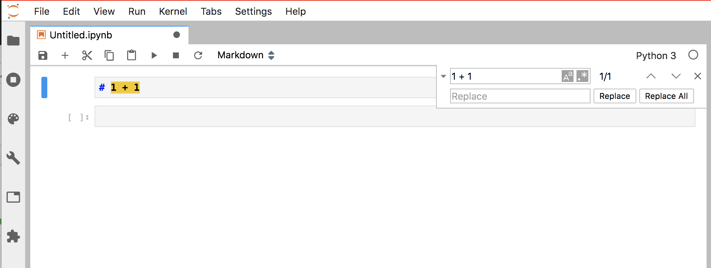
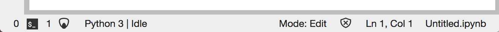

# JupyterLab 1.x Changelog

## [v1.2.0](https://github.com/jupyterlab/jupyterlab/releases/tag/v1.2.0)

### October 29, 2019

Here are some highlights for this release. See the [JupyterLab
1.2.0](https://github.com/jupyterlab/jupyterlab/milestone/38?closed=1)
milestone on GitHub for the full list of pull requests and issues
closed.

### User-facing changes

- Select cells from the current cell to the top of the notebook with
  `Shift Home`, to the bottom of the notebook with `Shift End`
  ([#7336](https://github.com/jupyterlab/jupyterlab/pull/7336),
  [#6783](https://github.com/jupyterlab/jupyterlab/pull/6783))
- Add a log console extension to display unhandled messages and other
  activity
  ([#7318](https://github.com/jupyterlab/jupyterlab/pull/7318),
  [#7319](https://github.com/jupyterlab/jupyterlab/pull/7319),
  [#7379](https://github.com/jupyterlab/jupyterlab/pull/7379),
  [#7399](https://github.com/jupyterlab/jupyterlab/pull/7399),
  [#7406](https://github.com/jupyterlab/jupyterlab/pull/7406),
  [#7421](https://github.com/jupyterlab/jupyterlab/pull/7421))
- Allow the npm `max-old-space` option to be specified outside of
  JupyterLab
  ([#7317](https://github.com/jupyterlab/jupyterlab/pull/7317))
- Only display node structure in a JSON tree view for arrays and empty
  objects
  ([#7261](https://github.com/jupyterlab/jupyterlab/pull/7261))
- Make much smaller distribution packages by not building JavaScript
  source maps for releases.
  ([#7150](https://github.com/jupyterlab/jupyterlab/pull/7150))
- Add support for pasting cell attachments and dragging attachments
  from the file browser
  ([#5913](https://github.com/jupyterlab/jupyterlab/pull/5913),
  [#5744](https://github.com/jupyterlab/jupyterlab/issues/5744))
- Add a new `registry` configuration parameter to override the default
  yarn repository when building
  ([#7363](https://github.com/jupyterlab/jupyterlab/pull/7363),
  [#7109](https://github.com/jupyterlab/jupyterlab/pull/7109),
  [#7249](https://github.com/jupyterlab/jupyterlab/pull/7249),
  [#7248](https://github.com/jupyterlab/jupyterlab/issues/7248))

### For developers

- Update the Markdown renderer (`marked`) to 0.7.0
  ([#7328](https://github.com/jupyterlab/jupyterlab/pull/7328))
- Remove datagrid as a singleton, allowing extensions to use newer
  versions
  ([#7312](https://github.com/jupyterlab/jupyterlab/pull/7312))
- Add metadata to the kernelspec information
  ([#7234](https://github.com/jupyterlab/jupyterlab/pull/7234))
- Allow different mimetypes for the clipboard data
  ([#7233](https://github.com/jupyterlab/jupyterlab/pull/7233))
- Add inline svg icon support to toolbar buttons
  ([#7232](https://github.com/jupyterlab/jupyterlab/pull/7232))
- Add PageConfig functions to query if a plugin is deferred or
  disabled
  ([#7216](https://github.com/jupyterlab/jupyterlab/pull/7216))
- Allow for renderers for nbformat.ierror to be created
  ([#7203](https://github.com/jupyterlab/jupyterlab/pull/7203),
  [#7193](https://github.com/jupyterlab/jupyterlab/issues/7193))
- Refactor `fileeditor-extension` for modularization
  ([#6904](https://github.com/jupyterlab/jupyterlab/pull/6904))
- Add execution timing to cells
  ([#6864](https://github.com/jupyterlab/jupyterlab/pull/6864),
  [#3320](https://github.com/jupyterlab/jupyterlab/issues/3320))

### Bugfixes

- Fix the `file-browser-path` query parameter
  ([#7313](https://github.com/jupyterlab/jupyterlab/pull/7313))
- Skip custom click behavior on links when the download attribute is
  set ([#7323](https://github.com/jupyterlab/jupyterlab/pull/7323))
- Fix opening multiple browser tabs in Safari
  ([#7322](https://github.com/jupyterlab/jupyterlab/pull/7322))
- Fix context menus on SVG icons
  ([#7263](https://github.com/jupyterlab/jupyterlab/pull/7263))
- Fix overwriting of target attribute of anchors rendered by
  `IPython.display`
  ([#7231](https://github.com/jupyterlab/jupyterlab/pull/7231))
- Fix multi-cursor backspacing
  ([#7205](https://github.com/jupyterlab/jupyterlab/pull/7205),
  [#7401](https://github.com/jupyterlab/jupyterlab/pull/7401),
  [#7413](https://github.com/jupyterlab/jupyterlab/pull/7413))
- Fix mult-cursor cell splitting
  ([#7207](https://github.com/jupyterlab/jupyterlab/pull/7207),
  [#7417](https://github.com/jupyterlab/jupyterlab/pull/7417),
  [#7419](https://github.com/jupyterlab/jupyterlab/pull/7419))

## [v1.1.0](https://github.com/jupyterlab/jupyterlab/releases/tag/v1.1.0)

### August 28, 2019

Here are some highlights of what is in this release. See the [JupyterLab
1.1.0](https://github.com/jupyterlab/jupyterlab/milestone/31?closed=1)
milestone on GitHub for the full list of pull requests and issues
closed.

### User-facing changes

- `jupyter lab build` now has a `--minimize=False` option to build
  without minimization to conserve memory and time
  ([#6907](https://github.com/jupyterlab/jupyterlab/pull/6907))
- Fix workspace reset functionality
  ([#7106](https://github.com/jupyterlab/jupyterlab/pull/7106),
  [#7105](https://github.com/jupyterlab/jupyterlab/issues/7105))
- Restore behavior of the "raises-exception" cell tag
  ([#7020](https://github.com/jupyterlab/jupyterlab/pull/7020),
  [#7015](https://github.com/jupyterlab/jupyterlab/issues/7015))
- Add settings to override theme font sizes
  ([#6926](https://github.com/jupyterlab/jupyterlab/pull/6926))
- Accept query parameter to optionally change file browser location
  ([#6875](https://github.com/jupyterlab/jupyterlab/pull/6875))
- Pressing escape in the console should switch out of edit mode
  ([#6822](https://github.com/jupyterlab/jupyterlab/pull/6822))
- Fix file browser downloads in Google Chrome
  ([#6686](https://github.com/jupyterlab/jupyterlab/pull/6686))
- Make it possible to override the default widgets to view a file
  ([#6813](https://github.com/jupyterlab/jupyterlab/pull/6813),
  [#4048](https://github.com/jupyterlab/jupyterlab/issues/4048))
- Support installing multiple versions of the same extension
  ([#6857](https://github.com/jupyterlab/jupyterlab/pull/6857))
- Support JupyterHub server name for JupyterHub 1.0
  ([#6931](https://github.com/jupyterlab/jupyterlab/pull/6931))
- Add docs to help users diagnose issues before creating them
  ([#6971](https://github.com/jupyterlab/jupyterlab/pull/6971))
- The JupyterLab conda-forge package is now a `noarch`
  package. If you are using JupyterLab with `notebook`
  version 5.2 or earlier, you may need to manually enable the
  JupyterLab server extension. See the issue for more details
  ([#7042](https://github.com/jupyterlab/jupyterlab/issues/7042))

### For developers

- Expose install_kernel for tests so that outside projects can better
  use the testing framework
  ([#7089](https://github.com/jupyterlab/jupyterlab/pull/7089))
- Fix `comm_info_request` content to conform to the Jupyter message
  specification in a backwards-compatible way
  ([#6949](https://github.com/jupyterlab/jupyterlab/pull/6949),
  [#6947](https://github.com/jupyterlab/jupyterlab/issues/6947))
- Add yarn package resolution to build to constrain core package
  versions to patch semver ranges
  ([#6938](https://github.com/jupyterlab/jupyterlab/pull/6938))
- Make handling comm messages optional in a kernel connection.
  ([#6929](https://github.com/jupyterlab/jupyterlab/pull/6929))
- Expose icon svg to theme css
  ([#6034](https://github.com/jupyterlab/jupyterlab/pull/6034),
  [#7027](https://github.com/jupyterlab/jupyterlab/pull/7027))
- Expose convenience functions for open dialogs
  ([#6366](https://github.com/jupyterlab/jupyterlab/pull/6366),
  [#6365](https://github.com/jupyterlab/jupyterlab/issues/6365))
- Add debug messages to possible kernel messages
  ([#6704](https://github.com/jupyterlab/jupyterlab/pull/6704))
- Add server side coreconfig object
  ([#6991](https://github.com/jupyterlab/jupyterlab/pull/6991))

### Bug fixes

- Handle errors that occur during kernel selection
  ([#7094](https://github.com/jupyterlab/jupyterlab/pull/7094))
- Fix escaping issues for page config and other template variables
  ([#7016](https://github.com/jupyterlab/jupyterlab/pull/7016),
  [#7024](https://github.com/jupyterlab/jupyterlab/issues/7024),
  [#7061](https://github.com/jupyterlab/jupyterlab/pull/7061),
  [#7058](https://github.com/jupyterlab/jupyterlab/issues/7058),
  [#6858](https://github.com/jupyterlab/jupyterlab/issues/6858))
- Require jinja2 2.10+ to fix escaping issues
  ([#7055](https://github.com/jupyterlab/jupyterlab/pull/7055),
  [#7053](https://github.com/jupyterlab/jupyterlab/issues/7053))
- Increase the search debounce from 100ms to 500ms to increase
  incremental search responsiveness in large documents
  ([#7034](https://github.com/jupyterlab/jupyterlab/pull/7034))
- Fix vega downloads and download urls in general
  ([#7022](https://github.com/jupyterlab/jupyterlab/pull/7022),
  [#7017](https://github.com/jupyterlab/jupyterlab/issues/7017),
  [#7098](https://github.com/jupyterlab/jupyterlab/pull/7098),
  [#7047](https://github.com/jupyterlab/jupyterlab/issues/7047))
- Do not complain in the build about duplicate or optional packages
  ([#7013](https://github.com/jupyterlab/jupyterlab/pull/7013))
- Fix contextual help layout for R help
  ([#6933](https://github.com/jupyterlab/jupyterlab/pull/6933),
  [#6935](https://github.com/jupyterlab/jupyterlab/pull/6935))

## [v1.0.0](https://github.com/jupyterlab/jupyterlab/releases/tag/v1.0.0)

### June 28, 2019

See the [JupyterLab
1.0.0](https://github.com/jupyterlab/jupyterlab/milestone/2?closed=1)
milestone on GitHub for the full list of pull requests and issues closed
in 1.0.0, and other 1.0.x milestones for bugs fixed in patch releases.

### Find and Replace

We have added first class support for find and replace across
JupyterLab. It is currently supported in notebooks and text files and is
extensible for other widgets who wish to support it.
([#6350](https://github.com/jupyterlab/jupyterlab/pull/6350),
[#6322](https://github.com/jupyterlab/jupyterlab/issues/6322),
[#6301](https://github.com/jupyterlab/jupyterlab/pull/6301),
[#6282](https://github.com/jupyterlab/jupyterlab/pull/6282),
[#6256](https://github.com/jupyterlab/jupyterlab/pull/6256),
[#6241](https://github.com/jupyterlab/jupyterlab/pull/6241),
[#6237](https://github.com/jupyterlab/jupyterlab/pull/6237),
[#6159](https://github.com/jupyterlab/jupyterlab/pull/6159),
[#6081](https://github.com/jupyterlab/jupyterlab/issues/6081),
[#6155](https://github.com/jupyterlab/jupyterlab/pull/6155),
[#6094](https://github.com/jupyterlab/jupyterlab/pull/6094),
[#6024](https://github.com/jupyterlab/jupyterlab/pull/6024),
[#5937](https://github.com/jupyterlab/jupyterlab/pull/5937),
[#5795](https://github.com/jupyterlab/jupyterlab/pull/5795),
[#1074](https://github.com/jupyterlab/jupyterlab/issues/1074))

### Status Bar

We have integrated the [JupyterLab Status Bar
package](https://github.com/jupyterlab/jupyterlab-statusbar) package
into the core distribution. Extensions can add their own status to it as
well ([#5577](https://github.com/jupyterlab/jupyterlab/pull/5577),
[#5525](https://github.com/jupyterlab/jupyterlab/pull/5525)
[#5990](https://github.com/jupyterlab/jupyterlab/pull/5990),
[#5982](https://github.com/jupyterlab/jupyterlab/issues/5982),
[#5514](https://github.com/jupyterlab/jupyterlab/pull/5514),
[#5508](https://github.com/jupyterlab/jupyterlab/pull/5508),
[#5352](https://github.com/jupyterlab/jupyterlab/issues/5352)).

### JupyterHub Integration

- We now include the JupyterHub extension in core JupyterLab, so you
  no longer need to install `@jupyterlab/hub-extension`.
  ([#6451](https://github.com/jupyterlab/jupyterlab/pull/6451),
  [#6428](https://github.com/jupyterlab/jupyterlab/issues/6428))
- JupyterLab now has a File > Logout menu entry when running with
  JupyterHub
  ([#6087](https://github.com/jupyterlab/jupyterlab/pull/6087),
  [#5966](https://github.com/jupyterlab/jupyterlab/issues/5966))

### Printing

We now have a printing system that allows extensions to customize how
documents and activities are printed.
([#5850](https://github.com/jupyterlab/jupyterlab/pull/5850),
[#1314](https://github.com/jupyterlab/jupyterlab/issues/1314))

### Other User Facing Changes

- The launcher displays longer kernel names and supports keyboard
  navigation
  ([#6587](https://github.com/jupyterlab/jupyterlab/pull/6587))
- Notebook outputs without any valid MimeType renderers will not be
  displayed, instead of displaying an error
  ([#6559](https://github.com/jupyterlab/jupyterlab/pull/6559),
  [#6216](https://github.com/jupyterlab/jupyterlab/issues/6216))
- Add tooltip to file browser root breadcrumb icon showing the server
  root, if it is available
  ([#6552](https://github.com/jupyterlab/jupyterlab/pull/6552))
- Downloading a file will no longer open a new browser window
  ([#6546](https://github.com/jupyterlab/jupyterlab/pull/6546))
- Rename the help "Inspector" to "Contextual Help" and move it to
  the "Help" menu
  ([#6493](https://github.com/jupyterlab/jupyterlab/pull/6493),
  [#6488](https://github.com/jupyterlab/jupyterlab/issues/6488),
  [#6678](https://github.com/jupyterlab/jupyterlab/pull/6678),
  [#6671](https://github.com/jupyterlab/jupyterlab/pull/6671))
- Update many of the icons to make them more consistent
  ([#6672](https://github.com/jupyterlab/jupyterlab/pull/6672),
  [#6618](https://github.com/jupyterlab/jupyterlab/issues/6618),
  [#6664](https://github.com/jupyterlab/jupyterlab/pull/6664),
  [#6621](https://github.com/jupyterlab/jupyterlab/issues/6621))
- Update the settings UI to remove the table view
  ([#6654](https://github.com/jupyterlab/jupyterlab/pull/6654),
  [#6622](https://github.com/jupyterlab/jupyterlab/issues/6622),
  [#6653](https://github.com/jupyterlab/jupyterlab/pull/6653),
  [#6623](https://github.com/jupyterlab/jupyterlab/issues/6623),
  [#6646](https://github.com/jupyterlab/jupyterlab/pull/6646),
  [#6642](https://github.com/jupyterlab/jupyterlab/issues/6642))
- Replace FAQ Extension with link to JupyterLab documentation
  ([#6628](https://github.com/jupyterlab/jupyterlab/pull/6628),
  [#6608](https://github.com/jupyterlab/jupyterlab/issues/6608),
  [#6625](https://github.com/jupyterlab/jupyterlab/pull/6625),
  [#6610](https://github.com/jupyterlab/jupyterlab/issues/6610))
- Change the default keyboard shortcut for closing a tab to be `Alt+w`
  instead of `Cmd/Ctrl+w` to avoid conflicts with operating systems.
  ([#6486](https://github.com/jupyterlab/jupyterlab/pull/6486),
  [#6357](https://github.com/jupyterlab/jupyterlab/issues/6357))
- Show help text in Inspector window to describe you should select a
  function
  ([#6476](https://github.com/jupyterlab/jupyterlab/pull/6476))
- Fixes SVG rendering
  ([#6469](https://github.com/jupyterlab/jupyterlab/pull/6469),
  [#6295](https://github.com/jupyterlab/jupyterlab/issues/6295))
- Add support for dropping a tab in the tab bar area.
  ([#6454](https://github.com/jupyterlab/jupyterlab/pull/6454),
  [#5406](https://github.com/jupyterlab/jupyterlab/issues/5406))
- Switch some default shortcuts to use `Accel` instead of `Ctrl` so
  they are more natural for Mac users
  ([#6447](https://github.com/jupyterlab/jupyterlab/pull/6447),
  [#5023](https://github.com/jupyterlab/jupyterlab/issues/5023))
- Add ability to tell between hover and selected command palette items
  ([#6407](https://github.com/jupyterlab/jupyterlab/pull/6407),
  [#279](https://github.com/jupyterlab/jupyterlab/issues/279))
- Hide the "Last Modified" column when the file browser is narrow
  ([#6406](https://github.com/jupyterlab/jupyterlab/pull/6406),
  [#6093](https://github.com/jupyterlab/jupyterlab/issues/6093))
- Support copy/paste in terminal and Mac OS using `Ctrl+C` and
  `Ctrl+V`
  ([#6391](https://github.com/jupyterlab/jupyterlab/pull/6391),
  [#6385](https://github.com/jupyterlab/jupyterlab/issues/6385),
  [#1146](https://github.com/jupyterlab/jupyterlab/issues/1146))
- Support scrolling in running kernels panel
  ([#6383](https://github.com/jupyterlab/jupyterlab/pull/6383),
  [#6371](https://github.com/jupyterlab/jupyterlab/issues/6371))
- Adds ability to "Merge Selected Cells" in the context menu in the
  notebook
  ([#6375](https://github.com/jupyterlab/jupyterlab/pull/6375),
  [#6318](https://github.com/jupyterlab/jupyterlab/issues/6318))
- Turn On Accessibility In Xterm.js to make it more compatible for
  screen readers
  ([#6359](https://github.com/jupyterlab/jupyterlab/pull/6359))
- When selecting cells using the keyboard shortcuts, we now skip
  collapsed cells
  ([#6356](https://github.com/jupyterlab/jupyterlab/pull/6356),
  [#3233](https://github.com/jupyterlab/jupyterlab/issues/3233))
- Supporting opening `.geojson` files in JSON viewer
  ([#6349](https://github.com/jupyterlab/jupyterlab/pull/6349))
- Performance fixes for text-based progress bars
  ([#6304](https://github.com/jupyterlab/jupyterlab/pull/6304),
  [#4202](https://github.com/jupyterlab/jupyterlab/issues/4202))
- Add support for rendering Vega 5 and Vega Lite 3 while keeping the
  existing Vega 4 and Vega Lite 2 renderers
  ([#6294](https://github.com/jupyterlab/jupyterlab/pull/6294),
  [#6133](https://github.com/jupyterlab/jupyterlab/pull/6133),
  [#6128](https://github.com/jupyterlab/jupyterlab/issues/6128),
  [#6689](https://github.com/jupyterlab/jupyterlab/pull/6689),
  [#6685](https://github.com/jupyterlab/jupyterlab/pull/6685),
  [#6684](https://github.com/jupyterlab/jupyterlab/issues/6684),
  [#6675](https://github.com/jupyterlab/jupyterlab/issues/6675),
  [#6591](https://github.com/jupyterlab/jupyterlab/pull/6591),
  [#6572](https://github.com/jupyterlab/jupyterlab/issues/6572))
- Drag and drop console cells into a notebook or text editor
  ([#5585](https://github.com/jupyterlab/jupyterlab/pull/5585),
  [#4847](https://github.com/jupyterlab/jupyterlab/issues/4847))
- Drag and drop notebook cells into a console or text editor
  ([#5571](https://github.com/jupyterlab/jupyterlab/pull/5571),
  [#3732](https://github.com/jupyterlab/jupyterlab/issues/3732))
- The extension manager search now sorts extensions by the score
  assigned to them by NPM instead of alphabetically
  ([#5649](https://github.com/jupyterlab/jupyterlab/pull/5649))
- Notify the user when a kernel is automatically restarted, for
  example, if crashes from an out of memory error
  ([#6246](https://github.com/jupyterlab/jupyterlab/pull/6246),
  [#4273](https://github.com/jupyterlab/jupyterlab/issues/4273))
- Expose the extension manager in a command and menu item
  ([#6200](https://github.com/jupyterlab/jupyterlab/pull/6200))
- Add command to render all Markdown cells
  ([#6029](https://github.com/jupyterlab/jupyterlab/pull/6029),
  [#6017](https://github.com/jupyterlab/jupyterlab/issues/6017))
- Supports using shift to select text in output area
  ([#6015](https://github.com/jupyterlab/jupyterlab/pull/6015),
  [#4800](https://github.com/jupyterlab/jupyterlab/issues/4800))
- Output areas that opened in new views are restored properly now on
  reload
  ([#5981](https://github.com/jupyterlab/jupyterlab/pull/5981),
  [#5976](https://github.com/jupyterlab/jupyterlab/issues/5976))
- Add support for managing notebook metadata under a new "Advanced
  Tools" section in the cell tools area. The cell and notebook
  metadata now always reflect the current state of the notebook
  ([#5968](https://github.com/jupyterlab/jupyterlab/pull/5968),
  [#5200](https://github.com/jupyterlab/jupyterlab/issues/5200))
- Inherit terminal theme from core theme
  ([#5964](https://github.com/jupyterlab/jupyterlab/pull/5964))
- Adds a built-in HTML viewer so that you can view HTML files
  ([#5962](https://github.com/jupyterlab/jupyterlab/pull/5962),
  [#5855](https://github.com/jupyterlab/jupyterlab/pull/5855),
  [#2369](https://github.com/jupyterlab/jupyterlab/issues/2369))
- New workspaces are now automatically generated when you create a new
  window with the same workspace name.
  ([#5950](https://github.com/jupyterlab/jupyterlab/pull/5950),
  [#5854](https://github.com/jupyterlab/jupyterlab/issues/5854),
  [#5830](https://github.com/jupyterlab/jupyterlab/pull/5830),
  [#5214](https://github.com/jupyterlab/jupyterlab/issues/5214))
- We now add a hint to the context menu to describe how you can access
  the native browser menu
  ([#5940](https://github.com/jupyterlab/jupyterlab/pull/5940),
  [#4023](https://github.com/jupyterlab/jupyterlab/issues/4023))
- The tabs on the left panel have changed to make them more
  understandable
  ([#5920](https://github.com/jupyterlab/jupyterlab/pull/5920),
  [#5269](https://github.com/jupyterlab/jupyterlab/issues/5269))
- Start a new terminal when the page is refreshed and the old terminal
  has died
  ([#5917](https://github.com/jupyterlab/jupyterlab/pull/5917))
- Add a command to open the main menus, which can be assigned to a
  keyboard shortcut to open and navigate menus without a mouse
  ([#5910](https://github.com/jupyterlab/jupyterlab/pull/5910),
  [#3074](https://github.com/jupyterlab/jupyterlab/issues/3074))
- The contextual help now updates based on changes in the cursor from
  the mouse instead of just from the keyboard
  ([#5906](https://github.com/jupyterlab/jupyterlab/pull/5906),
  [#5899](https://github.com/jupyterlab/jupyterlab/issues/5899))
- The launcher now updates when the kernels change on the server
  ([#5904](https://github.com/jupyterlab/jupyterlab/pull/5904),
  [#5676](https://github.com/jupyterlab/jupyterlab/issues/5676))
- Retain cell auto scroll behavior even when a cell output is cleared
  ([#5817](https://github.com/jupyterlab/jupyterlab/pull/5817),
  [#4028](https://github.com/jupyterlab/jupyterlab/issues/4028))
- If you link to a relative path that is not a file in a markdown
  cell, this will now be preserved instead of changing it to a file
  URL ([#5814](https://github.com/jupyterlab/jupyterlab/pull/5814))
- Adds the ability to link to a certain row in a CSV file and have the
  viewer open to that row
  ([#5727](https://github.com/jupyterlab/jupyterlab/pull/5727),
  [#5720](https://github.com/jupyterlab/jupyterlab/issues/5720))
- We have improved the performance of switching to a large notebook
  ([#5700](https://github.com/jupyterlab/jupyterlab/pull/5700),
  [#4292](https://github.com/jupyterlab/jupyterlab/issues/4292),
  [#2639](https://github.com/jupyterlab/jupyterlab/issues/2639))
- The vdom extension now supports event handling, so that you can have
  kernel code run in response to user interaction with the UI
  ([#5670](https://github.com/jupyterlab/jupyterlab/pull/5670))
- Adds the ability to run "Run All Code" and "Restart Kernel and
  Run All Code" in code and markdown files
  ([#5641](https://github.com/jupyterlab/jupyterlab/pull/5641),
  [#5579](https://github.com/jupyterlab/jupyterlab/issues/5579))
- We now remember what line ending a text file has when loading it, so
  that files with `CRLF` line endings will properly be saved with the
  same endings
  ([#5622](https://github.com/jupyterlab/jupyterlab/pull/5622),
  [#4464](https://github.com/jupyterlab/jupyterlab/issues/4464),
  [#3901](https://github.com/jupyterlab/jupyterlab/issues/3901),
  [#3706](https://github.com/jupyterlab/jupyterlab/issues/3706))
- Fixes rendering of SVG elements in HTML MimeType output
  ([#5610](https://github.com/jupyterlab/jupyterlab/pull/5610),
  [#5610](https://github.com/jupyterlab/jupyterlab/issues/5610),
  [#5589](https://github.com/jupyterlab/jupyterlab/issues/5589))
- Allow copying files by holding down `Ctrl` when dragging them in the
  file browser
  ([#5584](https://github.com/jupyterlab/jupyterlab/pull/5584),
  [#3235](https://github.com/jupyterlab/jupyterlab/issues/3235))
- Switch the hover modified time in the file browser to use the local
  format
  ([#5567](https://github.com/jupyterlab/jupyterlab/pull/5567))
- We have added a default keyboard shortcut of `Ctrl Shift Q` for
  closing and cleaning up a file
  ([#5534](https://github.com/jupyterlab/jupyterlab/pull/5534),
  [#4390](https://github.com/jupyterlab/jupyterlab/issues/4390))
- Adds the ability to find and go to a certain line in the CSV viewer
  ([#5523](https://github.com/jupyterlab/jupyterlab/pull/5523))
- Add the ability to create new text and markdown files from the
  launcher and command palette
  ([#5512](https://github.com/jupyterlab/jupyterlab/pull/5512),
  [#5511](https://github.com/jupyterlab/jupyterlab/pull/5511))
- A "New Folder" option has been added to the file browser context
  menu ([#5447](https://github.com/jupyterlab/jupyterlab/pull/5447))
- The ANSI colors are now the same as those in the classic notebook
  ([#5336](https://github.com/jupyterlab/jupyterlab/pull/5336),
  [#3773](https://github.com/jupyterlab/jupyterlab/issues/3773))
- Send complete statements instead of current lines when stepping
  through code in a cell
  ([#6515](https://github.com/jupyterlab/jupyterlab/pull/6515),
  [#6063](https://github.com/jupyterlab/jupyterlab/pull/6063))
- Description list styles (`dl`, `dt`, `dd`) are improved to be
  consistent with the nteract project
  ([#5682](https://github.com/jupyterlab/jupyterlab/pull/5682),
  [#2399](https://github.com/jupyterlab/jupyterlab/issues/2399))

### Settings

- The settings system has been rewritten
  ([#5470](https://github.com/jupyterlab/jupyterlab/pull/5470),
  [#5298](https://github.com/jupyterlab/jupyterlab/issues/5298)) and
  now uses json5 as the syntax, which supports comments and other
  features for better human readability
  ([#6343](https://github.com/jupyterlab/jupyterlab/pull/6343),
  [#6199](https://github.com/jupyterlab/jupyterlab/issues/6199)).
- The keyboard shortcut system has been rewritten and now displays a
  list of system commands in the settings comments
  ([#5812](https://github.com/jupyterlab/jupyterlab/pull/5812),
  [#5562](https://github.com/jupyterlab/jupyterlab/issues/5562)).

There are new settings for many following items, including:

- Adds an option to shut down terminals and notebook kernels when they
  are closed
  ([#6285](https://github.com/jupyterlab/jupyterlab/pull/6285),
  [#6275](https://github.com/jupyterlab/jupyterlab/pull/6275))
- Scrolling past the end of a notebooks and text editor document
  ([#5542](https://github.com/jupyterlab/jupyterlab/pull/5542),
  [#5271](https://github.com/jupyterlab/jupyterlab/issues/5271),
  [#5652](https://github.com/jupyterlab/jupyterlab/pull/5652),
  [#4429](https://github.com/jupyterlab/jupyterlab/issues/4429))
- Text editor code folding, rulers, and active line highlighting
  ([#5761](https://github.com/jupyterlab/jupyterlab/pull/5761),
  [#4083](https://github.com/jupyterlab/jupyterlab/issues/4083),
  [#5750](https://github.com/jupyterlab/jupyterlab/pull/5750),
  [#4179](https://github.com/jupyterlab/jupyterlab/issues/4179),
  [#5529](https://github.com/jupyterlab/jupyterlab/pull/5529),
  [#5528](https://github.com/jupyterlab/jupyterlab/issues/5528))
- Markdown viewer options
  ([#5901](https://github.com/jupyterlab/jupyterlab/pull/5901),
  [#3940](https://github.com/jupyterlab/jupyterlab/issues/3940))
- Terminal scrollback and other settings
  ([#5609](https://github.com/jupyterlab/jupyterlab/pull/5609),
  [#3985](https://github.com/jupyterlab/jupyterlab/issues/3985))
- The autosave interval
  ([#5645](https://github.com/jupyterlab/jupyterlab/pull/5645),
  [#5619](https://github.com/jupyterlab/jupyterlab/issues/5619))
- The file browser showing the current active file
  ([#5698](https://github.com/jupyterlab/jupyterlab/pull/5698),
  [#4258](https://github.com/jupyterlab/jupyterlab/issues/4258))
- Custom scrollbar styling for dark themes
  ([#6026](https://github.com/jupyterlab/jupyterlab/pull/6026),
  [#4867](https://github.com/jupyterlab/jupyterlab/issues/4867))

### Command Line Changes

- Installing extensions will be quieter and adds a `--debug` to
  extension installing
  ([#6567](https://github.com/jupyterlab/jupyterlab/pull/6567),
  [#6499](https://github.com/jupyterlab/jupyterlab/issues/6499),
  [#5986](https://github.com/jupyterlab/jupyterlab/issues/5986))
- We now support running JupyterLab when its application directory is
  a symlink
  ([#6240](https://github.com/jupyterlab/jupyterlab/pull/6240),
  [#6166](https://github.com/jupyterlab/jupyterlab/issues/6166))
- Add `--all` flag to `labextension uninstall` to remove all
  extensions
  ([#6058](https://github.com/jupyterlab/jupyterlab/pull/6058),
  [#6006](https://github.com/jupyterlab/jupyterlab/issues/6006))
- Adds the ability to override the base URLs from the config
  ([#5518](https://github.com/jupyterlab/jupyterlab/pull/5518),
  [#5503](https://github.com/jupyterlab/jupyterlab/pull/5503))
- Updates to workspaces CLI command
  ([#6473](https://github.com/jupyterlab/jupyterlab/pull/6473),
  [#5977](https://github.com/jupyterlab/jupyterlab/issues/5977),
  [#6276](https://github.com/jupyterlab/jupyterlab/pull/6276),
  [#6234](https://github.com/jupyterlab/jupyterlab/pull/6234),
  [#6210](https://github.com/jupyterlab/jupyterlab/issues/6210),
  [#5975](https://github.com/jupyterlab/jupyterlab/pull/5975),
  [#5695](https://github.com/jupyterlab/jupyterlab/pull/5695),
  [#5694](https://github.com/jupyterlab/jupyterlab/issues/5694))

### Extension Development Changes

- We have rewritten how extensions provide keyboard shortcuts and
  interact with the settings system. If you previously defined
  keyboard shortcuts or used the settings mechanism, you will need to
  update your extension
  ([#5470](https://github.com/jupyterlab/jupyterlab/pull/5470),
  [#5298](https://github.com/jupyterlab/jupyterlab/issues/5298))
- We have renamed the plugin type from `JupyterLabPlugin` to
  `JupyterFrontEndPlugin`. The application arg is also renamed from
  `JupyterLab` to `JupyterFrontEnd` and some its functionality has
  been moved to a separate `ILabShell` plugin
  ([#5845](https://github.com/jupyterlab/jupyterlab/pull/5845),
  [#5919](https://github.com/jupyterlab/jupyterlab/pull/5919))
- The lab shell `addToMainArea`, `addToLeftArea`, `addToTopArea`,
  `addToRightArea`, and `addToBottomArea` functions have been replaced
  with a single `add()` function that takes the area as an argument.
  Replace `addToMainArea(widget, options)` with
  `add(widget, 'main', options)`, etc.
  ([#5845](https://github.com/jupyterlab/jupyterlab/pull/5845))
- Rename `pageUrl` to `appUrl` in the server connection
  ([#6509](https://github.com/jupyterlab/jupyterlab/pull/6509),
  [#6508](https://github.com/jupyterlab/jupyterlab/issues/6508),
  [#6585](https://github.com/jupyterlab/jupyterlab/pull/6585),
  [#6584](https://github.com/jupyterlab/jupyterlab/issues/6584))
- `MainAreaWidget` instances now forward update requests to their
  `content`
  ([#6586](https://github.com/jupyterlab/jupyterlab/pull/6586),
  [#6571](https://github.com/jupyterlab/jupyterlab/issues/6571))
- The theme data attributes are renamed and moved to the document body
  element. If you are relying on these attributes in CSS to
  conditionally style based on the theme, you should update their
  names. For example `data-theme-light` is now `data-jp-theme-light`.
  ([#6566](https://github.com/jupyterlab/jupyterlab/pull/6566),
  [#6554](https://github.com/jupyterlab/jupyterlab/issues/6554))
- Extensions which require CSS should no longer import their CSS files
  into their Javascript files. Instead, they should specify a root CSS
  file in the `style` attribute in their `package.json`, and
  JupyterLab will automatically import that CSS file.
  ([#6533](https://github.com/jupyterlab/jupyterlab/pull/6533),
  [#6530](https://github.com/jupyterlab/jupyterlab/issues/6530),
  [#6395](https://github.com/jupyterlab/jupyterlab/pull/6395),
  [#6390](https://github.com/jupyterlab/jupyterlab/issues/6390))
- `Dialog.prompt` has been replaced by a number of type-specific
  dialogs such as `InputDialog.getString`, `InputDialog.getBoolean`,
  etc. ([#6522](https://github.com/jupyterlab/jupyterlab/pull/6522),
  [#6378](https://github.com/jupyterlab/jupyterlab/issues/6378),
  [#6327](https://github.com/jupyterlab/jupyterlab/pull/6327),
  [#6326](https://github.com/jupyterlab/jupyterlab/issues/6326))
- When a `RenderMime` widget is re-rendered, the default behavior is
  to remove any existing content in the DOM. This can be overridden if
  needed.
  ([#6513](https://github.com/jupyterlab/jupyterlab/pull/6513),
  [#6505](https://github.com/jupyterlab/jupyterlab/issues/6505),
  [#6497](https://github.com/jupyterlab/jupyterlab/issues/6497))
- We have updated our internal TypeScript version to 3.5.1 and our
  compile target to `ES2017`. Extensions may need to upgrade their
  TypeScript version and target as well.
  ([#6440](https://github.com/jupyterlab/jupyterlab/pull/6440),
  [#6224](https://github.com/jupyterlab/jupyterlab/pull/6224))
- We have updated the typings for some of the Kernel messages so that
  they better match the spec.
  ([#6433](https://github.com/jupyterlab/jupyterlab/pull/6433))
- A `connectionFailure` signal has been added to some of the manager
  classes, which can be used to detect when a connection to the server
  is lost
  ([#6399](https://github.com/jupyterlab/jupyterlab/pull/6399),
  [#6176](https://github.com/jupyterlab/jupyterlab/issues/6176),
  [#3324](https://github.com/jupyterlab/jupyterlab/issues/3324))
- Add rate limiting and polling utilities to `coreutils` to use for
  throttling and debouncing of API requests
  ([#6345](https://github.com/jupyterlab/jupyterlab/pull/6345),
  [#6346](https://github.com/jupyterlab/jupyterlab/issues/6346),
  [#6401](https://github.com/jupyterlab/jupyterlab/pull/6401),
  [#6305](https://github.com/jupyterlab/jupyterlab/pull/6305),
  [#6157](https://github.com/jupyterlab/jupyterlab/issues/6157),
  [#6192](https://github.com/jupyterlab/jupyterlab/pull/6192),
  [#6186](https://github.com/jupyterlab/jupyterlab/pull/6186),
  [#6141](https://github.com/jupyterlab/jupyterlab/pull/6141),
  [#3929](https://github.com/jupyterlab/jupyterlab/issues/3929),
  [#6141](https://github.com/jupyterlab/jupyterlab/pull/6141),
  [#3929](https://github.com/jupyterlab/jupyterlab/issues/3929),
  [#6186](https://github.com/jupyterlab/jupyterlab/pull/6186),
  [#6192](https://github.com/jupyterlab/jupyterlab/pull/6192),
  [#6401](https://github.com/jupyterlab/jupyterlab/pull/6401)
  ,[#6305](https://github.com/jupyterlab/jupyterlab/pull/6305),
  [#6157](https://github.com/jupyterlab/jupyterlab/issues/6157))
- Require session when instantiating terminal widget
  ([#6339](https://github.com/jupyterlab/jupyterlab/pull/6339),
  [#5061](https://github.com/jupyterlab/jupyterlab/issues/5061))
- Provides a signal to see what items are opened in a directory
  listing
  ([#6270](https://github.com/jupyterlab/jupyterlab/pull/6270),
  [#6269](https://github.com/jupyterlab/jupyterlab/issues/6269))
- Ads the ability to add widget above the main work area to a top
  header area
  ([#5936](https://github.com/jupyterlab/jupyterlab/pull/5936))
- Renames `contextMenuFirst` to `contextMenuHitTest` in the
  `JupyterFrontEnd`
  ([#5932](https://github.com/jupyterlab/jupyterlab/pull/5932))
- Removes the `initialCommand` arg from the terminal creation command.
  ([#5916](https://github.com/jupyterlab/jupyterlab/pull/5916))
- Adds `--jp-code-cursor-width0`, `--jp-code-cursor-width1`, and
  `--jp-code-cursor-width2` variables to the themes to support
  changing the cursor width if you change the font size
  ([#5898](https://github.com/jupyterlab/jupyterlab/pull/5898))
- Adds the ability to insert a new item to the toolbar before or after
  another item
  ([#5896](https://github.com/jupyterlab/jupyterlab/pull/5896),
  [#5894](https://github.com/jupyterlab/jupyterlab/issues/5894))
- Adds the ability for extensions to register new CodeMirror modes
  ([#5829](https://github.com/jupyterlab/jupyterlab/pull/5829))
- We have removed the `JUPYTERLAB_xxx_LOADER` Webpack loaders, instead
  you should use the loader directly in the URL as Webpack supports it
  ([#5709](https://github.com/jupyterlab/jupyterlab/pull/5709),
  [#4406](https://github.com/jupyterlab/jupyterlab/issues/4406))
- Adds the ability to handle fragments for document widgets
  ([#5630](https://github.com/jupyterlab/jupyterlab/pull/5630),
  [#5599](https://github.com/jupyterlab/jupyterlab/issues/5599))
- We have added a `@jupyterlab/ui-components` package that contains
  reusable React components to be used internally and in extensions.
  Feel free to use this to create extension UIs with consistent styles
  ([#5538](https://github.com/jupyterlab/jupyterlab/pull/5538))
- The `showErrorMessage` function now lets you customize the buttons
  it uses
  ([#5513](https://github.com/jupyterlab/jupyterlab/pull/5513))
- We now provide helpers for using React components within JupyterLab.
  If you were previously using `ReactElementWidget` you should switch
  to using `ReactWidget`.
  ([#5479](https://github.com/jupyterlab/jupyterlab/pull/5479),
  [#5766](https://github.com/jupyterlab/jupyterlab/issues/5766),
  [#6595](https://github.com/jupyterlab/jupyterlab/pull/6595),
  [#6595](https://github.com/jupyterlab/jupyterlab/pull/6595))
- The share link command has been moved to its own extension so that
  it can be overridden
  ([#5460](https://github.com/jupyterlab/jupyterlab/pull/5460),
  [#5388](https://github.com/jupyterlab/jupyterlab/issues/5388))
- Creating a new services session now requires passing a kernel model
  instead of a kernel instance
  ([#6503](https://github.com/jupyterlab/jupyterlab/pull/6503),
  [#6142](https://github.com/jupyterlab/jupyterlab/issues/6142))
- We upgraded the Webpack raw file loader. The new version of the raw
  loader exports ES2015 modules, so this may require changes in
  extensions that import files using the raw loader. For example, if
  you did `require('myfile.md')` to get the content of
  `myfile.md` as a string, you now should import it using
  ES2015 `import` syntax, or use
  `require(\'myfile.md\').default`.
- Widget factories now can support custom cloning behavior from an
  optional source widget
  ([#6060](https://github.com/jupyterlab/jupyterlab/pull/6060),
  [#6044](https://github.com/jupyterlab/jupyterlab/issues/6044))
- We have renamed the type `InstanceTracker` to `WidgetTracker`
  ([#6569](https://github.com/jupyterlab/jupyterlab/commit/da8e7bda5eebd22319f59e5abbaaa9917872a7e8)).
- In order to add widgets to the main area (e.g. as in the old XKCD
  extension tutorial), the correct syntax is now
  `app.shell.add(widget)` or `app.shell.add(widget, 'main')`, see
  [here](https://github.com/jupyterlab/jupyterlab/blob/da8e7bda5eebd22319f59e5abbaaa9917872a7e8/packages/application/src/shell.ts#L500).
