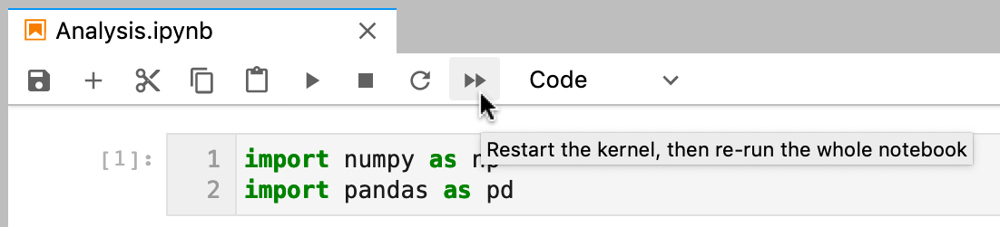
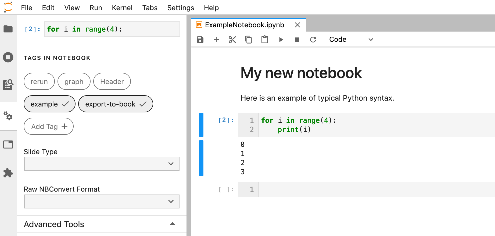
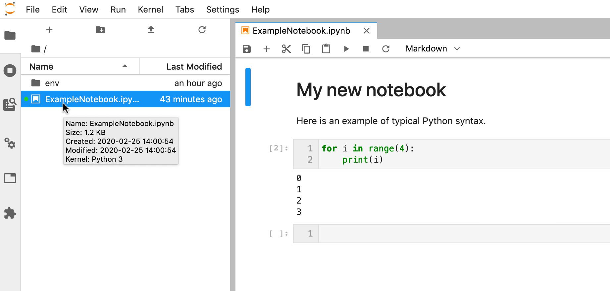
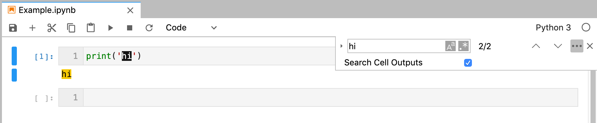

# JupyterLab 2.x Changelog

## [v2.2.x](https://github.com/jupyterlab/jupyterlab/milestone/53)

## [v2.2.0](https://github.com/jupyterlab/jupyterlab/releases/tag/v2.2.0)

See the [JupyterLab
2.2](https://github.com/jupyterlab/jupyterlab/milestone/53?closed=1)
milestone on GitHub for the full list of pull requests and issues
closed.

### July 2020

We are very excited to add Eric Charles to the core team this month!
([#8513](https://github.com/jupyterlab/jupyterlab/pull/8513))

### User-facing changes

- Cells can no longer be executed while kernels are terminating or
  restarting. There is a new status for these events on the Kernel
  Indicator
  ([#8562](https://github.com/jupyterlab/jupyterlab/pull/8562),
  [#8477](https://github.com/jupyterlab/jupyterlab/issues/8477))


- Adds a visual clue for distinguishing hidden files and folders in
  the file browser window
  ([#8393](https://github.com/jupyterlab/jupyterlab/pull/8393))


- Enable horizontal scrolling for toolbars to improve mobile
  experience
  ([#8417](https://github.com/jupyterlab/jupyterlab/pull/8417))


- Improves the right-click context menu for the file editor
  ([#8425](https://github.com/jupyterlab/jupyterlab/pull/8425))


- Merge cell attachments when merging cells
  ([#8427](https://github.com/jupyterlab/jupyterlab/pull/8427),
  [#8414](https://github.com/jupyterlab/jupyterlab/issues/8414))


- Add styling for high memory usage warning in status bar with
  nbresuse
  ([#8437](https://github.com/jupyterlab/jupyterlab/pull/8437))


- Adds support for Python version 3.10
  ([#8445](https://github.com/jupyterlab/jupyterlab/pull/8445))
- Support live editing of SVG with updating rendering
  ([#8495](https://github.com/jupyterlab/jupyterlab/pull/8495),
  [#8494](https://github.com/jupyterlab/jupyterlab/issues/8494))


### For developers

- Specify that we recommend typescript over javascript for extensions
  ([#8411](https://github.com/jupyterlab/jupyterlab/pull/8411))
- Lazy load codemirror theme stylesheets.
  ([#8506](https://github.com/jupyterlab/jupyterlab/pull/8506))
- Increase the link expiry to one week
  ([#8402](https://github.com/jupyterlab/jupyterlab/pull/8402))
- Add documentation on private npm registry usage
  ([#8455](https://github.com/jupyterlab/jupyterlab/pull/8455),
  [#7827](https://github.com/jupyterlab/jupyterlab/issues/7827),
  [#7660](https://github.com/jupyterlab/jupyterlab/issues/7660))
- Add feature request template + slight reorg in readme
  ([#8467](https://github.com/jupyterlab/jupyterlab/pull/8467))
- Add link to react example in extension-examples repo
  ([#8474](https://github.com/jupyterlab/jupyterlab/pull/8474))
- Update documentation of whitelist/blacklist
  ([#8540](https://github.com/jupyterlab/jupyterlab/pull/8540))
- Improve whitelist figure description in documentation
  ([#8517](https://github.com/jupyterlab/jupyterlab/pull/8517))

### Bugfixes

- Typo: fix spelling of extension
  ([#8512](https://github.com/jupyterlab/jupyterlab/pull/8512))
- Close correct tab with close tab
  ([#8529](https://github.com/jupyterlab/jupyterlab/pull/8529))
- Remove unused css rules
  ([#8547](https://github.com/jupyterlab/jupyterlab/pull/8547),
  [#8537](https://github.com/jupyterlab/jupyterlab/issues/8537))
- Fix small typo in getting started docs, proxy
  ([#8549](https://github.com/jupyterlab/jupyterlab/pull/8549))
- Fix link on CI badges
  ([#8603](https://github.com/jupyterlab/jupyterlab/pull/8603))
- Simplified multicursor backspace code
  ([#8523](https://github.com/jupyterlab/jupyterlab/pull/8523))
- Fix recent breaking changes to normalizepath in filebrowser
  ([#8383](https://github.com/jupyterlab/jupyterlab/pull/8383),
  [#8382](https://github.com/jupyterlab/jupyterlab/issues/8382))
- Fix watch mode and add ci test
  ([#8394](https://github.com/jupyterlab/jupyterlab/pull/8394))
- Address CI failures
  ([#8433](https://github.com/jupyterlab/jupyterlab/pull/8433))
- Fix lint errors in dependency graph script
  ([#8451](https://github.com/jupyterlab/jupyterlab/pull/8451))
- Fix lint complaints coming up from github actions
  ([#8452](https://github.com/jupyterlab/jupyterlab/pull/8452))
- Address CI usage test timeout
  ([#8464](https://github.com/jupyterlab/jupyterlab/pull/8464))
- Add chokidar to dev_mode/package.json
  ([#8481](https://github.com/jupyterlab/jupyterlab/pull/8481))
- Fix autolink
  ([#8496](https://github.com/jupyterlab/jupyterlab/pull/8496))
- Update phosphor aliases
  ([#8498](https://github.com/jupyterlab/jupyterlab/pull/8498))
- Fix default return in Python when extension has no version metadata
  ([#8430](https://github.com/jupyterlab/jupyterlab/pull/8430))
- Updated the installation documentation on read the docs to match the
  readme file on the repo
  ([#8386](https://github.com/jupyterlab/jupyterlab/pull/8386))
- Handle quit_button when launched as an extension
  ([#8486](https://github.com/jupyterlab/jupyterlab/pull/8486),
  [#8483](https://github.com/jupyterlab/jupyterlab/issues/8483))
- Add worker-loader
  ([#8593](https://github.com/jupyterlab/jupyterlab/pull/8593),
  [#8587](https://github.com/jupyterlab/jupyterlab/issues/8587))

## [v2.1.x](https://github.com/jupyterlab/jupyterlab/milestone/55)

### v2.1.2

- Fix icon sidebar height for third party extensions
  ([#8333](https://github.com/jupyterlab/jupyterlab/pull/8333))
- Pin JupyterLab server requirement more tightly
  ([#8330](https://github.com/jupyterlab/jupyterlab/pull/8330))
- Scrolls cells into view after deletion
  ([#8287](https://github.com/jupyterlab/jupyterlab/pull/8287))
- Sets data attribute on file type in filebrowser
  ([#8275](https://github.com/jupyterlab/jupyterlab/pull/8275))

### v2.1.1

- Pin puppeteer to fix ci
  ([#8260](https://github.com/jupyterlab/jupyterlab/pull/8260))
- Fix Save As for files without sessions
  ([#8248](https://github.com/jupyterlab/jupyterlab/pull/8248))

## [v2.1.0](https://github.com/jupyterlab/jupyterlab/releases/tag/v2.1.0)

### April 2020

See the [JupyterLab
2.1](https://github.com/jupyterlab/jupyterlab/milestone/49?closed=1)
milestone on GitHub for the full list of pull requests and issues
closed.

### User-facing changes

- Display the extension manager in the left sidebar by default. Users
  will need to acknowledge the disclaimer in the extension manager
  before using it.
  ([#8050](https://github.com/jupyterlab/jupyterlab/pull/8050),
  [#8145](https://github.com/jupyterlab/jupyterlab/pull/8145))
- Added `blacklist and whitelist support <extension_listings>` for the
  extension manager
  ([#7989](https://github.com/jupyterlab/jupyterlab/pull/7989))
- Automatically link URLs in notebook output text
  ([#8075](https://github.com/jupyterlab/jupyterlab/pull/8075),
  [#7393](https://github.com/jupyterlab/jupyterlab/issues/7393))
- Added a "Restart Kernel and Run All Cells..." button to the
  notebook toolbar
  ([#8024](https://github.com/jupyterlab/jupyterlab/pull/8024))



- Added a context menu item for opening a Markdown editor from the
  Markdown preview
  ([#7942](https://github.com/jupyterlab/jupyterlab/pull/7942))

- Support Node.js 10+
  ([#8112](https://github.com/jupyterlab/jupyterlab/pull/8112),
  [#8083](https://github.com/jupyterlab/jupyterlab/issues/8083))

- Added a command to replace the selection in an editor with text
  (inserting if there is no selection). This can be assigned a
  keyboard shortcut, as shown below. We also added a command to go
  through a series of commands and run the first enabled command.
  ([#7908](https://github.com/jupyterlab/jupyterlab/pull/7908)) Here
  is a keyboard shortcut to insert text in a currently-active notebook
  editor:

  ```js
  {
    command: "notebook:replace-selection",
    selector: ".jp-Notebook",
    keys: ["Ctrl L"],
    args: {text: "lambda x: x"}
  }
  ```

  Here is a keyboard shortcut to insert text into an editor of the
  currently active console, file editor, or notebook:

  ```js
  {
    command: "apputils:run-first-enabled",
    selector: "body",
    keys: ["Ctrl L"],
    args: {
      commands: [
        "console:replace-selection",
        "fileeditor:replace-selection",
        "notebook:replace-selection",
      ],
      args: {text: "lambda x: x"}
    }
  }
  ```

### For developers

- `NotebookWidgetFactory` is now a plugin so it can be overridden
  ([#8066](https://github.com/jupyterlab/jupyterlab/pull/8066),
  [#7996](https://github.com/jupyterlab/jupyterlab/issues/7996))
- Many improvements to `LabIcon`: work with all SVG loaders, improve
  performance, fix issue with menus from extensions
  ([#8125](https://github.com/jupyterlab/jupyterlab/pull/8125))
- Change the header application area to a box panel, which means the
  header area will display if its children set their minimum height
  ([#8059](https://github.com/jupyterlab/jupyterlab/pull/8059),
  [#7279](https://github.com/jupyterlab/jupyterlab/issues/7279))
- JupyterLab's custom context menu is now disabled on all descendants
  of a DOM element with a `data-jp-suppress-context-menu` attribute
  ([#7877](https://github.com/jupyterlab/jupyterlab/pull/7877),
  [#7670](https://github.com/jupyterlab/jupyterlab/issues/7670))

### Bugfixes

- Fix property inspector restoration on reload
  ([#8114](https://github.com/jupyterlab/jupyterlab/pull/8114))
- Increase the timeout for yarn
  ([#8104](https://github.com/jupyterlab/jupyterlab/pull/8104),
  [#8102](https://github.com/jupyterlab/jupyterlab/issues/8102))
- Fix find and replace with empty strings
  ([#8100](https://github.com/jupyterlab/jupyterlab/pull/8100),
  [#8098](https://github.com/jupyterlab/jupyterlab/issues/8098))
- Select search text when focusing the search overlay
  ([#8073](https://github.com/jupyterlab/jupyterlab/pull/8073),
  [#7932](https://github.com/jupyterlab/jupyterlab/pull/7932))
- Fix attaching images with spaces in their names to Markdown cells
  ([#8095](https://github.com/jupyterlab/jupyterlab/pull/8095))
- Fix build errors by distributing the `.yarnrc` configuration with
  the Python package
  ([#8045](https://github.com/jupyterlab/jupyterlab/pull/8045))
- Throttle fetch requests in the setting registry's data connector
  ([#7927](https://github.com/jupyterlab/jupyterlab/pull/7927))
- Close the gap between lines in notebook output
  ([#7832](https://github.com/jupyterlab/jupyterlab/pull/7832),
  [#7760](https://github.com/jupyterlab/jupyterlab/pull/7760))

## [v2.0.2](https://github.com/jupyterlab/jupyterlab/releases/tag/v2.0.2)

### April 2020

See the [JupyterLab
2.0.2](https://github.com/jupyterlab/jupyterlab/milestone/50?closed=1)
milestone on GitHub for the full list of pull requests and issues
closed.

- Fix cell execution when recording timing
  ([#8057](https://github.com/jupyterlab/jupyterlab/pull/8057),
  [#8056](https://github.com/jupyterlab/jupyterlab/issues/8056))
- Fix font settings for the editor
  ([#8004](https://github.com/jupyterlab/jupyterlab/pull/8004),
  [#7910](https://github.com/jupyterlab/jupyterlab/issues/7910))
- Avoid redundant checkpoint calls on loading a notebook
  ([#7926](https://github.com/jupyterlab/jupyterlab/pull/7926),
  [#7889](https://github.com/jupyterlab/jupyterlab/issues/7889))
- For developers: make kernel `IFuture.done` typings more correct by
  not including `undefined`
  ([#8032](https://github.com/jupyterlab/jupyterlab/pull/8032))

## [v2.0.0](https://github.com/jupyterlab/jupyterlab/releases)

### February 2020

Here are some highlights for this release. See the [JupyterLab
2.0](https://github.com/jupyterlab/jupyterlab/milestone/36?closed=1)
milestone on GitHub for the full list of pull requests and issues
closed.

### User-facing changes

- New user interface for notebook cell tags
  ([#7407](https://github.com/jupyterlab/jupyterlab/pull/7407),
  [#7786](https://github.com/jupyterlab/jupyterlab/pull/7786))



- File info display when hovering on a file in the file browser
  ([#7485](https://github.com/jupyterlab/jupyterlab/pull/7485),
  [#7352](https://github.com/jupyterlab/jupyterlab/issues/7352))



- Support for searching outputs in notebooks
  ([#7258](https://github.com/jupyterlab/jupyterlab/pull/7258))



- `Ctrl Shift .` and `Ctrl Shift ,` shortcuts move focus to the next
  and previous tab bar in the main area, respectively
  ([#7673](https://github.com/jupyterlab/jupyterlab/pull/7673))

- `Shift Home` and `Shift End` shortcuts in a notebook select all
  cells from the current cell to the top or bottom of a notebook,
  respectively
  ([#7177](https://github.com/jupyterlab/jupyterlab/pull/7177))

- Explicit "No Kernel" button in the kernel selection dialog for new
  notebooks
  ([#7647](https://github.com/jupyterlab/jupyterlab/pull/7647))

- Notebook `recordTiming` advanced setting to control whether
  execution timing information is stored in notebook files
  ([#7578](https://github.com/jupyterlab/jupyterlab/pull/7578))

- "Select current running or last run cell" command added (requires
  notebook `recordTiming` advanced setting to be set to true)
  ([#7551](https://github.com/jupyterlab/jupyterlab/pull/7551))

- Codemirror `lineWiseCopyCut` advanced setting to control the
  behavior of the copy/cut keyboard shortcuts when there is no
  selection
  ([#7842](https://github.com/jupyterlab/jupyterlab/pull/7842))

- Refreshed the command palette and property inspector sidebar icons
  and user interfaces
  ([#7577](https://github.com/jupyterlab/jupyterlab/pull/7577),
  [#7038](https://github.com/jupyterlab/jupyterlab/issues/7038),
  [#7733](https://github.com/jupyterlab/jupyterlab/pull/7733),
  [#7732](https://github.com/jupyterlab/jupyterlab/issues/7732),
  [#7718](https://github.com/jupyterlab/jupyterlab/pull/7718),
  [#7686](https://github.com/jupyterlab/jupyterlab/issues/7686))

- "New File" and "New Markdown File" items in file browser context
  menu ([#7483](https://github.com/jupyterlab/jupyterlab/pull/7483),
  [#4280](https://github.com/jupyterlab/jupyterlab/issues/4280))

- "Download" item in File menu
  ([#7480](https://github.com/jupyterlab/jupyterlab/pull/7480))

- "Restart Kernel and Run up to Selected Cell" item in notebook
  Kernel menu
  ([#7789](https://github.com/jupyterlab/jupyterlab/pull/7789),
  [#6746](https://github.com/jupyterlab/jupyterlab/issues/6746))

- In extension manager, the "enable" button is now only shown for
  installed extensions
  ([#7482](https://github.com/jupyterlab/jupyterlab/pull/7482))

- Dialogs can now be closed by clicking outside of them
  ([#7885](https://github.com/jupyterlab/jupyterlab/pull/7885),
  [#3784](https://github.com/jupyterlab/jupyterlab/issues/3784))

- `documentsearch:startWithReplace` command to open the document find
  overlay with replace. There is not currently a default keyboard
  shortcut for this, but one can be assigned as a custom keyboard
  shortcut in Advanced Settings.
  ([#7725](https://github.com/jupyterlab/jupyterlab/pull/7725))

- `#` added to the CSV Viewer delimiter options
  ([#7367](https://github.com/jupyterlab/jupyterlab/pull/7367),
  [#6324](https://github.com/jupyterlab/jupyterlab/issues/6324))

- The JSON viewer now only displays structure hints for arrays and
  empty objects for a more streamlined feel
  ([#7227](https://github.com/jupyterlab/jupyterlab/pull/7227))

- Optional platform-aware keyboard shortcut fields `linuxKeys`,
  `macKeys`, and `winKeys` in keyboard shortcut definitions
  ([#7589](https://github.com/jupyterlab/jupyterlab/pull/7589))

  ```js
  {
    command: "application:toggle-mode",
    selector: "body",
    linuxKeys: ["Ctrl Shift M"], // only linux
    macKeys: ["Cmd Shift Z"], // only mac
    winKeys: ["Ctrl Shift B"], // only windows
    keys: ["Accel Shift U"] // default shortcut
  }
  ```

- Added options for `jupyter lab clean` to clean specific parts of the
  build, such as `--extensions`, `--settings`, `--static`, and `--all`
  ([#7583](https://github.com/jupyterlab/jupyterlab/pull/7583),
  [#6734](https://github.com/jupyterlab/jupyterlab/pull/6734))

- Removed the vega 4 and vega-lite 2 renderers (vega 5 and vega-lite 4
  is included in JupyterLab by default). These legacy renderers may be
  available via custom extensions
  ([#7650](https://github.com/jupyterlab/jupyterlab/pull/7650),
  [#7523](https://github.com/jupyterlab/jupyterlab/issues/7523),
  [#7658](https://github.com/jupyterlab/jupyterlab/pull/7658))

- JupyterHub users should use the `c.Spawner.default_url = '/lab'`
  setting instead of the deprecated and now removed `labhubapp`
  ([#7724](https://github.com/jupyterlab/jupyterlab/pull/7724))

### For developers

See `extension_migration` for help in
migrating extensions to JupyterLab 2.0.

#### Backward incompatible changes

- Switch from `@phosphor` to `@lumino` dependencies.
  ([#7582](https://github.com/jupyterlab/jupyterlab/pull/7582),
  [#7534](https://github.com/jupyterlab/jupyterlab/issues/7534),
  [#7763](https://github.com/jupyterlab/jupyterlab/pull/7763),
  [#7762](https://github.com/jupyterlab/jupyterlab/issues/7762),
  [#7595](https://github.com/jupyterlab/jupyterlab/pull/7595))
- Factor out the `settingsregistry` and `statedb` packages from
  coreutils
  ([#7681](https://github.com/jupyterlab/jupyterlab/pull/7681),
  [#7615](https://github.com/jupyterlab/jupyterlab/issues/7615))
- Rework services architecture (sessions, kernels, terminals). Among
  these changes, `ClientSession` is renamed to `SessionContext` and
  the `IKernelConnection.connectToComm` method is replaced with
  `IKernelConnection.createComm` and `IKernelConnection.hasComm`
  methods.
  ([#7252](https://github.com/jupyterlab/jupyterlab/pull/7252),
  [#7674](https://github.com/jupyterlab/jupyterlab/pull/7674),
  [#7820](https://github.com/jupyterlab/jupyterlab/pull/7820),
  [#7694](https://github.com/jupyterlab/jupyterlab/pull/7694),
  [#7690](https://github.com/jupyterlab/jupyterlab/issues/7690),
  [#7682](https://github.com/jupyterlab/jupyterlab/pull/7682))
- Upgrade to TypeScript 3.7
  ([#7522](https://github.com/jupyterlab/jupyterlab/pull/7522))
- Remove `polling` from coreutils in favor for `@lumino/polling`
  ([#7617](https://github.com/jupyterlab/jupyterlab/pull/7617))
- TypeScript strict null checking in core packages
  ([#7657](https://github.com/jupyterlab/jupyterlab/pull/7657),
  [#7607](https://github.com/jupyterlab/jupyterlab/pull/7607))
- Update state database list method to query based on namespace match.
  ([#7742](https://github.com/jupyterlab/jupyterlab/pull/7742),
  [#7257](https://github.com/jupyterlab/jupyterlab/issues/7257))
- Address code todo items and deprecations for 2.0
  ([#7720](https://github.com/jupyterlab/jupyterlab/pull/7720),
  [#7724](https://github.com/jupyterlab/jupyterlab/pull/7724))
- Update Console panel tracker widgets
  ([#7705](https://github.com/jupyterlab/jupyterlab/pull/7705),
  [#7726](https://github.com/jupyterlab/jupyterlab/issues/7726),
  [#7648](https://github.com/jupyterlab/jupyterlab/issues/7648),
  [#7645](https://github.com/jupyterlab/jupyterlab/pull/7645))
- Update contribution guide to require node v12+
  ([#7479](https://github.com/jupyterlab/jupyterlab/pull/7479))
- New API for the `Running` sidebar extension
  ([#6895](https://github.com/jupyterlab/jupyterlab/pull/6895),
  [#6876](https://github.com/jupyterlab/jupyterlab/issues/6876))
- Clean up handling of icons under unified LabIcon (
  [#7192](https://github.com/jupyterlab/jupyterlab/pull/7192)
  [#7700](https://github.com/jupyterlab/jupyterlab/pull/7700),
  [#7765](https://github.com/jupyterlab/jupyterlab/issues/7765),
  [#7767](https://github.com/jupyterlab/jupyterlab/pull/7767),
  [#7800](https://github.com/jupyterlab/jupyterlab/pull/7800),
  [#7846](https://github.com/jupyterlab/jupyterlab/pull/7846),
  [#7859](https://github.com/jupyterlab/jupyterlab/issues/7859),
  [#7864](https://github.com/jupyterlab/jupyterlab/pull/7864),
  [#7886](https://github.com/jupyterlab/jupyterlab/pull/7886))

#### Other changes

- New property inspector used to display the properties of the
  currently selected main area widget
  ([#7665](https://github.com/jupyterlab/jupyterlab/pull/7665),
  [#7664](https://github.com/jupyterlab/jupyterlab/issues/7664),
  [#7718](https://github.com/jupyterlab/jupyterlab/pull/7718),
  [#7686](https://github.com/jupyterlab/jupyterlab/issues/7686))
- Allow metadata for launcher items
  ([#7654](https://github.com/jupyterlab/jupyterlab/pull/7654),
  [#7652](https://github.com/jupyterlab/jupyterlab/issues/7652))
- Allow default file browser to restore manually.
  ([#7695](https://github.com/jupyterlab/jupyterlab/pull/7695),
  [#4009](https://github.com/jupyterlab/jupyterlab/issues/4009))
- Upgrade bundled yarn to 1.21.1
  ([#7691](https://github.com/jupyterlab/jupyterlab/pull/7691),
  [#7692](https://github.com/jupyterlab/jupyterlab/issues/7692))
- Make session dialogs configurable
  ([#7618](https://github.com/jupyterlab/jupyterlab/pull/7618),
  [#7616](https://github.com/jupyterlab/jupyterlab/issues/7616))
- Support transient editor configs
  ([#7611](https://github.com/jupyterlab/jupyterlab/pull/7611),
  [#7295](https://github.com/jupyterlab/jupyterlab/issues/7295))
- Optionally force new browser tab
  ([#7603](https://github.com/jupyterlab/jupyterlab/pull/7603),
  [#7602](https://github.com/jupyterlab/jupyterlab/issues/7602))
- Update core dependencies (e.g., `codemirror`, `xterm.js`,
  `markdown`, `fontawesome`, etc.)
  ([#7590](https://github.com/jupyterlab/jupyterlab/pull/7590),
  [#7194](https://github.com/jupyterlab/jupyterlab/issues/7194),
  [#7326](https://github.com/jupyterlab/jupyterlab/pull/7326),
  [#6479](https://github.com/jupyterlab/jupyterlab/issues/6479),
  [#7769](https://github.com/jupyterlab/jupyterlab/pull/7769))
- Add storybook to `ui-components`
  ([#7588](https://github.com/jupyterlab/jupyterlab/pull/7588),
  [#6799](https://github.com/jupyterlab/jupyterlab/issues/6799))
- Add explicit documentation encouraging people to re-use lab
  components
  ([#7543](https://github.com/jupyterlab/jupyterlab/pull/7543))
- Enable TypeScript sourcemaps for debugging locally installed
  labextensions
  ([#7541](https://github.com/jupyterlab/jupyterlab/pull/7541))
- Add `UseSignal` example to the docs
  ([#7519](https://github.com/jupyterlab/jupyterlab/pull/7519))
- Add `env` prop to kernel options
  ([#7499](https://github.com/jupyterlab/jupyterlab/pull/7499))
- Add kernelspec metadata
  ([#7229](https://github.com/jupyterlab/jupyterlab/pull/7229),
  [#7228](https://github.com/jupyterlab/jupyterlab/issues/7228))
- Allow different mimetypes for the clipboard data
  ([#7202](https://github.com/jupyterlab/jupyterlab/pull/7202))
- Add password dialog to apputils
  ([#7855](https://github.com/jupyterlab/jupyterlab/pull/7855))
- Alias phosphor packages to lumino to allow a deprecation period for
  phosphor
  ([#7893](https://github.com/jupyterlab/jupyterlab/pull/7893))
- Match react version in ui-components peerdependencies
  ([#7794](https://github.com/jupyterlab/jupyterlab/pull/7794))
- Fix lint-staged for both win and mac
  ([#7784](https://github.com/jupyterlab/jupyterlab/pull/7784))
- Update websocket workaround for node environments
  ([#7780](https://github.com/jupyterlab/jupyterlab/pull/7780),
  [#6934](https://github.com/jupyterlab/jupyterlab/pull/6934))
- Fix handling of linked extensions
  ([#7728](https://github.com/jupyterlab/jupyterlab/pull/7728),
  [#6738](https://github.com/jupyterlab/jupyterlab/issues/6738))
- Fix extension compatibility checks for prereleases and extensions
  supporting multiple major versions of JupyterLab
  ([#7723](https://github.com/jupyterlab/jupyterlab/pull/7723),
  [#7241](https://github.com/jupyterlab/jupyterlab/issues/7241),
  [#7919](https://github.com/jupyterlab/jupyterlab/pull/7919))
- Teach update-dependency about more range specifiers and make it
  adopt the current range for any tag
  ([#7709](https://github.com/jupyterlab/jupyterlab/pull/7709))
- Add support for giving a rank to items in the top area
  ([#7278](https://github.com/jupyterlab/jupyterlab/pull/7278))
- Apply all options to the initial JupyterLab application instance
  ([#7251](https://github.com/jupyterlab/jupyterlab/pull/7251))

### Bugfixes

- "Copy Shareable Link" in the file browser context menu now
  properly works in JupyterHub
  ([#7906](https://github.com/jupyterlab/jupyterlab/pull/7906))
- Update Mathjax CDN in the cell and console examples
  ([#7680](https://github.com/jupyterlab/jupyterlab/pull/7680))
- Revert ensure-max-old-space now that Node 12+ has better default
  memory ceilings
  ([#7677](https://github.com/jupyterlab/jupyterlab/pull/7677),
  [#7675](https://github.com/jupyterlab/jupyterlab/issues/7675))
- Resolve race condition between default file browser and tree urls.
  ([#7676](https://github.com/jupyterlab/jupyterlab/pull/7676),
  [#4009](https://github.com/jupyterlab/jupyterlab/issues/4009))
- Fix handling of code editor refresh
  ([#7672](https://github.com/jupyterlab/jupyterlab/pull/7672),
  [#7671](https://github.com/jupyterlab/jupyterlab/issues/7671))
- Start new notebooks in edit mode
  ([#7666](https://github.com/jupyterlab/jupyterlab/pull/7666),
  [#6731](https://github.com/jupyterlab/jupyterlab/issues/6731))
- Use consistent versions of React
  ([#7661](https://github.com/jupyterlab/jupyterlab/pull/7661),
  [#7655](https://github.com/jupyterlab/jupyterlab/issues/7655))
- Add scrollbar styles to nbconvert-css
  ([#7653](https://github.com/jupyterlab/jupyterlab/pull/7653))
- Close output views when corresponding notebooks are closed
  ([#7633](https://github.com/jupyterlab/jupyterlab/pull/7633),
  [#7301](https://github.com/jupyterlab/jupyterlab/issues/7301))
- Fixed incorrect white background for new command palette icon
  ([#7609](https://github.com/jupyterlab/jupyterlab/pull/7609),
  [#7577](https://github.com/jupyterlab/jupyterlab/issues/7577))
- Block fetching the settings for a plugin that is disabled
  ([#7147](https://github.com/jupyterlab/jupyterlab/pull/7147))
- When timing metadata changes, ensure signal fires
  ([#7576](https://github.com/jupyterlab/jupyterlab/pull/7576))
- Prevent memory leaks in Vega renderer
  ([#7564](https://github.com/jupyterlab/jupyterlab/pull/7564))
- Handle cell execution cancellation when cell is disposed
  ([#7555](https://github.com/jupyterlab/jupyterlab/pull/7555),
  [#7554](https://github.com/jupyterlab/jupyterlab/issues/7554))
- Fix dropdown option style issue on Windows
  ([#7513](https://github.com/jupyterlab/jupyterlab/pull/7513))
- Make sure label is linked to a control when checking for element
  type ([#7458](https://github.com/jupyterlab/jupyterlab/pull/7458))
- Refine log console message UX
  ([#7448](https://github.com/jupyterlab/jupyterlab/pull/7448),
  [#7444](https://github.com/jupyterlab/jupyterlab/issues/7444),
  [#7443](https://github.com/jupyterlab/jupyterlab/issues/7443))
- Fix multicursor backspacing
  ([#7401](https://github.com/jupyterlab/jupyterlab/pull/7401),
  [#7205](https://github.com/jupyterlab/jupyterlab/issues/7205))
- Reset log display and count when non-notebook tab gets activated
  ([#7334](https://github.com/jupyterlab/jupyterlab/pull/7334),
  [#7325](https://github.com/jupyterlab/jupyterlab/issues/7325))
- Fix Safari multiple tabs by working around a Safari bug.
  ([#7316](https://github.com/jupyterlab/jupyterlab/pull/7316),
  [#6921](https://github.com/jupyterlab/jupyterlab/issues/6921))
- Skip custom click behavior on links when the download attribute is
  set ([#7311](https://github.com/jupyterlab/jupyterlab/pull/7311),
  [#5443](https://github.com/jupyterlab/jupyterlab/issues/5443))
- Fix context menu hit test to deal with SVG nodes.
  ([#7242](https://github.com/jupyterlab/jupyterlab/pull/7242),
  [#7224](https://github.com/jupyterlab/jupyterlab/issues/7224))
- Fix overwriting of target attribute of anchors rendered by
  `IPython.display`
  ([#7215](https://github.com/jupyterlab/jupyterlab/pull/7215),
  [#6827](https://github.com/jupyterlab/jupyterlab/issues/6827))
- Fix file browser location in tree view
  ([#7155](https://github.com/jupyterlab/jupyterlab/pull/7155))
- Stop too many fetch calls in docmanager-extension
  ([#7879](https://github.com/jupyterlab/jupyterlab/pull/7879),
  [#7874](https://github.com/jupyterlab/jupyterlab/pull/7874))
- Ensures that `Shift Tab` dedent shortcut works correctly in the file
  editor
  ([#7865](https://github.com/jupyterlab/jupyterlab/pull/7865))
- Fix unexpected jump to last search result when using documentsearch
  ([#7835](https://github.com/jupyterlab/jupyterlab/pull/7835))
- Fixed refresh issue for html viewer
  ([#7824](https://github.com/jupyterlab/jupyterlab/pull/7824),
  [#7552](https://github.com/jupyterlab/jupyterlab/pull/7552))
- Fix for center-aligned images with IPython.display.image
  ([#7798](https://github.com/jupyterlab/jupyterlab/pull/7798))
- Changes to setting editor should trigger application dirty state
  ([#7774](https://github.com/jupyterlab/jupyterlab/pull/7774),
  [#7757](https://github.com/jupyterlab/jupyterlab/issues/7757))
- Move vega from "devdependencies" to "dependencies"
  ([#7699](https://github.com/jupyterlab/jupyterlab/pull/7699),
  [#7689](https://github.com/jupyterlab/jupyterlab/issues/7689))
- Restore default file browser manually.
  ([#7695](https://github.com/jupyterlab/jupyterlab/pull/7695),
  [#4009](https://github.com/jupyterlab/jupyterlab/issues/4009))
- Use default `app_dir` when `app_dir` is `''`
  ([#7268](https://github.com/jupyterlab/jupyterlab/pull/7268),
  [#7264](https://github.com/jupyterlab/jupyterlab/issues/7264))
